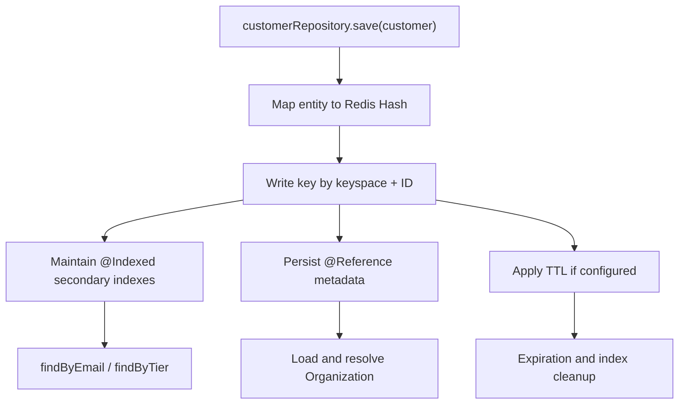
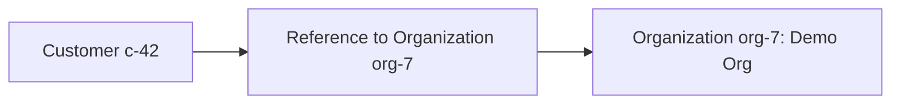

# Testing Repositories, Indexes, References, and TTL in Spring Data Redis

When using **Spring Data Redis Repositories**, an application does more than call `GET`/`SET`. The framework also maps Java objects to Redis Hashes, manages identifiers, writes **secondary indexes** for `@Indexed` properties, stores and resolves `@Reference` associations, and supports lifetimes via `@TimeToLive` or `@RedisHash(timeToLive = ...)`.

Consequently, a test verifying only that “`repository.save(entity)` followed by `findById(id)` returns the object” **is not enough**. A system can save and load entities successfully while queries on indexed fields return nothing, references are saved in the wrong order, or TTL causes an entity to vanish mid-test.

This lesson focuses on **testing Redis Repository behavior**, specifically across four layers:

1. **Repository mapping:** saving, finding by ID, updating, deleting, and verifying persisted fields after reload.
2. **Secondary indexes:** querying by `@Indexed` attributes, updating indexed values, and cleaning up indexes on delete or expiration.
3. **References:** saving an entity referencing another via `@Reference`; verifying resolution and dangling-reference scenarios.
4. **TTL:** configuring lifetimes, testing expiration, avoiding brittle absolute-time assertions, and understanding the role of keyspace notifications.

We will use **JUnit 5, Spring Boot, Spring Data Redis, Testcontainers, and AssertJ/Awaitility** to run integration tests against a real Redis server. All code samples revolve around the same `Customer`–`Organization` model to highlight each behavior clearly.

> Note: examples focus on Spring Data Redis Repositories. Exact APIs and auto-configuration details may vary across Spring Boot/Spring Data Redis releases; when integrating into your project, use dependencies matching your version.

## 1. Why Must Repositories Be Tested on Real Redis?

Spring Data Redis provides `CrudRepository` support for entities mapped with `@RedisHash`. For example:

```java
Customer saved = customerRepository.save(customer);
Optional<Customer> found = customerRepository.findById(saved.getId());
```

Behind that call, several steps occur:



Mocking `CustomerRepository` only proves the service invoked the expected method. It **does not prove** Spring Data Redis created indexes, serialized references properly, or set the right TTL in Redis.

Therefore, split testing into two tiers:

| Tier | Tools | Goal |
|---|---|---|
| Unit test | JUnit + Mockito/fakes | Verify business branching, validation, method interactions |
| Integration test | JUnit + real Redis, typically via Testcontainers | Verify mapping, indexes, references, TTL, Redis command behavior |

For the scope of this lesson, **integration testing is the primary tier**.

### 1.1. Behaviors That Mock Redis Struggles to Reproduce

- Redis Hashes and serializer/mapping metadata.
- Auxiliary keys/indexes managed by repository infrastructure.
- `EXPIRE`, `TTL`, and expiration behavior.
- Keyspace notifications and asynchronous cleanup handling.
- Atomicity of Redis commands and scripts.
- Reference state when target entities are unsaved or deleted.
- Real operation ordering under concurrent requests.

You do not need every unit test to boot Redis, but you should have **an integration test suite** covering these behaviors.

## 2. Data Model Used Throughout This Lesson

Suppose the application stores customers and the organizations they belong to:

```text
Organization
    id
    name

Customer
    id
    email        (@Indexed)
    tier         (@Indexed)
    organization (@Reference -> Organization)
    ttlSeconds   (@TimeToLive)
```

Requirements:

- Look up a `Customer` by `id`.
- Look up by `email` or `tier` via secondary indexes.
- Load a `Customer` and resolve its referenced `Organization`.
- Some `Customer` records exist only temporarily with a TTL.
- Deleting or expiring an entity must prevent subsequent queries from returning the gone entity.

### 2.1. The `Organization` Class

```java
package com.example.redis.model;

import org.springframework.data.annotation.Id;
import org.springframework.data.redis.core.RedisHash;

@RedisHash("lesson:organizations")
public class Organization {

    @Id
    private String id;

    private String name;

    public Organization() {
    }

    public Organization(String id, String name) {
        this.id = id;
        this.name = name;
    }

    public String getId() {
        return id;
    }

    public void setId(String id) {
        this.id = id;
    }

    public String getName() {
        return name;
    }

    public void setName(String name) {
        this.name = name;
    }
}
```

`@RedisHash("lesson:organizations")` defines the entity's keyspace. For instance, an organization with ID `org-7` typically maps to a key like:

```text
lesson:organizations:org-7
```

However, auxiliary keys created by repositories are implementation details that should be verified per version rather than inferring the entire index structure from one example.

### 2.2. The `Customer` Class

```java
package com.example.redis.model;

import java.util.concurrent.TimeUnit;

import org.springframework.data.annotation.Id;
import org.springframework.data.redis.core.RedisHash;
import org.springframework.data.redis.core.TimeToLive;
import org.springframework.data.redis.core.index.Indexed;
import org.springframework.data.redis.core.index.Reference;

@RedisHash("lesson:customers")
public class Customer {

    @Id
    private String id;

    @Indexed
    private String email;

    @Indexed
    private String tier;

    @Reference
    private Organization organization;

    @TimeToLive(unit = TimeUnit.SECONDS)
    private Long ttlSeconds;

    public Customer() {
    }

    public Customer(String id, String email, String tier) {
        this.id = id;
        this.email = email;
        this.tier = tier;
    }

    public String getId() {
        return id;
    }

    public void setId(String id) {
        this.id = id;
    }

    public String getEmail() {
        return email;
    }

    public void setEmail(String email) {
        this.email = email;
    }

    public String getTier() {
        return tier;
    }

    public void setTier(String tier) {
        this.tier = tier;
    }

    public Organization getOrganization() {
        return organization;
    }

    public void setOrganization(Organization organization) {
        this.organization = organization;
    }

    public Long getTtlSeconds() {
        return ttlSeconds;
    }

    public void setTtlSeconds(Long ttlSeconds) {
        this.ttlSeconds = ttlSeconds;
    }
}
```

In this example:

- `@Id` supplies the entity identifier.
- `@Indexed` instructs repository infrastructure to maintain secondary indexes for supported equality queries.
- `@Reference` expresses that `Organization` is a separate entity linked by reference; it has no JPA-style cascade-save semantics by default.
- `@TimeToLive` lets `ttlSeconds` control expiration of the `Customer` key.

When loading an entity with `@TimeToLive`, the field value may reflect **remaining TTL** rather than the original constant saved. Therefore, avoid rigid tests asserting `getTtlSeconds()` always equals the value passed to `save`.

### 2.3. Repository Interfaces

```java
package com.example.redis.repository;

import java.util.List;
import org.springframework.data.repository.CrudRepository;
import com.example.redis.model.Customer;

public interface CustomerRepository
        extends CrudRepository<Customer, String> {

    List<Customer> findByEmail(String email);

    List<Customer> findByTier(String tier);
}
```

```java
package com.example.redis.repository;

import org.springframework.data.repository.CrudRepository;
import com.example.redis.model.Organization;

public interface OrganizationRepository
        extends CrudRepository<Organization, String> {
}
```

The two finders `findByEmail`/`findByTier` operate through query derivation and indexes supported by Spring Data Redis. **They do not scan arbitrary Redis Hashes.** Whenever you want to query by a property, verify it has a matching secondary index.

## 3. Enabling Redis Repositories

An explicitly configured application:

```java
package com.example.redis;

import org.springframework.boot.SpringApplication;
import org.springframework.boot.autoconfigure.SpringBootApplication;
import org.springframework.data.redis.core.RedisKeyValueAdapter;
import org.springframework.data.redis.repository.configuration.EnableRedisRepositories;

@SpringBootApplication
@EnableRedisRepositories(
        enableKeyspaceEvents =
                RedisKeyValueAdapter.EnableKeyspaceEvents.ON_STARTUP,
        shadowCopy = RedisKeyValueAdapter.ShadowCopy.OFF
)
public class RedisRepositoryDemoApplication {

    public static void main(String[] args) {
        SpringApplication.run(
                RedisRepositoryDemoApplication.class, args);
    }
}
```

Here:

- `@EnableRedisRepositories` instructs Spring to generate implementations for matching repositories.
- `enableKeyspaceEvents = ON_STARTUP` initializes the repository expiration listener at application startup.
- `shadowCopy = OFF` disables shadow copies for TTL entities in this demo setup, avoiding extra copies kept only to carry payloads inside expiration events.

**These choices must fit your environment.** Enabling expiration event handling requires Redis to emit appropriate notifications. Some managed Redis services forbid apps from calling `CONFIG SET`; in those environments, configure `notify-keyspace-events` through provider controls.

### 3.1. `ON_STARTUP` Does Not Turn Events into Durable Messages

Even when the listener is running:

- Redis keyspace events travel over Pub/Sub.
- Events can be lost while the application is offline.
- Missed events are never replayed.
- Expiration-driven index cleanup can miss updates if the listener is down or not connected to the right Redis node.

Therefore, expiration tests must distinguish **the entity key expired** from **index metadata was cleaned up**. Never treat those two as a single assertion.

## 4. Dependencies for Integration Testing

Minimal Maven dependency at the application layer:

```xml
<dependency>
    <groupId>org.springframework.boot</groupId>
    <artifactId>spring-boot-starter-data-redis</artifactId>
</dependency>
```

For tests:

```xml
<dependency>
    <groupId>org.springframework.boot</groupId>
    <artifactId>spring-boot-starter-test</artifactId>
    <scope>test</scope>
</dependency>

<dependency>
    <groupId>org.testcontainers</groupId>
    <artifactId>junit-jupiter</artifactId>
    <scope>test</scope>
</dependency>

<dependency>
    <groupId>org.awaitility</groupId>
    <artifactId>awaitility</artifactId>
    <scope>test</scope>
</dependency>
```

For Gradle, the same idea:

```gradle
implementation("org.springframework.boot:spring-boot-starter-data-redis")
testImplementation("org.springframework.boot:spring-boot-starter-test")
testImplementation("org.testcontainers:junit-jupiter")
testImplementation("org.awaitility:awaitility")
```

Manage versions via the corresponding Spring Boot and Testcontainers BOMs/platforms. Newer Testcontainers releases may reorganize module names or packages; use the artifacts and versions selected for your project.

### 4.1. Why Use Testcontainers Instead of a Local Machine Redis?

On each test run, Testcontainers launches a Redis container with an explicit version:

- Independent of a developer's localhost Redis.
- Avoids polluting shared Redis data.
- Reproducible in CI with a compatible container runtime.
- Lets you pin Redis versions to reproduce bugs.
- Verifies Redis TTL, secondary indexes, and Pub/Sub on a real server.

Testcontainers still requires a container runtime on the test host. If CI lacks one, run the suite against an equivalent isolated Redis integration environment rather than switching to mocks and claiming equal coverage.

## 5. Spring Boot Integration Test with a Redis Container

A base test class:

```java
package com.example.redis;

import org.junit.jupiter.api.Test;
import org.springframework.beans.factory.annotation.Autowired;
import org.springframework.boot.test.context.SpringBootTest;
import org.springframework.test.context.DynamicPropertyRegistry;
import org.springframework.test.context.DynamicPropertySource;
import org.testcontainers.containers.GenericContainer;
import org.testcontainers.junit.jupiter.Container;
import org.testcontainers.junit.jupiter.Testcontainers;
import org.testcontainers.utility.DockerImageName;

import com.example.redis.repository.CustomerRepository;

@Testcontainers
@SpringBootTest(classes = RedisRepositoryDemoApplication.class)
class CustomerRepositoryIntegrationTest {

    @Container
    static final GenericContainer<?> REDIS =
            new GenericContainer<>(
                    DockerImageName.parse("redis:7.2-alpine"))
                    .withExposedPorts(6379);

    @DynamicPropertySource
    static void redisProperties(DynamicPropertyRegistry registry) {
        registry.add(
                "spring.data.redis.host", REDIS::getHost);
        registry.add(
                "spring.data.redis.port",
                () -> REDIS.getMappedPort(6379));
    }

    @Autowired
    CustomerRepository customers;

    @Test
    void contextLoads() {
        // Mapping/index/reference/TTL tests will be added below.
    }
}
```

In Spring Boot 3.x, Redis properties live under `spring.data.redis.*`. On older Boot versions, use the matching property namespace.

### 5.1. Why Use `@DynamicPropertySource`?

Ports assigned by the container runtime are dynamic. Never hardcode `localhost:6379` hoping the container happens to bind there.

`@DynamicPropertySource` supplies container host/port to the Spring context:

```text
Redis container :6379
        |
        v
Host mapped port (e.g., 49153)
        |
        v
spring.data.redis.host / port
        |
        v
LettuceConnectionFactory -> Repositories
```

In multi-profile setups, also confirm no custom `RedisConnectionFactory` bean overrides these dynamic properties.

### 5.2. Initialize Expiration Listeners Before Creating TTL Keys

For tests verifying **keyspace notifications**, the application context and subscription must be active before saving TTL entities. If the app subscribes only after the key expires, Redis Pub/Sub will not replay old events.

For tests checking only that “`findById` no longer returns an expired entity,” waiting for expiration events is unnecessary because Redis checks key validity on reads.

## 6. Testing Repository Save and Read by ID

Basic test:

```java
@Test
void saveThenFindByIdRestoresMappedFields() {
    String id = "customer-" + UUID.randomUUID();
    Customer customer = new Customer(
            id,
            "user-" + id + "@example.test",
            "STANDARD");

    customers.save(customer);

    Customer loaded = customers.findById(id).orElseThrow();

    assertThat(loaded.getId()).isEqualTo(id);
    assertThat(loaded.getEmail()).isEqualTo(
            "user-" + id + "@example.test");
    assertThat(loaded.getTier()).isEqualTo("STANDARD");
}
```

This example uses `UUID` and AssertJ; in a real test file, include:

```java
import java.util.UUID;
import static org.assertj.core.api.Assertions.assertThat;
```

Calling `findById` reloads from storage and tests repository mapping, rather than inspecting the in-memory Java instance.

### 6.1. Testing Existence and Non-Existence

```java
assertThat(customers.existsById(id)).isTrue();

customers.deleteById(id);

assertThat(customers.existsById(id)).isFalse();
assertThat(customers.findById(id)).isEmpty();
```

Tests must use unique IDs so they never delete data created by other tests. If the app layers another cache outside Redis repositories, be clear about which layer is under test.

### 6.2. Why Not Assert Whole-Object Identity with `==`?

```java
assertThat(loaded).isSameAs(customer); // Not the goal.
```

Loading an entity from storage constructs a new Java object. Tests should compare **business fields** or meaningful `equals` contracts, not object identity.

Similarly, you do not need to count internal auxiliary keys to verify an entity round-tripped properly.

## 7. Test Isolation: Do Not Let Test A Corrupt Test B

Redis Repositories may create primary keys, keyspace sets, secondary index sets, and TTL metadata. Deleting a single key via raw Redis `DEL` can **bypass repository cleanup logic**.

Strategies:

1. Give each test unique IDs/emails (`UUID`) and distinct keyspaces.
2. Give each suite its own Redis container or explicitly managed namespace.
3. For repository-managed entities, prefer `repository.deleteById` / `deleteAll` where appropriate so the framework cleans up related metadata.
4. If a test requires `FLUSHDB`, run it only on a **disposable test-dedicated Redis**, never on a shared instance.
5. Never run tests sharing a keyspace in parallel if they perform global cleanup.

### 7.1. A Clean Cleanup Pattern

Inside a test class:

```java
private final List<String> customerIds = new ArrayList<>();
private final List<String> organizationIds = new ArrayList<>();

@AfterEach
void cleanup() {
    customerIds.forEach(customers::deleteById);
    organizationIds.forEach(organizations::deleteById);
}
```

When creating fixtures, record their IDs:

```java
String id = "customer-" + UUID.randomUUID();
customerIds.add(id);
customers.save(new Customer(id, uniqueEmail(), "STANDARD"));
```

This is an illustrative pattern; a complete test class also injects `OrganizationRepository` and imports collection/JUnit classes. When specifically testing cleanup after expiration, avoid running manual cleanup prematurely and masking the signal you want to observe.

### 7.2. Why Avoid Mocking Repositories in Index Tests?

Mocks are easy to write:

```java
when(customers.findByEmail("a@example.test"))
        .thenReturn(List.of(customer));
```

Yet that only proves the mock was stubbed that way. It **does not** prove `@Indexed` entries are created, updated, or removed properly in Redis.

## 8. How Spring Data Redis Secondary Indexes Work

Redis is not a relational database with built-in indexes on every Hash attribute. Spring Data Redis supports **secondary indexes** via mapping metadata and framework-managed Redis structures.

Example:

```java
@Indexed
private String email;
```

When the repository saves a `Customer`, the framework stores the entity and creates/updates index entries supporting queries by `email`.

Conceptually:

```text
Customer(id=c1, email=a@example.test)
       |
       +-> Entity Hash for c1
       |
       +-> Secondary index: email=a@example.test -> reference c1
```

Index key naming and auxiliary data depend on the Spring Data Redis version and mapping configuration. **Never write production code coupled to internal index key names** without a stable contract.

### 8.1. Derived Finders Need Matching Indexes

Repository:

```java
List<Customer> findByEmail(String email);
List<Customer> findByTier(String tier);
```

Entity:

```java
@Indexed private String email;
@Indexed private String tier;
```

This links indexed attributes to equality queries.

If you declare `findByEmail` without a matching secondary index, do not assume Spring Data Redis scans every Hash to filter like a SQL table. Query capabilities depend on supported indexes and how they are maintained.

## 9. Testing Indexes After Save

A test:

```java
@Test
void findByIndexedEmailReturnsSavedCustomer() {
    String id = "c-" + UUID.randomUUID();
    String email = id + "@example.test";

    Customer customer = new Customer(id, email, "GOLD");
    customers.save(customer);

    List<Customer> matches = customers.findByEmail(email);

    assertThat(matches)
            .extracting(Customer::getId)
            .containsExactly(id);
}
```

This test verifies **index query behavior** without reading internal Redis Sets directly.

Testing tier:

```java
@Test
void findByTierReturnsMatchingCustomers() {
    String suffix = UUID.randomUUID().toString();

    customers.save(new Customer(
            "c1-" + suffix, "c1-" + suffix + "@example.test", "GOLD"));
    customers.save(new Customer(
            "c2-" + suffix, "c2-" + suffix + "@example.test", "GOLD"));

    List<Customer> matches = customers.findByTier("GOLD");

    assertThat(matches)
            .extracting(Customer::getId)
            .contains("c1-" + suffix, "c2-" + suffix);
}
```

**Watch out for test isolation:** if the same Redis container already holds `GOLD` customers from other tests, `containsExactlyInAnyOrder(...)` or `hasSize(2)` can fail. Use isolated keyspaces/data or assert at least the IDs created by this test, paired with explicit cleanup.

## 10. Testing Updates to an Indexed Property

An important scenario:

```text
Customer c1:
    email = old@example.test

Update:
    email = new@example.test

Expectation:
    findByEmail(old) -> does not contain c1
    findByEmail(new) -> contains c1
```

Test:

```java
@Test
void changingIndexedEmailUpdatesRepositoryQueries() {
    String id = "c-" + UUID.randomUUID();
    String oldEmail = id + "-old@example.test";
    String newEmail = id + "-new@example.test";

    Customer customer = new Customer(
            id, oldEmail, "STANDARD");
    customers.save(customer);

    customer.setEmail(newEmail);
    customers.save(customer);

    assertThat(customers.findByEmail(oldEmail))
            .extracting(Customer::getId)
            .doesNotContain(id);

    assertThat(customers.findByEmail(newEmail))
            .extracting(Customer::getId)
            .contains(id);
}
```

This test verifies **secondary index maintenance** when an entity changes. Keep test emails unique so conclusions remain unambiguous.

### 10.1. Pitfall: Updating the Hash Directly and Expecting Indexes to Auto-Sync

Concept:

```text
Repository.save(customer) creates entity Hash and secondary index

Then:
Redis HSET entityKey email "new@example.test"

Repository.findByEmail("new@example.test") ?
```

If you modify a Hash directly with raw Redis commands or `opsForHash()`, **repository infrastructure may not know** to update indexes. Therefore, tests should use the exact write path production uses:

- If production uses Repositories exclusively, test repository save/update.
- If production mixes Repositories with `RedisTemplate` and Lua, test index consistency after those write paths.
- If direct writes are mandatory, design an explicit index-sync strategy or redesign queries.

Never write a test calling `findByEmail` expecting an out-of-band `HSET` to update indexes like a database trigger.

## 11. Testing Entity Deletion and Index Removal

Test:

```java
@Test
void deletingCustomerRemovesItFromIndexedQuery() {
    String id = "c-" + UUID.randomUUID();
    String email = id + "@example.test";

    customers.save(new Customer(id, email, "STANDARD"));
    assertThat(customers.findByEmail(email))
            .extracting(Customer::getId)
            .contains(id);

    customers.deleteById(id);

    assertThat(customers.findById(id)).isEmpty();
    assertThat(customers.findByEmail(email))
            .extracting(Customer::getId)
            .doesNotContain(id);
}
```

What the test establishes:

1. The entity was saved and found via the indexed query.
2. Deleted via the Repository.
3. `findById` no longer returns the entity.
4. `findByEmail` no longer returns the deleted Customer.

Checking only that `findById` is empty leaves index behavior unverified.

### 11.1. Do Not Confuse an Empty Finder Result with Completely Cleaned Index Keys

An index-backed query may stop returning a deleted entity even while some temporary index metadata still lingers. To prove **no stale membership remains**, write a test inspecting framework-managed metadata tailored to your version and cleanup mechanism.

Separate:

- **Black-box tests:** finders do not return deleted/expired entities.
- **White-box/diagnostic tests:** inspect specific index keys/sets for your active version.

Do not conflate both conclusions from a black-box result alone.

## 12. Secondary Indexes Are Not Full-Text Search

`@Indexed` supports specific queries, typically equality checks. It does not turn Redis into a SQL engine or full-text search system.

Distinctions to keep clear:

| Requirement | Approach |
|---|---|
| Find Customer with exact email string | Secondary index fits |
| Find by exact tier value | Secondary index fits |
| Find email containing an arbitrary substring | Not a default `@Indexed` capability |
| Complex multi-condition filters, sorting, deep pagination | Evaluate repository query limits and design fitting indexes |
| Full-text search | Consider a dedicated search engine or Redis Search if deployed |

Passing `findByEmail` therefore does not prove `findByEmailContaining` or arbitrary comparisons are supported.

## 13. What Is a `@Reference` in a Redis Repository?

Suppose every Customer links to an Organization:

```java
@Reference
private Organization organization;
```

Goal: avoid embedding the entire Organization inside Customer. Redis Repository stores a **reference to another entity** per Spring Data Redis mapping rules.



This is not a relational database foreign key:

- Redis does not enforce that `Organization` still exists.
- There is no cascade-save or cascade-delete by default.
- Separate `save` calls across two repositories do not share an ACID transaction.
- Secondary indexes on Customer do not automatically index fields inside Organization.

### 13.1. Save the Target Entity First

```java
Organization org = new Organization(
        "org-" + UUID.randomUUID(), "Demo Organization");

organizations.save(org);

Customer customer = new Customer(
        "c-" + UUID.randomUUID(),
        "customer@example.test",
        "GOLD");
customer.setOrganization(org);

customers.save(customer);
```

When loading Customer, repository mapping can resolve Organization from the stored reference.

### 13.2. `@Reference` Does Not Mean Auto-Saving the Whole Object Graph

If you only run:

```java
Organization org = new Organization("org-unknown", "Not Saved");

Customer customer = new Customer(
        "c-1", "c1@example.test", "STANDARD");
customer.setOrganization(org);
customers.save(customer);
```

do not assume `Organization` is created automatically. `@Reference` is not a cascade-persistence guarantee. When workflows require both, call `OrganizationRepository.save` explicitly first.

## 14. Testing Reference Resolution on Readback

Test:

```java
@Test
void customerReferenceResolvesSavedOrganization() {
    String suffix = UUID.randomUUID().toString();

    Organization org = new Organization(
            "org-" + suffix, "ACME Test Organization");
    organizations.save(org);

    Customer customer = new Customer(
            "c-" + suffix,
            "c-" + suffix + "@example.test",
            "GOLD");
    customer.setOrganization(org);
    customers.save(customer);

    Customer loaded = customers
            .findById(customer.getId())
            .orElseThrow();

    assertThat(loaded.getOrganization()).isNotNull();
    assertThat(loaded.getOrganization().getId())
            .isEqualTo(org.getId());
    assertThat(loaded.getOrganization().getName())
            .isEqualTo("ACME Test Organization");
}
```

The crucial step is **reloading Customer through the Repository after saving**, rather than asserting `customer.getOrganization()` on the original Java instance. The original object already had its field set in memory and proves nothing about Redis references.

### 14.1. Verifying Mapping Does Not Auto-Cascade Saves

Another test:

```java
Organization unsaved = new Organization(
        "org-" + UUID.randomUUID(), "Not Persisted");

Customer customer = new Customer(
        "c-" + UUID.randomUUID(),
        "no-cascade@example.test",
        "STANDARD");
customer.setOrganization(unsaved);
customers.save(customer);

assertThat(organizations.existsById(unsaved.getId()))
        .isFalse();
```

The goal is clarifying that **saving `Organization` belongs to `OrganizationRepository`**. For your specific version, also verify how reference resolution behaves when the target entity is missing, without making rigid assumptions about mapper nulls or exceptions.

## 15. Dangling References: When the Target Entity Is Deleted

Scenario:

```text
T1: Organization org-7 exists
T2: Customer c-42 references org-7
T3: Organization org-7 is deleted
T4: Customer c-42 is loaded again
```

Redis has no foreign-key constraint blocking T3. State at T4 depends on how the mapper resolves missing references in your version.

Therefore, an integration test should verify **application policy**:

- If Organization is missing, should the API reject the request?
- Does it return Customer with an absent reference?
- Should an inconsistency alert be emitted?
- Should references be cleaned up before deleting Organization?

Skeleton test example:

```java
@Test
void deletingReferencedOrganizationHasDefinedPolicy() {
    // Arrange: save org, save customer pointing to org.
    // Act: organizations.deleteById(orgId).
    // Assert: application handles missing reference per policy.
    // Do not assume Redis cascade-deletes customer.
}
```

Do not lock tests to a specific mapper exception type unless verified for your Spring Data Redis version. The invariant to understand is **references do not enforce relational integrity like an RDBMS**.

### 15.1. `@Reference` Is Not a Field-Join Mechanism

Do not assume:

```java
List<Customer> findByOrganizationName(String name);
```

executes like a SQL JOIN just because of `@Reference`. If you need to find all Customers belonging to an Organization, it is usually better to store an indexed scalar field like `organizationId` on Customer, or maintain a dedicated index matching your query pattern.

When adding an `organizationId` field, tests must verify synchronization between the ID field and the reference so the two never contradict each other.

## 16. TTL in Spring Data Redis Repositories

Two common ways to express TTL:

**Fixed TTL per entity type:**

```java
@RedisHash(value = "temporary:customers", timeToLive = 60)
public class TemporaryCustomer {
    @Id
    private String id;
}
```

Here, every entity in that keyspace gets the annotation-configured TTL.

**Dynamic TTL per property:**

```java
@TimeToLive(unit = TimeUnit.SECONDS)
private Long ttlSeconds;
```

Before saving:

```java
Customer customer = new Customer(id, email, "STANDARD");
customer.setTtlSeconds(5L);
customers.save(customer);
```

TTL is applied to the primary Customer Redis key according to mapping rules.

### 16.1. Do Not Mix Two TTL Sources Arbitrarily

When an entity has both `@RedisHash(timeToLive = ...)` and `@TimeToLive`, understand how Spring Data Redis resolves the effective expiration. Never set conflicting values and write tests based on guesses.

In this lesson, we use `ttlSeconds` to test per-entity lifetimes. If production chooses a fixed annotation TTL, write dedicated tests for it.

### 16.2. `@TimeToLive` on Readback May Reflect Remaining Time

Suppose:

```java
customer.setTtlSeconds(30L);
customers.save(customer);
```

Five seconds later:

```java
Customer loaded = customers.findById(id).orElseThrow();
Long ttl = loaded.getTtlSeconds();
```

`ttl` can be less than `30` because the framework reads back the current remaining TTL. Hence, asserting:

```java
assertThat(loaded.getTtlSeconds()).isEqualTo(30L);
```

is inherently flaky. Assert a meaningful range instead, or inspect the TTL directly on the Redis key.

## 17. Checking TTL Immediately After Saving

`StringRedisTemplate.getExpire(...)` lets you observe key lifetimes.

```java
@Autowired
StringRedisTemplate redis;

@Test
void savingCustomerWithTtlSetsRedisExpiration() {
    String id = "c-" + UUID.randomUUID();
    Customer customer = new Customer(
            id, id + "@example.test", "TEMP");
    customer.setTtlSeconds(10L);

    customers.save(customer);

    String key = "lesson:customers:" + id;
    Long ttlMillis = redis.getExpire(
            key, TimeUnit.MILLISECONDS);

    assertThat(ttlMillis).isNotNull();
    assertThat(ttlMillis).isPositive();
    assertThat(ttlMillis)
            .isLessThanOrEqualTo(10_000L);
}
```

The test uses the declared `lesson:customers` keyspace. With custom keyspace naming or special serializers, the physical key may differ; confirm your project's mapping when inspecting TTL directly.

### 17.1. Special Return Values of `TTL`

Redis commands:

```redis
TTL lesson:customers:c-42
PTTL lesson:customers:c-42
```

Results:

| Value | Meaning |
|---|---|
| Non-negative number | Remaining time in seconds/ms |
| `-1` | Key exists without an expiration |
| `-2` | Key does not exist or already expired |

If a test for a TTL-enabled entity receives `-1`, investigate the mapping or write path.

Never assert TTL equals exactly `10_000L`, as time elapses between `save` and `PTTL`.

### 17.2. Positive TTL Does Not Guarantee the Entity Survives Until Expiry

Redis keys can be removed via repositories, `DEL`, eviction, or infrastructure failures. TTL is an upper bound on server-side lifetime, not a guarantee the key stays present for that exact duration.

## 18. Testing Automatic Entity Disappearance After TTL

Never call `Thread.sleep(2000)` and assume Redis emitted an expiration event on cue. Expiration events and Redis's internal active/lazy expiration cycles do not necessarily match the exact millisecond deadline.

To verify “the Repository no longer reads the entity after TTL,” use bounded polling with a timeout:

```java
import static org.awaitility.Awaitility.await;
import static org.assertj.core.api.Assertions.assertThat;

import java.time.Duration;

@Test
void customerBecomesUnavailableAfterTtl() {
    String id = "c-" + UUID.randomUUID();
    Customer customer = new Customer(
            id, id + "@example.test", "TEMP");
    customer.setTtlSeconds(2L);

    customers.save(customer);

    await()
            .atMost(Duration.ofSeconds(10))
            .pollInterval(Duration.ofMillis(100))
            .untilAsserted(() ->
                    assertThat(customers.findById(id)).isEmpty());
}
```

Effects:

- The test waits up to a generous upper bound.
- It does not depend on a single callback timestamp.
- It verifies Repository behavior once the Redis key expires.

This is a **bounded timeout test**, not a full replacement for testing keyspace event/index cleanup flows.

### 18.1. Avoid Asserting Before Expiration When TTL Is Too Short

With a 1-second TTL, a slow CI runner might let the key expire before an initial `findById(id).isPresent()` assertion even runs. To prove both initial existence and expiration:

1. Use a TTL long enough for the initial check.
2. Verify positive TTL immediately after saving.
3. Poll until the key disappears.
4. Choose a timeout with headroom for CI.

Do not design tests assuming every machine schedules threads accurately to the millisecond.

## 19. Testing Indexes After TTL Expiration

Suppose Customer is indexed by email:

```text
Customer c1
    email = temp@example.test
    TTL = 2 seconds
```

After TTL:

- The entity Hash has expired.
- `findById(c1)` returns nothing.
- `findByEmail(temp@example.test)` must not return a valid expired Customer.
- Index metadata may need **cleanup via expiration listeners**.

A black-box test:

```java
@Test
void expiredCustomerIsNotReturnedByIndexedFinder() {
    String id = "c-" + UUID.randomUUID();
    String email = id + "@example.test";

    Customer customer = new Customer(id, email, "TEMP");
    customer.setTtlSeconds(2L);
    customers.save(customer);

    assertThat(customers.findByEmail(email))
            .extracting(Customer::getId)
            .contains(id);

    await()
            .atMost(Duration.ofSeconds(10))
            .untilAsserted(() ->
                    assertThat(customers.findByEmail(email))
                            .extracting(Customer::getId)
                            .doesNotContain(id));
}
```

**What this test proves:** the finder stops returning the expired entity within the wait window.

**What it does not yet prove:** that every secondary index set has been completely cleaned up. A stale index reference may still exist without resolving to an entity. If you must verify metadata cleanup, write dedicated internal tests or use appropriate inspection mechanisms.

### 19.1. Why Index Cleanup on TTL Differs from Repository Deletion

When calling:

```java
customers.deleteById(id);
```

Spring Data Redis proactively updates metadata/indexes along the repository code path.

When Redis **expires a key due to TTL**, deletion happens on the server. Repository infrastructure does not run `deleteById` at that moment. Keyspace expiration event listeners help the framework react and clean up metadata.

If events are lost while subscribers are offline or notifications are disabled on Redis, some index references can linger longer than desired.

## 20. Keyspace Notifications Related to TTL and Indexes

Redis supports:

```redis
CONFIG GET notify-keyspace-events
```

To emit standard **expired keyevent** notifications:

```redis
CONFIG SET notify-keyspace-events Ex
```

Where:

- `E` selects keyevent channels.
- `x` selects expiration events.
- The channel is typically named `__keyevent@0__:expired`.

In Spring Data Redis Repositories, expiration listeners can use these events to publish Spring application events and assist in cleaning up related index metadata.

### 20.1. Do Not Enable Notifications Only Locally by Mistake

A test running on a `Testcontainers`-managed Redis container may have permission to run `CONFIG SET`, whereas managed production Redis may forbid runtime configuration.

This means:

- Passing tests do not automatically guarantee production has matching notify flags.
- If production blocks `CONFIG SET`, configure notifications via provider settings.
- Never grant broad admin privileges to the application Redis user just to make tests/startup succeed.

### 20.2. Lost Keyspace Events While the App Is Offline

```text
T1: Customer c1 is saved with TTL
T2: All app instances/listeners are offline
T3: Redis deletes c1 due to TTL and emits expired notification
T4: App restarts
```

The notification at T3 **is not replayed** just because the subscriber reconnects at T4. Consequently, if index metadata relies on event cleanup, stale metadata can accumulate.

This is a fundamental limitation of using Redis Pub/Sub as a signal, not a JUnit flaw.

## 21. Shadow Copy / Phantom Copy for Entities with TTL

In some configurations, Spring Data Redis Repositories store an additional **shadow copy** of TTL entities—usually outliving the main key slightly—so expiration events can still carry the entity payload after Redis deletes the primary key.

Example:

```text
Customer key (TTL 120 seconds)
    |
    +-- expires at T+120

Shadow copy
    |
    +-- persists briefly afterward to supply event payload
```

Therefore, inspecting Redis key counts may reveal extra keys beyond the primary entity key.

### 21.1. What Does `ShadowCopy.OFF` Do in This Lesson?

In the configuration:

```java
@EnableRedisRepositories(
        enableKeyspaceEvents =
                RedisKeyValueAdapter.EnableKeyspaceEvents.ON_STARTUP,
        shadowCopy = RedisKeyValueAdapter.ShadowCopy.OFF
)
```

we disabled shadow copies because tests here only check IDs, indexes, references, and TTL, without needing the full payload inside Spring expiration events.

Do not conclude “no shadow copy” means “no listener” or “indexes definitely never clean up.” These settings are related but serve distinct roles.

### 21.2. When You Need to Test Events with Payloads

If a real app consumes `RedisKeyExpiredEvent<Customer>` and requires the full expired Customer payload, choose an appropriate shadow copy configuration and test the event handler. Never expect a raw Redis expired notification to include Customer fields: Redis messages normally carry only the **key name**.

This also increases memory usage because shadow copies are kept around longer; evaluate production resource impact.

## 22. Testing Expiration Events Is Not the Same as Testing TTL

A test observing expiration events can use a Spring listener:

```java
import org.springframework.context.event.EventListener;
import org.springframework.data.redis.core.RedisKeyExpiredEvent;

@Component
public class ExpiredCustomerEventSink {

    private final BlockingQueue<String> expiredKeys =
            new LinkedBlockingQueue<>();

    @EventListener
    public void onExpired(RedisKeyExpiredEvent<?> event) {
        expiredKeys.offer(
                new String(
                        event.getId(),
                        StandardCharsets.UTF_8));
    }

    public String poll(long timeout, TimeUnit unit)
            throws InterruptedException {
        return expiredKeys.poll(timeout, unit);
    }
}
```

This is an **observer pattern**: ID/payload accessor APIs and byte decoding must match your exact Spring Data Redis version. Listeners may also receive events from other entities/keyspaces; tests must filter for their expected IDs/prefixes.

A test can:

1. Ensure expired notifications are enabled on the Redis server.
2. Ensure the Spring listener has subscribed.
3. Create a Customer with a suitably short TTL.
4. Wait for the event within a generous window.
5. Compare the event's ID/key.

### 22.1. Events Do Not Guarantee Delivery

Even if an integration test receives events consistently multiple times in a row, **production has no durable Pub/Sub replay**. Never rely solely on these events for mandatory business actions like billing or regulatory data deletion.

If business logic cannot tolerate missed events, use a durable source of truth with deadline reconciliation or a dedicated event pipeline.

## 23. When References and TTL Coexist: What Happens?

Suppose:

```text
Organization org-7: no TTL

Customer c1:
    organization -> org-7
    TTL = 60 seconds
```

After Customer expires:

- The Customer key is gone.
- Organization still exists.
- The Repository does not automatically delete Organization just because a Customer referencing it expired.

Test:

```java
@Test
void customerExpiryDoesNotDeleteReferencedOrganization() {
    String suffix = UUID.randomUUID().toString();
    Organization org = new Organization(
            "org-" + suffix, "Persisted Organization");
    organizations.save(org);

    Customer customer = new Customer(
            "c-" + suffix,
            "ttl-" + suffix + "@example.test",
            "TEMP");
    customer.setOrganization(org);
    customer.setTtlSeconds(2L);
    customers.save(customer);

    await()
            .atMost(Duration.ofSeconds(10))
            .untilAsserted(() ->
                    assertThat(customers.findById(customer.getId()))
                            .isEmpty());

    assertThat(organizations.findById(org.getId()))
            .isPresent();
}
```

This test highlights that **there is no default cascade delete from Customer to Organization**.

Conversely, if Organization has a short TTL and expires before Customer, Customer's reference can become dangling. Test read behavior and missing-reference policies rather than assuming automatic consistency.

## 24. Updating an Entity's TTL After Saving

Try:

```java
Customer customer = new Customer(
        id, email, "TEMP");
customer.setTtlSeconds(30L);
customers.save(customer);

Customer loaded = customers.findById(id).orElseThrow();
loaded.setTtlSeconds(60L);
customers.save(loaded);
```

This **modifies TTL intentionally per application design**. Tests should verify:

- Redis TTL after the second save matches the new window.
- Index queries still work.
- References still load.
- TTL refresh behavior matches policy.

Do not accidentally `save(loaded)` after another update if `loaded.getTtlSeconds()` reflects **remaining TTL**, as doing so may re-apply a shorter expiration than intended.

### 24.1. Redis `SET` and Redis Hash Differ on TTL

A plain `SET key value` overwrites any existing TTL on a String key unless TTL-preserving options are passed.

Repositories map entities to Redis Hashes with dedicated infrastructure; do not extrapolate hash TTL behavior from `SET`. Test the actual update paths used by your project (repository save, direct hash updates, scripts, etc.).

## 25. Index Cleanup When Deleting a Redis Key Directly: What to Avoid

Suppose:

```text
CustomerRepository.save(c1)
    -> creates entity Hash
    -> creates email index

stringRedisTemplate.delete("lesson:customers:c1")
    -> deletes entity Hash directly
    -> repository does not necessarily clean up indexes
```

If a project mixes Repositories and `RedisTemplate`, establish clear rules:

- What is the primary write/delete path for entities?
- When are direct `DEL` calls permitted?
- How are secondary indexes synchronized if bypassing repositories?
- Is there an index-rebuild tool when metadata drifts?

In production, stale indexes inflate query costs, produce unexpected results, or accumulate metadata. Black-box and diagnostic tests must match real write/delete paths.

## 26. Testing Serializers and Schema Mapping

Redis Repositories serialize data via Spring Data Redis mapping infrastructure. If the app configures custom converters or serializers, tests must cover real data types:

- Unicode strings in names.
- Empty strings or missing fields.
- Converted enums or scalars.
- IDs containing special characters.
- Nested objects that are not `@Reference`.
- New fields introduced by model evolution.

Example:

```java
@Test
void repositoryRoundTripsUnicode() {
    String id = "c-" + UUID.randomUUID();
    Customer customer = new Customer(
            id, "unicode-" + id + "@example.test", "VIP");

    customers.save(customer);

    Customer loaded = customers.findById(id).orElseThrow();
    assertThat(loaded.getEmail()).isEqualTo(
            "unicode-" + id + "@example.test");
}
```

To test Unicode thoroughly, add a field like `displayName` containing `"Nguyễn Thị Lan"` and assert it after readback. Testing an entity display name checks mapping; avoid conflating whether it is indexed with serializer goals.

### 26.1. Do Not Assume Redis Keys Use Java Serialized Bytes Without Inspecting the Mapper

`StringRedisTemplate` and `RedisTemplate<Object,Object>` use different serializers. `RedisRepository` uses its own mapping. A test inspecting internal storage via `StringRedisTemplate.opsForHash()` may fail to decode certain fields depending on configuration.

Prefer repository-level assertions for contract behavior. Only drop down to raw Redis Hashes for white-box diagnostics using serializers aligned with production.

## 27. Timing Risks in TTL Tests

TTL tests become flaky quickly if written as exact stopwatch assertions.

### 27.1. Bad: Sleeping Exactly Equal to TTL

```java
customer.setTtlSeconds(1L);
customers.save(customer);

Thread.sleep(1000);
assertThat(customers.findById(id)).isEmpty();
```

Why this is unstable:

- When `save` finishes and when the thread starts sleeping are not the exact same instant.
- Thread schedulers and container runtimes have jitter.
- Tests can be paused on busy CI runners.
- Spring expiration listeners have their own callback delay.

### 27.2. Better: Await Assertions on Desired State

```java
await()
        .atMost(Duration.ofSeconds(10))
        .pollInterval(Duration.ofMillis(100))
        .untilAsserted(() ->
                assertThat(customers.findById(id)).isEmpty());
```

The condition is polled repeatedly within a bounded deadline.

### 27.3. Do Not Fix Every Delay by Increasing Fixed Sleeps

If tests time out frequently:

- Is the Redis container healthy?
- Was TTL actually set?
- Is something rewriting the key and refreshing its TTL?
- Is the test waiting for the entity to disappear or waiting for an expiration event?
- Has the listener subscribed yet?
- Is CI experiencing excessive latency?

Raising `Thread.sleep` to 30 seconds often just hides bugs; good tests wait on concrete conditions and produce diagnostic messages on failure.

## 28. A Test Matrix for Repositories, Indexes, References, and TTL

| Scenario | Action | Primary Assertion |
|---|---|---|
| Save/read | Save Customer then `findById` | Fields round-trip accurately |
| Not found | `findById` with unused ID | `Optional.empty` |
| Indexed query | Save with unique email | `findByEmail` returns Customer |
| Update index | Change email via `repository.save` | Old email excludes ID, new email includes ID |
| Delete index | `repository.deleteById` | `findById` empty and finder excludes ID |
| Reference | Save Organization before Customer | Loading Customer resolves Organization |
| No cascade | Save Customer referencing unsaved org | `OrganizationRepository` does not auto-save org |
| Dangling reference | Delete referenced Organization | App handles per policy |
| TTL assigned | Save Customer with `ttlSeconds` | Redis `PTTL` is positive |
| TTL expiration | Wait past TTL | Repository no longer returns Customer |
| Expired indexed entity | Wait past TTL | Finder does not return expired Customer |
| TTL/reference | Customer expires | Organization remains |
| Listener | Enable keyspace events and wait for expiry | Observer receives event within window |
| Isolation | Multiple tests with distinct IDs/prefixes | Results do not interfere |

You do not need to cram all scenarios into one `@Test`. Small independent tests make failure reports easier to read and isolate broken layers.

## 29. Comparing Repository Tests and Raw `RedisTemplate` Tests

| Goal | Repository Test | `RedisTemplate` Test |
|---|---|---|
| `@RedisHash` mapping | Ideal | Does not directly test full framework mapping |
| `@Indexed` lookups | Mandatory integration test | Can inspect internal indexes when debugging |
| `@Reference` resolution | Ideal | Does not resolve automatically like repository mapping |
| `@TimeToLive` | Ideal | Can verify `TTL` on physical keys |
| Specific Redis commands | May need supplementing | Ideal |
| Atomic scripts | Not the focus of repositories | `RedisTemplate.execute(script)` fits well |
| Byte-level serializer control | Indirect | More convenient |

The two approaches complement each other. Do not rely on only one side and assume the other works automatically.

## 30. How Does Redis Cluster Affect Testing?

Testcontainers with standalone Redis is great for proving basic mapping, indexes, references, and TTL. However, if production runs Redis Cluster, you also need a **cluster-based integration suite** for these constraints:

- Keyspaces and index keys may hash to different slots.
- Some repository/index operations may issue multiple Redis commands.
- Lua/multi-key operations can hit `CROSSSLOT`.
- Keyspace expiration notifications are node-local; subscriptions do not broadcast cluster-wide automatically.
- Topology changes, resharding, and failover can interrupt listeners.

Never conclude “standalone tests pass, so we are cluster-safe.” Separate:

1. Functional repository tests on standalone Redis.
2. Cluster compatibility tests on a deployment topology close to production.
3. Network/failover tests if high reliability is required.

A single Redis container **cannot simulate** 16,384 slots spread across multiple primaries.

## 31. Testing Expiration Events and Indexes in Redis Cluster

Suppose index cleanup relies on expired notifications:

```text
Primary A -> expiration of Customer A
Primary B -> expiration of Customer B

Spring listener subscribes only to Primary A
```

Here, events on B may never reach the listener on A. A standalone integration test will miss this bug completely.

Therefore, if production uses Cluster:

- Verify driver/listener subscription topology.
- Test primary failover and slot migrations.
- Test metadata cleanup on application restarts.
- Build reconciliation or index-rebuild policies if business logic requires clean metadata.

Never design a test that passes only because all test keys happened to land on a single node.

## 32. Do Not Confuse Redis Repositories with JPA Repositories

Two interfaces can share `save`/`findById` method names while having very different semantics.

Redis Repositories:

- Map onto Redis data structures.
- Manage secondary indexing inside Spring Data Redis.
- `@Reference` is not a constrained foreign key.
- Do not cascade transactions like JPA mappings by default.
- TTL can remove entities without the app calling `repository.delete`.
- Cross-key/cross-node consistency depends on Redis design and drivers.

Thus, tests built on JPA assumptions like “saving parent cascades child” or “deleting parent deletes child” have no basis when simply adding `@Reference`.

## 33. Troubleshooting Failed Tests by Root Cause

### 33.1. `findById` Misses Right After `save`

Check:

- Did the app inject the right repository/connection factory?
- Was the Redis test container ready before the context used Redis?
- Are keyspace and entity ID correct?
- Was TTL so short the entity expired immediately?
- Did another test delete data in the same namespace?
- Is there a serializer/mapping mismatch?

### 33.2. `findById` Succeeds, Yet `findByEmail` Returns Empty

Check:

- Does `email` have `@Indexed`?
- Does the finder name match the exact property?
- Was the entity written via the repository or via direct Redis commands?
- Did normalization or casing alter the email value?
- Did another test delete/corrupt index metadata?

### 33.3. Email Updated, Yet Old Index Still Returns Customer

Check:

- Did code call `repository.save(updatedEntity)`?
- Did direct Hash writes bypass the repository?
- Is the test querying a different entity with the same email?
- Did index mapping change across app versions?

### 33.4. Reference Is Null or Fails to Resolve

Check:

- Was the `Organization` entity saved separately first?
- Does `Organization` have proper `@RedisHash` and `@Id`?
- Do ID and reference keys match?
- Did the target entity expire or get deleted?
- Do both repositories use the same Redis instance/serializer/mapping?

### 33.5. TTL Is Not Set

Check:

- Is `@TimeToLive` on the right field/getter with the right unit?
- Was the TTL field actually populated before saving?
- Did another operation overwrite the key and clear expiration?
- Is `getExpire` querying the right physical key?
- Are `@RedisHash(timeToLive)` and `@TimeToLive` mixed ambiguously?

### 33.6. Entity Expires, Yet Event Listener Misses It

Check:

- Are expired keyspace notifications enabled on Redis?
- Did the `ON_STARTUP` listener subscribe before the key expired?
- Is the app connected to the right Redis node/database?
- Does managed Redis block `CONFIG SET`?
- Was the event lost during a reconnect/restart?

### 33.7. Indexes Stay Stale After Expiration

Check:

- Is event cleanup functioning?
- Was the subscriber offline when the key expired?
- Does Redis Cluster have multiple nodes not all covered by listeners?
- Did direct key deletes bypass the repository?
- Is the test checking internal index keys matching the active framework version?

## 34. Complete Reusable Test Template

Once you have the models, repositories, and `RedisRepositoryDemoApplication`, you can structure the test class:

```java
package com.example.redis;

import static org.assertj.core.api.Assertions.assertThat;
import static org.awaitility.Awaitility.await;

import java.time.Duration;
import java.util.UUID;
import java.util.concurrent.TimeUnit;

import org.junit.jupiter.api.Test;
import org.springframework.beans.factory.annotation.Autowired;
import org.springframework.boot.test.context.SpringBootTest;
import org.springframework.data.redis.core.StringRedisTemplate;
import org.springframework.test.context.DynamicPropertyRegistry;
import org.springframework.test.context.DynamicPropertySource;
import org.testcontainers.containers.GenericContainer;
import org.testcontainers.junit.jupiter.Container;
import org.testcontainers.junit.jupiter.Testcontainers;
import org.testcontainers.utility.DockerImageName;

import com.example.redis.model.Customer;
import com.example.redis.model.Organization;
import com.example.redis.repository.CustomerRepository;
import com.example.redis.repository.OrganizationRepository;

@Testcontainers
@SpringBootTest(classes = RedisRepositoryDemoApplication.class)
class RedisRepositoryBehaviorIT {

    @Container
    static final GenericContainer<?> REDIS =
            new GenericContainer<>(
                    DockerImageName.parse("redis:7.2-alpine"))
                    .withExposedPorts(6379);

    @DynamicPropertySource
    static void redisProperties(DynamicPropertyRegistry registry) {
        registry.add(
                "spring.data.redis.host", REDIS::getHost);
        registry.add(
                "spring.data.redis.port",
                () -> REDIS.getMappedPort(6379));
    }

    @Autowired
    CustomerRepository customers;

    @Autowired
    OrganizationRepository organizations;

    @Autowired
    StringRedisTemplate redis;

    @Test
    void indexedFieldIsQueryableAfterSave() {
        String id = "c-" + UUID.randomUUID();
        String email = id + "@example.test";

        customers.save(new Customer(id, email, "STANDARD"));

        assertThat(customers.findByEmail(email))
                .extracting(Customer::getId)
                .contains(id);
    }

    @Test
    void changingIndexValueUpdatesQuery() {
        String id = "c-" + UUID.randomUUID();
        String oldEmail = id + "-old@example.test";
        String newEmail = id + "-new@example.test";

        Customer customer =
                new Customer(id, oldEmail, "GOLD");
        customers.save(customer);

        customer.setEmail(newEmail);
        customers.save(customer);

        assertThat(customers.findByEmail(oldEmail))
                .extracting(Customer::getId)
                .doesNotContain(id);
        assertThat(customers.findByEmail(newEmail))
                .extracting(Customer::getId)
                .contains(id);
    }

    @Test
    void savedReferenceCanBeResolved() {
        String suffix = UUID.randomUUID().toString();
        Organization org =
                new Organization("org-" + suffix, "Example Org");
        organizations.save(org);

        Customer customer = new Customer(
                "c-" + suffix,
                "customer-" + suffix + "@example.test",
                "GOLD");
        customer.setOrganization(org);
        customers.save(customer);

        Customer loaded = customers
                .findById(customer.getId())
                .orElseThrow();

        assertThat(loaded.getOrganization()).isNotNull();
        assertThat(loaded.getOrganization().getId())
                .isEqualTo(org.getId());
    }

    @Test
    void ttlIsStoredAndEntityExpires() {
        String id = "c-" + UUID.randomUUID();
        Customer customer = new Customer(
                id, id + "@example.test", "TEMP");
        customer.setTtlSeconds(2L);
        customers.save(customer);

        Long ttl = redis.getExpire(
                "lesson:customers:" + id,
                TimeUnit.MILLISECONDS);

        assertThat(ttl).isPositive();

        await()
                .atMost(Duration.ofSeconds(10))
                .pollInterval(Duration.ofMillis(100))
                .untilAsserted(() ->
                        assertThat(customers.findById(id))
                                .isEmpty());
    }
}
```

This snippet outlines a **suite of integration tests** using a disposable Redis container that can be split into separate classes by goal. When scaling up, add explicit cleanup or container isolation policies so tests sharing indexed values (such as `tier=GOLD`) do not interfere with one another.

### 34.1. Why Do Tests Not Inspect Raw Redis Index Keys?

Assertions use repository APIs, keeping the focus on the **application contract**. If the framework changes internal index key names in future versions while keeping queries intact, the tests will not break needlessly.

When you need to catch regressions in metadata cleanup or memory footprint, add a **dedicated white-box suite** targeting exact keys for your version and documented as coupled to internals.

## 35. Hands-On Exercises

### Exercise 1 — Save and Reload

Create a `Customer` with ID, email, and tier. Save via `CustomerRepository` and reload via `findById`. Assert all fields match and explain why `isSameAs` should not be used.

### Exercise 2 — Secondary Index Query

Add `@Indexed` on `tier`. Save two `GOLD` Customers and one `STANDARD` Customer. Write a test verifying `findByTier("GOLD")` returns both matching IDs while staying immune to data from other tests.

### Exercise 3 — Changing an Indexed Value

Update a Customer's email via `repository.save`. Verify the ID no longer appears under the old email and does appear under the new email.

### Exercise 4 — Delete and Index Cleanup

Save a Customer with a unique email, confirm the finder locates it, call `deleteById`, and verify the finder no longer returns the deleted Customer.

### Exercise 5 — Reference Resolution

Save an `Organization` first, save a `Customer` with `@Reference` to that Organization, then reload the Customer from the repository and assert Organization ID and name.

### Exercise 6 — No Cascade Persistence

Save a Customer referencing an unsaved Organization. Verify no Organization record is created automatically by `CustomerRepository.save`. Discuss how to handle dangling references on reads.

### Exercise 7 — TTL with `@TimeToLive`

Set `ttlSeconds = 5L`, save the Customer, call `getExpire`, and assert a positive TTL. Wait for the entity to disappear using Awaitility instead of sleeping exactly 5 seconds.

### Exercise 8 — TTL and Indexes

Save a Customer with an indexed email and short TTL. After expiration, verify `findById` and `findByEmail` do not return the Customer. Explain why that alone **does not automatically prove index keys were completely cleaned up**.

### Exercise 9 — Keyspace Notifications

Enable Redis expired events on a test Redis container and configure the `ON_STARTUP` listener. Capture events in a queue, wait for a Customer to expire, and assert the matching event arrives; scope this test solely to notification behavior, never claiming durable delivery.

### Exercise 10 — Production Cluster

Describe why standalone Redis tests are insufficient when production uses Redis Cluster. Explain how to test routing, cross-slot constraints, and expiration listeners across multiple primaries.

### Exercise 11 — Test Isolation

Design a strategy so two tests both using `tier=GOLD` do not interfere with each other. Options include dedicated test containers, unique IDs, distinct keyspaces, or repository-API cleanup.

### Exercise 12 — Debugging Stale Indexes

A `findById` call succeeds while `findByEmail` returns empty after the application updates a Redis Hash directly with `HSET`. Explain the cause and rewrite the update path so repository indexes remain in sync.

## 36. Key Points to Remember

| Question | Answer |
|---|---|
| Why not rely only on mocked Repositories? | Mocks do not verify real mapping, indexes, references, or TTL |
| Suitable tools for integration tests? | JUnit 5 + Spring Boot + real Redis / Testcontainers |
| What is `@RedisHash` for? | Mapping an entity to a Redis Hash/keyspace |
| What is `@Id` for? | Identifying the entity |
| How to test `@Indexed`? | Save via repository, then query by the indexed field |
| What to test when changing an indexed field? | Old finder excludes ID; new finder includes ID |
| How should entities be deleted to maintain indexes? | Prefer the repository delete path |
| Does `@Reference` cascade-save automatically? | Never assume it does |
| How to test references? | Save target entity first, reload source, assert reference resolves |
| Do references enforce foreign-key constraints? | Not like an RDBMS |
| How is TTL configured? | `@RedisHash(timeToLive=...)` or `@TimeToLive` |
| Does TTL on readback always match the saved value? | No; it can reflect remaining time |
| Why avoid asserting exact TTL? | Elapsed time and scheduling jitter |
| How to test expiration? | Awaitility/polling key or repository state |
| Can TTL expiry affect indexes? | Yes; cleanup may depend on expiration notifications |
| Do Redis keyspace events replay? | No; they travel over Pub/Sub |
| What is shadow copy for? | Supplying entity payloads to expiration events when configured |
| Does an empty finder prove index metadata is clean? | Not completely |
| Are standalone tests enough for Redis Cluster? | No, add topology-specific tests |
| Should `FLUSHDB` clean up shared test Redis? | No |

**Conclusion:** testing Spring Data Redis Repositories must go well beyond calling `save` and `findById`. **Secondary indexes**, **`@Reference`**, and **TTL** all rely on mapping infrastructure working alongside a real Redis server, making Testcontainers integration suites an effective choice. Verify queries after saves, updates, and deletes; verify reference resolution after readback; and test TTL enforcement using assertions resilient to real-world latency.

Most importantly, distinguish **entity expiration** from **cleaned-up secondary indexes**, **stored references** from **persisted target entities**, and **passing TTL tests** from **delivered keyspace events**. These subtle boundaries are exactly where Redis Repository applications pass naive tests yet suffer data drift or hard-to-debug issues in production.

### References

- [Spring Data Redis — Redis Repositories](https://docs.spring.io/spring-data/redis/reference/redis/redis-repositories.html)
- [Spring Data Redis — Object-to-Hash Mapping](https://docs.spring.io/spring-data/redis/reference/redis/redis-repositories/mapping.html)
- [Spring Data Redis — Indexes](https://docs.spring.io/spring-data/redis/reference/redis/redis-repositories/indexes.html)
- [Spring Data Redis — Object References](https://docs.spring.io/spring-data/redis/reference/redis/redis-repositories/references.html)
- [Spring Data Redis — Time To Live / Expirations](https://docs.spring.io/spring-data/redis/reference/redis/redis-repositories/expirations.html)
- [Spring Data Redis — Repository Queries](https://docs.spring.io/spring-data/redis/reference/redis/redis-repositories/queries-and-query-methods.html)
- [Spring Data Redis — RedisKeyValueAdapter API](https://docs.spring.io/spring-data/redis/reference/api/java/org/springframework/data/redis/core/RedisKeyValueAdapter.html)
- [Spring Boot — Testing](https://docs.spring.io/spring-boot/reference/testing/index.html)
- [Testcontainers for Java — JUnit 5](https://java.testcontainers.org/test_framework_integration/junit_5/)
- [Awaitility](https://github.com/awaitility/awaitility)
- [Redis — EXPIRE](https://redis.io/docs/latest/commands/expire/)
- [Redis — TTL](https://redis.io/docs/latest/commands/ttl/)
- [Redis — Keyspace notifications](https://redis.io/docs/latest/develop/pubsub/keyspace-notifications/)
