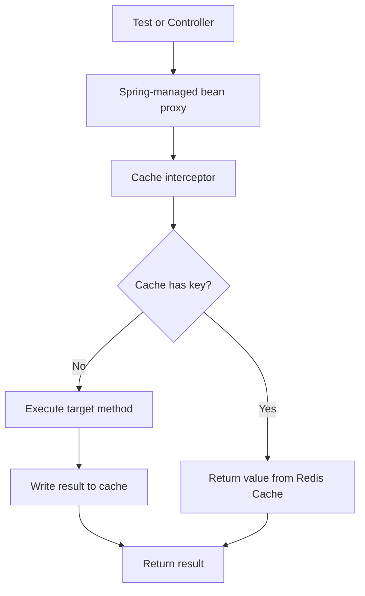
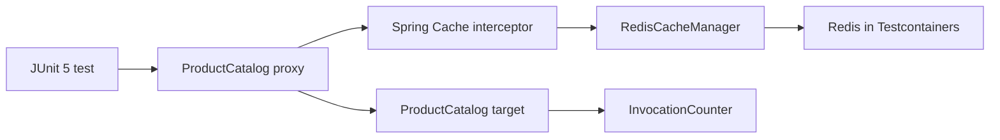
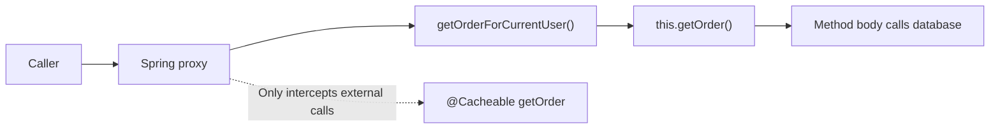
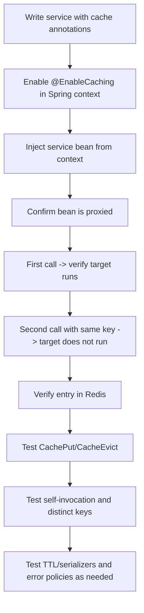

# Testing Spring Cache Through a Real Proxy

When using **Spring Data Redis** as the backend for **Spring Cache**, annotations like `@Cacheable`, `@CachePut`, and `@CacheEvict` normally work through **Spring AOP proxies**. This detail dictates how tests must be written. If you instantiate a service with `new`, invoke the target object directly, or run a unit test without booting a Spring context, the annotations sit in the source code **without an active interceptor**, so no caching behavior occurs.

To test an application flow properly, invoke methods through a **Spring-managed bean**, verify the bean is actually proxied, and configure a Redis-backed `CacheManager`. Only then does the test observe both layers:

1. **Proxy and annotation layer:** does Spring intercept method calls, build cache keys, read the cache, skip the method body on cache hits, and write/evict entries at the right time?
2. **Redis layer:** does the cache entry actually land in Redis with the right key prefix, TTL, and serializer, and is it read back on a subsequent call through the proxy?

This lesson shows how to design meaningful tests with JUnit 5, Spring Boot, and Testcontainers, prove cache hits/misses via counters, handle self-invocation, and distinguish proxy issues from Redis connectivity or serialization failures.

## 1. Understanding the Real Path of `@Cacheable`

A call through a Spring-managed bean typically flows through this chain:



With:

```java
@Cacheable(cacheNames = "products", key = "#p0")
public Product findById(String id) {
    return repository.findById(id).orElseThrow();
}
```

On the first call with `id = "P-101"`:

```text
Controller -> proxy -> cache miss -> repository -> cache put -> return
```

On the second call with the same key while the entry is valid:

```text
Controller -> proxy -> cache hit -> return
                                      ^
                                      |
                              repository does not run
```

**What needs verification is not merely that two calls return the same value.** An uncached service can also return identical results. The test should observe a signal showing **how many times the method body ran**, such as an invocation counter or a fake repository counting calls.

## 2. Why Unit Tests Instantiating Services Directly Easily Mislead

Example:

```java
ProductService service = new ProductService(repository);
service.findById("P-101");
service.findById("P-101");
```

If `service` is created with `new`, it is a plain Java object. Even though `findById` carries `@Cacheable`, no Spring Cache interceptor sits in front of those calls. Both calls still hit the repository.

Common test setups:

| Test Style | Spring AOP Proxy? | Real Redis? | What Can It Verify? |
| --- | --- | --- | --- |
| `new ProductService(...)` | No | No, unless calling Redis internally | Target Java logic, not cache annotations |
| `@InjectMocks` on plain target | Usually no | Depends on mocks | Target logic and mock interactions, not proxies |
| `@SpringBootTest` with cache disabled/`NoOpCacheManager` | May have proxy | Not necessarily | Must check actual manager configuration |
| Spring context with `ConcurrentMapCacheManager` | May have | No | Annotation logic, keys, hit/miss using RAM cache |
| Spring context + `RedisCacheManager` + real Redis | **Yes, if caching enabled** | **Yes** | Proxies, Redis read/write, TTL, serializers, real lifecycle |

Pure unit tests are not useless—they fit business calculations very well. But when asking **“is `@Cacheable` actually working in our application?”**, you must test at the Spring proxy boundary.

### 2.1. Testing Through the Proxy Differs from Mocking the Proxy

If you mock the service bean itself:

```java
// Illustrative idea: service is a mock instead of a real bean.
when(productService.findById("P-101")).thenReturn(product);
```

Calls to the mock never execute the real method or prove the cache interceptor works. When observing data-load counts, **keep the service proxied by Spring** while mocking/faking downstream dependencies like repositories, or embedding an `AtomicInteger` in a test bean.

## 3. Proxy Mode: Conditions Required for Cache Annotations to Take Effect

Spring Cache normally runs in proxy mode. Essential prerequisites:

- `@EnableCaching` (or equivalent configuration enabling annotation-driven caching).
- The service is created and managed by the **Spring `ApplicationContext`**.
- Calls enter **through the proxy** retrieved from the context, rather than `this` calls inside the same object.
- The method is interceptable. In standard proxy setups, use **public instance methods** that can be proxied; avoid `private`, `final`, or non-proxied call paths.
- A matching `CacheManager` and valid cache names are configured.
- Cache keys are generated consistently across invocations.

Example enabling caching:

```java
import org.springframework.cache.annotation.EnableCaching;
import org.springframework.context.annotation.Configuration;

@Configuration
@EnableCaching
public class CacheEnablingConfiguration {
}
```

Spring Boot can auto-configure a `CacheManager` based on classpath and properties, yet **you should never assume adding the Redis starter makes every annotation automatically active**. Tests must confirm caching is enabled and the active manager is actually Redis.

### 3.1. JDK Proxies and Class-Based Proxies

Two common proxy mechanisms:

| Type | Characteristics |
| --- | --- |
| **JDK dynamic proxy** | Proxies via interfaces; calls through the interface go through naturally |
| **Class-based proxy (CGLIB)** | Subclasses the target class; class/method must be overridable per proxy rules |

Do not write assertions coupled to generated proxy class names. Instead, use:

```java
import org.springframework.aop.support.AopUtils;

assertThat(AopUtils.isAopProxy(service)).isTrue();
```

This signals the bean is an AOP proxy, though not yet proof that cache advice specifically is active. Combine it with **hit/miss and Redis storage tests**. If the test environment attaches other advisors (security, transactions, etc.), checking `isAopProxy` alone can create false confidence.

## 4. Integration Testing Pattern: Invoking the Service Through Spring Context

Let us build a sample service whose method executions are counted with an `AtomicInteger`. Caching uses real Redis via Testcontainers. This avoids an external database while still cleanly distinguishing **cached calls** from **actual body executions**.



Behaviors to test:

1. First `load(id)`: counter increments and result is cached.
2. Second `load(id)`: result stays identical, counter **does not increment**.
3. `refresh(id)` with `@CachePut`: method body still runs, cache updates.
4. `evict(id)` with `@CacheEvict`: key is deleted; next `load` calls target again.
5. Calling a method in the **same class** that internally invokes `this.load(id)`: cache advice is bypassed.
6. A real Redis key exists after a cache miss, verifying the backend.

## 5. Dependencies for Spring Boot and Testcontainers

For **Spring Boot 3.1+**, JUnit 5, and Java 17+, Gradle example:

```groovy
dependencies {
    implementation 'org.springframework.boot:spring-boot-starter-cache'
    implementation 'org.springframework.boot:spring-boot-starter-data-redis'

    testImplementation 'org.springframework.boot:spring-boot-starter-test'
    testImplementation 'org.testcontainers:junit-jupiter'
}

test {
    useJUnitPlatform()
}
```

This example assumes the project applies Spring Boot dependency management to resolve library versions. Testcontainers requires a **Docker-compatible container runtime** capable of launching Redis images. If CI lacks a container runtime, tests cannot run; never silently swap Redis for a mock while still claiming real Redis coverage.

The Redis container is a **test-only Redis instance**. Never use production Redis, run `FLUSHALL` on a shared Redis, or depend on state on a developer's laptop.

## 6. Sample Service with Cache Annotations

In the same example, the service has three annotated methods and one intentional self-invocation method:

```java
package com.example.cache;

import java.util.concurrent.atomic.AtomicInteger;
import org.springframework.cache.annotation.CacheEvict;
import org.springframework.cache.annotation.CachePut;
import org.springframework.cache.annotation.Cacheable;

public class ProductCatalog {

    private final InvocationCounter counter;

    public ProductCatalog(InvocationCounter counter) {
        this.counter = counter;
    }

    @Cacheable(cacheNames = "productCards", key = "#p0")
    public String load(String id) {
        return id + "|loaded#" + counter.next();
    }

    @CachePut(cacheNames = "productCards", key = "#p0")
    public String refresh(String id) {
        return id + "|loaded#" + counter.next();
    }

    @CacheEvict(cacheNames = "productCards", key = "#p0")
    public void evict(String id) {
        // Spring Cache performs eviction through the proxy.
    }

    public String internallyLoad(String id) {
        // Intentional internal call on the same object: bypasses proxy mode.
        return load(id);
    }
}

public class InvocationCounter {

    private final AtomicInteger calls = new AtomicInteger();

    public int next() {
        return calls.incrementAndGet();
    }

    public int calls() {
        return calls.get();
    }

    public void reset() {
        calls.set(0);
    }
}
```

The snippet above presents **two separate classes** in the same package (`ProductCatalog.java` and `InvocationCounter.java`); do not place two `public class` definitions into a single `.java` file.

We intentionally use `#p0` to refer to the first parameter, avoiding reliance on Java parameter name retention via `-parameters`. If using `key = "#id"`, ensure Spring can resolve parameter names or configure the build accordingly.

The `id|loaded#N` format simply lets tests observe target execution counts, not a real product payload. In a real application, the method body calls repositories, APIs, or cached data sources.

## 7. Test Configuration Using `RedisCacheManager` and Real Proxies

An explicit test configuration:

```java
package com.example.cache;

import java.time.Duration;
import org.springframework.boot.SpringBootConfiguration;
import org.springframework.boot.autoconfigure.EnableAutoConfiguration;
import org.springframework.cache.annotation.EnableCaching;
import org.springframework.context.annotation.Bean;
import org.springframework.data.redis.cache.RedisCacheConfiguration;
import org.springframework.data.redis.cache.RedisCacheManager;
import org.springframework.data.redis.connection.RedisConnectionFactory;

@SpringBootConfiguration
@EnableAutoConfiguration
@EnableCaching(proxyTargetClass = true)
public class CacheTestApplication {

    @Bean
    public InvocationCounter invocationCounter() {
        return new InvocationCounter();
    }

    @Bean
    public ProductCatalog productCatalog(InvocationCounter counter) {
        return new ProductCatalog(counter);
    }

    @Bean
    public RedisCacheManager cacheManager(
            RedisConnectionFactory connectionFactory) {

        RedisCacheConfiguration defaults =
                RedisCacheConfiguration.defaultCacheConfig()
                        .entryTtl(Duration.ofMinutes(5))
                        .disableCachingNullValues();

        return RedisCacheManager.builder(connectionFactory)
                .cacheDefaults(defaults)
                .build();
    }
}
```

Configuration choices:

| Configuration | Reason |
| --- | --- |
| `@SpringBootConfiguration` + `@EnableAutoConfiguration` | Creates a Spring Boot context with Redis auto-config |
| `@EnableCaching(proxyTargetClass = true)` | Enables cache advice and uses class-based proxies for the example |
| `@Bean ProductCatalog` | Service is Spring-managed rather than instantiated with `new` in tests |
| `@Bean RedisCacheManager` | Explicitly selects Redis backend instead of falling back to an in-memory cache provider |
| 5-minute TTL | Produces observable entry expiration in Redis |
| `disableCachingNullValues()` | Disallows caching `null`; example returns non-null Strings |

Because `@EnableCaching(proxyTargetClass = true)` is active, `ProductCatalog` and `load` must be subclassable/overridable. Do not mark the service or method `final` in this example.

We **use only `CacheTestApplication` in this test**, without defining a second conflicting `CacheManager` bean. If your project defines custom or multiple managers, configure explicit manager selection.

## 8. Complete Integration Test with Redis Testcontainers

The following test class uses `@SpringBootTest` to boot a **real Spring `ApplicationContext`** and `@Testcontainers` to run an isolated Redis instance.

```java
package com.example.cache;

import java.util.concurrent.TimeUnit;

import org.junit.jupiter.api.BeforeEach;
import org.junit.jupiter.api.Test;
import org.springframework.aop.support.AopUtils;
import org.springframework.beans.factory.annotation.Autowired;
import org.springframework.boot.test.context.SpringBootTest;
import org.springframework.cache.Cache;
import org.springframework.cache.CacheManager;
import org.springframework.data.redis.core.StringRedisTemplate;
import org.springframework.test.context.DynamicPropertyRegistry;
import org.springframework.test.context.DynamicPropertySource;
import org.testcontainers.containers.GenericContainer;
import org.testcontainers.junit.jupiter.Container;
import org.testcontainers.junit.jupiter.Testcontainers;
import org.testcontainers.utility.DockerImageName;

import static org.assertj.core.api.Assertions.assertThat;

@SpringBootTest(classes = CacheTestApplication.class)
@Testcontainers
class CacheProxyIntegrationTest {

    @Container
    static final GenericContainer<?> redisContainer =
            new GenericContainer<>(
                    DockerImageName.parse("redis:7.4-alpine"))
                    .withExposedPorts(6379);

    @DynamicPropertySource
    static void redisProperties(DynamicPropertyRegistry properties) {
        properties.add("spring.data.redis.host",
                redisContainer::getHost);
        properties.add("spring.data.redis.port",
                () -> redisContainer.getMappedPort(6379));
    }

    @Autowired
    ProductCatalog catalog;

    @Autowired
    InvocationCounter counter;

    @Autowired
    CacheManager cacheManager;

    @Autowired
    StringRedisTemplate redis;

    @BeforeEach
    void isolateCache() {
        Cache cache = cacheManager.getCache("productCards");
        assertThat(cache).isNotNull();
        cache.clear();
        counter.reset();
    }

    @Test
    void beanIsSpringAopProxy() {
        assertThat(AopUtils.isAopProxy(catalog)).isTrue();
    }

    @Test
    void secondCallIsCacheHitAndDoesNotRunBody() {
        String first = catalog.load("p-101");
        String second = catalog.load("p-101");

        assertThat(first).isEqualTo("p-101|loaded#1");
        assertThat(second).isEqualTo(first);
        assertThat(counter.calls()).isEqualTo(1);
    }

    @Test
    void differentCacheKeysExecuteIndependently() {
        String one = catalog.load("p-101");
        String two = catalog.load("p-102");
        String oneAgain = catalog.load("p-101");

        assertThat(one).isEqualTo("p-101|loaded#1");
        assertThat(two).isEqualTo("p-102|loaded#2");
        assertThat(oneAgain).isEqualTo(one);
        assertThat(counter.calls()).isEqualTo(2);
    }

    @Test
    void cachePutAlwaysRunsMethodAndReplacesEntry() {
        String initial = catalog.load("p-101");
        String updated = catalog.refresh("p-101");
        String cachedAfterUpdate = catalog.load("p-101");

        assertThat(initial).isEqualTo("p-101|loaded#1");
        assertThat(updated).isEqualTo("p-101|loaded#2");
        assertThat(cachedAfterUpdate).isEqualTo(updated);
        assertThat(counter.calls()).isEqualTo(2);
    }

    @Test
    void cacheEvictMakesNextLoadExecuteAgain() {
        String before = catalog.load("p-101");
        catalog.evict("p-101");
        String after = catalog.load("p-101");

        assertThat(before).isEqualTo("p-101|loaded#1");
        assertThat(after).isEqualTo("p-101|loaded#2");
        assertThat(counter.calls()).isEqualTo(2);
    }

    @Test
    void selfInvocationBypassesCacheAdvice() {
        String first = catalog.internallyLoad("p-self");
        String second = catalog.internallyLoad("p-self");

        assertThat(first).isEqualTo("p-self|loaded#1");
        assertThat(second).isEqualTo("p-self|loaded#2");
        assertThat(counter.calls()).isEqualTo(2);

        // External call through the proxy creates the cache entry.
        String externalFirst = catalog.load("p-self");
        String externalAgain = catalog.load("p-self");

        assertThat(externalFirst).isEqualTo("p-self|loaded#3");
        assertThat(externalAgain).isEqualTo(externalFirst);
        assertThat(counter.calls()).isEqualTo(3);
    }

    @Test
    void entryReallyExistsInRedisWithTtl() {
        catalog.load("p-redis");

        // Default RedisCacheConfiguration prefix: cacheName::key.
        String redisKey = "productCards::p-redis";

        assertThat(redis.hasKey(redisKey)).isTrue();
        Long ttl = redis.getExpire(redisKey, TimeUnit.SECONDS);
        assertThat(ttl).isNotNull();
        assertThat(ttl).isBetween(1L, 300L);
    }
}
```

These are **separate classes** in package `com.example.cache`: `ProductCatalog`, `InvocationCounter`, `CacheTestApplication`, and `CacheProxyIntegrationTest`. Imports, annotations, and tests match Spring Boot 3.x, JUnit 5, and Testcontainers APIs; adjust dependencies/APIs if your project uses a different Spring Boot/Testcontainers line.

### 8.1. What These Tests Actually Verify

| Test | Evidence |
| --- | --- |
| `beanIsSpringAopProxy` | `catalog` is an AOP proxy bean from the Spring context |
| `secondCallIsCacheHitAndDoesNotRunBody` | Second call with the same key does not increment the counter |
| `differentCacheKeysExecuteIndependently` | Distinct cache keys do not accidentally share results |
| `cachePutAlwaysRunsMethodAndReplacesEntry` | `@CachePut` executes the body and replaces the cached value |
| `cacheEvictMakesNextLoadExecuteAgain` | Eviction causes the subsequent read to miss |
| `selfInvocationBypassesCacheAdvice` | Internal call bypasses interceptor; external call goes through it |
| `entryReallyExistsInRedisWithTtl` | Redis holds the key under the test prefix with a 5-minute TTL |

All behaviors are observed through real bean invocations. Asserting only `catalog.load(...).equals(...)` without checking the counter, Redis key, or proxy is significantly weaker.

### 8.2. Why You Do Not Need `Thread.sleep` to Prove TTL

To verify configuration **set a TTL**, simply read:

```java
Long seconds = redis.getExpire(
        "productCards::p-redis", TimeUnit.SECONDS);
```

If Redis returns `-1`, the key exists **without a TTL**; `-2` means the key **does not exist**. Checking a positive TTL capped at 300 seconds avoids waiting 5 minutes.

To test **actual entry expiration**, configure a separate setup with a very short TTL and wait conditionally using Awaitility or bounded polling. Still, time-based tests can flake due to scheduling, CPU/CI load, and read timing. Never put `Thread.sleep(300_000)` in a daily suite.

## 9. Why Testing with a Fake `CacheManager` Misses Redis Bugs

Spring Boot offers multiple `CacheManager` implementations: `ConcurrentMapCacheManager`, `RedisCacheManager`, `CaffeineCacheManager`, `NoOpCacheManager`, etc.

An in-memory RAM cache test can verify:

```text
@Cacheable produces cache hits
SpEL keys evaluate properly
@CachePut/evict run through the proxy
```

Yet it does not verify:

- Redis is connecting to the right host/database or Cluster.
- Key prefixes produce the right namespaces.
- Value serializers deserialize objects properly across calls.
- Redis TTL is applied accurately.
- The backend throws `WRONGTYPE` or `SerializationException`.
- `Cache.clear()` on Redis cleans up only the keys belonging to that cache.

Therefore, organize **two complementary test layers**:

1. **Fast:** Spring context + `ConcurrentMapCacheManager` to check advice, keys, and annotation flows.
2. **Integration:** Spring context + `RedisCacheManager` + real Redis to check serialization, key prefixes, TTL, and backend interactions.

You do not need to run every business combination under Redis Testcontainers if cost is high; however, critical cache paths should have at least one integration suite proving real operation.

## 10. Self-Invocation: The Most Common Reason Cache Annotations “Don't Run”

Consider:

```java
@Service
public class OrderViewService {

    @Cacheable(cacheNames = "orders", key = "#p0")
    public String getOrder(String id) {
        return loadFromDatabase(id);
    }

    public String getOrderForCurrentUser(String id) {
        return this.getOrder(id);
    }
}
```

When a client calls:

```java
orderViewService.getOrder("O-101");
```

the call passes through the Spring proxy, so cache advice applies. Yet when a client calls:

```java
orderViewService.getOrderForCurrentUser("O-101");
```

the proxy only intercepts `getOrderForCurrentUser` (which has no `@Cacheable`). Inside the target object, `this.getOrder(id)` **bypasses the proxy**, so `@Cacheable` on `getOrder` does not execute in standard proxy mode.



### 10.1. How to Test Self-Invocation

Do not guess from annotation presence. Test with a counter:

```java
String first = catalog.internallyLoad("p-self");
String second = catalog.internallyLoad("p-self");

assertThat(first).isNotEqualTo(second);
assertThat(counter.calls()).isEqualTo(2);
```

Then invoke `load` via the **bean proxy**:

```java
String first = catalog.load("p-self");
String again = catalog.load("p-self");

assertThat(again).isEqualTo(first);
```

### 10.2. How to Fix Self-Invocation

Usually the cleanest fix is extracting the cached method into a separate bean:

```java
@Service
public class CachedOrderReader {

    @Cacheable(cacheNames = "orders", key = "#p0")
    public OrderView find(String id) {
        return loadFromDatabase(id);
    }
}

@Service
public class OrderFacade {

    private final CachedOrderReader cachedReader;

    public OrderFacade(CachedOrderReader cachedReader) {
        this.cachedReader = cachedReader;
    }

    public OrderView getForCurrentUser(String id) {
        return cachedReader.find(id);
    }
}
```

`OrderView` and `loadFromDatabase` are domain details omitted in this snippet. When `OrderFacade` calls the Spring-injected `cachedReader` bean, the invocation passes through the proxy.

Options like self-injection of your own proxy, `AopContext.currentProxy()`, or AspectJ weaving exist, but they increase coupling and configuration complexity. Avoid choosing them just to make a unit test pass when splitting beans gives a cleaner design.

## 11. Testing `@Cacheable` with `condition` and `unless`

`@Cacheable` supports pre- and post-execution conditions:

```java
@Cacheable(
        cacheNames = "productCards",
        key = "#p0",
        condition = "#p0.length() >= 3",
        unless = "#result == null"
)
public String find(String id) {
    return source.find(id);
}
```

Key difference:

| Attribute | Evaluation Timing | Effect |
| --- | --- | --- |
| `condition` | Evaluated before caching lookup/store | If false, the call does not participate in caching |
| `unless` | Evaluated after the method returns a result | If true, the result is not written to the cache |

Tests must call the **actual bean proxy** and inspect source invocation counts.

Conceptual example:

```java
// When id is too short, condition=false:
service.find("x");
service.find("x");
assertThat(source.invocationsFor("x")).isEqualTo(2);

// When find("abc") returns non-null, caching is allowed:
service.find("abc");
service.find("abc");
assertThat(source.invocationsFor("abc")).isEqualTo(1);
```

With `unless="#result == null"`, any `null` return is excluded from caching under this condition, even if the provider permits storing nulls. **Test null policy explicitly**; never assume every `RedisCacheConfiguration` behaves the same way.

## 12. Testing `@CachePut`: The Method Must Execute

`@CachePut` differs from `@Cacheable`: it **never skips the method body to return a cached value**.

```java
@CachePut(cacheNames = "products", key = "#result.id")
public Product update(Product product) {
    return repository.save(product);
}
```

A meaningful test must verify:

1. `update` called the repository/handler and produced the new result.
2. The cache entry at the matching key changed.
3. A subsequent `@Cacheable` call for that key returns the **new result** without calling the old data source.

Asserting only that `update()` returned the expected object does not prove the cache updated.

**SpEL key note:** `@CachePut` can reference `#result` because the method result already exists. `@Cacheable` looks up the cache before execution, where `#result` is unavailable for the read key. Never use inconsistent key expressions between put and get—it makes caching look "broken" even though the interceptor ran.

## 13. Testing `@CacheEvict` and Eviction Timing

By default:

```java
@CacheEvict(cacheNames = "products", key = "#p0")
public void invalidate(String id) {
    // Perform required work.
}
```

Eviction runs after the method completes successfully per the cache interceptor contract. You can change this:

```java
@CacheEvict(
        cacheNames = "products",
        key = "#p0",
        beforeInvocation = true
)
public void invalidateBefore(String id) {
    // Entry eviction is requested before the target executes.
}
```

When testing:

| Scenario | With default `beforeInvocation=false` | With `beforeInvocation=true` |
| --- | --- | --- |
| Method succeeds | Evicts after success | Evicts before execution |
| Method throws exception | Usually does not evict since target failed | Eviction was already requested before target |

To prove this difference, create a method that intentionally throws an exception **on a Spring-proxied bean**, preload the cache, call the method via the proxy, and inspect the key/data source afterward.

Never call `this.invalidate(...)` inside the same class to test annotations, as self-invocation invalidates the test.

### 13.1. `allEntries = true`

```java
@CacheEvict(cacheNames = "products", allEntries = true)
public void invalidateAll() {
}
```

When `allEntries = true`, Spring Cache requests clearing the entire `products` cache, not just one key. Tests should populate two or three distinct entries, call `invalidateAll()` via the proxy, and verify all are reloaded on subsequent reads.

On Redis, clearing can execute multiple commands depending on `RedisCacheWriter`/batch strategy. Never use a single `clear` test to claim clearing an entire cache is an atomic transaction across every configuration.

## 14. Testing Cache Key Generation

Two requests with identical business outcomes can generate **different cache keys** if key expressions drift. Test key logic at the proxy:

```java
@Cacheable(cacheNames = "products", key = "#p0 + ':' + #p1")
public String load(String tenantId, String productId) {
    return source.load(tenantId, productId);
}
```

Example:

```text
load("tenant-1", "P-101") -> key tenant-1:P-101
load("tenant-2", "P-101") -> key tenant-2:P-101
```

If using only `key = "#p1"`, two tenants can accidentally share cache entries. A test using only one tenant will miss **cache key collisions**.

Cases to test:

- Two different IDs create two separate entries.
- Two different tenants never accidentally share data.
- Parameters that do not affect results are intentionally excluded from the key.
- Complex key objects implement proper `equals/hashCode` or map to stable keys.
- `null` values, empty strings, and special characters follow the contract.
- Cache prefixes/versions are applied consistently across environments.

With default `RedisCacheManager`, physical key names usually look like:

```text
cacheName::convertedKey
```

However, with custom `computePrefixWith(...)`, serializers, or `KeyGenerator`s, real key names differ. Tests inspecting physical Redis keys must match **the active configuration** rather than hardcoding defaults across modules.

## 15. Cached Data: Serializers and TTL Also Need Testing

Spring Cache receives a Java object, and `RedisCache` serializes it before storing in Redis. A test using `ConcurrentMapCacheManager` can pass while a Redis test fails because the object is incompatible with the serializer.

Example JSON value configuration:

```java
import org.springframework.data.redis.cache.RedisCacheConfiguration;
import org.springframework.data.redis.serializer.RedisSerializationContext;
import org.springframework.data.redis.serializer.GenericJackson2JsonRedisSerializer;

RedisCacheConfiguration defaults =
        RedisCacheConfiguration.defaultCacheConfig()
                .serializeValuesWith(
                        RedisSerializationContext.SerializationPair
                                .fromSerializer(
                                        new GenericJackson2JsonRedisSerializer()));
```

When using JSON serializers, verify object types, constructors, polymorphism, and matching security/schema requirements. Changing serializers between application versions reading the same cache can make legacy entries unreadable even though the Redis keys exist.

Valuable assertions:

1. The first call through the proxy creates the entry.
2. The entry is read back on the second call or from another Spring context sharing the same serializer config.
3. The real key carries the right TTL.
4. On serialization failures, tests do not mask exceptions as fake cache hits.
5. On schema changes, legacy data is skipped, invalidated, or migrated per strategy.

Do not call `GET` and decode bytes as UTF-8 if the cache uses JDK or binary serialization. Verify key existence and let `Cache.get()` or a proxy call verify deserialization.

## 16. When Spring Cache Meets `@Transactional`

A service might update a database while also updating or evicting cache entries:

```java
@Transactional
@CacheEvict(cacheNames = "products", key = "#p0")
public void updateProduct(String id, ProductUpdate update) {
    repository.update(id, update);
}
```

Exercise extreme caution: transaction and cache advisors can have **different ordering** depending on configuration. `@CacheEvict` running “after the Java method returns” does not guarantee it runs **after the database transaction actually commits**.

Example race:

```text
Transaction starts
UPDATE database
Cache evicted before commit
Another request misses cache, reads stale data from DB
Other request repopulates cache with stale data
First transaction commits
```

A test calling two methods sequentially on the same thread cannot uncover this race.

If the system requires cache invalidation strictly **after commit**, configure a transaction-aware cache manager, post-commit callbacks, or an appropriate invalidation/outbox mechanism. Also evaluate what happens if commit succeeds while Redis is temporarily unable to evict; database `@Transactional` does not combine Redis and SQL into a single atomic transaction.

**For testing:** separate testing cache advice correctness from transaction ordering. When testing ordering, use an integration test with a real database, real transaction manager, and concurrent coordination rather than a mocked repository.

## 17. Testing Errors and Cache Fallbacks

Redis-related errors can arise when:

- Redis is unavailable or loses connectivity.
- Keys hold incompatible types (`WRONGTYPE`).
- Serializers cannot decode legacy entries.
- Cache keys are oversized or malformed.
- The backend rejects commands due to ACLs, config, or node state.
- Timeouts occur after Redis may already have executed the command.

Depending on application design, cache errors may be thrown or routed to a `CacheErrorHandler`. If the app expects **cache-miss fallbacks** on Redis errors, test explicitly when each is allowed:

```text
GET cache error   -> may read authoritative data source
PUT cache error   -> can business operation still succeed?
EVICT cache error -> risk of stale cache remaining after source update
```

Never install a `CacheErrorHandler` that swallows every error and assume consistency stays intact. In particular, failed cache eviction after a database update leaves **stale cache**; tests must enforce the chosen handling and reconciliation policy.

In proxy verification tests, start with a healthy Redis to confirm clear hit/miss behavior. Then add dedicated connection-failure tests if required by product specs.

## 18. Testing Concurrency and Cache Stampedes

If multiple concurrent requests hit a cache miss simultaneously, they may all invoke the source method:

```text
Thread A -> cache miss -> database
Thread B -> cache miss -> database
Thread C -> cache miss -> database
```

Spring Cache offers:

```java
@Cacheable(cacheNames = "products", key = "#p0", sync = true)
public Product find(String id) {
    return repository.findById(id).orElseThrow();
}
```

`sync = true` asks the cache provider to synchronize value loading for the same key as supported by its API. However, **never assume** that with `RedisCacheManager` this provides an exact once-only distributed mutex across all processes or nodes.

A concurrency test inside **one Spring context** can use a `CountDownLatch` to start threads together and a counter to observe source invocations. Still, that test only characterizes the **provider/version under the tested conditions**.

To verify distributed behavior, test across **multiple application contexts or processes** hitting the same Redis, measuring each instance separately and testing failover/network timeouts. Never use a single-JVM test to claim cluster-wide cache stampede prevention.

### 18.1. A Naive Test Can Miss the Race

If you warm the cache before launching threads:

```java
catalog.load("p-101");
```

every thread simply reads a cache hit; the test never exercises **concurrent cache misses**. Use a **non-existent key** and release all threads near-simultaneously through a synchronization barrier.

Also, concurrency tests must not require the source call count to equal strictly 1 unless the application explicitly guarantees single-flight coordination. Align expectations with the synchronization mechanism's real scope.

## 19. Watch Out for AOP Targets, Spies, and Mocks

In a test, these patterns can accidentally bypass the proxy:

```java
// Creating the service with new:
var direct = new ProductCatalog(counter);
direct.load("p-101");

// Unwrapping the target inside the proxy and calling directly (anti-pattern):
// var target = AopTestUtils.getTargetObject(catalog);
// target.load("p-101");
```

Calling the target directly bypasses the cache interceptor even when the proxy bean exists in the context. That tests **target logic**, not **Spring Cache through the proxy**.

With Mockito, follow these rules:

- Mocking/faking **repositories or data sources** beneath the service is completely valid for counting data loads.
- Replacing the service itself with a mock discards the annotation/cache behavior under test.
- When wrapping a proxied bean in a spy, `verify`/spying behavior depends on proxy mechanics, Spring Test versions, and spy wrapping. Never assume `verify(service, times(1)).load(...)` always measures target body executions accurately.
- A counter inside the target or a fake repository usually yields clearer test signals.

In recent Spring Framework versions, `@MockitoBean` supports overriding beans in the context. Older Spring Boot examples often use `@MockBean`; APIs and deprecations vary by version. This lesson avoids relying on them to test proxies, since `InvocationCounter` is a small deterministic bean.

## 20. Isolating Data Between Tests

Caching creates **state external to test methods**, so tests can interfere with each other if uncleaned. For example, test A caches `p-101`, and test B expects a cache miss on `p-101` yet receives a hit.

In our example:

```java
@BeforeEach
void isolateCache() {
    Cache cache = cacheManager.getCache("productCards");
    assertThat(cache).isNotNull();
    cache.clear();
    counter.reset();
}
```

This is sensible isolation when the **Redis container belongs exclusively to this test suite**. If Redis is shared with another parallel suite, `cache.clear()` can wipe another test's entries. Options:

| Isolation Strategy | Pros | Notes |
| --- | --- | --- |
| Dedicated Redis container per test class/suite | Predictable outcomes | Container startup overhead |
| Suite-specific cache name prefix/namespace | Reduces key collisions | Cleanup must target the right namespace |
| Unique ID per test | Limits key collisions | Old entries still need policy-based cleanup |
| `@DirtiesContext` | Refreshes Spring context | Does not auto-clear existing Redis data; expensive |
| `FLUSHDB`/`FLUSHALL` | Broad wipe | **Never use on shared/production Redis** |

Best practice is giving integration tests a **dedicated backend**, clearing only caches owned by the test. Never use a shared real Redis used by colleagues or other services simply because it is convenient locally.

### 20.1. Spring Test Context Cache Differs from Application Cache

Spring Test **reuses `ApplicationContext` instances** across test classes with matching configurations to reduce startup time. This is distinct from **Spring Cache storing data in Redis**.

`@DirtiesContext` only tells the TestContext framework to discard/rebuild the context; it does not guarantee Redis keys were deleted. If stale cache entries persist in Redis, manage Redis data or namespaces explicitly.

## 21. `RedisCacheManager`, Cache Names, and Multiple `CacheManager` Beans

Large applications may run multiple managers side-by-side:

```text
redisCacheManager  -> shared cache across instances
localCacheManager  -> in-RAM cache
```

An annotation:

```java
@Cacheable(cacheNames = "products", key = "#p0")
```

must resolve to the right manager per Spring configuration. With multiple managers and no explicit selection, the app may fail configuration or pick the wrong manager.

When multiple managers exist, specify:

```java
@Cacheable(
        cacheManager = "redisCacheManager",
        cacheNames = "products",
        key = "#p0"
)
```

or configure a `CacheResolver`/primary default. Tests should confirm `RedisCacheManager` is in use:

```java
assertThat(cacheManager).isInstanceOf(RedisCacheManager.class);
```

In the full example, `cacheManager` is declared explicitly with no competing second manager.

### 21.1. Understand Redis Key Names Together with Prefixes

`RedisCacheConfiguration.defaultCacheConfig()` normally applies prefix `cacheName::`. If customized:

```java
RedisCacheConfiguration defaults =
        RedisCacheConfiguration.defaultCacheConfig()
                .computePrefixWith(name -> "tests:cache:" + name + "::");
```

a cache key for `productCards` changes from:

```text
productCards::p-101
```

to:

```text
tests:cache:productCards::p-101
```

Assertions like `redis.hasKey(...)` must change accordingly. Reserve direct physical key assertions for verifying **storage contracts**; keep most business cache tests verifying through `CacheManager` and proxies to avoid coupling to internal formats.

## 22. Common Failures and How to Diagnose Them

### 22.1. Calling Twice Still Runs the Method Body

Check:

1. Was the bean injected from the Spring context?
2. Is `@EnableCaching` active?
3. Is self-invocation or direct target invocation bypassing the proxy?
4. Is the method/class `final`, `private`, or improperly visible?
5. Do both calls actually produce the exact same cache key?
6. Do `condition`/`unless` suppress caching?
7. Did the entry have an ultra-short TTL or get evicted in between?
8. Is `CacheManager` returning `NoOpCache` or a different cache name?

Do not start by increasing Redis timeouts if the method is actually being invoked directly via `this`.

### 22.2. Passes with `ConcurrentMap`, Fails with Redis

Common culprits are serializers, Redis connectivity, TTL, cache names/key prefixes, or keys occupied by a different Redis type. In-RAM unit tests never validate these contracts.

### 22.3. `@CachePut` Runs, Yet Subsequent Reads See Stale Values

Verify `cacheNames` and `key` SpEL expressions on `@CachePut` match `@Cacheable`; check for two different `CacheManager` beans, competing writers overwriting afterward, or transaction/TTL/serializer mismatches.

### 22.4. `@CacheEvict` Is Called, Yet the Key Remains

Verify the call passed through the proxy, the method did not throw an exception before default post-invocation eviction, `key`/`allEntries` match, and Redis deletion succeeded.

### 22.5. `AopUtils.isAopProxy(bean)` Is True, Yet Caching Still Does Not Run

The bean may be proxied for transactions, security, or another advisor. Verify caching behavior with an invocation counter and Redis checks, or inspect active advisors. `isAopProxy` alone is only a hint, not sufficient proof.

### 22.6. Using `@SpringBootTest`, Yet Caching Is Still Bypassed

`@SpringBootTest` only boots the context—**it does not guarantee the service was invoked through the proxy**. Instantiating a bean with `new` inside a test method still bypasses proxies.

### 22.7. Tests Depend on Execution Order

One test leaves keys behind for the next. Use isolated Redis containers, separate cache namespaces, and explicit `@BeforeEach` cleanup; never depend on JUnit run order.

### 22.8. Using Real Redis and Accidentally Pointing to Production

Tests should use dynamic properties from Testcontainers or an explicitly designated test endpoint. Never rely on `localhost:6379` when dev/CI hosts might run important Redis instances.

### 22.9. Expecting `sync=true` to Act as a Strong Distributed Lock

`sync=true` is a Spring Cache contract for synchronizing value loading within the provider's capabilities. A single-process test never proves distributed exactly-once guarantees across multiple instances.

### 22.10. Calling `flushDb()` in `@AfterEach`

On a shared Redis, this wipes data unrelated to the test. Scope cleanup to the test's namespace or use a dedicated Redis container.

## 23. Layered Testing Strategy

A practical project typically combines:

| Layer | Purpose | Example |
| --- | --- | --- |
| Target unit test | Verify business calculations and error handling | Instantiate service with `new` |
| Spring proxy test | Verify `@Cacheable`, `@CachePut`, `@CacheEvict`, keys, self-invocation | Context with `@EnableCaching`, injected bean |
| Redis integration test | Verify connectivity, serializers, prefixes, TTL, cached payloads | `@SpringBootTest` + Testcontainers |
| Transaction integration test | Verify commit/invalidation ordering | Real database + Redis + transactions |
| Multi-instance test | Verify behavior across multiple processes/nodes | Multiple Spring contexts/processes sharing Redis |
| Resilience test | Verify timeouts, Redis outages, recovery | Controlled fault-injection environment |

One test does not have to cover every layer. For example, `secondCallIsCacheHitAndDoesNotRunBody` focuses on proxy and backend behavior; it does not prove caching under Redis Cluster failover.

### 23.1. Which Tests Should Run in CI?

A balanced suite typically includes:

- Fast unit tests on every commit.
- A group of Redis Testcontainers integration tests for critical cache flows.
- Multi-instance concurrency and timeout/failover tests run separately when suitable infrastructure and coordination exist.

Do not trade correctness away by dropping proxy tests and keeping only `@InjectMocks` tests. A small integration suite checking real target execution counts and Redis keys catches subtle configuration bugs early.

## 24. Practical Verification Workflow



This progression moves from proving **the method is intercepted** to proving **the cache actually stores real data**. When a step fails, pinpointing the cause is far easier than debugging an end-to-end test that merely reports a wrong final output.

## 25. Summary

**Testing Spring Cache through a real proxy** means invoking `@Cacheable`, `@CachePut`, and `@CacheEvict` methods **through Spring `ApplicationContext`-managed beans** with `@EnableCaching` and a configured `CacheManager`. Testing with `new` or calling `this.cachedMethod()` bypasses that path in standard proxy mode.

A strong test verifies more than return values. It confirms **target execution counts**, **per-key hit/miss behavior**, **update/evict behavior**, **self-invocation bypass**, and with Redis, **real entries and TTL persisted in Redis**.

Spring Boot Test paired with **Testcontainers Redis** gives an isolated backend for integration testing. Keep caches isolated between tests, verify `RedisCacheManager` rather than an in-RAM cache, and never wipe all of Redis when the backend is shared. Add dedicated transaction, concurrency, and failover tests whenever product requirements demand them.

**Core principle:** to test cache annotations, **call the proxy and observe whether the target is skipped at the right times**. Never rely solely on seeing annotations in source code or two calls returning the same value.

### References

- [Spring Framework — Declarative Annotation-based Caching](https://docs.spring.io/spring-framework/reference/integration/cache/annotations.html): `@Cacheable`, `@CachePut`, `@CacheEvict`, `sync=true`, and proxy limitations.
- [Spring Framework — Proxying Mechanisms](https://docs.spring.io/spring-framework/reference/core/aop/proxying.html): JDK/CGLIB proxies, self-invocation, and advice bypass cases.
- [Spring Framework — Cache Abstraction](https://docs.spring.io/spring-framework/reference/integration/cache.html): cache interceptors, key generation, and `CacheManager`.
- [Spring Data Redis — Redis Cache](https://docs.spring.io/spring-data/redis/reference/redis/redis-cache.html): `RedisCacheManager`, TTL, serialization, writers, and key prefixes.
- [Spring Boot — Testing](https://docs.spring.io/spring-boot/reference/testing/index.html): `@SpringBootTest`, contexts, and integration testing.
- [Spring Framework — DynamicPropertySource](https://docs.spring.io/spring-framework/reference/testing/annotations/integration-spring/annotation-dynamicpropertysource.html): passing Redis container host/port into Spring Test contexts.
- [Testcontainers — JUnit 5](https://java.testcontainers.org/test_framework_integration/junit_5/): `@Testcontainers` and `@Container`.
- [Spring Framework — AopUtils API](https://docs.spring.io/spring-framework/docs/current/javadoc-api/org/springframework/aop/support/AopUtils.html): verifying AOP proxies on beans.
