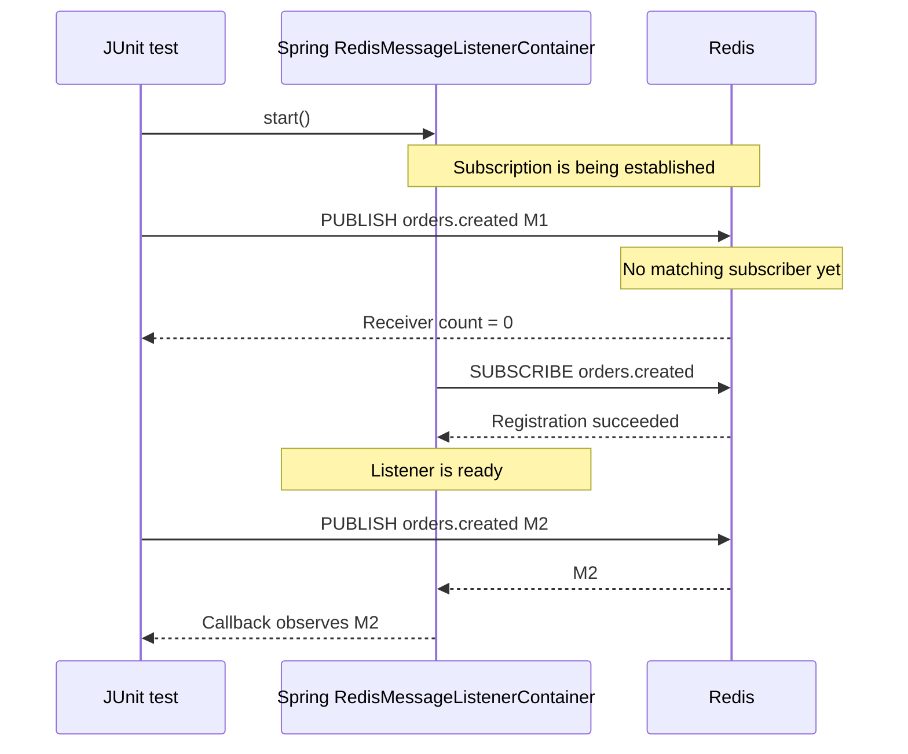
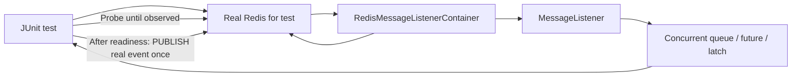

# Testing Pub/Sub Without Fixed Waits in Spring Data Redis

## 1. The Problem: Pub/Sub Tests That Sometimes Pass and Sometimes Fail

Redis Pub/Sub works asynchronously: a publisher sends messages via `PUBLISH`, while a subscriber needs an active connection and channel registration before messages are emitted. In Spring Data Redis, subscriptions are typically managed by `RedisMessageListenerContainer`, and message handling callbacks run through `MessageListener` or a listener adapter.

A seemingly simple test:

```java
container.start();
redisTemplate.convertAndSend("orders.created", "order-42");

Thread.sleep(1000);

assertThat(receivedMessages).contains("order-42");
```

This test hides two problems:

1. **Subscription race:** `start()` initiates the container's lifecycle, yet you cannot infer from it that every subscription has been confirmed by Redis and is ready right when `PUBLISH` executes. Redis Pub/Sub **does not replay** messages published before a subscriber finished registering.
2. **Fixed sleep:** `Thread.sleep(1000)` makes the test needlessly slow when the message arrives immediately, yet still fails randomly if CI load, VM pauses, CPU contention, or thread scheduling delays the callback past 1 second.

Instead of sleeping a fixed number of milliseconds and hoping the system is ready, build tests around **observable signals**:

- Confirm the listener actually received a probe message.
- Emit the business event under test **after** receiving the readiness signal.
- Wait for the callback or target state to satisfy expectations with a **maximum timeout**.
- Use a dedicated channel and event ID per test to avoid picking up messages from other tests.
- Clean up listeners and resources after tests to avoid leaking subscriptions into subsequent runs.

This lesson walks through doing this in Spring Data Redis, from unit-testing listeners to integration tests with real Redis, Testcontainers, `Awaitility`, `CountDownLatch`, and `CompletableFuture`.

## 2. Redis Pub/Sub Is Not a Message-Retaining Queue

First difference to grasp:



M1 is lost for this subscriber. Increasing `Thread.sleep(...)` **after publishing M1** will never bring it back.

With standard Redis Pub/Sub:

- Subscribers receive messages only while actively subscribed and when transport does not drop them.
- Redis keeps no message history for late-connecting subscribers.
- There is no business ACK or automatic retry like a pending-entry queue system.
- Multiple subscribers on the same channel all receive the same message; it is not a competing-worker distribution mechanism.
- A successful `PUBLISH` does not mean the Java callback finished processing.

Therefore, you must solve **two independent synchronizations**:

1. **Subscription readiness:** was the subscriber ready before the test message was sent?
2. **Processing completion:** has the handler finished producing the side effect the test wants to assert?

Waiting for the callback after publishing only answers the second question **provided the message was not lost before the listener subscribed**. That is why a pre-publish handshake matters.

## 3. Why Does `Thread.sleep` Cause Flaky Tests?

Suppose a test runs in three environments:

| Environment | Time Until Subscription Ready | Time Until Callback Completes |
| --- | ---: | ---: |
| Lightly loaded laptop | 30 ms | 10 ms |
| CI with freshly started container | 350 ms | 80 ms |
| CI under CPU/GC/network contention | 1,500 ms | 400 ms |

If you hardcode `Thread.sleep(500)`:

- The laptop wastes 500 ms when only a few dozen ms were needed.
- Fresh CI might pass, yet offers no proof the subscription was ready.
- Contended CI fails even though the application works properly.
- Bumping it to 5,000 ms might hide the race most runs while slowing down the entire suite without offering any real guarantee.

Distinguish three techniques:

| Technique | What It Does | Suitability |
| --- | --- | --- |
| `Thread.sleep(1000)` | Waits unconditionally regardless of what happens | Avoid for synchronizing Pub/Sub tests |
| `latch.await(5, SECONDS)` | Waits for a real signal, failing if 5 seconds elapse | Suitable for awaiting verified callbacks |
| `await().atMost(5s).until(condition)` | Polls condition until true, up to 5 seconds | Suitable for asynchronous state checks |
| Probe/handshake | Proves the listener received a message before sending the main event | Suitable for eliminating subscription races |

**A maximum timeout is not a “fixed wait.”** A test with a 5-second timeout finishes immediately when the signal arrives; 5 seconds is simply the failure budget, not a fixed sleep schedule.

## 4. Architecture of a Reliable Integration Test

A Pub/Sub integration test should include these parts:



Recommended steps:

1. Provision an isolated test Redis, e.g., via Testcontainers.
2. Generate a test-specific channel name containing a UUID.
3. Register a `MessageListener` capable of recording both probes and events.
4. Start `RedisMessageListenerContainer`.
5. **Emit a probe with a unique ID in a bounded loop** until that exact listener observes it.
6. Only after step 5, publish the business event under test **once**.
7. Await the assertion condition via a future/latch/queue or Awaitility.
8. Clean up the container and test resources.

In a stable test environment, the probe acts as a practical barrier: the listener has demonstrably received a message on that exact channel. If the connection drops **after the probe**, the real event can still be lost; that is an expected Pub/Sub delivery limit and should be handled per test policy rather than masked with infinite business-event retries.

### Why Use a Dedicated Test Channel?

Suppose two parallel tests both use:

```text
channel = orders.created
payload = order-42
```

Test A's callback might receive the message published by test B and falsely pass A's assertion even if A's publish path is broken.

Better:

```text
channel = it:pubsub:order-created:a872cf0d...
probe   = probe:4b82a6...
event   = event:8fd18c...
```

The test matches **exact channel + exact event ID/payload**, rather than merely checking “some message arrived.”

## 5. Approach 1: Handshaking with a Probe on the Target Channel

This is a pragmatic technique independent of driver-specific subscription callback APIs.

### Workflow

```text
Test                        Redis                  Listener
  |                           |                        |
  |--- start container ------>|                        |
  |--- PUBLISH probe-1 ------>|   (not subscribed yet) |
  |--- PUBLISH probe-1 ------>|   (not subscribed yet) |
  |--- PUBLISH probe-1 ------>|--- callback probe-1 -->|
  |<------------------------ probe received signal ----|
  |                           |                        |
  |--- PUBLISH event-42 ----->|--- callback event-42 ->|
  |<--------------------- event processed signal ------|
  |                           |                        |
  |                assert event-42 received            |
```

The crucial point is that **probes can be republished** because probes only verify readiness and **carry no business side effects**. Conversely, the real event is published **once** so the test accurately reflects real publishing behavior.

### Implementation with `ConcurrentLinkedQueue`

```java
import java.nio.charset.StandardCharsets;
import java.util.Queue;
import java.util.concurrent.ConcurrentLinkedQueue;

import org.springframework.data.redis.connection.MessageListener;

Queue<String> seenProbes = new ConcurrentLinkedQueue<>();
Queue<String> seenEvents = new ConcurrentLinkedQueue<>();

MessageListener listener = (message, pattern) -> {
    String payload = new String(
            message.getBody(), StandardCharsets.UTF_8);

    if (payload.startsWith("probe:")) {
        seenProbes.add(payload);
    } else if (payload.startsWith("event:")) {
        seenEvents.add(payload);
    }
};
```

Routing both message types through the **same channel and same listener** ensures the probe proves the exact subscription needed by the test.

Use Awaitility for conditional probe publishing:

```java
String probe = "probe:" + UUID.randomUUID();

await()
        .atMost(Duration.ofSeconds(10))
        .pollInterval(Duration.ofMillis(100))
        .until(() -> {
            redisTemplate.convertAndSend(channel, probe);
            return seenProbes.contains(probe);
        });
```

Here:

- Bounded polling retries only the **probe** while the subscriber is starting up.
- `until(...)` returns true only once the callback has added the probe to the queue.
- There is no `Thread.sleep` guessing an arbitrary delay.
- When callbacks are fast, the condition finishes within the very first polls.
- If the subscriber never comes up, the test fails cleanly at the max deadline.

**Never reuse this retry-publishing pattern for the business event under test**, as republishing can hide lost-event bugs and create duplicates.

### After the Probe, Publish the Real Event Exactly Once

```java
String event = "event:" + UUID.randomUUID();

redisTemplate.convertAndSend(channel, event);

await()
        .atMost(Duration.ofSeconds(5))
        .untilAsserted(() ->
                assertThat(seenEvents).contains(event));
```

Thus the test waits for the callback through an observable condition rather than a fixed duration.

## 6. Complete Integration Test Example: Spring Boot, Testcontainers, and Awaitility

A test can manually create the listener container to manage its lifecycle alongside an isolated test Redis. The following example uses Spring Boot, JUnit 5, Testcontainers, and Awaitility.

### 6.1. Relevant Dependencies

For Maven, alongside the application's main starter:

```xml
<dependency>
    <groupId>org.springframework.boot</groupId>
    <artifactId>spring-boot-starter-data-redis</artifactId>
</dependency>
<dependency>
    <groupId>org.springframework.boot</groupId>
    <artifactId>spring-boot-starter-test</artifactId>
    <scope>test</scope>
</dependency>
<dependency>
    <groupId>org.testcontainers</groupId>
    <artifactId>junit-jupiter</artifactId>
    <scope>test</scope>
</dependency>
<dependency>
    <groupId>org.testcontainers</groupId>
    <artifactId>testcontainers</artifactId>
    <scope>test</scope>
</dependency>
<dependency>
    <groupId>org.awaitility</groupId>
    <artifactId>awaitility</artifactId>
    <scope>test</scope>
</dependency>
```

When using Spring Boot dependency management, library versions are managed by the BOM; otherwise, declare compatible versions explicitly. Testcontainers requires Docker or a CI-supported container runtime.

### 6.2. Complete Test

```java
package com.example.redis;

import static org.assertj.core.api.Assertions.assertThat;
import static org.awaitility.Awaitility.await;

import java.nio.charset.StandardCharsets;
import java.time.Duration;
import java.util.Queue;
import java.util.UUID;
import java.util.concurrent.ConcurrentLinkedQueue;

import org.junit.jupiter.api.Test;
import org.springframework.beans.factory.annotation.Autowired;
import org.springframework.boot.SpringBootConfiguration;
import org.springframework.boot.autoconfigure.EnableAutoConfiguration;
import org.springframework.boot.test.context.SpringBootTest;
import org.springframework.data.redis.connection.RedisConnectionFactory;
import org.springframework.data.redis.connection.MessageListener;
import org.springframework.data.redis.core.StringRedisTemplate;
import org.springframework.data.redis.listener.ChannelTopic;
import org.springframework.data.redis.listener.RedisMessageListenerContainer;
import org.springframework.test.context.DynamicPropertyRegistry;
import org.springframework.test.context.DynamicPropertySource;
import org.testcontainers.containers.GenericContainer;
import org.testcontainers.junit.jupiter.Container;
import org.testcontainers.junit.jupiter.Testcontainers;
import org.testcontainers.utility.DockerImageName;

@Testcontainers
@SpringBootTest(classes = RedisPubSubIntegrationTest.TestApplication.class)
class RedisPubSubIntegrationTest {

    @SpringBootConfiguration
    @EnableAutoConfiguration
    static class TestApplication {
    }

    @Container
    static final GenericContainer<?> REDIS =
            new GenericContainer<>(
                    DockerImageName.parse("redis:7.4-alpine"))
                    .withExposedPorts(6379);

    @DynamicPropertySource
    static void redisProperties(DynamicPropertyRegistry registry) {
        registry.add("spring.data.redis.host", REDIS::getHost);
        registry.add("spring.data.redis.port",
                () -> REDIS.getMappedPort(6379));
    }

    @Autowired
    RedisConnectionFactory connectionFactory;

    @Autowired
    StringRedisTemplate redisTemplate;

    @Test
    void receivesPublishedEventAfterSubscriptionIsReady() throws Exception {
        String channel = "it:pubsub:" + UUID.randomUUID();

        Queue<String> probes = new ConcurrentLinkedQueue<>();
        Queue<String> events = new ConcurrentLinkedQueue<>();

        MessageListener listener = (message, pattern) -> {
            String payload = new String(
                    message.getBody(),
                    StandardCharsets.UTF_8);

            if (payload.startsWith("probe:")) {
                probes.add(payload);
            } else if (payload.startsWith("event:")) {
                events.add(payload);
            }
        };

        RedisMessageListenerContainer container =
                new RedisMessageListenerContainer();

        container.setConnectionFactory(connectionFactory);
        container.addMessageListener(
                listener,
                new ChannelTopic(channel));

        // Manually instantiated outside Spring: manage init/start/destroy explicitly.
        container.afterPropertiesSet();
        container.start();

        try {
            // Step 1: readiness barrier using the exact listener under test.
            String probe = "probe:" + UUID.randomUUID();

            await()
                    .atMost(Duration.ofSeconds(10))
                    .pollInterval(Duration.ofMillis(100))
                    .until(() -> {
                        redisTemplate.convertAndSend(channel, probe);
                        return probes.contains(probe);
                    });

            // Step 2: publish the business event ONLY ONCE.
            String expectedEvent = "event:" + UUID.randomUUID();
            redisTemplate.convertAndSend(channel, expectedEvent);

            // Step 3: wait until the callback has actually received the event.
            await()
                    .atMost(Duration.ofSeconds(5))
                    .untilAsserted(() ->
                            assertThat(events).contains(expectedEvent));

        } finally {
            container.stop();
            container.destroy();
        }
    }
}
```

The test executes actions in an observable sequence:

1. Redis Testcontainers starts and Spring Data Redis connects to the mapped host/port.
2. The listener container subscribes to the test's isolated channel.
3. `start()` initiates registration, **but the test does not treat that alone as sufficient**.
4. Probes are emitted until the listener callback receives one.
5. The real event is published exactly once.
6. The assertion awaits the callback with an explicit deadline.
7. `finally` cleans up the subscription and container even if the test fails.

`afterPropertiesSet()` is called because the container in this snippet is **instantiated manually outside the Spring bean lifecycle**. If the container is a Spring-managed bean, the framework invokes initialization hooks and manages start/stop; do not call lifecycle hooks redundantly by hand.

Image tag `redis:7.4-alpine` is an example for testing. Real projects should pin a version/image digest aligned with CI policies and the production Redis version under test, preventing unexpected behavior shifts if tags mutate.

### What This Test Actually Proves

The test confirms that while test Redis is healthy and the listener is actively subscribed, a message published **after the readiness barrier** reaches the Java callback.

It **does not** prove:

- Pub/Sub retains messages when subscribers are offline.
- Events always reach every subscriber across all network failures.
- Multi-step business handlers committed to a database, if the test only inspects an in-memory queue.
- Exactly-once processing across multiple application instances.
- Multi-primary Redis Cluster subscription semantics match standalone behavior.

Each additional guarantee requires its own test and business design.

## 7. Approach 2: Using `CountDownLatch` to Await Callbacks

When expecting a single event, `CountDownLatch` is a clean, straightforward primitive:

```java
CountDownLatch eventHandled = new CountDownLatch(1);
AtomicReference<String> received = new AtomicReference<>();

MessageListener listener = (message, pattern) -> {
    String payload = new String(
            message.getBody(), StandardCharsets.UTF_8);

    if (payload.equals(expectedEvent)) {
        received.set(payload);
        eventHandled.countDown();
    }
};
```

After verifying subscriber readiness using an appropriate mechanism:

```java
redisTemplate.convertAndSend(channel, expectedEvent);

boolean completed = eventHandled.await(5, TimeUnit.SECONDS);

assertThat(completed).isTrue();
assertThat(received.get()).isEqualTo(expectedEvent);
```

`await(5, TimeUnit.SECONDS)` returns immediately when the callback invokes `countDown()`; it does not sleep for the full 5 seconds.

**However, a latch does not replace a readiness barrier.** If the message is lost prior to subscribing, the latch waits until timeout and fails. When testing online subscriber callbacks, synchronize registration first.

### Multiple Events or Multiple Subscribers

You can use `CountDownLatch(n)` when expecting **n specific callbacks**. Pair it with unique IDs so a duplicate message is not counted twice:

```java
Set<String> receivedIds = ConcurrentHashMap.newKeySet();
CountDownLatch allHandled = new CountDownLatch(3);

void onEvent(String eventId) {
    if (expectedIds.contains(eventId) &&
            receivedIds.add(eventId)) {
        allHandled.countDown();
    }
}
```

In this snippet, `expectedIds` is the test's set of expected IDs, and `receivedIds.add(eventId)` returns true only the first time an ID is seen. This prevents false positives from duplicate callbacks.

Never use raw handler invocation counts in place of **distinct event IDs** when the test requires each event once.

## 8. Approach 3: Using `CompletableFuture` to Return Processed Results

When you want to retrieve a parsed object rather than just knowing a callback fired, use `CompletableFuture`:

```java
CompletableFuture<OrderEvent> result = new CompletableFuture<>();

MessageListener listener = (message, pattern) -> {
    String json = new String(
            message.getBody(), StandardCharsets.UTF_8);

    try {
        OrderEvent event =
                objectMapper.readValue(json, OrderEvent.class);

        if (expectedEventId.equals(event.eventId())) {
            result.complete(event);
        }
    } catch (Exception exception) {
        result.completeExceptionally(exception);
    }
};
```

After readiness:

```java
redisTemplate.convertAndSend(channel, eventJson);

OrderEvent actual = result.get(5, TimeUnit.SECONDS);

assertThat(actual.eventId()).isEqualTo(expectedEventId);
assertThat(actual.orderId()).isEqualTo("42");
```

The snippet assumes this record:

```java
public record OrderEvent(String eventId, String orderId) {
}
```

`CompletableFuture.get(timeout, unit)` unblocks as soon as the callback completes or throws on timeout—no `Thread.sleep` needed.

### When to Use a `Future` vs. a `Queue`?

| Requirement | Suitable Primitive |
| --- | --- |
| A single callback occurred | `CountDownLatch(1)` |
| A single typed result/DTO | `CompletableFuture<T>` |
| Multiple messages captured for inspection | `BlockingQueue<T>` or concurrent collection |
| Waiting on final repository/cache state | Awaitility polling condition |
| Reactive `Mono/Flux` pipeline | `StepVerifier` and Reactor Test |

If the callback can receive both probes and events, complete the future only when the **event ID matches**. Completing the future on a probe causes false passes.

## 9. Approach 4: `BlockingQueue.poll(timeout)` for Message Payloads

Another option:

```java
BlockingQueue<String> received = new LinkedBlockingQueue<>();

MessageListener listener = (message, pattern) ->
        received.offer(new String(
                message.getBody(), StandardCharsets.UTF_8));
```

After readiness:

```java
redisTemplate.convertAndSend(channel, expectedEvent);

String payload = received.poll(5, TimeUnit.SECONDS);
assertThat(payload).isEqualTo(expectedEvent);
```

Advantage: you can pull messages one by one to inspect payloads and observed callback order.

**Pitfall:** if a probe remains in the queue, the first `poll(...)` might return the probe instead of the event. Two fixes:

1. Use separate queues for probes and events, as shown in the integration test example.
2. Read/filter specifically by `eventId` within a total time budget, never assuming the very first element is the main event.

With multiple publishers, background notifications or messages from other tests can interleave. Isolated channels and unique payloads keep tests independent of unrelated message ordering.

## 10. Testing Business Processing: Wait for Side Effects, Not Just `onMessage`

In real applications, a listener often:

1. Receives the message.
2. Deserializes JSON.
3. Invokes a service.
4. Writes to a database or updates a cache.
5. Emits metrics/logs.

If the callback **offloads work to another executor** and returns immediately, `onMessage` firing does not prove business processing finished.

Example:

```java
@Override
public void onMessage(Message message, byte[] pattern) {
    OrderEvent event = decode(message.getBody());
    CompletableFuture.runAsync(() -> orderProjection.apply(event));
}
```

A test counting only `onMessage` passes before `orderProjection.apply(...)` finishes.

Instead, wait for the **output state**:

```java
redisTemplate.convertAndSend(channel, eventJson);

await()
        .atMost(Duration.ofSeconds(5))
        .untilAsserted(() -> {
            OrderView view =
                    orderViewRepository.findByOrderId("42");

            assertThat(view).isNotNull();
            assertThat(view.status()).isEqualTo("CREATED");
        });
```

This awaits the business condition without guessing how many milliseconds processing takes.

**Event ordering note:** if multiple workers update the same record, assert the projection's version or event ID rather than a generic value that could match pre-test state.

### Surfacing Exact Failure Causes

If the listener fails deserialization, Awaitility may simply time out without explaining why. Combine it with:

- The container's error handler.
- Completing a future exceptionally on callback errors.
- Logging/metrics keyed by event ID.
- Verifying channels and serializers.
- Inspecting test Redis connectivity and subscription state.

That turns timeouts into actionable diagnostics instead of vague “expected event not found” errors.

## 11. Why `container.isRunning()` Is Not Enough

`RedisMessageListenerContainer` manages internal lifecycle and subscriptions. An API like `isRunning()` mostly reports container lifecycle state; it does not inherently guarantee Redis confirmed all channel subscriptions, callbacks have been dispatched, or the listener remains connected afterward.

Distinguish these stages:

```text
Container object created
    |
    v
Container started at lifecycle level
    |
    v
Redis connection opened
    |
    v
SUBSCRIBE/PSUBSCRIBE sent
    |
    v
Redis confirms subscription
    |
    v
MessageListener can receive messages
```

A single lifecycle boolean does not span every milestone.

### Can You Rely on Subscription Acknowledgments?

At the Redis protocol level, `SUBSCRIBE`/`PSUBSCRIBE` returns confirmation responses. Some drivers/APIs expose subscription callbacks or registration state so the app knows when a subscription is active.

If your project uses a subscription acknowledgment callback supported by your **current driver/Spring Data Redis version**, you can use it as a readiness signal. Understand the caveats:

- Acknowledgments must correspond to the **specific channel/pattern** the test needs.
- An ack proves registration at that instant, not that the connection stays alive forever.
- Never treat `container.start()` or a generic flag as equivalent to acknowledgment.
- Never assume all driver versions expose the exact same callback API.

Probing on the target channel remains a helpful technique when you want tests decoupled from driver-level API differences.

## 12. Is the Return Value of `convertAndSend` Enough for a Readiness Barrier?

Spring Data Redis lets you observe:

```java
Long subscriptions = redisTemplate.convertAndSend(
        channel, probe);
```

This value corresponds to Redis `PUBLISH`: the number of clients/subscriptions Redis routed the message to within the command's scope and topology.

You can use it as a **diagnostic signal**, yet never rely on:

```java
assertThat(subscriptions).isGreaterThan(0);
```

as complete test proof.

Because:

1. A **different subscriber** in the test environment might be listening on that channel.
2. Redis counts routed messages—it **does not wait for Java callbacks to finish**.
3. The callback can throw a deserialization error after Redis delivers the message.
4. On Redis Cluster, `PUBLISH` counts are scoped by node/topology.
5. The application's container could disconnect/reconnect right after that count was returned.

When testing a specific listener, a stronger signal is **that exact listener receiving a uniquely identified probe**.

To speed up troubleshooting, log the `PUBLISH` return count to spot zero-subscriber cases, while keeping primary assertions on callbacks or business state.

## 13. How Should `ChannelTopic` and `PatternTopic` Be Tested Differently?

Spring Data Redis supports:

```java
new ChannelTopic("orders.created");
new PatternTopic("orders.*");
```

- `ChannelTopic` subscribes to an **exact channel name**.
- `PatternTopic` subscribes to a **glob pattern** matching multiple channels.

For pattern tests, capture the actual channel name too:

```java
record ReceivedMessage(String channel, String payload) {}

Queue<ReceivedMessage> received = new ConcurrentLinkedQueue<>();

MessageListener listener = (message, pattern) -> {
    String actualChannel = new String(
            message.getChannel(), StandardCharsets.UTF_8);
    String payload = new String(
            message.getBody(), StandardCharsets.UTF_8);

    received.add(new ReceivedMessage(actualChannel, payload));
};
```

Subscribe:

```java
container.addMessageListener(
        listener,
        new PatternTopic("it:orders:*"));
```

Publish probes to a **real channel matching the pattern**, such as `it:orders:probe`, and verify the listener receives it.

After the handshake, publish the event to `it:orders:created` and check both:

```text
channel = it:orders:created
payload = event:<unique ID>
```

Never check only the body, since an identical body could arrive on a different channel.

### Overlapping Subscriptions

If a client subscribes to both `orders.created` and `orders.*`, one publish can trigger multiple notifications. When asserting callback counts, check up front whether subscriptions overlap.

If the real system attaches multiple listeners, test each listener with distinct event IDs instead of assuming “one `PUBLISH` always equals one callback across the whole app.”

## 14. Testing Multiple Subscribers: Each Subscriber Needs Its Own Readiness Signal

Redis Pub/Sub broadcasts. Suppose two instances subscribe to one channel:

```text
Publisher
    |
    v
Redis
    |-------------------|
    v                   v
Listener A          Listener B
```

To prove both A and B receive an event, seeing **one** probe is not enough:

```text
Probe received by Listener A
Listener B is still registering
Test immediately publishes event
Listener B misses it
```

Instead:

1. Create an observer/latch/future for A.
2. Create an observer/latch/future for B.
3. Publish a probe with a fixed ID until **both observers** confirm receipt.
4. Publish the business event once.
5. Wait for both A and B to record the matching event ID.

Conceptual example:

```java
Set<String> readyListeners = ConcurrentHashMap.newKeySet();

await()
    .atMost(Duration.ofSeconds(10))
    .until(() -> {
        redisTemplate.convertAndSend(channel, probe);
        return readyListeners.contains("A")
                && readyListeners.contains("B");
    });
```

Each listener marks itself ready only when it receives `probe`. For complex production listeners, attach a lightweight observer or test adapter without altering business handlers.

Then:

```java
redisTemplate.convertAndSend(channel, event);

await()
    .atMost(Duration.ofSeconds(5))
    .untilAsserted(() -> {
        assertThat(eventsReceivedByA).contains(event);
        assertThat(eventsReceivedByB).contains(event);
    });
```

When testing load balancing, Redis Pub/Sub is usually **the wrong tool** because every subscriber on the channel receives the event; if you want competing workers sharing work within a group, consider Redis Streams consumer groups.

## 15. Unit-Testing a Handler Without Real Redis

Not every subscriber behavior needs an integration test. **Parsing, validation, dispatching, and service delegation** can be tested rapidly with pure Java unit tests.

Example listener:

```java
import java.nio.charset.StandardCharsets;

import org.springframework.data.redis.connection.Message;
import org.springframework.data.redis.connection.MessageListener;

public final class OrderCreatedListener implements MessageListener {

    private final OrderEventHandler handler;

    public OrderCreatedListener(OrderEventHandler handler) {
        this.handler = handler;
    }

    @Override
    public void onMessage(Message message, byte[] pattern) {
        String channel = new String(
                message.getChannel(), StandardCharsets.UTF_8);
        String payload = new String(
                message.getBody(), StandardCharsets.UTF_8);

        if (!"orders.created".equals(channel)) {
            return;
        }

        handler.handle(payload);
    }
}

interface OrderEventHandler {
    void handle(String payload);
}
```

Unit test with Mockito:

```java
import static org.mockito.Mockito.*;

import java.nio.charset.StandardCharsets;
import org.junit.jupiter.api.Test;
import org.springframework.data.redis.connection.Message;

class OrderCreatedListenerTest {

    @Test
    void dispatchesMatchingChannel() {
        OrderEventHandler handler =
                mock(OrderEventHandler.class);

        OrderCreatedListener listener =
                new OrderCreatedListener(handler);

        Message message = mock(Message.class);
        when(message.getChannel()).thenReturn(
                "orders.created".getBytes(StandardCharsets.UTF_8));
        when(message.getBody()).thenReturn(
                "event-42".getBytes(StandardCharsets.UTF_8));

        listener.onMessage(message, null);

        verify(handler).handle("event-42");
    }
}
```

This test:

- Needs no Redis server.
- Needs no subscription lifecycle.
- Has zero network or listener-thread races.
- Quickly verifies mapping/dispatch logic.

However, it **does not verify** `RedisMessageListenerContainer` configuration, Redis connectivity, or registered topic names. So keep a few selective integration tests using readiness barriers.

### Splitting Unit and Integration Tests by Responsibility

| What to Verify | Preferred Test Type |
| --- | --- |
| Valid and invalid JSON parsing | Unit test for parser/listener |
| Listener invokes right service per channel | Unit test |
| Container registers and receives messages via Redis | Integration test with Redis |
| Multiple subscribers all receive events | Multi-listener integration test |
| App processes events and updates database | Integration test verifying side effects |
| Behavior on Redis restart/failover | Dedicated fault-injection test |
| Offline subscriber misses messages | Lifecycle/timing integration test, noting proof boundaries |

Clean separation cuts CI runtime and clarifies failure causes.

## 16. Can Asynchronous Logic Be Tested with `StepVerifier`?

If a business service returns `Mono` or `Flux`, `StepVerifier` is great for verifying the Reactor pipeline:

```java
StepVerifier.create(service.process(event))
        .expectNextMatches(result -> result.success())
        .verifyComplete();
```

However, `MessageListener.onMessage(...)` is a callback invoked by Redis Pub/Sub—it **does not directly return a `Mono` to the test**. If the listener writes straight to a repository, running `StepVerifier` on another publisher does not prove the callback received the message.

A sound pattern:

1. Integration test uses a handshake to verify the listener subscribed.
2. Publish the event once.
3. Use Awaitility or a future to observe processing outcomes.
4. Separately unit-test Reactor services with `StepVerifier` to check operators, errors, and completion.

If your application builds an adapter turning Pub/Sub callbacks into a `Flux` via a sink, test that adapter with `StepVerifier` by subscribing **before publishing events** and evaluating how the sink buffers or drops messages. Never pass `Flux.fromIterable(...)` over an already-collected snapshot to fake a live event stream.

## 17. Testing with `@SpringBootTest`: Avoiding False Positives from Reused Contexts

Spring Test can reuse application contexts across test classes. If a test leaves behind an unstopped `RedisMessageListenerContainer` or dynamic listener:

- Later tests receive messages from stale subscriptions.
- One publish triggers extra callbacks.
- `PUBLISH` reports higher subscriber counts than expected.
- “At least one message received” passes even before the intended listener is ready.
- Lingering threads/resources keep the test suite from exiting cleanly.

To prevent this:

- Use a unique UUID channel per test.
- Clean up subscriptions via container lifecycle or unregister dynamically added listeners.
- Never log messages into an uncleaned static collection across tests without explicit clearing and synchronization.
- When sharing an application context and real container bean, avoid calling `stop()` on an app-wide bean in one test if parallel tests depend on it.
- If a test mutates bean configs or shared contexts, isolate contexts or manage isolation explicitly.
- Avoid creating fresh Redis clients/connections on every probe poll; reuse the configured `StringRedisTemplate`.

Testcontainers isolates the Redis instance, yet does not stop two test classes from colliding on a shared channel or listener bean.

## 18. Wait Time Budgets: How Long Is Reasonable?

No single timeout suits every CI setup. Start from your test environment's timing budget:

| Action | Example Max Timeout | Reason |
| --- | --- | --- |
| Redis container ready | Managed by Testcontainers wait strategy | Waits until process/service accepts connections |
| Subscription readiness via probe | 5–15 seconds | Covers context startup, connection, subscribe |
| Lightweight message callback | 2–5 seconds | Allows moderate scheduling and I/O jitter |
| Processing with database writes | Match real latency and CI load | Waits for side effect, not just callback |
| Fault injection/recovery | Higher dedicated deadline | Network/node recovery differs from simple callbacks |

These are **illustrative test budgets**, not Redis SLAs. Key rules:

- Never set timeouts so tight they fail regularly under normal CI load.
- Never set timeouts so huge they hide broken readiness or dead listeners.
- When timing out, report **which stage** failed: Redis readiness, subscription handshake, callback, or side effect.
- Use a bounded overall deadline instead of unbounded chained waits.
- Never add `Thread.sleep` before a retry to “stabilize” a test; use signals or conditions instead.

## 19. Testing Failures: Unsubscribed Listener or Wrong Topic

A test should fail **quickly and meaningfully** when a listener never receives its probe.

Example mismatched topic:

```java
container.addMessageListener(
        listener,
        new ChannelTopic("orders.cancelled"));

// Test still publishes to "orders.created"
redisTemplate.convertAndSend("orders.created", probe);
```

If the handshake requires the listener to receive the probe on `orders.created`, it times out cleanly within the deadline. That is the right failure: the subscription does not match the test.

Debug in order:

1. Is the test Redis container up?
2. Do publisher and subscriber target the same Redis instance/DB?
3. Does `ChannelTopic` have the exact expected name?
4. Is another `PatternTopic` accidentally catching the probe and causing a false pass?
5. Was the listener registered on the container that actually started?
6. Did the callback throw an exception?
7. Do keys, serializers, and channel bodies share the same encoding?
8. Did the subscriber disconnect/reconnect between the probe and the real event?

Never try to fix a mismatched topic by raising a sleep from 1 second to 30 seconds.

## 20. Testing Disconnected Subscribers: Never Assume Pub/Sub Replays

Standard Redis Pub/Sub provides **at-most-once delivery**: messages published while a subscriber is offline are not saved for replay.

Test scenario:

```text
1. Start listener, await probe confirming readiness.
2. Publish event A, await confirmation A was processed.
3. Stop listener and verify the subscription is actually inactive.
4. Publish event B while listener is offline.
5. Restart listener and run a fresh handshake.
6. Publish event C, await confirmation C was processed.
7. Verify event B has no default replay path.
```

Steps 1, 2, 5, and 6 have crisp observable conditions. Step 3 must verify lifecycle/disconnection before publishing B; if you only call stop asynchronously, the test might publish B while the subscriber is still connected.

**Challenge with “event not received” assertions:** in async systems, seeing no event within a window does not prove it will never arrive. Tests must state their **observation window** and scope of conclusion. Prefer testing filtering/lifecycle via deterministic design and positive evidence rather than treating `Thread.sleep(100)` + `assertFalse` as strong proof.

If business rules cannot tolerate losing events while offline, that is a signal to adopt **Redis Streams, a durable queue, or an outbox**, not to make Pub/Sub tests wait longer.

## 21. Testing Self-Emitted Redis Notification Patterns

Keyspace notifications differ from business Pub/Sub in that the **Redis server** emits notifications on key mutations, such as:

```text
__keyevent@0__:set     payload = demo:profile:42
__keyevent@0__:expired payload = demo:session:42
```

Tests require:

1. Test Redis configured with matching `notify-keyspace-events` flags.
2. Listener subscribed to the right channel/pattern and logical DB.
3. Readiness synchronization **for that exact notification channel**.
4. Writes/deletes/expirations on uniquely named keys.
5. Conditional waiting for the notification rather than fixed sleeps.

### 21.1. Using `set` Events as a Readiness Probe

If a test listener subscribes to `__keyevent@0__:set`, you can emit isolated probe keys:

```redis
CONFIG SET notify-keyspace-events E$
```

Subscribe:

```java
new ChannelTopic("__keyevent@0__:set")
```

Inside the readiness loop, create or update the probe key:

```java
String probeKey = "it:notification:probe:" + UUID.randomUUID();

await()
    .atMost(Duration.ofSeconds(10))
    .until(() -> {
        redisTemplate.opsForValue().set(probeKey, "READY");
        return seenKeys.contains(probeKey);
    });
```

When the listener records the key name payload, the test knows **Redis emitted the notification and the listener received it**. This is a handshake backed by real Redis-emitted events.

You do not need hundreds of distinct keys in the poll loop; updating the same probe key works if Redis emits a notification for every `SET`. Delete the test key afterward with controlled cleanup.

### 21.2. `expired` Events Do Not Fire at the Exact TTL Deadline

To test expiration:

```redis
CONFIG SET notify-keyspace-events Ex
```

Understand that Redis emits `expired` when it actually deletes the expired key, **not guaranteed at the exact millisecond TTL hits 0**. Never write:

```java
redisTemplate.opsForValue().set(
        key, "TEMP", Duration.ofSeconds(1));
Thread.sleep(1000);
assertThat(expiredSeen).isTrue();
```

Instead:

- Create the key with an appropriate TTL.
- Ensure the listener is ready before setting the TTL.
- Wait for the `expired` notification via future/latch/Awaitility with a generous max timeout.
- Do not treat TTL deadlines as exact stopwatches.
- Do not confuse `expire` (setting an expiration) with `expired` (the key actually being deleted).

If the listener only listens to `expired` and lacks a subscription ack callback, you can use a **dedicated expiration probe** created/retried under controlled policy until the listener observes an `expired` event, then run the main scenario. That can be slow because Redis expiration is asynchronous; for listener unit tests, mock the message instead of forcing real TTL waits.

If a test listens to both `set` and `expired`, probing `set` alone does not automatically prove the **`expired` subscription** is active. Verify both subscriptions explicitly or probe `expired`.

### 21.3. Redis Cluster Requires Per-Node Monitoring

In Redis Cluster, keyspace notifications are local to the node executing the operation. Standalone tests inspect a single Redis instance and do not prove a subscription covers every cluster primary. Cluster integration tests must verify per-node subscriptions, notification config on every node, and behavior during resharding/failover.

## 22. Testing Serializers and Payload Contracts

With `StringRedisTemplate`, messages typically travel as UTF-8 strings per its serializer. Listeners receive `Message.getBody()` as bytes.

Example:

```java
String payload = new String(
        message.getBody(), StandardCharsets.UTF_8);
```

Applications may use:

- Plain text strings.
- JSON text.
- Protobuf or binary formats.
- Custom `RedisTemplate` serializers.

Tests must verify **publisher and subscriber agree on the serialization contract**. If the publisher uses JDK serialization while the listener decodes UTF-8, the callback receives bytes yet produces invalid content.

### Payloads Carrying an `eventId`

A clean envelope:

```json
{
  "eventId": "c4f6bd93-2a63-4b7d-81c2-c8479ca5d9de",
  "eventType": "OrderCreated",
  "schemaVersion": 1,
  "orderId": "42"
}
```

Tests match `eventId` to avoid mistaking old messages or messages from other tests. `schemaVersion` helps verify contract versioning. Business events can include `occurredAt`, without relying on millisecond-accurate system clocks to prove listener execution.

### Avoid Asserting on Logs

Logs are diagnostic tools, yet assertions like “wait until a log line contains `OrderCreated`” are weaker than observing a concrete future, event ID, or database state. Logs can be buffered, filtered by level, formatted differently across environments, or polluted by prior tests.

## 23. Testing with Real Application Beans vs. Dedicated Test Listeners

These serve two distinct goals.

### Dedicated Listener Built Inside the Test

The integration test above instantiates `RedisMessageListenerContainer` manually and attaches a lambda listener.

Pros:

- Minimal coupling to full app wiring.
- Easy to inject UUID channels.
- Easy to attach queues/latches and clean up.
- Great for testing Spring Data Redis connectivity to Redis and subscription semantics.

Limitation: **does not verify that the application's production listener bean is wired properly**.

### The Application's Real Subscriber Bean

When testing the end-to-end flow:

- Start the real Spring Boot context.
- Use the real listener container and real topic (or test topic configured via properties).
- Attach an appropriate observer to detect subscription readiness.
- Publish the message via the real publisher.
- Await the explicit business side effect.

For example, if the app reads channel names from configuration:

```yaml
app:
  events:
    orders-created-channel: it:orders:created
```

Tests can override the property with a test-specific value so production listeners never subscribe to a shared channel during tests.

Depending on needs, keep **a few integration tests exercising real bean wiring**, while keeping most validation/dispatch logic in unit tests.

## 24. Common Failures and How to Fix Them

| Symptom | Possible Cause | Approach |
| --- | --- | --- |
| Passes locally, fails in CI | Subscription not ready or slow callback | Probe handshake + Awaitility/latch with timeout |
| `Thread.sleep(5s)` still fails occasionally | Message published before subscribe and lost | Stop waiting after publish; synchronize before publish |
| `isRunning() == true` yet no messages arrive | Lifecycle start not enough or wrong topic | Confirm probe is received by the exact listener |
| `PUBLISH` returns positive count yet assertion times out | Another subscriber received it, callback failed, or handler slow | Use unique event IDs/observers, check error handler |
| Assertion picks up wrong event | Shared channel/payload across tests | Use UUID channels and payloads |
| Test event received twice | Overlapping listeners/topics or uncleaned old context | Clean up listeners, inspect topology and registrations |
| Probe received, business side effect missing | Async handler has not finished | Await target state, not just `onMessage` |
| Queue returns probe first | Probe and event share the same queue | Separate queues or filter by event ID |
| Listener reads garbled characters | Serializer mismatch | Match serializers/encodings, inspect bytes |
| Key expiration test times out | Missing `notify-keyspace-events`, wrong DB, TTL not yet expired | Enable flags, ensure readiness, wait conditionally |
| Lingering threads/connections after test | Forgot to stop/destroy container or subscriber | Clean up in `finally`/lifecycle hooks |
| Cluster node receives event, another misses it | Keyspace notifications are node-local | Test subscriptions across every primary and topology |
| “No event received” test occasionally fails | Negative assertion ran too early or non-deterministically | Define observation window; prefer unit tests for filters |
| Test hangs forever | `await()` missing timeout or leaked task | Always enforce timeouts and cleanup |
| Events occasionally lost on failover | Pub/Sub has no replay; connection interrupted | Test failure model separately; use durable mechanism if needed |

## 25. Assertion Principles: Observe What Actually Matters

Some assertions easily mislead:

```java
assertThat(redisTemplate.convertAndSend(channel, msg))
        .isGreaterThan(0);
```

This only confirms Redis reported a counted subscription; it **does not** prove the app's handler finished.

```java
assertThat(container.isRunning()).isTrue();
```

This only checks container state, not that an event can reach the listener.

```java
Thread.sleep(1000);
assertThat(received).isNotEmpty();
```

This can capture a probe or another test's event and depends on machine speed.

Better:

```java
await()
    .atMost(Duration.ofSeconds(5))
    .untilAsserted(() -> {
        assertThat(receivedEventIds).contains(expectedEventId);
        assertThat(persistedOrder.status()).isEqualTo("CREATED");
    });
```

In real code, `persistedOrder` must be **freshly loaded inside the polling lambda**, never holding a snapshot captured before the handler ran:

```java
await()
    .atMost(Duration.ofSeconds(5))
    .untilAsserted(() -> {
        OrderView fresh =
                orderViewRepository.findByOrderId("42");
        assertThat(fresh.status()).isEqualTo("CREATED");
    });
```

That is the difference between polling **live state** and polling a stale snapshot object.

## 26. Resources, Parallel Tests, and Reproducibility

### Test Isolation

- Use a dedicated channel per test.
- Use a dedicated key prefix if tests combine Redis keyspace notifications.
- Never use production Redis or environments sharing user data.
- Never let callback threads append to an uncleaned static list.
- Use immutable event IDs and avoid relying on timestamps for uniqueness.
- Clean up listeners in `finally` or teardown hooks.
- Run tests in parallel only when truly isolated; if tests share a global container bean, coordinate concurrency carefully.

### Resource Cleanup

For manually created containers:

```java
RedisMessageListenerContainer container =
        new RedisMessageListenerContainer();

try {
    container.setConnectionFactory(connectionFactory);
    container.addMessageListener(listener, new ChannelTopic(channel));
    container.afterPropertiesSet();
    container.start();

    // Handshake and assertions.
} finally {
    container.stop();
    container.destroy();
}
```

If code fails before `afterPropertiesSet()` finishes, handle resource teardown appropriately. In simple tests, manage the container in `@BeforeEach`/`@AfterEach`; in multi-resource tests, structure teardown so every resource closes reliably.

### Separating Readiness and Real Events in Logs

Helpful logs when tests fail:

```text
testId=... stage=redis-ready
testId=... stage=listener-created channel=...
testId=... stage=probe-observed probeId=...
testId=... stage=event-published eventId=...
testId=... stage=event-handled eventId=...
```

Avoid logging secrets/PII. Never put unbounded `testId` values into production Prometheus metric labels; CI diagnostic logging serves a different scope.

## 27. Testing in Multi-Instance Systems and Real-World Reliability

A single Redis node and single listener integration test suffices for basic wiring. Distributed systems introduce more states:

- Redis reconnects while events are published.
- Listeners are added or removed dynamically.
- Two instances subscribe simultaneously, each with its own thread pool.
- Redis Cluster or Sentinel changes primary/topology.
- Testcontainers is still starting Redis with persistence/ACL/config loading.
- Callbacks offload work to an executor or secondary message broker.
- Slow networks, GC pauses, or canceled requests.

Categorize tests accordingly:

| Test Type | Purpose | Synchronization |
| --- | --- | --- |
| Unit | Handler logic | Invoke listener directly and assert |
| Simple integration | Redis + subscriber + publisher | Probe, then event and await |
| Integration with database | End-to-end side effects | Probe, publish, await database state |
| Multi-subscriber | Broadcast to multiple instances | Separate readiness per listener |
| Fault injection | Behavior on connection interruptions | Lifecycle/network barriers and explicit deadlines |
| Load/performance | Throughput and event loss under heavy load | Metric analysis, not single-event assertions |

Not every test needs Docker or real Redis. Choosing the right layer keeps suites fast, stable, and easy to debug.

## 28. Self-Check Questions

1. Why should `RedisMessageListenerContainer.start()` not by itself be treated as proof that subscribing finished?
2. Why can a message `PUBLISH`ed before the subscriber is ready never be rescued by `Thread.sleep` afterward?
3. How does a 5-second timeout in `CountDownLatch.await(...)` differ from a fixed 5-second sleep?
4. Why can probes be republished repeatedly while the business event under test should only be published once?
5. When there are two subscribers, how many readiness signals are needed to prove both are ready?
6. If `convertAndSend(...)` returns 1, is it guaranteed that the Java business handler finished?
7. Under what conditions can `Queue.poll(timeout)` return a probe instead of the real event?
8. Why should UUID channels and UUID event IDs be used?
9. When a handler performs async work, should you assert `onMessage` ran or assert the target side effect materialized?
10. When testing a `PatternTopic`, why must you verify the actual channel name?
11. How can a `@SpringBootTest` be affected by a lingering listener from another test?
12. While a listener is offline, does Redis Pub/Sub store messages to replay after reconnecting?
13. Why must a “no messages arrived” assertion always define an observation window?
14. Why shouldn't an `expired` keyspace notification test `sleep` for the exact TTL and assert?
15. How do listener unit tests and container integration tests cover different scopes?
16. Does `StepVerifier` prove Redis invoked a Pub/Sub callback if it only tests a standalone service `Mono`?
17. If CI times out right at the probe stage, which configuration layers should you check first?
18. If the probe succeeded yet the real event was lost due to a reconnect in between, is that a test bug or an expected limit of Pub/Sub?
19. When testing Redis Cluster, why does subscribing on one node not prove coverage of keyspace notifications across all nodes?
20. When should you adopt Redis Streams instead of trying to force zero-loss delivery out of Pub/Sub?

**Key takeaway:** Reliable Spring Data Redis Pub/Sub testing never relies on `Thread.sleep` to guess when subscriptions or callbacks finish. **Synchronize readiness with observable probes/acks**, **publish the real event exactly once**, and **await business conditions using Awaitility, latches, futures, or queues with bounded timeouts**. Use dedicated channels and event IDs per test, clean up listeners afterward, and never mistake what the test proves for durability or at-least-once guarantees that Redis Pub/Sub simply does not provide.

## References

- [Spring Data Redis — Pub/Sub Messaging](https://docs.spring.io/spring-data/redis/reference/redis/pubsub.html): `RedisMessageListenerContainer`, `MessageListener`, `ChannelTopic`, and `PatternTopic`.
- [Spring Data Redis — RedisMessageListenerContainer API](https://docs.spring.io/spring-data/redis/docs/current/api/org/springframework/data/redis/listener/RedisMessageListenerContainer.html): lifecycle, registration, and listener management.
- [Redis — Pub/Sub](https://redis.io/docs/latest/develop/pubsub/): subscribe/publish, delivery scope, and at-most-once semantics.
- [Redis — Keyspace Notifications](https://redis.io/docs/latest/develop/pubsub/keyspace-notifications/): keyevent/keyspace notifications and expired events.
- [Awaitility — Usage](https://github.com/awaitility/awaitility/wiki/Usage): testing asynchronous conditions with maximum deadlines.
- [Testcontainers — Java](https://java.testcontainers.org/): isolated Redis testing via containers.
- [Project Reactor — Testing](https://projectreactor.io/docs/core/release/reference/testing.html): `StepVerifier` and reactive pipeline testing strategies.
