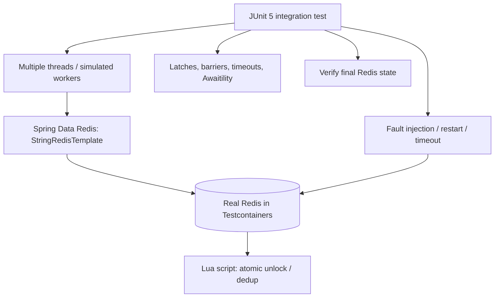
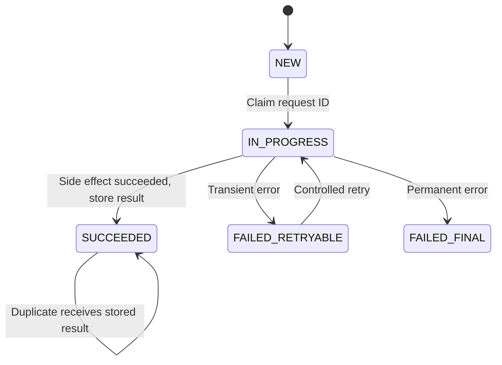

# Testing Concurrency, Idempotency, and Lock Expiration with Spring Data Redis

## 1. Why Passing CRUD Tests Does Not Prove System Correctness

Suppose a Spring Boot application runs work that only one worker should execute at a time: processing orders, generating invoices, syncing data, or scheduling notifications. The application uses Redis to store distributed locks and records of processed requests (*idempotency markers*).

In a simple sequential test:

```text
Worker A acquires lock -> succeeds
Worker A runs job      -> succeeds
Worker A releases lock -> succeeds
```

Everything looks fine. Yet when two or more instances run concurrently, situations like this arise:

```text
Worker A                         Redis                    Worker B
   | SET lock tokenA NX PX 3000     |                         |
   |------------------------------->|                         |
   |<-------------------------------| OK                      |
   |                                |                         |
   | processing stalls > 3 seconds  |                         |
   |                                | lock A's TTL expires    |
   |                                |<------------------------| SET lock tokenB NX PX 3000
   |                                |------------------------>| OK
   |                                |                         | begins processing
   | DEL lock                       |                         |
   |------------------------------->|                         |
   |                                | B's lock deleted wrongly!
```

This exhibits a **race condition**: the lock expired while Worker A was still executing. If A blindly runs `DEL` upon finishing, it deletes B's valid lock. Even after fixing unlock, A can still continue mutating data past the lock lease and cause duplicate side effects.

Another scenario:

```text
Client sends request payment-101
  -> Redis records marker or increments counter
  -> Response is lost
Client retries payment-101
  -> app processes it a second time without idempotency
```

These bugs **do not surface in sequential tests**. To evaluate behavior properly, you need real concurrency tests, lock TTL expiration tests, ambiguous Redis outcome tests, and recovery tests.

This lesson focuses on three topics in Spring Data Redis:

1. **Concurrency:** multiple threads/instances contending for locks and data simultaneously.
2. **Idempotency:** retrying the same logical request produces no unintended duplicate side effects.
3. **Lock expiration:** TTL keeps locks from living forever, while introducing stale-owner overlap risks.

## 2. Distinguishing Atomicity, Mutual Exclusion, and Idempotency

| Concept | Question to Answer | How Redis Helps |
|---|---|---|
| **Atomic command** | Does a single command execute without interleaving from other commands? | Commands like `SET NX PX` and `INCR` are atomic at the single-command level |
| **Mutual exclusion** | How many workers may enter the critical section at once? | Locks using `SET ... NX PX ...` help, but must handle TTL and stale owners |
| **Idempotency** | Does sending the same request twice produce extra side effects? | Markers, Redis Lua, unique constraints, or target-system idempotency |
| **Durability** | Do processed records survive crashes/failover? | Redis persistence/replication or storing in an authoritative source |
| **Ordering** | Do updates apply in the intended version order? | Versioning, CAS, fencing tokens, or appropriate serialization |
| **At-least-once delivery** | Can an event be redelivered so nothing is lost? | Redis Streams + consumer groups/PEL and recovery workflows |

Three common confusions:

- An **atomic** `INCR` does not make an entire “read DB → send email → ACK” workflow atomic.
- A lock with TTL does not guarantee the old worker **stops executing** the instant Redis deletes the key.
- An idempotency marker in Redis does not automatically guarantee exactly-once side effects inside PostgreSQL, an email gateway, or a payment provider.

## 3. Appropriate Testing Architecture



Reliable testing separates:

**Unit tests:** verify key construction, request ID normalization, fallback choices, or handler logic without Redis.

**Integration tests:** run real commands against Redis to verify atomicity, TTL, Lua scripts, and data types.

**Concurrency tests:** launch many callers near-simultaneously using barriers/latches, then assert final state invariants.

**Failure-injection tests:** simulate lost responses, Redis restarts, lock expirations, and timeouts to verify correctness under uncertainty.

Never use a Redis mock backed by a plain `Map<String,String>` to conclude `SET NX PX` or Lua scripts obey real semantics. Mocks help test Java logic, not distributed locking on a Redis server.

## 4. Test Environment: JUnit 5, Testcontainers, and Spring Data Redis

Examples use Spring Boot 3.x, Java 17+, JUnit 5, Spring Data Redis, and Redis OSS via Testcontainers:

```groovy
dependencies {
    implementation 'org.springframework.boot:spring-boot-starter-data-redis'

    testImplementation 'org.springframework.boot:spring-boot-starter-test'
    testImplementation 'org.testcontainers:junit-jupiter'
    testImplementation 'org.testcontainers:testcontainers'
    testImplementation 'org.awaitility:awaitility'
}
```

Testcontainers and other library versions must be managed compatibly via your project BOM/dependency management. Never assume every project includes them automatically.

Integration test setup:

```java
import org.junit.jupiter.api.Test;
import org.springframework.beans.factory.annotation.Autowired;
import org.springframework.boot.test.context.SpringBootTest;
import org.springframework.data.redis.core.StringRedisTemplate;
import org.springframework.test.context.DynamicPropertyRegistry;
import org.springframework.test.context.DynamicPropertySource;
import org.testcontainers.containers.GenericContainer;
import org.testcontainers.junit.jupiter.Container;
import org.testcontainers.junit.jupiter.Testcontainers;
import org.testcontainers.utility.DockerImageName;

@Testcontainers
@SpringBootTest
class RedisConcurrencyIntegrationTest {

    @Container
    static final GenericContainer<?> redisContainer =
        new GenericContainer<>(
            DockerImageName.parse("redis:7.2-alpine")
        ).withExposedPorts(6379);

    @DynamicPropertySource
    static void redisProperties(DynamicPropertyRegistry registry) {
        registry.add("spring.data.redis.host", redisContainer::getHost);
        registry.add(
            "spring.data.redis.port",
            () -> redisContainer.getMappedPort(6379)
        );
    }

    @Autowired
    StringRedisTemplate redis;

    @Test
    void redisIsReachable() {
        String key = "test:health:redis";
        redis.opsForValue().set(key, "ready");
        // An AssertJ assertion checks GET returns "ready".
        redis.delete(key);
    }
}
```

Subsequent tests can share this connection setup or an equivalent test fixture class. **Each test needs its own keyspace** so parallel runs never collide.

Testcontainers requires a Docker/container runtime. If CI lacks Docker, provision a dedicated Redis test server with explicit reset policies. Never use production Redis to test locks or fault injection.

### 4.1. Why Avoid In-Memory Simulated Redis?

Behaviors under test depend on the Redis server:

- Server-enforced TTL lifetimes.
- Single atomic execution point of `SET NX PX`.
- Atomic Lua script execution on the Redis node.
- Special `PTTL`/`TTL` return codes.
- Command behavior under connection timeouts or restarts.
- Redis Cluster hash slots and multi-key constraints.

A Java mock cannot reproduce these faithfully without reimplementing much of Redis.

## 5. Minimal Distributed Lock: `SET NX PX`

To acquire a lock, issue a single Redis command combining existence check and TTL:

```redis
SET lock:job:daily-report worker-token-123 NX PX 30000
```

Meaning:

- `lock:job:daily-report`: lock key.
- `worker-token-123`: owner identifier token.
- `NX`: create the key only if it does not already exist.
- `PX 30000`: set a 30,000-millisecond TTL atomically in the same command.

The command succeeds if the worker won the lock; if the key already exists, Redis leaves it untouched. Learners should inspect raw responses in `redis-cli` because drivers translate replies to Boolean or nullable values.

**Why not issue `SETNX` followed by `PEXPIRE` as two commands?**

```text
SETNX lock token     -> succeeds
Process crashes
PEXPIRE lock 30000   -> never runs
```

The lock ends up with no TTL and can live forever without manual cleanup. `SET ... NX PX ...` eliminates the crash window between the two commands.

### 5.1. Spring Data Redis Uses `setIfAbsent` with `Duration`

```java
import java.time.Duration;

import org.springframework.data.redis.core.StringRedisTemplate;

public final class RedisLockService {

    private final StringRedisTemplate redis;

    public RedisLockService(StringRedisTemplate redis) {
        this.redis = redis;
    }

    public boolean acquire(
            String lockKey, String ownerToken, Duration lease) {
        if (lease.isZero() || lease.isNegative()) {
            throw new IllegalArgumentException("Lease must be positive");
        }
        if (ownerToken == null || ownerToken.isBlank()) {
            throw new IllegalArgumentException("Owner token required");
        }

        Boolean acquired = redis.opsForValue()
            .setIfAbsent(lockKey, ownerToken, lease);

        return Boolean.TRUE.equals(acquired);
    }
}
```

`StringRedisTemplate.opsForValue().setIfAbsent(key, value, duration)` expresses acquiring a lock with a TTL in one operation.

Note: `null` can occur in special execution modes such as pipelines or transactions. Never treat `null` as acquired; the code strictly requires `Boolean.TRUE`.

### 5.2. Tokens Must Be Unique Across Lock Acquisitions

Never use a fixed value like `"locked"` as the owner token:

```text
Worker A: token "locked"
Worker B: token "locked"
```

When A's lock expires and B acquires it, A cannot tell the new lock belongs to B because both share the same value. Generate a fresh token for **each acquisition attempt**, e.g.:

```java
String token = java.util.UUID.randomUUID().toString();
```

This token verifies unlock ownership for **that specific acquisition**, not a user ID, session ID, or monotonically increasing fencing sequence.

## 6. Why `GET` Followed by `DEL` Is Not a Safe Unlock

A common bug:

```java
if (token.equals(redis.opsForValue().get(lockKey))) {
    redis.delete(lockKey);
}
```

Two separate commands `GET` and `DEL` are **not atomic**:

```text
Worker A: GET lock -> tokenA
Redis:    lock A's TTL expires
Worker B: SET lock tokenB NX PX ... -> succeeds
Worker A: DEL lock -> wrongly deletes B's lock
```

Even Java `synchronized` only guards a code block inside one JVM; workers in other JVMs can still interleave.

The fix is comparing the token and deleting **inside a single atomic Redis Lua script**.

## 7. Atomic Unlock with a Lua Script

Script:

```lua
-- KEYS[1]: lock key
-- ARGV[1]: owner token to verify
if redis.call('GET', KEYS[1]) == ARGV[1] then
    return redis.call('DEL', KEYS[1])
end
return 0
```

Semantics:

- If the key still holds the caller's token, Redis deletes the lock.
- If the key already expired, nothing is deleted.
- If a new worker already acquired the lock with a different token, the new lock is preserved.

Applying it in Spring Data Redis:

```java
import java.time.Duration;
import java.util.List;

import org.springframework.data.redis.core.StringRedisTemplate;
import org.springframework.data.redis.core.script.DefaultRedisScript;

public final class RedisLockService {

    private static final DefaultRedisScript<Long> UNLOCK_SCRIPT;

    static {
        UNLOCK_SCRIPT = new DefaultRedisScript<>();
        UNLOCK_SCRIPT.setScriptText("""
            if redis.call('GET', KEYS[1]) == ARGV[1] then
                return redis.call('DEL', KEYS[1])
            end
            return 0
            """);
        UNLOCK_SCRIPT.setResultType(Long.class);
    }

    private final StringRedisTemplate redis;

    public RedisLockService(StringRedisTemplate redis) {
        this.redis = redis;
    }

    public boolean acquire(
            String lockKey, String ownerToken, Duration ttl) {
        if (ttl.isNegative() || ttl.isZero()) {
            throw new IllegalArgumentException("TTL must be positive");
        }

        return Boolean.TRUE.equals(
            redis.opsForValue().setIfAbsent(lockKey, ownerToken, ttl)
        );
    }

    public boolean release(String lockKey, String ownerToken) {
        Long removed = redis.execute(
            UNLOCK_SCRIPT,
            List.of(lockKey),
            ownerToken
        );
        return Long.valueOf(1L).equals(removed);
    }
}
```

This is an illustrative implementation for a **single Redis primary**. It does not by itself provide fencing, linearizability across failovers, lock renewal, or a guarantee that work always finishes before TTL.

**Never delete the lock unconditionally in `finally`.** Call `release(lockKey, ownerToken)` so a worker deletes only a lock it still owns.

### 7.1. When the Redis Command Times Out During Unlock

Suppose Redis ran Lua and deleted the lock, yet the reply failed to reach the client. The worker gets a timeout and cannot tell whether unlock happened.

This unlock script is safe to retry with the same token: if the lock was already deleted or belongs to a new owner, it returns `0` without deleting the wrong lock. Still, retries must obey bounded policies and overall deadlines rather than spinning endlessly.

## 8. Testing Concurrent Lock Contention with `CountDownLatch`

First goal: multiple threads try to acquire **the same lock key**, yet **only one thread** succeeds while none have released it.

Calling workers sequentially in a `for` loop creates zero contention. Use `CountDownLatch` so all workers start at a controlled instant.

The JUnit 5 example below assumes `StringRedisTemplate redis` connected to Testcontainers Redis and `RedisLockService` from earlier:

```java
import static org.assertj.core.api.Assertions.assertThat;

import java.time.Duration;
import java.util.ArrayList;
import java.util.List;
import java.util.Objects;
import java.util.UUID;
import java.util.concurrent.CountDownLatch;
import java.util.concurrent.ExecutorService;
import java.util.concurrent.Executors;
import java.util.concurrent.Future;
import java.util.concurrent.TimeUnit;

import org.junit.jupiter.api.Test;

class LockRaceTest {

    // RedisLockService lockService: fixture connected to real test Redis.

    @Test
    void onlyOneWorkerAcquiresTheSameLiveLock() throws Exception {
        int contenders = 12;
        String lockKey = "test:lock:" + UUID.randomUUID();
        RedisLockService lockService = new RedisLockService(redis);

        ExecutorService pool = Executors.newFixedThreadPool(contenders);
        CountDownLatch ready = new CountDownLatch(contenders);
        CountDownLatch start = new CountDownLatch(1);
        List<Future<String>> futures = new ArrayList<>();
        String winningToken = null;

        try {
            for (int i = 0; i < contenders; i++) {
                futures.add(pool.submit(() -> {
                    String token = UUID.randomUUID().toString();
                    ready.countDown();
                    if (!start.await(5, TimeUnit.SECONDS)) {
                        throw new IllegalStateException("Start gate timed out");
                    }
                    return lockService.acquire(
                        lockKey, token, Duration.ofSeconds(30)
                    ) ? token : null;
                }));
            }

            assertThat(ready.await(5, TimeUnit.SECONDS)).isTrue();
            start.countDown();

            List<String> winners = new ArrayList<>();
            for (Future<String> future : futures) {
                String token = future.get(5, TimeUnit.SECONDS);
                if (token != null) {
                    winners.add(token);
                }
            }

            assertThat(winners).hasSize(1);
            winningToken = winners.get(0);
            assertThat(redis.opsForValue().get(lockKey))
                .isEqualTo(winningToken);
        } finally {
            start.countDown();
            if (winningToken != null) {
                lockService.release(lockKey, winningToken);
            }
            pool.shutdownNow();
        }
    }
}
```

To compile verbatim, place the test method inside the integration test class holding `redis` or inject that fixture; `LockRaceTest` focuses on the **start gate and concurrent assertions**.

### 8.1. Why Does This Test Avoid Releasing Inside Each Worker?

If the winning thread acquires and immediately releases, another thread can acquire the lock afterward. The test would see two successful acquisitions even though **two owners never overlapped**. Asserting “only one worker succeeded” would miss its purpose.

Above, the winner holds the lock until every contender returns. Thus, across one contended round with a live lock, exactly one acquisition succeeds.

### 8.2. Why Must Latches and Futures Have Timeouts?

If a thread never reaches the barrier or Redis hangs, the test must not block forever. `ready.await(5, SECONDS)` and `future.get(5, SECONDS)` surface failures cleanly.

Slow CI runners may need larger timeouts; what matters is a **finite bound**, not hardcoding 5 seconds everywhere.

## 9. Testing Mutual Exclusion at the Critical Section Level

Testing “only one worker acquires” proves atomicity of the acquire command at one instant, not protection across the entire **critical section**.

A stronger invariant:

```text
activeWorkersInsideCriticalSection <= 1
```

Inside one JVM, an `AtomicInteger` detects whether two threads ever enter the guarded region concurrently:

```java
AtomicInteger active = new AtomicInteger();
AtomicBoolean overlapDetected = new AtomicBoolean(false);

Runnable protectedWork = () -> {
    int concurrent = active.incrementAndGet();
    try {
        if (concurrent > 1) {
            overlapDetected.set(true);
        }
        // Short, controlled work.
    } finally {
        active.decrementAndGet();
    }
};
```

However, this `AtomicInteger` only observes threads **inside one test process**. It proves nothing across two distinct JVMs or containers.

For **multi-instance tests**, use a shared audit sink or dedicated Redis script logging critical-section entries and exits, then check for overlapping intervals. Ensure the audit collection itself is race-free rather than doing a `GET` then `SET`.

### 9.1. Invariants While the Lock Is Valid Differ After TTL Expires

As long as every worker finishes **faster than TTL**, we expect at most one valid owner at a time.

Yet if Worker A runs past the TTL, Redis lets Worker B acquire. Both A and B can execute business logic simultaneously even though Redis recognizes only B. **A lock with TTL cannot kill Thread A.**

That is why lock expiration must be tested explicitly, beyond the happy path.

## 10. Testing TTL with `PTTL` and Awaitility

Redis offers:

```redis
TTL lock:key
PTTL lock:key
```

`TTL` returns remaining seconds; `PTTL` returns milliseconds. Special values:

| `PTTL` | Meaning |
|---|---|
| Positive number | Key still has remaining lifetime |
| `-1` | Key exists **without an expiry** |
| `-2` | Key **does not exist** |

Never write a TTL test using `Thread.sleep(500)` assuming exact machine scheduling. Use **bounded conditional waiting**:

```java
import static org.assertj.core.api.Assertions.assertThat;
import static org.awaitility.Awaitility.await;

import java.time.Duration;
import java.util.UUID;

import org.junit.jupiter.api.Test;

@Test
void lockExpiresAndCanBeAcquiredAgain() {
    String key = "test:lock:ttl:" + UUID.randomUUID();
    RedisLockService lock = new RedisLockService(redis);

    String tokenA = UUID.randomUUID().toString();
    String tokenB = UUID.randomUUID().toString();

    assertThat(lock.acquire(
        key, tokenA, Duration.ofMillis(250)
    )).isTrue();

    Long initialTtl = redis.getExpire(
        key, java.util.concurrent.TimeUnit.MILLISECONDS
    );
    assertThat(initialTtl).isNotNull().isPositive();

    await()
        .atMost(Duration.ofSeconds(5))
        .until(() -> Boolean.FALSE.equals(redis.hasKey(key)));

    assertThat(lock.acquire(
        key, tokenB, Duration.ofSeconds(5)
    )).isTrue();
    assertThat(redis.opsForValue().get(key)).isEqualTo(tokenB);

    assertThat(lock.release(key, tokenB)).isTrue();
}
```

This uses Awaitility to wait until **Redis actually expires the lock**, rather than trusting the JVM's clock to decide when TTL elapsed. Under heavy CI load, even a 5-second budget can time out and warrant investigating runner latency.

Never assert rigidly that “after exactly 250 ms, `PTTL` must equal `-2` on the exact nanosecond.” Schedulers, networks, and Redis expiration have observable jitter.

## 11. Critical Test: An Expired Owner Must Not Delete the New Owner's Lock

This test guards against the signature race of TTL-based distributed locks.

Scenario:

1. Worker A acquires `tokenA` with a short TTL.
2. Wait until Redis confirms lock A expired.
3. Worker B acquires the same key with `tokenB`.
4. Worker A finishes late and tries releasing with `tokenA`.
5. Redis **must preserve B's lock**.

```java
import static org.assertj.core.api.Assertions.assertThat;
import static org.awaitility.Awaitility.await;

import java.time.Duration;
import java.util.UUID;

@Test
void expiredOwnerMustNotDeleteNewOwnersLock() {
    String key = "test:lock:handoff:" + UUID.randomUUID();
    RedisLockService lock = new RedisLockService(redis);

    String tokenA = UUID.randomUUID().toString();
    String tokenB = UUID.randomUUID().toString();

    assertThat(lock.acquire(
        key, tokenA, Duration.ofMillis(200)
    )).isTrue();

    await()
        .atMost(Duration.ofSeconds(5))
        .until(() -> Boolean.FALSE.equals(redis.hasKey(key)));

    assertThat(lock.acquire(
        key, tokenB, Duration.ofSeconds(10)
    )).isTrue();

    // A is the expired owner and no longer allowed to delete the lock.
    assertThat(lock.release(key, tokenA)).isFalse();

    // The new lock stays intact with B's token.
    assertThat(redis.opsForValue().get(key))
        .isEqualTo(tokenB);

    assertThat(lock.release(key, tokenB)).isTrue();
}
```

This clearly separates unlock strategies:

| Unlock Method | Result When A Releases After B Acquires |
|---|---|
| Unconditional `DEL key` | **Broken**: deletes B's lock |
| Two-step `GET key` then `DEL key` | **Still racy** between `GET` and `DEL` |
| Lua compare-token-and-delete | **Token-safe**: preserves B's lock |

**Limitation:** safe Lua unlock does not stop Worker A from performing business side effects. Protecting full business correctness requires fencing/versioning, covered next.

## 12. Lock Expiration Does Not Signal the Old Worker to Stop

When a Redis key's TTL runs out:

```text
Redis: lock is gone.
Worker A: Java thread may still be running.
Worker B: acquired the new lock.
```

Redis cannot kill a JVM thread, roll back a SQL statement, or cancel an outbound payment gateway call.

Example:

```text
T0  A acquires 2-second lock.
T1  A calls external API; response stalls for 5 seconds.
T2  Redis deletes A's lock.
T3  B acquires lock and updates data.
T4  A receives response and overwrites with stale update.
```

Even if A calls Lua unlock at T4 and gets `0`, A's side effect already ran. Therefore, **checking lock ownership at entry never guarantees long-term critical-section safety**.

### 12.1. Testing Stale Owners with Explicit Barriers

A test can coordinate with two `CountDownLatch`es:

```text
A acquires lock
A signals "entered critical section" (entered.countDown)
A waits on allowFinish
Main test awaits lock A's TTL expiry
B acquires lock, writes new version
Main releases allowFinish
A finishes late
Test checks final data version
```

This is **deterministic event coordination**—easy to explain and far less flaky than random `Thread.sleep` races. Put timeouts on every wait so failed runs never hang.

The test must not expect “A magically stops when TTL expires”: Redis provides no such guarantee. Instead, expect **A is rejected from overwriting B's version** via storage-level version/fencing checks.

## 13. Fencing Tokens: Protecting Resources from Stale Owners

A **random owner token** makes unlocking safe. However, it cannot tell the target resource which owner is **newer**.

To protect a resource from stale workers, use a **monotonically increasing fencing token**:

```text
Worker A acquires -> fencing = 41
Worker A pauses; lock expires
Worker B acquires -> fencing = 42
Worker B writes resource with fencing 42
Worker A wakes up, tries writing with fencing 41
Storage rejects because 41 < 42
```

For example, the target store enforces conditional generation updates:

```sql
UPDATE protected_resource
SET payload = :new_payload,
    last_fencing = :new_fencing
WHERE resource_id = :resource_id
  AND last_fencing < :new_fencing;
```

Tokens per acquisition must increment from a source **strong enough for your consistency requirements**, and checking/updating `last_fencing` must be atomic at the side-effect boundary.

### 13.1. Can Fencing Tokens Come from Redis `INCR`?

`INCR` on a single healthy Redis primary generates increasing numbers:

```redis
INCR lock:fence:daily-report
```

However, **do not assume asynchronous Redis primary–replica failover guarantees fencing tokens never regress**. A promoted primary may lack recent increments if replication lagged.

When strict stale-write protection across failover is mandatory, evaluate a monotonic/linearizable token source such as an authoritative database sequence/transaction or stronger coordinator.

**Fencing tokens differ from owner tokens.** Owner tokens verify lock ownership at release; fencing tokens prove generational ordering at the protected resource.

## 14. Should You Renew a Lock's TTL?

When jobs occasionally outlive the initial TTL, apps may consider **lease renewal**. Yet renew only if the caller **still owns the lock**:

```lua
-- KEYS[1]: lock key
-- ARGV[1]: current owner token
-- ARGV[2]: new lease in milliseconds
if redis.call('GET', KEYS[1]) == ARGV[1] then
    return redis.call('PEXPIRE', KEYS[1], ARGV[2])
end
return 0
```

The script executes `GET` and `PEXPIRE` atomically on Redis. If B now owns the key, A cannot extend B's TTL.

### 14.1. Renewal Tests

Cases to verify:

1. Matching token and live lock: renew succeeds and `PTTL` increases accordingly.
2. Wrong token: renew returns `0` without altering the current owner's TTL.
3. Expired key: renew returns `0` without resurrecting an expired lock.
4. Redis timeout during renew: worker must handle **uncertain lease ownership**.
5. Worker paused too long: fails to renew in time, allowing another owner to acquire.

### 14.2. Renewal Does Not Eliminate Every Risk

A watchdog scheduler can still miss deadlines due to:

- Stop-the-world GC pauses.
- Frozen processes or overloaded hosts.
- Network partitions.
- Redis failover.
- Executor starvation or stopped schedulers.

Thus, TTL renewal reduces premature expirations **without guaranteeing a stale owner can never continue running**. For high-impact side effects, still enforce versioning/fencing/idempotency at the target resource.

## 15. Idempotency: What If the Same Request Runs Multiple Times?

An operation is *idempotent* when repeating the same logical request causes no additional business side effects beyond what was permitted once.

Example:

```text
Request ID = pay-101
Action = "capture payment for order o-101"

Attempt 1: Payment captured
Attempt 2: Returns attempt 1's result; no extra capture
Attempt 3: Returns attempt 1's result; no extra capture
```

This differs from “every request arrives once at the network layer.” In distributed systems, messages/requests get redelivered, so the system must make repeated execution **safe in observable effects**.

### 15.1. Idempotency Keys Should Reflect Business Identity

Example:

```text
tenant:t-7 / order:o-101 / action:capture / request:pay-101
```

A solid key must:

- Stay identical across retries of the same logical operation.
- Never be reused across distinct operations.
- Include tenant/resource scope in multi-tenant systems.
- Be validated against the request payload: same ID with a different payload must be rejected or handled per explicit policy.
- Outlive the maximum retry/redelivery window.

Never generate a fresh UUID on every retry and call it an idempotency key. A new UUID prevents recognizing retries as the same operation.

## 16. Pitfall: `SETNX` Marker First, Then Business Logic

Example:

```text
SET idempotency:pay-101 IN_PROGRESS NX EX 600
  -> succeeds
Call payment gateway
  -> process crashes before saving result
```

The next retry sees the marker exists:

```text
Idempotency marker exists
  -> skip processing
```

Yet nobody knows whether the payment actually succeeded or failed. **Marking “processed” before side effects finish** can drop work or return wrong responses.

A safer design models explicit states:



Specify clearly:

1. Who owns `IN_PROGRESS`?
2. After a crash, when may another worker take over?
3. Where is the success result stored?
4. If payment succeeded yet storing the result failed, how does reconciliation recover?
5. When a request reuses an ID with a different payload, is it rejected?

A Redis marker can assist, **but never replaces a business transaction/idempotency guarantee at the target store**.

## 17. Atomic Idempotency When Side Effects Live Entirely Inside Redis

A simpler case occurs when the entire protected operation executes **atomically inside one Redis Lua script**.

Suppose the same request ID must increment a counter **at most once**, returning the first result on every retry:

```lua
-- KEYS[1]: counter key
-- KEYS[2]: dedup marker key
-- ARGV[1]: marker TTL, milliseconds

local previous = redis.call('GET', KEYS[2])
if previous then
    return tonumber(previous)
end

local nextValue = redis.call('INCR', KEYS[1])
redis.call('SET', KEYS[2], tostring(nextValue), 'PX', ARGV[1])
return nextValue
```

Outcome:

```text
Request pay-101 attempt 1 -> INCR counter to 1; marker = "1"; returns 1
Request pay-101 attempt 2 -> reads marker "1"; skips INCR; returns 1
Request pay-101 attempt 3 -> reads marker "1"; skips INCR; returns 1
```

In Redis Cluster, both script keys must map to the **same hash slot**:

```text
idem:{order-101}:counter
idem:{order-101}:request:pay-101
```

Sharing hash tag `{order-101}` satisfies Redis Cluster's same-slot requirement for multi-key scripts. In production, validate/escape IDs so raw input cannot break key conventions or cross namespaces.

### 17.1. Calling the Script from Spring Data Redis

```java
import java.time.Duration;
import java.util.List;

import org.springframework.data.redis.core.StringRedisTemplate;
import org.springframework.data.redis.core.script.DefaultRedisScript;

public final class IdempotentRedisCounter {

    private static final DefaultRedisScript<Long> SCRIPT;

    static {
        SCRIPT = new DefaultRedisScript<>();
        SCRIPT.setScriptText("""
            local previous = redis.call('GET', KEYS[2])
            if previous then
                return tonumber(previous)
            end

            local nextValue = redis.call('INCR', KEYS[1])
            redis.call(
                'SET', KEYS[2], tostring(nextValue), 'PX', ARGV[1]
            )
            return nextValue
            """);
        SCRIPT.setResultType(Long.class);
    }

    private final StringRedisTemplate redis;

    public IdempotentRedisCounter(StringRedisTemplate redis) {
        this.redis = redis;
    }

    public long incrementOnce(
            String operationId,
            String requestId,
            Duration dedupTtl) {

        if (dedupTtl.isZero() || dedupTtl.isNegative()) {
            throw new IllegalArgumentException("dedupTtl must be positive");
        }

        String tag = "{" + operationId + "}";
        String counterKey = "idem:" + tag + ":counter";
        String markerKey =
            "idem:" + tag + ":request:" + requestId;

        Long result = redis.execute(
            SCRIPT,
            List.of(counterKey, markerKey),
            String.valueOf(dedupTtl.toMillis())
        );

        if (result == null) {
            throw new IllegalStateException("No result from Redis script");
        }
        return result;
    }
}
```

Example keeping the marker alive for 24 hours:

```java
long result = counter.incrementOnce(
    "order-101",
    "pay-101",
    Duration.ofHours(24)
);
```

For the same `operationId` and `requestId`, the script returns the stored marker result as long as the marker remains alive.

**Limitation:** this protects only the **increment inside Redis**. Sending an email or charging a payment externally afterward is not protected inside the Redis script transaction.

## 18. Testing Multiple Threads Using the Same Idempotency Key

Goal: even when 20 threads simultaneously invoke `incrementOnce("order-101", "pay-101", ...)`, the Redis counter increments once and every caller receives the same result.

```java
import static org.assertj.core.api.Assertions.assertThat;

import java.time.Duration;
import java.util.ArrayList;
import java.util.List;
import java.util.UUID;
import java.util.concurrent.CountDownLatch;
import java.util.concurrent.ExecutorService;
import java.util.concurrent.Executors;
import java.util.concurrent.Future;
import java.util.concurrent.TimeUnit;

@Test
void duplicateRequestsOnlyIncrementOnce() throws Exception {
    String operationId = "test-" + UUID.randomUUID();
    String requestId = "same-logical-request";
    IdempotentRedisCounter counter =
        new IdempotentRedisCounter(redis);

    int callers = 20;
    ExecutorService pool = Executors.newFixedThreadPool(callers);
    CountDownLatch ready = new CountDownLatch(callers);
    CountDownLatch start = new CountDownLatch(1);

    try {
        List<Future<Long>> futures = new ArrayList<>();

        for (int i = 0; i < callers; i++) {
            futures.add(pool.submit(() -> {
                ready.countDown();
                if (!start.await(5, TimeUnit.SECONDS)) {
                    throw new IllegalStateException("Start gate timeout");
                }
                return counter.incrementOnce(
                    operationId,
                    requestId,
                    Duration.ofMinutes(5)
                );
            }));
        }

        assertThat(ready.await(5, TimeUnit.SECONDS)).isTrue();
        start.countDown();

        for (Future<Long> future : futures) {
            assertThat(future.get(10, TimeUnit.SECONDS))
                .isEqualTo(1L);
        }

        String counterKey =
            "idem:{" + operationId + "}:counter";
        assertThat(redis.opsForValue().get(counterKey))
            .isEqualTo("1");
    } finally {
        start.countDown();
        pool.shutdownNow();
    }
}
```

The example uses a random operation ID to avoid test collisions. When running in a project, place this inside the Testcontainers class from section 4 and clean up keys afterward if needed.

This test verifies script atomicity on **one Redis instance/slot**, not marker durability across Redis primary failovers or infinite retention.

### 18.1. Also Test “Same ID, Different Payload”

If idempotency keys guard payments, never accept the same key with a different amount and silently return the old result:

```text
Request ID pay-101, amount = 100
Request ID pay-101, amount = 100 -> valid duplicate
Request ID pay-101, amount = 999 -> must trigger conflict
```

In a complete system, markers store a **hash of the normalized request payload** alongside status/results. When the same ID arrives:

- Matching payload: return stored result or in-progress status.
- Mismatched payload: return a conflict/validation error per API contract.

The simple counter script above does not verify payloads; add that check before applying it to sensitive business operations.

## 19. Testing Marker TTL Expiration: Idempotency Is Time-Bounded

Suppose a marker lives 500 ms:

```text
T0: request A -> counter increments to 1, marker exists
T1: retry A before TTL -> returns 1, counter unchanged
T2: marker TTL expires
T3: retry A after TTL -> counter increments to 2
```

This is expected for **time-bounded idempotency**, yet breaks business requirements if retries arrive after the marker expired.

Matching test:

```java
import static org.assertj.core.api.Assertions.assertThat;
import static org.awaitility.Awaitility.await;

import java.time.Duration;
import java.util.UUID;

@Test
void idempotencyExpiresAccordingToRetentionPolicy() {
    String op = "test-" + UUID.randomUUID();
    IdempotentRedisCounter counter =
        new IdempotentRedisCounter(redis);

    assertThat(counter.incrementOnce(
        op, "request-A", Duration.ofMillis(300)
    )).isEqualTo(1L);

    assertThat(counter.incrementOnce(
        op, "request-A", Duration.ofMillis(300)
    )).isEqualTo(1L);

    String marker = "idem:{" + op + "}:request:request-A";

    await().atMost(Duration.ofSeconds(5))
        .until(() -> Boolean.FALSE.equals(redis.hasKey(marker)));

    assertThat(counter.incrementOnce(
        op, "request-A", Duration.ofMinutes(1)
    )).isEqualTo(2L);
}
```

**Takeaway:** choose idempotency marker TTL based on the **maximum possible retry/redelivery window**, not average HTTP timeout. For long-lived deduplication, short-lived Redis markers are insufficient; a unique constraint in the authoritative database is safer.

## 20. Idempotency When Side Effects Live in a Database

A Redis Lua script **cannot atomically commit** alongside a PostgreSQL `INSERT` inside a single conventional transaction.

Example flow:

```text
1. SETNX marker in Redis.
2. INSERT payment in PostgreSQL.
3. Update marker = SUCCEEDED.
```

If the process crashes between steps 2 and 3:

- PostgreSQL may have committed.
- Redis marker stays `IN_PROGRESS` or expires.
- Another worker handles a retry and tries inserting again.

The right protection puts idempotency inside the **same transactional boundary as the side effect**. Example in PostgreSQL:

```sql
CREATE TABLE payment_request (
    request_id VARCHAR(120) PRIMARY KEY,
    payload_hash VARCHAR(128) NOT NULL,
    status VARCHAR(24) NOT NULL,
    result_json TEXT
);
```

The business transaction checks/inserts the request ID under a unique constraint, applies business changes, and stores the success payload within the same transaction when the data model allows.

Redis can still hold a fast cache or shortcut state to offload DB reads, while the **DB unique constraint/transaction** serves as the primary guard for payment records.

### 20.1. Testing Two Concurrent Inserts with the Same ID

Tests should:

1. Start two concurrent transactions with the same request ID.
2. Hit the same unique constraint.
3. Verify only one transaction creates the business record.
4. Verify the other request receives the stored result or a controlled conflict.
5. Verify a different payload reusing the same ID is rejected.

Never use `Thread.sleep` to “let transaction A go first.” Use barriers and real test-database constraints, then assert final state.

### 20.2. External APIs Need Their Own Idempotency Contracts

When calling payment providers, pass a **provider-supported idempotency key** or implement transaction reconciliation. A Redis marker cannot stop a provider from charging twice if responses drop on the wire.

Even combining a Redis lock and DB marker leaves a failure window:

```text
Payment provider charged successfully
App times out before writing result to DB
```

Recovery plans must therefore reconcile via transaction/reference IDs on the provider side rather than resending charges blindly.

## 21. Testing Uncertain Write Outcomes After Timeouts

An essential test must simulate:

```text
Client sends Redis INCR
Redis executes INCR
Reply is lost on the network
Client hits timeout
Client retries operation
```

Testing only errors returned **before Redis receives the command** misses the hardest failure mode: **the server applied the side effect, yet the client never knew**.

Simulate this with a TCP proxy/fault-injection layer (such as Toxiproxy) or a test harness controlling client responses.

Goals to distinguish:

- Command never reached Redis.
- Command reached Redis but did not run.
- Command executed, reply dropped.
- Command executed and reply arrived normally.

**Never conclude from a timeout that an operation did not happen.**

### 21.1. Expected Outcomes of the Test

When the operation uses a request ID and durable-enough idempotency marker:

```text
Attempt 1: Redis INCR + atomic result marker save
Reply lost
Retry with same request ID
Redis script returns saved result
Counter still incremented only once
```

With raw `INCR` and no marker:

```text
Attempt 1: INCR -> 1
Reply lost
Retry: INCR -> 2
```

That is a **correctness bug introduced by retrying**, not Redis violating atomicity.

## 22. Which Operations Are Safe to Retry and Which Are Not?

| Redis Command/Operation | Risk When Retrying After Timeout | Testing Hint |
|---|---|---|
| `GET`, `HGET` | No direct write side effect; data may have changed | Compare result against read-time version |
| `SET key fixedValue` | Usually value-idempotent, yet TTL can reset | Check TTL before/after retry |
| `DEL key` | Final absence matches, return count can differ | Verify it never deletes a new owner's lock |
| `INCR` / `DECR` | Easily increments/decrements multiple times | Test request ID + dedup |
| `LPUSH` / `RPUSH` | Can insert duplicate list items | Check item count and business IDs |
| `XADD ... *` | Redis assigns a new entry ID every time | Check event count and markers |
| `SET ... NX PX` | Retry fails because the first attempt already created the lock | Test owner token and uncertain acquisition |
| `XACK` | Retrying ACK returns `0` if already ACKed | Inspect PEL; never treat `0` as never processed |
| Idempotent Lua script | Safe within script and marker lifetime | Test retry after dropped reply and after marker TTL |

Never slap a generic `@Retry` onto every Redis method. Retry policies must understand **command semantics**, not just exception classes.

## 23. When Lock Acquisition Times Out: You Might Already Hold the Lock

A subtle scenario:

```text
Worker A sends SET lock tokenA NX PX 30000
Redis executes and creates lock
Reply is lost
Worker A hits timeout
```

Worker A does not know if it won the lock. Returning “failed to acquire” and walking away leaves the lock sitting until TTL expires, blocking other workers. Retrying with a **new token** makes things even worse.

When policy permits verification:

- Retain the **owner token used in the acquisition attempt**.
- After an error, read the key back to see whether the token matches.
- If the token matches and lease remains valid, recover local ownership per protocol design.
- If another token appears or the key is gone, do not claim ownership.
- Every check still races with expiry/renewal and failover; if proof is insufficient, fail safely.

**Warning:** one `GET` seeing your token does not guarantee the lock remains yours for the whole critical section. Always check lease deadlines and external resource fencing.

## 24. Testing Across Multiple JVMs/Containers Instead of Only Threads

A test with 20 threads in a single JVM misses bugs like:

- Static or `synchronized` “locks” that only guard one JVM.
- Instances running different Redis client configurations.
- Clock/timer skew across processes.
- An instance crashing mid-operation.
- Reconnects, failovers, or container restarts.

Multi-instance test layout:

```text
Test Docker network
   |
   +-- Test Redis
   |
   +-- Worker A container
   |
   +-- Worker B container
   |
   +-- Test coordinator / shared audit
```

The test coordinator sends identical requests to A and B, releases them via a shared barrier, collects outcomes, and reconciles **final state in the authoritative store**.

### 24.1. Do Not Just Count Log Lines

If workers print:

```text
"I have lock"
```

logs can be dropped, delayed, or duplicated. Concurrency tests should assert:

- Actual data mutation count.
- Final owner token.
- Resource version/fencing values.
- Duplicate side-effect count.
- Number of requests served idempotently.

Logs help investigate failures, whereas **post-condition state** provides stronger proof.

## 25. Testing TTL Against Redis Time, Not Just JVM Clocks

Key TTL is tracked by Redis. Reference:

```redis
PTTL lock:job:daily-report
GET lock:job:daily-report
```

Examples:

```text
PTTL = 29500 -> key has roughly 29.5 seconds left
PTTL = -1    -> key exists without an expiry; dangerous for locks
PTTL = -2    -> key does not exist
```

### 25.1. Why JVM Clock Mocking Is Insufficient

If a test merely calls:

```java
clock.advance(Duration.ofSeconds(31));
```

to simulate elapsed time in Java, the Redis server never sees that fake clock. Redis locks rely on Redis server time; tests must wait or drive a test Redis instance in real time.

Cases worth checking:

- Locks are created with positive TTL.
- Locks never end up with `PTTL = -1` after acquisition.
- Renewal succeeds only with the matching owner token.
- Expiration allows Worker B to acquire.
- A cannot release or renew B's lock.

### 25.2. Avoid Ultra-Short TTLs in Contention Tests

If a test spawns 30 threads on a loaded CI runner with a 10 ms lock TTL, the lock can expire before all contenders even attempt acquisition. The test might report multiple winners that actually acquired **at different times**.

Choose generous TTLs for acquisition-race tests and keep a separate short-TTL test for expiration. Those two tests verify different things.

## 26. Failure States to Simulate

| Fault Injection | What to Verify |
|---|---|
| Redis process restart | Do locks/markers recover per persistence policy? |
| Redis server unreachable | Acquire fails/times out within deadline without assuming ownership |
| Packet drop after write | Retries never double side effects |
| Network partition | Can an old worker keep running past lease expiry? |
| Long GC pause | Renewal fails, fencing blocks stale writes |
| Redis command timeout | Uncertain outcomes are handled safely |
| Replica failover | Locks/markers may vanish if un-replicated; app handles limits |
| Redis Cluster resharding | Multi-key Lua stays same-slot, avoiding `CROSSSLOT` |
| Clock/time skew | Local clocks alone never decide lease safety |
| Dedup marker TTL expiration | Retries after retention can create new effects |
| Concurrent requests, same ID, different payload | Rejected/conflicted per contract |
| Redis disk full / persistence error | Never assume markers are durable just because write ACKed |
| Worker crashes before unlock | Lock expires via TTL so other workers continue |
| Worker crashes after side effect before ACK | Recovery processes duplicates idempotently |

**Never run fault injection against production Redis.** Isolated tests must target specific failure modes without disrupting real user sessions or keys.

## 27. Testing Redis Sentinel/Cluster and Lock Limits

Standard Redis primary–replica replication is asynchronous:

```text
Primary P: SET lock tokenA -> OK
Write has not reached replica R
Primary P fails
Replica R is promoted
Lock tokenA may be missing on R
Worker B acquires lock
Worker A is still running
```

This is **lock loss across failover**, even when TTL still had plenty of time on the old primary.

A failover test should:

1. Start a test Redis topology with primary, replicas, and failover.
2. Acquire a lock on the primary.
3. Simulate replication lag if supported by the test harness.
4. Trigger failover in the test environment.
5. Check whether old and new workers can both believe they own the operation.
6. Verify the protected data store rejects stale writes via fencing, versioning, or transactions.

### 27.1. `WAIT` Does Not Replace Fencing

Redis `WAIT` waits for replicas to acknowledge a replication offset, yet it does not provide full strong consistency or a linearizable distributed lock protocol across arbitrary failovers.

Likewise, enabling AOF and fsync on the primary does not guarantee a promoted replica already received the lock.

When work demands **strict mutual exclusion across partitions and failovers**, evaluate a distributed coordinator or resource-level fencing with stronger guarantees. Never claim a single-instance Redis lock proves absolute exactly-once semantics.

## 28. Redis Cluster: Locks and Idempotency Keys Must Account for Hash Slots

Multi-key Lua scripts must satisfy Redis Cluster's slot rules.

**Wrong** example:

```text
lock:order-101
counter:order-101
request:pay-101
```

These keys are not guaranteed to share a slot.

Example using matching hash tags:

```text
lock:{order-101}
counter:{order-101}
request:{order-101}:pay-101
```

Verify via:

```redis
CLUSTER KEYSLOT lock:{order-101}
CLUSTER KEYSLOT counter:{order-101}
CLUSTER KEYSLOT request:{order-101}:pay-101
```

All three must map to the exact same slot. However, **never reuse one global hash tag across the entire application**: funneling every key into one slot creates a hotspot and defeats sharding.

### 28.1. Cluster Routing Does Not Alter Timeout Semantics

During resharding, clients encounter `MOVED`/`ASK`, retries, or command timeouts. If a write executed before its reply was lost, retrying without idempotency remains just as dangerous.

Never treat “the driver automatically handles redirects” as meaning business operations have exactly-once semantics.

## 29. Testing Redis Streams Consumers and Idempotency

Redis Streams can redeliver records while entries remain pending and get claimed/recovered. Example:

```text
Worker A receives stream record 100-0
Worker A writes business result
Worker A crashes before XACK
Worker B claims record 100-0
Worker B reprocesses unless deduplicated
```

An integration test should:

1. Use a dedicated test consumer group.
2. Append a record with `XADD`.
3. Have Worker A read without calling `XACK`.
4. Simulate Worker A stopping.
5. Have Worker B claim the pending entry via the chosen mechanism.
6. Re-run the handler with the same business event ID.
7. Verify the side effect happens once per idempotency policy.
8. Only `XACK` once the outcome is persisted properly.

**Note:** Redis Streams provide group ACKs, yet `XACK` does not share a transaction with databases or external APIs. Tests must simulate crashes after side effects and before ACK.

### 29.1. The Idempotency Key Is Not Necessarily the Redis Stream ID

A Redis Stream ID identifies one entry inside a stream, yet the same logical business event can appear **twice under two distinct Stream IDs** if the producer retries `XADD *` after a lost reply.

When business logic needs deduplication per logical event, carry a stable **business event ID** set by the producer and deduplicated by consumers, rather than relying solely on physical stream entry IDs.

## 30. Testing Locks in Reactive Pipelines

Spring Data Redis also provides `ReactiveRedisTemplate` and `ReactiveStringRedisTemplate`. Reactive acquisition example:

```java
import java.time.Duration;

import org.springframework.data.redis.core.ReactiveStringRedisTemplate;

import reactor.core.publisher.Mono;

public Mono<Boolean> acquireReactive(
        ReactiveStringRedisTemplate redis,
        String key,
        String token) {

    return redis.opsForValue()
        .setIfAbsent(key, token, Duration.ofSeconds(10))
        .map(Boolean.TRUE::equals);
}
```

This covers only **acquisition**, not a complete lock implementation.

A reactive locking pipeline typically needs cleanup across all terminal paths:

- Business Publisher succeeds.
- Business Publisher emits `onError`.
- Subscriber cancels.
- Mid-flight timeout.

Reactor offers `Mono.usingWhen(...)` to attach asynchronous cleanup hooks across success, error, and cancellation. Release must still run **atomic compare-owner-and-delete**, never unconditional `DEL`.

### 30.1. Cancellation Does Not Roll Back Redis Commands

Example:

```java
return redis.opsForValue()
    .setIfAbsent(key, token, Duration.ofSeconds(10))
    .timeout(Duration.ofMillis(100));
```

If the command reached Redis and created the lock while `Mono` timed out before receiving the reply, Java does not know the lock exists. Reactor cancellation never sends a transaction rollback to Redis.

Reactive tests must inspect **Redis state after timeout** and define policies for uncertain acquisition outcomes. Never assume `StepVerifier` seeing `TimeoutException` means the key was never created.

### 30.2. Never Call `.block()` on the WebFlux Event Loop to Acquire a Lock

Avoid:

```java
boolean acquired = acquireReactive(redis, key, token).block();
```

inside handlers running on Reactor's event loop. Blocking stalls threads and defeats non-blocking I/O.

Compose Publishers, bound deadlines, and manage cleanup along subscription lifecycles. Still, Reactor does not upgrade Redis semantics into distributed transactions or fencing guarantees.

## 31. Measuring Concurrency and Correctness, Not Just Throughput

A system handling 50,000 operations/sec is still broken if even a small fraction of requests duplicate or locks get deleted out from under live workers.

Metrics to collect:

| Metric | Meaning |
|---|---|
| Lock acquire success/failure | Level of contention and acquisition availability |
| Lock acquisition latency p95/p99 | How long workers wait |
| Remaining lock TTL at start/end | Whether jobs risk running near lease expiry |
| Expired-owner unlock attempts | How often workers finish past TTL |
| Token mismatch on release/renew | Occurrences of stale owners or wrong tokens |
| Overlapping critical sections | Mutual exclusion violations observed in audit tests |
| Duplicate request count | Rate of requests sharing an idempotency key |
| Replayed-result count | Retries served stored results |
| Idempotency conflict count | Same ID with mismatched payload |
| Marker expiration/reuse | Whether dedup retention window is too short |
| Redis timeouts/reconnects | Exposure to uncertain command outcomes |
| Business duplicate side effects | Actual correctness in the authoritative source |
| Fencing/version rejections | How often stale writers were blocked |

Never log raw lock tokens, payment credentials, or sensitive payloads. Safe correlation IDs and structured error codes suffice for diagnostics.

### 31.1. One Passing Test Run Does Not Rule Out Races

Concurrency bugs depend on scheduling, latency, and load. You should:

- Repeat runs across many iterations with **isolated keys**.
- Scale contender counts appropriately for the test environment.
- Vary TTLs and critical-section durations.
- Run under CI load without relying on random sleeps.
- Combine stress with failure injection rather than stressing only happy paths.
- Log seeds, request IDs, and timelines on failures.

Note: running more iterations never provides a formal proof of mutual exclusion. For strict correctness requirements, **review protocols, invariants, and distributed failure modes** alongside testing.

## 32. Checklist of Invariants for the Test Suite

| Invariant | How to Observe |
|---|---|
| At most one owner acquires a live lock | Many contenders behind a barrier; winner does not release until all finish |
| Acquire sets a positive TTL | `PTTL > 0` right after successful acquire |
| Expired owner never deletes new owner's lock | A expires → B acquires → A's release leaves B untouched |
| Wrong token cannot renew | Lua token check + `PEXPIRE`; B's `PTTL` is not extended |
| Expired lock lets another worker proceed | Await key absence, then acquire as B |
| Stale worker cannot overwrite newer state | Fencing/version check at target store |
| One request ID increments Redis counter once | Lua dedup + 20 concurrent callers |
| Duplicates receive the stored result | Script returns identical value while marker is live |
| Same ID with different payload is rejected | Verify payload hash/conflict rejection |
| Marker expires per retention policy | Await marker expiry, verify post-retention semantics |
| Response timeout causes no double writes | Fault injection drops reply + retry same request ID |
| Crash between side effect and ACK causes no duplicates | Redis Streams pending recovery + idempotency |
| Failover is not assumed 100% lossless | Test primary switchover and verify fencing/durability limits |
| Multi-key Cluster commands share a slot | `CLUSTER KEYSLOT` or routing assertions |
| Tests never hang indefinitely | Timeouts on latches, futures, Awaitility, and HTTP calls |

Suites should **state expected invariants explicitly** instead of merely asserting a service returns `true`. Missing invariants lead to slapping on retries or bumping TTLs, hiding symptoms without fixing root causes.

## 33. Anti-Patterns to Avoid

### 33.1. Using Java `synchronized` Instead of a Distributed Lock

`synchronized` only coordinates threads in one JVM—it never protects across separate Spring Boot instances.

### 33.2. Splitting `SETNX` and `EXPIRE` into Two Commands

If the process crashes between them, the key can live forever. Use `SET NX PX` or an atomic equivalent in one operation.

### 33.3. Unlocking with `DEL` Without Checking Ownership

An expired worker can delete a newer worker's lock. Use atomic compare-token-and-delete.

### 33.4. Assuming TTL Stops the Old Worker from Writing

TTL only expires the Redis key; it does not halt running threads or in-flight external calls.

### 33.5. Testing Acquire Without Testing Release

A working acquire can still break at release once TTL expires and ownership changes.

### 33.6. Testing Concurrency with a Sequential `for` Loop

Without barriers and true concurrency, tests miss races.

### 33.7. Using `sleep` as Proof a Lock Expired on Schedule

Poll Redis state using Awaitility with timeouts, and check `PTTL`/owner tokens.

### 33.8. Assuming a 30-Second Idempotency TTL Suits Every System

Messages can redeliver minutes or hours later, and clients retry late. Tie retention to business windows.

### 33.9. Marking `SUCCEEDED` Before Side Effects Complete

Crashing between marker creation and side effect leaves requests skipped despite never completing.

### 33.10. Retrying `INCR` or `XADD` After Timeouts Without Deduplication

The server may have executed the command before the reply was dropped; retries duplicate side effects.

### 33.11. Treating Redis Lua as a Transaction Spanning PostgreSQL/Payment Gateways

Lua is atomic inside Redis only—it never commits atomically with external systems.

### 33.12. Using a Random UUID as a Fencing Token

UUIDs identify owners, not monotonically increasing generations; stale-write protection requires ordering/checks at the resource.

### 33.13. Trusting a Promoted Primary Always Retains Old Locks

Asynchronous Redis replication may not have replicated the lock before failover.

### 33.14. Using One Hash Tag Across Every Operation in Cluster

It avoids `CROSSSLOT` at the cost of a severe hotspot; scope hash tags per resource or transaction boundary.

### 33.15. Asserting Only Logs or HTTP `200`

An API can return `200` twice while billing or emailing the customer twice. Assert final business state.

## 34. Step-by-Step Practice Workflow

Run on Testcontainers Redis or an isolated Redis server.

**Step 1 — Create a lock with a short TTL.**

```redis
SET test:lock:demo tokenA NX PX 3000
PTTL test:lock:demo
GET test:lock:demo
```

Observe the key holds `tokenA` and remaining lifetime.

**Step 2 — Contend while the key exists.**

```redis
SET test:lock:demo tokenB NX PX 3000
```

Verify the command does not overwrite the existing lock.

**Step 3 — Test owner token on unlock.**

Execute Lua compare-and-delete on test Redis via the Spring Data Redis code from section 7. With a mismatched token, the script returns `0` and the key stays intact.

**Step 4 — Wait for the lock to expire.**

```redis
PTTL test:lock:demo
```

Once `PTTL` reaches `-2`, acquire with `tokenB`. Do not rely on a single rigid sleep.

**Step 5 — Test old-owner release.** Have A call release with `tokenA` after B acquires. Verify B's lock remains intact.

**Step 6 — Run concurrency test.** Use JUnit/`CountDownLatch` with at least 10 contenders trying to acquire, without releasing immediately on win.

**Step 7 — Run idempotency script.** Have multiple threads invoke the same request ID. Verify the counter increments once.

**Step 8 — Wait for marker TTL expiry.** Resend the same request ID after retention expires. Observe the operation executes again and evaluate whether retention fits business needs.

**Step 9 — Simulate lost response.** Redis executes a write while the client times out. Compare raw commands against deduplicated scripts.

**Step 10 — Simulate stale owner.** A runs past lease expiry, B acquires and writes a newer version, then A wakes up and tries writing. Verify the target store blocks the stale write.

**Step 11 — Test recovery.** Restart Redis or crash workers in isolation; check surviving/lost locks and markers against persistence policy.

**Step 12 — Document limits.** Record what was verified against a single Redis primary versus what still needs HA/failover or authoritative-store tests.

## 35. When to Use Redis Locks vs. Other Mechanisms

| Requirement | Approach to Consider | Limits to Test |
|---|---|---|
| Prevent two low-impact background jobs from overlapping normally | Redis lock with TTL + owner-token unlock | Overlap possible if lease expires |
| Deduplicate cache/counter requests wholly within Redis | Atomic Lua dedup + marker | Marker retention and durability |
| Prevent charging a payment twice | Provider idempotency key + DB transaction/unique constraint | Uncertain external outcomes |
| Distribute work needing retries | Redis Streams consumer groups + ACK/idempotent handlers | Pending recovery, retention, duplicates |
| Block stale workers from overwriting resources | Fencing token/version check at resource | Monotonic reliability of token source |
| Strict mutual exclusion across network partitions/failovers | Coordinator/transactional store matching consistency needs | Verify failure model and guarantee level |
| Simply update a counter atomically | `INCR` | No lock needed for one command, yet retries need dedup |
| Atomically update multiple fields on one Redis key | Lua script or appropriate transaction | Multi-key slot/timeout and correctness |

Sometimes the simplest solution is **no lock at all**: when business logic fits an atomic Redis operation or conditional SQL update, it is usually easier to test and less race-prone than a homegrown distributed lock.

## 36. Conclusion

Testing **concurrency, idempotency, and lock expiration** in Spring Data Redis goes far beyond confirming a single `SET` or `GET` succeeds. Dangerous bugs hide in the seams between operations:

- Multiple workers contending for the same resource.
- Redis locks expiring while old workers continue executing.
- Requests performing side effects whose responses are lost.
- Redis or workers crashing between business writes and acknowledgments.
- Idempotency markers expiring or vanishing after failover.

Essential principles:

1. **Atomic acquisition:** use `SET ... NX PX ...` or `setIfAbsent(key, token, ttl)`.
2. **Safe unlock:** compare owner token and `DEL` in one Lua script.
3. **Real concurrency tests:** use latches/barriers, bounded futures, and final-state assertions.
4. **Separate TTL tests:** await Redis expiration explicitly, let a new owner acquire, and prove the old owner cannot delete the new lock.
5. **Never equate TTL with halting side effects:** stale owners keep running; enforce fencing/versioning or transactional stores.
6. **Scoped, time-bounded idempotency:** Redis atomic dedup protects Redis state inside the script; external side effects need their own contracts.
7. **Handle ambiguous outcomes:** timeouts never prove commands did not run, so retries must be safe by request ID and command semantics.
8. **Test real faults:** test Redis, multi-instance runs, fault injection, and HA/failover are essential complements for high reliability.

A trustworthy system is built not just on high test pass rates, but on **explicit business invariants** verified under concurrency, timeouts, crashes, and recovery.

## References

- [Redis Documentation — Distributed locks](https://redis.io/docs/latest/develop/use/patterns/distributed-locks/)
- [Redis Documentation — SET](https://redis.io/docs/latest/commands/set/)
- [Redis Documentation — PTTL](https://redis.io/docs/latest/commands/pttl/)
- [Redis Documentation — EVAL](https://redis.io/docs/latest/commands/eval/)
- [Redis Documentation — Lua scripting](https://redis.io/docs/latest/develop/programmability/eval-intro/)
- [Redis Documentation — INCR](https://redis.io/docs/latest/commands/incr/)
- [Redis Documentation — Replication](https://redis.io/docs/latest/operate/oss_and_stack/management/replication/)
- [Redis Documentation — Redis Streams](https://redis.io/docs/latest/develop/data-types/streams/)
- [Spring Data Redis Reference — RedisTemplate](https://docs.spring.io/spring-data/redis/reference/redis/template.html)
- [Spring Data Redis Reference — Redis Scripting](https://docs.spring.io/spring-data/redis/reference/redis/scripting.html)
- [Spring Data Redis Reference — Reactive Redis Support](https://docs.spring.io/spring-data/redis/reference/redis/reactive.html)
- [Spring Data Redis API — ValueOperations](https://docs.spring.io/spring-data/redis/docs/current/api/org/springframework/data/redis/core/ValueOperations.html)
- [Spring Data Redis API — RedisScript](https://docs.spring.io/spring-data/redis/docs/current/api/org/springframework/data/redis/core/script/RedisScript.html)
- [Testcontainers — Java documentation](https://java.testcontainers.org/)
- [JUnit 5 — User Guide](https://junit.org/junit5/docs/current/user-guide/)
- [Awaitility — Documentation](https://github.com/awaitility/awaitility/wiki/Usage)
- [Project Reactor — Reference Guide](https://projectreactor.io/docs/core/release/reference/)
