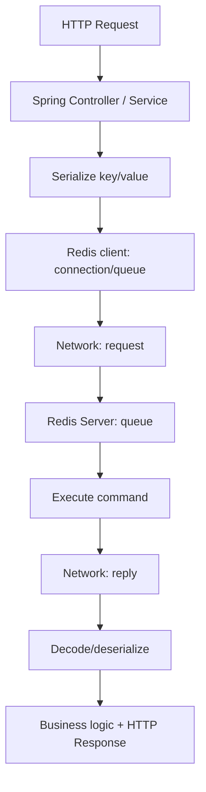

# Distinguishing Network, Application, and Redis Server Bottlenecks in Spring Data Redis

> **Module:** Spring Data Redis  
> **Chapter:** Performance  
> **Lesson:** A methodology for decomposing Redis access time, measuring at the application, Redis client, network, and Redis Server layers; identifying bottlenecks and optimizing in the right place without sacrificing data correctness.

## 1. Where Is Redis Slow?

A Spring Boot service calls:

```java
String json = stringRedisTemplate.opsForValue()
        .get("cache:product:101");
```

If the log records that the call took **120 ms**, you cannot conclude that Redis Server spent 120 ms executing `GET`. It could be:

- 80 ms waiting for the Redis connection pool.
- 20 ms network round-trip.
- 0.2 ms server execution.
- 10 ms serializer and callback processing.
- The remainder in thread scheduling, CPU contention, or GC.

Another scenario: `HGETALL` on a very large Hash executes for 90 ms on the Redis side; in that case, increasing the connection pool helps very little.

**Principle:** Time measured at `RedisTemplate` is *client-observed time*, not *Redis Server command execution time*. You must measure layer by layer to distinguish the root cause.

### 1.1. Three Main Bottleneck Categories

| Category | Sources of Slowdown | Observation Tools |
|---|---|---|
| **Network** | RTT, cross-region/cross-AZ, retransmission, bandwidth, DNS/TLS/connection setup | PING from pod, `redis-cli --latency`, TCP/cloud network telemetry |
| **Application/Redis client** | GC, serialization, thread/event-loop blocking, pool/queue, sequential commands, retries | Micrometer, JFR, thread dumps, Lettuce/Jedis command/pool metrics |
| **Redis Server** | Big keys, expensive commands, Lua, CPU/queue, eviction, persistence, hot shard | `INFO`, `SLOWLOG`, `LATENCY`, commandstats, per-node monitoring |

Multiple bottlenecks can occur simultaneously. Getting a 5 MiB JSON payload can incur network transfer, Redis output handling, **and** JVM deserialization costs.

### 1.2. Questions Before Optimizing

1. Are all HTTP endpoints slow, or only endpoints that call Redis?
2. Are all Redis commands slow, or only `HGETALL`, `SMEMBERS`, or `MGET` with many keys?
3. Are all pods slow, or only a specific pod/AZ?
4. Does the slowdown correlate with traffic, after deployment, during failover, or on a backup schedule?
5. Are Redis and the application in the same region/AZ?
6. How many Redis commands does a single HTTP request invoke?
7. Are cache misses increasing due to TTL or eviction?
8. In Redis Cluster, is one primary node hotter than the remaining nodes?

The answers help you choose targeted measurements rather than measuring everything at random.

## 2. Decomposing the Path of a Redis Command



Approximate model:

\[
T_{\text{redis-call}} \approx
T_{\text{serialize}}+T_{\text{client-queue}}
+T_{\text{network-out}}+T_{\text{server-queue}}
+T_{\text{server-execute}}+T_{\text{network-back}}
+T_{\text{deserialize}}
\]

And:

\[
T_{\text{HTTP}} \approx T_{\text{application-before}}
+T_{\text{redis-call}}+T_{\text{application-after}}
+T_{\text{other-dependencies}}
\]

This model is for reasoning; with async I/O, stages may overlap. Do not naively sum the *p99* of multiple operations to get the total p99.

### 2.1. Measurements Do Not Have the Same Meaning

| Measurement | What It Represents | What Cannot Be Inferred Directly |
|---|---|---|
| HTTP timer | End-to-end request | That Redis is the bottleneck |
| Timer around `RedisTemplate.get()` | Serialization + client + network + server + decode | Redis execution alone |
| Lettuce command metrics | Command duration as defined by the recorder | Not server CPU by default |
| `SLOWLOG` | Server execution time of commands exceeding threshold | Network RTT, client queue |
| `LATENCY` | Monitored server-side latency events | HTTP request latency |
| `redis-cli --latency` | Redis PING request–reply from where the CLI runs | Pure TCP RTT |
| JVM GC pause | Time the JVM was paused | Server execution |
| TCP RTT/retransmissions | Transport quality | Serializer/server command cost |

**Example:** `RedisTemplate GET = 85 ms` while `SLOWLOG GET = 0.15 ms` does not mean the measurement is wrong. Most of the time may be spent in queueing, network, or decoding.

## 3. Understanding Latency, Throughput, Queueing, and Saturation

- **Latency:** time to complete a single operation.
- **Throughput:** number of operations processed per second.
- **Concurrency:** number of requests/commands in existence simultaneously.
- **Saturation:** a resource nearing its limit, causing work to wait in a queue.

Redis may execute a GET in 0.1 ms in isolation, yet the client still observes 50 ms under overload because of waiting.

### 3.1. Queueing and Tail Latency

Conceptual example:

```text
Low load:
  Client queue:         0.1 ms
  Network:              1.0 ms
  Server execute:       0.2 ms
  Decode:               0.1 ms
  Total:                1.4 ms

High load:
  Client queue:        45.0 ms
  Network:              1.0 ms
  Server execute:       0.2 ms
  Decode:               0.1 ms
  Total:               46.3 ms
```

A command still executes fast on Redis Server, yet the call is slow on the client.

### 3.2. Little's Law

In steady state:

\[
L=\lambda W
\]

Where \(L\) is the average number of operations in the system, \(\lambda\) is operations/second, and \(W\) is the time spent in the system (seconds).

If throughput is 5,000 operations/second:

```text
W = 2 ms:  L ≈ 5,000 × 0.002 = 10 operations in-flight
W = 20 ms: L ≈ 5,000 × 0.020 = 100 operations in-flight
```

When latency increases 10x, the amount of waiting work can grow proportionally, increasing queue/memory usage and creating an overload feedback loop.

### 3.3. Must Measure p50/p95/p99

Example:

```text
Average = 4 ms
p50     = 1 ms
p95     = 14 ms
p99     = 90 ms
max     = 500 ms
```

A 4 ms average can hide a very high p99. When an HTTP SLO evaluates tail latency, p95/p99 matters more than the mean. Do not sum independent *percentiles* to derive the total p99: measure the total directly or use spans from the same trace.

## 4. Starting with HTTP Traces and Application Metrics

An endpoint:

```text
GET /products/101          320 ms
├─ Authentication           10 ms
├─ Redis GET                 2 ms
├─ Database fallback       260 ms
├─ Build DTO                25 ms
└─ HTTP serialization       18 ms
```

Optimizing Redis does not solve the main problem. Here you must examine cache misses and database latency.

Conversely:

```text
GET /products/101          320 ms
├─ Authentication            9 ms
├─ Redis GET               280 ms
└─ Other                    31 ms
```

Now you need to decompose the Redis path further.

### 4.1. Spring Boot Actuator and Micrometer

Gradle Kotlin DSL example:

```kotlin
dependencies {
    implementation("org.springframework.boot:spring-boot-starter-actuator")
    implementation("io.micrometer:micrometer-registry-prometheus")
    implementation("org.springframework.boot:spring-boot-starter-data-redis")
}
```

Illustrative configuration:

```yaml
management:
  endpoints:
    web:
      exposure:
        include: health,info,metrics,prometheus
  metrics:
    distribution:
      percentiles-histogram:
        http.server.requests: true
        app.redis.lookup.duration: true
```

Automatic metrics depend on the Spring Boot/Micrometer/driver version. Do not assume that enabling Actuator automatically makes all Lettuce command timers available. Check your instrumentation and exporter. Do not expose actuator endpoints to the public Internet without protection.

### 4.2. Timer Around RedisTemplate

```java
import java.util.concurrent.TimeUnit;

import io.micrometer.core.instrument.MeterRegistry;
import io.micrometer.core.instrument.Timer;
import org.springframework.data.redis.core.StringRedisTemplate;

public class MeasuredRedisReader {

    private final StringRedisTemplate redis;
    private final MeterRegistry registry;

    public MeasuredRedisReader(
            StringRedisTemplate redis,
            MeterRegistry registry) {
        this.redis = redis;
        this.registry = registry;
    }

    public String get(String key) {
        long start = System.nanoTime();
        boolean success = false;

        try {
            String value = redis.opsForValue().get(key);
            success = true;
            return value;
        } finally {
            Timer.builder("app.redis.lookup.duration")
                    .tag("operation", "GET")
                    .tag("outcome", success ? "success" : "error")
                    .register(registry)
                    .record(
                            System.nanoTime() - start,
                            TimeUnit.NANOSECONDS);
        }
    }
}
```

Meaning:

- Measures **wall-clock** duration from calling the template until the method completes.
- `success=true` even if Redis returns null: a cache miss is a successful GET.
- Do not attach raw `key`, `userId`, or `eventId` to metric labels.
- Appropriate histogram/percentiles are needed for the backend to read p95/p99.
- In high-throughput applications, prepare the Timer during initialization instead of creating a builder on every call.

This timer does **not** separate network time from Redis execution time.

### 4.3. Measuring Serialization Separately

If storing JSON with `StringRedisTemplate`:

```java
String json = redis.opsForValue().get(key);
ProductView product =
        objectMapper.readValue(json, ProductView.class);
```

Measure:

```text
redis.get.duration
json.decode.duration
business.transform.duration
```

If GET takes 2 ms and JSON decode takes 45 ms, the bottleneck is in the application. If using `RedisTemplate<String, ProductView>` with a JSON serializer, decoding happens *inside* `get()`, so you need to measure the serializer separately or use a profiler.

### 4.4. Cache Hit, Miss, and Error

Three distinct states:

1. **Hit:** Redis GET returns a value.
2. **Miss:** Redis GET returns nil/null.
3. **Error:** Redis GET fails with timeout, connection, codec, or command error.

Increased cache misses drive up database fallback load; slow HTTP responses do not automatically mean Redis Server is slow.

## 5. Lettuce/Jedis: Connection Wait and Client Queue

A Redis command can spend time even before reaching the server:

```text
Application
  -> Serialize
  -> Acquire/reuse connection
  -> Queue command
  -> Netty/driver scheduling
  -> Network
  -> Redis
  -> Decode response
```

### 5.1. Lettuce Command Latency Metrics

Lettuce provides a command latency collector/recorder, and compatible versions support Micrometer. Metrics can be broken down by command type, connection context, and duration/percentile depending on the recorder.

Used to:

- View GET/SET/HGETALL/XREAD latency at the client.
- Cross-check against the RedisTemplate timer.
- Compare latency from one pod with another pod.
- Compare against Redis Server SLOWLOG/INFO.
- Detect pending command backlog.

**Read the metric scope for your exact Lettuce version.** Client-measured command latency does not automatically equal Redis Server execution time.

### 5.2. JedisPool Waiting for Connections

Example:

```text
RedisTemplate GET wall time: 130 ms
Pool borrow wait:            112 ms
Command after borrowing:       2 ms
Other overhead:               16 ms
```

This is **client resource contention**.

Check:

- Active, idle, and waiting connections.
- Borrow timeout and pool size.
- Connection leaks.
- Blocking commands holding connections for a long time.
- Transaction duration.
- Current load compared to `maxclients`.
- Whether Redis still has CPU/memory headroom.

Increasing the pool does not automatically fix network RTT or server CPU saturation. An oversized pool can push even more concurrent requests onto Redis.

### 5.3. Lettuce Connection Sharing

Lettuce supports shared connections for many ordinary operations, depending on API/config. Do not assume "one HTTP request needs one Redis connection." Some workloads such as blocking commands or transactions require dedicated connection/session handling.

### 5.4. Do Not Create a New Connection Per Request

If code repeatedly creates a new Redis client/factory/connection:

```text
DNS -> TCP connect -> TLS handshake -> AUTH -> GET -> close
```

setup time can exceed the GET itself. Symptoms: cold calls are slow, warm calls are fast, `total_connections_received` spikes, TIME_WAIT sockets or TLS handshakes increase.

Use a Spring-managed `RedisConnectionFactory`/template and reuse connections as designed.

## 6. Spring Boot Application: CPU, GC, Threads, and Event Loops

### 6.1. JVM GC Pauses

GC pauses can freeze threads/callbacks, causing RedisTemplate and HTTP timers to spike even though Redis Server executed the command quickly.

Check:

- JVM GC pause distribution.
- Heap used/old generation.
- Allocation rate.
- JFR (Java Flight Recorder).
- Thread dump.
- CPU/process/container quota.

If HTTP p99 spikes coincide with GC pauses, adding Redis CPU is not the primary fix.

### 6.2. Large Serializers

A Redis GET returning a 5 MiB JSON payload can trigger:

- Large network byte transfer.
- JVM allocation of byte arrays/Strings.
- Jackson parsing the object graph.
- Heap pressure and GC.
- Another round of response serialization.

Reduce payload size based on access patterns, read only required fields, and profile the codec instead of merely increasing the connection pool.

### 6.3. Spring MVC Thread Blocking

Synchronous `RedisTemplate` waits for results. If many request threads simultaneously wait on I/O, the server-side HTTP thread pool can saturate.

Symptoms:

- Many threads in WAITING/BLOCKED state.
- HTTP queued requests increasing.
- Redis CPU not rising proportionally.
- Individual Redis commands still fast.

Increasing HTTP worker threads may just issue more concurrent Redis calls. Capacity must be tuned across the entire chain.

### 6.4. Blocked WebFlux Event Loop

Wrong:

```java
public Mono<String> get(String key) {
    String value =
            stringRedisTemplate.opsForValue().get(key);
    return Mono.justOrEmpty(value);
}
```

The blocking call already ran before the Mono was returned.

Calling `.block()` on the WebFlux event-loop is also wrong:

```java
String v = reactiveRedisTemplate
        .opsForValue().get(key).block();
```

Proper approach with native reactive Redis:

```java
public Mono<String> get(String key) {
    return reactiveRedisTemplate.opsForValue().get(key);
}
```

Reactive does not make Redis Server execute commands faster; it reduces the need to hold threads waiting on I/O when the entire pipeline is written non-blocking.

### 6.5. BoundedElastic as a Bridge

When forced to call the imperative Redis API from a reactive flow:

```java
Mono<String> result =
        Mono.fromCallable(
                () -> stringRedisTemplate.opsForValue().get(key))
            .subscribeOn(Schedulers.boundedElastic());
```

This avoids blocking the Netty event-loop, but still consumes blocking worker threads. The scheduler queue can also saturate; this is not native reactive Redis I/O.

## 7. Network Bottleneck: RTT and Transmission Path

### 7.1. Symptoms

- Redis server SLOWLOG shows no heavy commands.
- Redis CPU is not high.
- Small-value GETs still have high client latency.
- PING from the application pod is high, while from a host near Redis it is low.
- Cross-AZ/cross-region or VPN/proxy traffic.
- TCP retransmissions/loss.
- Large values slow down proportionally to payload size.
- One subnet/pod is slower than others.

**Caution:** Redis PING can be slow when the server is queueing commands, so high PING alone does not prove the network is the sole cause.

### 7.2. Measuring from Where the Application Runs

```bash
redis-cli -h redis.example.internal -p 6379 PING
redis-cli -h redis.example.internal -p 6379 --latency
```

Run from the same pod/host/network equivalent to the Spring service. With TLS/ACL, configure appropriately and avoid exposing credentials in shell history.

`redis-cli --latency` measures Redis PING request–reply, including network plus server/client scheduling, not pure TCP RTT.

### 7.3. Comparing Three Locations

| Measurement Location | Objective |
|---|---|
| Slow pod | Actual network path |
| Another pod in the same system | Check for pod/host-specific issues |
| Host near Redis | Near-server baseline |

Hypothetical example:

```text
Pod A -> Redis PING p95: 45 ms
Pod B -> Redis PING p95: 44 ms
Host near Redis:          0.8 ms
Redis command exec:       0.2 ms
```

Suspect the network path or app–Redis distance. Confirm further with TCP metrics and topology.

If only Pod A is slow, investigate Pod A CPU/GC/networking first.

### 7.4. Bandwidth and Large Values

With a 4 MiB payload and 100 MiB/s effective throughput:

\[
T_{\text{transfer}} \gtrsim
\frac{4\ \mathrm{MiB}}{100\ \mathrm{MiB/s}}
=0.04s=40ms
\]

This is an **illustrative ideal bound**; in reality, RTT, TCP, TLS, and server/client overhead also apply.

If network transfer already dominates latency, upgrading Redis CPU will likely not yield significant improvement.

### 7.5. Packet Loss

Measure TCP retransmissions, packet drops, network interface throughput, MTU/proxy issues, cloud flow telemetry, and host networking. Small packet loss can make p99 very high even when p50 looks good.

## 8. Redis Server Bottleneck

Redis primarily executes commands on a sequential processing path per shard/node; newer Redis versions can use I/O threads for part of network I/O. One slow command can force other commands to wait.

Sources of slowdown:

- `HGETALL` on a large Hash.
- `SMEMBERS` on a large Set.
- `LRANGE 0 -1` on a long List.
- `ZRANGE` returning thousands/millions of members.
- `KEYS *` on a large keyspace.
- Long-running Lua/Redis Function.
- Big key deletion.
- CPU saturation or a Redis Cluster hot shard.
- Memory pressure/eviction.
- RDB/AOF fork, disk I/O.
- Replication/failover/resharding.
- Client output buffers and network bandwidth.

### 8.1. O(N) Commands and Big Keys

Example:

```redis
HGETALL cache:catalog:all-products
```

If the Hash has 200,000 fields, the server and network must handle a huge amount of data, and the JVM must deserialize many objects.

If only a few fields are needed:

```redis
HMGET cache:catalog:all-products name price stock
```

You can also split keys by aggregate or paginate. `HSCAN` with a cursor can reduce per-call blocking, but does not provide a consistent snapshot under concurrent writes.

### 8.2. Low Overall Redis CPU Can Still Be a Bottleneck

If the Redis command thread saturates one core on a multi-core VM, the **machine-wide average CPU** may look low. Measure per-process/per-thread CPU and per-shard workloads. Disk/persistence/network output can also bottleneck even when CPU is low.

## 9. Redis INFO: Reading Server Metrics

```bash
redis-cli INFO server
redis-cli INFO stats
redis-cli INFO commandstats
redis-cli INFO cpu
redis-cli INFO memory
redis-cli INFO clients
redis-cli INFO persistence
redis-cli INFO replication
redis-cli INFO keyspace
```

On Redis Cluster, collect from the right node/shard; one node does not represent the entire cluster. Managed Redis services may restrict certain commands; use the corresponding provider metrics.

### 9.1. INFO stats

Common fields (depending on Redis version):

- `instantaneous_ops_per_sec`.
- `total_commands_processed`.
- `total_connections_received`.
- `rejected_connections`.
- `evicted_keys`, `expired_keys`.
- `keyspace_hits`, `keyspace_misses`.
- `instantaneous_input_kbps`, `instantaneous_output_kbps`.

Many counters are **cumulative since Redis started**. To find the current rate, take the delta between two samples divided by elapsed time; do not infer throughput directly from totals.

### 9.2. INFO commandstats

```bash
redis-cli INFO commandstats
```

You may see data like:

```text
cmdstat_get:calls=100000,usec=12000,usec_per_call=0.12
cmdstat_hgetall:calls=100,usec=150000,usec_per_call=1500.00
```

Illustrative numbers. `usec_per_call` is an average Redis command execution metric, **not** application end-to-end p99. Combine with SLOWLOG/histograms to find tail latency.

### 9.3. INFO cpu

`used_cpu_sys`, `used_cpu_user`, and main-thread counters are cumulative CPU times. Take the delta and divide by wall-time; combine with CPU quotas and per-thread monitoring.

### 9.4. INFO memory

Monitor:

- `used_memory`, `used_memory_rss`.
- `maxmemory`, `maxmemory_policy`.
- Fragmentation ratios.
- Memory allocated to clients/replication.
- Eviction rate and pending lazyfree objects where applicable.

High RAM usage is not an error by itself; check for capacity pressure, swapping, eviction, or allocation bottlenecks.

### 9.5. INFO clients

Check `connected_clients`, `blocked_clients`, output buffers, and connection limits. Blocked clients can be normal with `BLPOP`/`XREAD BLOCK`; interpret in workload context.

### 9.6. INFO persistence

Check `rdb_bgsave_in_progress`, `aof_rewrite_in_progress`, `latest_fork_usec` where available alongside disk/fsync metrics. P99 spikes coinciding with fork/AOF rewrite require checking host resources.

Do not blindly disable persistence in production just to go faster if Redis holds data that requires durability.

## 10. SLOWLOG: Server-Side Command Execution Time

```bash
redis-cli SLOWLOG LEN
redis-cli SLOWLOG GET 20
redis-cli CONFIG GET slowlog-log-slower-than
redis-cli CONFIG GET slowlog-max-len
```

SLOWLOG records commands whose execution time exceeded the threshold. It **does not include network request/response transfer time or client connection wait time**.

Example:

```text
RedisTemplate GET p99: 85 ms
Redis SLOWLOG GET:     0.1 ms
Redis commandstats:    0.2 ms average
```

Look for client queue, network, server queue before the command, output transfer, or deserialization.

### 10.1. An Empty Slowlog Does Not Prove the Server Is Idle

If the server receives huge numbers of fast GETs and cannot keep up, GETs can queue up. Each individual GET stays below the slowlog threshold and never appears. Combine CPU/ops, client latency, throughput, and Redis histograms.

### 10.2. Sensitive Data

SLOWLOG can contain command arguments/key names. Do not share raw output if it contains PII, tokens, or private data.

## 11. Redis LATENCY: Finding Server Stalls

```bash
redis-cli LATENCY LATEST
redis-cli LATENCY DOCTOR
```

Event-based latency monitoring may require `latency-monitor-threshold` to be enabled (>0) depending on the Redis version. Having no events does not automatically prove the server had no pauses.

Sources:

- Fork/background persistence.
- AOF fsync.
- Long commands/Lua.
- Eviction, lazyfree/defrag.
- Host scheduling pauses.
- Memory allocator pressure.

Some Redis versions provide `INFO latencystats` or per-command histograms. These measure server-side latencies, **not** directly equivalent to client p99.

### 11.1. Intrinsic Latency

```bash
redis-cli --intrinsic-latency 100
```

This command measures scheduling pauses on **the machine running the CLI**, not the network to Redis. Only run on the Redis host when authorized; it can cause CPU overhead. Running it on a laptop only reflects the laptop.

## 12. Memory Pressure, Eviction, and Cache Hit Ratio

A common feedback loop:

```text
Redis approaches maxmemory
  -> eviction increases
  -> cache hit drops
  -> DB fallback increases
  -> HTTP latency increases
  -> retries increase
  -> Redis and DB continue overloading
```

Redis GET can still be fast while the endpoint is slow due to **poor cache effectiveness**.

Monitor:

- `evicted_keys` delta.
- `used_memory`/maxmemory.
- Cache hit/miss.
- TTL and key churn.
- DB QPS/latency.
- Value size.

A valid mitigation is reducing payload sizes, improving effective cache hit ratio, or adjusting TTL/eviction policy to the workload rather than just raising the Redis command timeout.

### 12.1. Big Key Deletion

`DEL` on a key containing a huge collection can consume heavy server CPU while freeing memory. `UNLINK` generally helps unlink the key and reclaim memory asynchronously when appropriate. However, reclamation is not instantaneous and still has a cost; check Redis version/semantics.

## 13. Redis Cluster: Hot Slot and Topology

Redis Cluster uses **16,384 hash slots**. One hot key or many keys sharing a hash tag can concentrate load onto a single primary node.

Example:

```text
order:{all}:101
order:{all}:102
order:{all}:103
```

All three share the hash tag `all`, so they map to the same slot. Adding nodes does not split that individual slot.

Symptoms:

- One Redis primary has high CPU.
- Latency increases primarily on keys belonging to that shard.
- Other primaries still have headroom.
- Cluster-wide average metrics can hide the issue.

Mitigations:

- Tag by the smallest aggregate that requires atomic multi-key operations.
- Avoid global hash tags.
- Optimize access patterns for hot keys.
- Monitor per-node CPU/memory/network.
- Do not break atomicity if business logic requires multiple keys in the same slot.

### 13.1. MOVED/ASK vs CROSSSLOT

- `MOVED`: Redis reports the slot has been routed to another node.
- `ASK`: temporary redirection during migration.
- `TRYAGAIN`: a transient condition.
- `CROSSSLOT`: native multi-key command using keys in different slots.

Cluster-aware clients handle redirects/topology refreshes. However, increasing timeout will not fix `CROSSSLOT`; you must fix the data model or split commands if atomicity is not required.

### 13.2. High-Level multiGet Scatter/Gather

Some client APIs can split multi-key reads by slot and merge the results. In that case, one Java method may execute multiple Redis commands rather than an atomic cross-shard transaction/snapshot.

Benchmarks must understand whether a client method is implemented via a **native command or multiple sub-requests**.

## 14. Network Optimization: Reducing Round Trips

### 14.1. The Sequential GET Problem

```text
GET A -> reply A -> GET B -> reply B -> GET C -> reply C
```

With high RTT, wait times add up.

### 14.2. Pipelining

```text
GET A, GET B, GET C -> replies A, B, C
```

Pipelining lets you send multiple commands before waiting for each reply. It reduces request–reply waiting but **does not automatically create a transaction**.

Spring Data Redis example:

```java
import java.nio.charset.StandardCharsets;
import java.util.List;
import org.springframework.data.redis.core.StringRedisTemplate;

public List<Object> readBatch(StringRedisTemplate redis) {
    return redis.executePipelined(connection -> {
        connection.stringCommands().get(
                "cache:1".getBytes(StandardCharsets.UTF_8));
        connection.stringCommands().get(
                "cache:2".getBytes(StandardCharsets.UTF_8));
        connection.stringCommands().get(
                "cache:3".getBytes(StandardCharsets.UTF_8));
        return null;
    });
}
```

Illustrative API pattern; ensure key serialization and result decoding match your template and compatible driver/Cluster behavior.

### 14.3. Pipeline Trade-offs

- Reduces RTT overhead.
- Can increase throughput.
- Increases pending commands and buffer memory.
- Not atomic.
- Does not bypass multi-key Redis Cluster `CROSSSLOT`.
- If Redis CPU is saturated, pipelining can make the server queue longer.
- Requires handling partial failures.

### 14.4. MGET, HMGET, Hash, or Batch

| Technique | When Useful | Limits |
|---|---|---|
| Sequential GET | Few keys | Multiple round trips |
| Pipeline GET | Multiple independent commands | Not atomic, buffers |
| Native MGET | Standalone Redis or keys in same hash slot | Cross-slot constraints |
| HMGET | Single Hash, only a few fields needed | Data model must fit |
| HGETALL | Need entire small Hash | Big response if Hash is large |
| Cluster scatter/gather | Keys in different slots | Not atomic, multiple requests |
| Lua/Redis Function | Atomic logic on a shard | Long scripts cause blocking |

Do not force all keys into one tag just to use MGET; a hot slot can degrade Cluster efficiency.

## 15. Application N+1 Redis Commands

Example:

```java
for (String id : ids) {
    String json = redis.opsForValue().get("product:" + id);
    process(json);
}
```

With 100 GETs/request and 1,000 HTTP requests/second, Redis may have to process 100,000 GETs/second. Sequential RTTs can cause severe latency even if Redis executes each GET very quickly.

Improvements:

- Count Redis commands per HTTP request.
- Batch/pipeline where appropriate.
- Use HMGET or cache aggregates based on access pattern.
- Bound the number of IDs and response size.
- Avoid N+1 in service/repository helpers.
- Monitor Redis Server QPS after the change.

Reducing round trips is often more effective than increasing raw Redis command throughput.

## 16. Reactive Concurrency and Backpressure

In Reactive Redis:

```java
Flux<ProductView> products =
        Flux.fromIterable(productIds)
                .flatMap(this::loadFromRedis, 16);
```

`16` is an illustrative concurrency value; there is no single optimal number for every system.

- `flatMap`: multiple inner publishers may run concurrently; output order is not guaranteed to match input.
- `concatMap`: sequential, preserves order.
- `flatMapSequential`: processes inner publishers concurrently while emitting in input order.

High concurrency can raise throughput up to the saturation point, after which it only inflates p99 and pending queues.

**Backpressure does not cancel the side effect of a Redis command already executed by the server.** Timeouts, idempotency, and capacity planning are still required.

### 16.1. Do Not Self-Subscribe Inside a Service

Bad:

```java
public Mono<Void> cachePut(String key, String value) {
    redis.opsForValue().set(key, value).subscribe();
    return Mono.empty();
}
```

Better:

```java
public Mono<Void> cachePut(String key, String value) {
    return redis.opsForValue().set(key, value).then();
}
```

The caller/WebFlux manages subscription, cancellation, and write errors.

## 17. Layer-by-Layer Controlled Benchmark

A controlled experiment:

### Step 1. HTTP Baseline Without Redis

```java
@GetMapping("/diagnostics/baseline")
public ResponseEntity<String> baseline() {
    return ResponseEntity.ok("ok");
}
```

If the baseline endpoint already has high p99, the issue is not Redis command execution. Diagnostics endpoints must be secured, not exposed publicly.

### Step 2. Small Key GET

Measure GET of a key containing a few bytes from the actual Spring pod:

- RedisTemplate timer.
- Lettuce command timer.
- Redis Server SLOWLOG/INFO.
- Redis PING from the pod.
- JVM/thread/pool metrics.

### Step 3. Large Key GET

Keep app/Redis topology constant, vary value size. If small GET is fast and large GET is slow, inspect network transfer, output buffers, and deserialization.

### Step 4. Increasing Concurrency

Hypothetical example:

| Concurrency | Throughput | p99 |
|---:|---:|---:|
| 1 | 500 ops/s | 3 ms |
| 8 | 3,500 ops/s | 5 ms |
| 32 | 5,000 ops/s | 20 ms |
| 128 | 5,100 ops/s | 200 ms |

Throughput plateaus after 32 while p99 climbs sharply: a component is saturated. Locate it via pool waiting, Redis CPU, network throughput, and server queues rather than guessing from the table alone.

### Step 5. Testing Batching

Compare 20 sequential GETs against pipelining/bounded concurrency or native same-slot MGET. Re-measure p95/p99, CPU, payload, throughput, and error count.

### Step 6. Comparing Multiple Locations

Compare tests from:

- Slow pod.
- Fast pod.
- Host near Redis.

Avoid using benchmarks from a laptop over VPN to represent the application network path.

## 18. Redis Benchmark

**Test environment** example:

```bash
redis-benchmark -h redis-test.internal -p 6379 -t get,set -n 100000 -c 50 -d 128 -q
```

Pipelining:

```bash
redis-benchmark -h redis-test.internal -p 6379 -t get -n 100000 -c 50 -P 16 -q
```

Flags:

- `-t`: command types.
- `-n`: total benchmark requests.
- `-c`: number of clients.
- `-d`: payload size.
- `-P`: pipeline depth.
- `-q`: quiet/short output.

Benchmarks can write data and generate heavy load; **do not run arbitrarily in production**. Match TLS/auth, payload, location, and concurrency to the real environment. Raw benchmarks exclude Spring serialization, controllers, DB fallback, and business logic, so they do not replace HTTP load tests. For tail latency, account for the arrival-rate model and coordinated omission.

## 19. Five Metric-Reading Scenarios

### 19.1. Slow Network

| Metric | Example |
|---|---:|
| HTTP p95 | 150 ms |
| RedisTemplate GET p95 | 95 ms |
| PING from app pod | 80 ms |
| PING near Redis | 0.8 ms |
| Redis command execution | 0.2 ms |
| Redis CPU | Low |

Prioritize checking the network path, cross-region traffic, TLS/connection reuse, and retransmissions. There is no evidence yet that Redis CPU needs scaling.

### 19.2. Connection Pool Wait

| Metric | Example |
|---|---:|
| RedisTemplate GET p95 | 130 ms |
| Pool borrow wait | 115 ms |
| Redis PING | 1 ms |
| Redis execution | 0.2 ms |
| Redis CPU | Low |

Prioritize fixing connection leaks/blocking operations and tuning the pool conditionally.

### 19.3. Heavy Server Command

| Metric | Example |
|---|---:|
| HGETALL RedisTemplate p95 | 220 ms |
| SLOWLOG HGETALL | 150–180 ms |
| Redis primary CPU | Very high |
| Hash cardinality | Very large |

Prioritize splitting big Hashes, reading only needed fields, reducing command complexity, and checking hot slots.

### 19.4. High Cache Miss Rate

| Metric | Example |
|---|---:|
| HTTP p95 | 600 ms |
| Redis GET p95 | 4 ms |
| DB fallback p95 | 480 ms |
| Cache hit ratio | 20% |

Prioritize TTL/eviction, cache stampede, and the source of truth. Redis GET is still fast.

### 19.5. JVM GC Pause

| Metric | Example |
|---|---:|
| HTTP p99 | 800 ms |
| GC pause | 700 ms |
| Redis execution | Under 1 ms |
| Redis PING from another pod | 1 ms |

Prioritize JVM heap/allocation/JFR and codec tuning, not adding Redis connections.

Numbers are illustrative only. Confirm root cause using evidence from the **same time window and workload**.

## 20. Incident Troubleshooting Runbook

1. **Scope the SLO:** which endpoint, what p99, when did it start, which pods are affected?
2. **Decompose HTTP:** how much time is in Redis-related spans vs DB/WebClient?
3. **Read client metrics:** command latency, pool waiting, retries, pending commands.
4. **Read Redis Server:** INFO cpu/stats/memory/commandstats, SLOWLOG, LATENCY, persistence.
5. **Measure network:** PING from pod, compare good/bad pods, check TCP retransmissions.
6. **Inspect application:** GC, thread states, event loop, serialization, commands/request.
7. **Form a testable hypothesis.**
8. **Change one controlled factor:** data model, pool, payload, placement, batching, or command.
9. **Measure before/after:** p50/p95/p99, throughput, errors, resource usage.
10. **Check side effects:** correctness, memory, retries, and latency of other endpoints.

A good hypothesis:

> "GET takes 120 ms due to waiting 100 ms on the connection pool. When the connection leak is fixed and pool wait drops, RedisTemplate time should drop accordingly without changing Redis Server."

A poor hypothesis:

> "Redis is in the stack, so increase maxmemory and timeout."

## 21. Preserving Correctness When Optimizing

### 21.1. Pipelining Is Not Atomic

A pipeline containing `DECRBY stock 1` and `INCR orders 1` does not guarantee all commands succeed together or roll back. If you need an atomic business operation, use Redis Lua/valid transactions or an authoritative transactional store.

### 21.2. Retrying After Timeout Can Repeat Side Effects

Redis `INCR`, `LPUSH`, `XADD`, or Lua writes may have already executed before the client timed out. Blind retries can increment/append twice. Use idempotency keys or reconciliation.

### 21.3. Cache Invalidation

Using stale cache to reduce latency requires a freshness policy. For balances/inventory/checkout, stale cache may be inappropriate.

### 21.4. Cluster Hash Tags

Putting all keys under a single global tag to avoid `CROSSSLOT` can create a hot shard. Tag by the smallest aggregate needing atomicity.

### 21.5. Metrics Must Not Leak Data

Do not record raw Redis keys containing user identifiers, tokens, or PII in metric labels. Use low-cardinality tags, redaction, and sampling.

## 22. Common Misconceptions

**"RedisTemplate GET 50 ms means Redis execution took 50 ms."** False: you must separate client, network, and server.

**"Empty SLOWLOG means Redis Server cannot be the bottleneck."** False: queueing and high volumes of fast commands can still saturate the server.

**"High PING proves the network is slow."** Insufficient: server queueing can also raise PING latency.

**"Increasing pool connections always makes things faster."** False: only valid when pool waiting is the bottleneck and the server has headroom.

**"ReactiveRedisTemplate automatically makes Redis Server faster."** False: it changes the I/O waiting model, not Redis command cost.

**"Increasing timeout improves throughput."** Uncertain: it can grow the backlog and worsen tail latency.

**"Pipelining turns multiple commands into a transaction."** False: it is not atomic.

**"Low Redis CPU rules out a server bottleneck."** False: a single hot core, disk/network output, persistence, or one hot shard can still bottleneck.

**"Lower cache hit rate means Redis GET is slow."** False: GET is fast, while the fallback source bears heavier load.

**"MGET is always better than GET."** Not unconditionally; check Cluster hash slots, payload sizes, and data consistency.

**"A redis-benchmark run is enough to evaluate HTTP p99."** False: it excludes Spring/JSON/DB/business logic.

**"Optimizing latency by disabling TLS/persistence is always fine."** No, if it violates security/durability requirements.

## 23. Frequently Asked Questions

**1. When should you suspect the network most?**

When Redis Server execution is low, latency from the app pod differs significantly from a host near Redis, and network telemetry shows RTT/retransmission/throughput bottlenecks.

**2. When should you suspect the application most?**

When Redis Server and PING are fast but RedisTemplate/HTTP are slow, with GC pauses, serializer CPU, pool waiting, event-loop blocking, or many sequential GETs.

**3. When should you suspect Redis Server most?**

When SLOWLOG, LATENCY, commandstats, CPU, big keys, or per-shard metrics all point to command execution/server saturation.

**4. Does SLOWLOG include network transfer?**

No. It focuses on command execution time.

**5. Does redis-cli --latency measure TCP RTT?**

Not strictly. It measures Redis PING request–reply, including server/client scheduling.

**6. Why is p99 high while p50 is low?**

Often due to rare stalls: GC, retransmissions, queueing, persistence, big keys, or failover.

**7. What if Redis Cluster average CPU is low but one node is slow?**

Check for hot shards/hot hash tags and per-node load distribution.

**8. Why is a large-payload GET slower than a small one?**

Due to bandwidth, server output handling, client deserialization, and GC.

**9. Should you run redis-benchmark in production?**

Not arbitrarily. Use test/staging or an authorized controlled canary.

**10. Can MGET be used to reduce RTT?**

Yes, when keys share a Redis hash slot or on standalone Redis with matching semantics; for cross-slot Cluster keys, evaluate scatter/gather or redesign.

**11. Does pipelining increase Redis throughput indefinitely?**

No. Once the server or network saturates, it may only increase queues and p99.

**12. Does switching to reactive replace benchmarking?**

No. You still need to measure network, Redis Server, client scheduling, and real workloads.

**13. Does a Redis timeout mean a write did not occur?**

No. If Redis already executed the command and the reply was lost, retrying can duplicate side effects.

**14. Do big keys affect the application?**

Yes. Large responses consume bandwidth, decode CPU, and heap allocations, not just Redis Server resources.

**15. Is a cache miss a Redis error?**

No. A missing key is a valid outcome; connection/timeout errors must be counted separately.

**16. How do you tell if the connection pool is bottlenecked?**

Monitor borrow wait, active/idle/waiting counts, timeouts, and connection lifetime; cross-check with Redis PING/execution.

## 24. Measurement and Optimization Checklist

1. **Set SLOs:** p50/p95/p99, throughput, and error budget.
2. **Measure HTTP end-to-end** and dependency spans.
3. **Measure RedisTemplate timer** by operation/outcome.
4. **Separate serialization/JSON decode** where needed.
5. **Enable Lettuce/Jedis metrics** per your actual library version.
6. **Measure Redis PING from the actual pod**, not a laptop.
7. **Compare network paths across pods/AZs** and check TCP retransmissions.
8. **Inspect Redis INFO stats/cpu/memory/clients/commandstats**.
9. **Inspect SLOWLOG** for command execution.
10. **Inspect LATENCY/persistence** for server stalls.
11. **Check per-shard Cluster metrics** and hot tags.
12. **Inspect JVM GC/CPU/threads/event-loop**.
13. **Monitor pool borrow wait and pending commands**.
14. **Count Redis commands per HTTP request** to catch N+1 patterns.
15. **Check big keys and payload bytes**.
16. **Track cache hit/miss/eviction** and DB fallback load.
17. **Benchmark concurrency in steps**, watching throughput plateaus and p99.
18. **Use batching/pipelining/MGET/HMGET conditionally**.
19. **Never blindly retry non-idempotent writes**.
20. **Measure before/after, verifying system-wide impact and correctness**.

## 25. Summary

A "slow" Redis operation may be constrained by **network RTT/transfer**, **application/Redis client queues/CPU/GC**, or **Redis Server execution/queues/resources**. These cannot be distinguished by a single RedisTemplate timer or a single Redis PING.

A reliable approach is to:

- Measure HTTP and Redis client latency first.
- Compare against Redis Server INFO/SLOWLOG/LATENCY.
- Measure PING and network from the actual pod/host.
- Check JVM, serializers, connection pools, and commands/request.
- Form a hypothesis and validate it with controlled experiments.
- Optimize the right layer, then re-measure p95/p99, throughput, errors, and data correctness.

**Redis performance optimization must be evidence-based and must never trade away atomicity, idempotency, security, or durability just to shave off a few milliseconds.**

## References

- Redis — [Latency monitoring](https://redis.io/docs/latest/operate/oss_and_stack/management/optimization/latency-monitor/).
- Redis — [Latency troubleshooting](https://redis.io/docs/latest/operate/oss_and_stack/management/optimization/latency/).
- Redis — [SLOWLOG](https://redis.io/docs/latest/commands/slowlog/).
- Redis — [INFO](https://redis.io/docs/latest/commands/info/).
- Redis — [Pipelining](https://redis.io/docs/latest/develop/using-commands/pipelining/).
- Redis — [Benchmarking](https://redis.io/docs/latest/operate/oss_and_stack/management/optimization/benchmarks/).
- Redis — [Cluster specification](https://redis.io/docs/latest/operate/oss_and_stack/reference/cluster-spec/).
- Redis — [Memory optimization](https://redis.io/docs/latest/operate/oss_and_stack/management/optimization/memory-optimization/).
- Spring Data Redis — [RedisTemplate](https://docs.spring.io/spring-data/redis/reference/redis/template.html).
- Spring Data Redis — [Pipelining](https://docs.spring.io/spring-data/redis/reference/redis/pipelining.html).
- Spring Data Redis — [Reactive Redis](https://docs.spring.io/spring-data/redis/reference/redis/reactive.html).
- Spring Boot — [Actuator metrics](https://docs.spring.io/spring-boot/reference/actuator/metrics.html).
- Lettuce — [Advanced usage](https://redis.github.io/lettuce/advanced-usage/).
- Micrometer — [Timer concepts](https://docs.micrometer.io/micrometer/reference/concepts/timers.html).
- Project Reactor — [Reference Guide](https://projectreactor.io/docs/core/release/reference/).
