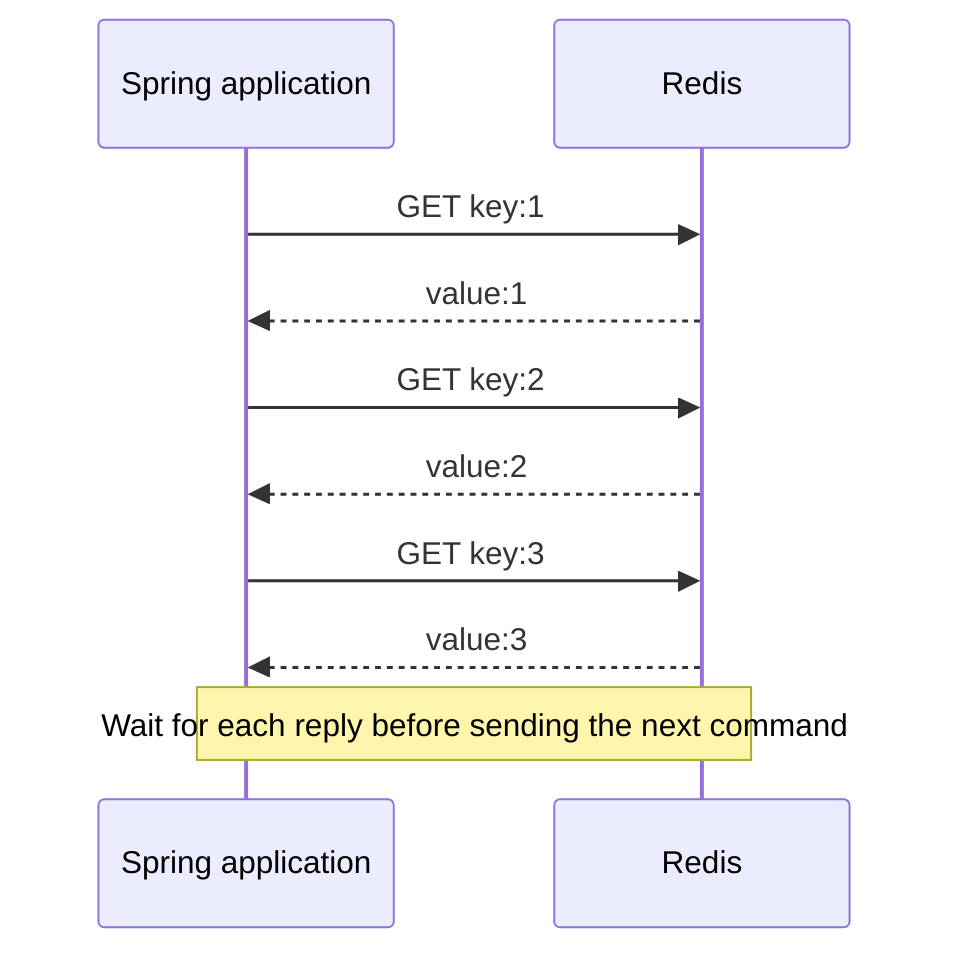
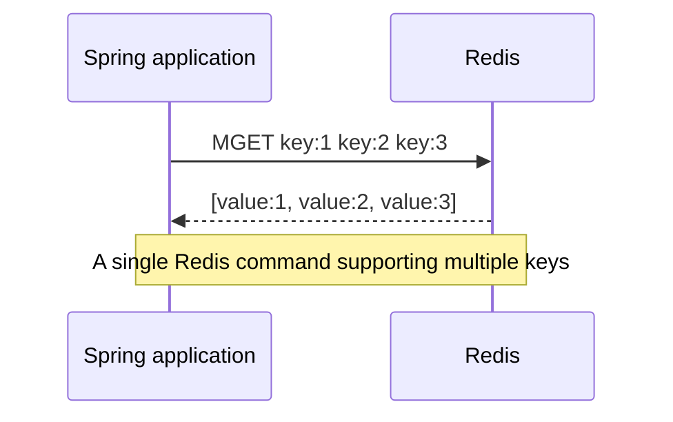
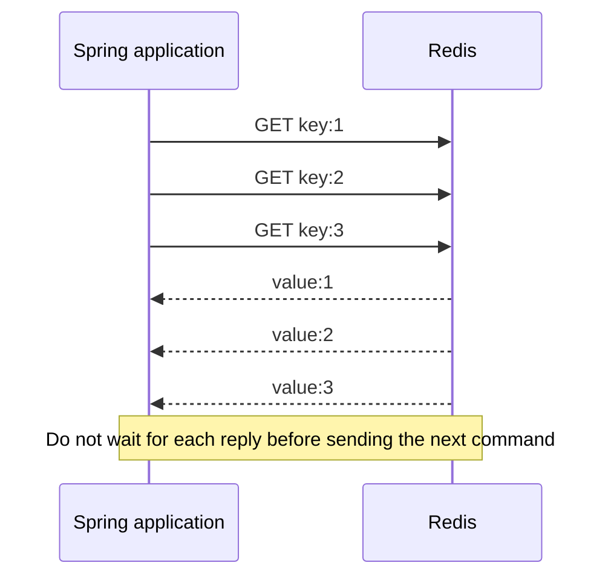
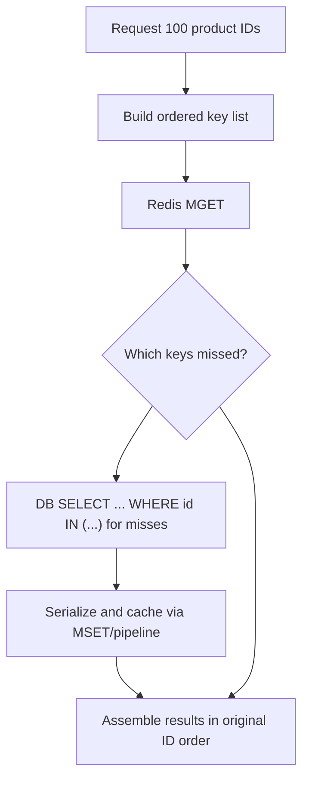
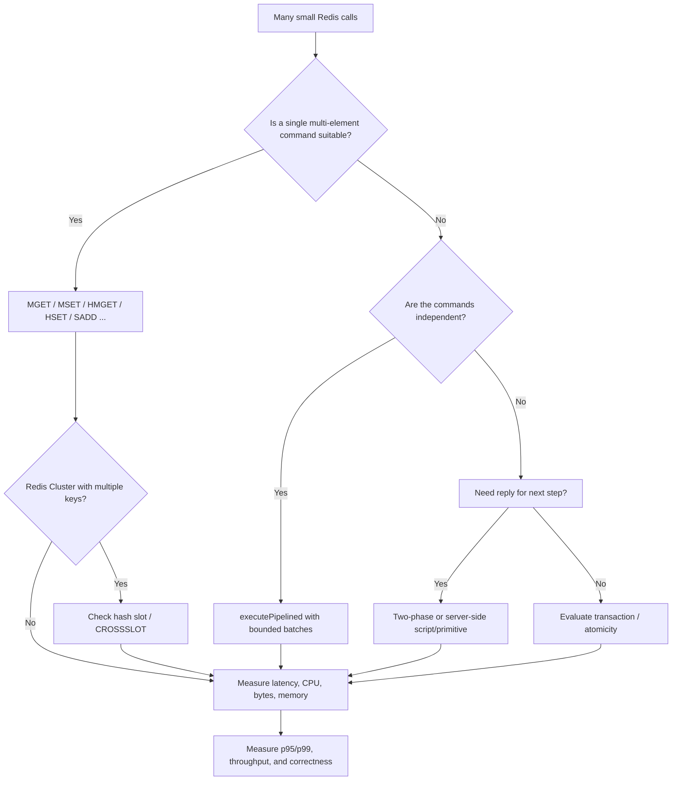

# Reducing Network Round Trips with Multi-Element Commands or Pipelining in Spring Data Redis

## 1. Why Can Many Small Redis Commands Cause Slowdowns?

Redis handles many simple read/write operations very quickly, but a Java application does not run inside the same process as Redis. Every call to `RedisTemplate` or `StringRedisTemplate` goes through specific layers of overhead:

1. The application builds the key and value and serializes the data.
2. The client/driver sends the Redis command over a socket, possibly over TLS.
3. Redis processes the command and writes the response.
4. The driver receives the response, deserializes it, and returns the result to the Spring service.
5. The application proceeds to send the next command.

If you keep **sending one command and waiting for its reply before sending the next**, network wait time can easily exceed the cost of executing a `GET` or `SET` inside Redis.

For example, a service needs to read the names of 100 products:

```java
Map<String, String> result = new LinkedHashMap<>();

for (String productId : productIds) {
    String value = stringRedisTemplate.opsForValue()
            .get("product:name:" + productId);
    result.put(productId, value);
}
```

The loop above is easy to understand, but it typically generates 100 sequential Redis reads. If the network has noticeable round-trip time (RTT), total latency increases substantially.

There are two ways to reduce this impact:

- **Multi-element commands (multi-key/multi-field commands):** replace multiple individual commands with a single Redis command supporting multiple keys, fields, or members, such as `MGET`, `MSET`, `HMGET`, or multi-field `HSET`.
- **Pipelining:** keep multiple individual commands, but send them consecutively without waiting for each reply before sending the next command.

> Key point to remember: **fewer network exchanges does not necessarily mean fewer Redis commands**. `MGET` replaces many `GET`s with one Redis command; a pipeline still consists of many `GET`s, only eliminating the client's back-and-forth waiting between them.

This lesson focuses on choosing between the two techniques in Spring Data Redis, how to implement them, atomicity limitations, Redis Cluster, and measuring actual effectiveness.

## 2. RTT, Bandwidth, and Command Processing Cost

Three concepts are often lumped together under the single word "latency":

| Component | Meaning | Usually Appropriate Optimization |
|---|---|---|
| Network RTT | Time for one cycle of sending a request and receiving a response | Multi-key or pipelining |
| Redis command execution | Time Redis spends processing data operations | Choose good commands, bound data size |
| Serialization / deserialization | Converting Java object ↔ bytes | Suitable serializer, small payload |
| Network bandwidth | Bytes transferred between application and Redis | Projection, reasonable batching, avoid returning unnecessary data |
| Client scheduling / connection | Connection wait, flush, threads, and callbacks | Pool/concurrency tuning, bounding pipelines |
| Origin access | Reading database/API on cache miss | Cache design, negative caching, batch loading |

A very simple estimate for **N sequential requests**, ignoring unrelated factors:

\[
T_{\text{sequential}} \approx N \times (RTT + T_{\text{command}})
\]

If N commands are run via pipeline in batches of B elements, network wait cost may be closer to:

\[
T_{\text{pipelined}} \approx \left\lceil\frac{N}{B}\right\rceil \times RTT
+ T_{\text{commands}}
+ T_{\text{transfer}}
+ T_{\text{client}}
\]

This is a **qualitative model**, not an SLA formula: packet counts, socket flushing behavior, concurrency, Redis Cluster routing, TCP/TLS, output buffering, and Redis load can change results significantly.

Illustrative example for a system with an average RTT of 2 ms:

```text
Reading 100 keys via 100 sequential waiting GETs:
  RTT wait overhead alone is roughly 100 × 2 ms = 200 ms.

Reading 100 keys with one MGET:
  One command and one response round trip, plus processing time for 100 keys.

Pipelining 100 GETs:
  Still 100 Redis GETs, but no waiting for each full RTT
  before sending the next GET; usually reduces network wait time.
```

This example does not imply that both `MGET` and pipelining always finish in exactly 2 ms. If total returned data is hundreds of MB, transfer/deserialization cost can become the dominant portion of latency.

## 3. Two Communication Models Seen Through Diagrams

### 3.1. Sending Each Command Sequentially



### 3.2. Multi-Key Command



### 3.3. Pipelining Multiple Individual Commands



Pipelining primarily reduces idle time when the client waits for replies; Redis still has to execute all of those commands.

## 4. Quick Selection Table: Multi-Key or Pipeline?

| Scenario | First Choice | Reason |
|---|---|---|
| Read multiple independent String keys | `MGET` / `multiGet` | One Redis command returning in key order |
| Write multiple String keys without per-key TTL | `MSET` / `multiSet` | One Redis command |
| Read multiple fields in **a single Redis Hash** | `HMGET` / `HashOperations.multiGet` | One key, multiple fields |
| Write multiple fields into **a single Redis Hash** | Multi-field `HSET` / `putAll` | Combines multiple fields |
| Add multiple members to a Set | Multi-member `SADD` / `SetOperations.add` | One command for multiple members |
| Add multiple members and scores to a Sorted Set | Multi-member `ZADD` / `ZSetOperations.add` | One command with multiple score/value pairs |
| Multiple different command types on independent keys | Pipeline | No single Redis command replaces all of them |
| Each command has its own TTL/options | Pipeline multiple `SET ... EX/PX` | Each command retains its own options |
| Next command depends on the previous command's result | Sequential calls or server-side atomic design | Pipeline does not provide immediate replies inside the callback |
| Atomicity required across multiple operations | Appropriate atomic primitive, `MULTI/EXEC`, or Lua/Function | Plain pipelining is not atomic |
| Multiple keys in different hash slots in Cluster | Key-routed pipeline or co-located slot design | Multi-key command may trigger `CROSSSLOT` |
| Extremely large payload | Chunked batches, projections, or data model changes | An oversized single batch still causes overload |

**There is no rule that "pipelining is always faster than multi-key."** Usually, try the appropriate multi-element command first because the code is simpler and Redis handles one command. Pipelining is useful when operations cannot be expressed as a single command, yet you want to avoid multiple network round-trip waits.

## 5. MGET: Reading Multiple String Keys in One Command

Redis supports:

```redis
SET product:name:P100 "Keyboard"
SET product:name:P101 "Mouse"
SET product:name:P102 "Monitor"

MGET product:name:P100 product:name:P101 product:name:P102
```

The result is a list of values matching the **exact order of input keys**.

If a key does not exist, the element at that position is null/Nil accordingly. If a key exists but is not of type String, Redis `MGET` returns null for that position rather than failing the whole command; therefore, you must distinguish "key does not exist" from "key is not a String" when logic needs the reason.

### 5.1. Spring Data Redis: ValueOperations.multiGet

```java
package com.example.catalog;

import java.util.ArrayList;
import java.util.LinkedHashMap;
import java.util.List;
import java.util.Map;

import org.springframework.data.redis.core.StringRedisTemplate;
import org.springframework.stereotype.Service;

@Service
public class ProductNameBatchReader {

    private final StringRedisTemplate redis;

    public ProductNameBatchReader(StringRedisTemplate redis) {
        this.redis = redis;
    }

    public Map<String, String> getNames(List<String> productIds) {
        if (productIds.isEmpty()) {
            return Map.of();
        }

        List<String> keys = new ArrayList<>(productIds.size());

        for (String id : productIds) {
            keys.add("product:name:" + id);
        }

        List<String> values =
                redis.opsForValue().multiGet(keys);

        if (values == null || values.size() != keys.size()) {
            throw new IllegalStateException(
                    "Unexpected Redis MGET response"
            );
        }

        Map<String, String> output = new LinkedHashMap<>();

        for (int i = 0; i < productIds.size(); i++) {
            // Map allows null values; indicates the key has no data.
            output.put(productIds.get(i), values.get(i));
        }

        return output;
    }
}
```

Explanation:

- `multiGet(keys)` uses Redis's multi-key read capability, typically `MGET`.
- Results are mapped by **key list order**, not Redis Hash order or arbitrary Set order.
- In the `Map` example, if input product IDs repeat, the Map key collides and later results overwrite earlier ones. If every occurrence must be preserved, return a `List` instead of a Map.
- `null` in the result must be interpreted per the data contract; it could be a cache miss or a key of another type.
- `StringRedisTemplate` uses String serialization, suitable when data is actually stored in that format.

**Do not use `Set<String>` just to deduplicate keys if subsequent code needs to map by index.** If deduplication is needed, create a deduplicated list with stable ordering, then map back by ID.

### 5.2. MGET Does Not Automatically Load Cache Misses from the Database

`multiGet` only reads Redis. When implementing cache-aside for multiple IDs:

1. `MGET` all keys.
2. Partition hit keys and miss keys.
3. Run **one batch query** against the database for the missing IDs if the source supports it.
4. Use `MSET` or pipelining to populate the results that need caching.
5. Assemble results in input order.

If after `MGET` you query the database one missed ID at a time, the bottleneck merely shifts from Redis to the database. **Batch Redis and batch source access should be designed together.**

## 6. MSET and MSETNX: Writing Multiple Keys in One Command

Redis CLI example:

```redis
MSET product:name:P100 "Keyboard" product:name:P101 "Mouse"
```

In standalone Redis, `MSET` writes multiple String keys in **a single atomic command with respect to other clients**: other clients cannot observe a half-written set of keys before MSET completes. However, that does not mean this group of writes is durably fsynced or replicated to replicas the moment Redis sends the reply.

In Spring Data Redis:

```java
package com.example.catalog;

import java.util.LinkedHashMap;
import java.util.Map;

import org.springframework.data.redis.core.StringRedisTemplate;
import org.springframework.stereotype.Service;

@Service
public class ProductNameBatchWriter {

    private final StringRedisTemplate redis;

    public ProductNameBatchWriter(StringRedisTemplate redis) {
        this.redis = redis;
    }

    public void putAll(Map<String, String> productNames) {
        if (productNames.isEmpty()) {
            return;
        }

        Map<String, String> redisKeys = new LinkedHashMap<>();

        for (var item : productNames.entrySet()) {
            redisKeys.put(
                    "product:name:" + item.getKey(),
                    item.getValue()
            );
        }

        redis.opsForValue().multiSet(redisKeys);
    }
}
```

### 6.1. Limitation: MSET Does Not Set Individual TTLs Per Key

`MSET` has no per-key `EX 300` option. If keys must auto-expire after 5 minutes, calling `MSET` alone and assuming TTL is set is wrong.

Additionally, writing with `SET` or `MSET` to a key normally replaces its String content and affects existing TTL according to command semantics. Do not assume TTL from a previous write is preserved without the proper options.

A risky pattern:

```redis
MSET cache:a A cache:b B
EXPIRE cache:a 300
EXPIRE cache:b 300
```

These are three commands. If the application crashes after `MSET` but before `EXPIRE`, keys may remain without the desired TTL.

When each key needs a TTL and no multi-key transaction is required, you typically pipeline multiple `SET key value EX ttl` commands so **each write and its TTL live in the same command**. Do not call `multiSet` then pipeline `EXPIRE` if "never leave a key without TTL" is a strict requirement.

### 6.2. MSETNX Is Not a Pipeline of SETNX

Redis also provides:

```redis
MSETNX job:1 pending job:2 pending
```

`MSETNX` only writes **if none of the keys in the list already exist**; on a single server / valid key group, the operation is atomic across the entire key set. It differs from pipelining multiple `SETNX` commands: each command in a pipeline can succeed or fail independently.

In Spring Data Redis, `ValueOperations.multiSetIfAbsent(map)` corresponds to this concept. The boolean result must be interpreted per the API; if inside a pipeline, the direct result of the operation is not immediately available as in a normal call.

MSETNX has no built-in TTL and is also subject to Redis Cluster multi-key constraints.

## 7. Multi-Field Hash: HMGET, HSET, and Data Modeling

If data is grouped under **a single Redis key**, Hash is a structure that often consolidates multiple fields into fewer commands.

Example:

```redis
HSET product:P100 name "Keyboard" category "Accessories" stock "12"
HMGET product:P100 name stock
```

Here `HSET` writes multiple fields of a Hash. `HMGET` reads only the needed fields, avoiding `HGETALL` if the Hash is very large.

### 7.1. Spring HashOperations.multiGet

```java
package com.example.catalog;

import java.util.List;

import org.springframework.data.redis.core.StringRedisTemplate;
import org.springframework.stereotype.Service;

@Service
public class ProductHashReader {

    private final StringRedisTemplate redis;

    public ProductHashReader(StringRedisTemplate redis) {
        this.redis = redis;
    }

    public List<Object> getSummaryFields(String productId) {
        return redis.opsForHash().multiGet(
                "product:" + productId,
                List.of("name", "stock")
        );
    }
}
```

Results are returned in field list order, possibly containing `null` if a field does not exist.

To write multiple fields:

```java
Map<String, String> fields = Map.of(
        "name", "Keyboard",
        "category", "Accessories",
        "stock", "12"
);

stringRedisTemplate.opsForHash()
        .putAll("product:P100", fields);
```

This typically corresponds to a single multi-field `HSET`.

### 7.2. Is Merging Multiple Keys Into One Hash Always Better?

No. Putting all data into a single Hash can:

- Reduce key count and enable reading multiple fields in one command.
- Create a **big key** if one Hash accumulates millions of fields.
- Create a **hot key** if every request accesses the same Hash.
- Cause key-level TTL on the entire Hash to affect many pieces of data; per-field TTL capability depends on Redis version and API support.
- In Redis Cluster, place all fields of the Hash on the single slot/node owning that key.

Choose key granularity based on read/write patterns; do not lump everything together just to save round trips at the expense of load distribution.

## 8. Other Multi-Element Operations

Redis provides several commands that accept a list of elements in one command:

| Need | Redis Command | Spring Data Redis |
|---|---|---|
| Read multiple String keys | `MGET` | `opsForValue().multiGet(keys)` |
| Write multiple String keys | `MSET` | `opsForValue().multiSet(map)` |
| Write all only if none exist | `MSETNX` | `multiSetIfAbsent(map)` |
| Read multiple fields of a Hash | `HMGET` | `opsForHash().multiGet(key, fields)` |
| Write multiple fields of a Hash | `HSET key field value ...` | `opsForHash().putAll(key, map)` |
| Add multiple members to a Set | `SADD key m1 m2 ...` | `opsForSet().add(key, values...)` |
| Add multiple elements to a List | `RPUSH key v1 v2 ...` | `opsForList().rightPushAll(key, values)` |
| Add multiple scored members to a ZSet | `ZADD key score member ...` | `opsForZSet().add(key, tuples)` |
| Delete multiple keys | `DEL key1 key2 ...` | `redisTemplate.delete(keys)` |
| Non-blocking delete via appropriate command | `UNLINK key1 ...` | unlink API per Spring Data Redis version |
| Compute across fields of one key | `HMGET`, `HINCRBY` per field | Choose primitives based on data |

Commands differ in atomicity, complexity, and reply format. For example:

- Multi-member `SADD` is one Redis command for one Set key.
- Multi-key `DEL` can reduce round trips, but deleting large amounts of data can cause significant impact; `UNLINK` is a non-blocking option for the memory reclamation part where applicable.
- `MGET` across very many keys can return a massive response; do not batch indefinitely just for the sake of "one command."
- `HGETALL` is one command, yet reading the entire Hash can be **slower** than fetching selected fields with `HMGET` if the full payload is unnecessary.

**Optimizing command count while inflating payload size 100x can make the entire endpoint slower.**

## 9. Pipelining: Keeping Multiple Commands, Reducing Reply Wait Time

Pipelining lets the client send a group of Redis commands consecutively, then receive replies afterward. Each command is still executed by Redis according to its individual semantics.

Example:

```text
GET product:name:P100
GET product:stock:P100
TTL product:name:P100
GET product:name:P101
GET product:stock:P101
TTL product:name:P101
```

No single `MGET` replaces all of these because the list contains both `GET` and `TTL`. Pipelining helps eliminate RTT wait time between individual commands.

### 9.1. Is a Pipeline a Single Redis Command?

**No.** `pipeline` is a client/protocol method for sending and receiving commands, not a Redis command equivalent to `MGET` or `MULTI`.

For 100 `GET`s:

- Pipelining still makes Redis process 100 `GET`s.
- Redis still generates 100 corresponding replies.
- Those commands still consume CPU, server output buffers, and network bandwidth.
- The client simply does not wait for each reply before sending the next command.

If Redis is CPU-bound, returning huge payloads, or executing complex commands, pipelining does not eliminate that work. It only significantly reduces one kind of overhead: **sequential communication wait time**.

### 9.2. A Pipeline Is Not a Transaction

| Property | Pipeline | `MULTI/EXEC` | Single Multi-Element Command |
|---|---|---|---|
| Reduces round trips for multiple commands? | Yes | Possibly depending on how sent | Yes, if operation is supported |
| Redis processes multiple commands? | Yes | Yes | No: single command |
| Guarantees no other client commands interleave? | **No** | Yes during EXEC phase per Redis semantics | Yes, since it is one command |
| Rolls back entire group on runtime error? | No | **Does not auto-rollback succeeded runtime writes** | Per command semantics |
| Per-command results? | Yes after pipeline | Yes via EXEC | Command's reply structure |
| Requires keys in same Cluster slot? | Depends on individual commands and routing | Usually has slot constraints | Constrained for multi-key commands |

In particular: if a pipeline sends `SET a 1` then `SET b 2`, another client can interleave a command between their executions on Redis, no matter how fast the pipelined client sends them. Do not use pipelining as a mechanism to enforce transactional invariants.

## 10. Spring Data Redis: executePipelined with RedisCallback

Spring Data Redis provides APIs such as:

- `RedisTemplate.executePipelined(RedisCallback<?>)`
- `RedisTemplate.executePipelined(SessionCallback<?>)`
- Overloads accepting a serializer to control result decoding.

`StringRedisTemplate` is convenient for examples because keys and values are interpreted as Strings.

### 10.1. Pipelining GETs for Multiple Keys

```java
package com.example.catalog;

import java.util.ArrayList;
import java.util.LinkedHashMap;
import java.util.List;
import java.util.Map;

import org.springframework.data.redis.core.RedisCallback;
import org.springframework.data.redis.core.StringRedisTemplate;
import org.springframework.data.redis.serializer.RedisSerializer;
import org.springframework.stereotype.Service;

@Service
public class PipelinedProductReader {

    private final StringRedisTemplate redis;

    public PipelinedProductReader(StringRedisTemplate redis) {
        this.redis = redis;
    }

    public Map<String, String> fetchNames(List<String> productIds) {
        if (productIds.isEmpty()) {
            return Map.of();
        }

        RedisSerializer<String> serializer =
                redis.getStringSerializer();

        List<String> keys = new ArrayList<>();

        for (String id : productIds) {
            keys.add("product:name:" + id);
        }

        List<Object> replies =
                redis.executePipelined(
                        (RedisCallback<Object>) connection -> {
                            for (String key : keys) {
                                connection.stringCommands().get(
                                        serializer.serialize(key)
                                );
                            }

                            // executePipelined contract:
                            // callback MUST return null.
                            return null;
                        }
                );

        if (replies.size() != keys.size()) {
            throw new IllegalStateException(
                    "Unexpected pipeline response size"
            );
        }

        Map<String, String> output = new LinkedHashMap<>();

        for (int i = 0; i < productIds.size(); i++) {
            output.put(
                    productIds.get(i),
                    (String) replies.get(i)
            );
        }

        return output;
    }
}
```

Explanation:

1. Build keys corresponding to each product ID.
2. Use a serializer compatible with `StringRedisTemplate`.
3. Send multiple `GET`s inside the callback, **without waiting for each command's result**.
4. The callback returns `null`.
5. After the pipeline completes and responses are decoded, `executePipelined` returns `List<Object>`.
6. Map replies back in the **exact order commands were issued**.

**When all commands are String key GETs, you should usually consider `multiGet` first.** This pipeline example demonstrates the mechanism and does not imply pipelining GET is always superior to MGET.

### 10.2. Why Does the Callback Return null?

While a pipeline is open, command calls do not behave like normal sequential request–response operations. Spring is responsible for collecting and returning the pipeline results **after the callback**.

Wrong:

```java
List<Object> replies = redis.executePipelined(
        (RedisCallback<Object>) connection -> {
            byte[] value = connection.stringCommands().get(
                    redis.getStringSerializer().serialize("key")
            );

            // Wrong idea: treating value as an immediate reply here.
            return value;
        }
);
```

The `executePipelined` callback is required to return `null`; returning a non-null value may throw an exception for violating Spring's contract. Even if a command API has a return type, results inside a pipeline **cannot be used immediately to drive subsequent commands**.

If the second command requires the value returned by the first, switch to a multi-phase flow or use an appropriate server-side Redis primitive/script/Function to handle the condition.

## 11. executePipelined with SessionCallback

`SessionCallback` lets you write multiple operations using Spring's `RedisOperations` inside one callback session, instead of calling `RedisConnection` directly. Example:

```java
package com.example.catalog;

import java.util.List;

import org.springframework.data.redis.core.RedisOperations;
import org.springframework.data.redis.core.SessionCallback;
import org.springframework.data.redis.core.StringRedisTemplate;

public final class PipelineExample {

    private final StringRedisTemplate redis;

    public PipelineExample(StringRedisTemplate redis) {
        this.redis = redis;
    }

    public List<Object> readThreeKeys() {
        return redis.executePipelined(
                new SessionCallback<Object>() {
                    @Override
                    public Object execute(
                            RedisOperations operations) {

                        operations.opsForValue()
                                .get("product:name:P100");
                        operations.opsForValue()
                                .get("product:name:P101");
                        operations.opsForValue()
                                .get("product:name:P102");

                        return null;
                    }
                }
        );
    }
}
```

Generic signatures of `SessionCallback` and overloads may vary across Spring Data Redis versions; in production code, prefer typed callbacks matching `RedisOperations<String,String>` and the actual API return types. The core rule remains: **do not inspect the value of `opsForValue().get(...)` inside the callback to evaluate conditions**.

### 11.1. Be Careful With Results While Pipelining

Logically flawed example:

```java
redis.executePipelined(
        (SessionCallback<Object>) operations -> {
            Object value = operations.opsForValue().get("counter");

            // Do not assume value holds returned data
            // before the pipeline has finished.
            if ("10".equals(value)) {
                operations.opsForValue().set("flag", "yes");
            }

            return null;
        }
);
```

Because `get(...)` does not immediately return the normal value inside a pipeline, this conditional branch will not behave as intended.

Instead, you can:

- Read with `multiGet` or a first pipeline.
- Process in Java.
- Write with a second pipeline.
- If single-step atomicity is required, choose an atomic command or appropriately scoped script/Function.

## 12. Pipelining Multiple SETs with TTL: Overcoming MSET's Limitation

A real-world scenario: writing 200 cache entries, each with a 5-minute TTL on independent keys.

`MSET` does not support per-key expiration. You can pipeline `SET key value EX 300` commands.

Example with `RedisCallback`:

```java
package com.example.catalog;

import java.time.Duration;
import java.util.Map;

import org.springframework.data.redis.core.RedisCallback;
import org.springframework.data.redis.core.StringRedisTemplate;
import org.springframework.data.redis.serializer.RedisSerializer;
import org.springframework.stereotype.Service;

@Service
public class PipelinedCacheWriter {

    private static final Duration TTL = Duration.ofMinutes(5);

    private final StringRedisTemplate redis;

    public PipelinedCacheWriter(StringRedisTemplate redis) {
        this.redis = redis;
    }

    public void putNames(Map<String, String> names) {
        if (names.isEmpty()) {
            return;
        }

        RedisSerializer<String> serializer =
                redis.getStringSerializer();

        redis.executePipelined(
                (RedisCallback<Object>) connection -> {
                    for (var entry : names.entrySet()) {
                        String key =
                                "cache:product:name:" + entry.getKey();

                        // Each SET uses one command with atomic per-key TTL,
                        // without splitting SET and EXPIRE.
                        connection.stringCommands().set(
                                serializer.serialize(key),
                                serializer.serialize(entry.getValue()),
                                org.springframework.data.redis.core.types.Expiration
                                        .from(TTL),
                                org.springframework.data.redis.connection.RedisStringCommands.SetOption
                                        .UPSERT
                        );
                    }

                    return null;
                }
        );
    }
}
```

In modern Spring Data Redis versions, `RedisStringCommands.set(byte[], byte[], Expiration, SetOption)` combines value and TTL into a single Redis command. `SetOption.UPSERT` indicates allowing writes whether or not the key already exists. Verify exact APIs/enums against your project's version.

Important correctness points:

- Each key has a single `SET` operation with TTL.
- The entire batch is still **multiple independent commands**, not a transaction.
- If the connection drops mid-pipeline, some keys may have been written while others were not.
- Do not automatically retry the whole batch if side effects are non-idempotent.
- For reconstructible cache data, missing some keys typically just causes a subsequent cache miss.

If you need per-key TTLs **and** strict **all-or-nothing across multiple keys**, pipelining cannot satisfy that; evaluate Redis Cluster slots, `MULTI/EXEC`, or Lua/Functions while considering runtime error risks.

## 13. Proper Serialization: Pipeline Results Are Not Always the Same Type

`RedisTemplate` and `StringRedisTemplate` configure serializers for:

- Key.
- Value.
- Hash key.
- Hash value.
- Certain operation-specific replies.

For instance, `StringRedisTemplate` uses String serialization by design, whereas a `RedisTemplate<String, ProductDto>` might use JSON or another serializer. When calling `RedisConnection` directly, you work with `byte[]` for keys/values; you must serialize consistently with the active configuration.

### 13.1. Common Mistake: Inconsistent Key Serializers

Suppose Spring Cache stores a key with a prefix/serializer:

```text
productSummary::P100
```

Yet a pipeline calls:

```text
GET P100
```

Redis returns a miss even though the cache entry exists. **The key structure in the Spring Cache abstraction** does not automatically match keys you construct manually via `RedisTemplate`.

If multiple templates or cache managers exist:

1. Identify the exact namespace/prefix.
2. Check the key serializer.
3. Check the value serializer.
4. Check the database index, TTL, and format version.
5. Avoid reading `RedisCacheManager` payloads directly with a String template if they are serialized in a different format.

### 13.2. Reply Types

A pipeline may contain a mix of:

```text
GET key:1          -> String/nil
EXISTS key:1       -> integer/boolean depending on adapter
TTL key:1          -> integer
SET key:2 value    -> status/boolean depending on adapter
HGET hash field    -> String/nil
```

The `List<Object>` does not necessarily contain only Strings. If code casts every reply to `String` as in a GET-only example, a mixed-command pipeline can throw a `ClassCastException`.

A maintainable design:

- Build a list of **metadata about sent commands**.
- Store the command type and associated key at the same index.
- After the pipeline finishes, decode/match each reply according to its command type.
- Validate list size and handle command/driver errors.

Do not write a 150-command heterogeneous pipeline and rely on magic indices like `replies.get(127)` without explicit mapping.

## 14. Does a Pipeline Guarantee Result Ordering?

Redis sends command replies on the same connection in the **order commands were received/executed on that connection**. With Spring Data Redis `executePipelined`, the result list maps sequentially to the issued commands.

Example:

```text
Command 0: GET a
Command 1: GET b
Command 2: TTL a

Reply 0:  "A"
Reply 1:  nil
Reply 2:  300
```

However, response ordering guarantees do **not** mean:

- Multi-command transactional execution.
- Other clients cannot interleave commands mid-pipeline.
- Every reply was successfully received by the application if the connection drops.
- All commands executed if the pipeline throws an exception.
- The entire batch is safe to retry.

In Redis Cluster, the driver may send commands to different nodes/connections. Review your driver's contract for assembling responses and do not assume a cross-node pipeline forms a single globally ordered sequence.

## 15. When Can Multi-Key Commands Not Be Used in Redis Cluster?

Redis Cluster partitions keys by **hash slot**. Many multi-key Redis commands require those keys to reside **in the same hash slot**.

Example:

```redis
MGET product:P100 product:P101
```

If the two keys land in different slots, Redis Cluster may return:

```text
CROSSSLOT Keys in request don't hash to the same slot
```

This is not a serializer or password error. It is a semantic constraint of multi-key commands in Redis Cluster.

### 15.1. Using Hash Tags When Same-Slot Is Needed

Redis Cluster uses the substring inside valid curly braces to compute the hash slot:

```text
product:{P100}:name
product:{P100}:stock
product:{P100}:price
```

These three keys share the hash tag `{P100}` and will route to the same slot.

```redis
MGET product:{P100}:name product:{P100}:price
```

Hash tags are useful when a small group of keys strictly needs same-slot multi-key commands or transactions.

**Do not share a single hash tag `{all}` across millions of keys just to make every `MGET` work.** That concentrates all those keys onto one slot/node, creating a hot spot and defeating Redis Cluster distribution.

### 15.2. What About Cross-Slot Pipelining?

A pipeline of individual `GET` commands can work across keys in different slots **if Spring Data Redis / the driver / Redis Cluster connection supports per-command routing**. However:

- You cannot assume all commands travel over a single connection.
- You cannot assume only one network RTT for the entire cluster.
- The driver may need to talk to multiple nodes and handle redirects/retries.
- Each node has its own pipeline/output buffer.
- Topology may change while the batch is in flight.

One approach is grouping keys by node/slot into appropriate batches, while avoiding unnecessary custom cluster-routing logic when the driver already handles it.

### 15.3. MGET, Pipeline, or a Hash?

| Data | Approach | Considerations |
|---|---|---|
| Multiple fields of one product | `HMGET` on one Hash | Simple, single key |
| Several keys of one product needing atomic MGET | Per-product hash tag | Same slot, but concentration risk |
| Many different products spread across Cluster | Pipeline GET with routing driver, or per-slot batches | No need to force everything into one slot |
| Querying 10,000 products across nodes | Chunk batches, bound concurrency and payload | Avoid huge responses and client memory pressure |

## 16. Pipeline Size: More Is Not Always Faster

A 10-command pipeline may save little RTT, while a 1,000,000-command pipeline can cause:

- Higher memory usage as Redis buffers replies until the client reads them.
- Higher application memory usage as `executePipelined` collects replies into a list.
- Longer wait time for a huge request, worsening p99 latency.
- Monopolizing a connection for a noticeable time, affecting other requests.
- Difficulty diagnosing which specific command failed.
- Timeouts if total batch time exceeds client command timeout.
- Higher traffic and CPU despite fewer round trips.

### 16.1. Choosing Size Based on Real Data

There is no universal "standard" batch size for every application. You can start by testing several sizes, e.g., **50, 100, 250, 500** commands/batch, and compare.

These are **illustrative test values**, not official Redis or Spring recommended thresholds.

Measure simultaneously:

- Total duration of one batch.
- Commands/second and bytes/second.
- Endpoint p50/p95/p99 latency.
- Redis/client CPU.
- Redis output buffers and network throughput.
- JVM GC/heap usage.
- Busy/waiting connection counts.
- Timeout/error rate.

If each reply is 20 bytes, a batch of 500 is light. If each reply is 500 KB of JSON, a batch of 500 pulls roughly 250 MB of data before overhead. Therefore, **bounding total bytes** is often just as important as bounding command count.

### 16.2. Splitting Lists Into Batches

Java example:

```java
package com.example.catalog;

import java.util.ArrayList;
import java.util.List;

public final class BatchPartitioner {

    private BatchPartitioner() {
    }

    public static <T> List<List<T>> partition(
            List<T> source, int batchSize) {

        if (batchSize <= 0) {
            throw new IllegalArgumentException(
                    "batchSize must be positive"
            );
        }

        List<List<T>> result = new ArrayList<>();

        for (int from = 0; from < source.size(); from += batchSize) {
            int to = Math.min(source.size(), from + batchSize);

            // Copy to avoid holding a view over the original List.
            result.add(
                    new ArrayList<>(source.subList(from, to))
            );
        }

        return result;
    }
}
```

Processing each batch:

```java
for (List<String> batch : BatchPartitioner.partition(keys, 200)) {
    // Call MGET if appropriate, or executePipelined
    // for the current batch only, then process and release replies.
}
```

In production, you do not have to materialize every batch list in memory up front; you can iterate by offset or stream data in a controlled manner. The key is **not pushing an unbounded number of commands into a single pipeline**.

## 17. Connections and Concurrency: Pipelining Is Not a License to Send Without Limits

Some systems perform fine at 10 pipeline batches/second yet slow down when 100 concurrent requests all issue long pipelines.

Factors involved:

1. **Connection acquisition:** many requests competing for connections will wait.
2. **Driver flush:** when commands are actually flushed onto the socket.
3. **Backpressure:** can the client keep up reading replies?
4. **Redis server CPU:** Redis still executes every command and does not scale infinitely with client threads.
5. **Network bandwidth:** multiple pipelines can saturate the link.
6. **Cluster routing:** each node has its own load/connections.
7. **Request deadline:** a batch must finish within the endpoint timeout.

With Lettuce, connection management and whether pooling is needed depend on operation types (blocking, transactions, connection sharing) and driver configuration. Do not assume a bigger pool is always faster; over-sizing pools can just add concurrency and memory pressure.

For heavy workloads, design **bounded concurrency**: limit active concurrent batches, batch size, timeouts, and retry budgets. If requests exceed budget, apply backpressure or degrade gracefully instead of overloading Redis.

## 18. Pipelining and Correctness: Per-Command Errors, Partial Success, Uncertain Outcomes

Since pipelining is not a transaction, you must account for failures.

### 18.1. One Command Fails, Subsequent Commands Still Run

Example:

```redis
SET cache:ok "value"
HGET cache:ok field
GET cache:ok
```

`HGET` on a String key may return `WRONGTYPE`. That does not cause the subsequent `GET` to be rolled back or cancelled automatically. Redis processes commands per their own semantics.

In Spring Data Redis, depending on driver/serializer and version, when a pipeline encounters an error reply, `executePipelined` may throw an exception and the `List<Object>` return path may not provide a complete per-command status table as you might expect. Do not assume `get(i)` always returns the individual error of the i-th command across all versions.

If you need per-command outcome auditing, build explicit tracking or keep batches small for easier reconciliation.

### 18.2. Connection Drop Leaves Batch Progress Unknown

```text
Client sends:
  SET key:a A
  INCR counter:views
  SET key:b B

Redis may have executed:
  SET key:a A
  INCR counter:views

Connection drops before client receives replies.
```

The client cannot be sure:

- Whether `key:a` was written.
- Whether `counter:views` was incremented.
- Whether `key:b` was written.
- How many replies Redis sent that never reached the application.

**Retrying the entire pipeline can double non-idempotent side effects**, such as `INCR`, `LPUSH`, or `XADD`.

### 18.3. Classifying Commands Before Retrying

| Operation | Retry on Unknown Outcome | Reason |
|---|---|---|
| `GET` / `MGET` | Usually safe regarding side effects | Read-only |
| `SET key value` with same value | Usually idempotent on final value | Re-writing same value, though TTL/version still matter |
| `DEL key` | Usually idempotent on final state | Repeated delete creates no extra data |
| `SADD key member` | Usually idempotent for same member | Sets do not store duplicate members |
| `INCR` | **Do not blindly retry** | May increment twice |
| `LPUSH` | **Do not blindly retry** | May append duplicate elements |
| `XADD ... *` | **Do not blindly retry** | May generate a new event ID and duplicate event |
| `SET key value EX 300` | Evaluate TTL | Retrying refreshes TTL from retry time |
| `MSETNX` | Verify outcome | Retry may return false because the first attempt succeeded |

For critical operations, require an **operation ID** and idempotency within the proper update boundary, or state reconciliation from an authoritative source. "Unknown whether the command ran" cannot be fixed merely by raising timeouts or retrying 3 times.

### 18.4. Pipelining Optimizes Throughput, Not Durability

An `OK` reply indicates Redis processed the command per its semantics. It does not automatically guarantee:

- All replicas received the write.
- The write was fsynced to meet your desired RPO.
- Backups include the change.
- Side effects in another database committed.

If Redis is a primary data store rather than just a cache, evaluate AOF/RDB, replication, failover, and write models separately. Pipelining does not replace transactions or backups.

## 19. MULTI/EXEC, Lua Scripts, and Redis Functions vs Pipelining

When reducing round trips while still needing atomicity control:

### 19.1. MULTI/EXEC

```redis
MULTI
SET account:{42}:status active
INCR account:{42}:version
EXEC
```

`MULTI/EXEC` ensures commands in the transaction execute as a group without other client commands interleaving during `EXEC`, but **Redis does not roll back earlier succeeded writes if a subsequent command hits a runtime error**.

Transactions can be pipelined to save round trips in certain scenarios/client APIs, yet **pipelining and transactions remain distinct concepts**.

### 19.2. Lua Scripts

Example of reading, checking, and writing in one server-side execution:

```lua
-- KEYS[1]: key holding stock quantity.
-- ARGV[1]: quantity to deduct.
local stock = tonumber(redis.call('GET', KEYS[1]))
local quantity = tonumber(ARGV[1])

if stock == nil or quantity == nil or quantity <= 0 then
    return redis.error_reply('INVALID_INPUT')
end

if stock < quantity then
    return 0
end

redis.call('DECRBY', KEYS[1], quantity)
return 1
```

A script avoids having the client `GET` and then decide to `DECRBY` across two network trips, keeping check-and-update in one atomic execution. However:

- Scripts can block Redis if they run too long; do not use them for unboundedly huge batches.
- A runtime error after some writes does not roll back those writes.
- In Cluster, keys accessed by the script must obey key declaration/slot rules.
- Security, versioning, and script deployment must be managed.

**Choose Lua/Functions when you need server-side logic and appropriate atomicity**, not just because pipeline return handling feels inconvenient.

## 20. Do Spring Cache Annotations Automatically Combine Multiple GETs?

Do not assume so. For example:

```java
@Cacheable(cacheNames = "productSummary", key = "#p0")
public ProductSummary findSummary(String productId) {
    return repository.loadSummary(productId);
}
```

If a controller calls:

```java
for (String id : ids) {
    service.findSummary(id);
}
```

each call goes through the Spring Cache interceptor and can issue an independent cache lookup. The Spring Cache abstraction does not automatically detect 100 method calls in a loop and **turn them into a single `MGET`**.

To leverage batching:

1. Design a service method taking a list of IDs.
2. Read the cache in bulk via `StringRedisTemplate`/`RedisTemplate` or a custom adapter.
3. Load misses in batch from the source.
4. Populate the cache with multi-key or pipelined writes.
5. Maintain consistent key prefixes/serializers/schemas/TTLs with the existing cache region.
6. Preserve result order and handle non-existent keys properly.

Using a template directly while bypassing `RedisCacheManager` shifts responsibility for cache semantics—prefixes, TTL, null representation, serialization, and invalidation—onto your code.

### 20.1. Batch Cache-Aside with multiGet and Grouped Fallback

Model:



Because `MGET` returns null per key, distinguish between:

- Missing key.
- Cached value representing non-existence (*negative caching*) if the system uses a marker.
- Key exists but serializer cannot read it.
- Wrong key type.
- Redis infrastructure error.

A batch loader should not treat every deserialization error as a normal cache miss and silently overwrite data that might belong to another namespace.

## 21. Observing Performance After Optimizing

Enabling pipelining is not proof that the endpoint is faster. Compare under the same dataset and concurrency level.

### 21.1. Metrics to Collect

| Metric | Why It Is Needed |
|---|---|
| Endpoint latency p50/p95/p99 | Are users actually experiencing lower latency? |
| Redis command rate by type | Did MGET replace GET and reduce command count? |
| Network bytes in/out | Did pipelining create large payload bursts? |
| App-to-Redis RTT | Estimate optimization opportunity |
| Redis CPU | Is the server command-processing bound? |
| JVM CPU/GC | Does deserializing large lists cause allocations? |
| Connection wait / active connections | Is pipelining holding connections too long? |
| Cache hit/miss rate | Did the batch loader miss cache due to key mismatch? |
| Error/timeout/retry rate | Are oversized batches causing more errors? |
| Total origin query count | Did Redis batching actually reduce database load? |
| Server slowlog / latency | Are there unusually heavy commands? |
| Payload size distribution | Are a few oversized keys hurting p99? |

CLI commands supporting controlled investigation:

```redis
INFO stats
INFO commandstats
INFO memory
SLOWLOG GET 20
LATENCY LATEST
```

`INFO commandstats` reports per-command-type statistics, without automatically separating traffic by Spring method. `SLOWLOG` tracks Redis command execution time, not full network RTT; a pipeline slowed by network or JVM overhead may not show up in the slowlog.

In Spring Boot, you can use Micrometer/Actuator and driver instrumentation to measure Redis client latency. Specific metric names depend on configuration and versions; never assume an invariant metric name.

### 21.2. A Fair Comparison Experiment

Given the same workload of 1,000 product IDs, compare:

| Option | Description |
|---|---|
| A | 1,000 sequential `GET`s |
| B | Split into 10 `MGET` batches of 100 keys each |
| C | Split into 10 pipelines of 100 `GET`s each |
| D | One `MGET` of 1,000 keys if topology and payload allow |
| E | Split into per-product Hashes and `HMGET` only needed fields |

Conclusions must rely on data, because:

- Redis Cluster may forbid `MGET` across keys in different slots.
- Large values may make D produce an oversized reply.
- At low RTT, the difference between A and B may be smaller than on a distant network.
- Client/Redis CPU may be the main bottleneck.
- Backend queries and serialization may still dominate total time.

Do not run just once and decide. Warm up the JVM, stabilize connections, test multiple concurrency levels, and record percentiles with a representative payload distribution.

## 22. Practical Scenario: 200 Products for a Listing Page

### 22.1. Initial Version

An API needs the name, price, and stock count for 200 products:

```text
200 × GET product:name:id
200 × GET product:price:id
200 × GET product:stock:id

Total: 600 sequential GETs
```

The main problem is likely 600 RTT waits if code invokes each synchronous Redis method and waits for the result.

### 22.2. Option A: MGET Per Field

```text
MGET product:name:P1 ... P200
MGET product:price:P1 ... P200
MGET product:stock:P1 ... P200

Total: 3 Redis commands if deployment supports multi-key
```

Simple, but in Redis Cluster, product keys in different slots will cause `CROSSSLOT` unless keys are designed accordingly.

### 22.3. Option B: Hash Per Product + Pipelined HMGET

```text
HMGET product:P1 name price stock
HMGET product:P2 name price stock
...
HMGET product:P200 name price stock
```

This is 200 Redis commands, which can be pipelined to avoid 200 RTTs. Each command reads only 3 fields from one Hash key; cluster clients can route per product key when supported.

Trade-offs:

- Requires changing the data model or already having Hashes.
- Updating fields of a single product together is more convenient.
- Large Hashes or a very hot product still have their own issues.
- Key-level TTL applies to the whole Hash; per-field TTL support must be verified against Redis version/API.

### 22.4. Option C: Hybrid

You can combine:

1. `MGET` keys sharing the same slot in valid small groups.
2. Pipeline remaining commands by node/slot.
3. Batch database queries only for cache misses.
4. Limit concurrent requests and total payload size.

The goal is not "absolute minimum commands," but **lower latency, reasonable Redis/DB load, and accurate business semantics**.

## 23. When Should You Not Batch or Pipeline?

Not every operation benefits from grouping:

- Endpoint only reads **one key**; batching helps nothing.
- Commands already have huge payloads where network bandwidth is the primary bottleneck.
- Redis server CPU is overloaded; pipelining sends commands faster but does not reduce server work.
- You must inspect and react to each reply before issuing the next command.
- Stronger transaction/atomicity guarantees are needed than pipelining provides.
- Multi-key operations in Redis Cluster do not satisfy same-slot constraints.
- An oversized batch inflates latency and causes request timeouts.
- Operations with non-idempotent side effects need individual ACKs/verification.
- The application has many rarely accessed keys; massive prefetching can cause cache pollution.
- A read path using `@Cacheable` already has a very high cache hit rate and no redundant Redis loops; switching to manual template management may add more complexity than benefit.

**Optimize in the right order:** determine command count, RTT, payload size, bottlenecks, and data correctness requirements first; only then choose multi-key, pipelining, data modeling, connection tuning, or server-side logic.

## 24. Common Mistakes and Misconceptions

| Misconception / Mistake | Reality |
|---|---|
| "A pipeline is a single Redis command" | Pipelining still sends multiple Redis commands |
| "Pipelining is always atomic" | No; other clients can interleave commands |
| "MULTI/EXEC rolls back all runtime errors" | Redis does not auto-rollback succeeded writes before a runtime error |
| "MGET and pipelined GET are identical" | MGET is one command; pipelined GET is multiple commands |
| "MultiGet returns a Map keyed by key" | Usually returns a List matching input key order |
| "One missing key in MGET fails everything" | Returns null at the corresponding position |
| "MSET automatically sets TTL" | No; a separate TTL strategy is required |
| "MSET then EXPIRE in a pipeline is atomic" | No; those are separate commands |
| "executePipelined callback returns replies" | Callback must return null; replies are returned after pipeline completion |
| "Use response inside pipeline callback for if/else" | Results are not available under normal synchronous semantics |
| "All replies are Strings" | May include Strings, numbers, booleans, nulls, or errors via exceptions |
| "A Redis Cluster pipeline is always one RTT" | Commands may go to multiple nodes/connections |
| "Wider hash tags are always better" | Concentrating keys into one slot can create hot spots |
| "Batching 10,000 commands is surely faster than 100" | Depends on bytes, memory, timeouts, and CPU |
| "Network drop means the batch never ran" | Outcome can be uncertain with partial success |
| "Retrying INCR after timeout is always safe" | Can increment twice |
| "Spring Cache automatically batches @Cacheable calls" | Do not assume automatic batching |
| "Redis SLOWLOG shows no slow commands so network isn't slow" | Slowlog excludes full network RTT/client time |

## 25. Decision Flow for Spring Data Redis



A short implementation sequence:

1. **Count actual commands** at the endpoint rather than estimating from lines of Java.
2. **Measure RTT and payload** to verify whether round-trip optimization is meaningful.
3. **Prefer multi-element Redis commands** for uniform operations within slot constraints.
4. **Use pipelining** for independent commands that cannot be combined into one command.
5. **Chunk into bounded batches**, controlling bytes and concurrent tasks.
6. **Separate throughput from atomicity**; if cross-key correctness is needed, pick the right primitive/transaction/script.
7. **Design exceptions, retries, and reconciliation**, especially for writes with side effects.
8. **Keep serializers and key naming consistent** with Spring Cache/Template/Repository.
9. **Re-measure p95/p99 and Redis/DB load** before broad rollout.

## 26. Summary

Reducing network round trips is one of the most effective ways to improve performance when a Spring Data Redis application issues many small commands over a network with noticeable RTT.

**Multi-element commands** such as `MGET`, `MSET`, `HMGET`, and multi-field `HSET` are typically the first choice when the problem matches a single command's semantics. **Pipelining** fits when you need to send multiple distinct Redis commands consecutively without waiting for each reply; Spring Data Redis supports this via `RedisTemplate.executePipelined` with `RedisCallback` or `SessionCallback`, where the callback returns `null` and the reply list is returned upon completion.

Optimization does not stop at "how many fewer RTTs." Redis Cluster enforces hash-slot constraints on multi-key commands; pipelining **does not create a transaction** and can partially succeed upon connection errors; oversized batches can still overload CPU, memory, and network. Good optimization means choosing **the right operation, right batch size, right serializer, and right consistency level**, then verifying with latency, throughput, resource usage, and result accuracy.

## References

- [Redis — Pipelining](https://redis.io/docs/latest/develop/using-commands/pipelining/)
- [Redis — MGET](https://redis.io/docs/latest/commands/mget/)
- [Redis — MSET](https://redis.io/docs/latest/commands/mset/)
- [Redis — HMGET](https://redis.io/docs/latest/commands/hmget/)
- [Redis — HSET](https://redis.io/docs/latest/commands/hset/)
- [Redis — Transactions](https://redis.io/docs/latest/develop/using-commands/transactions/)
- [Redis — Cluster specification](https://redis.io/docs/latest/operate/oss_and_stack/reference/cluster-spec/)
- [Spring Data Redis — Pipelining](https://docs.spring.io/spring-data/redis/reference/redis/pipelining.html)
- [Spring Data Redis — RedisTemplate](https://docs.spring.io/spring-data/redis/reference/redis/template.html)
- [Spring Data Redis — Redis cache](https://docs.spring.io/spring-data/redis/reference/redis/redis-cache.html)
