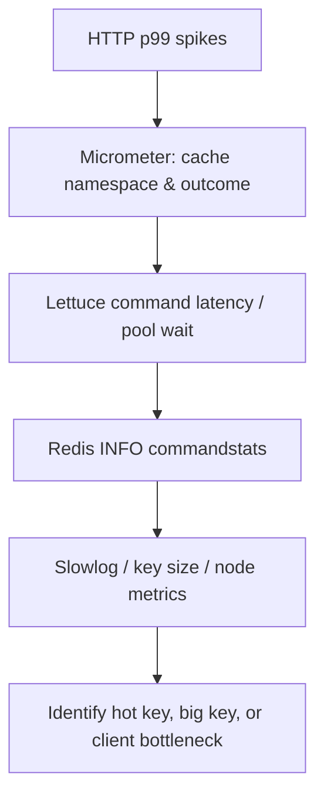
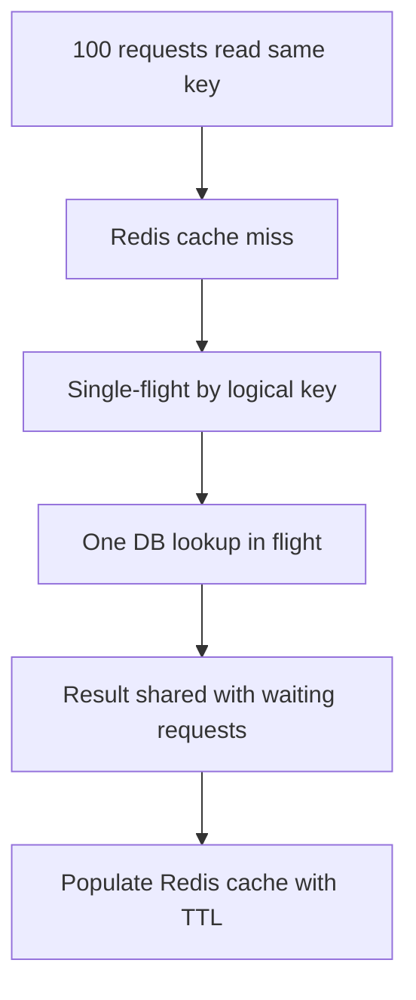

# Analyzing Hot Keys and Big Keys in Spring Data Redis

An application using Spring Data Redis may suffer sudden Redis CPU spikes, latency jumping from a few milliseconds to hundreds of milliseconds, network saturation, or one node in a Redis Cluster constantly overloading while other nodes sit nearly idle. Not all such incidents come from "Redis being slow." Two frequent culprits are **hot keys** and **big keys**.

- A **hot key** is a key accessed with unusually high frequency or intensity. A String of only a few bytes can become a hot key if tens of thousands of requests per second read or write it.
- A **big key** is a key whose memory size, payload, or internal element count exceeds operational budgets. A Hash with millions of fields or a multi-megabyte String can be a big key even if accessed only a few times per hour.
- A **hot slot/hot node** is a hotspot at the Redis Cluster partitioning layer: one slot or primary receives most of the load. It can stem from a single hot key, many keys grouped under one hash tag, or skewed traffic distribution.

These two traits are **distinct yet can coincide**. A big key hammered repeatedly with `HGETALL` is far worse than a big key that only updates a couple of fields per day.

This lesson builds a performance-analysis workflow tailored to **Spring Data Redis**: gathering symptoms, identifying suspect keys/patterns, measuring load and size with Redis CLI, correlating `RedisTemplate`/`ReactiveRedisTemplate` metrics, distinguishing skewed load on Cluster, and choosing ways to shrink size or reduce access while preserving business correctness.

> Principle: **measure with evidence before modifying data**. Commands like `SCAN`, `MEMORY USAGE`, and `redis-cli` analysis modes still consume resources. Avoid running deep scans or destructive commands in production without impact caps and a recovery plan.

## 1. At a Glance: Hot Key, Big Key, and Hot Slot

| Criterion | Hot Key | Big Key | Hot Slot/Node |
|---|---|---|---|
| Nature | Concentrated access intensity | Large data size | Uneven load distribution across Cluster |
| Analysis unit | Commands/sec, CPU, and network per key | Bytes, field/member/entry count, response size | CPU, ops/s, bandwidth per node/slot |
| Example | `homepage:config` read 80,000 times/sec | `user:events` holding millions of entries | Many keys sharing hash tag `{global}` |
| Symptoms | Rising p99, one read/write point overloaded | Slow O(N) commands, costly memory/replication/eviction | One primary slow while other primaries idle |
| Investigation | App metrics, LFU frequency, traffic sampling | `--bigkeys`, `--memkeys`, `MEMORY USAGE`, cardinality | Per-node metrics, topology, and hash slots |
| Remediation | Near-cache, coalescing, sharded writes, limit fan-out | Data splitting, pagination, retention, batched cleanup | Redistribute keys/slots, proper hash-tag design |

There is no universal threshold like "big key = over 1 MB" valid for every system. On a small Redis instance, a Hash with a few hundred thousand fields is alarming; for another workload, a multi-hundred-KB String may be fine if rarely read. Thresholds must reflect **memory budget, latency SLOs, command types, and access frequency**.

### 1.1. Contrasting Three Scenarios

**Scenario A – small key, very hot**

```text
Key: cache:homepage:feature-flags
Type: String
Memory: ~2 KiB
Access: massive GETs per second
```

The issue is not the 2 KiB size, but the volume of `GET`s, connection traffic, network throughput, and load on the node holding that key.

**Scenario B – very large key, rarely accessed**

```text
Key: analytics:session:2026-11
Type: Hash
Fields: several million fields
Access: a few HGETs per second
```

`HGET` on a single field usually hurts far less than `HGETALL` on the entire Hash. Even so, the big key enlarges memory footprint, replication/fork times, or deletion cleanup cost depending on the situation.

**Scenario C – no single dominant key, yet a hot slot**

```text
cart:{tenant-global}:customer:1
cart:{tenant-global}:customer:2
cart:{tenant-global}:customer:3
...
```

Many keys carrying the same hash tag `{tenant-global}` map to the **same hash slot**. When aggregate traffic grows large enough, one primary overloads even though no individual key looks unusually hot.

## 2. How Redis Processes Commands and Why One Key Can Affect an Entire Node

Redis executes most data operations on a primary event-loop execution path. Certain tasks may offload to background or I/O threads depending on version/config, yet **CPU-heavy commands or O(N) data operations** can still consume execution time and stall other commands.

Example:

```text
Client A: HGETALL enormous:hash
Client B: GET tiny:flag
Client C: INCR counter
```

If `HGETALL` traverses a huge Hash, builds, and sends a massive response, clients B and C can experience higher latency even though they access tiny keys.

Dimensions of impact:

1. **CPU:** running commands, marshaling data, traversing data structures.
2. **Memory:** big-key values and metadata, allocator fragmentation, network buffers.
3. **Network:** oversized responses or fan-out GETs saturating bandwidth.
4. **Latency:** queueing, blocking behind heavy commands, JVM GC, retries.
5. **Replication/persistence:** large writes and memory state affecting sync and persistence.
6. **Cluster balance:** every command for a key routes to the primary owning its slot; a single key cannot be split automatically across primaries.

Redis being fast on many small operations does not mean all operations on all key sizes have flat latency.

### 2.1. Do Not Blame Redis Server for All Latency

A slow request can stem from:

- Connection pool exhaustion or client wait for a connection.
- JVM GC, serialization, or heavy callbacks.
- Network RTT and retransmissions.
- An actually slow Redis command.
- Large payloads dragging out socket reads/writes.
- Fallback database queries on cache misses.

Always compare **client-side latency**, **Redis command execution time**, and **business processing time**.

## 3. Suspicious Operational Symptoms

Common observations:

| Observation | Hypothesis to Check |
|---|---|
| High Redis node CPU, `GET` dominates command count | Possible hot read key or high aggregate read load |
| P99 spikes whenever a report page loads | Possible `HGETALL`/`SMEMBERS`/`LRANGE 0 -1` on a big key |
| High Redis `used_memory`/fragmentation | Possible big values, growing key count, or fragmentation |
| One primary at 95% CPU, other primaries at 20% | Hot key, hot slot, or skewed hash tags |
| High outbound network, moderate CPU | Large responses or read fan-out |
| Evictions climb during peak hours | Memory pressure, TTL/eviction policy, unbounded data |
| Cache miss burst overloads the DB | Cache stampede after a hot key expires |
| Latency spikes when deleting a large collection | Deletion command or memory reclamation causing stalls |
| App sees many timeouts, Redis `SLOWLOG` nearly empty | Possible queueing/network/client bottleneck; do not rule out Redis yet |

Each symptom is an **investigation signal**, not conclusive proof. High CPU alone does not prove a hot key; it could be normal total key volume, heavy Lua scripts, or background tasks.

## 4. Start With a Baseline, Not KEYS *

Before hunting for a specific key, know normal behavior vs incident behavior.

Measure on each relevant node:

- Ops/s over time and by command group.
- Redis process CPU and host CPU.
- Client p50/p95/p99 latency by operation/namespace.
- Used memory, maxmemory, and fragmentation.
- Inbound/outbound network traffic.
- Slowlog count and notable entries.
- Cache hit/miss rates.
- Evictions, expired keys, connected clients.
- For Cluster: CPU, network, ops/s, and slot distribution discrepancies across primaries.

Example incident log:

```text
Observation window: 10:00–10:15
Symptom: cache lookup p99 jumped from 8 ms to 130 ms
Impact: /products/{id} endpoint partially timed out
Redis: primary B CPU high, outbound network spiked
Application: product-detail cache namespace had 1 heavily read ID
```

Numbers here only **illustrate how to document an observation**, not production thresholds or measurements from a real system.

### 4.1. Always Align the Same Time Window

Pulling Redis metrics at 10:00 while reading application logs from 12:00 misses the real root cause. Record timestamps, timezones, nodes, and observation windows across all telemetry.

In particular, a hot key may flare up for only a few minutes during a campaign or traffic burst. Scanning hours later may fail to reproduce it.

## 5. Safe Redis Commands to Begin Investigation

Redis exposes key data sources:

```redis
INFO stats
INFO commandstats
INFO memory
INFO cpu
INFO keyspace
SLOWLOG LEN
SLOWLOG GET 20
LATENCY LATEST
```

Not every managed Redis service allows all admin commands; check ACLs and provider-supported monitoring tools.

### 5.1. INFO stats

Commonly useful fields:

| Field | What to Observe |
|---|---|
| `instantaneous_ops_per_sec` | Approximate instantaneous command processing rate |
| `total_commands_processed` | Total commands since server start / stats reset |
| `keyspace_hits` / `keyspace_misses` | Key-lookup hit/miss counters; not always equal to business cache hit rate |
| `expired_keys` | Expired keys removed by Redis |
| `evicted_keys` | Keys evicted by memory policy |
|Network bytes/instantaneous bandwidth | Server network read/write rates |

Counters are usually **cumulative**, so compute growth rates by taking deltas between two timestamped snapshots rather than inferring current heat from totals.

### 5.2. INFO commandstats

```redis
INFO commandstats
```

Output resembles:

```text
cmdstat_get:calls=...,usec=...,usec_per_call=...
cmdstat_hgetall:calls=...,usec=...,usec_per_call=...
cmdstat_zrange:calls=...,usec=...,usec_per_call=...
```

`INFO commandstats` provides **per-command metrics**, without identifying which keys caused them. It narrows the search: if `HGETALL` surged during the incident window, locate the code paths calling it and the target Hashes.

### 5.3. INFO memory

```redis
INFO memory
```

Observe:

- `used_memory`: memory Redis uses for data and overhead per server accounting.
- `used_memory_rss`: resident memory seen by the operating system.
- `maxmemory` and eviction policy.
- Fragmentation/allocator metrics when exposed by your Redis version.

Note that high Redis memory usage does not prove a big key exists; it could hold many small keys. Combine key counts with per-key size measurements.

### 5.4. INFO keyspace

```redis
INFO keyspace
```

Fields like `keys`, `expires`, and `avg_ttl` per database give a starting overview of key counts and expiration coverage. They do **not** break down individual key sizes or access frequencies.

## 6. SLOWLOG: Finding Slow-Executing Commands

`SLOWLOG` records commands whose **execution time on the Redis server** exceeded the configured threshold; it does not include network RTT or time spent waiting in a Spring connection pool.

```redis
SLOWLOG LEN
SLOWLOG GET 20
```

The threshold is controlled by `slowlog-log-slower-than` in **microseconds**. Both threshold and max retained entries are server settings and may be restricted by managed providers.

When analyzing:

1. Record the slowlog entry timestamp.
2. Identify the command (`HGETALL`, `SMEMBERS`, `ZRANGE`, `EVAL`, ...).
3. Identify the key/namespace if safe and authorized to view.
4. Trace back to the Spring Data Redis code issuing the command.
5. Compare with application p99 in the same time window.

### 6.1. Pitfall: Empty SLOWLOG Does Not Mean Redis Has Zero Latency Impact

Example:

```text
Server command execution: 150 µs
Connection pool wait:    20 ms
Network transfer:        40 ms
Application deserialize: 15 ms
```

Commands may **stay out of the slowlog** while requests still take tens of milliseconds. For a heavily hit hot key, floods of individually fast commands can still build queues and inflate overall latency.

### 6.2. Data Exposure Risk

`SLOWLOG GET` can expose command arguments, including key names and partial payloads depending on commands/logging. Never paste raw outputs containing tokens, PII, or secrets into uncontrolled tickets or chats.

## 7. LATENCY: Inspecting Redis Server Spikes

Useful commands depending on Redis version:

```redis
LATENCY LATEST
LATENCY DOCTOR
LATENCY HISTOGRAM
```

`LATENCY LATEST`/`DOCTOR` surface latency monitoring events when enabled and populated. `LATENCY HISTOGRAM` provides per-command latency distributions on supporting Redis versions.

They help answer:

- Are spikes caused by O(N) commands, expiration cycles, persistence, or the allocator?
- Is simple `GET` server execution time rising?
- Do spikes line up with batch jobs or big-key deletions?

Do not rely on a `LATENCY` command alone to pinpoint a **specific key**; most of these aggregate at the command or server level.

## 8. Measuring a Single Key's Size: MEMORY USAGE

For a suspect key:

```redis
TYPE cache:product:42
MEMORY USAGE cache:product:42
PTTL cache:product:42
```

`MEMORY USAGE` returns the estimated RAM bytes occupied by the key and its value, including internal overhead per Redis's implementation. This is **in-Redis memory size**, not Java decoded JSON size or wire bytes in a response.

Two-key example:

```redis
MEMORY USAGE cache:homepage:config
MEMORY USAGE user:large:profile
```

Log results alongside the namespace, Redis data type, and measurement timestamp.

### 8.1. MEMORY USAGE SAMPLES

For multi-element data types, Redis accepts `SAMPLES` to control how many nested elements are sampled when estimating overhead:

```redis
MEMORY USAGE huge:hash SAMPLES 5
```

You can pass:

```redis
MEMORY USAGE huge:hash SAMPLES 0
```

to inspect **all nested elements** per command semantics. On genuine big keys, sampling everything can be very CPU-expensive; never run `SAMPLES 0` in production just to get a "more accurate" number.

Even sampled calls should be rate-budgeted, as thousands of rapid `MEMORY USAGE` calls add load.

### 8.2. Cardinality Is Not Byte Size

A Hash with 100,000 short field names and tiny values can differ vastly in RAM from a Hash with 10,000 fields holding large JSON payloads.

Therefore, inspect together:

```text
TYPE
HLEN / LLEN / SCARD / ZCARD / XLEN
STRLEN
MEMORY USAGE
```

Never rank big keys purely by `HLEN` assuming they hold the largest memory footprint.

## 9. Measuring Logical Size by Redis Data Type

| Data Type | Size Command | Meaning | Notes |
|---|---|---|---|
| String | `STRLEN key` | String byte length | Not equal to Java object heap size |
| Hash | `HLEN key` | Field count | Does not show how long each field value is |
| List | `LLEN key` | Element count | Does not show individual element size |
| Set | `SCARD key` | Member count | No guaranteed ordering |
| Sorted Set | `ZCARD key` | Member count | ZSET members/scores carry overhead |
| Stream | `XLEN key` | Current entry count | Must also consider retention, pending entries, consumer groups |

Example:

```redis
TYPE analytics:users
SCARD analytics:users
MEMORY USAGE analytics:users
```

If `TYPE` is not Set, do not call `SCARD` and misinterpret an error or `0` as an "empty set." Analysis scripts must respect the actual data type.

### 9.1. O(1) Cardinality Does Not Mean Full Reads Are O(1)

Example:

```redis
HLEN very:large:hash
HGETALL very:large:hash
```

`HLEN` fetches field count. `HGETALL` must return every field–value pair, with cost scaling by element count and payload size.

Similarly:

```redis
LLEN very:large:list
LRANGE very:large:list 0 -1
```

`LLEN` only retrieves length. `LRANGE 0 -1` returns every element of a massive List.

## 10. Redis CLI --bigkeys

A common Redis CLI utility:

```bash
redis-cli -h redis-host -p 6379 --bigkeys
```

It incrementally scans the keyspace, classifies types, and tracks keys with large logical sizes per type.

Results summarize items like:

```text
Largest string by length
Largest list by number of elements
Largest hash by number of fields
Largest set by cardinality
Largest sorted set by cardinality
Largest stream by entries
```

Do not assume it ranks exact **RAM bytes** for every key. The longest String might not consume the most memory overall, and a Hash with many fields can consume fewer bytes than a Hash with fewer fields holding huge values.

### 10.1. Redis CLI --memkeys

When supported by your Redis CLI/server version:

```bash
redis-cli -h redis-host -p 6379 --memkeys
```

This mode focuses on key memory footprint, typically via `MEMORY USAGE`. It is helpful when targeting **RAM consumption** rather than field/member counts.

Across different Redis CLI versions or managed environments with restricted commands, verify which flags are supported.

### 10.2. Scanning Still Generates Real Load

`--bigkeys`/`--memkeys` do not make reading millions of keys free:

- Redis traverses the keyspace across many `SCAN` calls.
- Cardinality/memory commands still consume CPU.
- Network and CLI still transfer results.
- Keys may update or expire mid-scan.

Run during **maintenance windows or with rate throttling** on sensitive production systems. Never let an investigation push an already slow system into worse overload.

## 11. SCAN Instead of KEYS * for Key Discovery

The command:

```redis
KEYS *
```

scales across the entire keyspace and can block Redis in one huge command. On production instances with many keys, avoid `KEYS *` when hunting for big keys.

Use `SCAN` instead:

```redis
SCAN 0 MATCH cache:product:* COUNT 100
```

Redis returns:

- A new **cursor**.
- A batch of keys that may be fewer, more, or equal to the `COUNT` hint.

Repeat with the returned cursor until it returns `0`.

### 11.1. SCAN Is Not a Stable Snapshot

During a scan:

- Keys can be added/deleted.
- Results can contain duplicate keys.
- A key can change type or TTL between reads.
- `COUNT 100` is a hint, not a guarantee of exactly 100 keys per response.

When writing inventory tools for stats, handle duplicates/mutations and recognize that totals are **time-window estimates**, not a transactional snapshot of Redis.

### 11.2. Scanning by Namespace

```redis
SCAN 0 MATCH cache:product:* COUNT 100
SCAN 0 MATCH session:* COUNT 100
SCAN 0 MATCH analytics:* COUNT 100
```

Patterns reduce output sent to the application, but do not turn keyspace `SCAN` into an index query independent of total key count.

### 11.3. redis-cli --scan

To inspect keys matching a pattern:

```bash
redis-cli -h redis-host -p 6379 --scan --pattern 'cache:product:*'
```

This can emit huge key lists. Never redirect lists containing PII/tokens into public logs. To measure sizes, write a bounded sampler rather than running unbounded `MEMORY USAGE` on every key during peak hours.

## 12. Inspecting Elements Inside a Big Key

When a key holds a huge collection, never run "fetch-all" commands just to peek inside.

Commands to avoid:

```redis
HGETALL giant:hash
SMEMBERS giant:set
LRANGE giant:list 0 -1
ZRANGE giant:zset 0 -1
XRANGE giant:stream - +
```

With millions of entries, the response can cause:

- O(N) server CPU blocking.
- Bloated TCP buffers and network saturation.
- Massive JVM object allocations and GC pauses.
- Client timeouts or out-of-memory crashes.

Prefer **bounded partial reads** matched to the data structure and goal:

| Type | Bounded Read |
|---|---|
| Hash | `HSCAN key cursor COUNT n` or `HGET` specific fields |
| Set | `SSCAN key cursor COUNT n` |
| List | `LRANGE key start stop` by reasonable page |
| Sorted Set | `ZRANGE key start stop` by page/rank or bounded score range |
| Stream | `XRANGE key start end COUNT n`, or offset-based consumer reads |
| String | `GETRANGE key start end` when byte slicing makes sense |

### 12.1. HSCAN Does Not Return a Snapshot

```redis
HSCAN giant:hash 0 COUNT 100
```

Iterate the cursor until `0`. Like `SCAN`, `COUNT` is a hint and results reflect concurrent mutations.

Never use `HSCAN` as an atomic transaction to compute billing or balances over a live Hash. It fits incremental traversal and maintenance jobs designed for eventual consistency.

### 12.2. Rank-Based Pagination Has Caveats

```redis
ZRANGE leaderboard:global 0 99 REV WITHSCORES
```

is far better than pulling the whole sorted set when the UI only needs the top 100.

However, deep offset pagination still costs resources and suffers rank shifts across pages under live updates. At large scale, consider keyset/score pagination with clear tie-breaking semantics.

### 12.3. GETRANGE Does Not Shrink the Stored Big String

Reading 1 KB from a huge String cuts per-request network bytes, yet Redis still holds **the entire big String** in RAM. To shrink memory footprint, redesign storage, chunk, compress, or offload large payloads to dedicated storage.

## 13. Hot Keys: Redis Has No Built-In Universal "Top Keys" Table

Many people wish for:

```text
SHOW HOT KEYS ORDER BY requests_per_second
```

Core Redis does not maintain a per-key access table with fixed timestamps/rates suitable for all workloads. Detecting hot keys typically combines:

1. Application metrics: which namespaces and logical IDs see heavy traffic?
2. Client instrumentation / traffic sampling.
3. Redis LFU frequency metadata when configuration supports it.
4. Per-node/per-slot traffic and latency.
5. Suspect commands from `SLOWLOG` or selective tracing.

Do not conclude "80% `GET`s means one hot key"; it could be millions of keys accessed evenly.

## 14. redis-cli --hotkeys and LFU Prerequisites

Redis CLI provides:

```bash
redis-cli -h redis-host -p 6379 --hotkeys
```

This mode relies on **LFU access frequency metadata** when Redis uses a compatible eviction policy. It is **not** an exact per-key requests/second meter and does not work identically under all eviction policies.

Example LFU policies:

```text
allkeys-lfu
volatile-lfu
```

When the server is not configured with an LFU policy, `--hotkeys` or `OBJECT FREQ` will not measure as expected. Never change a production eviction policy just to run a diagnostic tool without evaluating impact, since eviction policy directly governs cache behavior.

### 14.1. OBJECT FREQ

When Redis tracks LFU metadata:

```redis
OBJECT FREQ cache:homepage:config
```

It returns a **Redis-managed frequency counter** using logarithmic increment/decay per LFU tuning. It is not an exact "N requests in the last second" count.

Therefore:

- Use it to spot relatively hot candidates.
- Cross-check with application metrics and traffic spike windows.
- Do not compare raw frequencies across two clusters with different LFU settings as absolute metrics.
- Do not rely on a single snapshot to diagnose short-lived hot keys.

### 14.2. OBJECT IDLETIME Does Not Replace OBJECT FREQ

Under LRU-style metadata configurations, `OBJECT IDLETIME key` reports time since a key was last accessed. That measures **recency**, not **frequency**:

```text
Key A: accessed once 1 second ago
Key B: accessed 50,000 times in the last second
```

Both can show tiny idle times. That does not mean both are equally hot.

## 15. Should You Use MONITOR to Catch Hot Keys?

`MONITOR` streams every command Redis executes:

```redis
MONITOR
```

It can impose **heavy overhead**, especially on high-traffic servers, and exposes sensitive command arguments. Avoid leaving `MONITOR` running in production just to "count keys."

If truly necessary:

- Prefer staging or an isolated replica/instance reproducing the workload.
- Keep collection windows brief with an agreed impact budget.
- Redact/sanitize sensitive data per policy.
- Stop immediately once enough samples are captured.
- Never publish raw command output into key-labeled dashboards.

In many systems, **application-level instrumentation** on suspect namespaces is safer and more informative than server-wide `MONITOR`.

## 16. Spring Data Redis: Mapping Java Calls to Redis Commands

Common mappings:

| Spring Data Redis Java | Conceptual Redis Command | Risk |
|---|---|---|
| `opsForValue().get(key)` | `GET` | Hot reads; large String payloads |
| `opsForHash().get(key, field)` | `HGET` | Hot field/key under heavy traffic |
| `opsForHash().entries(key)` | `HGETALL` | Returns entire Hash; dangerous on big Hashes |
| `opsForSet().members(key)` | `SMEMBERS` | Returns entire large Set |
| `opsForList().range(key, 0, -1)` | `LRANGE ... 0 -1` | Returns entire List |
| `opsForZSet().range(key, 0, -1)` | `ZRANGE ...` | Can return entire Sorted Set |
| `opsForValue().increment(key)` | `INCR` | Hot-write contention on one node/slot |
| `delete(key)` | `DEL` | Deleting big keys can cause latency spikes |

What matters is not just the method name, but **the count and byte size of returned data**.

### 16.1. One Line of Java Can Trigger a Huge Response

```java
Map<Object, Object> all = redis.opsForHash()
        .entries("customer:attributes:global");
```

In code, this is one line. In Redis, it can download **the entire Hash** into the JVM. If the Hash holds millions of fields, costs explode across Redis, network, deserialization, and Java heap.

If only one attribute is needed:

```java
Object email = redis.opsForHash()
        .get("customer:attributes:global", "email");
```

This is a completely different access pattern, even on the exact same key.

### 16.2. Repository APIs Can Generate Hidden Commands

`RedisRepository.save(entity)` can touch Redis Hashes, keyspace/index metadata, TTLs, or references. With multiple secondary indexes and large entities, total commands and payload size far exceed a single `SET`.

When hunting hot keys, check beyond `StringRedisTemplate`:

- Spring Cache / `RedisCacheManager`.
- Redis Repositories and secondary indexes.
- Session stores.
- Distributed locks.
- Redis Pub/Sub and Streams.
- Lua scripts or transactions/pipelines.

A hot index key maintained by a repository may never appear as a string literal in business code.

## 17. Measuring Namespace Frequency in the Application

To spot hot-read patterns, emit **metrics with low-cardinality labels**:

```text
redis_cache_lookup_total{
  namespace="product-detail",
  outcome="hit"
}
```

Never:

```text
redis_cache_lookup_total{
  key="product:123456789:private-email@example.test"
}
```

because every key spawns a new time series, exhausting monitoring memory and leaking sensitive data.

Recommended labels:

| Suitable Label | Examples |
|---|---|
| namespace | `product-detail`, `session`, `rate-limit` |
| operation | `get`, `set`, `hget` |
| outcome | `hit`, `miss`, `error` |
| client role | `api`, `batch-worker` |

If you must pinpoint **specific hot IDs**, use bounded sampling, hash IDs into one-way fingerprints per policy, and store them in a short-retention analytics pipeline—never raw keys or PII in Prometheus metric labels.

### 17.1. Hit/Miss Ratio Is Not Access Frequency

A namespace with a 99% hit rate can still harbor a hot key: 100,000 GETs/s hitting one cached key.

Conversely, a low-hit namespace can cause a **cache stampede** when concurrent requests fall back to the DB. Track throughput, latency, hits/misses, and key-pattern traffic shapes together.

## 18. Example: Measuring Latency in ReactiveStringRedisTemplate

In WebFlux, you can measure Redis operation latency with Micrometer at the service boundary. Simple example:

```java
package com.example.redis.metrics;

import java.util.concurrent.TimeUnit;

import io.micrometer.core.instrument.MeterRegistry;
import org.springframework.data.redis.core.ReactiveStringRedisTemplate;
import org.springframework.stereotype.Service;
import reactor.core.publisher.Mono;

@Service
public class InstrumentedProductCache {

    private final ReactiveStringRedisTemplate redis;
    private final MeterRegistry registry;

    public InstrumentedProductCache(
            ReactiveStringRedisTemplate redis,
            MeterRegistry registry) {
        this.redis = redis;
        this.registry = registry;
    }

    public Mono<String> readProduct(String productId) {
        String key = "cache:product:" + productId;

        return Mono.defer(() -> {
            long started = System.nanoTime();

            return redis.opsForValue().get(key)
                    .doOnSuccess(value ->
                            record(started, value == null
                                    ? "miss" : "hit"))
                    .doOnError(error ->
                            record(started, "error"));
        });
    }

    private void record(long started, String outcome) {
        long elapsed = System.nanoTime() - started;

        registry.timer(
                "cache.redis.lookup.duration",
                "namespace", "product-detail",
                "outcome", outcome)
                .record(elapsed, TimeUnit.NANOSECONDS);
    }
}
```

Key details:

- `Mono.defer` captures the start timestamp **per subscription**, avoiding timing the interval between assembly and subscription.
- `Mono.doOnSuccess` receives `null` when the publisher **completes empty**; this is not an `onNext(null)` signal.
- The three outcomes (`hit`, `miss`, `error`) maintain low cardinality.
- This timer measures client-observed Redis pipeline time including client/network effects; it does not equal `SLOWLOG` server execution time.
- This is an **instrumentation pattern**, not an automatic specific-hot-key detector.

If tracking counts by logical ID, use dedicated sampling/aggregation with data protection. Never replace `namespace` with `productId` in metric labels.

### 18.1. Do Not Put Payload Size in Labels

When measuring responses:

```text
response_bytes histogram
namespace="product-detail"
```

is far better than a per-request label `size="1948392"`. Histograms capture size distributions without creating new time series for every byte count.

## 19. Lettuce and Spring Boot Actuator Instrumentation

Beyond business metrics, you can leverage:

- Redis/Lettuce command latency metrics supported by your driver/framework.
- Connection/pool utilization when connection pooling is active.
- Application HTTP latency via Spring Boot Actuator + Micrometer.
- Redis server metrics from your deployment's Redis exporter/monitoring.

Diagnostic flow:



Simply adding `spring-boot-starter-actuator` does **not automatically produce per-key metrics for every Redis command**. Lettuce instrumentation depth depends on `ClientResources`, metrics/observation setup, and dependency versions. Verify actual exported metrics before building dashboards.

### 19.1. Separating Queueing from Server Latency

If:

```text
Application p99 = 180 ms
Redis server command p99 = 2 ms
```

check:

- Client-side connection pool wait.
- TCP/network transit.
- JVM GC/deserialization.
- Pending request count.
- Downstream DB fallback.

Do not conclude "Redis has a big key" solely because endpoint p99 rose.

## 20. Redis Cluster: Hot Key vs Hot Slot

In Cluster, each key maps to one of 16,384 hash slots:

```text
slot = CRC16(key) mod 16384
```

An important exception is **hash tags**: if a key contains a valid `{...}` segment, Redis hashes only the tag content.

Example:

```text
cart:{customer-42}:items
cart:{customer-42}:total
```

Both share a slot for co-located operations. Yet if an app uses a global tag:

```text
cache:{global}:product:1
cache:{global}:product:2
cache:{global}:product:3
```

all keys land on **one slot**, regardless of key count.

### 20.1. Determining the Hash Slot

```redis
CLUSTER KEYSLOT cache:product:42
CLUSTER KEYSLOT cache:{global}:product:42
CLUSTER KEYSLOT cache:{global}:product:43
```

The last two share `{global}` and therefore map to the exact same slot.

### 20.2. Measuring CPU/ops/s Per Primary

Topology commands:

```redis
CLUSTER INFO
CLUSTER NODES
CLUSTER SHARDS
```

Correlate cluster ownership with per-node CPU/network/`commandstats`. `CLUSTER INFO` does not output a "hot slots" table; it shows node membership and slot ranges.

If Primary B consistently has high CPU, check:

1. Is one hot key living in slots owned by B?
2. Are many keys sharing a hash tag mapped to one slot on B?
3. Is key/traffic distribution skewed toward B vs other primaries?
4. Is node B running background tasks or hitting a host/network bottleneck?
5. Are clients routing primary vs replica reads unevenly?

### 20.3. SCAN in Cluster

A `SCAN` sent to one Redis node covers only that node, not **all primaries in the Cluster**. Check exact behavior of CLI tools or cluster-aware client abstractions.

To find big-key/hot-key candidates Cluster-wide:

- List all active primaries.
- Run appropriate measurements across each authorized primary.
- Merge results tagged by node/slot/time window.
- Account for topology changes mid-scan.

Do not assume a single `redis-cli --bigkeys` pointed at one node inspects keys across all primaries.

## 21. Read-Heavy Hot Keys: Mitigation Strategies

Suppose a key:

```text
cache:homepage:config
```

is read constantly by many API instances.

### 21.1. In-Process Near-Cache

Instead of hitting Redis on every request:

```text
API instance
    |
    +-- local in-memory cache (short TTL)
    |
    +-- miss -> Redis GET
```

A local cache like Caffeine drastically reduces Redis requests for rarely changing data.

Trade-offs:

- Instances can temporarily serve slightly different versions during local TTL.
- Pub/Sub invalidations can be dropped.
- Local heap and TTL must be strictly bounded.
- Unsuitable for strict read-your-writes or immediate strong consistency.

For infrequently changing display configs, a 1–5 second near-cache may be acceptable; for permissions or balances, evaluate consistency carefully.

### 21.2. Request Coalescing / Single-Flight

If 100 concurrent requests miss a hot key, do not let all 100 query the DB.



Inside one JVM, coordinate in-flight lookups via a lifecycle-managed map. However, **local single-flight does not coordinate across separate instances**. For cross-instance stampede control, consider Redis locks/leases and jittered fallbacks, handling fencing, timeouts, and lock-holder crashes.

### 21.3. TTL Jitter

Many cache entries expiring in the same second can trigger load spikes:

```text
cache:product:1 TTL=300
cache:product:2 TTL=300
cache:product:3 TTL=300
...
```

If created together, they expire together and cause a stampede.

Small jittered TTL:

```java
long baseSeconds = 300;
long jitterSeconds = ThreadLocalRandom.current()
        .nextLong(0, 31);

Duration ttl = Duration.ofSeconds(
        baseSeconds + jitterSeconds);

redis.opsForValue().set(key, value, ttl);
```

This spreads expirations across a 300–330 second window. It suits caches tolerating slight freshness variance—**never** apply random jitter to security tokens with strict deadlines.

### 21.4. Read Replicas

If stale reads are acceptable, configure Lettuce to read from replicas via an appropriate `ReadFrom` policy.

However, if a key is **write-hot**, replica reads do nothing for primary write load. Moreover, Redis replication is asynchronous: data read from replicas may lag behind.

### 21.5. Pre-Warming and Staggered Refresh

For keys known ahead of time to be heavily read (configs, menus, product launches):

- Pre-warm caches before anticipated traffic surges.
- Prevent all instances from refreshing simultaneously.
- Use TTL jitter or lease-coordinated background refresh.
- Maintain fallbacks if refresh fails.
- Prevent refresh workers from creating a thundering herd against the DB.

## 22. Write-Heavy Hot Keys: Sharded Counters

A key:

```text
views:campaign:2026
```

receiving hundreds of thousands of `INCR`s per second directs all writes to the primary owning its slot.

If business logic **does not require reading the exact global sum in a single Redis command**, split the counter into shards:

```text
views:campaign:2026:part:0
views:campaign:2026:part:1
...
views:campaign:2026:part:15
```

Each request increments a random shard. Distinct key names allow shards to spread across hash slots and primaries.

### 22.1. Spring Data Redis Example

```java
import java.util.concurrent.ThreadLocalRandom;
import org.springframework.data.redis.core.StringRedisTemplate;

public class ShardedViewCounter {

    private static final int SHARD_COUNT = 16;
    private final StringRedisTemplate redis;

    public ShardedViewCounter(StringRedisTemplate redis) {
        this.redis = redis;
    }

    public void increment(String campaignId) {
        // campaignId must be validated or mapped to an opaque ID.
        int shard = ThreadLocalRandom.current()
                .nextInt(SHARD_COUNT);

        String key = "views:campaign:" + campaignId
                + ":part:" + shard;

        redis.opsForValue().increment(key);
    }
}
```

This code shows **only the write-distribution strategy**. Reading the total requires fetching all shards and summing them:

```text
total = part0 + part1 + ... + part15
```

Considerations:

- The sum is not read atomically across slots in Redis Cluster.
- Reading 16 keys sequentially adds round trips; use pipelining/batching/periodic aggregation as needed.
- Changing shard count alters the list of keys to read.
- Shard TTLs/retention must follow a unified policy.
- If a request times out after `INCR`, retrying can double-count.
- Never use for balances, inventory, or financial quotas requiring globally atomic updates.

### 22.2. Hash Tag Note

Never write:

```text
views:{campaign-2026}:part:0
views:{campaign-2026}:part:1
```

when the goal is **cross-slot load distribution**, because sharing the hash tag puts both keys back into one slot.

Hash tags serve same-slot multi-key atomicity, yet defeat sharding if applied when spreading load.

## 23. Big Strings: Chunking, Compression, and External Storage

Example of a String holding large JSON:

```text
report:export:daily -> multi-MB JSON
```

Every `GET` drags the full payload across the network and allocates huge objects in the JVM.

Options:

1. If clients need only certain fields, switch to a Hash or separately queryable parts.
2. If page-by-page reads are needed, split records into stably keyed pages/chunks.
3. If downloading whole large files, move blobs to object storage and keep only pointers/metadata in Redis.
4. Compress payloads if network/memory is bottlenecked and CPU has headroom.
5. Enforce a strict max cacheable payload cap.

### 23.1. Compression Is Not a Cure-All

Compression trims network/RAM bytes on compressible payloads, yet adds encode/decode CPU and still forces each request to read the whole String.

Measure:

- Size before/after compression.
- Compression/decompression CPU.
- P95/p99 latency.
- Access frequency.
- Fraction of payload actually needed per request.

If only one field is needed, **remodeling the data** usually beats compressing a huge JSON blob.

### 23.2. Chunking Trade-Offs

Example:

```text
report:42:chunk:0
report:42:chunk:1
report:42:chunk:2
report:42:manifest
```

Pros: read only needed parts. Cons: more keys, cross-chunk TTL alignment, missing chunks, version consistency, and cleanup.

If data requires an atomic snapshot, multiple keys across different slots do not form an atomic transaction. Use versioned manifests with publish-then-swap or dedicated storage for large immutable objects.

## 24. Big Hashes: Avoid HGETALL and Split by Groups

Suppose:

```text
user:profiles:global
  field=user-1 -> JSON
  field=user-2 -> JSON
  ...
  field=user-2000000 -> JSON
```

With `HGETALL`, a single read creates an enormous response.

If accessed by user ID:

```text
user:profile:user-1
user:profile:user-2
...
```

giving each user a separate key shrinks Hash size and enables independent TTL/eviction. It increases key count and per-key overhead, so measure the trade-off.

A middle ground is **bucketed Hashes**:

```text
user:profiles:bucket:0
user:profiles:bucket:1
...
user:profiles:bucket:255
```

Each bucket holds a bounded field subset. Ensure:

- A deterministic bucketing function.
- A plan if bucket count must grow at scale.
- Never calling `entries()` on a large bucket when only one field is needed.
- Measuring `HLEN` and `MEMORY USAGE` per bucket.
- Never tying buckets to a shared hash tag that forces everything into one slot.

### 24.1. Example Reading Only One Field

```java
Object json = redis.opsForHash()
        .get("user:profiles:bucket:17", "user-42");
```

Compare with:

```java
Map<Object, Object> all =
        redis.opsForHash()
                .entries("user:profiles:bucket:17");
```

The second call burns RAM and network even though the app only wanted `user-42`.

### 24.2. Scanning a Hash from Spring Data Redis

For large Hashes needing incremental maintenance or inspection:

```java
import java.util.Map;
import org.springframework.data.redis.core.Cursor;
import org.springframework.data.redis.core.ScanOptions;
import org.springframework.data.redis.core.StringRedisTemplate;

public void inspectSomeFields(
        StringRedisTemplate redis,
        String hashKey,
        int maxFields) {

    ScanOptions options = ScanOptions.scanOptions()
            .count(100)
            .build();

    int seen = 0;
    try (Cursor<Map.Entry<Object, Object>> cursor =
                 redis.opsForHash().scan(hashKey, options)) {

        while (cursor.hasNext() && seen < maxFields) {
            Map.Entry<Object, Object> entry = cursor.next();

            // Perform only bounded statistics processing.
            // Do not log sensitive values.
            seen++;
        }
    }
}
```

This illustrates **bounded iteration**, not an endpoint to invoke on every HTTP request. Close the cursor, remember `COUNT` is a hint, and account for mutations during scanning.

## 25. Big Lists: Paginate or Remodel

A List can grow unboundedly:

```redis
LPUSH notifications:user-42 event1
LPUSH notifications:user-42 event2
...
```

Risk:

```redis
LRANGE notifications:user-42 0 -1
```

loads the entire history into the JVM on every read.

Mitigations:

- Return only the newest page: `LRANGE key 0 49`.
- Cap length with `LTRIM` if only the latest N items matter.
- Consider Redis Streams if entry IDs, consumer tracking, and event-log retention are needed.
- Archive long-term history to appropriate storage instead of holding it indefinitely in Redis RAM.

### 25.1. Capping at N Elements

```redis
LPUSH notifications:user-42 "event-new"
LTRIM notifications:user-42 0 999
```

Two separate commands leave a gap between them under concurrent producers. When push+trim must be atomic, use Lua or coordinate producers accordingly.

`LTRIM` keeps lists bounded, yet you must verify element ordering and retention rules before discarding older items.

## 26. Big Sets and Sorted Sets

Sets:

```redis
SCARD online:users
SSCAN online:users 0 COUNT 100
```

Avoid:

```redis
SMEMBERS online:users
```

when member count is huge and you only need to check one user:

```redis
SISMEMBER online:users user-42
```

Sorted Sets:

```redis
ZCARD leaderboard:global
ZRANGE leaderboard:global 0 99 REV WITHSCORES
```

Avoid loading the full leaderboard if the UI only renders top 100.

### 26.1. Semantic Partitioning

If a global leaderboard grows too large:

```text
leaderboard:region:apac
leaderboard:region:emea
leaderboard:region:amer
```

shrinks each ZSet and distributes load. However, **global top-N** is no longer a single `ZRANGE`; you need proper merging/ranking and consistency rules.

Never split data by an arbitrary dimension if the business still requires frequent, strictly consistent global queries.

## 27. Big Streams: Define Explicit Retention

Redis Streams grow very large if producers keep calling `XADD` without retention.

Measure:

```redis
XLEN orders:events
XINFO STREAM orders:events
```

Cap by entry count:

```redis
XADD orders:events MAXLEN ~ 100000 * type OrderCreated orderId 42
```

Or trim by retention policy using `XTRIM`, `MAXLEN`/`MINID`, and Redis version features.

### 27.1. Do Not Trim Purely to Shrink Size

If consumer groups have pending entries or a consumer lags behind, trimming prematurely drops payloads before consumers process them.

Determine:

- Minimum retention per consumption SLA.
- Consumer group lag and pending entries.
- Replay policy.
- Whether another durable event store exists.

A big Stream is often a historical retention policy question, not purely Redis performance.

## 28. Deleting Big Keys: DEL vs UNLINK

Redis provides:

```redis
DEL huge:key
UNLINK huge:key
```

`DEL` deletes the key and can cause latency spikes freeing massive structures synchronously, depending on key type/encoding and Redis configuration.

`UNLINK` **unlinks the key from the keyspace immediately** and offloads memory reclamation to background lazy-freeing threads, keeping the main command thread free.

### 28.1. UNLINK Is Not Free

- Memory may not be reclaimed the instant the reply returns.
- Background threads still consume CPU and memory bandwidth.
- Unlinking many big keys simultaneously can stress background freeing queues.
- Replication, persistence, and cluster operational factors still apply.
- It does not fix whatever caused the key to grow unboundedly.

Never run `UNLINK` and assume memory was instantly freed the moment the client received `1`.

### 28.2. Batched Deletion

To clean up many keys:

1. Use bounded scanning to locate candidates.
2. Split into small batches.
3. Use `UNLINK` where supported by server/version/driver.
4. Rate-limit cleanup execution.
5. Watch Redis CPU, memory, and p99 throughout.
6. Halt automatically if protective thresholds are breached.

Never run:

```redis
KEYS *
DEL everything in one shot
```

in production. And never run `FLUSHDB`/`FLUSHALL` as a big-key fix.

### 28.3. Spring Data Redis

Spring Data Redis provides standard key deletion via `RedisTemplate.delete(...)`; modern versions/APIs also expose unlink. Verify method availability and server support before calling:

```java
Boolean removed = redis.unlink("huge:key");
```

In Cluster, multi-key deletions obey slot/routing constraints per driver. Do not build cross-slot multi-key deletion batches assuming one command executes atomically across the cluster.

## 29. Does Reading Big Keys via Pipelining Solve the Problem?

**Pipelining** cuts round-trip overhead for multiple independent commands. It does **not** make a giant `HGETALL` cheap.

Example:

```text
One HGETALL returning 100 MB:
    Pipelining does not shrink the 100 MB payload.

100 small independent HGETs:
    Pipelining can cut round-trip overhead.
```

Cautions:

- Oversized pipelines inflate server/client buffer memory.
- Spring Data Redis pipeline callbacks collect replies into a list that can use huge heap.
- Write commands still need idempotency on timeout.
- Cluster routing and multi-key semantics do not change just by pipelining.

Measure command counts, response sizes, and heap before enlarging pipeline batch sizes.

### 29.1. Real Batching Has a Budget

Read in bounded batches—such as 100 keys—and check memory/latency rather than stuffing 100,000 keys into one pipeline.

Set budgets for:

- Commands per batch.
- Expected total response bytes.
- Request deadline.
- Client heap.
- Redis server throughput.

No single "best" batch size fits every workload.

## 30. How Do TTL and Eviction Affect Hot Keys?

A hot key expiring during peak traffic can trigger a **cache stampede**:

```text
T0: Hot cache key TTL expires
T1: 5,000 concurrent GETs -> cache miss
T2: 5,000 fallback queries hit the DB
T3: DB overloads, cache fills stall
```

Redis itself may stay fast while the bottleneck shifts squarely onto the database.

Mitigations:

- TTL jitter to stagger expirations.
- Stale-while-revalidate if brief staleness is tolerable.
- Single-flight / request coalescing.
- Pre-warming critical keys.
- Negative caching for missing results with short policy-driven TTL.
- Concurrency limits on cache fills.

### 30.1. Never Use Random TTLs for Security Data

Verification tokens, distributed lock leases, and business deadlines require **exact policy lifetimes**. TTL jitter fits **caches tolerating slight freshness variation**, not every key by default.

### 30.2. Eviction Is Not Expiration

A key can be evicted under memory pressure before its TTL ends. Check `INFO stats` and `maxmemory-policy` rather than assuming a key with TTL stays cached until expiration.

## 31. Hash Tags Can Skew Redis Cluster Load

In Cluster, hash tags co-locate related keys into one slot when multi-key Lua/transactions are needed:

```text
order:{42}:status
order:{42}:total
```

Misuse causes harm:

```text
cache:{all}:product:1
cache:{all}:product:2
...
cache:{all}:product:1000000
```

All `{all}` keys funnel into one slot, nullifying Cluster load distribution.

### 31.1. Design Tags Per Aggregate

Sound for per-order atomicity:

```text
order:{42}:status
order:{42}:items

order:{43}:status
order:{43}:items
```

Each order maps across different slots while keys for the same order share a slot.

Even so, an unusually hot aggregate (such as one massive tenant) can still create a hotspot. That requires rethinking **aggregate boundaries** or aggregation methods, not just adding cluster nodes.

### 31.2. Resharding Cannot Split a Single Key

Migrating a slot to another primary relieves the old node temporarily, yet **a single key still belongs to one slot**. If one key needs more throughput than a single primary handles, resharding its slot to a new node will not parallelize that key across primaries.

Deeper fixes require sharding the data model or reducing direct access frequency on that key.

## 32. Investigating a Hot Read Key in Spring Cache

Suppose:

```java
@Cacheable(cacheNames = "product-detail", key = "#id")
public ProductDto findById(String id) {
    return repository.findById(id).orElseThrow();
}
```

Spring Cache may store physical keys with a prefix such as:

```text
product-detail::42
```

or another format depending on `RedisCacheConfiguration`.

During a flash sale, `id=42` gets hammered. This hot key may be tiny, yet every instance keeps issuing `GET` to Redis.

Investigation steps:

1. Identify the endpoint/namespace seeing the request surge.
2. Inspect the actual cache key prefix and serializer.
3. Measure read latency, response bytes, and hit rate.
4. Identify which node owns that key's slot.
5. Evaluate short-TTL near-caching.
6. If concurrent misses occur, add coalescing.
7. Re-measure p99 after changes under equivalent traffic.

### 32.1. Never Guess Physical Key Names

With `RedisCacheManager`, keys pass through configured key converters, serializers, and prefixes. In Redis Repositories, index keys differ from entity keys.

When tracking a hot key from logs or Redis, map **exact physical Redis keys** back to logical operations to avoid investigating the wrong namespace.

## 33. Investigating Big Keys from Redis Repository Secondary Indexes

Spring Data Redis Repositories create index structures for fields annotated with `@Indexed`:

```java
@RedisHash("customer")
public class Customer {
    @Id String id;
    @Indexed String status;
}
```

If millions of customers have `status="ACTIVE"`, the corresponding secondary index Set grows huge.

Even when entity keys are small, an **index key** for a popular value can become a big key and hot key.

Example query:

```java
List<Customer> findByStatus(String status);
```

If it returns millions of entities, the issue hits both Redis index memory and the JVM allocating a giant `List`, risking GC spikes or OOM.

### 33.1. Ways to Reduce Load

- Avoid querying "all ACTIVE" records and filtering in Java.
- Partition namespaces by tenant, time, or business attribute.
- Maintain a dedicated read model for paginated UIs.
- Evaluate whether Redis Repository indexes match the actual query workload.
- Bound the number of entities loaded at once.
- Check index updates/deletes and post-TTL cleanup if index metadata accumulates.

Note: Redis Repositories lack an SQL query planner to optimize huge queries automatically. Understand every index and dataset size your code queries.

## 34. Hot Keys from Distributed Locks or Global Rate Limiters

Not all hot keys are caches.

Examples:

```text
lock:global:scheduled-job
rate:global:api
leader:current
```

A global lock key can get hammered by workers spinning with `SET NX`/`GET`/retries. A global rate-limit counter receives `INCR` on every request.

### 34.1. For Distributed Locks

Adding read replicas does not cut write contention on one lock key. Options:

- Reduce how many workers contend for one resource.
- Scope locks per aggregate when global mutual exclusion is unnecessary.
- Bound polling frequency and use backoff with jitter.
- Consider queue/partition ownership instead of every instance spinning on one lock.
- Enforce TTL leases, owner tokens, and safe unlocks so one owner never deletes another's lock.

### 34.2. For Global Rate Limiters

Sharding counters cuts load yet **changes semantics** if the limiter must enforce an exact global quota atomically. A strict global quota limiter may have to accept serialization at one point or move to a more complex distributed quota-allocation architecture.

Never sacrifice security or quota correctness solely for higher benchmark throughput.

## 35. End-to-End Investigation Workflow: From Symptom to Fix

Suppose the application reports p99 climbing during peak hours.

### Step 1 — Confirm Scope

Record:

```text
timeWindow  = 14:00–14:10
endpoint    = GET /catalog/search
redisNodes  = primary A, B, C
symptom     = P99 rising + one node has high outbound network
```

### Step 2 — Check Total Load and Command Mix

On the affected node:

```redis
INFO stats
INFO commandstats
INFO memory
SLOWLOG GET 20
```

If `HGETALL` surged, find code calling `opsForHash().entries(...)`. If `GET` is huge yet `SLOWLOG` is quiet, look for hot-read patterns and network/payload costs.

### Step 3 — Identify Candidates

By application namespace:

```text
catalog:facets:global
catalog:result:query:popular
catalog:product:42
```

Run `MEMORY USAGE`/`TYPE`/cardinality checks on **selected candidates**, rather than scanning everything immediately.

### Step 4 — Distinguish Root Cause

| Measurement Result | Likely Cause |
|---|---|
| Key ~2 KiB, massive GETs | Hot read key |
| Hash ~1M fields, repeated HGETALL | Big key + heavy operation |
| Many moderate keys in one slot | Hot slot from hash tag / skew |
| Server fast, app deserialization slow | Client-side payload/GC |
| Miss burst and DB timeouts | Stampede / fallback bottleneck |

### Step 5 — Make One Measurable Small Change

Examples:

- Replace `HGETALL` with `HGET` or bounded `HSCAN`.
- Add short-TTL local cache for slowly changing configs.
- Bucket large Redis Sets/Hashes.
- Cap Redis Stream retention.
- Replace global counter with a sharded counter **if business semantics allow**.

### Step 6 — Compare Before and After

Compare under equivalent traffic:

```text
Before:
  P99 Redis GET ~ ?
  Redis primary CPU ~ ?
  Outbound bandwidth ~ ?
  JVM heap/GC ~ ?

After:
  P99 Redis GET ~ ?
  Redis primary CPU ~ ?
  Outbound bandwidth ~ ?
  JVM heap/GC ~ ?
```

Do not declare victory just because a local test felt faster. Verify **data correctness, TTLs, cache hits/misses, and cluster balance**.

## 36. Common Mistakes

### 36.1. "Big key = hot key"

False. A key can be huge yet rarely accessed, or tiny yet hammered by hundreds of thousands of GETs/s.

### 36.2. "Larger MEMORY USAGE always means slower commands"

Not always. `HGET` of one field on a big Hash behaves very differently from `HGETALL` on the full Hash; inspect both command and access pattern.

### 36.3. Running KEYS * in Production

Can stall latency across the entire node. Use budgeted `SCAN`; check metrics and known candidates before broad scanning.

### 36.4. Running MONITOR Throughout Peak Hours

Adds heavy overhead and risks leaking sensitive data. Collect briefly and safely only when truly needed.

### 36.5. Running --hotkeys Without Checking LFU

`--hotkeys` depends on appropriate metadata/policy; it is not an exact requests/s leaderboard and behaves differently across eviction policies.

### 36.6. Adding Redis Nodes to Fix One Hot Key

One key stays on one hash slot. Adding primaries never splits a single key across nodes.

### 36.7. Stuffing All Keys Into Hash Tag {global}

Forces one slot to carry the entire multi-key workload, creating a hot slot.

### 36.8. Reading Whole Collections on Every Request

`HGETALL`, `SMEMBERS`, `LRANGE 0 -1`, or `ZRANGE 0 -1` on large data blow up network, heap, and latency.

### 36.9. Pipelining a Giant Response

Pipelining does not shrink the byte payload returned by `HGETALL`.

### 36.10. Treating SCAN as an Atomic Snapshot

Results can duplicate, miss, or shift under concurrent mutations. Never use it for financial calculations needing consistent snapshots.

### 36.11. Bulk Deleting Big Keys with Unbounded DEL

Can trigger severe latency spikes. Consider `UNLINK`, batching, and rate limiting while monitoring background freeing.

### 36.12. Turning Every Cache Into a No-TTL Local Cache

Cuts hot reads at the price of stale data and JVM memory leaks. Always use bounded caches with invalidation/TTLs.

### 36.13. Assuming SLOWLOG Measures Full Request Latency

SLOWLOG reflects server execution thresholds, excluding network transit, client pool wait, and serialization.

### 36.14. Using Raw Keys as Micrometer Labels

Causes high-cardinality time series and PII/token leakage. Use low-cardinality namespace/operation/outcome tags.

### 36.15. Sharding an Exact Counter Without Checking Semantics

Global totals are no longer read atomically across slots. Never apply blindly to quotas, money, or strict inventory.

### 36.16. Using Redis Expiration Events as Exact Clocks

Expired notifications are best-effort Pub/Sub with no replay. Never rely on them for strict business deadlines.

### 36.17. Measuring Only One Primary in Cluster

You can miss big keys or hot nodes elsewhere, or falsely assume the whole cluster is healthy.

### 36.18. Checking Only Redis Server While Ignoring the JVM

Large JSON deserialization, heap allocations, and GC often dominate end-to-end request latency.

## 37. Operational Policy When Scanning Production Redis

An investigation plan should specify:

| Aspect | Decision Required |
|---|---|
| Objective | Finding big keys by RAM or hot keys by access? |
| Scope | One namespace, one node, or all primaries? |
| Time window | Peak-hour sampling or maintenance window? |
| Tools | INFO, SLOWLOG, MEMORY USAGE, SCAN, --bigkeys, --memkeys |
| Rate | Commands per second, batch size, pauses |
| Permissions | Diagnostic ACLs rather than standing admin credentials |
| Security | Redacting key names/payloads and output retention |
| Guardrails | CPU/p99 thresholds to abort scanning |
| Rollback | Can key naming/TTL/retention changes be reverted? |
| Verification | Before/after dashboards under equivalent load |

This is an engineering diagnostic workflow, not a mandate to run a documentation content-QA pass.

### 37.1. Avoid Dangerous Commands for "Quick Checks"

Never run:

```redis
FLUSHDB
FLUSHALL
DEBUG SLEEP 10
KEYS *
```

on shared production Redis to reproduce conditions. Load generation, cleanup, and eviction policy changes belong in test/canary environments or tightly controlled procedures.

## 38. Practice Exercises

### Exercise 1 — Distinguishing Hot and Big

Given three keys:

```text
A: String 1 KiB, 100,000 GET/s
B: Hash 1,000,000 fields, 1 HGET/s
C: Sorted Set 200,000 members, 5,000 ZRANGE 0 -1/s
```

Classify each key as hot, big, or both. Explain why C can cause more severe trouble than A despite a lower access count.

### Exercise 2 — Measuring Footprint and Cardinality

On test Redis:

```redis
SET demo:small "hello"
HSET demo:hash a 1 b 2 c 3
LPUSH demo:list x y z
```

Run `TYPE`, `MEMORY USAGE`, `HLEN`, `LLEN`, and `STRLEN` matching each type. Note which quantities are in bytes and which count elements.

### Exercise 3 — Finding Big Keys with redis-cli

Seed test data across Redis key types, then run `--bigkeys` or `--memkeys` as supported. Explain why the key with the most fields is not guaranteed to use the most RAM.

### Exercise 4 — Replacing HGETALL with HGET

A service uses:

```java
Map<Object, Object> all =
        redis.opsForHash().entries("customer:attributes:global");
String email = (String) all.get("email");
```

Rewrite it to fetch only one field; measure payload size and latency before/after on a sufficiently large test Hash.

### Exercise 5 — Bounded Hash Scanning

Use `opsForHash().scan(...)` with `ScanOptions` and close `Cursor` properly. Explain why `COUNT` is a hint and why a cursor should not be held open across a long HTTP request.

### Exercise 6 — Analyzing a Redis Cluster Hot Slot

Given:

```text
views:{global}:part:0
views:{global}:part:1
views:{global}:part:2
```

Use `CLUSTER KEYSLOT` to explain why all three shards land in the same slot, and fix the key naming to distribute load as intended.

### Exercise 7 — Mitigating Cache Stampedes

A hot cache key has a 5-minute TTL and 5,000 requests miss in the same second. Propose a design combining coalescing, TTL jitter, and DB fallback limits. Identify cases where stale caching is unacceptable.

### Exercise 8 — Sharded Counter

Implement 16 shards for a view counter, incrementing a random shard per request. Design the total-read method, highlighting trade-offs in command count and consistency on Redis Cluster.

### Exercise 9 — Bounding Stream Retention

A Redis Stream grows by 1 million entries/day. Propose entry-count or time-based retention while factoring in consumer lag and pending entries before trimming.

### Exercise 10 — Observing with Micrometer

Measure `ReactiveStringRedisTemplate.opsForValue().get(...)` latency by `namespace` and `hit/miss/error` outcome. Explain why `productId` must not be added as a metric label.

### Exercise 11 — Safe Big-Key Deletion

On a test Redis instance, create a large collection. Compare latency impact of `DEL` vs `UNLINK` while measuring CPU/memory, and explain why `UNLINK` may not reclaim all RAM the moment it returns.

### Exercise 12 — Writing an Investigation Report

Suppose p99 climbs, SLOWLOG shows many `HGETALL` calls, one Hash has a massive `HLEN`, yet another key has the highest `MEMORY USAGE`. Identify:

1. Which key is the cardinality big-key candidate.
2. Which key is the top RAM consumer.
3. Which command explains the request latency.
4. Which Spring Data Redis API call to change first.
5. Which metrics to verify after the fix.

## 39. Quick Reference Table

| Question | Answer |
|---|---|
| What is a hot key? | A key receiving concentrated traffic, not necessarily large |
| What is a big key? | A key oversized in RAM, payload, or cardinality for the workload |
| What is a hot slot? | A hash slot/primary carrying heavy load, possibly from many co-located keys |
| Command to measure key RAM? | `MEMORY USAGE key` |
| Command to measure String length? | `STRLEN key`, in bytes |
| Command to count Hash fields? | `HLEN key` |
| Commands to count List/Set/ZSet/Stream? | `LLEN` / `SCARD` / `ZCARD` / `XLEN` |
| Redis CLI to find keys by logical size? | `--bigkeys` |
| Redis CLI to find keys by RAM usage? | `--memkeys` on supporting versions |
| Redis CLI to find hot keys? | `--hotkeys` when LFU metadata applies |
| Is OBJECT FREQ requests/s? | No; the LFU counter is a relative estimate |
| Use KEYS * to scan production? | No; prefer controlled SCAN |
| Does SCAN guarantee a snapshot? | No; keys may repeat or mutate during scan |
| Does SLOWLOG measure network RTT? | No; it focuses on server command execution |
| Dangerous command on big Hashes? | `HGETALL` or Spring `opsForHash().entries` |
| Fix for reading one Hash field? | `HGET` / `opsForHash().get` |
| Gentler deletion for big keys? | Often `UNLINK`, though background cost remains |
| Does pipelining shrink HGETALL? | No |
| Does adding Cluster nodes split one hot key? | No; one key belongs to one slot |
| Risk of global hash tags? | Concentrating keys onto one slot, causing a hot slot |
| Ways to ease slowly changing hot reads? | Near-cache, coalescing, TTL jitter, pre-warming |
| Ways to ease hot write counters? | Sharding when semantics permit |
| Should raw keys be metric labels? | No; high cardinality and security exposure |

**Conclusion:** Analyzing hot keys and big keys in Spring Data Redis rests on **two independent axes: access intensity and data size**. Use application/Lettuce metrics to characterize the workload, `INFO`/`SLOWLOG` to inspect commands and nodes, `MEMORY USAGE` plus type-specific cardinality to find big keys, and `--bigkeys`/`--memkeys`/`--hotkeys` under appropriate conditions.

Once the root cause is clear, remediation follows naturally: **hot reads** need reduced centralized lookups; **hot writes** may use key sharding if business semantics allow; **big keys** need bounded sizes, partial reads, and retention; **hot slots** need revised hash-tag distribution and Cluster topology. Avoid merely raising timeouts, adding nodes, or turning on pipelining without changing the underlying workload. Re-measure every optimization using p95/p99, CPU, network, memory, and data correctness at the same load level.

### References

- [Redis — MEMORY USAGE](https://redis.io/docs/latest/commands/memory-usage/)
- [Redis — SCAN](https://redis.io/docs/latest/commands/scan/)
- [Redis — SLOWLOG](https://redis.io/docs/latest/commands/slowlog/)
- [Redis — INFO](https://redis.io/docs/latest/commands/info/)
- [Redis — LATENCY](https://redis.io/docs/latest/commands/latency/)
- [Redis — OBJECT FREQ](https://redis.io/docs/latest/commands/object-freq/)
- [Redis — UNLINK](https://redis.io/docs/latest/commands/unlink/)
- [Redis — Key eviction](https://redis.io/docs/latest/develop/reference/eviction/)
- [Redis — Redis Cluster specification](https://redis.io/docs/latest/operate/oss_and_stack/reference/cluster-spec/)
- [Spring Data Redis — Redis Templates](https://docs.spring.io/spring-data/redis/reference/redis/template.html)
- [Spring Data Redis — Cluster](https://docs.spring.io/spring-data/redis/reference/redis/cluster.html)
- [Spring Data Redis — Pipelines and Transactions](https://docs.spring.io/spring-data/redis/reference/redis/pipelining.html)
- [Spring Data Redis — Redis Repositories](https://docs.spring.io/spring-data/redis/reference/redis/redis-repositories.html)
- [Spring Boot — Actuator Metrics](https://docs.spring.io/spring-boot/reference/actuator/metrics.html)
- [Lettuce — Advanced Usage](https://redis.github.io/lettuce/advanced-usage/)
