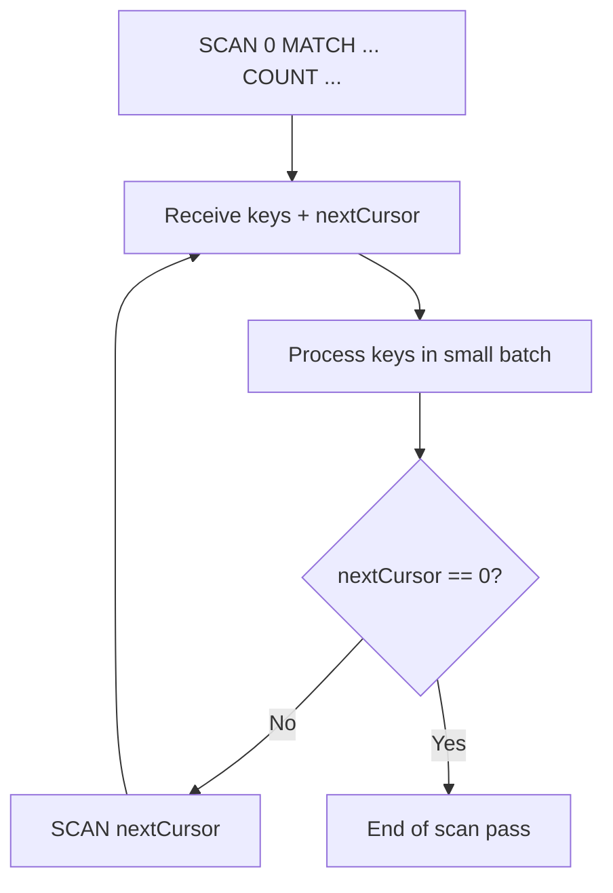
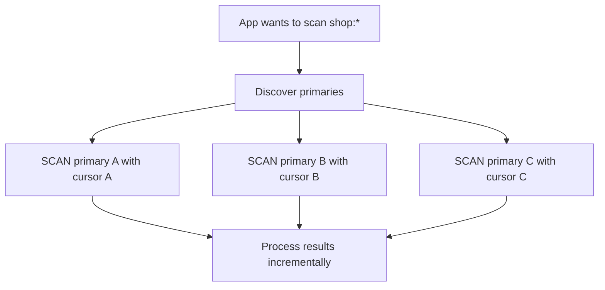

# Bounding SCAN, Full-Collection Operations, and Expensive Commands

Redis generally delivers low latency when applications access **specific keys** or **specific members/fields**. However, seemingly convenient operations—finding every key matching a pattern, reading an entire Hash, fetching a full Set, deleting a huge collection, or running unbounded set intersections/unions—can keep the Redis CPU busy for a long time, bloat network responses, and force the JVM to hold too much data in memory.

In **Spring Data Redis**, this risk surfaces through familiar APIs such as `RedisTemplate.keys(...)`, `HashOperations.entries(...)`, `SetOperations.members(...)`, `ListOperations.range(key, 0, -1)`, or a `Cache.clear()` call using the default scan/delete strategy. Replacing a full-load command with `SCAN` is an important improvement, yet **SCAN is not snapshot pagination and does not eliminate the total cost of traversing the entire dataset**.

This lesson distinguishes costs across **Redis Server**, **the network**, **the Java client**, and **the overall job**, then shows how to use `SCAN`, `HSCAN`, `SSCAN`, and `ZSCAN`, design bounded returns, perform controlled batch cleanup, operate on Redis Cluster, and monitor high-cost commands.

## 1. Why Can a Single Redis Command Cause High Latency?

Redis executes most data operations on a single main command-processing thread. A command that scans many elements, copies a large payload, or executes a CPU-heavy algorithm can make other requests wait longer. Modern Redis adds mechanisms for I/O processing and memory reclamation on background threads, yet **that does not mean every CPU-heavy command executes in parallel without affecting latency**.

Costs must be evaluated across multiple layers:

| Layer | Cost Example | Consequence |
| --- | --- | --- |
| **Redis CPU / event loop** | `KEYS *`, `HGETALL` on a large Hash, `SINTER` on large Sets | Other commands may have to wait |
| **Redis memory** | Building intermediate results, large sets, or sorts | Memory pressure, eviction/OOM |
| **Network** | Returning millions of members in one response | Bandwidth saturation, socket queues, timeouts |
| **JVM** | Deserializing entire `Map`, `Set`, `List` | Heap growth, GC pauses, `OutOfMemoryError` |
| **System-wide** | Multiple requests running full scans simultaneously | Lower throughput and higher latency for other workloads |

Example of a Hash with 2 million fields:

```redis
HGETALL users:properties
```

This command may scan the entire Hash and transfer every field/value to the client. `HashOperations.entries(key)` in Spring Data Redis returns a `Map`, so an application can easily end up holding the whole result in heap. If an HTTP request triggers this, it can degrade both Redis and the JVM even when business logic needs only a few fields.

### 1.1. Complexity Is Not the Whole Story

An `O(N)` command over 20 elements may be completely acceptable. That same command over millions of elements can be very expensive. The size of each value matters too: 1,000 elements × 20 bytes is vastly different from 1,000 elements × 1 MB.

Therefore, when evaluating a command, you need to know at least:

1. **Element count N** the command may traverse.
2. **Element count M** and total bytes returned.
3. **Invocation frequency** and number of concurrent callers.
4. **Data type and encoding** of the collection.
5. **SLO/latency budget** of other requests sharing Redis.

## 2. Table of Commonly Expensive Operations

| Redis Command / Spring API | Points to Watch | Better Alternative for Large Data |
| --- | --- | --- |
| `KEYS pattern` / `redisTemplate.keys(pattern)` | Scans the whole keyspace in one command; returns all matching keys | `SCAN`, still requiring bounds and a traversal plan |
| `HGETALL key` / `opsForHash().entries(key)` | Returns all Hash fields/values; cost scales with field count | `HGET`, `HMGET`, `HSCAN` |
| `HKEYS`, `HVALS` | Returns all field names or all values | `HSCAN`, read only needed fields |
| `SMEMBERS` / `opsForSet().members(key)` | Returns all Set members | `SISMEMBER`, `SMISMEMBER`, `SSCAN` |
| `ZRANGE key 0 -1` / `opsForZSet().range(key,0,-1)` | Returns entire Sorted Set | Bounded `ZRANGE`, `ZSCAN`, bounded score range |
| `LRANGE key 0 -1` / `opsForList().range(key,0,-1)` | Loads entire List | Small-page `LRANGE`, or batch pop if used as queue |
| `XRANGE key - +` | Reads full Stream history | `XRANGE ... COUNT n`, consumer groups, Record ID cursor |
| `SUNION`, `SINTER`, `SDIFF` | Scans multiple sets, may produce huge results | Design small index/candidate sets, check membership |
| `SORT` on large collection | May sort and allocate intermediate results | Use an already-ordered ZSET or paginate via data model |
| `DEL` on a very large key | May free many allocations synchronously | `UNLINK` when appropriate and supported |
| `FLUSHDB`, `FLUSHALL` | Very broad deletion scope, heavy impact | Controlled namespace deletion; never use as request cleanup |
| `MGET` on tens of thousands of keys | Many keys + huge response | Smaller batches, bounded concurrency, rethink data design |

This does not mean those commands are **always forbidden**. `HGETALL` on a 5-field Hash is reasonable. What to avoid is **an endpoint, job, or library with no size bounds** loading full datasets by habit.

## 3. `KEYS` and `SCAN`: Where Do They Differ?

### 3.1. `KEYS` Returns Results in a Single Call

```redis
KEYS shop:cache:*
```

Redis inspects the keyspace and returns every key matching the glob pattern. If the database holds many keys, the command can stall Redis and generate a huge response. In particular, avoid calling:

```java
Set<String> keys = stringRedisTemplate.keys("shop:cache:*");
```

inside user-facing HTTP requests or frequent jobs in large production environments.

**`KEYS` is not an indexed prefix search.** The pattern `shop:cache:*` does not let Redis jump directly to prefix-matching keys like a B-tree.

### 3.2. `SCAN` Iterates Incrementally with a Cursor

```redis
SCAN 0 MATCH shop:cache:* COUNT 100
```

Redis returns two items:

1. **Next cursor** to pass into the subsequent call.
2. **List of keys** found during this step.

Illustrative example:

```text
SCAN 0 MATCH shop:cache:* COUNT 100
  -> nextCursor: 208
  -> keys: [shop:cache:1, shop:cache:17, ...]

SCAN 208 MATCH shop:cache:* COUNT 100
  -> nextCursor: 34
  -> keys: [...]

SCAN 34 MATCH shop:cache:* COUNT 100
  -> nextCursor: 0
  -> keys: [...]
```

**A full scan ends only when the cursor returns to `0`.** Note that the cursor is returned by Redis; do not invent offsets like `0, 100, 200` as in SQL pagination.



The advantage of `SCAN` is **splitting a large traversal into smaller steps**, reducing the chance of a single command monopolizing Redis. However, if a job still scans tens of millions of keys, its total work remains substantial.

## 4. Essential `SCAN` Limitations You Must Understand

### 4.1. `COUNT` Is a *Hint*, Not a `LIMIT`

```redis
SCAN 0 MATCH shop:* COUNT 200
```

`COUNT 200` suggests how much work Redis should perform per call. It **does not guarantee returning exactly 200 keys**, nor at most 200 keys. Iterations can return fewer, more, or zero matching keys.

Especially with `HSCAN`, `SSCAN`, and `ZSCAN`, small collections using compact encodings may be returned **in full in a single scan**, regardless of a small `COUNT`. Therefore, the application must still bound element processing and memory per response.

### 4.2. An Empty Batch Can Arrive Before the Cursor Finishes

Example:

```text
cursor=84, returnedKeys=[]
```

Do not stop merely because `returnedKeys` is empty. If `nextCursor != 0`, matching keys may still exist in later iterations. This happens frequently when `MATCH` is highly selective.

### 4.3. Elements Can Be Returned Multiple Times

Redis keeps cursors very lightweight; a `SCAN` pass can return **the same key multiple times**. If you use `SCAN` to:

```text
Send an email every time a key is seen
Charge money once per key
Increment a counter per returned key
```

duplicate delivery can corrupt business logic. Handlers must be **idempotent**, or deduplicate by a stable identifier if exact counting/processing is required.

### 4.4. `SCAN` Is Not a Snapshot

During iteration, keys may be:

- Newly added.
- Deleted.
- Expired by TTL.
- Renamed.
- Migrated between nodes during Redis Cluster resharding.

Elements present **continuously from start to finish of a full scan** have specific guarantees per Redis documentation, whereas for keys present during only part of the scan, inclusion is **undefined**. Redis does not provide an immutable snapshot across the scan.

Thus, `SCAN` is unsuitable as the sole source for "exactly how many keys satisfy condition X at time T?" if concurrent writes/deletes occur.

### 4.5. Full-Scan Total Cost Still Scales with N

Redis documents `SCAN` cost as roughly `O(1)` **per call under normal conditions**, yet **a complete traversal** has overall cost **O(N)** in the number of elements in the keyspace or collection.

If every dashboard request runs a full `SCAN` loop, total load scales as:

```text
requests/second × total keys scanned per request
```

Replacing `KEYS` with `SCAN` while still executing a full scan on every request **does not form a scalable architecture**.

### 4.6. A Continuously Growing Collection Can Make Scans Very Long

If the scanned set grows continually, a full pass may fail to finish within the expected window. Jobs need **limits on duration, key count, iteration count, and resumability**, rather than an unbounded `while` loop.

### 4.7. `MATCH` and `TYPE` Are Not Secondary Indexes

```redis
SCAN 0 MATCH shop:orders:* COUNT 100
SCAN 0 TYPE hash COUNT 100
```

Options filter **returned results**; they do not turn `SCAN` into an application-indexed query. `TYPE` filters by logical Redis type on supporting Redis versions, without understanding business schemas inside Strings/Hashes.

If an endpoint repeatedly needs "PENDING orders for tenant X," design an index by status/tenant or use a queryable data store instead of scanning every `shop:orders:*` key per request.

## 5. Practicing `SCAN` with Redis CLI

In a learning Redis instance:

```redis
SET lesson:scan:user:1 active
SET lesson:scan:user:2 active
SET lesson:scan:order:1 pending
```

Try:

```redis
SCAN 0 MATCH lesson:scan:user:* COUNT 2
```

Output looks like:

```text
1) "someCursor"
2) [ "lesson:scan:user:1", ... ]
```

`someCursor` is just a placeholder symbol. Pass the **actual cursor** returned to continue until `"0"` appears.

Do not run:

```redis
SCAN 2 MATCH lesson:scan:user:* COUNT 2
```

simply because `COUNT 2` was used previously. `2` is **not an offset** for the next page.

### 5.1. Comparing with `KEYS`

On a tiny learning dataset, you can try:

```redis
KEYS lesson:scan:*
```

Understand that in production with many keys, `KEYS` can cause disruptions, whereas `SCAN` splits traversal into smaller chunks. In production, never run `KEYS *` on a multi-million-key database just to "check how many keys exist."

## 6. Scanning Keys with `RedisTemplate.scan(...)`

Spring Data Redis provides `RedisOperations.scan(ScanOptions)` returning `Cursor<K>`.

```java
import org.springframework.data.redis.core.Cursor;
import org.springframework.data.redis.core.ScanOptions;
import org.springframework.data.redis.core.StringRedisTemplate;

ScanOptions options = ScanOptions.scanOptions()
        .match("shop:cache:*")
        .count(200)
        .build();

try (Cursor<String> cursor = stringRedisTemplate.scan(options)) {
    while (cursor.hasNext()) {
        String key = cursor.next();
        // Process one key; do not retain all keys in a List/Set.
        System.out.println(key);
    }
}
```

Important points:

- `count(200)` is a **hint**, not a 200-key total cap for the job.
- `match` is a Redis glob pattern, not an SQL query.
- `Cursor` must be **closed**, so use `try-with-resources`.
- Never call `collect(Collectors.toList())` on all results when incremental processing suffices.
- With Redis Cluster, scan scope depends on connection/API; do not assume one cursor covers the entire Cluster.

### 6.1. Example of Processing with a Total Budget

A job must avoid unbounded scanning:

```java
import java.time.Duration;
import java.time.Instant;
import org.springframework.data.redis.core.Cursor;
import org.springframework.data.redis.core.ScanOptions;
import org.springframework.data.redis.core.StringRedisTemplate;

public long inspectAtMost(
        StringRedisTemplate redis, long maxKeys, Duration budget) {

    if (maxKeys <= 0 || budget.isNegative() || budget.isZero()) {
        throw new IllegalArgumentException("invalid budget");
    }

    ScanOptions options = ScanOptions.scanOptions()
            .match("shop:diagnostics:*")
            .count(100)
            .build();

    Instant deadline = Instant.now().plus(budget);
    long seen = 0;

    try (Cursor<String> cursor = redis.scan(options)) {
        while (cursor.hasNext()
                && seen < maxKeys
                && Instant.now().isBefore(deadline)) {
            String key = cursor.next();
            recordDiagnosticKey(key);
            seen++;
        }
    }
    return seen;
}

// recordDiagnosticKey is an application-implemented safe metrics
// recording method with appropriate log/metric limits.
```

This is an **early-stoppable inspection pass**, not a full scan: if `seen == maxKeys` or the budget expires, **do not claim the whole database was scanned**. When a problem requires completing across multiple runs, design progress tracking and restart handling; do not assume a closed cursor can serve as a durable long-term checkpoint while the keyspace mutates.

### 6.2. Do Not Treat `.hasNext()` as Purely an In-Memory Check

The cursor iterator may need to fetch the next batch from Redis once buffered items are exhausted. Thus, `hasNext()` or `next()` can involve I/O, timeouts, and exceptions. Never place a long cursor loop inside a low-SLO request without a budget and cancellation.

## 7. `HSCAN`: Processing Large Hashes Incrementally

Hashes work well for storing multiple fields/values, but:

```redis
HGETALL customer:attributes:123
```

returns **the entire Hash**. When only three fields are needed, use:

```redis
HMGET customer:attributes:123 name tier lastLogin
```

Or when iterating many fields:

```redis
HSCAN customer:attributes:123 0 MATCH preferences:* COUNT 100
```

`HSCAN` returns **field/value** pairs via a cursor. If the Hash is concurrently updated, entries may repeat or be missed per `SCAN` semantics.

### 7.1. Spring Data Redis with HashOperations

```java
import java.util.Map;
import org.springframework.data.redis.core.Cursor;
import org.springframework.data.redis.core.ScanOptions;
import org.springframework.data.redis.core.StringRedisTemplate;

String key = "customer:attributes:123";
ScanOptions options = ScanOptions.scanOptions()
        .match("preferences:*")
        .count(100)
        .build();

try (Cursor<Map.Entry<String, String>> cursor =
        stringRedisTemplate.<String, String>opsForHash()
                .scan(key, options)) {

    while (cursor.hasNext()) {
        Map.Entry<String, String> entry = cursor.next();
        processAttribute(entry.getKey(), entry.getValue());
    }
}

// processAttribute is application-provided logic.
```

If Hash field/value serializers are not String, generic types and decoding must match the actual `RedisTemplate`. `HSCAN` does not automatically turn binary payloads into meaningful text.

**`HSCAN` does not provide an exact snapshot page for building a full-aggregate edit form** if fields change concurrently. To read a small object atomically, `HGETALL` can work when schema size is bounded; for large objects needing snapshots, implement versioning/protocols accordingly.

## 8. `SSCAN`: Avoiding Loading an Entire Redis Set

If a Set holds millions of user IDs:

```redis
SMEMBERS campaign:subscribers:2026
```

Redis must return a massive payload. To check one member:

```redis
SISMEMBER campaign:subscribers:2026 u-123
```

To check multiple known members on supporting Redis versions:

```redis
SMISMEMBER campaign:subscribers:2026 u-123 u-456 u-789
```

When scanning is truly necessary:

```redis
SSCAN campaign:subscribers:2026 0 MATCH u-* COUNT 200
```

Spring example:

```java
import org.springframework.data.redis.core.Cursor;
import org.springframework.data.redis.core.ScanOptions;
import org.springframework.data.redis.core.StringRedisTemplate;

String key = "campaign:subscribers:2026";

try (Cursor<String> cursor =
        stringRedisTemplate.opsForSet().scan(
                key, ScanOptions.scanOptions().count(200).build())) {
    while (cursor.hasNext()) {
        String userId = cursor.next();
        processSubscriberIdempotently(userId);
    }
}
```

The method name `processSubscriberIdempotently` emphasizes the need for duplicate-safe handling; the application must implement it. If processing triggers non-idempotent side effects, track processed IDs durably at the business execution layer.

### 8.1. `SCARD` Does Not Replace `SMEMBERS`, and Vice Versa

If you only need the number of Set elements:

```redis
SCARD campaign:subscribers:2026
```

This is far better than fetching all members into Java and calling `.size()`. `SCARD` returns Set cardinality at execution time; `SSCAN` is only needed when inspecting individual members.

Similarly:

| What Do You Need to Know? | Command |
| --- | --- |
| Number of fields in a Hash | `HLEN` |
| Number of elements in a Set | `SCARD` |
| Number of members in a ZSET | `ZCARD` |
| Number of currently stored entries in a Stream | `XLEN` |
| Length of a List | `LLEN` |
| One Hash field | `HGET` |
| Set membership | `SISMEMBER` |
| Score of a ZSET member | `ZSCORE` |

Never count by fetching an entire collection when Redis provides a direct cardinality command. Distinguish **total element count** from **count matching a filter**; `HLEN` does not return "fields matching a pattern."

## 9. `ZSCAN` and `ZRANGE`: Two Different Meanings

Redis Sorted Sets support:

- **`ZSCAN`**: scans members/scores incrementally via hash-table scan; **does not guarantee score ordering**.
- **`ZRANGE`**: retrieves elements by **Sorted Set order**; can be bounded by index or score.

Example:

```redis
# Scan members/scores when score order is not needed:
ZSCAN leaderboard:season-1 0 COUNT 100

# Get top 20 by highest score:
ZRANGE leaderboard:season-1 0 19 REV WITHSCORES

# Get an index slice in order:
ZRANGE leaderboard:season-1 100 119 WITHSCORES
```

**Do not use `ZSCAN` for leaderboard pagination.** For top-N or score-ordered pages, use `ZRANGE`/`ZREVRANGE` and the options of your Redis version with a **bounded return range**.

### 9.1. `ZRANGE 0 -1` Is a Full-Load Operation

```redis
ZRANGE leaderboard:season-1 0 -1 WITHSCORES
```

If a leaderboard holds 3 million members, this produces a massive response. Do not run it by default just to render "page 1."

With Spring Data Redis:

```java
import java.util.Set;
import org.springframework.data.redis.core.ZSetOperations;

Set<ZSetOperations.TypedTuple<String>> top20 =
        stringRedisTemplate.opsForZSet()
                .reverseRangeWithScores(
                        "leaderboard:season-1", 0, 19);
```

`top20` is still an in-memory collection, yet **its scope is bounded to 20 elements**. If tie-breaking and stable ordering are business requirements, add tie-breakers and design an appropriate rank/score cursor.

### 9.2. Deep Offset Pagination Also Has a Cost

Example:

```redis
ZRANGE leaderboard:season-1 1000000 1000019
```

Although it returns 20 elements, locating the position in the data structure and maintaining order still has cost; deep-offset pagination patterns can impose significant load. For deep scrolling or frequently mutating data, consider **keyset pagination by score and member** or periodic snapshots/versions.

`ZSCAN` can also duplicate/skip changing elements, so it does not solve pagination consistency either.

## 10. `LRANGE` on Lists and Pagination Limits

Example of a List storing recent history:

```redis
LPUSH user:recent-actions:42 action-1001
LPUSH user:recent-actions:42 action-1002

# Avoid when the list can grow unboundedly:
LRANGE user:recent-actions:42 0 -1
```

If the UI only needs 20 items:

```redis
LRANGE user:recent-actions:42 0 19
```

In Spring:

```java
List<String> recent = stringRedisTemplate.opsForList()
        .range("user:recent-actions:42", 0, 19);
```

Deep offset pagination on a Redis List can take time to traverse to the target position. If you need long-term chronological queries with stable pagination, consider a **timestamp-scored Sorted Set**, Redis Streams by Record ID, or a suitable database.

### 10.1. Keep Lists Bounded on Write

For a "20 most recent actions" use case, cap length on write:

```redis
LPUSH user:recent-actions:42 action-1003
LTRIM user:recent-actions:42 0 19
```

These are two separate commands if invoked from the client, and `LTRIM` has cost proportional to the number of removed elements. If multiple writers run concurrently or both must be atomic, consider a Lua script or single-key transaction per your application contract.

For event lists requiring **zero lost records**, do not use Lists with arbitrary `LTRIM`; use a retention and recovery strategy that meets your guarantees.

## 11. Redis Streams: Bound Both Reads and Retention

Redis Streams support reading by Record ID:

```redis
# Bound returned record count:
XRANGE orders:events - + COUNT 100

# From newest backwards:
XREVRANGE orders:events + - COUNT 100
```

To continue reading, use the last received ID and specify an **exclusive boundary** using the appropriate Redis syntax rather than re-requesting the entire Stream on every call.

Example:

```redis
# First batch:
XRANGE orders:events - + COUNT 100

# Next batch, assuming last ID from first batch was 1731000000000-3:
XRANGE orders:events (1731000000000-3 + COUNT 100
```

The `(` excludes the starting boundary ID to avoid re-reading the last record of the previous page. Replace the illustrative ID with actual IDs.

When using consumer groups, use `XREADGROUP` with `COUNT` and a proper ACK/PEL workflow; **do not load the entire Stream history into a JVM List** just to process new records.

### 11.1. Retention Is Not the Same as Paging

To keep a Stream from growing forever:

```redis
XADD orders:events MAXLEN ~ 100000 * eventId e-1 type OrderCreated
```

`MAXLEN ~` performs **approximate trimming** during writes. It bounds retained data, not slow consumers. Trimming can evict records not yet processed by consumers if retention is too short.

Size retention around **acceptable downtime**, throughput, and replay needs—not just memory capacity.

## 12. Expensive Collection Operations

### 12.1. Redis Set Union/Intersection

```redis
SINTER segment:active segment:premium segment:region:apac
SUNION segment:a segment:b segment:c
SDIFF segment:all segment:disabled
```

These commands may scan many members and generate **huge results**. Running them once on small Sets may be reasonable; calling them repeatedly on multi-million-member Sets per HTTP request is risky.

If you only need to check whether one user belongs to all groups:

```redis
SISMEMBER segment:active u-101
SISMEMBER segment:premium u-101
SISMEMBER segment:region:apac u-101
```

Or use `SINTERCARD` with `LIMIT` on supporting Redis versions when only bounded cardinality is needed, rather than returning the entire intersection to the client.

Do not blindly treat replacing one `SINTER` with three separate `SISMEMBER` calls as an atomic snapshot: membership can change between commands. When consistency is required, design operations and transaction boundaries accordingly.

### 12.2. `SORT` and Server-Side Computation

```redis
SORT product:ids
```

Redis may scan and sort the entire collection. Even with `LIMIT`, computation cost can be substantial depending on data and options. For systems serving many ordered pages, maintain a **ranking Sorted Set** on write rather than sorting everything on every read.

### 12.3. MGET/HMGET and Oversized Batches

Batching reduces round trips, yet:

```redis
MGET key1 key2 key3 ... key100000
```

can produce a huge response, consuming client/server memory. Batches of 50–500 keys are usually easier to control than a giant list, though **there is no single right size for every workload**: measure against value sizes, network RTT, and SLOs.

Redis Cluster also imposes slot restrictions on many multi-key commands. Some high-level Spring Data Redis APIs split certain operations into per-node requests; **do not assume every multi-key command automatically becomes a valid or atomic cross-slot operation**.

## 13. Deleting Large Keys: `DEL` and `UNLINK`

`DEL` removes a key and can free large data structures on the main command thread. For very large Hashes, Sets, ZSETs, or Lists, memory deallocation can become a bottleneck.

Redis supports:

```redis
UNLINK shop:large:hash
```

`UNLINK` unlinks the key from the keyspace and delegates most memory reclamation to **background threads**, reducing time spent holding the main command thread.

| Command | Logical Effect | Memory Reclamation |
| --- | --- | --- |
| `DEL key` | Key is gone after command succeeds | Usually synchronous; can be costly for large collections |
| `UNLINK key` | Key is unlinked from keyspace | Memory reclamation offloaded to background thread |

**`UNLINK` is not free**: background CPU/memory work still occurs and it provides no rollback mechanism. Unlinking thousands of large keys simultaneously can build up a reclamation backlog and memory pressure.

Spring Data Redis provides:

```java
Boolean removed = stringRedisTemplate.unlink(
        "shop:large:hash");
```

Use it within a deletion workflow with clear ownership and conditions. Do not replace every `DEL` with `UNLINK` while ignoring business boundaries: deleting a key may impact secondary indexes, TTLs, consumers, or other caches.

### 13.1. Deleting Many Keys: Do Not Batch Unboundedly

Do not do:

```java
Set<String> keys = stringRedisTemplate.keys("shop:old:*");
stringRedisTemplate.delete(keys);
```

This combines **two risks**: `KEYS` scans the entire keyspace, and `delete(keys)` can issue an oversized command/batch. Also, newly created keys matching the pattern after scanning could be accidentally deleted on name collision.

A safer cleanup job needs:

1. Exact key scope and namespace ownership.
2. Per-node cursor scanning when using Cluster.
3. Small batches, bounding keys processed per iteration.
4. Controlled deletion (`UNLINK` or batched `DEL`) with latency monitoring.
5. Protection against deleting new data if namespaces/key versions are reused.
6. Retry capability and checkpointing by **business intent**, not solely an old SCAN cursor.

## 14. Spring Cache: `Cache.clear()` May Use `KEYS`

In Spring Data Redis, `RedisCacheManager` uses a `RedisCacheWriter` to store and remove cache entries. Under the default configuration described in the docs, clearing a cache can use a **`KEYS` then `DEL`** strategy.

If a cache contains millions of keys, calling:

```java
cacheManager.getCache("products").clear();
```

can trigger heavy load even though it is one line of Java.

You can configure `RedisCacheWriter` to use a **`SCAN` + batch delete** strategy:

```java
package com.example.cache;

import org.springframework.context.annotation.Bean;
import org.springframework.context.annotation.Configuration;
import org.springframework.data.redis.cache.BatchStrategies;
import org.springframework.data.redis.cache.RedisCacheConfiguration;
import org.springframework.data.redis.cache.RedisCacheManager;
import org.springframework.data.redis.cache.RedisCacheWriter;
import org.springframework.data.redis.connection.RedisConnectionFactory;

@Configuration
public class CacheConfiguration {

    @Bean
    public RedisCacheManager redisCacheManager(
            RedisConnectionFactory connectionFactory) {

        RedisCacheWriter writer =
                RedisCacheWriter.nonLockingRedisCacheWriter(
                        connectionFactory,
                        BatchStrategies.scan(500));

        return RedisCacheManager.builder(writer)
                .cacheDefaults(
                        RedisCacheConfiguration.defaultCacheConfig())
                .build();
    }
}
```

`BatchStrategies.scan(500)` sets the batch size for the clear strategy. It **does not guarantee** the clear touches only 500 keys, nor does it make clearing an atomic transaction. Spring Data Redis may perform multiple `SCAN`s and batch deletes until finished.

### 14.1. Driver and Cluster Compatibility

Spring Data Redis documentation notes:

- The `KEYS` strategy supports Standalone and Cluster with standard drivers.
- The `SCAN` strategy is fully supported with **Lettuce**.
- With **Jedis**, `SCAN`-based cache clearing has limitations in **non-Cluster** mode per the docs.

Therefore, verify your **driver** and topology before switching to `BatchStrategies.scan(...)`. Do not assume every `RedisCacheWriter`/driver/Cluster combination behaves identically just because the Redis `SCAN` command exists.

### 14.2. `SCAN`-Based Clear Still Has Race Conditions

Suppose one instance clears the `products` cache while another instance keeps inserting new entries into the same cache during the scan. Some new entries may survive or newly scanned entries may be deleted depending on timing.

If the requirement is "all old cache entries must vanish immediately on a new release," consider a **versioned cache prefix**:

```text
cache:products:v1::P-101
cache:products:v2::P-101
```

The new application version reads only `v2`, while `v1` expires by TTL or is cleaned by a background job. This pattern usually avoids depending on a massive synchronous clear during deployment.

## 15. Redis Cluster: One SCAN Is Not Necessarily the Whole Cluster

Redis Cluster divides the keyspace into **16,384 hash slots** distributed across multiple primaries. A `SCAN` command sent to one node normally sees only the keys held by that node.



Therefore, **do not treat a single Redis cursor as representing the entire Cluster**.

Spring Data Redis offers `RedisClusterConnection` with a **per-node** scan API:

```java
RedisClusterConnection cluster =
        connectionFactory.getClusterConnection();

Cursor<byte[]> cursor =
        cluster.scan(node, ScanOptions.scanOptions()
                .match("shop:*")
                .count(200)
                .build());
```

This snippet illustrates the API: `node` must be a `RedisClusterNode` from the topology, e.g., retrieved via `cluster.clusterGetNodes()`. Your application must manage connection/cursor lifecycles, target **primaries** rather than scanning duplicate datasets on replicas, and avoid assuming topology remains static during resharding.

A general workflow:

```text
1. Retrieve list of active primaries.
2. Open a separate SCAN cursor for each primary.
3. Process small batches, bounding Cluster-wide concurrency.
4. On MOVED/ASK/topology change, classify errors and re-coordinate.
5. Reconcile by key/version if high accuracy is needed.
```

During resharding, keys can migrate between nodes, causing scan results to **miss or duplicate** some elements. If you need an exact key list for billing, data migration, critical deletion, or auditing, maintain a stateful inventory or authoritative reconciliation outside a single `SCAN` pass.

### 15.1. Watch Out for `RedisClusterConnection.keys(...)`

Some cluster-aware APIs **fan out** `KEYS` across all primaries and merge results on the client. That does not make the command safer: it can simultaneously overload **every primary** and retain a huge key set in the JVM.

**`redisTemplate.keys(pattern)` and helpers collecting all keys should still be avoided** on large datasets, even when the driver spans multiple nodes.

## 16. Is `SCAN` Suitable for HTTP Pagination?

Usually **no**, if the product requires stable pagination, deterministic ordering, and total page counts.

`SCAN` returns cursors based on hash-table bucket state, without:

- Business ordering by `createdAt`, `name`, or `score`.
- Duplicate-free guarantees across pages when data mutates.
- An immutable snapshot at the first request.
- Fast total count matching `MATCH` via an index.
- Ability to "jump directly to page 100" using a simple offset.

For example, do not use `SCAN` like this:

```text
GET /orders?page=100&size=20
    -> SCAN whole keyspace and discard the first 1,980 keys
```

Better alternatives:

- Maintain a **Sorted Set index** by time/priority with bounded ranges.
- Use a database with true query and secondary-index support.
- Use a business cursor based on `(timestamp, id)` or Stream Record ID.
- Serve lists from a prebuilt read model endpoint.

Redis `SCAN` fits **maintenance, inventory, best-effort reconciliation, and background batch jobs**.

## 17. ReactiveRedisTemplate: Backpressure Does Not Shrink Big Commands

In a WebFlux stack, Spring Data Redis offers reactive APIs:

```java
import org.springframework.data.redis.core.ReactiveStringRedisTemplate;
import org.springframework.data.redis.core.ScanOptions;
import reactor.core.publisher.Flux;

Flux<String> keys = reactiveStringRedisTemplate.scan(
        ScanOptions.scanOptions()
                .match("shop:diagnostics:*")
                .count(100)
                .build());
```

Reactive scan emits keys incrementally and supports downstream coordination. However:

- `Flux` does not make scanning **millions of keys** free.
- `.collectList()` on the Flux still pulls all results into memory.
- `.flatMap(this::processKey)` without target concurrency bounds can spawn excessive parallel requests if misconfigured.
- `.take(100)` limits **downstream element demand**, not `COUNT` as an exact server limit, nor does it indicate completion.
- Reactive stream cancellation must be handled properly with the driver; once a write/delete reaches Redis, cancellation does not roll back side effects.

Example processing with fixed concurrency:

```java
import reactor.core.publisher.Mono;

Mono<Long> processed = reactiveStringRedisTemplate.scan(
                ScanOptions.scanOptions()
                        .match("shop:diagnostics:*")
                        .count(100)
                        .build())
        .take(500)
        .flatMap(key -> inspectKey(key), 4)
        .count();

// inspectKey(String) returns Mono<?> implemented by the application.
```

`take(500)` caps the stream at 500 forwarded keys, while `flatMap(..., 4)` bounds concurrent tasks in that operator stage. This is **not** a full-data traversal job; driver-level paging/cursor behavior and concurrency still need measurement.

For large deletions or migrations, use a background worker with **throttling and retries/idempotency**. A WebFlux handler scanning/deleting millions of keys directly will easily hit gateway timeouts.

## 18. Pipelining: Reduces Round Trips, Not Redis Computation

Spring Data Redis can pipeline multiple commands to reduce reply-wait round trips:

```text
Without pipeline:
  GET k1 -> reply
  GET k2 -> reply
  GET k3 -> reply

With pipeline:
  GET k1
  GET k2
  GET k3
  -> receive replies
```

Pipelining helps when issuing many simple commands over noticeable network latency. However:

1. Redis still **executes every command**; pipelining does not turn a million-field `HGETALL` into O(1).
2. Client/server still buffer replies; huge pipelines create memory pressure.
3. If the connection drops mid-pipeline, some commands may have executed while others did not—you must classify outcomes.
4. Pipelining **is not a transaction**; commands can have independent side effects and do not auto-rollback.
5. Batch size must be measured in bytes and latency, not just command count.

Never try pipelining thousands of `SMEMBERS` on giant Sets. Instead, **redesign the access path** so fetching whole Sets is unnecessary.

## 19. Data Modeling to Avoid Continuous Scanning

Many full-Redis scans are symptoms of missing a **dedicated index**.

### 19.1. Querying by Status

Avoid:

```text
Find all PENDING jobs:
  SCAN jobs:*
  GET each job
  filter status == PENDING
```

Maintain a Sorted Set instead:

```text
jobs:pending:by-time
  member = jobId
  score  = deadline timestamp
```

Read due jobs with a score range and `LIMIT`:

```redis
ZRANGEBYSCORE jobs:pending:by-time -inf 1763000000000 LIMIT 0 100
```

After processing, update the index and job state consistently. If Redis Cluster spans multiple slots across keys, design multi-key atomicity or idempotent recovery appropriately.

### 19.2. Short-Lived Data

Do not schedule a per-minute job to:

```text
SCAN sessions:* -> read lastSeen -> DEL if stale
```

when each session can carry a **TTL directly** on write. Redis automatically expires keys; no full-keyspace scan is required for routine housekeeping.

Note: a standard TTL on a Hash/Set/ZSET applies to the **entire key**, not individual members. For per-user `lastSeen`, use a Sorted Set score plus score-based pruning instead of scanning all keys.

### 19.3. Invalidation by Key Version

When invalidating millions of cache entries:

```text
cache:product:v1::123
cache:product:v2::123
```

Switch the application to prefix `v2` and let `v1` expire or clean up in the background. Avoid forcing requests or deployments to wait on a massive `KEYS` + `DEL`.

## 20. Deleting Very Large Collections and Bulk Operation Risks

A multi-million-field Hash can be deleted via:

```redis
UNLINK large:hash
```

If the goal is truly **deleting the whole collection**, you usually do not need `HSCAN` + `HDEL` field by field: that adds many round trips and races with concurrent updates.

If only fields matching a condition must be deleted:

```redis
HSCAN large:hash 0 MATCH obsolete:* COUNT 100
```

the job should execute batched `HDEL`s while accounting for SCAN's non-snapshot nature. Never scan a heavily mutated collection and infer exact post-job deleted/valid counts without reconciliation.

### 20.1. Recoverable Namespace Deletion Workflow

An operational pattern:

```text
Phase 1: Verify exact namespace/version and ownership
Phase 2: Stop old writers or migrate writers to v2 prefix
Phase 3: Scan per node with SCAN, batching, and time budget
Phase 4: UNLINK/DEL verified keys
Phase 5: Reconcile remaining keys/versions and replay job if needed
Phase 6: Complete once business conditions are satisfied
```

If writers still emit keys into the `v1` namespace after phase 3, scanning/deleting may **delete new data** or never finish. Stopping writes or versioning keys matters more than picking `COUNT=100` vs `COUNT=1000`.

**Never use SCAN to delete user data subject to legal/audit accuracy requirements without verification against the source of truth.**

## 21. Monitoring Slow Commands and Large Keys

Redis inspection tools help uncover high costs:

```redis
SLOWLOG GET 20
INFO commandstats
INFO memory
INFO stats
LATENCY LATEST
```

For a specific key:

```redis
TYPE large:hash
HLEN large:hash
MEMORY USAGE large:hash
```

For Sets/ZSETs/Lists:

```redis
SCARD large:set
ZCARD large:zset
LLEN large:list
```

Cardinality commands are usually far safer than reading full collections. `MEMORY USAGE` estimates memory consumed by a key, yet also carries cost and should not be called millions of times in production just for statistics.

### 21.1. Interpreting `SLOWLOG` Correctly

Redis Slow Log records **server-side command execution time** above the configured threshold; it does not measure:

```text
network latency
connection pool wait time
JVM serialize/deserialize time
application result processing time
```

Thus, a slow request missing from the Slow Log **does not mean Redis is uninvolved**. Combine end-to-end tracing, client command metrics, queueing, GC, and network telemetry.

### 21.2. Recommended Metrics

| Metric / Signal | Meaning |
| --- | --- |
| Redis command p50/p95/p99 latency | Latency under normal and peak load |
| `SLOWLOG` entries by command | Identify CPU-expensive commands |
| Command rate by type (`cmdstat_*`) | Frequency of `KEYS`, `HGETALL`, `SMEMBERS`, `SCAN`, etc. |
| Redis CPU/memory/evictions | Resource pressure and overload signals |
| Key/collection cardinality | Whether Hashes, Sets, ZSETs, or Streams grow unboundedly |
| Response size / network bytes | Detect returning excessive data |
| JVM heap/GC pauses | Client holding large results or deserializing excessively |
| Scan job duration and iteration count | Monitor background job time and work |
| Estimated scan duplicates/skips | Reliability of best-effort inventory |
| Batch delete rate and unlink backlog | Track cleanup impact |
| Cluster slot/node skew | Hot slots or uneven scan fan-out |

Do not log individual keys pointing to sensitive data just to debug `SCAN`; recording namespace, batch size, duration, and aggregate counts is usually sufficient.

## 22. Tuning `COUNT` and Batch Size Through Measurement

There is no single `COUNT=1000` suitable for every application. You can test values in an environment with a representative workload:

| Illustrative `COUNT` | Typical Characteristics | When to Consider |
| --- | --- | --- |
| `20` | More round trips, smaller batches | Need low per-command latency; small keyspace |
| `100` | Easier to bound, moderate data per batch | General maintenance jobs |
| `500` | Fewer round trips, potentially larger batches | Background jobs with spare bandwidth and Redis headroom |
| `2000` | May cut call count, higher cost per call | Only when workload tests prove it safe |

These are **test values**, not fixed recommendations. Returned volume depends on collection encoding, `MATCH`, and data distribution. Start conservatively, measure p99 latency across the **entire Redis workload**, and adjust based on real impact.

Example cleanup job budget:

```text
Max 1,000 keys/batch
Max 100 ms Redis-related work/batch
Max 1 active job/namespace
Max 2 concurrent batches Cluster-wide
Emit metrics each batch, schedule next batch
```

These bounds are design examples only. If Redis slows down or keys/values are large, throttle further. `COUNT` **does not enforce** total key, time, or concurrent client limits; the application must enforce them explicitly.

## 23. Handling Mid-Scan Failures

A `SCAN` job can encounter:

- Timeouts or connection resets.
- Redis Cluster resharding, failover, or topology updates.
- Java process restarts.
- Handler exceptions on a single key.
- Keys expiring/being deleted before the handler accesses them.
- Scan observing a key whose write/delete outcome was never confirmed.

Therefore, ensure:

1. **Idempotent handlers:** processing the same key twice causes no unwanted side effects.
2. **Do not treat missing keys as fatal errors by default:** keys may have expired; handle per business rules.
3. **Persist job state if completion is mandatory:** e.g., record job/event IDs in a durable store.
4. **Bounded retries:** data/ACL/type errors do not resolve via infinite retries.
5. **Post-job reconciliation:** re-scan or verify against the source of truth when completeness is critical.
6. **Never use old SCAN cursors as permanent checkpoints:** hash tables rehash and Redis nodes change roles.

### 23.1. Lost Write Replies Do Not Mean Nothing Changed

If a batch `UNLINK`/`HDEL` times out on the client, the server may already have deleted the keys. Retrying key deletion may be harmless at the key layer, whereas external application side effects (audit logs, billing, event emission) **are not automatically idempotent**. Separate Redis mutations from external business actions.

## 24. Common Anti-Patterns

### 24.1. Using `redisTemplate.keys("*")` for Dashboards

The full keyspace can be massive; one `KEYS` scan can stall every concurrent request. Maintain dedicated metrics, counters, or indexes instead.

### 24.2. Replacing `KEYS` with `SCAN` Yet Calling `collectList()` on Everything

```java
List<String> all = new ArrayList<>();
try (Cursor<String> cursor = redis.scan(options)) {
    cursor.forEachRemaining(all::add);
}
```

This avoids one giant `KEYS` reply yet still accumulates every key in the JVM and pays the full O(N) scan cost. If processing per key suffices, never collect everything into a list.

### 24.3. Stopping on an Empty SCAN Batch

An empty batch does not mean the cursor finished. Only stop a full iteration when the cursor returns `0` or when the job intentionally hits its budget (making it a partial scan).

### 24.4. Treating `COUNT` as Exact Pagination

`COUNT 100` guarantees neither 100 items per page, stable ordering, nor jumping directly to page N.

### 24.5. Calling `SMEMBERS` Just to Check One User

Choose `SISMEMBER` instead of downloading the entire Set and calling `.contains()` in Java.

### 24.6. Calling `HGETALL` Just to Read Two Fields

Choose `HMGET`/`HGET`. Hashes can grow over time until code that initially worked becomes unsafe in memory.

### 24.7. Using `LRANGE key 0 -1` for Page 1

Use a bounded range matching what the UI displays. If deep history browsing is required, revisit the data structure.

### 24.8. Reading the Entire Stream on Every Poll

`XRANGE - +` without `COUNT` can download huge histories. Use consumer groups or batched Record ID cursors.

### 24.9. Using `DEL` to Remove Very Large Collections

`UNLINK` offloads memory reclamation from the main command thread. Still apply rate limits and controlled deletion policies.

### 24.10. Running `SCAN` Continuously on Every Application Instance

If 20 instances scan the whole database every minute, total load multiplies. Use a dedicated job, leader election/coordinated scheduler, or node/namespace partitioning.

### 24.11. Calling SCAN an "Exact Snapshot"

Keys can repeat, vanish, or appear mid-scan. Use an appropriate data store/transaction when business logic needs an exact point-in-time result set.

### 24.12. Assuming Pipelining Makes O(N) Commands Cheap

Pipelining saves network RTT, not CPU cost of `HGETALL`, `SINTER`, `SORT`, etc. Oversized batches can also increase memory pressure.

### 24.13. Calling `Cache.clear()` Without Checking the RedisCacheWriter Strategy

Defaults may rely on `KEYS` and `DEL`. For large caches, select `BatchStrategies.scan(...)` where driver/topology supports it, or switch to versioned prefixes.

### 24.14. Scanning One Primary and Assuming the Whole Cluster Was Scanned

Cluster requires per-node/slot awareness and separate cursors. Do not treat one `SCAN` on one node as an inventory of all 16,384 slots.

### 24.15. Calling `MEMORY USAGE` on Millions of Keys Per Request

Even though it returns one number per key, the command volume is huge. Use sampling or budgeted observation jobs instead of unbounded N+1 calls.

## 25. Controlled Hands-On Practice

Test on a learning Redis instance—never production:

**Step 1: Create a small Hash, Set, and Sorted Set.**

```redis
HSET lesson:scan:hash field:1 alpha field:2 beta field:3 gamma
SADD lesson:scan:set u-101 u-102 u-103
ZADD lesson:scan:zset 10 item-a 20 item-b 30 item-c
```

**Step 2: Compare full reads vs scan.**

```redis
HGETALL lesson:scan:hash
HSCAN lesson:scan:hash 0 COUNT 2

SMEMBERS lesson:scan:set
SSCAN lesson:scan:set 0 COUNT 2

ZRANGE lesson:scan:zset 0 -1 WITHSCORES
ZSCAN lesson:scan:zset 0 COUNT 2
```

With small collections and compact encodings, **one `HSCAN`/`SSCAN`/`ZSCAN` call may return everything** despite `COUNT 2`. That is normal: `COUNT` is a hint, not a hard limit.

**Step 3: Check cardinality without downloading data.**

```redis
HLEN lesson:scan:hash
SCARD lesson:scan:set
ZCARD lesson:scan:zset
```

**Step 4: Inspect type and memory.**

```redis
TYPE lesson:scan:hash
MEMORY USAGE lesson:scan:hash
```

**Step 5: Clean up test keys.**

```redis
UNLINK lesson:scan:hash lesson:scan:set lesson:scan:zset
```

On a tiny test dataset, command cost will not reveal the latency of a multi-million-field collection. For production tuning, benchmark with realistic data sizes, throughput, and concurrency.

## 26. Quick Selection Matrix

| Need | Use | Avoid at Scale |
| --- | --- | --- |
| Look up a known key | `GET`, `HGET`, `ZSCORE`, etc. | Scanning the entire database to find the key |
| Count collection members | `HLEN`, `SCARD`, `ZCARD`, `LLEN`, `XLEN` | Loading the entire collection then calling `.size()` |
| Iterate namespace keys for maintenance | `SCAN` + cursor + batch + budget | Repeated `KEYS namespace:*` |
| Iterate a large Hash | `HSCAN`, or `HMGET` for needed fields | Unbounded `HGETALL` |
| Check Set membership | `SISMEMBER`/`SMISMEMBER` | `SMEMBERS` then `.contains` |
| Iterate a large Set | `SSCAN` | `SMEMBERS` on millions of IDs |
| Fetch leaderboard top N | Bounded `ZRANGE`/reverse range | `ZSCAN` then sorting all in JVM |
| Read a small List page | Bounded `LRANGE start stop` | `LRANGE 0 -1` |
| Read Stream history | `XRANGE COUNT` by ID or `XREADGROUP` | Unbounded `XRANGE - +` |
| Delete a huge key | `UNLINK` when appropriate | `DEL` if synchronous free causes latency spikes |
| Clear large Redis Cache | `BatchStrategies.scan(...)`, TTL, or versioned prefix | Huge one-shot `KEYS` + `DEL` |
| Business queries with sort/filter/pagination | Proper index/read model | Full-keyspace SCAN per request |

## 27. Summary

**Redis `SCAN` is an incremental traversal tool, not an indexed query or snapshot pagination.** It splits large work into smaller steps, yet `COUNT` is only a hint, batches can be empty, elements can repeat, data can mutate mid-scan, and **total full-scan cost still scales with N**. In Redis Cluster, you must also account for per-primary keyspace scope, resharding, and separate cursors.

With Spring Data Redis, prefer **purpose-built commands and bounded result sizes**: `HGET/HMGET` over `HGETALL`, `SISMEMBER` over `SMEMBERS`, bounded `ZRANGE` over `0 -1`, `XRANGE COUNT` over full Stream reads, and `HLEN/SCARD/ZCARD/LLEN/XLEN` when only counts are needed. `Cursor` instances from `scan(...)` must be closed, and long-running jobs need budgets, batching, retries/idempotency, and metrics.

**Pipelining does not reduce server-side complexity**, `UNLINK` reduces synchronous deallocation cost without making deletion free, and `Cache.clear()` can invoke `KEYS` unless configured otherwise. When the same query repeatedly forces full Redis scans, the durable fix is **remodeling data, adding indexes, or precomputing read models**, rather than just raising `COUNT` or timeouts.

### References

- [Redis — SCAN](https://redis.io/docs/latest/commands/scan/): cursor mechanics, `COUNT`, duplicates, collection mutations, and traversal guarantees.
- [Redis — HSCAN](https://redis.io/docs/latest/commands/hscan/), [SSCAN](https://redis.io/docs/latest/commands/sscan/), [ZSCAN](https://redis.io/docs/latest/commands/zscan/): iterating large collections.
- [Redis — KEYS](https://redis.io/docs/latest/commands/keys/) and [HGETALL](https://redis.io/docs/latest/commands/hgetall/): commands to avoid overusing on large data.
- [Redis — UNLINK](https://redis.io/docs/latest/commands/unlink/): separating key unlinking from background memory reclamation.
- [Redis — SLOWLOG](https://redis.io/docs/latest/commands/slowlog/), [INFO](https://redis.io/docs/latest/commands/info/): observing Redis commands and performance.
- [Spring Data Redis — RedisTemplate](https://docs.spring.io/spring-data/redis/reference/redis/template.html): Redis data-type operations and serializers.
- [Spring Data Redis — RedisTemplate API](https://docs.spring.io/spring-data/redis/reference/api/java/org/springframework/data/redis/core/RedisTemplate.html): `scan(ScanOptions)`, `keys(pattern)`, and Cursor management.
- [Spring Data Redis — Redis Cache](https://docs.spring.io/spring-data/redis/reference/redis/redis-cache.html): RedisCacheWriter, `KEYS`/`SCAN` strategies, and driver compatibility.
- [Spring Data Redis — Redis Cluster](https://docs.spring.io/spring-data/redis/reference/redis/cluster.html): per-node key scope, cross-slot operations, and cluster-aware connections.
