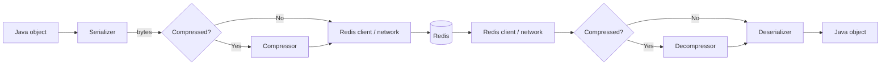

# Serialization, JSON, and Compression Costs in Spring Data Redis

## 1. Why Can Serialization Be a Redis Performance Bottleneck?

Redis handles many key/value operations very quickly, yet a Spring Data Redis application does not pass a Java object directly into Redis memory. On the client side, the object must be **serialized** into bytes; on reads, the byte sequence must be **deserialized** back into an application object.

Example:

```java
ProductSnapshot snapshot = new ProductSnapshot(
        "SKU-42", "T-shirt", 199_000L, Instant.now());

productRedisTemplate.opsForValue()
        .set("product:SKU-42", snapshot);

ProductSnapshot loaded = productRedisTemplate.opsForValue()
        .get("product:SKU-42");
```

This snippet incurs at least five cost components:

1. **Key encoding:** `"product:SKU-42"` is converted into bytes by the key serializer.
2. **Value encoding:** `ProductSnapshot` is converted into JSON or another format.
3. **Network transfer:** the client sends the command and payload to Redis.
4. **Storage in Redis:** Redis stores key/value bytes plus metadata and data structure overhead.
5. **Decoding on read:** Redis returns bytes to the client, and the serializer reconstructs the Java object.

If **compression** is used, the client also performs compression before sending and decompression upon receiving.

Path diagram:



**Overall performance is not just Redis server latency.** Application latency also depends on payload size, serializer CPU, memory allocations, garbage collection, network bandwidth, and concurrency.

This lesson helps you choose serializers and compression policies in Spring Data Redis using real measurements rather than assumptions like "JSON is always slow" or "compression is always faster."

## 2. Cost Layers to Measure Separately

You can approximate the processing time of a Redis request as:

```text
T_operation ≈ T_serialize_key
            + T_serialize_value
            + T_client_queue
            + T_network_request
            + T_redis_execution
            + T_network_response
            + T_deserialize_value
            + T_application_processing
```

For `SET`, response value decoding is negligible. For `GET` returning large objects, JSON decoding and object allocation can be substantial. For tiny keys on a local network, codec overhead can matter as much as or more than Redis server execution time.

Examples:

| Scenario | Typically Notable Cost | Optimization Direction |
| --- | --- | --- |
| `GET` a string of a few dozen bytes | Network round trip, client overhead | Reduce call count, do not compress |
| `GET` JSON of a few kilobytes | Network + JSON parser + allocations | Suitable serializer, benchmark compression |
| `GET` JSON of hundreds of kilobytes | Network/CPU/GC, oversized cache entry | Shrink payload, partition sensibly, or compress |
| `MGET` many keys | Total bytes, allocated objects, temporary memory | Controlled batching, size limits |
| Mass cache miss | Serialization + backend query + cache write | Stampede protection, bounded concurrency |
| Frequently updated value | Encoding cost, overwrites, persistence/replication | Avoid expensive compression, optimize schema |
| Single-field Hash update | Avoids re-encoding entire object | Use Redis Hash if semantics match |

Do not optimize purely by checking `redis-cli INFO commandstats`. Server statistics do not capture application CPU spent in Jackson, GZIP, or byte array allocations.

## 3. How Does Spring Data Redis Decide Stored Bytes?

Common abstractions:

- `RedisTemplate<K,V>`: synchronous, configurable key/value/hash serializers.
- `StringRedisTemplate`: template dedicated to String keys and values.
- `ReactiveRedisTemplate<K,V>`: reactive counterpart with a serialization context.
- `ReactiveStringRedisTemplate`: reactive template dedicated to Strings.
- `RedisCacheManager` and `RedisCacheConfiguration`: entry serialization in Spring Cache.
- Redis Repository: object mapping, Hashes, and repository indexes/structures.

Inside `RedisTemplate`, there are several serializer slots:

| Serializer | Data Handled | Impact |
| --- | --- | --- |
| `keySerializer` | Top-level Redis key | Key name bytes, hash-slot routing in Cluster |
| `valueSerializer` | Redis String value or corresponding operation values | Payload size and read decoding |
| `hashKeySerializer` | Redis Hash field name | Cost and interoperability with other clients |
| `hashValueSerializer` | Hash field value | Per-field codec |
| Serialization context | Reactive template | Equivalent encoding/decoding paths for reactive operations |
| `SerializationPair` | Redis Cache | Key/value codecs per cache configuration |

**The key serializer matters as much as the value serializer for compatibility.** If service A uses UTF-8 key `product:42` while service B uses JDK serialization for Java String `"product:42"`, the two services write different key bytes in Redis even though they look identical in Java.

In Redis Cluster, key bytes also determine the hash slot. Changing key serializers during an upgrade can make clients miss existing keys and trigger mass cache misses.

## 4. Common Serialization Options

| Option | Readability | Performance/Size | Compatibility |
| --- | --- | --- | --- |
| `StringRedisSerializer` | Easily readable in `redis-cli` | Efficient for short text; no JSON parsing | Good with consistent encoding |
| Typed JSON | Readable, easy to inspect | Field names & escaping overhead; parse/allocation cost | Good with schema management |
| Generic JSON with type metadata | Readable, but payload adds metadata | Extra bytes and polymorphic typing logic | Requires strict typing and security controls |
| JDK serialization | Hard to read, tied to Java implementation | Metadata and class coupling; not efficient by default | Poor across languages or class changes |
| Schema-based binary codec | Not directly human-readable | Can be compact and fast depending on codec | Requires shared schema/protocol |
| JSON + GZIP | Not directly readable with `GET` | Shrinks repetitive large payloads; adds CPU | Must standardize headers, versioning, decompression |
| Binary codec + LZ4/Zstd | Not directly readable | Can balance speed and compression ratio well | Needs dependencies, benchmarks, clear format |

No single format fits every key. Tiny string key/values do not need a full JSON codec, while a complex object shared across services benefits from explicit schemas and JSON version management.

**Measure with real payloads** rather than guessing speed from library names or generic benchmarks that do not resemble application data.

## 5. `StringRedisSerializer`: Simple with Low Overhead for String Data

Example using `StringRedisTemplate`:

```java
import java.time.Duration;
import org.springframework.data.redis.core.StringRedisTemplate;

public class FeatureFlagStore {

    private final StringRedisTemplate redis;

    public FeatureFlagStore(StringRedisTemplate redis) {
        this.redis = redis;
    }

    public void save(String name, boolean enabled) {
        redis.opsForValue().set(
                "feature:" + name,
                enabled ? "1" : "0",
                Duration.ofMinutes(5));
    }

    public boolean isEnabled(String name) {
        String value = redis.opsForValue()
                .get("feature:" + name);
        return "1".equals(value);
    }
}
```

For a boolean, encoding as `"1"`/`"0"` can be far more efficient than building a JSON object like:

```json
{
  "flag": "checkout",
  "enabled": true,
  "updatedBy": "service-a"
}
```

However, compact does not always mean better: if you need metadata, auditing, versioning, or multiple fields, an explicit structured format is easier to maintain.

### Do Not Confuse Character Count with Byte Count

With UTF-8:

```text
"OK"       -> 2 bytes
"Việt Nam" -> more bytes than characters because of Vietnamese diacritics
```

Payload size should be measured in bytes **after serialization**, not by Java `String.length()`. Multi-byte UTF-8 characters mean multilingual product names consume more network and memory than ASCII strings of the same character count.

## 6. Typed JSON: Clear Schema and Metadata Control

Suppose we cache a product snapshot:

```java
import java.time.Instant;

public record ProductSnapshot(
        String sku,
        String title,
        long priceCents,
        Instant updatedAt) {
}
```

A JSON value:

```json
{
  "sku": "SKU-42",
  "title": "T-shirt",
  "priceCents": 199000,
  "updatedAt": "2026-11-13T00:00:00Z"
}
```

JSON characteristics:

- Field names repeat in every entry.
- Text fields may require escaping.
- On decode, Jackson parses syntax and allocates new objects/strings/collections.
- Format is CLI-readable, aiding operations and cross-language interoperability.
- Schema evolution can be easier to manage than JDK serialization when optional/default/version fields are designed cleanly.

### Configuring `RedisTemplate` with a Typed JSON Serializer

In Spring Data Redis versions supporting the corresponding constructor, you can configure:

```java
import org.springframework.context.annotation.Bean;
import org.springframework.context.annotation.Configuration;
import org.springframework.data.redis.connection.RedisConnectionFactory;
import org.springframework.data.redis.core.RedisTemplate;
import org.springframework.data.redis.serializer.Jackson2JsonRedisSerializer;
import org.springframework.data.redis.serializer.StringRedisSerializer;

@Configuration
public class ProductRedisConfiguration {

    @Bean
    RedisTemplate<String, ProductSnapshot> productRedisTemplate(
            RedisConnectionFactory connectionFactory) {

        RedisTemplate<String, ProductSnapshot> template =
                new RedisTemplate<>();

        template.setConnectionFactory(connectionFactory);

        template.setKeySerializer(new StringRedisSerializer());
        template.setValueSerializer(
                new Jackson2JsonRedisSerializer<>(
                        ProductSnapshot.class));

        template.setHashKeySerializer(
                new StringRedisSerializer());

        template.afterPropertiesSet();
        return template;
    }
}
```

This snippet only illustrates the value encoding path in Redis Strings. In real applications containing `Instant` fields, configure `ObjectMapper`/Java Time modules matching your Jackson/Spring Data Redis version; a default Jackson serializer does not automatically share the same configuration as Spring MVC/WebFlux's `ObjectMapper`.

Consider passing an application-managed `ObjectMapper` (via the appropriate version constructor or custom typed serializer) to standardize:

- `JavaTimeModule`.
- Naming strategy.
- Null handling.
- Date/time timezone.
- Unknown fields.
- Numeric precision.
- Schema version.

**Never change JSON shapes in Redis arbitrarily while multiple application versions are running concurrently.**

### Why Can a Typed Serializer Have an Advantage?

A `Jackson2JsonRedisSerializer<ProductSnapshot>` knows the target type up front, so it does not need to embed Java type metadata into every payload. That usually reduces size compared to a generic serializer carrying polymorphic class names.

For a cache holding only `ProductSnapshot`, an explicit typed format is a sound choice. For a cache mixing multiple object types, use a safer type identifier and stricter schema management.

## 7. Generic JSON and Polymorphic Type Metadata Risks

Some applications use a generic JSON serializer to store multiple Java object types in the same template or Spring Cache. The format may embed type metadata to determine the target class during deserialization.

Illustrative metadata (configuration-dependent):

```json
{
  "@class": "com.example.catalog.ProductSnapshot",
  "sku": "SKU-42",
  "title": "T-shirt",
  "priceCents": 199000
}
```

Performance consequences:

1. Every entry adds bytes for package/class names or type markers.
2. Jackson must read metadata and resolve the target type.
3. Renaming packages/classes can break reading older cached entries.
4. Payloads are not naturally understood by non-Java services.

Security consequences:

- Do not enable overly broad Jackson default typing or polymorphic deserialization on untrusted data.
- Prevent Redis data writable by multiple parties from dictating arbitrary Java class instantiation.
- If polymorphism is required, enforce an allowlist/`PolymorphicTypeValidator` and a strict schema contract.
- Restrict Redis ACLs by namespace/role; never treat internal Redis as unconditionally trusted input.

**Practical recommendation:** if a cache holds one stable DTO type, prefer a typed serializer; if multiple types share a cache, use an application-managed envelope with `typeId` and `schemaVersion` instead of relying automatically on full Java class names.

## 8. Why Is JDK Serialization Rarely a Good Choice for Cross-Service Caches?

`JdkSerializationRedisSerializer` serializes Java objects, with major trade-offs:

- Binary payload is opaque to inspect and troubleshoot.
- Tightly coupled to class names, `serialVersionUID`, and Java object layouts.
- Prone to failures when rolling out incompatible application versions side by side.
- Unreadable by Go/Python/Node.js services.
- Security risks when deserializing untrusted payloads.
- Neither size nor CPU is smaller than JSON by default.

Redis stores raw byte arrays without knowing the original object. When modifying model classes in code, developers often overlook that old cache entries still hold binary payloads from the previous version.

If a system currently uses JDK serialization, never swap codecs in place under the same key prefix expecting old data to decode. Plan a migration via versioned namespaces or bounded dual-read, along with TTLs and old-key handling.

## 9. JSON Is Not Always the Heaviest Part: Size and CPU Must Be Measured

A small JSON payload:

```json
{"id":"42","status":"ACTIVE"}
```

Compressing it with GZIP can make it **larger** because GZIP adds headers/footers and framing overhead. Moreover, CPU time to initialize compressors/decompressors can exceed transfer time for a few dozen bytes.

For JSON with repeated field names and text:

```json
[
  {"sku":"A-001","category":"t-shirt","available":true},
  {"sku":"A-002","category":"t-shirt","available":true},
  {"sku":"A-003","category":"t-shirt","available":true}
]
```

compression algorithms exploit repetition and shrink payload size substantially.

### Questions to Separate

- Is JSON actually large after measuring UTF-8 bytes?
- What percentage of request latency is serialization CPU?
- Is the network between the Spring app and Redis a bottleneck?
- Is Redis memory constrained by total value bytes or mainly by key count/overhead?
- Does the payload have enough repetition/text to compress well?
- What is the read/write ratio? If write-heavy and read-light, compression CPU may never pay off.
- Are TTLs so short that repeated compression/decompression outweighs savings?

A good decision comes only after measuring **CPU + allocations + network + memory + p95 latency**, not compression ratio alone.

## 10. What Costs Does Compression Improve and What Does It Increase?

An approximate model:

```text
Uncompressed:
  serialize -> send N bytes -> store N bytes
  -> receive N bytes -> deserialize

Compressed:
  serialize -> compress -> send M bytes -> store M bytes
  -> receive M bytes -> decompress -> deserialize

Where:
  M < N only when the compressed payload is genuinely smaller.
```

Comparison:

| Factor | Uncompressed JSON | JSON + Compression |
| --- | --- | --- |
| Network payload | Larger if JSON is repetitive | Can be smaller |
| Redis value memory | Larger if JSON is repetitive | Can be smaller |
| Write CPU | JSON encode | JSON encode + compress |
| Read CPU | JSON parse | Decompress + JSON parse |
| GC/allocations | JSON bytes + DTO | JSON bytes + compressed bytes + buffers + DTO |
| `redis-cli GET` | Directly readable JSON text | Binary output, needs decoding tool |
| Lua inspecting JSON | Possible where appropriate | Must decompress first; Redis Lua lacks Java codecs |
| Schema versioning | Manage JSON schema | Must manage JSON schema **and** compression format |
| Field-level commands | Can use Hash instead | Compressed Redis String usually requires full read/write |

**Compression does not make Redis commands more atomic, change TTL semantics, or increase durability.** It only changes byte representation at the cost of encode/decode CPU.

## 11. When Does Compression Truly Help?

Cases worth testing:

- Caching large JSON DTOs with repeated field names.
- Caching configuration or text documents several kilobytes or larger.
- App and Redis across separate hosts/zones where network payload cost is significant.
- Redis memory is expensive while client CPU has headroom.
- Read/write ratio and cache hit rate are high enough that byte savings outweigh decompression CPU.

Cases where you should usually avoid compression:

- Values are booleans, counters, status codes, or short tokens.
- Data is already compressed (JPEG, PNG, gzip, zip...) or high-entropy random bytes.
- Counters needing direct `INCR`/`INCRBY` on Redis.
- Hashes needing per-field `HGET`/`HSET`.
- Application is CPU-bound or GC-bound rather than network/memory-bound.
- Values must be read directly by other clients via `StringRedisTemplate` or admin tools.

### Is There a Universal Compression Threshold?

No. Thresholds like 1 KiB, 2 KiB, or 4 KiB are only **starting points for benchmarking**. A 10 KiB JSON of random IDs may compress worse than a 2 KiB JSON with repetitive fields.

A practical policy:

1. Do not compress payloads below a configured byte threshold.
2. Above the threshold, attempt compression.
3. Keep the compressed form only if it is **genuinely shorter than the original** by enough to justify framing overhead.
4. Write a format header so decoders know whether the payload is compressed.
5. Monitor actual compression ratios and CPU, adjusting the threshold based on real data.

## 12. Algorithms Commonly Considered

| Algorithm | Typical Strengths | Trade-offs |
| --- | --- | --- |
| GZIP/Deflate | Built into the JDK, easy to share across languages | CPU can be higher than speed-focused codecs |
| LZ4 | Very fast compression/decompression across many payloads | Lower compression ratio than stronger codecs |
| Zstandard (Zstd) | Strong balance of speed and ratio with tuned levels | Extra dependency, tuning, sometimes native libraries |
| Snappy | High speed in many scenarios | Compression ratio may be modest on some JSON |
| Uncompressed | Zero compression/decompression CPU | Larger payloads |

Do not assume GZIP is always slowest or Zstd always wins. Results depend on payload size, entropy, compression level, library version, JVM/CPU, and workload.

For large cached objects read very frequently, **fast decompression** can matter more than maximum compression ratio. For write-once, rarely-read data, network/memory savings may not repay compression CPU.

Also evaluate native/JNI codecs against your CI, container images, and target OS. An algorithm that benchmarks fast on a laptop may be awkward to ship in production.

## 13. Compressed Formats Must Be Versioned, Not "GZIP-Guessed"

Suppose a Redis key previously stored raw JSON:

```text
{"sku":"SKU-42","priceCents":199000}
```

After enabling GZIP, the value at the same key becomes binary. If an older app version decodes it as UTF-8/JSON, it fails.

A maintainable format should carry a **self-describing header**:

```text
+------------+----------+----------+--------------------+
| Magic "RJ" | Version 1| Codec ID | Payload bytes      |
+------------+----------+----------+--------------------+
  2 bytes      1 byte     1 byte    N bytes

Codec ID:
  0 = JSON UTF-8, uncompressed
  1 = JSON UTF-8 + GZIP
```

Benefits:

- Decoders identify the entry format without blind decompression attempts.
- Uncompressed data still follows the same versioned envelope.
- Codecs can upgrade to Zstd/LZ4 in future versions.
- Legacy payloads lacking the magic header can be detected for intentional migration.
- Decompressed size limits can be enforced to prevent abnormal payload expansion.

Do not rely on GZIP's `0x1f 0x8b` magic bytes as an **application-wide contract** if multiple payload formats share Redis; a self-describing header prevents format ambiguity.

### Migrating Legacy Data

Three common approaches:

1. **New prefix:** store new-version entries under `v2:product:*` and let old keys expire by TTL.
2. **Dual-read:** try the new decoder first; if no header is found, fall back to the legacy decoder under bounded rules and rewrite in the new format.
3. **Batch migration:** run a controlled key scan, read, transcode, and rewrite with appropriate TTL/version.

For most short-TTL caches, **new prefix or cache-miss rebuild** is simpler and safer than indefinite mixed-format reads. For critical non-reconstructible data, design a migration plan that preserves state cleanly.

## 14. Example Versioned JSON + GZIP Serializer

The Java example below implements `RedisSerializer<T>` for a known target DTO type. Behavior:

- Uses Jackson to encode the object into UTF-8 JSON.
- Skips compression if JSON is smaller than the threshold.
- If large enough, tries GZIP; uses GZIP only if the compressed bytes are smaller.
- Writes header `RJ` + version + codec.
- On read, validates header/version/codec before decoding.
- Enforces a max decompressed byte cap to prevent memory exhaustion from oversized compressed payloads.

### 14.1. The Codec

```java
package com.example.redis;

import com.fasterxml.jackson.databind.ObjectMapper;

import java.io.ByteArrayInputStream;
import java.io.ByteArrayOutputStream;
import java.io.IOException;
import java.util.Arrays;
import java.util.Objects;
import java.util.zip.GZIPInputStream;
import java.util.zip.GZIPOutputStream;

import org.springframework.data.redis.serializer.RedisSerializer;
import org.springframework.data.redis.serializer.SerializationException;

public final class VersionedJsonGzipSerializer<T>
        implements RedisSerializer<T> {

    private static final byte MAGIC_1 = 'R';
    private static final byte MAGIC_2 = 'J';
    private static final byte VERSION = 1;
    private static final byte PLAIN_JSON = 0;
    private static final byte GZIP_JSON = 1;
    private static final int HEADER_SIZE = 4;

    private final ObjectMapper mapper;
    private final Class<T> type;
    private final int compressionThresholdBytes;
    private final int maxDecodedBytes;

    public VersionedJsonGzipSerializer(
            ObjectMapper mapper,
            Class<T> type,
            int compressionThresholdBytes,
            int maxDecodedBytes) {

        this.mapper = Objects.requireNonNull(mapper);
        this.type = Objects.requireNonNull(type);

        if (compressionThresholdBytes < 0 || maxDecodedBytes <= 0) {
            throw new IllegalArgumentException("Invalid size limits");
        }

        this.compressionThresholdBytes = compressionThresholdBytes;
        this.maxDecodedBytes = maxDecodedBytes;
    }

    @Override
    public byte[] serialize(T value) throws SerializationException {
        if (value == null) {
            return null;
        }

        try {
            byte[] json = mapper.writeValueAsBytes(value);
            if (json.length > maxDecodedBytes) {
                throw new SerializationException(
                        "JSON payload exceeds configured limit");
            }

            byte codec = PLAIN_JSON;
            byte[] payload = json;

            if (json.length >= compressionThresholdBytes) {
                byte[] compressed = gzip(json);

                if (compressed.length < json.length) {
                    codec = GZIP_JSON;
                    payload = compressed;
                }
            }

            byte[] framed = new byte[HEADER_SIZE + payload.length];
            framed[0] = MAGIC_1;
            framed[1] = MAGIC_2;
            framed[2] = VERSION;
            framed[3] = codec;

            System.arraycopy(
                    payload, 0, framed, HEADER_SIZE, payload.length);

            return framed;
        } catch (IOException ex) {
            throw new SerializationException(
                    "Unable to encode Redis JSON value", ex);
        }
    }

    @Override
    public T deserialize(byte[] bytes) throws SerializationException {
        if (bytes == null || bytes.length == 0) {
            return null;
        }

        if (bytes.length < HEADER_SIZE
                || bytes[0] != MAGIC_1
                || bytes[1] != MAGIC_2
                || bytes[2] != VERSION) {
            throw new SerializationException(
                    "Unsupported Redis value envelope");
        }

        byte codec = bytes[3];
        byte[] payload = Arrays.copyOfRange(
                bytes, HEADER_SIZE, bytes.length);

        try {
            byte[] json;
            if (codec == PLAIN_JSON) {
                json = payload;
            } else if (codec == GZIP_JSON) {
                json = gunzipWithLimit(payload);
            } else {
                throw new SerializationException(
                        "Unsupported Redis compression codec");
            }

            if (json.length > maxDecodedBytes) {
                throw new SerializationException(
                        "Decoded JSON exceeds configured limit");
            }

            return mapper.readValue(json, type);
        } catch (IOException ex) {
            throw new SerializationException(
                    "Unable to decode Redis JSON value", ex);
        }
    }

    private static byte[] gzip(byte[] input) throws IOException {
        ByteArrayOutputStream output =
                new ByteArrayOutputStream();

        try (GZIPOutputStream gzip =
                     new GZIPOutputStream(output)) {
            gzip.write(input);
        }

        return output.toByteArray();
    }

    private byte[] gunzipWithLimit(byte[] input)
            throws IOException {

        ByteArrayOutputStream output =
                new ByteArrayOutputStream();

        try (GZIPInputStream gzip = new GZIPInputStream(
                new ByteArrayInputStream(input))) {

            byte[] buffer = new byte[4096];
            int read;
            int total = 0;

            while ((read = gzip.read(buffer)) != -1) {
                if (read > maxDecodedBytes - total) {
                    throw new SerializationException(
                            "Decompressed value exceeds limit");
                }

                output.write(buffer, 0, read);
                total += read;
            }
        }

        return output.toByteArray();
    }
}
```

Design rationale:

- `null` stays `null` bytes per serializer contract; never turns null into literal `"null"`.
- Header cleanly distinguishes plain JSON from GZIP.
- Typed decoding uses `Class<T>`, avoiding arbitrary Java class instantiation from input data.
- `maxDecodedBytes` guards against compressed payloads expanding excessively and exhausting RAM.
- Attempting compression still spends CPU and allocates buffers; if benchmarks show most payloads compress poorly, raise the threshold or disable compression for that value type.
- If distinguishing multiple DTOs is needed, add an allowlisted `typeId`/schema version to the envelope or use separate typed templates/caches.

This is a **specific application codec**, not a standard Redis format. Any other service reading the same keys must implement the exact header/JSON/GZIP contract.

### 14.2. Configuring ObjectMapper and `RedisTemplate`

```java
package com.example.redis;

import com.fasterxml.jackson.databind.ObjectMapper;
import org.springframework.context.annotation.Bean;
import org.springframework.context.annotation.Configuration;
import org.springframework.data.redis.connection.RedisConnectionFactory;
import org.springframework.data.redis.core.RedisTemplate;
import org.springframework.data.redis.serializer.StringRedisSerializer;

@Configuration
public class ProductCacheRedisConfig {

    @Bean
    public RedisTemplate<String, ProductSnapshot> productRedisTemplate(
            RedisConnectionFactory factory,
            ObjectMapper objectMapper) {

        var valueSerializer =
                new VersionedJsonGzipSerializer<>(
                        objectMapper,
                        ProductSnapshot.class,
                        2048,       // Compression threshold: 2 KiB JSON
                        1_048_576); // Max 1 MiB JSON after decompression

        RedisTemplate<String, ProductSnapshot> template =
                new RedisTemplate<>();

        template.setConnectionFactory(factory);
        template.setKeySerializer(new StringRedisSerializer());
        template.setValueSerializer(valueSerializer);
        template.setHashKeySerializer(new StringRedisSerializer());
        template.afterPropertiesSet();

        return template;
    }
}
```

`ProductSnapshot` is the record defined earlier. `ObjectMapper` should have Spring's Java Time module configured (e.g., `jackson-datatype-jsr310`) if the DTO uses `Instant`. Depending on the app, you may configure a dedicated `ObjectMapper` for Redis so REST API JSON tweaks do not inadvertently alter the cache wire format.

Usage:

```java
import java.time.Duration;

redis.opsForValue().set(
        "cache:v1:product:SKU-42",
        productSnapshot,
        Duration.ofMinutes(10));

ProductSnapshot fromRedis = redis.opsForValue()
        .get("cache:v1:product:SKU-42");
```

Here `redis` is the injected `RedisTemplate<String, ProductSnapshot>` bean.

**Note:** key prefix `cache:v1:` tied to the format version is a simple migration tool. If you later change codecs, switch to `cache:v2:` and let old entries expire by TTL.

## 15. Compression Threshold: Do Not Compress Everything

Policy in the serializer above:

```text
json.length < threshold
    -> store uncompressed JSON in envelope

json.length >= threshold
    -> produce GZIP version
    -> if GZIP is smaller than JSON, store GZIP
    -> otherwise store uncompressed JSON
```

With a 2 KiB threshold:

| JSON Size | GZIP Size (Hypothetical) | Decision | Reason |
| ---: | ---: | --- | --- |
| 100 B | Not attempted | Plain JSON | Value below threshold |
| 1,800 B | Not attempted | Plain JSON | Save CPU |
| 3,000 B | 700 B | GZIP | Significant byte reduction |
| 3,000 B | 3,050 B | Plain JSON | GZIP increased size |
| 20,000 B | 8,000 B | GZIP | Network/memory win if CPU permits |

GZIP sizes in the table are purely illustrative. Measure actual ratios across your payload groups.

### Should the Header Be Included?

Yes. In this example format, every payload carries a 4-byte header. Comparing two branches that both carry the header makes `compressed.length < json.length` valid. If compression adds separate metadata/CRCs outside the GZIP stream, compare total stored bytes.

Do not attempt compression in the request path only to discard the output when "it didn't shrink" if CPU is a bottleneck. Failed compression attempts still paid the CPU cost. Thus, realistic thresholds and size histograms remain important.

## 16. Compression Changes Which Redis Commands Work on the Value

A Redis key storing uncompressed JSON is still a **Redis String**. Redis sees a byte array; the Spring client handles JSON parsing.

After compression, the Redis String holds a binary envelope:

```text
Redis key: cache:v1:product:SKU-42
Redis type: string
Value bytes:
  'R' 'J' 0x01 0x01 [GZIP bytes...]
```

Commands that still work at the byte level:

- `GET` returns raw bytes.
- `SET` writes raw bytes.
- `DEL` deletes the key.
- `EXPIRE` sets TTL.
- `TTL` reads remaining lifetime.
- `STRLEN` returns byte length of the value.

However:

- `redis-cli GET` does not display readable JSON.
- `GETRANGE` does not return a meaningful JSON slice.
- `APPEND` breaks the compressed/versioned format if arbitrary bytes are appended.
- `INCR` cannot be applied to compressed data.
- A Lua script expecting `cjson.decode(redis.call("GET", key))` cannot read a GZIP envelope without a compatible decoder.
- A service using `StringRedisTemplate` will read invalid characters or garbled content.

**Never read/write the same key through two incompatible codec paths** simply because both store Redis Strings.

## 17. Redis Hash or JSON String?

This decision strongly affects both speed and data structure design.

### JSON String

```text
Key: product:SKU-42
Value:
{"sku":"SKU-42","priceCents":199000,"available":true}
```

Pros:

- One `GET` retrieves the entire DTO.
- One `SET` updates the entire DTO.
- Easy schema versioning.
- Whole value can be compressed if large.

Trade-offs:

- Changing `available` usually requires GET → deserialize → modify → serialize → SET (unless another atomic mechanism is used).
- Multi-step sequence risks lost updates under concurrent writers.
- Compression requires decompressing and recompressing the whole value on any field update.

### Redis Hash

```redis
HSET product:SKU-42 sku SKU-42
HSET product:SKU-42 priceCents 199000
HSET product:SKU-42 available true

HGET product:SKU-42 available
```

Pros:

- Read/update individual fields via `HGET`/`HSET`.
- Small Hashes can be stored efficiently using compact internal encodings depending on version/thresholds.
- No need to re-encode a large JSON blob per field update.

Trade-offs:

- Reading the entire DTO requires fetching multiple fields and mapping back to an object.
- Each field name and metadata entry carries cost; Hashes do not automatically save memory for every schema.
- Hash key/value serializers must be kept consistent.
- Standard TTL applies to the Hash key as a whole; field-level expiration semantics depend on Redis version and do not behave identically to standalone key TTL everywhere.
- Spring Data Redis Repositories manage Hashes/indexes with their own contract; avoid manually writing repository keys without understanding the mapping.

### Selection Table

| Workload | Usually Appropriate Direction |
| --- | --- |
| Frequently read whole object, rarely update fields | Typed JSON String |
| Large object, network/memory is the bottleneck | JSON String + measured compression |
| Frequently read/update a few individual fields | Redis Hash |
| Continuously incremented numeric values | Numeric Redis String + `INCR` |
| Direct server-side Redis manipulation via Lua | Simple encoding Lua understands, or Hash script |
| Caching large reconstructible query results | Cache an object with TTL, benchmark sizes |

Do not optimize solely because "JSON looks verbose" while ignoring data modeling costs and atomicity needs.

## 18. Data Types That Cause Unexpected Overhead

### Dates and Times

`Instant`, `LocalDateTime`, or `ZonedDateTime` need consistent JSON representation. ISO-8601 is readable yet longer than epoch milliseconds:

```json
{"updatedAt":"2026-11-13T09:15:00Z"}
```

compared to:

```json
{"updatedAtEpochMs":1794561300000}
```

Do not change formats just to save a few bytes if it strips timezone semantics or risks seconds-vs-milliseconds confusion.

### `BigDecimal`

Monetary values require decimal precision. Never serialize as `double` to save bytes if precision loss occurs. Use integer minor units (cents/smallest currency unit) when the business contract permits, or standardized JSON decimal strings.

### Collections and Repeated Fields

A list of many small objects repeating key names (`id`, `status`, `category`) usually compresses well. Yet returning a giant list via one `GET` triggers allocation peaks and high latency. Consider pagination, key splitting, or materialized views.

### Nulls and Optional Fields

Serializers emitting many `null` fields bloat payloads. Omitting nulls saves bytes, provided schema consumers distinguish "absent field" from "present null field."

### Field Names

Shortening `priceCents` to `p` saves bytes at the expense of readability and maintenance cost. If extreme compactness is needed, a schema-driven codec or compression makes more sense than obfuscating DTO field names.

## 19. Configuring Compression in Spring Cache

Spring Cache via `RedisCacheManager` uses the value serializer chosen in `RedisCacheConfiguration`. If a cache holds only `ProductSnapshot`, configure the versioned codec specifically for that cache:

```java
import java.time.Duration;
import java.util.Map;

import com.fasterxml.jackson.databind.ObjectMapper;
import org.springframework.context.annotation.Bean;
import org.springframework.data.redis.cache.RedisCacheConfiguration;
import org.springframework.data.redis.cache.RedisCacheManager;
import org.springframework.data.redis.connection.RedisConnectionFactory;
import org.springframework.data.redis.serializer.RedisSerializationContext;

@Bean
RedisCacheManager redisCacheManager(
        RedisConnectionFactory factory,
        ObjectMapper mapper) {

    var productSerializer =
            new VersionedJsonGzipSerializer<>(
                    mapper,
                    ProductSnapshot.class,
                    2048,
                    1_048_576);

    RedisCacheConfiguration productConfig =
            RedisCacheConfiguration.defaultCacheConfig()
                    .entryTtl(Duration.ofMinutes(10))
                    .serializeValuesWith(
                            RedisSerializationContext.SerializationPair
                                    .fromSerializer(productSerializer));

    return RedisCacheManager.builder(factory)
            .withInitialCacheConfigurations(
                    Map.of("productSnapshotCache", productConfig))
            .build();
}
```

This snippet assumes placement inside a `@Configuration` class alongside `ProductSnapshot` and the serializer defined earlier.

**Typed cache warning:** this value serializer only understands `ProductSnapshot`. Never apply it globally to caches holding other DTO types. Other caches need their own `RedisCacheConfiguration` or an appropriate type-ID/schema-safe codec.

### CacheManager Key Prefix and Serializer

Spring Cache usually derives keys from cache names and method parameters. Changing key prefixes or serializers can cause existing cache entries not to be found. During rolling deployments across versions, evaluate:

- Can every active version read values written by other versions?
- How long is the TTL of old entries?
- Is a separate versioned prefix needed?
- Are cache misses acceptable to rebuild entries?
- Does any business operation read/write the same keys via `RedisTemplate` outside Spring Cache?

Never change a production cache's serializer configuration expecting existing entries to auto-convert formats.

## 20. Reactive Redis: Compression Can Consume Event-Loop CPU

With `ReactiveRedisTemplate`, Redis I/O runs asynchronously. Serialization and compression, however, still require CPU.

A reactive pipeline:

```text
WebFlux request
   |
   v
Serialize JSON
   |
   v
GZIP compress
   |
   v
Lettuce asynchronous network I/O
   |
   v
Redis
   |
   v
GZIP decompress
   |
   v
Deserialize JSON -> DTO
```

If heavy payload encoding/decompression executes on latency-sensitive threads, WebFlux throughput can suffer even while Redis Server remains idle.

### Reactive Does Not Make JSON/GZIP Free

```java
Mono<ProductSnapshot> product =
        reactiveProductTemplate.opsForValue()
                .get("product:SKU-42");
```

`Mono` expresses non-blocking execution at the API level; it does not mean serialization/deserialization CPU runs with infinite parallelism or zero overhead.

Guidelines:

- Avoid compressing tiny payloads.
- Bound accepted JSON sizes.
- Limit concurrency to avoid many large decompressions running simultaneously.
- Pick fast-decompressing codecs for read-heavy workloads.
- Measure thread CPU and event-loop latency, not only Redis RTT.
- If building custom CPU-heavy codec steps in an application pipeline, consider offloading to an appropriate Reactor scheduler, after verifying where the codec actually runs inside Spring Data Redis/the driver.

Do not treat `publishOn(Schedulers.boundedElastic())` as a magic cure for every serializer. Thread hopping adds overhead and does not alter internal driver threading.

## 21. Key Serializers and Cross-Service Compatibility

Suppose Redis holds the key:

```text
cache:v1:product:SKU-42
```

Java service A uses `StringRedisSerializer` for keys; service B uses a different raw byte format or separator. Even with `"SKU-42"`, final key bytes differ, so B misses A's keys.

Principles:

1. Key names must have stable namespaces.
2. All services sharing keys must agree on key encoding.
3. With Redis Cluster, hash tags `{...}` must align identically in the serialized bytes.
4. Do not compress **keys** just because values are large; key names must remain routable and observable.
5. Never place secrets inside key names; monitoring and notifications often expose key names.
6. Include a version in the namespace when introducing incompatible wire formats.

Compressing values and compressing keys are separate decisions; in nearly all applications, compression applies only to suitable values.

## 22. Impact on Redis Cluster and Replication

Redis Cluster assigns hash slots from key bytes; changing the value serializer from JSON to JSON+GZIP **does not directly change the hash slot**.

Compression can, however, alter:

- Bytes sent by clients over the network to primaries.
- Bytes stored by primaries in the dataset.
- Bytes transferred during replication and persistence per workload/representation.
- Restore or full-sync speed as dataset size changes.
- Client encode/decode CPU and ability to operate on values directly.

For instance, shrinking a JSON value from 20 KiB to 5 KiB can cut write and replication bandwidth noticeably. Still, do not assume "Redis memory will definitely drop 75%," since keys, object headers, allocator fragmentation, TTL metadata, and internal structures still consume memory.

Compression **does not improve consistency or durability**. A failover can still lose an unreplicated write regardless of compression.

In deployments with many replicas, smaller payloads ease replication network pressure, though application CPU and serialization time must still be measured.

## 23. Compression Gains Do Not Scale Linearly with Total Redis RAM

Redis memory covers:

```text
Key bytes
Value bytes
Object metadata
Dictionary/table overhead
Expiration metadata
Allocator overhead/fragmentation
Client buffers
Replication buffers
Persistence copy-on-write during snapshot/rewrite
Other data structures
```

Compression primarily reduces **value bytes** for entries using the codec.

Hypothetical example:

```text
100,000 keys
Each JSON value: 2 KiB
Each compressed value: 0.8 KiB

Value bytes before: ~200 MiB
Value bytes after:  ~80 MiB
Value savings:      ~120 MiB

Yet total used_memory will not drop by exactly 120 MiB:
metadata, key bytes, allocator behavior, and layout differences remain.
```

This is illustrative only, not an exact memory prediction. Redis allocators use discrete size classes, so real memory savings appear in steps rather than scaling linearly with JSON length.

Measure `MEMORY USAGE key` on representative samples and `INFO memory` before/after on a production-like test dataset instead of just summing JSON string lengths.

## 24. What Should Benchmarks Measure?

A proper benchmark measures **two levels**:

1. **Codec microbenchmark:** serialize/deserialize/compress/decompress in the JVM without Redis I/O.
2. **End-to-end Redis benchmark:** Spring Data Redis + network + Redis + realistic workload with concurrency, TTLs, and hit/miss ratios.

### Metrics to Collect

| Metric | Why It Matters |
| --- | --- |
| Serialized bytes/value | Actual size sent toward Redis |
| Compressed bytes/value | Actual payload reduction |
| Compression ratio | `compressed / uncompressed` and percentage saved |
| Encode latency p50/p95/p99 | Impact on write commands |
| Decode latency p50/p95/p99 | Impact on read commands |
| CPU time/operation | Quantifies JSON/GZIP CPU cost |
| Allocated bytes/operation | Predicts GC and memory pressure |
| End-to-end Redis latency p50/p95/p99 | Reflects real user/service experience |
| Throughput ops/s at fixed concurrency | Determines sustainable load capacity |
| Redis `used_memory`/`MEMORY USAGE` | Verifies actual RAM savings |
| Network bytes/s | Verifies actual bandwidth savings |
| GC pauses and heap usage | Catches buffer/DTO allocation pressure |
| Error/timeout rate | Checks if compression triggers overload/timeouts |

### Do Not Benchmark Only One 100-Byte DTO

Assemble a representative set of payloads:

- Median (p50) cache entry size.
- p90/p95 sizes.
- Very large payloads or collection-heavy DTOs.
- Unicode/Vietnamese strings.
- JSON with many null fields.
- Low-repetition data that compresses poorly.
- Legacy and new schemas if migration is needed.

If 90% of production entries are under 256 bytes, benchmarking only a 50 KiB JSON payload falsely makes GZIP look universally beneficial.

## 25. Microbenchmark Example with JMH

JMH measures Java method throughput/latency after JVM warm-up. A directional template:

```java
import java.util.concurrent.TimeUnit;

import org.openjdk.jmh.annotations.*;

@State(Scope.Thread)
@BenchmarkMode(Mode.AverageTime)
@OutputTimeUnit(TimeUnit.MICROSECONDS)
@Warmup(iterations = 3)
@Measurement(iterations = 5)
@Fork(2)
public class RedisCodecBenchmark {

    private ProductSnapshot sample;
    private byte[] encoded;
    private VersionedJsonGzipSerializer<ProductSnapshot> codec;

    @Setup
    public void setup() {
        ObjectMapper mapper = new ObjectMapper()
                .findAndRegisterModules();

        codec = new VersionedJsonGzipSerializer<>(
                mapper,
                ProductSnapshot.class,
                2048,
                1_048_576);

        sample = TestFixtures.sampleProductSnapshot();
        encoded = codec.serialize(sample);
    }

    @Benchmark
    public byte[] serialize() {
        return codec.serialize(sample);
    }

    @Benchmark
    public ProductSnapshot deserialize() {
        return codec.deserialize(encoded);
    }
}
```

This assumes `TestFixtures.sampleProductSnapshot()` provides representative test data in the project, with matching imports for `ObjectMapper`, the DTO, and serializer.

This is a skeleton illustrating structure, not a standalone complete program. To compare, add parallel benchmarks for plain JSON, other typed serializers, and binary codecs using the exact same dataset.

### Avoiding Measurement Mistakes

- Never wrap a single call in `System.nanoTime()` and draw conclusions.
- Warm up the JVM and codec before sampling.
- Prevent constant folding / dead-code elimination by returning results or using JMH `Blackhole`.
- Do not allocate random datasets inside every benchmark invocation if measuring serializer speed.
- Benchmark serialize and deserialize separately since read/write ratios differ.
- Do not measure only averages; tail latency often matters more.
- Never extrapolate local JMH throughput gains directly to end-to-end network throughput.

## 26. Redis Integration Benchmark and Load Model

An experiment can compare three configurations:

```text
A. Uncompressed String/JSON
B. JSON + GZIP threshold 2 KiB
C. JSON + LZ4/Zstd (if dependency available)

Holding constant:
  - Redis version
  - JVM/hardware
  - Docker/host topology
  - Key count
  - Payload distribution
  - TTL
  - Client concurrency
  - Read/write ratio
  - Network conditions
```

An illustrative run cycle:

1. Seed 10,000 or more **representative** payloads without real sensitive data.
2. Write keys per codec into isolated namespaces.
3. Measure encoding/write time and bandwidth.
4. Warm up thoroughly to eliminate startup noise.
5. Run mixed GET/SET workloads and record p50/p95/p99.
6. Record app CPU/heap/GC and Redis CPU/`used_memory`.
7. Test low, medium, and high concurrency to find saturation.
8. Repeat multiple runs and inspect variance; never cherry-pick the best run.
9. Test a rolling restart/compatible rollout cycle to uncover operational issues.
10. Roll out only with verified results and a rollback plan.

If the real workload uses Spring Cache with high hit rates, include cache misses and the miss path in end-to-end testing; cache-hit decoding and miss-path database queries have vastly different costs.

### Hypothetical Result Example

| Option | Median Value Bytes | Relative App CPU | GET p95 | Notes |
| --- | ---: | ---: | ---: | --- |
| Typed JSON | 3.5 KiB | 1.0x | 4 ms | Baseline |
| JSON + GZIP | 1.3 KiB | 1.4x | 5 ms | Fewer bytes, higher CPU/decode |
| JSON + LZ4 | 1.8 KiB | 1.1x | 4 ms | Potentially better balance |

Numbers in this table are **purely illustrative**, not universal Spring Data Redis measurements. Decide only from measurements on your own workload.

## 27. Serialization Optimization Must Not Break Data Contracts

Risks when changing codecs:

### 27.1. Schema Evolution

Renaming a field:

```json
{"priceCents":199000}
```

to:

```json
{"price":199000}
```

can break older app versions or produce wrong defaults. Use versioned fields, migrations, or dual-compatibility during rollout.

### 27.2. Different Java Types Across Services

One service uses `long` for prices while another uses `BigDecimal` or `double`. Do not assume Jackson conversion preserves identical precision and business semantics automatically.

### 27.3. Generic Typing

Enabling polymorphic deserialization that instantiates classes from value metadata creates security and compatibility risks. Prefer allowlists or internal type IDs.

### 27.4. Version-Skewed Compression

A new service writes GZIP envelopes into the same key where an older service expects raw JSON. Older instances fail continuously, turning cache into an outage trigger even when Redis is healthy.

### 27.5. Unbounded Decompression

A tiny compressed payload can expand into an abnormally huge output (*decompression bomb*), exhausting RAM/CPU. Always cap payload size on both encode and decode; do not rely solely on Redis `maxmemory`.

## 28. Safe Codec Rollout Strategy

A strategy for reconstructible caches:

```text
Version 1:
  prefix cache:v1:product:
  uncompressed JSON codec

Version 2:
  prefix cache:v2:product:
  JSON+GZIP envelope codec

During rollout:
  V1 still reads v1
  V2 reads/writes v2
  Cache miss on v2 -> load from origin -> write v2

After TTL:
  v1 expires naturally
  old prefix can be cleaned up on schedule
```

Pros: the two versions never misread each other's payloads, and rollback is straightforward.

Trade-off: during transition, two cache sets coexist, raising memory usage and initial miss rates; plan capacity accordingly.

### When Keeping the Same Key Is Mandatory

Readers can temporarily support both plain JSON and the new envelope:

```text
Read bytes:
  If new magic/version present -> decode new format.
  Else if valid legacy JSON -> decode legacy JSON.
  Else -> report error or treat as cache miss per policy.
```

Keep dual-read time-bounded and instrumented with telemetry tracking remaining legacy entries. Never use "catch every exception and try gzip" long term, as it masks corrupted data and makes decoding unpredictable.

**For non-reconstructible Redis data, rollback and migration must be designed at the data layer, not merely via key prefixes.**

## 29. Common Misconceptions

**"Redis just stores bytes, so every serializer is equally fast."**  
False. JVM encode/decode CPU, allocations, network bytes, and JSON parsers differ significantly.

**"JSON is always slower than binary."**  
No general rule holds without measuring the same workload, payload sizes, library versions, and implementation quality.

**"Compression always lowers latency."**  
False. Compression shrinks bytes when suitable yet increases CPU/allocations. On small values it can be both slower and larger.

**"Compression shrinks Redis memory by the exact payload reduction percentage."**  
False. Keys, metadata, allocator behavior, buffers, and internal structures still occupy RAM.

**"GZIP works for every Redis value."**  
False. Counters, Hash fields, Lua scripts, and cross-language consumers often require different formats/commands.

**"`StringRedisTemplate` can read any Redis String."**  
It decodes bytes assuming String encoding; a Redis String holding GZIP binary will not turn into readable JSON text.

**"Changing `RedisCacheConfiguration.serializeValuesWith` converts existing cached data."**  
False. Stored entries retain old bytes; you need migration or versioned prefixes.

**"Default `ObjectMapper` behaves identically everywhere."**  
Not guaranteed. Modules, naming strategies, null handling, and polymorphism differ across configurations.

**"Enabling default typing solves all deserialization issues."**  
It inflates payloads, couples data to Java class names, and widens attack surface. Use safe type contracts instead.

**"Reactive Redis automatically runs compression CPU in the background."**  
Do not assume so. Reactive I/O does not eliminate codec CPU; measure where work executes and protect the event loop.

**"Testing one key proves compression works."**  
False. You need real payload size distributions, read/write ratios, concurrency, and tail latency.

**"A unit test proving deserialize succeeds is enough."**  
Insufficient for rollout: also verify serialization round-trips, backward compatibility, TTLs, key namespaces, memory, CPU, and mixed-version behavior.

## 30. Practice: Comparing Plain JSON and Compressed JSON

Run on a test Redis instance—never use confidential data or production Redis.

### Step 1 — Create Sample DTOs

Prepare representative test groups:

- A small object under 200 bytes.
- A medium DTO of 2–5 KiB.
- A large object of 20–100 KiB with many fields/lists.
- A low-repetition payload to test low compression ratio.
- A Unicode/Vietnamese payload.

### Step 2 — Encode as JSON

```java
byte[] json = objectMapper.writeValueAsBytes(sample);
System.out.println("json bytes = " + json.length);
```

Do not substitute `sample.toString().length()` for serialized byte size.

### Step 3 — Encode Through the Versioned Codec

```java
byte[] encoded = serializer.serialize(sample);

System.out.println("stored bytes = " + encoded.length);
System.out.println("codec flag = " + encoded[3]);
```

For this lesson's codec:

- `0`: uncompressed JSON with header.
- `1`: JSON + GZIP.

Only inspect `encoded[3]` after verifying the array carries a valid header; production readers must validate magic/version like the serializer does.

### Step 4 — Verify Round-Trip

```java
ProductSnapshot actual = serializer.deserialize(encoded);

assertThat(actual).isEqualTo(sample);
```

If the DTO holds temporal fields, verify `ObjectMapper` preserves precision and timezone. With `BigDecimal`, verify precision stays intact.

### Step 5 — Write to Test Redis

Use dedicated key prefixes:

```text
it:codec:plain:small
it:codec:plain:large
it:codec:gzip:small
it:codec:gzip:large
```

Write bytes through a template with matching value serializers; never use `StringRedisTemplate` to write raw binary codec bytes and treat it as a shared contract.

Inspect:

```redis
TYPE it:codec:gzip:large
STRLEN it:codec:gzip:large
MEMORY USAGE it:codec:gzip:large
TTL it:codec:gzip:large
```

### Step 6 — Measure CPU and Latency

Run repeated benchmarks for:

- Plain JSON serialization.
- JSON+GZIP serialization.
- Plain JSON deserialization.
- JSON+GZIP deserialization.
- GET/SET via Spring `RedisTemplate`.

Use JMH for codec microbenchmarks and bounded load tests against Redis. Record p50/p95/p99, allocations, and CPU; never draw conclusions from a single isolated request.

### Step 7 — Test Side-by-Side Deployment

With two app versions running, have the old version read an entry written by the new version in a test environment. If the old version fails on the envelope, your rollout plan must include versioned prefixes or dual-read support. This is a critical availability concern, not merely a performance difference.

## 31. Checklist for Choosing Serializers and Compression Policies

Before deploying, answer:

1. What are the actual key and value types? Redis String or Hash/Set/Stream?
2. How many bytes are values at median/p95/p99 **after serialization**?
3. How much CPU and latency do encode/decode currently consume?
4. Is Redis network or memory actually bottlenecked?
5. Do other services, `redis-cli`, or Lua scripts read values directly?
6. Are `INCR`, `HSET`, or atomic in-place operations required on contents?
7. Does typed JSON satisfy the schema, or is unnecessary class metadata being written?
8. Are `ObjectMapper` settings compatible across services for dates, enums, nulls, and numeric precision?
9. Was the compression threshold benchmarked on real payloads?
10. Does compression actually shrink bytes after including header framing?
11. Does the decompressor enforce a max output size limit?
12. Is there an explicit version/codec ID header?
13. How are legacy entries distinguished from new entries?
14. Can two concurrently deployed app versions read each other's keys?
15. Could key prefix/serializer changes shift hash slots or trigger mass cache misses?
16. Do TTL/TTI policies continue working correctly after migration?
17. Have p95/p99 and GC been measured under production-like concurrency?
18. Are rollback and legacy-cache cleanup plans ready?
19. Which keys can tolerate cache misses to rebuild?
20. Are codec errors, size distributions, and compression ratios logged/metered without exposing sensitive data?

## 32. Self-Check Questions

1. Why does low Redis command latency not prove Spring Data Redis request latency is low?
2. How do `StringRedisSerializer` and `Jackson2JsonRedisSerializer` differ in what values they handle?
3. Why can a key serializer affect hash-slot placement in Redis Cluster?
4. What overhead does a typed JSON serializer avoid compared to a generic serializer embedding class metadata?
5. What is the security risk of overly broad polymorphic deserialization?
6. When JSON is only 100 bytes, why can GZIP make the payload larger?
7. Should a compression threshold be checked against Java String length or serialized bytes?
8. Why maintain a version/codec header instead of probing GZIP via try/catch exceptions?
9. Why must decompressed data size be bounded?
10. When is a Redis Hash better suited than a compressed JSON String?
11. Why does compressing a value not alter the key's hash slot?
12. Why does cutting value bytes by 50% not guarantee Redis `used_memory` drops by 50%?
13. Does the Reactive API automatically eliminate Jackson/GZIP CPU costs?
14. How do JMH and end-to-end Redis benchmarks answer different questions?
15. Why should you use a new prefix/cache version when rolling out a new serializer?
16. When one service reads data written by another, which parts of the wire format must match?
17. For a cache holding a single DTO type, what is the benefit of a typed serializer?
18. When do JSON readability, schema evolution, and debuggability outweigh saving every last byte?
19. What issue can occur if compression is enabled on a short-TTL cache with a low read/write ratio?
20. After compressing a value, which direct Redis value commands cease to be suitable?

**Takeaway:** Serialization costs sit in the application as well as Redis network and memory. **JSON** offers visibility and schema management at the expense of bytes, parsing, and allocations; **compression** pays off only when payloads are large/compressible enough to outweigh CPU costs. In Spring Data Redis, match serializers to key/value types, prefer typed contracts where possible, use **versioned headers** on compressed values, bound decompressed sizes, benchmark with real payload distributions, and roll out migrations safely. Never sacrifice cache correctness or recoverability just for an impressive compression ratio.

## References

- [Spring Data Redis — RedisTemplate](https://docs.spring.io/spring-data/redis/reference/redis/template.html): configuring Redis serializers and Redis operations.
- [Spring Data Redis — Serializers](https://docs.spring.io/spring-data/redis/reference/redis/redis-cache.html): serializers used in Redis Cache.
- [Spring Data Redis — RedisSerializer API](https://docs.spring.io/spring-data/redis/docs/current/api/org/springframework/data/redis/serializer/RedisSerializer.html): byte serialize/deserialize contract.
- [Spring Data Redis — Redis Cache](https://docs.spring.io/spring-data/redis/reference/redis/redis-cache.html): `RedisCacheConfiguration` and `SerializationPair`.
- [Spring Data Redis — Reactive Redis support](https://docs.spring.io/spring-data/redis/reference/redis/reactive.html): serialization context in reactive templates.
- [Redis — Strings](https://redis.io/docs/latest/develop/data-types/strings/): Redis Strings as byte arrays and related commands.
- [Redis — MEMORY USAGE](https://redis.io/docs/latest/commands/memory-usage/): measuring Redis memory per key.
- [Jackson — Databind](https://github.com/FasterXML/jackson-databind): `ObjectMapper`, Java object mapping, and configuration.
- [OpenJDK — Java GZIPInputStream](https://docs.oracle.com/en/java/javase/21/docs/api/java.base/java/util/zip/GZIPInputStream.html): GZIP decompression API.
- [OpenJDK — Java Microbenchmark Harness](https://openjdk.org/projects/code-tools/jmh/): JVM codec benchmarking tool.
