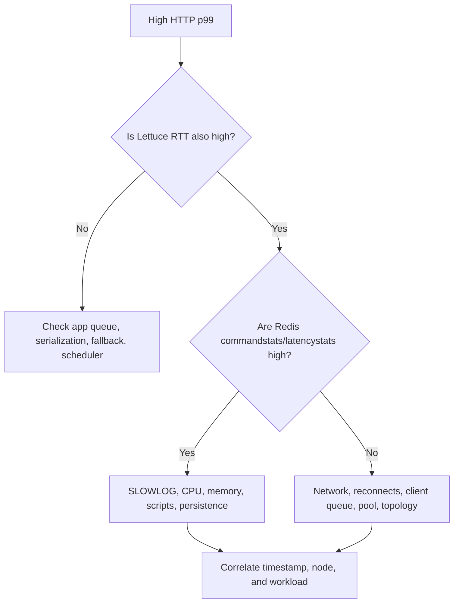
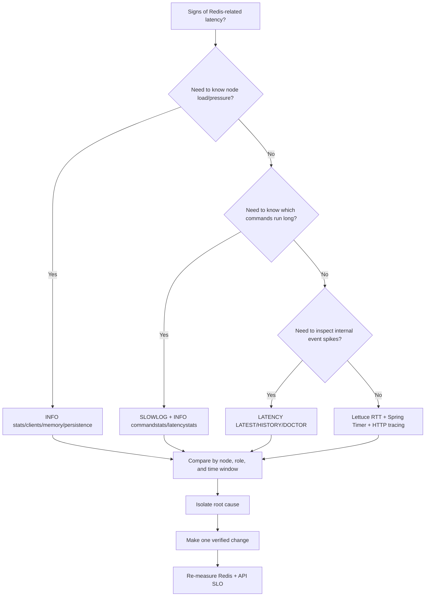

# Observing Redis with INFO, SLOWLOG, and Latency Statistics in Spring Data Redis

## 1. The Problem: The API Is Slow, But Where Is Redis Actually Slow?

Suppose a Spring Boot application uses Redis to read a product cache:

```java
String name = stringRedisTemplate.opsForValue()
    .get("product:name:p-42");
```

Normally the operation finishes very quickly. One day, the API starts exhibiting high p99 latency; many requests wait on Redis, yet `PING` from an administrator machine still replies. Is Redis executing `GET` slowly? Or is the application waiting on a connection, the network, a reconnect, or another request?

To answer this, you need to look at **multiple measurement points** instead of a single number:

```text
Spring HTTP request
  |
  +-- Waiting on thread / scheduler / connection
  |
  +-- Serializing key/value
  |
  +-- Redis client / Lettuce sends command
  |       |
  |       +-- Network to Redis
  |       |
  |       +-- Redis executes command
  |       |        |
  |       |        +-- SLOWLOG
  |       |        +-- INFO commandstats / latencystats
  |       |        +-- LATENCY monitor
  |       |
  |       +-- Network returns response
  |
  +-- Deserializing data / Reactor operators
  |
  +-- Further processing / returning HTTP response
```

Three core Redis tools:

1. **`INFO`:** Metrics and state of the Redis server grouped by sections such as memory, clients, stats, commandstats, persistence, replication, and latencystats.
2. **`SLOWLOG`:** A log of commands whose **execution time inside Redis** exceeds a configured threshold.
3. **Latency statistics:** The Redis Latency Monitor (`LATENCY LATEST/HISTORY/DOCTOR`), command histograms/percentiles when supported by the version, and client-side latency metrics from Lettuce or Spring.

Key point: **An empty SLOWLOG does not prove that the application's end-to-end Redis calls are fast.** A command may execute on the server in 100 µs while the client waits hundreds of milliseconds due to network, reconnects, queuing, TLS, or resource contention in the application.

The goal of this lesson is to know which tool answers which question, collect metrics at an appropriate cost, build useful dashboards, and use the results to diagnose the true root cause.

## 2. Four Observation Layers to Distinguish

| Layer | What Is Measured | Example Signals |
|---|---|---|
| Redis server | Node health, resources, executing commands | `INFO`, `SLOWLOG`, `LATENCY` |
| Redis client | Time from sending a command to receiving the response, reconnects, queuing | Lettuce command latency, timeouts, connection errors |
| Spring Data Redis | Calls through `RedisTemplate`/`ReactiveRedisTemplate`, serialization | Micrometer instrumentation or service-level timers |
| Business / HTTP | Cache hit/miss, fallback, request latency, error rate | API p95/p99, DB fallback, error budget |

**Illustrative** example numbers:

```text
Redis GET execution:  0.08 ms
Lettuce command RTT:  6.00 ms
App cache lookup:     8.00 ms
HTTP response:      140.00 ms
```

Do not add or subtract values from different points in time or different metric scopes and conclude with certainty that 132 ms was spent in the database. To analyze a specific request, you need a trace or measurements sharing correlation and clear time boundaries.

### 2.1. Time Units Are a Common Source of Confusion

| Signal | Common Unit |
|---|---|
| `SLOWLOG GET` duration | **µs** (microseconds) |
| `INFO commandstats` `usec` and `usec_per_call` | **µs** |
| `INFO latencystats` | **µs** |
| `LATENCY LATEST/HISTORY` event latency | **ms** (milliseconds) |
| `redis-cli --latency` | **ms** |
| HTTP/client metrics | May be s, ms, or ns depending on the measurement system |

Remember that **1 ms = 1,000 µs**. A command in SLOWLOG with a duration of 12,000 µs equals 12 ms, not 12 seconds.

## 3. INFO: A Snapshot of a Redis Node's State

In `redis-cli`:

```redis
INFO
```

Redis returns sections containing lines formatted as:

```text
# Stats
total_connections_received:...
total_commands_processed:...
instantaneous_ops_per_sec:...
keyspace_hits:...
keyspace_misses:...
...
```

To reduce the data collected and focus an investigation, you can query individual sections:

```redis
INFO server
INFO clients
INFO memory
INFO stats
INFO commandstats
INFO persistence
INFO replication
INFO cpu
INFO keyspace
```

Specific sections and fields may vary by **Redis version**, configuration, node role, and loaded modules. A dashboard should not treat every field as mandatory across all Redis 6/7/8 versions or all managed Redis offerings.

**`INFO` generally reports information for the connected node**, not an aggregate across all primaries and replicas in a Redis Cluster. If the same API uses three primaries, you must collect metrics from all three to avoid missing a bottleneck on one shard.

### 3.1. INFO Is Not a Per-Request Answer

`INFO stats` may show that Redis is processing 50,000 commands/s, but it does not directly tell you which HTTP request waited, which key caused slowness, or which command just timed out.

Therefore, use `INFO` to answer questions like **"What state is the Redis node in?"**, then combine it with SLOWLOG, the latency monitor, and client-side metrics to dig deeper.

## 4. INFO server: Confirming the Node and Environment

```redis
INFO server
```

Useful fields include:

| Field | Meaning | Why It Matters |
|---|---|---|
| `redis_version` | Running Redis version | Determines whether `LATENCY HISTOGRAM`/latencystats are available |
| `redis_mode` | Standalone, cluster, or sentinel according to server role | Distinguishes the topology to monitor |
| `uptime_in_seconds` | Time the process has been running | Detects restarts that reset counters |
| `process_id` | Redis PID on the node | Helpful when correlating logs |
| `os` | OS environment | Hints at scheduler or filesystem issues |
| `tcp_port` | Port reported by Redis | Confirms the endpoint |

Example:

```text
# Server
redis_version:7.x.x
redis_mode:standalone
uptime_in_seconds:98765
```

This is illustrative data, not measurements taken from a real Redis instance.

### 4.1. Why Is Uptime So Important?

Many metrics in `INFO` are **cumulative counters since process startup**. If a node restarts, counters may drop back to small values. When computing a rate from the difference of two measurements, you must detect resets; otherwise you will get negative rates or distorted graphs.

Storing `instance/node identifier` and uptime or start time alongside metrics helps distinguish:

- Real increases or decreases in traffic.
- Counter resets after a restart.
- An old node being replaced by a new node.
- A failover that changes the node's role.

## 5. INFO clients: Too Many Clients and Blocked Clients

```redis
INFO clients
```

Commonly encountered fields:

| Field | What It Shows |
|---|---|
| `connected_clients` | Number of open client connections |
| `blocked_clients` | Clients waiting in supported blocking mechanisms |
| `maxclients` (often in the clients section depending on version) | Server connection limit |
| Input/output buffer metrics | Signs of abnormal client buffer growth |

If `connected_clients` jumps from a few hundred to several thousand during an application deploy, possible causes include:

- Creating unnecessary Redis connection factories.
- A connection pool that is not being closed.
- Creating a new client/connection per request.
- Many pods reconnecting continuously at the same time.
- Many long-lived Pub/Sub or blocking consumers.

However, **many connected clients do not by themselves prove a bug**. Redis Streams, Pub/Sub, and blocking operations can hold connections open for a long time by design.

### 5.1. blocked_clients Does Not Mean the Server Is Frozen

Example:

```redis
BLPOP myqueue 30
```

A client can legitimately block while waiting for an element. If there are many consumers using blocking reads, a large `blocked_clients` count may simply reflect the workload.

Conversely, if an application only performs cache `GET` calls yet `blocked_clients` increases, check whether other parts of the system are using locks, queues, or scripts.

Do not conclude "Redis is completely locked up" solely from the `blocked_clients` number.

## 6. INFO memory: Measuring Memory Pressure and Eviction

```redis
INFO memory
```

Notable metrics:

| Field | Meaning |
|---|---|
| `used_memory` | Memory managed/accounted by Redis for data and related structures |
| `used_memory_human` | Human-readable representation |
| `used_memory_rss` | Resident Set Size reported by the OS |
| `maxmemory` | Configured memory limit, if set |
| `maxmemory_policy` | Policy applied when the limit is reached |
| `mem_fragmentation_ratio` | Ratio reflecting the relationship between RSS and memory tracked by Redis |
| `used_memory_dataset` | Estimated memory used by the dataset in supported versions |

### 6.1. Distinguishing Memory Pressure from Command Latency

If Redis approaches `maxmemory` and evictions increase, the application may observe:

- Lower cache hit rate.
- Increased database fallback.
- Higher HTTP p99 even though `GET` executes quickly.
- Redis `used_memory` not growing much further because keys are being evicted.

This is an example of **system performance degrading due to cache behavior**, not necessarily because `GET` command execution time increased.

### 6.2. Do Not Infer Everything from mem_fragmentation_ratio

A high fragmentation ratio can relate to allocator/OS memory behavior, but its interpretation depends on dataset size, version, and environment. On an instance with very little data, the ratio can appear high without indicating a serious problem.

Cross-check alongside `used_memory`, `used_memory_rss`, actual RSS, memory pressure, and latency. Do not automatically restart Redis just because a ratio crosses a fixed threshold.

## 7. INFO stats: Command Overview, Cache Hit/Miss, and Eviction

```redis
INFO stats
```

Commonly used fields:

| Field | Question to Answer |
|---|---|
| `total_commands_processed` | How many commands in total has the node processed? |
| `instantaneous_ops_per_sec` | Approximate current operations rate? |
| `total_connections_received` | Is there an abnormal increase in new connections? |
| `rejected_connections` | Are connections being rejected due to limits? |
| `keyspace_hits` | Number of successful Redis key lookups tracked by the server |
| `keyspace_misses` | Number of lookups where the key was not found |
| `expired_keys` | Number of keys removed due to expiration |
| `evicted_keys` | Number of keys removed due to memory limits/eviction |
| `total_net_input_bytes`, `total_net_output_bytes` | Network traffic at Redis |

### 7.1. Cumulative Counters vs. Rate Over an Interval

Suppose two measurements are taken 60 seconds apart:

```text
T0 total_commands_processed = 8,000,000
T1 total_commands_processed = 8,600,000

rate ≈ (8,600,000 - 8,000,000) / 60
     = 10,000 commands/s
```

The numbers above are illustrative only. In a metrics system, use an appropriate rate/increase function that handles counter resets after restarts.

**Do not treat the total counter value as if it were commands per second.**

### 7.2. Calculating Cache Hit Ratio by Delta

Suppose during a measurement interval:

```text
delta(keyspace_hits)   = 900
delta(keyspace_misses) = 100

server_keyspace_hit_ratio = 900 / (900 + 100) = 90%
```

Formula:

```text
hit_ratio = Δhits / (Δhits + Δmisses)
```

If the denominator is 0, the ratio is meaningless and should be displayed as "no data" rather than 100%.

**Important note:** `keyspace_hits/misses` are statistics based on Redis server lookup logic and are **not strictly synonymous with the hit rate of a `@Cacheable` method or an endpoint**. They may include accesses from multiple applications, Lua scripts, and different data structures. To measure domain-level cache effectiveness, instrument at the application cache layer.

### 7.3. Expiration Differs from Eviction

- `expired_keys` increasing: keys reached their TTL and were removed.
- `evicted_keys` increasing: Redis removed keys due to `maxmemory` pressure and eviction policy.

If cache misses rise because TTL is too short, the fix differs from misses caused by running out of memory and continuous eviction.

Do not merge both metrics into a single "keys lost" chart and apply a single remediation.

## 8. INFO commandstats: Which Commands Consume Redis CPU?

```redis
INFO commandstats
```

Simulated example output:

```text
# Commandstats
cmdstat_get:calls=100000,usec=200000,usec_per_call=2.00
cmdstat_set:calls=50000,usec=350000,usec_per_call=7.00
cmdstat_hgetall:calls=6000,usec=900000,usec_per_call=150.00
```

Newer Redis versions may also return fields such as `rejected_calls` or `failed_calls` per command; do not hardcode a parser based on a single version's example.

Meaning:

- `calls`: number of times the command was recorded.
- `usec`: total CPU/execution time recorded by Redis for the command.
- `usec_per_call`: average command duration according to the statistics.

### 8.1. A Very Low Average Can Still Hide Tail Latency

Suppose `GET` has `usec_per_call=3.0` µs. This **does not prove** every `GET` takes under 10 µs: a small number of slow commands can be masked by the average.

To inspect p99 and abnormal slow events, look at `INFO latencystats`, `LATENCY HISTOGRAM`, `SLOWLOG`, and client RTT.

### 8.2. commandstats Is Not Client RTT

If `cmdstat_hgetall` reports `usec_per_call=150`, that is server-recorded time for the command and excludes all waiting time:

- DNS and connect.
- Network to Redis and back.
- Client request queue.
- Redis connection pool wait.
- Java serialization/deserialization.
- Retries/fallbacks.

Therefore, do not use `usec_per_call` as the end-to-end response time of an HTTP API.

## 9. INFO persistence and replication: When Latency Comes from Infrastructure

```redis
INFO persistence
INFO replication
```

If AOF/RDB is enabled, notable fields may include:

```text
aof_enabled:1
aof_rewrite_in_progress:0
aof_last_write_status:ok
aof_pending_bio_fsync:0
aof_delayed_fsync:0
rdb_bgsave_in_progress:0
```

If latency spikes right during an AOF rewrite or RDB background save, check CPU, copy-on-write memory, and disk I/O. Do not automatically conclude this is the root cause merely because the two events overlap in time; inspect latency samples, logs, and storage metrics.

In a primary–replica setup:

```text
role:master
connected_slaves:2
master_repl_offset:...
slave0:ip=...,port=...,state=online,offset=...,lag=...
```

Per-replica fields show replication progress. **Replication lag reflects how fresh replica data is**, which differs from the latency of a `GET` command. A replica can answer `GET` fast while still returning stale data.

### 9.1. Redis Cluster and Sentinel Must Be Collected Per Node

In Redis Cluster, multiple primaries own different hash slots; reading `INFO` on only one node can miss an overloaded shard.

In Sentinel failover, nodes change roles; dashboards must tag metrics with **node ID / address / role / cluster**, without accidentally mixing the old primary and new primary.

When monitoring, track each primary/replica individually and aggregate by role, rather than treating a single seed hostname as representative of all Redis nodes.

## 10. INFO keyspace: How Many Keys and What Does TTL Look Like?

```redis
INFO keyspace
```

Example:

```text
# Keyspace
db0:keys=120000,expires=80000,avg_ttl=650000
```

Meaning:

- `keys`: number of keys tracked by Redis in the database.
- `expires`: number of keys with an expiration.
- `avg_ttl`: average time-to-live statistic as collected by Redis.

The numbers are examples only. Keyspace `INFO` is helpful when:

- The key count grows uncontrollably.
- An application stops setting TTLs and `expires` drops relatively.
- Cached data expires unusually fast.

**Keyspace does not automatically break down keys by service prefix.** To obtain domain-level metrics, instrument the producer/cache layer or use bounded keyspace inspection tools; do not arbitrarily run `KEYS *` on a large production node.

## 11. SLOWLOG: Viewing Commands That Execute Slowly Inside Redis

SLOWLOG is a log **in Redis memory** that records commands whose execution time exceeds a threshold. It differs from application logs and network traces.

Commands:

```redis
SLOWLOG GET 10
SLOWLOG LEN
```

`SLOWLOG GET 10` retrieves up to the 10 most recent entries; `SLOWLOG LEN` returns the number of currently retained entries.

A SLOWLOG entry typically contains:

```text
Entry ID
Unix timestamp (seconds)
Execution duration (microseconds)
Command and some arguments
Client address (if supported by version)
Client name (if supported by version)
```

Simulated example:

```text
id       = 4321
unix_sec = 1794500000
duration = 18500 microseconds
command  = HGETALL big:profile:42
client   = 10.0.1.25:52022
```

18,500 µs corresponds to **18.5 ms** of execution time in Redis. The timestamp only illustrates Unix format, not a real event.

### 11.1. SLOWLOG Does Not Measure Network Latency

Redis records the time the command executed on the server, **excluding** the time to send the request from the client or transmit the response over the network according to how SLOWLOG measures.

Therefore:

```text
Lettuce GET RTT  = 200 ms
SLOWLOG GET      = no entries
```

is not a contradiction. A command may run very fast while the client suffers from:

- Network delay/loss.
- Reconnects or request queuing.
- Connection/pool contention.
- The Redis server stalling before starting to process that specific command.
- An overloaded Java event loop or scheduler.
- TLS/serialization overhead.

SLOWLOG is especially useful for identifying **which commands have high server execution time**, not for certifying that every component outside the server is healthy.

## 12. Configuring SLOWLOG Threshold and Size

Redis has these parameters:

```conf
slowlog-log-slower-than 10000
slowlog-max-len 128
```

Meaning:

- `slowlog-log-slower-than` uses **microseconds**.
- `10000` means a threshold of roughly 10 ms.
- `slowlog-max-len` limits the number of entries Redis keeps in memory.

Check current settings:

```redis
CONFIG GET slowlog-log-slower-than
CONFIG GET slowlog-max-len
```

**Pay special attention to two values:**

| Threshold Value | Meaning |
|---|---|
| `10000` | Log commands exceeding ~10 ms |
| `1000` | Log commands exceeding ~1 ms |
| `0` | Log **every** command, easily causing overhead/log overflow |
| `-1` | Disable slowlog entry recording |

Do not use `0` on a busy production system just to "capture complete data". At very high rates, logging every command adds overhead and causes the small ring buffer to wrap rapidly.

### 12.1. Runtime Changes: Only with Operational Authorization

On a dedicated test Redis:

```redis
CONFIG SET slowlog-log-slower-than 5000
CONFIG SET slowlog-max-len 256
```

These commands **modify Redis server behavior**; they are not read-only queries. They require appropriate ACLs and should not be run in production without change governance.

Runtime configuration does not always persist across restarts; on managed Redis systems, you must use the server parameter configuration mechanism supported by the provider.

### 12.2. SLOWLOG Is Not a Durable Log

SLOWLOG holds a limited number of recent entries in memory. When the limit is exceeded, older entries are evicted. After a restart, you should not assume history remains intact.

For long-term investigation, use a metrics/log collection system that polls periodically, with appropriate **data redaction and access controls**. Do not use SLOWLOG as a business event audit log.

## 13. Reading SLOWLOG Systematically

When you see an entry:

```text
HGETALL user:profile:u-42  — 20,500 µs
```

ask:

1. Does this command appear frequently or was it a one-off?
2. How large is the payload/Hash?
3. Are multiple clients calling `HGETALL` on large keys concurrently?
4. Can you read just a few fields with `HMGET` or change the data model?
5. Is a Lua script processing a lot of data on the Redis event loop?
6. Are `SCAN`/`KEYS`/`SMEMBERS` returning huge amounts of data?
7. Were there CPU fluctuations or disk forks at the same time?

### 13.1. Commands Worth Inspecting Closely

| Command or Group | Typical Risk |
|---|---|
| `KEYS *` | Broad scan that can cause long pauses on datasets with many keys |
| `HGETALL` on a very large Hash | Reads and returns many fields/values |
| `SMEMBERS` on a very large Set | Returns all members |
| `LRANGE 0 -1` on a large List | Fetches all elements |
| Lua `EVAL` with heavy loops | Script blocks command processing for a long duration |
| `SORT`, some large set operations | Processing cost grows with data size |
| Massive multi-key operations | Increases CPU usage and payload size |

Do not jump to the conclusion that any `HGETALL` in SLOWLOG must be replaced with `HSCAN`. The decision depends on field count, consistency requirements, pagination, overhead, and business semantics.

### 13.2. Slow Commands vs. Hot Keys

A hot key often receives **very many fast commands**, keeping a Redis shard continuously busy even though no single command crosses the slowlog threshold. SLOWLOG may therefore **not show** a hot key issue.

Combine with:

- Command rate per node.
- Latency histograms and CPU.
- Application key namespace/operation telemetry.
- Appropriate hot-key analysis tools with controlled overhead.

Do not run overly broad or dangerous collection commands in production just to hunt for hot keys.

## 14. SLOWLOG and Information Security

SLOWLOG can contain command names and arguments, which may include keys or parts of payloads. Modern Redis versions have mechanisms to mask sensitive data for certain commands, but **you should not assume all business data is hidden**.

Example command:

```redis
SET session:token:abc123 some-sensitive-payload
```

If recorded in SLOWLOG, its contents could expose the token/payload in log dumps or dashboards if not handled properly.

Mitigations:

- Apply Redis ACLs / least privilege for SLOWLOG read access.
- Collect only necessary fields and mask sensitive keys/payloads when exporting.
- Never paste raw production SLOWLOG output into public tickets.
- Restrict retention and access to centralized logging systems.
- Aggregate by command and service rather than storing every unnecessary argument.

**`SLOWLOG RESET` clears slowlog history in memory**, which alters observability data. Do not run this command during routine investigation unless directed by operations governance, as it destroys evidence.

## 15. Redis Latency Monitor: Recording Latency Events

Redis includes a **Latency Monitoring Framework** to detect events with abnormal processing time—such as a slow command, a fork, or persistence-related activity—depending on version.

Unlike SLOWLOG, the latency monitor can track **multiple types of internal events**, not only single commands with long execution times.

Check configuration:

```redis
CONFIG GET latency-monitor-threshold
```

The `latency-monitor-threshold` is specified in **milliseconds**. When set to `0`, latency event monitoring via this mechanism is disabled.

Example in a test environment:

```redis
CONFIG SET latency-monitor-threshold 100
```

Meaning: observe latency events exceeding roughly 100 ms as supported by the Redis framework.

**Difference from SLOWLOG:**

```text
slowlog-log-slower-than = 10000  -> 10,000 µs = 10 ms
latency-monitor-threshold = 100 -> 100 ms
```

Confusing the units can cause a system to log far too much or miss the events you actually want to capture.

### 15.1. Do Not Set an Excessively Low Threshold by Guesswork

Too small a threshold can generate unnecessary recording volume; too high a threshold misses spikes affecting low-latency APIs. Base it on SLAs, baselines, and guidance for your Redis version.

Depending on Redis version, available events and monitoring overhead vary. When using a managed service, check whether the provider allows changing monitor settings.

## 16. LATENCY LATEST, HISTORY, and DOCTOR

Diagnostic commands:

```redis
LATENCY LATEST
LATENCY HISTORY command
LATENCY DOCTOR
```

### 16.1. LATENCY LATEST

`LATENCY LATEST` returns a summary of events recorded by the monitor, with details such as:

- Event name.
- Timestamp of the latest event.
- Latest latency, typically in ms.
- Maximum latency observed across the window/historical data retained by Redis.

**Simulated** example:

```text
event: command
timestamp: 1794500000
latest latency: 130 ms
max latency: 320 ms
```

A `command` event indicates that a command caused significant latency according to the Redis monitor. It does not mean every `GET` takes 130 ms.

### 16.2. LATENCY HISTORY

`LATENCY HISTORY event-name` returns a time series of samples for an event:

```redis
LATENCY HISTORY command
```

Each sample typically includes a Unix timestamp and latency. It can be used to see whether spikes recur before/after a Redis rewrite or deployment.

Actual event names are generated by Redis; do not assume your cluster definitely has an event named `command`. Inspect `LATENCY LATEST` first, then query the exact event names that appear.

### 16.3. LATENCY DOCTOR

```redis
LATENCY DOCTOR
```

Redis produces an analysis and recommendations based on collected events. It can be helpful as an initial triage step, but **it does not replace correlating workload, storage, network, and client metrics**.

If the latency monitor is disabled or no samples exceeded the threshold, `LATENCY DOCTOR` will lack evidence to explain slow HTTP requests. Do not conclude from an empty report that the application has no latency problem.

### 16.4. Events Beyond Commands

Redis can record events related to:

- Background process forks.
- Delayed AOF writes or fsyncs.
- RDB/AOF background activity.
- Active defragmentation.
- Certain internal operations or command execution.

Exact event names vary by Redis version. Read the event list on a real node rather than hardcoding every name into a dashboard and treating missing events as errors.

## 17. INFO latencystats: Per-Command Percentiles on Redis 7+

Newer Redis versions support per-command latency percentile statistics:

```redis
INFO latencystats
```

**Illustrative** example output:

```text
# Latencystats
latency_percentiles_usec_get:p50=1.003,p99=5.031,p99.9=12.000
latency_percentiles_usec_set:p50=3.007,p99=17.001,p99.9=70.003
```

Values here are in **microseconds**. They do not measure the time a request spends traversing Spring, Lettuce, or the network.

### 17.1. How Does This Differ from Averages in commandstats?

Suppose:

```text
INFO commandstats:
  cmdstat_get: usec_per_call=2.5

INFO latencystats:
  GET p50=1.0 µs
  GET p99=8.0 µs
  GET p99.9=40.0 µs
```

An average of 2.5 µs may look good, yet a small fraction of `GET` calls take much longer. If Redis handles 100,000 `GET`/s, tail latency affecting even a small percentage can impact a substantial number of requests.

### 17.2. Percentiles Cannot Be Added or Subtracted Across Layers

If Redis `GET` p99 = 8 µs and Lettuce p99 = 30 ms, you cannot conclude that **each request at Lettuce's p99** spent exactly 29.992 ms on the network. The two percentiles typically come from **different sample sets**, different measurement windows, and events do not necessarily align request-for-request.

To pinpoint a specific cause, instrument the same call or use appropriate tracing.

### 17.3. Configuring Tracking and the Percentile Set

On supported Redis versions:

```redis
CONFIG GET latency-tracking
CONFIG GET latency-tracking-info-percentiles
```

Options may exist to enable/disable command latency tracking and specify which percentiles are exported. Do not assume `INFO latencystats` has the same structure on older Redis versions that lack this feature.

**Per-command latency tracking/histograms is a different mechanism from the latency event monitor controlled by `latency-monitor-threshold`.** Do not assume enabling the event monitor alone gives you command percentiles.

## 18. LATENCY HISTOGRAM: Latency Distribution by Command

On Redis versions supporting histograms (Redis 7+), you can use:

```redis
LATENCY HISTOGRAM
LATENCY HISTOGRAM GET SET
```

The idea is to observe command counts across recorded latency buckets—typically in microseconds—rather than relying on a single average.

Conceptual example:

```text
GET:
  <= 1 µs       : 20,000 calls
  <= 2 µs       : 80,000 calls
  <= 8 µs       : 99,000 calls
  <= 64 µs      : 99,900 calls
  total         : 100,000 calls
```

This is **an illustrative cumulative histogram**, not actual Redis output. When reading real output, understand the bucket boundaries, counts, and version-specific representation.

### 18.1. What Questions Does a Histogram Answer?

- Is `GET`/`SET` tail latency rising over time?
- Does a command have many outliers despite a low average?
- Should `HGETALL` be replaced by narrower read operations?
- How did the command duration distribution shift after a deploy?

To measure over a time interval, your monitoring system must handle cumulative counters/histograms properly; do not compare two cumulative bucket counts as independent measurements.

### 18.2. Histograms Do Not Replace SLOWLOG

A histogram shows the **distribution**, but usually does not reveal the key or command arguments of a specific slow call. SLOWLOG provides concrete examples of long-duration commands, while histograms tell you how widespread that behavior is.

Combining both is better than using either alone.

## 19. redis-cli --latency: Measuring Responsiveness from the Client Location

A simple measurement from a machine with `redis-cli`:

```text
redis-cli -h redis.internal -p 6379 --latency
```

The tool continuously measures latency to Redis and displays min/avg/max statistics in Redis CLI's format. You can use it to compare:

- Running on the Redis host.
- Running on the Spring application host/pod.
- Running over the same network path/TLS used by the application, if the tool supports the corresponding flags.

### 19.1. Measuring Client Latency Is Not the Same as SLOWLOG

Example:

```text
From Redis host:            average RTT = 0.3 ms
From Spring application:    average RTT = 8.0 ms
Redis SLOWLOG:              no slow GET
```

These hypothetical numbers point to inspecting the network path/client environment. Still, verify whether the application uses the same endpoint, ACL, TLS, packet sizes, and command workload as the CLI measurement.

A small `PING` RTT **does not prove** an operation returning a 2 MB payload or executing a long Lua script has similarly low latency.

### 19.2. Do Not Run Unbounded Measurement Load

Continuously running measurements from hundreds of pods can generate extra traffic. Define a measurement goal, keep an appropriate observation window, and stop the tool once enough data is collected.

In production, prefer metrics instrumentation at a controlled frequency without capturing sensitive payloads.

## 20. Why Can Redis Be Fast While the Spring Application Is Slow?

An example:

```text
Redis GET exec               80 µs
Lettuce command RTT          4 ms
Connection pool wait       120 ms
JSON deserialization        15 ms
Application scheduling       8 ms
--------------------------------
Spring cache lookup        147 ms (illustrative)
```

In this scenario, optimizing the Redis command from 80 µs down to 40 µs barely changes API latency. The bottleneck lies in pool wait or client-side processing.

Common causes:

- Redis connection pool out of permits.
- Creating new connections repeatedly.
- DNS resolution or TLS handshakes.
- Redis client reconnects or command queuing.
- JVM GC pauses or CPU starvation.
- Reactor event-loop running blocking operations.
- JSON/JDK serialization of large values.
- API wrapper retrying commands multiple times.
- Network packet loss.
- Reading from a replica in a distant geographic region.

**Do not use an empty `SLOWLOG GET 10` as the sole basis to declare the application buggy.** Compare metrics across multiple layers.

## 21. Reading INFO from Java with Spring Data Redis

To feed server metrics into an internal admin tool, Spring Data Redis exposes server commands via `RedisConnection`.

Example using `StringRedisTemplate` with Redis permissions allowing `INFO`:

```java
import java.util.Properties;

import org.springframework.data.redis.core.RedisCallback;
import org.springframework.data.redis.core.StringRedisTemplate;
import org.springframework.stereotype.Component;

@Component
public class RedisInfoReader {

    private final StringRedisTemplate redis;

    public RedisInfoReader(StringRedisTemplate redis) {
        this.redis = redis;
    }

    public Properties readStats() {
        return redis.execute(
            (RedisCallback<Properties>) connection ->
                connection.serverCommands().info("stats")
        );
    }

    public Long totalCommands() {
        Properties stats = readStats();

        if (stats == null) {
            return null;
        }

        String raw = stats.getProperty("total_commands_processed");
        return raw == null ? null : Long.valueOf(raw);
    }
}
```

Things to note:

- The `INFO` command executes on the Redis connection used by the template.
- Reading a specific section reduces the number of fields to parse.
- Fields may be absent or differ by version.
- On Redis Cluster, a single connection-level template operation may not replace querying **each node**.
- Server `INFO` typically requires the appropriate Redis ACL permission and may be restricted by managed Redis providers.

The example using `Properties` is written against Spring Data Redis 3.x APIs. For other version lines, check the `RedisServerCommands.info(...)` signature and handle the response type of your library.

### 21.1. Do Not Call INFO on Every HTTP Request

If a web endpoint serves 5,000 requests/s and every request calls `INFO stats`, you add unnecessary administrative commands and couple the endpoint to monitoring activity.

Instead:

- Collect periodically via a metrics exporter.
- Cache observation results in the monitoring layer if needed.
- Avoid polling at excessively high frequencies.
- Never expose full internal Redis information to HTTP users.

## 22. Measuring Latency in Spring with Micrometer

The Redis server measures command execution time; the application usually needs to measure **the actual time the service waits**.

With Spring Boot Actuator and Micrometer, you can wrap an operation with a timer:

```groovy
dependencies {
    implementation 'org.springframework.boot:spring-boot-starter-actuator'
    implementation 'org.springframework.boot:spring-boot-starter-data-redis'
}
```

An imperative service:

```java
import io.micrometer.core.instrument.MeterRegistry;
import io.micrometer.core.instrument.Timer;

import org.springframework.data.redis.core.StringRedisTemplate;
import org.springframework.stereotype.Service;

@Service
public class MeasuredCacheReader {

    private final StringRedisTemplate redis;
    private final MeterRegistry registry;

    public MeasuredCacheReader(
            StringRedisTemplate redis, MeterRegistry registry) {
        this.redis = redis;
        this.registry = registry;
    }

    public String getProductName(String productId) {
        Timer.Sample sample = Timer.start(registry);
        String outcome = "success";

        try {
            return redis.opsForValue()
                .get("product:name:" + productId);
        } catch (RuntimeException error) {
            outcome = "error";
            throw error;
        } finally {
            sample.stop(
                Timer.builder("app.redis.cache.lookup")
                    .tag("operation", "GET")
                    .tag("outcome", outcome)
                    .register(registry)
            );
        }
    }
}
```

This timer measures **the total Java call time through the template**, which may include network, client queue, and deserialization. It **does not isolate server command execution**.

### 22.1. Tags Must Have Low Cardinality

Tag by:

```text
operation = GET | SET | HGET
purpose   = cache | session | rate_limit
outcome   = success | error | cancelled
service   = catalog | checkout
```

Do not use:

```text
redis_key = product:name:p-42
user_id   = u-123456
request_id= ...
```

Each distinct key/user/request ID can generate millions of time series, consuming huge amounts of RAM and storage in your metrics backend. Moreover, those values may contain sensitive data.

### 22.2. "success" Does Not Equal Cache Hit

`StringRedisTemplate.opsForValue().get(...)` returns `null` when a key does not exist. A call that succeeds at the Redis level yet misses the cache should still record:

```text
Redis call outcome = success
Cache result       = miss
```

If you need service-level cache hit ratios, create separate counters/timers for hits and misses. Do not fold cache misses into circuit breaker error rates.

## 23. Measuring a ReactiveRedisTemplate Operation

In Reactor, a `Mono` is lazy and may be subscribed to multiple times. If you start a timer too early, you may measure **waiting time before subscription** instead of the operation itself.

Example:

```java
import java.time.Duration;
import java.util.concurrent.TimeUnit;

import io.micrometer.core.instrument.MeterRegistry;
import io.micrometer.core.instrument.Timer;

import org.springframework.data.redis.core.ReactiveStringRedisTemplate;
import org.springframework.stereotype.Service;

import reactor.core.publisher.Mono;
import reactor.core.publisher.SignalType;

@Service
public class MeasuredReactiveCacheReader {

    private final ReactiveStringRedisTemplate redis;
    private final MeterRegistry registry;

    public MeasuredReactiveCacheReader(
            ReactiveStringRedisTemplate redis,
            MeterRegistry registry) {
        this.redis = redis;
        this.registry = registry;
    }

    public Mono<String> getProductName(String productId) {
        return Mono.defer(() -> {
            long start = System.nanoTime();

            return redis.opsForValue()
                .get("product:name:" + productId)
                .doFinally(signal -> {
                    long elapsed = System.nanoTime() - start;

                    String outcome =
                        signal == SignalType.ON_ERROR ? "error" :
                        signal == SignalType.CANCEL   ? "cancelled" :
                            "complete";

                    Timer.builder("app.redis.cache.lookup")
                        .tag("operation", "GET")
                        .tag("api", "reactive")
                        .tag("outcome", outcome)
                        .register(registry)
                        .record(elapsed, TimeUnit.NANOSECONDS);
                });
        });
    }
}
```

Key points to remember:

- `Mono.defer(...)` creates a fresh measurement on each subscription.
- `doFinally` runs on completion, error, or cancellation.
- `System.nanoTime()` measures elapsed intervals, not wall-clock timestamps.
- Completion of `Mono.empty()` is still `complete`, not an error.
- If the timer wraps retry/fallback operators, the measured time may include **all retry attempts and fallbacks**. Place instrumentation at the right scope to measure a single Redis attempt.

**Define clearly what a metric measures** before comparing it against Redis SLOWLOG. Even though both use the word "latency", they do not share the same boundary.

## 24. Lettuce Command Latency and Client-Level Instrumentation

Lettuce can collect command latency on the client side and integrate with Micrometer depending on version and configuration.

How it differs from a service-level timer:

```text
Service timer:
    Java cache lookup method
    -> Redis command + serializer + client waiting

Lettuce command latency:
    client-tracked stages from sending the command
    -> receiving the result from Redis

Redis INFO/SLOWLOG:
    only the stages executed/recorded on the Redis server
```

When an appropriate command latency recorder is enabled, you can observe command names, remote endpoints, and percentiles/timers provided by the integration. However, **Spring Data Redis does not guarantee all Lettuce metrics are exported by default** simply because the application has a Micrometer dependency.

For production integration:

1. Check the Lettuce version resolved by Spring Boot.
2. Verify `ClientResources` and the configured recorder/instrumentation.
3. Ensure the application exports metrics to your monitoring system.
4. Check tag cardinality, connection targets, and aggregation behavior.
5. Test with a successful `GET` and a Redis timeout to confirm the metric matches the expected scope.

If auto-instrumentation from the framework or an agent is already active, do not wrap another timer with the same name and cause double counting on dashboards. Distinguish metrics by **metric name and measurement boundary**.

### 24.1. Why Can Command RTT Still Be Lower Than API Latency?

For example, server `GET` is fast and Lettuce records 2 ms RTT, yet API p99 is 500 ms due to:

- Waiting for a connection/bulkhead.
- Database fallback after a cache miss.
- Blocking JSON parsing or CPU starvation.
- HTTP queuing and downstream latency.

Monitoring Redis metrics alone is insufficient to declare the entire API healthy.

## 25. How Do Redis Latency Monitors and Client Timers Differ?

| Tool | Data Source | Measurement Boundary | Best Answers |
|---|---|---|---|
| `INFO stats` | Redis server | Node-wide counters | Traffic, hits/misses, evictions, errors |
| `INFO commandstats` | Redis server | Aggregate execution per command | Which commands consume CPU/execution time |
| `INFO latencystats` | Redis server | Command execution percentiles | Tail latency inside Redis |
| `SLOWLOG` | Redis server | Commands exceeding execution threshold | Which specific commands/args were very slow |
| `LATENCY LATEST/HISTORY` | Redis server | Internal latency events above threshold | Were there fork/AOF/command spikes? |
| `LATENCY HISTOGRAM` | Redis server | Command latency distribution | Outlier rate per command |
| `redis-cli --latency` | A CLI client | Network + server round trip for probe | RTT from the CLI's location |
| Lettuce command latency | Redis Java client | Command send/receive phases | How fast/slow Redis commands look to the client |
| Micrometer service Timer | Spring app | Measured method/Publisher scope | How long a business cache lookup takes |
| HTTP server metrics | Web server | Entire request | User-perceived latency |

No single tool holds every root cause. A good dashboard displays these layers side by side rather than merging them into one chart generically labeled "Redis latency".

## 26. Building Dashboards Around Operational Questions

A useful layout:

### 26.1. Row 1 — System Health

- Redis node up/down, primary/replica role, Redis version.
- Connected clients, blocked clients.
- Cluster health or Sentinel failover events.
- Redis errors and client reconnects/timeouts.

### 26.2. Row 2 — Load and Memory

- Commands/s, network in/out.
- Used memory, maxmemory, RSS, and fragmentation.
- Keyspace hits/misses rate and service-specific cache hit rate.
- Expired/evicted keys per second.

### 26.3. Row 3 — Latency

- Lettuce command RTT p50/p95/p99.
- Redis command latency percentiles per command.
- SLOWLOG slow entry rate or top command families.
- Redis latency event spikes, AOF rewrite/fork correlation.
- HTTP cache endpoint p95/p99.

### 26.4. Row 4 — Persistence, Replication, and Fallback

- `aof_delayed_fsync`/AOF write status.
- Replication offset gap, master link state.
- Redis Cluster redirects/failover.
- DB fallback requests/s, latency, and error rate.

### 26.5. Row 5 — Business SLOs

- Request success rate.
- Cache availability/fail-open rate.
- Critical API p99 latency.
- Impact on checkout, sessions, or rate-limit decisions.

Do not build dashboards to show off metric counts; every chart should help answer a concrete investigative question or operational decision.

## 27. Computing Rates and Percentiles Properly in a Metrics System

A Redis exporter typically scrapes `INFO` periodically and exposes fields as time series. When graphing, understand:

### 27.1. Counters

`total_commands_processed`, `keyspace_hits`, `keyspace_misses`, `expired_keys`, and `evicted_keys` are generally treated as counters. Rates should be computed from growth over time, handling restarts.

Conceptual formula:

```text
ops_per_second ≈ Δ(total_commands_processed) / Δtime_seconds
```

### 27.2. Gauges

`connected_clients` and `used_memory` are point-in-time state values. Do not mechanically apply `rate()` when the question is "how many clients are connected right now?".

### 27.3. Histograms/Percentiles

Do not average **per-node p99** values and call that the cluster-wide Redis p99. To compute an accurate aggregate percentile, you need histograms or distribution data that can be weighted and merged properly.

Example:

```text
Node A has 100,000 GET/s, p99 = 1 ms
Node B has     100 GET/s, p99 = 50 ms
```

The arithmetic mean `(1 + 50) / 2 = 25.5 ms` does not represent the true p99 across all requests. Keep node scopes distinct or aggregate using a histogram/metrics pipeline that supports it.

### 27.4. Sampling and Time Windows

A 200 ms spike lasting only a few seconds can be missed if a scraper runs every 60 seconds and only reads the last gauge value.

To capture tail latency, use proper counters/histograms, sufficiently granular request metrics, and adequate retention. You do not need to crank all `INFO` polling up to every 100 ms; doing so can create unnecessary load.

## 28. Diagnosis: API p99 Rises While SLOWLOG Is Empty

Scenario:

```text
Spring HTTP p99:        1,200 ms
Lettuce GET p99:          900 ms
Redis GET latencystats:    10 µs
SLOWLOG:                no slow GETs
```

Things to check:

1. Are Redis connections reconnecting?
2. Are Redis commands queuing on the client?
3. Is there packet loss or high RTT between application pods and Redis?
4. Is the Redis replica located in another region?
5. Are too many concurrent requests contending for connections?
6. Are timeouts being retried multiple times?
7. Did Redis stall before starting the command, since SLOWLOG only records execution?
8. Are driver/client metrics measuring the right command and endpoint?

Investigation flow:



**This diagram is an analytical guide**, not a rigid conclusion. Depending on metric scopes and sampling windows, values may not align completely.

## 29. Diagnosis: Many SLOWLOG Entries and Latency Monitor Command Spikes

Suppose a node shows:

```text
SLOWLOG:
  HGETALL large key: 30 ms
  EVAL script:      120 ms

LATENCY LATEST:
  latest command event: 120 ms

INFO commandstats:
  cmdstat_eval usec rising sharply
```

These signs suggest server-side workload is causing slowness. You should:

- Check whether scripts loop over large numbers of keys or members.
- Reduce the dataset size read per request.
- Use command-appropriate pagination and avoid scanning huge datasets in one command.
- Move CPU-heavy logic out of Redis if server-side atomicity is not required.
- Enforce data size/workload limits.
- Re-measure after changes in a test environment.

Do not simply raise `slowlog-log-slower-than` to make the log empty. Doing so hides symptoms from the screen without reducing latency.

### 29.1. Lua and Single-Threaded Execution

The Redis server executes most command logic sequentially on the main command execution path. An overly long Lua script can affect the processing of other commands. Modern Redis versions also include I/O threading and background work, so describing Redis as "completely single-threaded" is an oversimplification.

Operational takeaway: a long script can raise latency for other clients even when they only issue `GET`.

## 30. Diagnosis: High Cache Misses and Heavy DB Load While GET Is Fast

Scenario:

```text
Redis GET execution p99 = 15 µs
Cache hit ratio drops 95% -> 40%
evicted_keys/s rises sharply
DB query p99 rises
HTTP p99 rises
```

Redis `GET` remains fast, yet many requests hit the database. Possible causes:

- Cache eviction due to `maxmemory`.
- Overly short TTL.
- Key version/prefix changed after a deploy.
- Wrong key serializer, causing the service to read the wrong keyspace.
- Cache warming not yet complete.

Check:

```redis
INFO memory
INFO stats
INFO keyspace
```

Also inspect per-endpoint cache hit/miss metrics in the Spring app, not just the server-wide ratio. Verify whether keys are being evicted or if producer and reader simply use different prefixes.

**Lesson:** Fixing cache efficiency issues is not always about optimizing Redis command execution.

## 31. Diagnosis: Latency Spikes During AOF Rewrite or Fork

Redis can spawn a background process to rewrite AOF or snapshot RDB. These moments can introduce CPU/memory overhead, copy-on-write pressure, and disk I/O.

Observe over the same window:

```redis
INFO persistence
INFO memory
LATENCY LATEST
LATENCY DOCTOR
```

Metrics worth watching:

- `aof_rewrite_in_progress`.
- `rdb_bgsave_in_progress`.
- `aof_delayed_fsync`.
- Unusual memory/RSS growth.
- Latency monitor fork/AOF-related events, if present.
- Disk write latency and filesystem metrics outside Redis.

A plausible correlation:

```text
AOF rewrite starts
    -> disk I/O increases
    -> fsync delay increases
    -> Redis p99 / HTTP p99 increases
```

Confirm with data and logs, however, because concurrent latency could stem from another traffic batch or the network.

## 32. Diagnosis: Only One Redis Cluster Shard Is Slow

Redis Cluster distributes keys across 16,384 hash slots. If a service uses improper hash tags or has a hot key, one primary can bear most of the load.

Example:

```text
Primary A: 60,000 ops/s, high CPU, high p99
Primary B:  8,000 ops/s, low CPU
Primary C:  7,000 ops/s, low CPU
```

If a dashboard only displays cluster-wide averages, the problem on A can be hidden.

Steps:

1. Collect `INFO stats/commandstats/memory` on each node.
2. Compare command rate and p99 per node.
3. Inspect hot keys and hash tags in your key design.
4. Use `CLUSTER KEYSLOT` on suspected keys in an authorized environment.
5. Check whether resharding/failover is underway.
6. If rebalancing is needed, perform it through an operational procedure—never trigger slot ownership changes automatically from application code.

**Do not compare node A's p99 against cluster-wide traffic** as if they measured the same sample set. Keep node ID/role on every metric.

## 33. A Sequential Investigation Workflow

Suppose the dashboard reports rising Redis timeouts. A structured workflow:

**Step 1 — Confirm scope.** Is the error in one HTTP API, all cache operations, one service, or all services? One Redis node or the whole topology?

**Step 2 — Check the client.** Does Lettuce show reconnects, command timeouts, or large queues? Did a recent deploy change pool, serializer, or timeout settings?

**Step 3 — Check overall server state.**

```redis
INFO server
INFO clients
INFO stats
INFO memory
```

**Step 4 — Check command-level performance.**

```redis
INFO commandstats
INFO latencystats
SLOWLOG GET 20
```

If the Redis version does not support `latencystats`, do not force a parser or diagnose based on the missing section.

**Step 5 — Inspect latency events.**

```redis
LATENCY LATEST
LATENCY DOCTOR
```

If the monitor is not enabled, note the lack of data rather than treating an empty report as proof that Redis is completely healthy.

**Step 6 — Check infrastructure.**

```redis
INFO persistence
INFO replication
```

Correlate with CPU, disk I/O, network, and failover/resharding events.

**Step 7 — Align timestamps.** Match signals sharing the same time window, node/role, and command type.

**Step 8 — Propose a small, measurable change.** For instance, replace `HGETALL` on large Hashes, bound client concurrency, or fix a network issue.

**Step 9 — Verify business impact.** Did better Redis p99 improve HTTP p99 and error rates? Did cache misses or fallback rates rise?

Do not skip the last step. A change that optimizes the Redis server can slow down the service if it accidentally increases round trips or breaks an atomic operation.

## 34. Lab 1: Capturing an INFO Baseline

Perform this on a development or dedicated test Redis. No server configuration changes are required.

### Step 1: Identify Version and Role

```redis
INFO server
INFO replication
```

Record the Redis version, uptime, and role.

### Step 2: Gather Resource Metrics

```redis
INFO clients
INFO memory
INFO stats
INFO keyspace
```

Observe `connected_clients`, `used_memory`, `keyspace_hits`, `keyspace_misses`, and `evicted_keys`.

### Step 3: Send Some GET/SET Commands

```redis
SET test:obs:item-1 hello EX 300
GET test:obs:item-1
GET test:obs:missing
GET test:obs:item-1
```

These are test commands in an isolated keyspace with a short TTL for automatic cleanup. Then run:

```redis
INFO stats
INFO commandstats
```

The goal is to see which counters change; do not expect an exact ratio if other traffic is hitting Redis concurrently.

### Step 4: Calculate Deltas

Sample again after a sufficiently long interval and compute commands/s and delta-based cache hit ratio. If the test Redis has only one client, you can easily match your commands to the counters; in production, account for other clients.

## 35. Lab 2: Reading SLOWLOG Conditionally

On a test Redis, inspect:

```redis
CONFIG GET slowlog-log-slower-than
CONFIG GET slowlog-max-len
SLOWLOG LEN
SLOWLOG GET 10
```

To set an illustrative threshold, **only in test**:

```redis
CONFIG SET slowlog-log-slower-than 1000
CONFIG SET slowlog-max-len 256
```

A threshold of 1,000 µs = 1 ms.

Next, run a test workload with appropriate CPU cost and observe whether commands appear in SLOWLOG. Never run `KEYS *` on a large dataset or deliberately write a long-running Lua script in production just to "generate a slowlog entry".

When reading:

1. Note the ID and timestamp.
2. Convert duration accurately from µs to ms.
3. Group by command type.
4. Identify input size and data structure.
5. Correlate with application latency in the same time window.

**Never change production thresholds just to generate logs for a lab exercise.**

## 36. Lab 3: Redis Latency Events

Only on a test Redis:

```redis
CONFIG GET latency-monitor-threshold
CONFIG SET latency-monitor-threshold 50
LATENCY LATEST
LATENCY DOCTOR
```

When an event exceeds 50 ms, observe the event name and duration. If a `command` event appears:

```redis
LATENCY HISTORY command
```

Having no events is not a lab failure; the workload simply may not have generated enough latency.

If supported by your Redis version:

```redis
CONFIG GET latency-tracking
INFO latencystats
LATENCY HISTOGRAM GET SET
```

Compare the **µs units** of per-command percentiles with the **ms units** of the latency event monitor. They measure related signals, but they are not identical.

Note that `LATENCY RESET` or `SLOWLOG RESET` discards in-memory history; you do not need them to complete this lab.

## 37. Lab 4: Measuring from Spring Boot

Create a service using `StringRedisTemplate` or `ReactiveStringRedisTemplate` and instrument a Micrometer Timer as shown in the earlier examples.

### Step 1: Attach Low-Cardinality Tags

```text
metric: app.redis.cache.lookup
tags:
  operation: GET
  outcome: complete/error
  purpose: product-cache
```

### Step 2: Generate Cache Hits and Misses

```text
GET product:name:p-42 -> HIT
GET product:name:missing -> MISS
```

Verify that metrics separate **operation success** from **cache hit/miss**, without counting misses as connection errors.

### Step 3: Compare Timings Across Layers

Capture over the same window:

- Spring timer p50/p99.
- Lettuce command latency if instrumentation is enabled.
- `INFO latencystats` or `SLOWLOG` from Redis.
- HTTP server request timer.

Note which metrics measure service time and which measure Redis server command execution.

### Step 4: Simulate Network Latency

In a dedicated test environment, use network fault injection (for example, a test TCP proxy) to increase RTT to Redis without making the Redis command itself heavy.

Expected observations:

```text
Lettuce/client RTT increases
Spring cache lookup increases
Redis server SLOWLOG may remain empty
Redis command execution percentiles may not rise correspondingly
```

This is a critical experiment showing that **you cannot find every latency root cause from SLOWLOG alone**.

### Step 5: Simulate Server-Side Slowness

On an isolated test Redis, run a controlled workload with high server-side cost. Observe:

```text
Slow commands appear in SLOWLOG
INFO commandstats usec_per_call increases
latencystats/histograms show outliers if supported
Spring/Lettuce latency may increase
```

Do not write infinite scripts, block production servers, or use real user data.

## 38. Common Mistakes When Using INFO, SLOWLOG, and LATENCY

### "An empty SLOWLOG means Redis isn't slow"

False. SLOWLOG only records commands exceeding the **server-side execution time** threshold. Network delays, client queues, and reconnects do not necessarily appear.

### "INFO usec_per_call is the API latency"

False. That is the Redis execution time statistic per command, excluding all end-to-end stages.

### "latency-monitor-threshold uses microseconds"

False. That threshold is in **milliseconds**; the slowlog threshold uses microseconds.

### "INFO latencystats and LATENCY LATEST are the same feature"

No. Per-command latency tracking/percentiles differ from the threshold-based latency event monitor.

### "SLOWLOG GET 10 is the entire history"

No. It only fetches up to the 10 most recent entries in a ring buffer, not a long-term audit log.

### "Every SLOWLOG entry is the cause of a slow API"

Not necessarily. You must match node, timestamp, command, and request scope; multiple events may occur concurrently.

### "You can average the p99 of Redis nodes"

You cannot treat an average of p99 values as a valid p99 of the combined distribution. Aggregate using histograms or display per node.

### "Setting slowlog-log-slower-than=0 in production is harmless"

False. It can log every command, create overhead, and expose sensitive information.

### "Redis INFO on one seed node is INFO for the entire Cluster"

No. Collect metrics across all Redis data nodes and their actual roles.

### "Increasing Redis evictions are caused by TTL expiration"

No. Expiration and eviction are distinct mechanisms with separate counters.

### "LATENCY DOCTOR reporting nothing means everything is fine"

Not if the monitor is disabled, the threshold is too high, or no qualifying samples have occurred.

### "Low client PING RTT proves large-payload SETs are fast"

No. Payload size, command type, server workload, and application serialization can yield very different results.

### "Adding lots of labels to Micrometer makes debugging easier"

Not if labels are Redis keys, user IDs, or request IDs with high cardinality. Use proper traces/logs to retain per-request details.

### "SLOWLOG can serve as audit storage instead of a database"

No. It is memory-bounded, overwrites older entries, and does not provide durable business history.

### "One combined 'Redis latency' chart is enough to operate"

No. Separate Redis server execution, client RTT, Spring service timers, HTTP latency, and business outcomes.

## 39. Decision Workflow for Choosing the Right Tool



Production checklist:

1. Know the Redis versions and topologies in use.
2. Collect `INFO` on **each** data node, tagging node and role.
3. Know the units of SLOWLOG (µs) and the LATENCY monitor (ms).
4. Have commandstats/latencystats or an equivalent strategy for older Redis versions.
5. Never use threshold `0` on busy production instances.
6. Do not export raw arguments containing sensitive data from SLOWLOG.
7. Distinguish counters, gauges, and histograms when building dashboards.
8. Handle counter resets on Redis restarts and role changes.
9. Collect client RTT and Spring/HTTP timers alongside server metrics.
10. Track cache hit/miss metrics per business domain, not only global Redis hits/misses.
11. Compare p99 across the same node, command, and time range.
12. Have empirical tests separating network latency from server execution time.
13. Alert on user-facing SLOs, not just CPU/memory thresholds.
14. During incidents, investigate from data before increasing timeouts or changing Redis config.

## 40. Summary

**`INFO`, `SLOWLOG`, and latency statistics are three complementary pieces for observing Redis in a Spring Data Redis system.**

- **`INFO`** reveals node state, traffic, memory, clients, cache behavior, persistence, replication, and aggregate per-command performance.
- **`SLOWLOG`** records commands executing slowly **on the Redis server**, using a threshold in **microseconds**; it does not fully reflect network latency or Java client queues.
- **`LATENCY LATEST/HISTORY/DOCTOR`** exposes internal latency events exceeding a **millisecond** threshold when the event monitor is enabled.
- **`INFO latencystats` and `LATENCY HISTOGRAM`** provide per-command distribution/tail latency data on supported Redis versions.
- **Lettuce and Micrometer in Spring** add the client/application perspective: how long requests wait, whether reconnects, timeouts, or fallbacks occur, and how that impacts HTTP p99.

For accurate diagnosis, preserve **units, measurement boundaries, Redis node identity, time windows, and metric semantics**. Do not optimize a `GET` from 20 µs to 10 µs when the application is waiting 300 ms for a connection, and do not treat an empty SLOWLOG as proof that every Redis request is fast.

Most importantly: **observe from server to application**, use the right signals to locate root causes, and re-measure the impact on user experience and business correctness.

## References

- [Redis Documentation — INFO](https://redis.io/docs/latest/commands/info/)
- [Redis Documentation — SLOWLOG](https://redis.io/docs/latest/commands/slowlog/)
- [Redis Documentation — SLOWLOG GET](https://redis.io/docs/latest/commands/slowlog-get/)
- [Redis Documentation — LATENCY LATEST](https://redis.io/docs/latest/commands/latency-latest/)
- [Redis Documentation — LATENCY HISTORY](https://redis.io/docs/latest/commands/latency-history/)
- [Redis Documentation — LATENCY DOCTOR](https://redis.io/docs/latest/commands/latency-doctor/)
- [Redis Documentation — LATENCY HISTOGRAM](https://redis.io/docs/latest/commands/latency-histogram/)
- [Redis Documentation — Redis latency monitoring](https://redis.io/docs/latest/operate/oss_and_stack/management/optimization/latency-monitor/)
- [Redis Documentation — Diagnosing latency issues](https://redis.io/docs/latest/operate/oss_and_stack/management/optimization/latency/)
- [Redis Documentation — CONFIG GET](https://redis.io/docs/latest/commands/config-get/)
- [Redis Documentation — Redis Cluster](https://redis.io/docs/latest/operate/oss_and_stack/reference/cluster-spec/)
- [Spring Data Redis Reference — Drivers](https://docs.spring.io/spring-data/redis/reference/redis/drivers.html)
- [Spring Data Redis Reference — RedisTemplate](https://docs.spring.io/spring-data/redis/reference/redis/template.html)
- [Spring Data Redis Reference — Reactive Redis Support](https://docs.spring.io/spring-data/redis/reference/redis/reactive.html)
- [Spring Boot Reference — Metrics](https://docs.spring.io/spring-boot/reference/actuator/metrics.html)
- [Micrometer Documentation — Timers](https://docs.micrometer.io/micrometer/reference/concepts/timers.html)
- [Lettuce Reference — Command latency](https://redis.github.io/lettuce/advanced-usage/#command-latency-collector)
