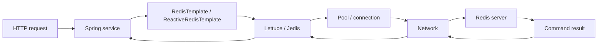
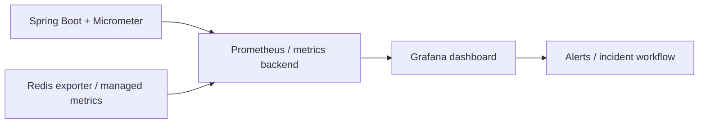

# Tracking Connection Count, Command Errors, and Wait Time in Spring Data Redis

## 1. Why Observe Redis on Both the Application Side and the Server Side?

Redis usually responds very quickly, so a Spring Data Redis application can run smoothly for months before hitting hard-to-diagnose failures:

- HTTP requests gradually slow down even though Redis still answers `PING`.
- Some Spring Boot instances throw `RedisCommandTimeoutException`, yet Redis has no corresponding slow commands in `SLOWLOG`.
- Connected client counts on Redis surge right after a deployment or failover.
- `GET` commands still succeed while `SET` begins failing due to memory or permissions.
- Redis shows many `blocked_clients`, when in reality those are normal `XREAD BLOCK` consumers.
- The application connection pool is exhausted while the Redis server still has plenty of room for new connections.

These symptoms cannot be explained by a single "Redis UP/DOWN" metric.

This lesson focuses on **three crucial operational signal groups in Spring Data Redis**:

1. **Connection count:** How many clients are connected to the Redis server, how does the application create and use connections, and is the pool exhausted?
2. **Command errors:** Which error types is Redis returning, which connection/serialization/timeout errors does the client see, and what is the business impact?
3. **Wait time:** Are slow Redis results caused by command execution, network, pool contention, driver queuing, blocking commands, or retries?

The goal is to design observability that surfaces issues before users are severely impacted and provides enough signals to pinpoint root causes.

> **Core principle:** Measure the **Redis server**, the **Redis driver**, and the **application operation context**. Each describes a different part of the same Redis call; none replaces the others.

---

## 2. Distinguishing Three Observation Layers

A cache read request may flow through:



Each layer sees one slice:

| Layer | Typical Signals | What It Cannot Fully See |
|---|---|---|
| **Spring application** | Service Redis call duration, cache hit/miss, endpoint impact, retry/fallback | Connections from all other applications on Redis |
| **Lettuce/Jedis driver** | Command latency, connect/reconnect, pool wait, client-side timeouts | Commands sent to the server by other clients |
| **Redis server** | `connected_clients`, `rejected_connections`, `commandstats`, `errorstats`, `SLOWLOG` | Total time an HTTP request waited on a pool, Java serialization, and round-trip network |

For example, a `GET` may take 500 ms at the Java layer while taking only 30 µs to execute on the Redis server. The difference can come from connection waiting, command queues, the event loop, network, serialization, JVM GC, or thread scheduling. You cannot automatically conclude "Redis is running slow" just because an application timer is high.

Conversely, a Redis `SLOWLOG` containing CPU-heavy commands while API latency has not yet risen visibly can serve as an early warning before traffic climbs.

## 3. Minimum Set of Metrics to Track

| Group | Metric | Question to Answer |
|---|---|---|
| Connections | `connected_clients` | How many client connections is Redis maintaining? |
| Connections | `maxclients` | Is there configured connection headroom left? |
| Connections | `rejected_connections` | Has the server rejected new connections? |
| Connections | `total_connections_received` | Is the rate of new connection creation abnormal? |
| Connections | Pool active/idle/waiting | Is the application waiting to borrow connections? |
| Connections | Connect/reconnect failures | Are disconnects or reconnect loops occurring? |
| Commands | Command counts / rate | Which commands are called most and how is load shifting? |
| Commands | `total_error_replies` | How many error replies has Redis returned? |
| Commands | `errorstats` | Which types of error replies are rising? |
| Commands | `commandstats` rejected/failed | Are commands being rejected or failing execution? |
| Timeouts | Application command timeouts | How many commands fail to finish within the client budget? |
| Latency | Client p50/p95/p99 | How are Redis command durations distributed for callers? |
| Latency | `SLOWLOG`, `LATENCY` | Are there execution problems or latency events on the server? |
| Business impact | HTTP error/latency, cache fallback | How are Redis issues affecting users? |

The first three groups must be correlated by **timestamp, application instance, Redis node, and operation type**. A single isolated metric rarely suffices for diagnosis.

---

## 4. Reading Connection Counts from Redis with INFO clients

Redis provides:

```redis
INFO clients
```

Example output may include:

```text
# Clients
connected_clients:82
cluster_connections:0
maxclients:10000
client_recent_max_input_buffer:16384
client_recent_max_output_buffer:0
blocked_clients:8
tracking_clients:0
```

Exact field names may vary by Redis version and deployment mode. The values above **are illustrative only**, not the state of a live server.

### 4.1. connected_clients

`connected_clients` is the number of client connections currently connected to **the Redis node answering the command**. It is not necessarily:

- The number of online users.
- The number of running HTTP requests.
- The number of Spring Boot instances.
- The number of application threads.
- The number of Redis commands currently executing.

One Spring Boot instance can hold multiple connections due to pooling, Pub/Sub, blocking Stream readers, or driver behavior. Conversely, many application commands can share a single native Lettuce connection.

With Redis Cluster, inspect **each node**; reading `INFO clients` on one node does not report all client connections across the entire cluster.

### 4.2. maxclients

`maxclients` is the configured limit for Redis client connections, visible in `INFO clients` on supported versions or via:

```redis
CONFIG GET maxclients
```

`CONFIG GET` requires appropriate privileges and some managed Redis offerings restrict it. The effective limit is also bounded by OS file descriptors or provider caps.

You can track the ratio:

\[
\text{Connection utilization} =
\frac{\text{connected\_clients}}{\text{maxclients}}
\times 100\%
\]

Having 8,000 connections out of `maxclients=10,000` is 80% utilization. That is a signal worth investigating, **not a universal mandatory threshold for every system**; also consider growth trends, failover nodes, and special clients.

### 4.3. blocked_clients

`blocked_clients` generally reflects clients executing **blocking commands** such as `BLPOP` or `XREAD BLOCK`.

Example:

```redis
XREAD BLOCK 5000 COUNT 10 STREAMS events:orders $
```

A consumer actively waiting for events increments `blocked_clients`. Thus:

- `blocked_clients > 0` **does not by itself prove Redis is hung**.
- A blocked count matching your worker count can be completely normal.
- An unexpected sudden jump may indicate too many consumers being created, listeners not shutting down, or connections held too long.
- Compare against expected workers/subscriptions before alerting.

Redis server `blocked_clients` **differs from** Java threads blocked waiting to borrow a connection in the application.

### 4.4. client buffers

Input/output buffer metrics help spot slow-reading clients, oversized payloads, or Pub/Sub subscribers falling behind.

However, a single field like `client_recent_max_output_buffer` is only one angle and does not replace checking Redis memory and detailed client state. If buffers grow continuously, check subscriber throughput, network, and command response sizes.

---

## 5. Detecting Abnormal Connection Creation Loops

Two distinct metrics in:

```redis
INFO stats
```

typically include:

```text
total_connections_received:...
rejected_connections:...
```

### total_connections_received

This is a cumulative counter of connections accepted by the server since startup. To monitor connection creation speed, compute **the increase over a time window** rather than looking at the absolute total.

Example:

```text
12:00:00 total_connections_received = 100000
12:01:00 total_connections_received = 101800

1,800 new connections were received in 60 seconds.
Average rate over the interval = 30 connections/second.
```

If an application previously opened 2–3 new connections/second and jumps to 30/second after a deployment, check:

- Is a new `LettuceConnectionFactory` or `JedisPool` being created per request?
- Are connections being opened and closed repeatedly?
- Is there continuous reconnecting caused by network, TLS, or authentication failures?
- Is pool `max-idle` too low, causing connections to be discarded and recreated constantly?
- Did a new scheduled job or health check start creating a fresh connection per run?
- Did another application sharing Redis ramp up load?

When Redis restarts, cumulative counters reset to 0. Dashboards should use a rate function from the monitoring system that handles counter resets, rather than raw subtraction across a restart.

### rejected_connections

`rejected_connections` is the count of new connections rejected by Redis, usually tied to connection limits or server resource limits.

An increase while `connected_clients` nears `maxclients` strongly indicates connection capacity exhaustion. Still, inspect logs, file descriptor limits, managed service quotas, and network state.

**Note:** A client-side timeout **does not necessarily** increment `rejected_connections`. For instance, if the client cannot reach Redis due to DNS or a firewall, the connection attempt may never hit the Redis server.

---

## 6. CLIENT LIST: Seeing Who Holds Connections

The command:

```redis
CLIENT LIST
```

returns details about connected clients, such as address, client type, connection age, state, DB, client name, and buffer details depending on Redis version.

An illustrative snippet:

```text
id=204 addr=10.0.0.21:50210 age=300 idle=0
flags=N db=0 name=orders-api ...
```

This is technical telemetry that may contain sensitive internal metadata. Never expose raw `CLIENT LIST` output on public dashboards or forward it to uncontrolled log sinks.

### CLIENT SETNAME Helps Investigation

Redis supports:

```redis
CLIENT SETNAME orders-api-instance-a
```

Setting a client name helps identify which component owns a connection in `CLIENT LIST`. With Spring Data Redis, naming behavior depends on the driver and connection configuration; note that client names are assigned to **specific connections**, so do not assume every connection from a service shares the exact same name by default.

When using pooling or reconnects, verify the actual name after reconnection and how the driver manages connections.

### What to Avoid

Do not automatically run `CLIENT KILL` on connections that appear "idle" solely based on `idle`; many legitimate native connections or Pub/Sub listeners have long idle times.

If terminating a client is ever necessary, verify ownership, role, transaction/consumer impact, and operational policy. During observation, stick to read-only state commands.

---

## 7. Connection Counts in Spring Data Redis Do Not Equal Server Connection Counts

Spring Data Redis provides the `RedisConnectionFactory` abstraction; actual connection behavior depends on the driver.

### 7.1. Lettuce

Lettuce uses Netty-based I/O and can share a native connection across many ordinary commands depending on `LettuceConnectionFactory` configuration.

Consequences:

- Many `StringRedisTemplate.opsForValue().get(...)` calls do not open a new socket each time.
- High concurrent request volume does not proportionally increase socket counts.
- One connection can hold many in-flight commands awaiting replies; **few connections does not mean low load**.
- Stateful connection commands, blocking reads, Pub/Sub, or transactions require dedicated connection handling.
- When enabling pooling for Lettuce, understand which operations use the pool; **not every Lettuce application needs a pool**.

### 7.2. Jedis

Jedis is commonly used via a connection pool for synchronous operations. If the pool is exhausted, application threads can **block waiting to borrow a connection**, slowing requests before a Redis command is even sent.

Therefore, alongside server connection counts, track:

- Active/borrowed connections.
- Idle connections.
- Callers waiting for a connection.
- Connection borrow duration.
- Failures to borrow a connection within the timeout.

### 7.3. Distinction Table

| Symptom | Where to Observe It |
|---|---|
| How many client sockets Redis currently has | `INFO clients` |
| How many active/idle connections the pool holds | JVM-side client/pool metrics |
| A thread waits too long to borrow from the pool | Pool wait metrics and application exceptions |
| A Redis command is still waiting for a reply | Driver command latency/in-flight metrics, tracing |
| Redis refuses new connections | `rejected_connections`, client logs/exceptions |
| Pub/Sub subscriber holds a connection | Redis `CLIENT LIST`, driver listener lifecycle |
| `XREAD BLOCK` waits for messages | `blocked_clients` and consumer metrics |

**Do not infer a pool bug just because `connected_clients` is high**, and do not assume the pool is healthy just because Redis has not hit `maxclients`.

---

## 8. Example Connection and Timeout Configuration in Spring Boot

With Spring Boot and Lettuce, an illustrative configuration:

```yaml
spring:
  data:
    redis:
      host: localhost
      port: 6379
      connect-timeout: 1s
      timeout: 2s
```

General meaning:

- `connect-timeout`: time limit for establishing a connection per the client/driver mechanism.
- `timeout`: limit governing Redis client command execution per Spring Boot configuration.

Exact property names and behavior must match your Spring Boot and driver version. This sample applies to local standalone Redis; production also involves TLS, authentication, Sentinel/Cluster, client resources, and failover.

### When Pooling Is Needed

An illustrative pool configuration for Lettuce:

```yaml
spring:
  data:
    redis:
      lettuce:
        pool:
          max-active: 16
          max-idle: 8
          min-idle: 2
          max-wait: 500ms
```

Enabling pooling requires Apache Commons Pool 2 or the matching pool dependency for your Spring Boot version.

**Do not add pooling mechanically.** Lettuce shares a native connection for normal commands; pooling helps specific workloads or stateful commands, but adding a pool does not automatically make Redis faster.

The values `16/8/2/500ms` are examples only. Actual values depend on instance count, concurrency, command mix, server limits, latency, and disconnect behavior.

### Calculating Total Maximum Connections

Suppose you run:

```text
20 Spring Boot instances
Each instance pool max 16 connections

Those pools alone could require up to 20 × 16 = 320 connections.
```

Not yet counting:

- Pub/Sub listener connections.
- Stream blocking readers.
- Connections opened by health checks and monitoring tools.
- Redis replication/cluster internal connections.
- Other applications sharing Redis.
- Connections transiently open during reconnect/failover.

Connection capacity planning must account for **the entire application fleet**, not just a single pod.

---

## 9. Three Error Categories That Often Get Mixed Together

When a Redis call fails, separate **errors returned by the Redis server** from **client/transport errors**.

### 9.1. Redis Error Replies

Redis received the command and returned an error reply, for example:

```text
-WRONGTYPE Operation against a key holding the wrong kind of value
-NOAUTH Authentication required.
-NOSCRIPT No matching script. Please use EVAL.
-OOM command not allowed when used memory > 'maxmemory'
```

Depending on the error and Redis version, the server may increment `total_error_replies` or a specific error stats group.

### 9.2. Network or Connection Errors

Examples:

- DNS resolution failure.
- TCP connection refused.
- TLS handshake failure.
- Firewall/network partition blocking traffic.
- Socket closed while a command was in flight.
- Driver losing connection during failover.

These typically surface in **application/driver metrics and exceptions**, not necessarily in `INFO errorstats`, because the Redis server may never receive the command.

### 9.3. Client-Side Timeouts

For example, a command exceeds the Lettuce/Jedis budget or the application times out borrowing a connection from the pool.

A timeout only means the caller **did not receive a result in time**. It cannot prove whether Redis executed the command or not.

An `INCR` may already have incremented the counter on the server even though the reply failed to arrive before the timeout. Retrying without idempotency can increment the counter a second time.

### Quick Diagnostic Table

| Error | Might Redis Record an Error Reply? | What Else to Check |
|---|---|---|
| `WRONGTYPE` | Yes | Key schema, serializer, application commands |
| `NOAUTH`/`NOPERM` | Possibly | ACLs, credentials, Pub/Sub/command permissions |
| `OOM` | Possibly | `used_memory`, `maxmemory`, eviction policy |
| TCP connect timeout | Not necessarily | DNS, network, connect timeout, pool |
| Client command timeout | Not necessarily | Driver latency, server latency, network, in-flight queue |
| Pool borrow timeout | Redis may be completely healthy | Pool active/waiters, connections held too long |
| JVM serializer exception | Not necessarily | Codec/serializer, object schema |
| Redis failover mid-command | Depends on timing | Reconnects, topology, replication/failover |
| Command cancelled by client | Not necessarily | Subscription/cancellation, caller timeout |

**Do not lump all errors into "Redis down".** Remediation and business impact vary widely by category.

---

## 10. Tracking Errors from the Redis Server: INFO stats

Run:

```redis
INFO stats
```

A helpful field:

```text
total_error_replies:...
```

This is a cumulative counter of error replies returned by the server. Because it is a counter, measure its growth rate:

```text
09:00 total_error_replies = 1250
09:05 total_error_replies = 1310

In 5 minutes there were 60 additional error replies.
```

Rising error replies should be broken down by command type and caller. A low background rate of application errors may not affect users, whereas a spike right after a deploy often signals an API, schema, or config bug.

**Do not compare a cumulative count against a static threshold** like "greater than 1000 is an incident": a long-running Redis may have a high total counter even when zero new errors are occurring.

## 11. Tracking by Error Type: INFO errorstats

The command:

```redis
INFO errorstats
```

can return counts grouped by error code prefix, for example:

```text
# Errorstats
errorstat_ERR:count=...
errorstat_WRONGTYPE:count=...
errorstat_NOAUTH:count=...
```

Exact field formatting, included codes, and availability depend on Redis version, configuration, and managed service restrictions.

### Reading Metrics to Find Root Causes

- `WRONGTYPE` rising: two components may be using the same key for different data types, such as one doing `SET` string and another doing `HSET` hash.
- `NOAUTH`/`NOPERM` rising: credentials or ACLs may be misconfigured, especially after secret rotation or adding new commands.
- `ERR` rising: inspect actual error messages and triggering commands; this is a broad category.
- `OOM` or memory-related errors: cross-check `INFO memory`, maxmemory policy, and rejected operations.
- `NOSCRIPT` rising: may relate to `EVALSHA`/script cache usage across restarts or failovers; proper scripting APIs generally reload/rerun scripts automatically.

Do not blindly retry every failed command: `WRONGTYPE`, ACL failures, and syntax errors are **not transient errors**, and retrying only adds load.

### Securing Error Logs

Redis error messages can sometimes include command names, key names, or potentially sensitive data. Never place raw command arguments, Redis keys, or tokens into metric labels, as monitoring systems retain them long-term and they cause massive cardinality.

---

## 12. Tracking Errors Per Command: INFO commandstats

Run:

```redis
INFO commandstats
```

Illustrative line:

```text
cmdstat_get:calls=100000,usec=250000,usec_per_call=2.50,rejected_calls=0,failed_calls=0
```

Fields vary by Redis version. Common meanings:

| Field | Interpretation |
|---|---|
| `calls` | Number of command invocations recorded by server stats |
| `usec` | Total command processing time in microseconds |
| `usec_per_call` | Average processing time per command invocation |
| `rejected_calls` | Commands rejected prior to execution per stats rules |
| `failed_calls` | Commands that encountered an error during processing per stats rules |

From `commandstats`, you can spot:

- `HGETALL` or `ZRANGE` surging after a code change.
- An operation's average processing time increasing compared to baseline.
- Rejected/failed counts concentrated in one command family.
- Command rate climbing even though application HTTP requests did not, hinting at retries or N+1 Redis calls.

**Important limitation:** `usec_per_call` is Redis server processing time for the command, **not the end-to-end time** from a Java thread calling `RedisTemplate` until receiving the result. It is also an average, which can mask p99 tail latency.

---

## 13. Tracking Slow Commands with SLOWLOG

Redis provides `SLOWLOG`:

```redis
SLOWLOG LEN
SLOWLOG GET 10
```

It records commands whose **execution time inside Redis** exceeds a configured threshold. Self-managed Redis parameters typically include:

```redis
CONFIG GET slowlog-log-slower-than
CONFIG GET slowlog-max-len
```

`slowlog-log-slower-than` is normally measured in **microseconds**, unlike Java client command timeouts which are usually in milliseconds/seconds.

### Does SLOWLOG Measure the Network?

No. Redis's slow log focuses on **command execution time** at the server; it does not reflect network I/O or time the command spent queued before execution.

Example:

```text
App sees GET take 300 ms
Redis SLOWLOG has no GET entry

Possible breakdown:
  - Pool wait 150 ms
  - Network / driver queue 149 ms
  - Redis processes GET in 1 ms
```

An empty `SLOWLOG` does **not** imply good application latency.

### When Should You Inspect SLOWLOG?

- Driver p99 rises without connection errors.
- Redis CPU rises.
- Lua scripts or large data-structure operations are in use.
- A new endpoint introduces high-complexity commands.
- Redis latency stutters under rising traffic.

SLOWLOG can contain command arguments; access and extraction must be controlled. Never forward raw entries to centralized logs without scrubbing sensitive information.

---

## 14. Tracking Redis Server Latency Events

Redis provides latency diagnostic commands such as:

```redis
LATENCY LATEST
LATENCY DOCTOR
```

Depending on Redis version, you can also inspect latency event history.

**Note:** Redis latency monitoring may require configuring a threshold and enabling it appropriately. If monitoring is disabled or no events crossed the threshold, empty output **does not prove Redis has zero latency spikes**.

Causes of rising server latency can include:

- Commands processing large amounts of data.
- Long-running Lua scripts or Redis Functions.
- Persistence-related tasks.
- Memory allocator or active defragmentation under certain conditions.
- CPU contention or host virtualization overhead.
- Saturated network or server event loop.

Correlate latency data with `INFO commandstats`, `SLOWLOG`, CPU, disk I/O, AOF/RDB, and client metrics.

### Redis Latency and HTTP Latency Are Different

```text
HTTP response latency
  = Java routing / security / business logic
  + connection acquire
  + Redis client / driver / queue / network / command
  + downstream DB / HTTP
  + HTTP serialization
```

Thus, a low-latency Redis server can still accompany very high HTTP p99 if the driver waits on a pool, JVM GC pauses occur, or a request makes many sequential Redis calls.

---

## 15. Classifying Wait Times When Using Spring Data Redis

The phrase "Redis timeout" in logs can refer to many distinct waiting points:

| Type | When Does It Occur? | Direction to Investigate |
|---|---|---|
| **DNS resolution timeout** | Client fails to resolve endpoint in time | DNS, service discovery, network |
| **TCP connect timeout** | Cannot establish socket to Redis | Redis endpoint, firewall, network, connect timeout |
| **TLS handshake/auth timeout** | Connection opened but negotiation/auth did not finish | TLS config, certs, ACLs, network |
| **Pool borrow timeout** | Could not obtain a connection from the pool in time | Pool size, active/waiting counts, connection leaks |
| **Command timeout** | Command sent or queued, no reply within client budget | Driver queue, network, server, command latency |
| **Redis blocking command timeout** | `XREAD BLOCK`/`BLPOP` wait period ended with no data | May be normal expected behavior, not an incident |
| **Application/request timeout** | HTTP or Reactor deadline shorter than total work | End-to-end latency budget |
| **Retry budget exceeded** | Total duration across attempts exceeded limit | Retry policy, backoff, downstream health |

A timed-out command usually requires checking **the exception class and stack trace** to see where the timeout originated.

Do not label every exception containing the word `timeout` as a Redis server bug; for instance, a pool borrow timeout can happen because the application holds connections too long even while Redis executes commands quickly.

### Distinguishing Timeouts from Cache Misses

- Redis `GET` for a missing key normally returns `null` via `StringRedisTemplate`; that is a **cache miss**, not an error.
- A command timeout produces an exception or error signal, not "absent data".
- Returning a default value on timeout may be acceptable for an optional cache, yet dangerous for permissions, idempotency, or billing.

Track `hit`, `miss`, and `error` separately so dashboards never report cache misses as operational errors.

---

## 16. Blocking Commands Must Be Interpreted by Their Semantics

Example consumer:

```redis
XREAD BLOCK 5000 COUNT 50 STREAMS order-events $
```

The command can wait up to 5,000 ms if no new events arrive. Redis may increment `blocked_clients` and the caller waits intentionally.

Distinguish three cases:

1. **As designed:** No messages arrive; `XREAD` waits 5 seconds and returns empty.
2. **Client timeout misconfiguration:** Driver command timeout is set to 2 seconds, shorter than `BLOCK 5000`; the driver errors out before Redis finishes waiting.
3. **Real failure:** Redis stops responding even past the valid block timeout, or the connection drops.

For Stream consumers, dashboards should track:

- Expected consumer and blocking connection counts.
- Empty reads after normal wait intervals.
- Actual events received.
- Consumer lag, pending entries, and ACK/retry metrics.
- **Abnormal** driver command timeouts, separated from normal block expirations.

Never set an alert saying "any Redis command taking over 1 second is an error" on workloads running `XREAD BLOCK 5000` or long-lived subscriptions.

---

## 17. Relationship Between Timeouts, Retries, and Idempotency

Suppose a service executes:

```java
redis.opsForValue().increment("orders:counter");
```

The client times out after 2 seconds. There are at least two possibilities:

```text
A. Redis never received or never executed INCR.
B. Redis executed INCR, but the response never reached the client.
```

If the service retries unconditionally, case B increments the counter twice. With `XADD`, it can produce duplicate messages; with `SET` and a TTL, retrying can shift expiration timing.

Therefore, after observing a timeout:

- Never automatically assume a write did not execute.
- Retry only error classes and operations covered by a safe policy.
- Design idempotency for operations with side effects.
- Use backoff and jitter to avoid retry storms.
- Bound retries within the request time budget.
- Track retry counts separately from logical request counts.

A change in retry policy can multiply `commands/sec` severalfold even when HTTP traffic stays flat. That is why **application-layer metrics** must be compared against **Redis server metrics**.

---

## 18. Adding Spring Boot Actuator and Micrometer

To observe Spring Boot, use Actuator and Micrometer. Gradle example:

```kotlin
dependencies {
    implementation("org.springframework.boot:spring-boot-starter-data-redis")
    implementation("org.springframework.boot:spring-boot-starter-actuator")

    // Needed only if you want Prometheus to scrape Actuator:
    runtimeOnly("io.micrometer:micrometer-registry-prometheus")
}
```

Spring Boot normally manages versions via its BOM. Exact driver metric names and capabilities depend on Spring Boot, Spring Data Redis, Lettuce/Jedis, and active configuration.

Maven example:

```xml
<dependencies>
    <dependency>
        <groupId>org.springframework.boot</groupId>
        <artifactId>spring-boot-starter-data-redis</artifactId>
    </dependency>
    <dependency>
        <groupId>org.springframework.boot</groupId>
        <artifactId>spring-boot-starter-actuator</artifactId>
    </dependency>
    <dependency>
        <groupId>io.micrometer</groupId>
        <artifactId>micrometer-registry-prometheus</artifactId>
        <scope>runtime</scope>
    </dependency>
</dependencies>
```

### 18.1. Configuring Observability Endpoints

```yaml
management:
  endpoints:
    web:
      exposure:
        include: health,info,metrics,prometheus
  endpoint:
    health:
      show-details: when_authorized
```

When the Prometheus registry is configured and the endpoint is exposed, Prometheus can scrape:

```text
/actuator/prometheus
```

`/actuator/metrics` is useful for discovering which meters actually exist in the running application.

**Security notes:**

- Never expose all management endpoints unauthenticated to the Internet.
- Protect metrics and health details via network/security policies.
- Do not leak Redis hostnames, credentials, connection strings, exception stack traces, or user-specific labels.
- Actuator may provide a Redis health check, but **a health check does not replace command latency metrics or data correctness verification**.

### 18.2. Checking Which Metrics Are Actually Exported

Exact meter names depend on which components are instrumented. Simply adding Actuator **does not guarantee** all Lettuce command latency, connection pool, or Redis command error metrics appear.

Workflow:

1. Start the application with Actuator.
2. Execute a few Redis operations.
3. Inspect the meter list at `/actuator/metrics`.
4. Identify meters from Micrometer, Lettuce, pooling, or custom instrumentation.
5. Check tags, units, and histogram/percentile levels.
6. Cross-check with the Prometheus endpoint if enabled.
7. Add service, driver, or exporter instrumentation for any missing signals.

Never build a dashboard around a guessed metric name without verifying it is exported in your exact application version.

---

## 19. Measuring Redis Duration with a Service-Layer Timer

A Micrometer `Timer` can measure the elapsed time from when the application prepares to call Redis until it receives a result or exception in a synchronous operation.

Example cache adapter using `StringRedisTemplate`:

**`MeasuredProductCache.java`**

```java
package com.example.observability;

import java.util.Optional;

import io.micrometer.core.instrument.MeterRegistry;
import io.micrometer.core.instrument.Timer;
import org.springframework.data.redis.core.StringRedisTemplate;
import org.springframework.stereotype.Component;

@Component
public class MeasuredProductCache {

    private final StringRedisTemplate redis;
    private final MeterRegistry meters;

    public MeasuredProductCache(
            StringRedisTemplate redis,
            MeterRegistry meters
    ) {
        this.redis = redis;
        this.meters = meters;
    }

    public Optional<String> getProductName(String sku) {
        String key = "catalog:v1:name:" + sku;
        Timer.Sample sample = Timer.start(meters);
        String outcome = "hit";

        try {
            String value = redis.opsForValue().get(key);

            if (value == null) {
                outcome = "miss";
                return Optional.empty();
            }

            return Optional.of(value);
        } catch (RuntimeException ex) {
            outcome = "error";

            meters.counter(
                    "app.redis.command.errors",
                    "operation", "get"
            ).increment();

            throw ex;
        } finally {
            sample.stop(
                    Timer.builder("app.redis.command.duration")
                            .description(
                                    "Application-observed Redis operation time"
                            )
                            .tag("operation", "get")
                            .tag("outcome", outcome)
                            .register(meters)
            );
        }
    }
}
```

Logical behavior of these meters:

- `app.redis.command.duration` measures **time observed from the Java service** for a `GET`.
- `outcome=hit` when data is returned.
- `outcome=miss` when the key is absent.
- `outcome=error` when an exception is thrown.
- `app.redis.command.errors` counts exceptions per operation.

This example does not guess which exceptions represent timeouts; detailed error classification should inspect actual driver/Spring exception types. You can add an `error_type` tag with a **bounded, normalized set of values** (such as `timeout`, `connection`, `serialization`, `other`), never raw exception messages.

### Why Not Attach Key Names?

Avoid:

```java
.tag("key", "catalog:v1:name:" + sku)
```

If the application has millions of SKUs, the metrics backend could create millions of time series. This is **high cardinality**, consuming memory, CPU, storage, and cost while risking data leaks.

Use tags like:

```text
operation=get
component=product-cache
outcome=hit|miss|error
```

Tag value sets must stay small and bounded.

### An App Timer Is Not a Redis Server Timer

This code measures the duration of calling Redis from the service, including parts of Java, the driver, and the network. It **does not** isolate Redis server command execution time. Pair it with `commandstats`, `SLOWLOG`, or driver metrics to break down causes.

---

## 20. Measuring ReactiveRedisTemplate Pipelines at Subscription Time

With reactive Redis, a `Mono` can be constructed long before subscription begins. Starting a timer when the method is called—when the publisher is subscribed to 2 seconds later—measures the wrong interval.

Use `Mono.defer(...)` to capture a fresh start timestamp for **each subscription**.

**`MeasuredReactiveCache.java`**

```java
package com.example.observability;

import java.util.concurrent.TimeUnit;
import java.util.concurrent.atomic.AtomicReference;

import io.micrometer.core.instrument.MeterRegistry;
import io.micrometer.core.instrument.Timer;
import org.springframework.data.redis.core.ReactiveStringRedisTemplate;
import org.springframework.stereotype.Component;

import reactor.core.publisher.Mono;
import reactor.core.publisher.SignalType;

@Component
public class MeasuredReactiveCache {

    private final ReactiveStringRedisTemplate redis;
    private final MeterRegistry meters;

    public MeasuredReactiveCache(
            ReactiveStringRedisTemplate redis,
            MeterRegistry meters
    ) {
        this.redis = redis;
        this.meters = meters;
    }

    public Mono<String> getName(String sku) {
        return Mono.defer(() -> {
            long startNanos = System.nanoTime();

            AtomicReference<String> outcome =
                    new AtomicReference<>("hit");

            return redis.opsForValue()
                    .get("catalog:v1:name:" + sku)
                    .doOnSuccess(value -> {
                        if (value == null) {
                            outcome.set("miss");
                        }
                    })
                    .doOnError(error -> outcome.set("error"))
                    .doFinally(signal -> {
                        if (signal == SignalType.CANCEL) {
                            outcome.set("cancel");
                        }

                        long elapsedNanos =
                                System.nanoTime() - startNanos;

                        Timer.builder("app.redis.command.duration")
                                .tag("operation", "get")
                                .tag("mode", "reactive")
                                .tag("outcome", outcome.get())
                                .register(meters)
                                .record(
                                        elapsedNanos,
                                        TimeUnit.NANOSECONDS
                                );
                    });
        });
    }
}
```

Explanation:

- `Mono.defer` creates a fresh timer measurement per subscriber.
- `System.nanoTime()` is a monotonic clock suited for elapsed intervals, not business timestamps.
- `doOnSuccess(null)` handles empty completion in Reactor for a cache miss.
- `doOnError` isolates errors.
- `doFinally` records the metric even if downstream cancels the subscription.
- `SignalType.CANCEL` is a subscriber-side cancellation signal, **not proof that the Redis server never ran the command**.

In reactive flows, a timed-out or cancelled request may already have dispatched the Redis command. Apply the same retry and idempotency discipline as in synchronous code.

**Never call `block()` just to measure duration:** doing so turns the current thread call blocking and can stall the WebFlux event loop.

---

## 21. Observing Latency at the Lettuce/Jedis Driver Level

Beyond service-level Timers, the driver can expose command latency and connection/command lifecycle signals.

### Lettuce

Lettuce can record command latency and integrate with Micrometer depending on version and configuration. Driver-level measurements can distinguish:

- Time from issuing the command until the first response byte arrives.
- Time until completion per the driver's recording mechanism.
- Command family and Redis endpoint address.
- Reconnect events, command timeouts, or connection status through corresponding hooks.

**These meters are not always enabled automatically in every Spring Boot version.** Verify:

1. Lettuce and Spring Data Redis versions.
2. Configured `ClientResources` and latency recorder/collector.
3. Whether the `MeterRegistry` is wired into the right place.
4. Whether the meters actually appear in `/actuator/metrics`.
5. Tags, units, histograms, and performance overhead.

In some integrations, Lettuce meters are prefixed around `lettuce.command.*`; do not hardcode dashboards around that prefix before inspecting actual exported meters.

### Jedis

If the application uses Jedis, latency/pool metric availability depends on client version, pooling library, and installed instrumentation. You can measure at the adapter/service layer with Micrometer Timers as shown earlier; if using Commons Pool 2, monitor the corresponding pool metrics.

### Do Not Treat Driver Latency as API Latency

Driver latency excludes application work such as:

- Auth/session parsing before calling Redis.
- JSON/business processing before and after commands.
- Service-level retry logic.
- Authoritative database queries.
- Writing the HTTP response.

You need both **driver command latency** and **application operation latency** to understand any gap.

---

## 22. Measuring Pool Wait Time and Spotting Connection Saturation

With pooling, a request can spend most of its time waiting to borrow a connection:

```text
HTTP request begins
  |
  +-- 450 ms: wait for available connection
  +--   1 ms: Redis executes GET
  +--   2 ms: response / deserialize
  |
  +-- Total ~453 ms
```

Redis `SLOWLOG` will not record the 450 ms pool wait, yet users still see a slow endpoint.

Signals to watch:

| Pool Metric | Meaning |
|---|---|
| Active/borrowed | Connections currently checked out by callers |
| Idle | Connections available to borrow |
| Waiting/queued | Callers waiting for a connection |
| Borrow wait p95/p99 | How slow borrowing a connection has become |
| Exhausted/borrow timeouts | Pool unable to satisfy requests within budget |
| Created/destroyed | Abnormal pool churn |
| Validation failures | Pooled connections failing health validation |

If Redis `connected_clients` stays low while the application reports pool exhaustion, the pool may be sized too small, connections may be held too long, or a single instance's pool is blocked. Raising Redis `maxclients` will not fix this.

Conversely, if every pod opens too many connections and Redis `rejected_connections` climbs, raising `max-active` across all pods can worsen the incident.

### Signs of a Connection Leak

- Active connections climb and fail to drop after traffic subsides.
- Pool waiters stay elevated continuously.
- Thread dumps show many callers blocked waiting to borrow.
- Code paths opening connections manually without closing/releasing them in `finally`.
- New subscribers/consumers created without stopping when tasks end.

In Spring Data Redis, use Spring-managed templates and factories that honor lifecycle management instead of opening raw connections per HTTP request.

---

## 23. Observing the Redis Server with an Exporter

Spring Boot Actuator monitors **the Java application**, while the Redis server needs its own metric source. A common pattern is a Prometheus-compatible Redis exporter or telemetry provided by a managed Redis platform.

Flow:



A Redis exporter collects signals from `INFO` and inspection commands. Configure appropriate read-only privileges, secure its endpoint, and avoid running expensive commands too frequently.

Metrics to include:

- Connected clients, blocked clients, max clients.
- Total connections, rejected connections.
- Error replies and error breakdown.
- Commands/sec, commandstats.
- Redis memory and evictions.
- CPU, network I/O, persistence, and replication state.
- Server role and uptime to detect restarts or failovers.

**Metric names vary across exporters and versions.** Never assume every exporter emits exact names like `redis_connected_clients` or exposes every error category identically. Inspect real exporter output before writing dashboard queries.

### Use Rates for Counters and Current Values for Gauges

| Type | Example | How to Read |
|---|---|---|
| Gauge | Connected clients | Current value, compared against limits and trends |
| Gauge | Blocked clients | Current value, compared against expected blocking workers |
| Counter | Total connections received | Growth rate over an observation interval |
| Counter | Rejected connections | Growth rate; sustained non-zero values warrant investigation |
| Counter | Error replies | Error rate and ratio |
| Counter | Command calls | Command rate by type |
| Timer/histogram | App/driver latency | p50, p95, p99; rate and total samples |

Never compare a post-restart cumulative counter directly against a pre-restart value without accounting for the reset.

---

## 24. Latency: p50, p95, p99, and Histograms

Suppose in one minute there are 10,000 Redis calls:

```text
Most GETs: 1–3 ms
A few GETs: 50–100 ms
A few requests: time out at 2 seconds
```

The average may remain small while a subset of users experiences severe delays. That is why **latency percentiles** matter.

| Percentile | Interpretation |
|---|---|
| p50 | Half of samples have latency at or below this value |
| p95 | Roughly 95% of samples have latency at or below this value |
| p99 | Roughly 99% of samples have latency at or below this value |
| max | Highest sample in the window, depending on collection mechanism |

For example, an application's Redis read SLO might be **p99 under 20 ms** under normal conditions. That is illustrative; cross-region workloads, blocking commands, and large-value operations have different budgets.

### Configuring Histograms in Micrometer

If you need cross-instance percentiles in Prometheus, enable histograms selectively on key timers:

```yaml
management:
  metrics:
    distribution:
      percentiles-histogram:
        app.redis.command.duration: true
```

Depending on Spring Boot/Micrometer versions, property names, histogram usage, and SLO bucket boundaries must align with actual meters. Histograms multiply time series, so enable them only on important meters with low-cardinality tags.

### Example PromQL on a Custom Meter

If Micrometer exports `app.redis.command.duration` as `app_redis_command_duration_seconds_bucket` with histograms enabled, p95 can be queried as:

```promql
histogram_quantile(
  0.95,
  sum by (le, operation) (
    rate(app_redis_command_duration_seconds_bucket[5m])
  )
)
```

This query **illustrates common Prometheus naming conventions**; verify actual metric names and labels against your live endpoint.

If only `_sum` and `_count` exist, you can compute **mean duration**, not p95/p99:

```promql
sum(rate(app_redis_command_duration_seconds_sum[5m]))
/
sum(rate(app_redis_command_duration_seconds_count[5m]))
```

When analyzing p99, note that very low sample counts in a window can make estimates noisy.

---

## 25. Setting Per-Request Timeout Budgets

An API with a bounded total latency budget cannot give every downstream layer a timeout longer than that budget.

Example:

```text
HTTP request budget: 1500 ms

Authentication      50 ms
Redis cache read     80 ms
Database fallback   900 ms
Response rendering  100 ms
Reserved            370 ms
```

If Redis command timeout is set to 3 seconds, during a Redis outage an HTTP request with a 1.5-second budget will hang too long or get cancelled before the Redis timeout fires.

Conversely, if using a 5-second Redis Streams blocking read, you cannot apply the same 80 ms cache `GET` timeout to every Redis command.

Distinguish workloads:

- **Fast Redis operations:** `GET`, `SET`, `HGET`, `INCR` on the request path.
- **Long-running/blocking operations:** Stream `BLOCK` reads, Pub/Sub listeners.
- **Bulk operations:** `SCAN`, batch reads/writes, heavy data scripts.

Each class may need its own timeout or connection strategy in the driver rather than one global value for everything.

### Do Not Set Timeouts Too Low Just to "Fail Fast"

A 1 ms timeout can cause healthy commands to fail under minor network jitter and trigger retry storms. Choose thresholds based on:

1. Latency measured under normal and peak load.
2. End-to-end request budget.
3. Business SLOs.
4. Cost of retries and fallbacks.
5. Driver behavior and network environment.

---

## 26. When to Use Tracing Instead of Only Metrics

Metrics tell you "how many timeouts occurred and what p99 is"; distributed tracing answers "which step made this specific request slow?".

A trace may show:

```text
HTTP GET /products/{sku}                 840 ms
  |
  +-- Authentication                      15 ms
  |
  +-- ProductService.load                 810 ms
        |
        +-- Redis GET (client span)        420 ms
        |
        +-- DB fallback                    360 ms
```

When supported instrumentation is active, Redis client operations appear in traces via Micrometer Observation/Tracing or driver integration.

### Be Careful When Tagging Spans

Use:

```text
db.system=redis
operation=GET
component=product-cache
outcome=timeout
```

Avoid tagging:

```text
redis.key=session:<token>
redis.command=SET auth:secret:... <raw-value>
user.email=...
```

Raw Redis keys, command arguments, and values can expose identifiers/secrets while inflating cardinality and trace storage costs.

A Redis span shows that the client command was slow, though you still correlate pool and server metrics to determine why.

### Tracing Sampling

You do not need to trace 100% of requests on very high-traffic systems. Use sampling and prioritize capturing error/timeout traces within your observability platform's budget.

During incident triage, a handful of representative traces paired with system-wide rate/latency metrics usually beats logging every command.

---

## 27. Recommended Dashboard for Spring Data Redis

An operational dashboard should organize panels so they correlate across the same time range.

### Group A — Connections

- `connected_clients` per Redis node.
- Connection utilization vs. `maxclients`.
- `rejected_connections`/sec.
- Rate of `total_connections_received`.
- `blocked_clients` vs. expected blocking workers.
- Pool active/idle/waiters per Spring Boot instance.
- Reconnect events and connection exceptions.

### Group B — Errors

- Redis error replies/sec by error category.
- Rejected/failed command counts per command.
- Client command timeouts/sec.
- Connect timeouts/sec.
- Pool borrow timeouts/sec.
- Serializer/codec errors.
- HTTP impact: 5xx, 429, fallbacks, and operation failures.

### Group C — Timing

- App timer p50/p95/p99 per operation.
- Driver latency if available.
- Redis `SLOWLOG` counts and trends.
- Redis server latency events.
- Pool borrow wait p95/p99.
- Total HTTP latency p95/p99.
- Retry attempts and exceeded deadlines.

### Group D — Server Context

- Redis CPU and memory.
- Command rate and network I/O.
- Persistence/AOF fsync if enabled.
- Replication lag and role.
- Evictions.
- Redis restarts and failovers.

Everything does not have to fit on a single screen. What matters is being able to align **the same timestamp and the same Redis node/application** across related signals.

---

## 28. Examples of Context-Aware Alerts

The thresholds below are **starting examples** and must be tuned to your baseline, SLOs, and instance count.

| Alert | Illustrative Condition | Why It Matters |
|---|---|---|
| Connection saturation | `connected_clients/maxclients > 80%` sustained 5 min and rising | Early warning before hitting connection limit |
| Rejected connections | Sustained `rejected_connections` rate > 0 | Clients are failing to connect |
| Connection churn | New connection rate many times above baseline | Reconnect storm, connection leak, or bad config |
| Client timeout spike | Timeouts above normal baseline impacting API | Users waiting too long |
| Error reply spike | Sharp rise in error replies after a deploy | Command, ACL, or schema bug |
| Redis latency SLO | `GET` p99 exceeds budget with sufficient sample volume | Tail latency degradation |
| Pool exhausted | Waiters rising and borrow time near `max-wait` | Pool saturation or held connections |
| Unexpected blocked clients | Blocked count far exceeds expected worker count | Lifecycle leak or runaway consumers |
| Failover/reconnect storm | Simultaneous reconnects plus rising command errors | Topology or network disruption |

### Combining Signals to Reduce False Positives

For `blocked_clients=50`:

- If the system runs 50 `XREAD BLOCK` Stream consumers, this can be normal.
- If only 5 consumers are expected and blocked clients jump from 5 to 50 after a deploy, investigate.

For rising Redis p99:

- If Redis server `commandstats` and `SLOWLOG` stay clean, check pool, network, GC, and driver queues.
- If server CPU and `SLOWLOG` rise together, suspect command complexity or Redis load.

**A useful alert must point toward a clear investigative action**, not merely report that one metric is high.

---

## 29. Runbook 1: Abnormal Rise in Connection Count

### Symptoms

`connected_clients` rises rapidly, `rejected_connections` begins increasing, or multiple application instances log pool errors.

### Safe Steps

**Step 1 — Identify the Redis node and scope**

```redis
INFO clients
INFO stats
```

Check how close Redis is to `maxclients` and whether the new connection rate is climbing.

**Step 2 — Inspect connected clients**

```redis
CLIENT LIST
```

Focus on client name, source host, connection type, connection age, and flags. Never export sensitive output to unauthorized channels.

**Step 3 — Correlate with deployments and pools**

Check:

- Did the app just scale from 5 to 50 pods?
- Did `max-active` per pod increase?
- Is a connection factory or pool being created per request?
- Did restarting Pub/Sub or Stream listeners leave old connections open?
- Are connection errors triggering continuous reconnect loops?

**Step 4 — Find root cause before raising limits**

If the application has a leak, merely raising `maxclients` only delays exhaustion until Redis runs out of resources again. If load grew legitimately, do capacity planning and scale according to topology.

**Step 5 — Verify recovery**

Watch connection counts, creation rate, rejection rate, and HTTP errors return to baseline. Do not stop at checking `PING`.

### Things Not to Do

- Do not blindly `CLIENT KILL` connections without confirming ownership.
- Do not run `FLUSHDB`/`FLUSHALL` to "free connections"; deleting keys does not fix a connection leak.
- Do not raise pool `max-active` everywhere without summing total connections across all pods.

---

## 30. Runbook 2: Redis Command Errors Spike After Deployment

### Symptoms

Application logs report Redis errors while `total_error_replies` or `errorstats` increases.

### Procedure

1. Note deployment timestamp and affected Redis node(s).
2. Inspect `INFO errorstats` to separate error categories.
3. Inspect `INFO commandstats` to spot commands with rising rejected/failed counts.
4. Compare application error counts per operation and endpoint.
5. Check changes to key schemas, serializers, ACLs, Lua scripts, `maxmemory`, or connection settings.
6. If `WRONGTYPE` is suspected, run `TYPE` on a single authorized test/target key and check key-building logic; avoid logging sensitive values.
7. For `NOPERM`/`NOAUTH`, inspect credential/ACL configuration through secure operational channels.
8. For Redis OOM errors, check `INFO memory` and memory policy instead of increasing retries.
9. Confirm the fix by verifying error reply rates and application error ratios drop back to baseline.

Example:

```redis
INFO errorstats
INFO commandstats
INFO memory
```

### Why Not Automatically Retry Every Error?

An `HGET` against a string key will still fail with `WRONGTYPE` even if retried 100 times. Retries only amplify command volume and system cost. Schema/code errors require fixing the root cause; transient network errors can use bounded retries if the operation is safe.

---

## 31. Runbook 3: Timeouts Rise While Redis SLOWLOG Is Empty

### Symptoms

The application logs many `RedisCommandTimeoutException` or deadline-exceeded errors while `SLOWLOG GET` shows no notably slow commands.

### Investigation Sequence

**Step 1 — Identify timeout category**

Inspect exception chains and telemetry:

- Connect timeout?
- Pool borrow timeout?
- Command timeout?
- HTTP/Reactor timeout?
- A legitimate blocking command with `BLOCK`?

**Step 2 — Inspect driver/pool metrics**

Check in-flight commands, pool waiters, active/idle counts, reconnects, command latency, and timeout settings.

**Step 3 — Inspect Redis server**

```redis
INFO clients
INFO stats
INFO commandstats
SLOWLOG GET 10
LATENCY LATEST
```

If server command latency is low, shift focus to the network, driver event loop, pool, and JVM.

**Step 4 — Check host and JVM**

Look for CPU throttling, GC pauses, thread starvation, container resource limits, and network latency between app and Redis. An event loop blocked by heavy CPU work can delay handling replies even after Redis has responded.

**Step 5 — Re-evaluate timeout budget**

If client timeout is 100 ms while normal peak p99 RTT is already 80 ms, minor jitter will cause frequent timeouts. Tune budgets against SLOs and architecture rather than raising timeouts indefinitely.

**Step 6 — Check retries**

Multiple retries stretch response latency, amplify command rate, and can overload the primary DB during fail-open cache fallbacks. Track retry attempts alongside HTTP latency.

### Investigation Conclusion

An empty `SLOWLOG` does not invalidate application timeouts. It simply means no command crossed the server's slowlog execution threshold during the observation window.

---

## 32. Redis Cluster and Sentinel: Observe by Topology

In Redis Cluster, keys are distributed across nodes by hash slot. An application communicates with multiple Redis nodes, so **a single `connected_clients` line does not represent the entire cluster**.

### For Redis Cluster

- Collect metrics from every relevant primary and replica.
- Track connections per node, not just cluster totals.
- Monitor roles, failovers, resharding, and routing errors.
- Separate normal client-routing `MOVED`/`ASK` replies from errors actually impacting the application; behavior depends on driver and topology state.
- One node can become a hotspot with high p99 even while cluster-wide throughput looks moderate.
- Check client topology refresh settings if timeouts spike after resharding or failover.
- Never put specific Redis keys into metric labels to hunt hot keys; use controlled analysis tools.

### For Sentinel

During primary failover:

- Clients may disconnect and reconnect.
- In-flight commands may time out.
- Connection counts on old and new primaries shift.
- Writes near the failover boundary may have uncertain outcomes during network disruption.

Dashboards should display **failover/role-change markers** alongside command errors and application latency. Otherwise, normal failover-window timeouts can be misread as a regression in new application code.

### For Managed Redis

Providers may restrict `CONFIG GET`, `CLIENT LIST`, or `SLOWLOG` or expose alternative metrics. Use the observability interfaces supported by your provider and verify metric equivalence; never assume every raw command is permitted.

---

## 33. Redis Command Capacity and Connections Do Not Scale Linearly

A common misconception: "More connections make Redis process faster."

In most workloads, the Redis server processes commands very quickly, while CPU, network bandwidth, memory, operation count, and command complexity are the true constraints. Adding connections does not increase processing capacity on a single node.

Suppose an application currently does:

```text
100 concurrent HTTP requests
Each request issues 20 sequential Redis GETs
Total = 2,000 Redis commands
```

Reducing per-request `GET` counts or adopting appropriate batch APIs can cut Redis load dramatically without adding connections.

Conversely, if timeouts stem from an undersized connection pool with long borrow queues, tuning the pool helps. Base decisions on metrics:

- Redis CPU and commands/sec.
- Driver command latency.
- Pool wait and active counts.
- Response payload sizes.
- Network throughput.
- App p99 and error rate.

### Pipelining and Batching Do Not Remove Limits

Pipelining reduces round trips, yet Redis still executes every command. Oversized batches can inflate queue memory or response sizes and degrade tail latency for other clients.

Do not turn on pipelining everywhere just to shrink connection counts.

---

## 34. Observing by Use Case: Cache, Session, Streams, and Pub/Sub

### Cache

Key signals:

- Cache hit/miss by cache name or component, not by key.
- Redis `GET` latency and timeouts.
- Database fallback rate.
- Concurrent origin requests during Redis errors.
- Redis evictions and memory pressure.

Rising cache misses do not automatically mean a Redis outage. Short TTLs, cold starts, or prefix changes in a deployment can also cause them.

### Session

Monitor:

- Session read/write errors.
- Session access latency.
- Redis connections and timeouts.
- Abnormal forced re-login rates.
- Security alerts when sessions cannot be verified.

**Never fail-open access control just because the Redis session store is temporarily unresponsive.**

### Redis Streams

Monitor:

- Expected blocking reader count.
- Records received per second.
- Consumer group lag, backlog, and pending entries.
- Real `XREAD` timeouts vs. normal `BLOCK` expirations.
- ACK and reclaim failures.
- Consumer-held connections and graceful shutdown lifecycle.

### Pub/Sub

Monitor:

- Whether subscribers are connected.
- Expected subscription count.
- Message rate and callback failures.
- Reconnect events.
- Output buffer pressure when subscribers fall behind.

Redis Pub/Sub does not durably retain messages for replay after a disconnect; a healthy connection gauge does not prove messages sent during a disconnect were delivered.

### Rate Limiter

Monitor:

- `ALLOW`/`DENY` volume per policy.
- Lua script latency and Redis errors.
- Timeouts and connection failures.
- Fail-open vs. fail-closed fallback rates.
- Redis key cardinality and memory.

Do not watch only HTTP 429s: rate-limiter Redis failures can surface as HTTP 503s or, worse, let traffic pass unchecked.

---

## 35. Verifying Instrumentation with Controlled Scenarios

Before trusting a dashboard, verify that expected metrics are emitted in a **dedicated test environment**.

### Scenario 1 — Successful Commands

Send normal `GET`/`SET` operations. Check:

- App Timer sample counts increment.
- Success outcome is recorded accurately.
- Redis command counts rise for the corresponding commands.
- No spurious errors are recorded.

### Scenario 2 — Non-Existent Key

`GET` a missing key:

- Service treats it as a cache miss.
- Metric records `outcome=miss`.
- Error counter does **not** increment.
- HTTP 404 or fallback follows business logic rather than flagging a Redis outage.

### Scenario 3 — Redis Returns a Real Error

In an isolated test Redis, intentionally run a type-mismatch operation:

```redis
SET demo:it:key value
HGET demo:it:key field
```

`HGET` on a string triggers `WRONGTYPE`. Verify Redis `errorstats`/counters and application error tracking.

Never run tests that alter production keys.

### Scenario 4 — Redis Connection Unavailable

In the test environment, stop or disconnect the test Redis container cleanly:

- App records connection/command errors.
- Timeouts are not classified as cache misses.
- Retries stay bounded.
- Endpoints apply fail-open or fail-closed policy as designed.
- Once Redis recovers, connections re-establish cleanly.

### Scenario 5 — Normal Blocking Read

Call `XREAD BLOCK` with a finite wait and no incoming events. Verify:

- `blocked_clients` may rise during the wait.
- When `BLOCK` finishes, it returns empty per Redis semantics.
- Metrics do not misclassify a normal idle wait as an error.
- Client command timeout comfortably exceeds the block duration.

These scenarios validate **instrumentation** and do not require injecting faults against live user traffic.

---

## 36. Securing Observability Data

Observability can inadvertently leak sensitive data if it captures raw Redis keys, commands, or internal endpoints.

### Keep High-Cardinality Data Out of Labels

Labels to avoid:

```text
redis.key=session:user:12345:token:...
client.ip=<arbitrary-ip>
error.message=<raw stack trace>
user.id=<millions of values>
```

Your metrics backend may spawn millions of series from these values.

Use bounded label sets instead:

```text
application=orders-api
operation=get
component=session-store
outcome=error
error_kind=timeout
redis_role=primary
```

Values for each tag must be governed by policy.

### Restrict Access to Diagnostic Commands

- `CLIENT LIST` exposes internal IP addresses and connection metadata.
- `SLOWLOG` may contain command arguments.
- `MONITOR` streams live commands with heavy overhead and severe exposure risk; **never use it as routine monitoring**.
- `CONFIG GET`/`CONFIG SET` may be restricted by ACLs or managed services.
- `/actuator/prometheus` and `/actuator/metrics` must not be exposed publicly on the Internet.

When deep diagnostics are necessary, use minimum read-only privileges, time-bound capture, and scrub sensitive values.

---

## 37. Distinguishing a Healthy Redis Server from a Healthy Business Flow

A Redis node can answer `PING` normally while the application still fails due to:

- Wrong data types or serializer mismatches.
- ACLs blocking a command required by the service.
- Connection pool exhaustion on specific app instances.
- Command timeouts caused by pod-to-Redis network issues.
- Mass cache misses overloading the database.
- Failover leaving clients routing to a stale node.
- Stream consumer lag accumulating unprocessed backlog.

Therefore, a Redis health indicator alone cannot confirm that business RTO or SLO targets are met.

Track at least:

1. **Server health:** Basic Redis responsiveness, connections, error replies, memory.
2. **Client health:** Connects, timeouts, pool state, command latency from app instances.
3. **Business health:** API success rates, end-to-end latency, completed tasks/events.

For sensitive workflows, a synthetic read/write probe to a **dedicated health-test key** can validate the live path, provided frequency is bounded so health checks do not become a load source.

---

## 38. Common Misconceptions and Pitfalls

| Misconception | Why It Is Wrong | Better Approach |
|---|---|---|
| `connected_clients` equals active HTTP users | One connection serves many commands; one app opens multiple sockets | Separate Redis clients from business users |
| Successful `PING` means no timeouts | Timeouts can stem from pools, network, driver, or other commands | Check client metrics and end-to-end traces |
| Empty `SLOWLOG` means Redis adds no delay | Slowlog ignores pool/network and only logs above threshold | Inspect app/driver latency, pool, and network |
| `blocked_clients > 0` is an error | `XREAD BLOCK`/`BLPOP` wait intentionally | Compare against expected blocking workers |
| Raising `maxclients` fixes all timeouts | Pool exhaustion, network, or server CPU may still bottleneck | Locate bottleneck by layer |
| Raising pool `max-active` is always better | Increases sockets and server load; risks connection storms | Capacity plan across total instances |
| Redis error replies cover all client timeouts | Timeouts may never reach the server | Measure client errors separately |
| A cache miss is a Redis error | `GET` on a missing key is normal behavior | Distinguish hit, miss, and error |
| Timeout means a write did not run | Reply may have been lost after execution | Use idempotency and conditional retries |
| High cumulative error replies equals a live outage | Counter accumulates since server start | Watch rate and error ratio |
| App p99 equals Redis server execution p99 | Includes pool, driver, network, and serialization | Combine metrics across layers |
| Adding Actuator automatically provides all Lettuce metrics | Instrumentation depends on version/config | Verify actual meters; add recorder if needed |
| Tagging keys/user IDs in metrics helps debugging | Causes high cardinality and leaks data | Tag component, operation, and outcome |
| `SLOWLOG` replaces regular monitoring | Only logs slow commands and may leak arguments | Use exporters, timers, tracing, and `SLOWLOG` when investigating |
| Monitoring one Redis Cluster node covers the cluster | Other shards or replicas may be failing | Collect per-node and correlate topology |
| Infinite retries overcome timeouts | Triggers retry storms and duplicate side effects | Use bounded retries, backoff, and idempotency |

---

## 39. Practice Questions

### Question 1. Redis reports 200 connections, yet 1,000 HTTP requests are in flight. Is that contradictory?

No. HTTP requests do not map one-to-one to Redis sockets. Lettuce in particular multiplexes commands over shared connections, and many in-flight requests may not currently be executing a Redis call.

### Question 2. `rejected_connections` is rising while Redis CPU is low. What should you inspect?

Compare `connected_clients` against `maxclients`, check connection creation rate, sum maximum pool limits across all instances, inspect for connection leaks, and check file descriptor or service quotas.

### Question 3. The service reports command timeouts, yet Redis `SLOWLOG` is empty. Can you rule out the Redis server?

Not yet. Timeouts could stem from pooling, network, event loop stalls, or server events not captured by slowlog. Correlate driver latency, pool metrics, server stats, and traces.

### Question 4. Redis shows `blocked_clients=40` because 40 workers run `XREAD BLOCK`. Is this a critical alert?

Not necessarily. If 40 workers match the intended deployment size, that state is normal. Alert only when blocked counts deviate unexpectedly or correlate with lag/errors.

### Question 5. `total_error_replies` rises right after a deploy. What signals help pinpoint the cause?

`INFO errorstats`, `INFO commandstats`, application exceptions by operation, recent changes to key schemas/serializers/ACLs/scripts, and deployment timestamps.

### Question 6. A Redis `GET` finds no key. Should that increment `app.redis.command.errors`?

No. A cache miss is a normal outcome under the data contract; record it separately under a `miss` outcome.

### Question 7. Is a pool borrow timeout an error returned by the Redis server?

No. Pool timeouts occur when the client cannot acquire a connection in time. Redis may never have received any command.

### Question 8. Why shouldn't `redis.key` be attached to a Micrometer Timer?

Because keys usually span huge value sets, creating high-cardinality time series and risking sensitive data exposure. Use bounded tags like operation, component, and outcome.

### Question 9. An `INCR` operation timed out. Is retrying it automatically safe?

You cannot assume it is safe from a timeout alone. The server may have incremented the counter before the reply was lost. Require idempotency or handle potential duplicate execution explicitly.

### Question 10. For Redis Cluster, why isn't cluster-wide total connections enough?

A single node can exhaust its connections or become a hotspot even when cluster totals look modest. Track metrics per primary/replica/node alongside topology status.

### Question 11. If Actuator exposes `/actuator/metrics`, are p99 Redis histograms guaranteed to exist?

Not necessarily. The relevant meter must be instrumented and histogram/percentile export enabled. Exposed meters vary across Spring Boot and Micrometer versions.

### Question 12. When the server runs `XREAD BLOCK 5000`, what happens if the client timeout is 2 seconds?

The client may time out before Redis finishes its 5-second block wait, producing false error signals when simply waiting for events. Configure timeouts and client strategies appropriately for blocking readers.

---

## 40. Implementation Roadmap for Observability in Spring Data Redis

A practical rollout sequence:

1. **Inventory Redis workloads:** caches, sessions, rate limiters, locks, Streams, Pub/Sub, Repositories, and long-blocking commands.
2. **Identify the driver:** Lettuce or Jedis, connection sharing/pooling settings, and standalone/Sentinel/Cluster topology.
3. **Collect server metrics:** `INFO clients`, `INFO stats`, `INFO commandstats`, `INFO errorstats`, via an exporter or managed metrics.
4. **Instrument application operations:** Timers for `GET`/`SET` and critical operations, `hit`/`miss`/`error` outcomes, and error counters.
5. **Enable supported driver metrics:** command latency, connection lifecycle, and pool wait; verify actual meters in Actuator.
6. **Categorize timeouts:** connect, borrow, command, blocking read, and request deadline—never lump them together.
7. **Measure tail latency:** p95/p99 for SLO-bound operations using histograms with bounded cardinality.
8. **Link business impact:** HTTP errors/latency, cache fallbacks, session failures, and Stream lag/ACKs.
9. **Design dashboards and alerts:** thresholds tied to baselines, roles/nodes, and meaningful time windows.
10. **Write runbooks:** clear steps for connection spikes, rising error replies, and client timeouts.
11. **Verify in isolated test Redis:** success/miss/error paths, connection loss, and normal blocking reads.
12. **Protect observability data:** never log raw keys/values/credentials, and restrict access to metrics endpoints.
13. **Monitor after changes:** driver upgrades, pod scaling, pool sizing, retry policies, Redis failovers, and payload growth.
14. **Tune timeout budgets:** base them on observed numbers and SLOs instead of keeping defaults blindly.

### Pre-Closure Checklist for a Redis Incident

| Question | Required Evidence |
|---|---|
| Were there more connections than normal? | `connected_clients`, connection creation rate, pool metrics |
| Did Redis reject connections? | `rejected_connections` and client connect errors |
| Which command errors did Redis return? | `errorstats`, `commandstats`, classified exceptions |
| Where was latency spent? | App Timer, driver latency, pool wait, `SLOWLOG`, network |
| Which timeouts were abnormal? | Connect/borrow/command/request; exclude expected `BLOCK` waits |
| Was there a retry storm? | Attempts per request, command rate, retry errors |
| Is there duplicate-write risk? | Side-effecting commands, idempotency/reconciliation |
| Were users or business flows impacted? | HTTP latency/5xx, cache fallback, sessions, Stream lag |
| Is the incident truly resolved? | Error rates back to baseline, p99 within SLO, business flows healthy |

---

## 41. Conclusion

In Spring Data Redis, tracking **connection counts, command errors, and wait times** requires combining multiple viewpoints:

- **Redis server:** `INFO clients`, `INFO stats`, `INFO commandstats`, `INFO errorstats`, `CLIENT LIST`, `SLOWLOG`, and `LATENCY` reveal connection usage, error categories, and server-side execution behavior.
- **Lettuce/Jedis driver:** connection/pool metrics, command latency, reconnects, and timeouts expose problems occurring before or after Redis processes a command.
- **Spring application:** Micrometer Timers, error counters, tracing, cache hit/miss, fallbacks, and HTTP latency measure business impact.

Keep four essentials in mind:

1. `connected_clients` is not active HTTP users; `blocked_clients` is not automatically a bug.
2. Redis server error replies exclude many network, pool, and client timeout errors.
3. `SLOWLOG` does not measure total application wait time on Redis; observe end-to-end.
4. A timeout does not prove a write never ran, so retries must respect idempotency.

A good dashboard does more than display pretty charts—it helps operators quickly answer: **where is the failure, how broad is the impact, what should be checked next, and how do we verify recovery?**

### References

- [Redis — INFO](https://redis.io/docs/latest/commands/info/)
- [Redis — CLIENT LIST](https://redis.io/docs/latest/commands/client-list/)
- [Redis — CLIENT SETNAME](https://redis.io/docs/latest/commands/client-setname/)
- [Redis — SLOWLOG](https://redis.io/docs/latest/commands/slowlog/)
- [Redis — Latency Monitoring](https://redis.io/docs/latest/operate/oss_and_stack/management/optimization/latency-monitor/)
- [Redis — XREAD](https://redis.io/docs/latest/commands/xread/)
- [Spring Data Redis — Reference Documentation](https://docs.spring.io/spring-data/redis/reference/)
- [Spring Data Redis — RedisTemplate](https://docs.spring.io/spring-data/redis/reference/redis/template.html)
- [Spring Boot — Production-ready Features: Actuator](https://docs.spring.io/spring-boot/reference/actuator/index.html)
- [Spring Boot — Metrics](https://docs.spring.io/spring-boot/reference/actuator/metrics.html)
- [Micrometer — Concepts](https://docs.micrometer.io/micrometer/reference/concepts.html)
- [Lettuce — Java Redis Client](https://redis.github.io/lettuce/)
