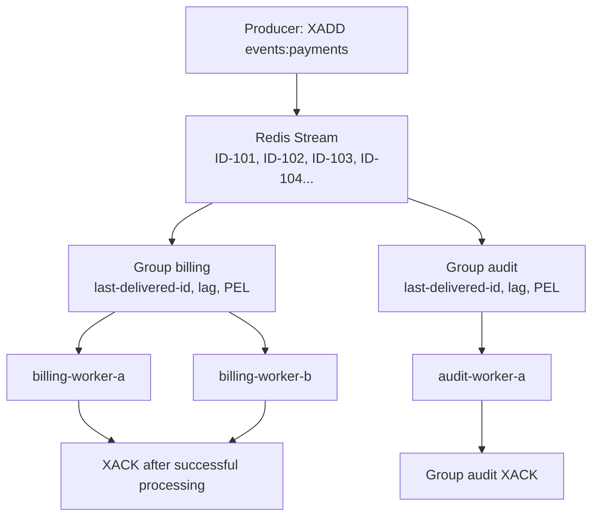
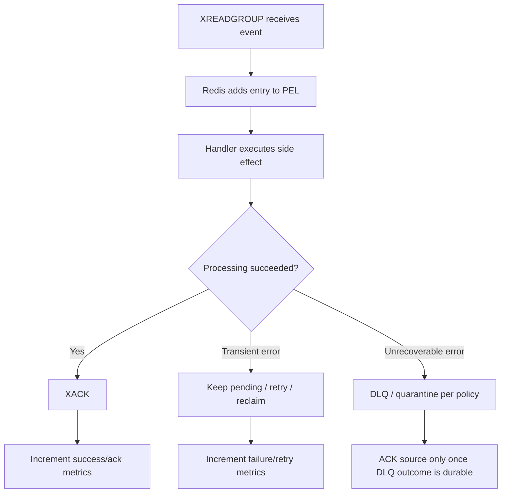
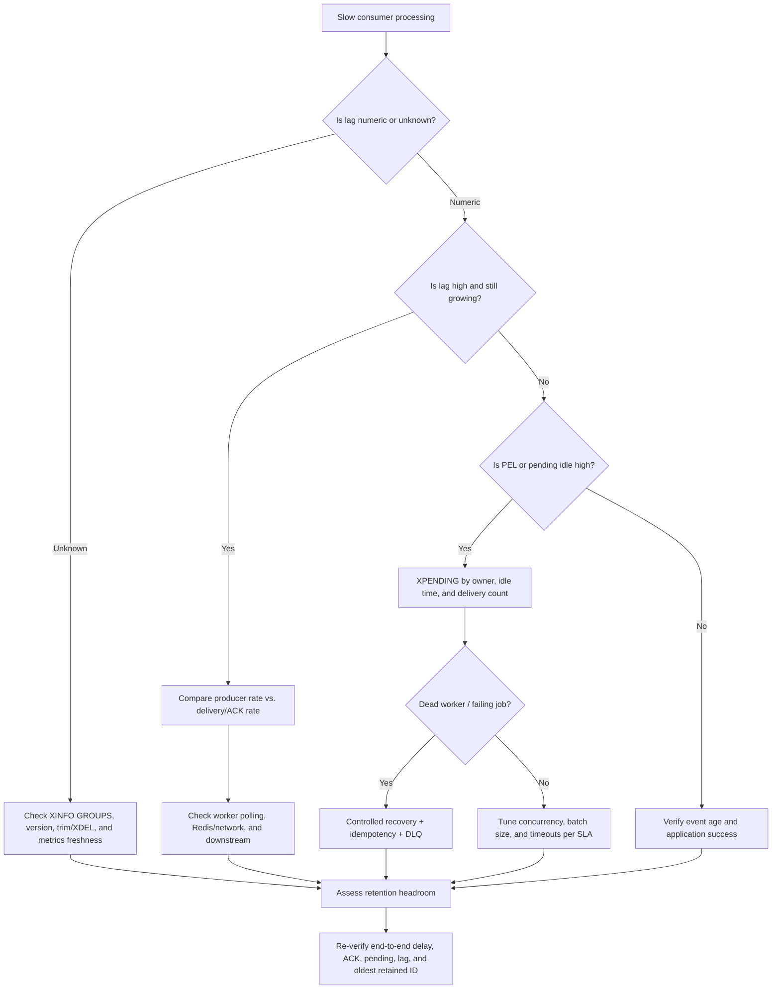

# Observing Consumer Lag and Pending Entries List of Redis Streams in Spring Data Redis

## 1. Why Monitor Both Lag and Pending Entries?

Redis Streams lets applications append events with `XADD` and organize workers into **consumer groups** via `XREADGROUP`. A consumer group tracks which entries have been delivered to workers and which entries have been acknowledged via `XACK`. In production, seeing that Redis is connected and workers are running is **not enough** to know whether work is being processed on time.

Suppose a system processes payment events:

```text
Producer:                writes 1,000 events/minute to events:payments
Consumer group billing:  processes 700 events/minute
Consumer group audit:    processes 1,000 events/minute
```

Redis responds normally and the `billing` workers are still running, yet that group's unprocessed backlog grows by roughly 300 events/minute. Without early detection, the system can fall hours behind or retention trimming can delete unprocessed entries.

There are two distinct kinds of remaining work to track **separately**:

1. **Not yet delivered to the consumer group** (*undelivered entries*, typically shown as **consumer lag** in `XINFO GROUPS` when Redis can compute it).
2. **Delivered but not yet acknowledged** (*pending entries*, tracked in the **Pending Entries List — PEL**).

> **Lag is not PEL.** High lag means the group has not kept up with newly added entries; a large PEL or long-idle pending entries means entries were already delivered to consumers but have not yet been `XACK`ed. A dashboard showing only one of the two will miss critical failure modes.

This lesson covers how to read these metrics from Redis and Spring Data Redis, interpret edge cases, build dashboards and alerts, and structure recovery runbooks.

## 2. Reviewing the Stream, Group, and Consumer Model

A Stream is a log of entries with monotonically increasing IDs. Each group maintains its own delivery position and its own PEL. Within a single group, multiple consumers share incoming entries.



The same entry can be processed and acknowledged by group `billing` while still remaining unreceived or unacknowledged by group `audit`. The state of **the two groups is independent**.

Common commands:

| Command | Role |
|---|---|
| `XADD` | Append an entry to a Stream |
| `XGROUP CREATE` | Create a consumer group at a starting position |
| `XREADGROUP` | Read entries within a consumer group |
| `XACK` | Remove an entry from the group's PEL after processing |
| `XINFO STREAM` | Inspect Stream metadata and boundary IDs |
| `XINFO GROUPS` | Inspect consumer group states and lag if available |
| `XINFO CONSUMERS` | Inspect consumers within a group |
| `XPENDING` | Inspect summary or detailed unacknowledged entries |
| `XCLAIM` / `XAUTOCLAIM` | Transfer pending entry ownership during recovery |
| `XTRIM` / `XDEL` | Remove entries from the Stream, potentially affecting replayability |

`XACK` does not automatically delete the payload from the Stream. Meanwhile, `XTRIM` can delete data before a consumer ever processes it if retention is misconfigured.

## 3. Distinguishing Three Types of Remaining Work

To read a dashboard accurately, separate at least three quantities:

### 3.1. Entries Not Yet Delivered to the Group (Lag)

A group has a `last-delivered-id` marking how far it has delivered messages to consumers. Redis can compute how many entries sit after that position—new entries not yet delivered.

Example:

```text
Stream:
  ID 101 102 103 104 105 106 107 108 109 110

Group billing:
  Delivered:     101 102 103 104 105
  Undelivered:   106 107 108 109 110

Consumer lag (when Redis can compute it): 5 entries
```

Here lag counts **entries**, not milliseconds. Nor does it prove entries 101–105 were processed successfully.

### 3.2. Delivered but Unacknowledged Entries (PEL)

Suppose entries 101 through 105 were delivered, but only 101, 102, and 104 have been acked:

```text
Delivered:       101 102 103 104 105
XACKed:          101 102     104
Remaining PEL:           103     105

Pending: 2 entries
```

Those two messages might currently be in flight or stuck in a failing worker. Inspect **idle time**, consumer owner, delivery count, and handler status.

### 3.3. Event Age and Business Wait Time

A group with a lag of 5 entries might have entries waiting 10 seconds or 10 hours. To know elapsed delay, you need reliable timestamps:

- When the producer wrote the entry to the Stream.
- When the consumer first received the entry.
- When business processing started.
- When processing finished and acked.
- When the entry was redelivered after an error.

**Pending idle time** is not always event age: when a message is claimed/redelivered, idle time resets relative to the latest delivery. To measure **end-to-end processing delay**, store a producer-generated `createdAt`/event timestamp or reliable reference timestamp and measure until successful completion.

### 3.4. Commonly Confused Cases

| Scenario | Lag | Pending | Meaning |
|---|---:|---:|---|
| New group, hasn't read anything yet | Very high | 0 | Many entries waiting for delivery |
| Workers read fast but process slowly | 0 or low | Very high | Work is backing up after delivery |
| Worker crashed after reading | 0 or low | Long-lived | Needs pending recovery/reclaim |
| Healthy consumer keeping up near real time | Low | Low and fresh | Normal state within SLA |
| Stream retains old already-acked entries | 0 | 0 | `XLEN` can still be very large |
| Stream trimmed aggressively | May be undefined | May still hold references | Check for data lost from the log |

A system that alerts only when `XPENDING > 1000` misses a group that stopped reading new entries altogether. A system that alerts only on `lag` misses workers reading messages and never acking them.

## 4. Generating Sample Data with redis-cli

The commands below use a **dedicated test namespace**. Never run `DEL` or alter groups on production data.

### 4.1. Creating a Stream and Group

```redis
DEL demo:obs:orders

XGROUP CREATE demo:obs:orders billing 0-0 MKSTREAM
# OK

XADD demo:obs:orders * eventId ev-1 orderId 101 type CREATED
XADD demo:obs:orders * eventId ev-2 orderId 102 type PAID
XADD demo:obs:orders * eventId ev-3 orderId 103 type CREATED
XADD demo:obs:orders * eventId ev-4 orderId 104 type PAID
XADD demo:obs:orders * eventId ev-5 orderId 105 type CREATED
```

Redis returns Stream IDs in `milliseconds-sequence` format. Record the actual IDs when acking or investigating; `ev-1`, `ev-2` are **illustrative business IDs**, not Redis-assigned Stream IDs.

`XGROUP CREATE ... 0-0` allows the group to read existing entries remaining in the Stream from the beginning. `MKSTREAM` creates an empty Stream if the key does not exist yet.

### 4.2. Inspecting the Group Before Consumers Read

```redis
XINFO GROUPS demo:obs:orders
```

On Redis versions supporting lag statistics, after creating the group at the start of the Stream and adding five entries, the group should report a lag corresponding to five undelivered entries.

If you instead use:

```redis
XGROUP CREATE demo:obs:orders future-only $ 
```

the `future-only` group starts at the tail of the Stream at creation time and reads only newer entries. Do not compare lag between two groups without accounting for **starting offset**. Both may be working as designed for different scopes.

### 4.3. Reading Some Entries and Inspecting Pending

```redis
XREADGROUP GROUP billing worker-a COUNT 3 STREAMS demo:obs:orders >
```

This delivers up to three new entries to the group. They enter the group's PEL until acknowledged.

Next:

```redis
XPENDING demo:obs:orders billing
XINFO GROUPS demo:obs:orders
XINFO CONSUMERS demo:obs:orders billing
```

Assuming no concurrent trims or deletes, you will observe lag drop from 5 to roughly 2 while pending rises from 0 to 3.

### 4.4. Acknowledging an Entry and Observing the Difference

Use the **actual Stream ID** of a received entry:

```redis
XACK demo:obs:orders billing <STREAM_ID_OF_EV_1>
```

The command returns the number of entries successfully acknowledged. Acking a pending entry reduces pending, yet lag **does not necessarily change** because that message had already been delivered earlier.

```redis
XPENDING demo:obs:orders billing
XLEN demo:obs:orders
```

`XLEN` can still be 5: acking does not delete events from the log.

## 5. XINFO GROUPS: Observing Lag and Delivery Progress

The command:

```redis
XINFO GROUPS events:orders
```

typically returns a set of fields depending on Redis version, including:

| Field | Interpretation |
|---|---|
| `name` | Consumer group name |
| `consumers` | Number of consumers with metadata in the group |
| `pending` | Total pending entries for the group |
| `last-delivered-id` | Last Stream ID delivered according to the group's position |
| `entries-read` | Logical read counter used by Redis to help compute lag |
| `lag` | Number of entries not yet delivered to the group, **if Redis can determine it** |

`entries-read` and `lag` do not exist or share identical semantics in every Redis version. Redis 7.0 introduced group lag tracking via the logical `entries-read` counter. On older servers, never assume those fields exist.

### 5.1. Lag Counts Entries, Not Wall-Clock Time

For example, `lag = 1200` means roughly 1,200 entries in the lag-tracked range have not been delivered to the group—**it does not mean the group is 1,200 milliseconds or 1,200 seconds behind**.

If the producer writes 100 entries/second, 1,200 entries corresponds to roughly 12 seconds of input in a steady-rate example. Yet if the producer paused for hours or emitted a sudden burst, converting entry count to time fails.

To alert on "an event has waited over 5 minutes", use event timestamps and an actual delay measurement—never set `lag > 300000` as if it counted milliseconds.

### 5.2. Lag Can Be Null/Unknown

In situations where Redis cannot reliably compute the logical distance between a group and the Stream, `lag` can be **null**. Common cases include:

- The group was created or repositioned at an arbitrary ID where Redis cannot reliably determine the logical `entries-read` counter.
- `XDEL` or `XTRIM` deleted entries in a range affecting lag calculation, such as between the group's delivery position and the tail of the Stream.
- Certain restore, upgrade, or metadata-change scenarios where lag cannot be inferred simply.

Redis can resume computing lag once the group advances to a suitable position per server semantics. Never automatically convert **null lag to 0** on a dashboard: doing so disguises an "unknown" state as "zero backlog".

In Java and metrics exporters, distinguish:

```text
lag = 0     -> Redis returned 0
lag = 250   -> Redis returned 250
lag = null  -> Redis could not determine / field absent
```

When lag is null, rely on publish/deliver/ack rates, boundary IDs, oldest event age, and PEL instead of guessing an exact value.

### 5.3. Do Not Use XLEN as Lag

`XLEN` returns **total entries remaining in the Stream**, including entries already processed and acknowledged by all consumer groups that have not yet been trimmed.

Example:

```text
XLEN = 1,000,000
Group billing:
  lag = 0
  pending = 0

=> The Stream still retains 1 million historical entries.
   billing is caught up and has no pending work.
```

Thus the formula `lag = XLEN - pending` is **wrong**. `XLEN` is also affected by trims/deletes, whereas each group has its own offset and metadata.

## 6. XINFO STREAM: Understanding How Much Data Remains Stored

Command:

```redis
XINFO STREAM events:orders
```

Commonly useful fields:

| Field | Operational Meaning |
|---|---|
| `length` | Number of entries currently remaining in the Stream |
| `first-entry` | Earliest entry still present |
| `last-entry` | Latest entry still present |
| `last-generated-id` | Last ID generated by the Stream per server state |
| `entries-added` | Total entries added per the counter on supported versions |
| `max-deleted-entry-id` | Highest deleted entry ID per metadata |
| `recorded-first-entry-id` | Starting point recorded by Redis to assist logical lag calculation |
| `groups` | Number of consumer groups on the Stream |

Not every version or engine exposes all fields or formats them identically.

### 6.1. A Large ID Gap Does Not Necessarily Mean a Large Backlog

Stream IDs contain a timestamp component and a sequence number. Do not compute:

```text
last-generated-id - last-delivered-id
```

as integer subtraction to infer pending or lag counts. Two IDs can be far apart in timestamp with only a single entry between them; conversely, thousands of entries can be written within a tiny window.

When Redis provides a computed `lag`, use it. Otherwise, measure rates and delays from application data, or maintain an intentional sequence/cursor mechanism rather than guessing from ID arithmetic.

### 6.2. When Trimming Deletes Data Behind a Group

Suppose a Stream enforces:

```redis
XADD events:orders MAXLEN ~ 100000 * eventId ev-1000 type CREATED
```

If the producer outpaces a consumer, entries at the head of the Stream can be trimmed before that group reads them. The group may then **have no way to read back the lost data** even though it knows its earlier delivery position.

Dashboards must therefore pair **group lag + retention window + oldest retained ID**. Seeing `lag` drop does not prove the group succeeded: it can drop due to delivery, group repositioning, or trimming/deletion depending on circumstances.

## 7. XPENDING: Inspecting Group-Level Pending Work

Short form:

```redis
XPENDING events:orders billing
```

returns a summary of the group's PEL, including:

- Total pending count.
- Minimum and maximum pending IDs when non-empty.
- Pending count breakdown by consumer owner.

This summary form is suitable for periodic group-level monitoring without loading individual messages.

### 7.1. Inspecting Detailed Pending Entries

Extended syntax:

```redis
XPENDING events:orders billing - + 10
```

This fetches up to 10 pending entries. Each item typically reports:

1. Pending **Stream ID**.
2. Owning **consumer name**.
3. **Idle time** in milliseconds since Redis-tracked delivery/activity.
4. **Delivery count**.

To filter for entries idle longer than a threshold, on Redis versions supporting the syntax:

```redis
XPENDING events:orders billing IDLE 60000 - + 10
```

`IDLE 60000` filters for messages idle for at least 60 seconds, helping surface stuck work.

### 7.2. Filtering by Consumer

You can fetch pending entries owned by a specific consumer:

```redis
XPENDING events:orders billing - + 20 worker-a
```

This helps compare:

- Which worker holds the most pending entries.
- Which worker holds the oldest idle pending entries.
- Whether an old consumer name after a restart still owns a backlog.
- Whether work distribution across workers is heavily skewed.

Do not automatically assume a consumer holding many pending entries is broken: it might legitimately pull large batches, or individual jobs may have varying durations. Check **pending age, job type, and throughput**.

### 7.3. Do Not Scan the Entire PEL Too Frequently

Calling `XPENDING` with huge ranges over massive PELs produces large responses and consumes CPU/network. For monitoring:

- Use the summary `XPENDING stream group` at a reasonable interval.
- Use `XINFO GROUPS` and `XINFO CONSUMERS` for high-level state.
- Query detailed entries with a bounded `COUNT` only when symptoms appear.
- When listing many pending entries, paginate by ID rather than requesting everything in one call.
- Use sensible polling intervals and cap concurrency on monitoring jobs.

Never let a monitoring service slow down Redis by continuously scanning millions of pending IDs.

## 8. XINFO CONSUMERS: Seeing Which Consumers Are Active

Command:

```redis
XINFO CONSUMERS events:orders billing
```

Important fields:

| Field | Meaning |
|---|---|
| `name` | Consumer name in the group |
| `pending` | Pending entry count held by this consumer |
| `idle` | Elapsed time without interaction/operation per version semantics |
| `inactive` | Elapsed time since last successful interaction on supported Redis versions |

Starting in Redis 7.2, `idle` and `inactive` are distinguished more clearly: `idle` reflects time since the last attempted interaction, while `inactive` reflects time since the last successful interaction. On older Redis versions, `idle` interpretation differs. Tie dashboards to **Redis version** instead of assuming one universal definition.

### 8.1. An Idle Consumer Is Not Necessarily Dead

A worker might:

- Be running a valid, long-duration job.
- Have no new messages to read.
- Be paused due to backpressure.
- Have shut down while leaving its metadata behind.
- Be polling continuously yet receiving zero new messages.
- Have a broken connection and be unable to process.

`XINFO CONSUMERS` reports **Redis-side metadata**, not a full JVM process health check. Combine with:

- Worker heartbeats, if present.
- Last successful handler completion.
- Last successful ack.
- In-flight batch counts.
- Pod/process health and restart counts.
- Error logs and dependency timeouts.
- Pending idle age and delivery counts.

Never delete a consumer solely because `idle` is high without checking whether it still owns pending entries that need recovery.

### 8.2. Keep Consumer Names Stable for Investigation

Within a group, assign consumer names that identify a worker/instance stably over its deployment lifecycle, for example:

```text
billing-worker-pod-7f3a
billing-worker-pod-8c91
```

If every poll generates a random new consumer name, `XINFO CONSUMERS` fills up with "ghost" consumers, making pending ownership and real consumer counts hard to track. Conversely, if two separate processes accidentally share **the same consumer name**, Redis treats them as one logical consumer and per-consumer metrics become misleading.

In Kubernetes, derive names cleanly from pod identity, while ensuring that when a pod is replaced its pending entries are reclaimed/recovered and stale consumer metadata is cleaned up per policy.

## 9. A Symptom Matrix for Locating Bottlenecks

| Symptom | Primary Possibility | Investigation Step |
|---|---|---|
| Lag rising, pending low | Consumers not reading fast enough or stopped reading | Check `XINFO GROUPS`, worker polling, throughput |
| Lag low, pending rising | Workers read fast but process/ack slowly | Check handler latency, errors, and `XPENDING` |
| Lag = 0, very old pending | Delivered job is stuck | Check owner, idle time, recovery |
| Lag spikes right after deploy | Consumer stopped or bad connection/config | Check readiness, Redis auth, schema |
| Lag is null | Redis cannot compute logical lag | Check group offset, trim/`XDEL`, and version |
| High PEL, rising delivery count | Frequent retries/reclaims | Check poison messages and overly short idle thresholds |
| Low PEL yet downstream DB errors | Consumer may be acking too early or swallowing errors | Correlate acks with business success |
| Group A healthy, Group B high lag | Downstream bottleneck, not global Redis | Investigate each group individually |
| `XLEN` drops sharply, group misses events | Stream trimmed/deleted before reading | Check retention and oldest retained ID |
| Consumer count climbs steadily | Unstable consumer names or uncleaned metadata | Check naming/restarts and `XGROUP DELCONSUMER` |
| All groups slow and Redis latency high | Redis/network/CPU/memory bottleneck | Check `INFO`, `commandstats`, infrastructure |
| High ACK rate yet backlog keeps growing | Producer outpaces consumers | Compare ingress vs. ack and scale/apply backpressure |

Two primary signals should always sit **side by side** on dashboards: *undelivered lag* and *pending count*. To gauge real progress, also watch **rates** and **event age**.

## 10. Throughput: Arrival, Delivery, and Acknowledgment Rates

Three distinct rates exist:

- **Ingress rate:** events successfully appended by producers via `XADD` per second.
- **Delivery rate:** entries handed to consumers via `XREADGROUP` per second.
- **Success/ACK rate:** events actually processed successfully by handlers and `XACK`ed per second.

Never equate worker `XREADGROUP` call counts with processed event counts; one call can return 0, 1, or many entries.

### 10.1. When Will Backlog Grow?

Suppose over a steady measurement window:

```text
Ingress = 150 events/second
Successful ACK = 120 events/second

Difference ≈ 30 events/second
After 10 minutes, unfinished work may grow by
roughly 18,000 events, absent trimming or other exceptions.
```

This estimates **group-wide outstanding workload**, which does not map solely to `lag`. Consumers may already have read many messages, shifting backlog from undelivered lag into the PEL.

If `ACK rate` remains below ingress over time, adding consumers helps **only if the bottleneck is horizontally scalable processing**. If the downstream database is already saturated, adding workers makes things worse.

### 10.2. Catch-Up Rate After an Outage

Suppose there is a backlog of 120,000 events and:

```text
New ingress = 100 events/second
Consumer successful processing = 140 events/second

Net backlog drain ≈ 40 events/second
Catch-up time ≈ 120,000 / 40 = 3,000 seconds (50 minutes)
```

This estimate assumes steady rates and single-pass throughput per event. In practice, retries, poison messages, variable job sizes, and downstream limits can extend recovery time.

If ACK rate merely equals ingress rate, outstanding backlog will **not shrink** even while consumers work continuously.

## 11. Observing with Spring Data Redis

Spring Data Redis exposes `StreamOperations` via `RedisTemplate.opsForStream()` or `StringRedisTemplate.opsForStream()`. These APIs support both processing and Stream inspection.

Key APIs to know:

| API / Type | Purpose |
|---|---|
| `opsForStream().read(...)` | Read by consumer group or offset |
| `opsForStream().acknowledge(...)` | ACK after processing |
| `opsForStream().pending(stream, group)` | Read Pending Entries List summary |
| `opsForStream().groups(stream)` | Fetch group info akin to `XINFO GROUPS` |
| `opsForStream().consumers(stream, group)` | Fetch consumer info akin to `XINFO CONSUMERS` |
| `opsForStream().info(stream)` | Fetch Stream info akin to `XINFO STREAM` |
| `StreamInfo` / `PendingMessagesSummary` | Typed representations of Redis replies in Spring Data Redis |

Exact method signatures, return types, and getters on `StreamInfo` or group objects can vary across Spring Data Redis versions. When you need `lag` and `entries-read`, check both your Redis server version and Spring Data Redis version; older APIs may not expose newer fields.

### 11.1. Reading the PEL Summary

A minimal snippet:

```java
package com.example.demo.streams;

import org.springframework.data.redis.connection.stream.PendingMessagesSummary;
import org.springframework.data.redis.core.StringRedisTemplate;
import org.springframework.stereotype.Service;

@Service
public class OrderPendingInspector {

    private static final String STREAM = "events:orders";
    private static final String GROUP = "billing";

    private final StringRedisTemplate redis;

    public OrderPendingInspector(StringRedisTemplate redis) {
        this.redis = redis;
    }

    public long pendingCount() {
        PendingMessagesSummary summary =
                redis.opsForStream().pending(STREAM, GROUP);

        return summary.getTotalPendingMessages();
    }
}
```

Things to note:

- Both Stream and group must already exist for the inspection command to succeed per Redis rules.
- When Redis is unavailable, the method may throw an exception; **never swallow it and return 0**, which tells dashboards "zero backlog".
- This returns only the total pending entry count, **excluding entries never yet delivered**.
- For very large workloads, summary queries are far safer than continuously reading every pending ID.
- On critical Streams, also check for cases where messages were trimmed/deleted while pending metadata lingers per version and policy.

### 11.2. Reading Group and Consumer Info

Spring can retrieve group/consumer info via:

```java
var groups = stringRedisTemplate.opsForStream()
        .groups("events:orders");

var consumers = stringRedisTemplate.opsForStream()
        .consumers("events:orders", "billing");
```

When building an exporter, iterate groups and extract supported fields: group name, pending count, consumer count, last-delivered ID, and lag when available. Never coerce an absent/null field to 0.

A dedicated Redis exporter can also invoke `XINFO GROUPS` directly if your Spring Data Redis version lacks getters for newer fields. If using driver/raw connections to parse RESP replies, handle data types carefully and keep monitoring code separate from business logic.

## 12. Spring Data Redis Worker Example: Measuring Delivery, Handling, and ACK

Application-side observability helps explain Redis-side numbers. A worker should track at least:

- Entries received.
- Entries handled successfully.
- Entries failing processing.
- Successful ACKs.
- Handler execution duration.
- Time elapsed since event creation before completion, if payload includes a timestamp.

Example:

```java
package com.example.demo.streams;

import java.time.Duration;

import io.micrometer.core.instrument.Counter;
import io.micrometer.core.instrument.MeterRegistry;
import io.micrometer.core.instrument.Timer;
import org.springframework.data.redis.connection.stream.Consumer;
import org.springframework.data.redis.connection.stream.ReadOffset;
import org.springframework.data.redis.connection.stream.StreamOffset;
import org.springframework.data.redis.core.StreamReadOptions;
import org.springframework.data.redis.core.StringRedisTemplate;
import org.springframework.stereotype.Service;

@Service
public class InstrumentedOrderWorker {

    private static final String STREAM = "events:orders";
    private static final String GROUP = "billing";

    private final StringRedisTemplate redis;
    private final OrderHandler handler;
    private final Counter received;
    private final Counter handled;
    private final Counter failures;
    private final Counter acknowledged;
    private final Timer handlerTime;

    public InstrumentedOrderWorker(
            StringRedisTemplate redis,
            OrderHandler handler,
            MeterRegistry metrics) {

        this.redis = redis;
        this.handler = handler;

        this.received = Counter.builder(
                "app.redis.stream.messages.received")
                .tag("stream", STREAM)
                .tag("group", GROUP)
                .register(metrics);

        this.handled = Counter.builder(
                "app.redis.stream.messages.handled")
                .tag("stream", STREAM)
                .tag("group", GROUP)
                .register(metrics);

        this.failures = Counter.builder(
                "app.redis.stream.messages.failed")
                .tag("stream", STREAM)
                .tag("group", GROUP)
                .register(metrics);

        this.acknowledged = Counter.builder(
                "app.redis.stream.messages.acknowledged")
                .tag("stream", STREAM)
                .tag("group", GROUP)
                .register(metrics);

        this.handlerTime = Timer.builder(
                "app.redis.stream.handler.duration")
                .tag("stream", STREAM)
                .tag("group", GROUP)
                .register(metrics);
    }

    public void pollOnce(String consumerName) {
        var records = redis.opsForStream().read(
                Consumer.from(GROUP, consumerName),
                StreamReadOptions.empty()
                        .count(50)
                        .block(Duration.ofSeconds(2)),
                StreamOffset.create(
                        STREAM, ReadOffset.lastConsumed())
        );

        if (records == null || records.isEmpty()) {
            return;
        }

        received.increment(records.size());

        for (var record : records) {
            try {
                handlerTime.record(() ->
                        handler.handle(record.getValue())
                );
                handled.increment();

                Long acked = redis.opsForStream().acknowledge(
                        STREAM, GROUP, record.getId()
                );

                if (acked != null && acked > 0) {
                    acknowledged.increment(acked);
                }
            } catch (RuntimeException failure) {
                failures.increment();
                // Do not ACK: message still needs recovery/retry flow.
                // Log with ID without exposing sensitive payload.
            }
        }
    }

    public interface OrderHandler {
        void handle(java.util.Map<String, String> payload);
    }
}
```

This example instruments a single poll iteration and **does not yet implement scheduling, PEL recovery, idempotency, or DLQ**. Depending on serializer, `StringRedisTemplate`'s `record.getValue()` may map to a Map with different generic types; adjust the handler interface to match your project's schema and mapper.

In particular:

- `received` increments when the consumer receives messages, not proving business completion.
- `handled` increments after the handler returns without error, yet can exceed ACKs if network/Redis fails.
- `acknowledged` increments when Redis confirms a positive ACK count; do not count a message acked twice if a retry returns 0.
- `failed` reports handler exceptions; failures can happen after side effects succeed yet before ACK, making idempotency essential.
- After redelivery, the same event increments `received` a second time. That is **delivery count**, not unique event count.

Do not equate single-process counters with system-wide totals until metrics are aggregated across all instances.

## 13. Exposing PEL as a Micrometer Gauge

You can build a periodic probe reading the PEL so dashboards display total pending from Redis's perspective.

### 13.1. Example with `@Scheduled` and Gauge

```java
package com.example.demo.streams;

import java.time.Instant;
import java.util.concurrent.atomic.AtomicLong;

import io.micrometer.core.instrument.Counter;
import io.micrometer.core.instrument.Gauge;
import io.micrometer.core.instrument.MeterRegistry;
import org.slf4j.Logger;
import org.slf4j.LoggerFactory;
import org.springframework.data.redis.connection.stream.PendingMessagesSummary;
import org.springframework.data.redis.core.StringRedisTemplate;
import org.springframework.scheduling.annotation.Scheduled;
import org.springframework.stereotype.Component;

@Component
public class StreamPendingMetricsProbe {

    private static final Logger log =
            LoggerFactory.getLogger(StreamPendingMetricsProbe.class);

    private static final String STREAM = "events:orders";
    private static final String GROUP = "billing";

    private final StringRedisTemplate redis;

    // Last successfully fetched value. Never turn Redis errors into 0.
    private final AtomicLong pending = new AtomicLong(-1L);
    private final AtomicLong scrapeOk = new AtomicLong(0L);
    private final AtomicLong lastSuccessEpochSeconds =
            new AtomicLong(0L);

    private final Counter scrapeErrors;

    public StreamPendingMetricsProbe(
            StringRedisTemplate redis,
            MeterRegistry registry) {

        this.redis = redis;

        Gauge.builder(
                "app.redis.stream.pending.entries",
                pending, AtomicLong::get)
                .tag("stream", STREAM)
                .tag("group", GROUP)
                .register(registry);

        Gauge.builder(
                "app.redis.stream.probe.success",
                scrapeOk, AtomicLong::get)
                .tag("stream", STREAM)
                .tag("group", GROUP)
                .register(registry);

        Gauge.builder(
                "app.redis.stream.probe.last.success.epoch",
                lastSuccessEpochSeconds, AtomicLong::get)
                .tag("stream", STREAM)
                .tag("group", GROUP)
                .register(registry);

        this.scrapeErrors = Counter.builder(
                "app.redis.stream.probe.errors")
                .tag("stream", STREAM)
                .tag("group", GROUP)
                .register(registry);
    }

    @Scheduled(
            fixedDelayString =
                    "${app.redis.stream.probe.delay-ms:15000}"
    )
    public void refresh() {
        try {
            PendingMessagesSummary summary =
                    redis.opsForStream().pending(STREAM, GROUP);

            pending.set(summary.getTotalPendingMessages());
            scrapeOk.set(1L);
            lastSuccessEpochSeconds.set(
                    Instant.now().getEpochSecond()
            );
        } catch (RuntimeException failure) {
            scrapeOk.set(0L);
            scrapeErrors.increment();
            log.warn(
                    "Cannot refresh stream pending metrics for {}/{}",
                    STREAM, GROUP, failure
            );
        }
    }
}
```

To activate `@Scheduled` in the application, enable scheduling with `@EnableScheduling` in an appropriate configuration class. Example:

```java
@Configuration
@EnableScheduling
public class SchedulingConfiguration {
}
```

Import the corresponding Spring annotations; this is a functional example of PEL measurement, not a complete production scheduler configuration.

### 13.2. Why Include `probe.success` and Timestamp?

If Redis becomes temporarily unreachable, leaving `pending` at its previous value yields **stale metrics**. Replacing it with 0 is even worse because 0 looks like the group finished all work.

Therefore, an exporter should track:

- `pending.entries`: last successfully measured value.
- `probe.success`: whether the latest poll succeeded.
- `last.success.epoch`: timestamp of the latest successful measurement.
- `probe.errors`: count of metric-fetch failures.

Dashboards must surface **staleness**. A clean-looking pending chart last updated two hours ago does not prove the Stream is healthy.

In production you can represent missing data with `NaN` or an absent metric per your monitoring convention instead of `-1` as in the example. The core rule is **never turn a failed read into `pending=0`**.

### 13.3. Choosing Where to Run the Probe

If 30 application pods all query `XPENDING` for one group every 5 seconds, monitoring load multiplies by 30 for virtually identical data. Better options:

- Run a dedicated exporter for Redis Streams metrics.
- Run the observer on a single leader-elected instance if appropriate.
- Partition groups across probes.
- Increase polling intervals for low-churn metrics and alert on rate/age.
- Keep monitoring strictly read-only; never mix recovery mutations into scrapes.

Ensure monitoring still runs if the primary workers crash—embedding the probe solely inside the worker itself risks losing visibility right when workers die.

## 14. Designing Useful Metrics While Avoiding High Cardinality

The metric names below are **suggested custom instrumentation names**, not guaranteed built-ins from Spring Data Redis or Redis exporters.

| Suggested Metric | Type | Unit | Explanation |
|---|---|---|---|
| `app.redis.stream.group.lag.entries` | Gauge | entry | Undelivered entries (when known) |
| `app.redis.stream.group.lag.known` | Gauge | 0/1 | Whether lag could be computed |
| `app.redis.stream.group.pending.entries` | Gauge | entry | Total unacknowledged PEL entries |
| `app.redis.stream.group.pending.oldest.idle.seconds` | Gauge | seconds | Max idle time among sampled pending entries |
| `app.redis.stream.group.consumers` | Gauge | consumer | Consumer metadata count |
| `app.redis.stream.events.published` | Counter | event | App-observed successful `XADD` calls |
| `app.redis.stream.events.delivered` | Counter | delivery | Delivery count, including redeliveries |
| `app.redis.stream.events.acknowledged` | Counter | ack | Successful ACKs |
| `app.redis.stream.events.failed` | Counter | attempt | Failed processing attempts |
| `app.redis.stream.events.reclaimed` | Counter | entry | Reclaimed entries |
| `app.redis.stream.handler.duration` | Timer | seconds | Handler execution latency |
| `app.redis.stream.event.end.to.end.delay` | Timer | seconds | From event creation to processing completion |
| `app.redis.stream.monitor.scrape.success` | Gauge | 0/1 | Whether latest metric scrape succeeded |
| `app.redis.stream.retention.oldest.age.seconds` | Gauge | seconds | Age of earliest entry still retained in the Stream |

Keep names and units consistent with Micrometer/Prometheus conventions in your stack. For instance, a Micrometer `Timer` exports different time series depending on registry and histogram settings.

### 14.1. Keep Labels Low-Cardinality

Reasonable labels:

```text
stream="events:orders"
group="billing"
service="order-processing"
environment="production"
redis_node="redis-primary-1"
```

Labels unsuitable for broad metrics:

```text
event_id="1763000000000-0"
order_id="123456789"
user_id="..."
payload="..."
trace_id="..."
```

Individual event IDs or user IDs can spawn millions of time series and overload the monitoring system itself. When investigating a specific event, use **structured logs or tracing** with IDs governed by security policy, never metric labels.

### 14.2. Pending Idle and Event Age Are Different Metrics

Suppose an event was created 30 minutes ago, picked up by a worker then, and reclaimed and redelivered 25 minutes later:

```text
Event age = 30 minutes
Current pending idle = 5 minutes
```

If you only alert on `pending idle > 10 minutes`, the system stays silent even though the event is 30 minutes late. For end-to-end SLAs, measure event age or creation-to-completion time alongside pending idle for recovery.

## 15. Minimum Dashboard for a Redis Stream Consumer Group

A practical dashboard can be organized into four rows:

### Row 1 — Stream Flow Health

- `XADD` rate / incoming events per second.
- `XACK` rate / successful completions per second.
- Lag (entry count) for **each group**.
- Pending count for **each group**.
- Whether group lag is known.
- Worker and Redis connection error rates.

### Row 2 — Processing Latency

- End-to-end event delay p50/p95/p99.
- Handler duration p50/p95/p99.
- Pending oldest idle, e.g. top 10.
- Oldest unprocessed event age by timestamp.
- Retry/reclaim counts.

### Row 3 — Worker Distribution

- Consumer count in the group.
- Pending count per consumer.
- `idle`/`inactive` per Redis version.
- Worker heartbeats and ready pod counts.
- CPU, memory, GC, and downstream dependency latency.

### Row 4 — Retention & Redis Infrastructure

- `XLEN`, oldest retained Stream ID.
- Trim/delete rate per Stream.
- Redis memory usage and eviction/expiration.
- Redis latency, CPU, network.
- AOF/RDB/replication health if Stream data requires recovery guarantees.

When comparing multiple groups on the same Stream, use **identical time units and time ranges**; `billing` may trail by 15 minutes while `audit` remains real-time.

### 15.1. Which Metrics Are Must-Haves Before Go-Live?

If limited to a minimal set:

1. **Lag per group** or an alternative signal alerting when lag is unknown.
2. **Pending count** and **pending age** per group.
3. **Published vs. acknowledged rate**.
4. **Consumer health / last successful ACK**.
5. **Oldest retained entry / retention headroom**.
6. **Monitoring freshness** so stale charts are never mistaken for live health.

This set covers producers, consumers, processing outcomes, and replay-loss risks.

## 16. Example Prometheus Queries with Custom-Instrumented Metrics

Suppose an exporter exposes the following Prometheus series:

```text
redis_stream_group_lag_entries{stream="events:orders",group="billing"}
redis_stream_group_pending_entries{stream="events:orders",group="billing"}
redis_stream_group_lag_known{stream="events:orders",group="billing"}
redis_stream_events_published_total{stream="events:orders"}
redis_stream_events_acknowledged_total{stream="events:orders",group="billing"}
redis_stream_probe_success{stream="events:orders",group="billing"}
```

This is a **hypothetical metric schema for illustration**, not default series guaranteed by every Redis exporter.

Example PromQL queries:

```promql
redis_stream_group_lag_entries{
  stream="events:orders",
  group="billing"
}
```

```promql
redis_stream_group_pending_entries{
  stream="events:orders",
  group="billing"
}
```

```promql
rate(redis_stream_events_published_total{
  stream="events:orders"
}[5m])
```

```promql
rate(redis_stream_events_acknowledged_total{
  stream="events:orders",
  group="billing"
}[5m])
```

Alerting on undetermined lag:

```promql
redis_stream_group_lag_known{
  stream="events:orders",
  group="billing"
} == 0
```

These are **measurement examples**, not complete production alert rules. If metrics vanish altogether when an exporter dies, checking `== 0` is insufficient; also monitor `up`, scrape freshness, and `absent(...)` according to your discovery labels.

### 16.1. Do Not Sum ACKs Across Multiple Groups as Stream Throughput

An event can be processed by `billing`, `audit`, and `notifications`. If all three groups ack the same event, system-wide `ACK count` is 3 even though the producer wrote **1 event**.

When comparing rates:

- Compare producer rate against ACK rate **separately per group**.
- Never sum ACKs across all groups and claim consumers run three times faster than the producer.
- If a group filters or skips events by business rule, define explicitly which events count as "successfully processed".

Know whether a group consumes every event or a subset; pipeline stages routing into downstream streams require metrics at each stage.

## 17. Designing Meaningful Alerts Instead of Raw Entry Thresholds

The thresholds below **are illustrative only** and must be calibrated to your baseline and SLAs:

| Alert | Example Condition | Impact to Investigate |
|---|---|---|
| Consumer stalled | Ingress active yet zero ACKs for 5 min | Dead workers, auth failures, blocked handlers |
| Sustained high group lag | Lag > 10,000 entries for 10 min | Producer exceeds delivery capacity |
| PEL growing steadily | Pending climbs across multiple intervals | Handler, ACK, or recovery problem |
| High pending idle | Oldest idle > 300 seconds | Stuck job or unrecovered worker |
| End-to-end delay SLA breach | p99 delay > 60 seconds | Data arriving too late |
| Abnormal delivery count | Many pending entries retried > 5 times | Poison messages or premature reclaim |
| Undetermined lag | `lag = null` persists | `XINFO` logical lag disabled/broken |
| Stale metrics | No successful scrape for 2 min | True state unknown |
| Retention danger | Oldest retained ID nears replay cutoff | Unprocessed data risks trimming |
| Redis overloaded | CPU, memory, and latency rise together | Infrastructure bottleneck or heavy monitoring |

### 17.1. Alerts Need Sustained Duration

A group seeing 20,000 lag for a few seconds after a batch import can be normal if workers drain it within the next minute. Typically combine:

- Magnitude of lag/pending.
- **Rate of growth** vs. ACK rate.
- Duration above threshold.
- Entry age affecting SLAs.
- Downstream load and recovery headroom.

For instance, "lag above 10,000 for 10 minutes with ACK rate unable to catch up" is far more actionable than an instant alert on `lag > 10000`.

### 17.2. When a High PEL Is Not an Error

If a worker pulls 500-event batches and takes 2 seconds per batch, several hundred pending entries will naturally appear mid-flight. That does not mean the queue is stuck.

A good alert separates **normal in-flight batch pending** from **pending unacknowledged past SLA**. Alerting solely on raw pending count generates false positives and pressures teams into raising thresholds blindly.

## 18. Handling Long-Pending Entries: XPENDING, XCLAIM, XAUTOCLAIM

When a worker reads an entry and crashes before `XACK`, the entry stays pending and will not be redelivered as a new entry by `XREADGROUP ... >`.

### 18.1. Identifying Stuck Entries

```redis
XPENDING events:orders billing
XPENDING events:orders billing IDLE 60000 - + 50
```

Extended output reveals IDs, owners, idle times, and delivery counts.

### 18.2. Transferring Ownership with XAUTOCLAIM

On Redis versions supporting `XAUTOCLAIM`:

```redis
XAUTOCLAIM events:orders billing worker-b 60000 0-0 COUNT 50
```

Meaning:

- `billing` is the group.
- `worker-b` is the consumer claiming ownership.
- `60000` is the minimum idle threshold in ms.
- `0-0` is the starting cursor for scanning pending entries.
- `COUNT 50` bounds work/results per call.

Handle the returned cursor and continue scanning per Redis mechanics. Do not run `XAUTOCLAIM` once and assume you checked the entire PEL if a non-zero cursor remains.

### 18.3. Why Must the Idle Threshold Exceed Normal Processing Time?

If a job takes 90 seconds to process while recovery reclaims anything idle over 10 seconds, two workers can **process the same event concurrently**:

```text
worker-a starts long job
        |
        +--- after 10s ---> worker-b claims and restarts it
        |
        +--- worker-a still hasn't finished
```

Pick reclaim thresholds using handler SLAs, heartbeats, and progress visibility; for long jobs, consider explicit leases/heartbeats or smaller work units.

**`XAUTOCLAIM` does not guarantee exactly-once processing.** The previous worker may have completed the side effect and died before acking; the new worker must handle events idempotently by event ID.

### 18.4. What If a Pending Entry Was Already Trimmed?

Certain Stream deletion/trimming policies can remove payloads while PEL references still remain. In those cases:

- `XPENDING` may still list the ID, depending on version and reference deletion policy.
- `XAUTOCLAIM` in Redis 7.0+ can clean up references pointing to deleted entries; that is metadata cleanup, **not payload recovery**.
- Adding more workers cannot reprocess messages already purged from the Stream.
- You need a durable event source, archive/outbox, or reconciliation process.

Redis 8.2 added deletion/trim options governing cross-group references such as `KEEPREF`, `DELREF`, and `ACKED` on supported commands. Check your server version and policy; **low PEL caused by reference deletion is not proof an event was processed successfully**.

## 19. Acking at the Right Moment and Its Impact on Metrics

A typical worker flow:



Crucial points:

- Acking **before** processing risks losing events if the process crashes after acking.
- Acking **after** processing risks duplicates if the process crashes right after the side effect and before acking.
- Always acking inside `finally` is wrong because it acks exceptions too.
- If the handler succeeds yet `XACK` fails on the network, the entry stays in the PEL even though the business side effect already occurred.
- If `XACK` returns 0, the entry may no longer be pending in that group at call time; investigate why instead of unconditionally incrementing an "acknowledged" counter by 1.

Measuring both **handler success** and **ACK success** exposes the gap between the two steps. For critical side effects, enforce idempotency keys/`eventId`s and transactions in the target system.

## 20. Investigation Runbook When Lag Increases

An ordered runbook:

### Step 1: Scope the Incident

- Only one consumer group or all groups?
- Only one Stream or multiple Streams?
- Only one Redis node/cluster shard or the whole fleet?
- Were there recent changes to deployments, schemas, ACLs, TTLs, or retention?

### Step 2: Inspect Redis Group State

```redis
XINFO STREAM events:orders
XINFO GROUPS events:orders
XINFO CONSUMERS events:orders billing
XPENDING events:orders billing
```

Determine whether lag is numeric or null, check PEL count, consumer count, and `last-delivered-id`.

### Step 3: Compare Rates

- Did producer write rates jump abruptly?
- Did delivery rate fall?
- Did handler success/ACK rate fall?
- Are workers receiving messages yet failing or holding them pending too long?
- Are continuous retries amplifying downstream load?

### Step 4: Check the Application and Dependencies

Inspect:

- Handler exceptions and JSON/schema migrations.
- Downstream database/API connection timeouts.
- Thread pool saturation, queued work, JVM GC.
- Redis connection pools, blocked reads, and command timeouts.
- Consumer process restarts.
- Duplicate consumer names or wrong group names.

### Step 5: Verify Whether the Backlog Is Recoverable

- Does the head of the Stream still hold undelivered messages?
- Did `MAXLEN`/`MINID` retention trim entries before the group caught up?
- Are there pending IDs whose payloads are missing?
- Is there an event log/outbox capable of replay?
- Is there a DLQ and bounded retry limit?

### Step 6: Recover Under Control

Depending on cause:

- Restart consumers with corrected configuration.
- Scale consumers if downstream systems and Redis have capacity.
- Tune `COUNT` and bounded concurrency.
- Reclaim idle pending entries once you confirm the old worker stopped or the handler is idempotent.
- Route poison messages properly to a DLQ/quarantine.
- Expand retention/capacity or throttle producers if the replay window is at risk.
- Replay/reconcile from the source of truth if Stream payloads were lost.

### Step 7: Verify Catch-Up

Do not stop just because lag hits 0; confirm:

- Pending entries are processed/acked legitimately with no entries idle past SLA.
- ACK/success rate matches or exceeds ingress.
- End-to-end delay returns to normal.
- No silent spike in DLQ or error counters.
- Fresh metrics are scraping cleanly.
- No un-reconciled event loss occurred due to trimming or skipping.

## 21. Investigation Runbook When Pending Increases

If PEL grows while lag stays near 0:

1. Check the `XPENDING` summary.
2. Run `XPENDING ... IDLE ...` to sample long-pending items.
3. Inspect consumer owners, idle times, and delivery counts.
4. Check whether workers finished processing yet failed to ack.
5. Check whether old workers died while new workers only read `>`.
6. Inspect exceptions and poison messages.
7. Where needed, run bounded reclaim into an idempotent handler.
8. Verify DLQ/reconciliation and confirm metrics recover.

Example email-sending job:

```text
worker-a receives evt-42
Email provider confirms delivery
Process crashes before XACK
PEL still holds evt-42
worker-b reclaims evt-42
```

Without idempotency, the email can be sent twice. The fix is not "delete pending immediately whenever you see it"; verify completion against the authoritative system before acknowledging.

### 21.1. XGROUP DELCONSUMER Can Be Dangerous

Redis provides `XGROUP DELCONSUMER stream group consumer` to remove a consumer's metadata, yet this operation **does not automatically transfer that consumer's pending entries to another consumer for processing**.

If the consumer still owns pending messages, deleting its metadata can orphan recovery or strip ownership tracking depending on Redis version semantics. Before removing a "ghost" consumer, inspect its pending entries and have an explicit claim/ack plan.

Never delete consumers just to make `consumers` or `pending` metrics look prettier on a dashboard.

## 22. Retention Must Be Tracked Alongside Lag and PEL

If a Stream retains at most 100,000 entries while a group builds a 150,000-entry undelivered backlog during a spike, older events can be trimmed before workers read them.

Retention operations:

```redis
XTRIM events:orders MAXLEN ~ 100000
XTRIM events:orders MINID ~ <cutoff-id>
```

Note that Redis syntax and consumer-group reference handling vary by version.

**Whenever you measure lag, measure retention headroom.** The operational question is: "If consumers stay slow, how long until unprocessed entries get trimmed?"

### 22.1. Relationships to Track

| Quantity | What It Tells You |
|---|---|
| `XLEN` | How many entries remain stored in the Stream |
| `first-entry ID` | Oldest entry still present in the Stream |
| Group `last-delivered-id` | How far the group has delivered |
| Group `lag` | How many undelivered entries remain, if computable |
| PEL min/max IDs | ID span of delivered-but-unacked entries |
| Pending oldest idle | How long certain entries have awaited ACK |
| Producer rate | How quickly new entries push out old ones |
| Current trim rate | How quickly retention policy removes data |

If the Stream head advances past a pending ID needed for replay, normal reclaim fails because the payload is gone. For Streams carrying mandatory work, retain entries until every critical group has safely processed them or maintain a durable archive.

### 22.2. Lag = Null After Trimming Is Not Always an Exporter Bug

When Redis cannot compute lag after Stream history changes, the exporter should preserve the unknown state while continuing to expose pending counts, ingress/ACK rates, and the oldest retained ID. Do not invent a fallback formula from `XLEN` and PEL when Redis explicitly reports insufficient information.

### 22.3. Distinguish Replayability from Completed Business Processing

An event may be:

- Still in the Stream yet already acked by group A.
- Pending in group B.
- Never yet delivered to group C.
- Trimmed even though group B has not acked, depending on policy.
- Archived elsewhere for replay.

Therefore, there is no single global "Stream processed" metric unless you define the set of consumer groups and what "processed" means for your system.

## 23. XINFO and XPENDING Have Operational Cost

Inspection queries are still Redis commands. With tens of thousands of Streams and many groups, aggressive polling can:

- Drive up Redis QPS and CPU.
- Inflate replies and network traffic.
- Cause multiple app instances to query identical metadata redundantly.
- Pressure Redis connection pools.
- Slow down dashboards without improving detection.
- Explode metric cardinality if every pending ID is exposed.

A sensible pattern:

1. **Overview** via `XINFO GROUPS` and `XPENDING` summary every few tens of seconds as fits your SLA.
2. **Detailed** `XPENDING ... COUNT n` only during alerts or active investigation.
3. **Application counters** instrumented directly in producers/consumers for rates instead of scanning Streams.
4. **Bounded sampling** of pending IDs—never pull everything in one command.
5. **Filter target streams/groups** from an explicit inventory; never run `KEYS *` in production to discover keys dynamically.

If you have thousands of groups, use a dedicated exporter, staggered scraping schedules, and protect Redis from monitoring overload.

## 24. Redis Permissions Required for Observation

A monitoring client needs permission to run commands such as:

```text
XINFO
XPENDING
XLEN
XRANGE (if checking oldest/newest entries)
INFO (for infrastructure metrics)
```

Depending on Redis ACLs and engine version, permissions can be scoped by command category or subcommand. Grant **read-only, least-privilege** access to exporters, restricting key patterns where appropriate.

Recovery commands such as `XCLAIM`, `XAUTOCLAIM`, `XACK`, and `XGROUP DELCONSUMER` **should not automatically be granted to a read-only metrics dashboard role**. Separating observation roles from recovery roles reduces the risk of a buggy script or automation mutating group state.

Never log raw payloads containing financial data or PII just to debug pending entries. Usually Stream ID, event type, timestamp, and correlation ID suffice to tie logs/traces back to authorized storage.

## 25. When Redis Cluster or Multiple Stream Partitions Are Used

One Redis Stream key belongs to a single hash slot/node in Redis Cluster. When scaling workloads across multiple partitioned Streams:

```text
events:orders:0
events:orders:1
events:orders:2
events:orders:3
```

each Stream has:

- Its own consumer groups and PELs.
- Its own lag value.
- Its own retention window and oldest ID.
- Its own producer and ACK rates.
- Workers potentially assigned to different partitions.

An aggregate dashboard must identify **which partition is falling behind**. Showing only total lag across four partitions can hide that partition 2 is stalled while the others run fast.

Example:

| Partition | Lag | Pending |
|---|---:|---:|
| 0 | 10 | 5 |
| 1 | 8 | 2 |
| 2 | 10,000 | 2,000 |
| 3 | 15 | 4 |

A total row shows 10,033 lag across four partitions, yet the priority is investigating **partition 2**—perhaps due to a hot key/order ID, a failing worker, or an overloaded Redis node.

### 25.1. Be Careful When Summing Metrics

- Lags across partitions belonging to the same logical consumer stage can be summed to estimate total undelivered messages **if metrics are complete and each event lands in exactly one partition**.
- Pending counts can similarly be summed to estimate stage-wide pending work.
- Never sum lag while silently treating a `null` partition as `0`.
- Never sum groups serving **different functions** as one shared backlog: the same event appears in multiple groups.
- Across multiple Redis nodes, query metadata against the right stream key and topology; never read one node and declare the whole cluster healthy.

## 26. Practical Dashboard Example: Order Processing Application

Suppose a service runs:

```text
Stream: events:orders

Group billing:
  - 4 workers
  - processes payments
  - 30-second event completion SLA

Group notifications:
  - 2 workers
  - sends notifications
  - 2-minute event completion SLA
```

Over one measurement window:

| Metric | billing | notifications |
|---|---:|---:|
| Producer rate (same stream) | 200/s | 200/s |
| Group ACK rate | 195/s | 210/s |
| Lag | 2,500 | 0 |
| Pending | 800 | 3,000 |
| Pending oldest idle | 45 s | 1,200 s |
| Handler error rate | 2% | 15% |
| End-to-end delay p99 | 60 s | 25 minutes |

Reading the situation:

- `billing` is slower than the producer so its backlog will keep growing; its p99 already exceeds the 30-second SLA.
- `notifications` has 0 lag yet huge pending counts with entries idle for 20 minutes; fast delivery **does not mean notifications are actually succeeding**.
- You cannot prioritize by lag alone: `notifications` may be in worse shape due to ancient pending items.
- Both groups must be investigated independently; adding workers to `billing` will not fix `notifications` handler failures.

These figures illustrate reading a dashboard snapshot, not universal operational benchmarks.

## 27. Misconceptions to Avoid

**"Lag is the count of unprocessed messages."** Incomplete. Lag typically reflects entries not yet delivered to the group; pending reflects delivered-but-unacked entries. Watch both.

**"Pending equals 0 means consumers finished everything."** No. Many entries may remain undelivered, or a worker may have acked prematurely, or references may have been deleted.

**"`XLEN` minus pending equals lag."** False. `XLEN` includes already-processed history, while lag depends on each group's delivery cursor.

**"Null lag means 0."** False. Null means Redis could not compute it or the exporter lacks the field; represent it as unknown.

**"Lag of 500 means 500 seconds late."** False. Lag counts entries, not time.

**"High consumer idle definitely means the process died."** No. There may simply be no new events, or a handler may be running a long job; correlate with heartbeats and app metrics.

**"`XACK` decreases `XLEN`."** Not under standard Streams semantics. Acking removes the entry from a group's PEL; the payload stays until deleted or trimmed.

**"Reading with `>` on restart recovers all pending entries."** No. `XREADGROUP ... >` fetches entries never yet delivered to the group; pending items require a dedicated recovery path.

**"`XAUTOCLAIM` guarantees no duplicate processing."** No. An entry can be claimed while the original worker is still running or after a side effect completed prior to acking.

**"If `XAUTOCLAIM` returns an ID, the payload is always still there."** No. Entries may have been trimmed or deleted; recovery must handle missing payloads.

**"Adding more consumers always makes a group faster."** No. Downstream services, the Redis node, lock contention, or hot partitions may be the real bottleneck.

**"Default exported metrics are enough."** Not necessarily. Spring Data Redis does not emit full series for group lag, pending age, and end-to-end delay by default. Many require dedicated exporters or custom instrumentation.

**"Using every pending ID as a metric label makes debugging easier."** False. Extreme cardinality can overwhelm your monitoring backend.

**"A single lag alert is enough to protect retention."** No. Also monitor oldest retained ID, trim rate, pending counts, and unknown lag states.

## 28. Quick Diagnostic Decision Tree



This tree guides investigation; it does not prove an incident is resolved on its own. For business-critical messages, verify actual state in the target system and confirm reconciliation for any lost events.

## 29. Summary

To observe Redis Streams meaningfully in Spring Data Redis, inspect **both halves of the pipeline**:

- **Consumer lag** tells you how many entries remain **undelivered** to the group, when Redis can compute that field.
- **Pending Entries List** tells you which entries the group delivered that are **not yet ACKed**, including owner, idle time, and delivery count.

`XINFO GROUPS`, `XINFO CONSUMERS`, `XPENDING`, and `XINFO STREAM` expose these states on Redis. In Spring Data Redis, `StreamOperations` provides matching APIs and pairs with **Micrometer** to measure deliveries, handler successes, ACKs, failures, and end-to-end delay from the application. Dashboards must also separate **null lag from 0**, **pending idle from event age**, and **PEL from undelivered backlog**.

Good observability goes beyond drawing charts—it drives the right actions when workers slow down or crash: spotting stuck pending items, retrying/reclaiming with idempotency, bounding batches and downstream load, monitoring retention so unprocessed events are not trimmed away, and alerting when metrics go stale. For events that must not be lost, **business completion must be verified through durable state and timely ACKs**, not merely by watching lag return to 0.

## References

- [Redis — XINFO GROUPS](https://redis.io/docs/latest/commands/xinfo-groups/)
- [Redis — XINFO CONSUMERS](https://redis.io/docs/latest/commands/xinfo-consumers/)
- [Redis — XINFO STREAM](https://redis.io/docs/latest/commands/xinfo-stream/)
- [Redis — XPENDING](https://redis.io/docs/latest/commands/xpending/)
- [Redis — XREADGROUP](https://redis.io/docs/latest/commands/xreadgroup/)
- [Redis — XACK](https://redis.io/docs/latest/commands/xack/)
- [Redis — XAUTOCLAIM](https://redis.io/docs/latest/commands/xautoclaim/)
- [Redis — Streams introduction](https://redis.io/docs/latest/develop/data-types/streams/)
- [Spring Data Redis — Redis Streams](https://docs.spring.io/spring-data/redis/reference/redis/redis-streams.html)
- [Spring Data Redis — StreamOperations API](https://docs.spring.io/spring-data/redis/docs/current/api/org/springframework/data/redis/core/StreamOperations.html)
- [Micrometer — Documentation](https://docs.micrometer.io/micrometer/reference/)
