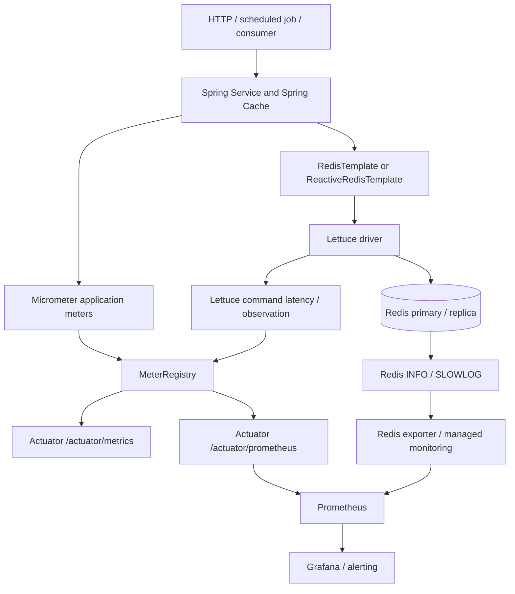
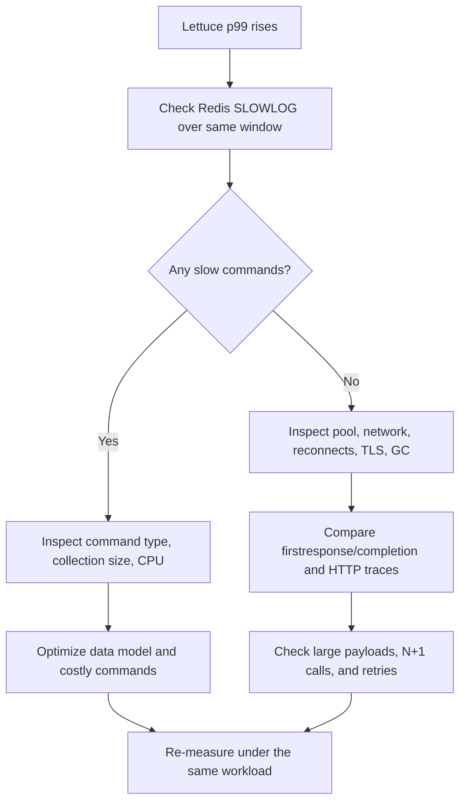

# Integrating Micrometer, Actuator, and Driver Metrics

When a **Spring Data Redis** application runs slowly, sees rising timeouts, or throws errors after failover, knowing only "Redis is alive" is not enough. A single HTTP request might wait for a connection, issue dozens of Redis commands, receive a large payload, deserialize data inside the JVM, or repeatedly miss the cache even while zero commands appear in the Redis Slow Log.

To isolate the root cause, you must observe from **business code**, through **Spring Data Redis and the driver**, down to the **Redis Server**. In a Spring Boot application, three pieces commonly work together:

- **Micrometer:** a vendor-neutral instrumentation model offering meters such as `Counter`, `Timer`, `Gauge`, and histograms, along with the `Observation` and tracing ecosystem.
- **Spring Boot Actuator:** auto-configures many observability components and exposes endpoints like `/actuator/health`, `/actuator/metrics`, and `/actuator/prometheus`.
- **Redis driver**, typically **Lettuce**: records Redis command latencies and observations, covering time to first response and time to command completion.

This lesson explains how to configure and read metrics, measure application operations, observe Redis caches and the driver, ship metrics to Prometheus, correlate traces, control cardinality, and distinguish Redis Server issues from network/client issues.

> **Principle:** Actuator is not Prometheus; `RedisHealthIndicator` is not a p99 latency monitor; and a fast Redis command does not prove a multi-step business operation is fast. Each layer has its own observability contract.

## 1. Architecture for Observing Redis from Application to Server



The arrows show measurement paths **you can wire up**—they do not all appear automatically simply by adding a single dependency. Redis Server metrics require a server-side source; driver metrics require enabling the corresponding instrumentation.

### 1.1. Four Layers to Distinguish

| Layer | Questions to Answer | Appropriate Measurement Source |
| --- | --- | --- |
| **Application/cache** | How many cache hits/misses? How long does `loadProduct` take? | Business metrics, `CacheManager` metrics when supported |
| **Driver** | Are `GET`, `SET`, `HGETALL` responding slowly? | Lettuce command latency recorder, driver events |
| **Redis Server** | CPU, memory, eviction, replication lag, slow commands? | Redis `INFO`, `SLOWLOG`, server exporter |
| **End-to-end request** | Is the HTTP request slow due to Redis, SQL, network, or JVM? | HTTP metrics, tracing, correlation IDs |

A single isolated metric rarely suffices for diagnosis. For example, Redis `GET` may take only 2 ms, yet one request issuing 100 sequential `GET` calls can become markedly slow.

## 2. Micrometer Concepts

Micrometer lets an application emit metrics through one consistent API and export them to many monitoring backends. Its core abstraction is `MeterRegistry`.

| Meter Type | Used to Measure | Examples |
| --- | --- | --- |
| `Counter` | Monotonically increasing event counts | Retries, timeouts, cache misses |
| `Timer` | Count and duration of operations | Redis command latency, product lookup flow |
| `DistributionSummary` | Distribution of non-time values | Payload bytes, batch sizes |
| `Gauge` | Current value that can go up or down | Backlog depth, pending task count |
| `LongTaskTimer` | Count and duration of long-running jobs | Backfills, maintenance tasks |

Example creating a counter:

```java
import io.micrometer.core.instrument.Counter;
import io.micrometer.core.instrument.MeterRegistry;

Counter misses = Counter.builder("app.redis.cache.lookups")
        .description("Cache lookups recorded by the application")
        .tag("cache", "productName")
        .tag("result", "miss")
        .register(meterRegistry);

misses.increment();
```

`app.redis.cache.lookups` is a **custom metric**, not a built-in default metric name from Spring Data Redis.

### 2.1. Metric Tags and Cardinality

Tags should have bounded sets of values:

```text
cache     = products | sessions
command   = GET | SET | HGET
operation = loadProduct | reserveInventory
result    = success | timeout | error
```

Avoid:

```text
userId   = u-389123
key      = cart:tenant-12:user-389123
traceId  = a new ID per request
session  = random session
```

In Micrometer, each unique **metric name + tag combination** generally creates a separate meter/time series. Attaching user IDs, Redis keys, or request IDs explodes time-series counts, consumes JVM and monitoring RAM, and risks leaking sensitive data.

**Metric tags are for low-cardinality dimensions**; per-request diagnostic details belong in access-controlled traces or logs.

## 3. Actuator: Endpoints, Health, and Metrics

Spring Boot Actuator provides helpful endpoints:

| Endpoint | Contents | Limitations |
| --- | --- | --- |
| `/actuator/health` | Health indicator status, optionally including Redis | Does not measure latency percentiles |
| `/actuator/metrics` | List of collected meters and measurements | Not Prometheus scrape format |
| `/actuator/prometheus` | Prometheus-formatted metrics when registry is present | Does not generate Redis server-side metrics automatically |
| `/actuator/caches` | Caches known to Spring | Does not inherently include hit/miss stats across every provider |
| `/actuator/info` | Configured application metadata | Does not replace Redis monitoring |

**Endpoint exposure** and **endpoint access** are two separate concerns. Exposing an endpoint does not automatically configure authentication or authorization. In production, never expose all Actuator endpoints openly to the Internet.

### 3.1. Health UP Does Not Mean Redis Is Fast

The Redis health indicator checks connectivity and returns a corresponding status. An overloaded Redis can still return `UP` while p99 latency climbs. Conversely, a health check can time out briefly during failover even as the application recovers right afterward.

Therefore:

- Use **health** for readiness/availability per your operational contract.
- Use **driver timers** to observe command latency.
- Use **server metrics/Slow Log** to pinpoint Redis-side causes.
- Use **HTTP/business timers and traces** to measure application experience.

Never treat a health indicator as a test of write durability across replication or failover.

## 4. Dependencies for Spring Boot + Redis + Actuator

Example for Spring Boot 3.x, Java 17+, and Lettuce:

```groovy
// build.gradle
dependencies {
    implementation 'org.springframework.boot:spring-boot-starter-data-redis'
    implementation 'org.springframework.boot:spring-boot-starter-actuator'
    implementation 'org.springframework.boot:spring-boot-starter-cache'

    runtimeOnly 'io.micrometer:micrometer-registry-prometheus'

    testImplementation 'org.springframework.boot:spring-boot-starter-test'
}
```

This assumes the project uses Spring Boot dependency management to align versions. If you do not use Spring Cache, omit the cache starter. If you only need `/actuator/metrics` for local diagnostics, the Prometheus registry is optional.

**Version note:** Spring Boot 3.x and 4.x may differ in auto-configuration, tracing dependencies, and certain properties; consult the reference documentation matching your exact version before applying changes.

### 4.1. Application Configuration

```yaml
# application.yml
spring:
  application:
    name: catalog-service
  data:
    redis:
      host: localhost
      port: 6379
      connect-timeout: 2s
      timeout: 3s

management:
  endpoints:
    web:
      exposure:
        include: "health,info,metrics,prometheus,caches"
  endpoint:
    health:
      show-details: when_authorized
  metrics:
    tags:
      application: ${spring.application.name}
```

`localhost` is for local development. In production, configure real endpoints, authentication, TLS, and topology.

`management.metrics.tags.application` is a low-cardinality tag helpful when multiple applications export metrics together.

Key points:

1. Both `micrometer-registry-prometheus` and exposing `prometheus` are required for scraping to work.
2. Security or network rules may block endpoints with 401/403 even when exposed.
3. Never publish health details or sensitive endpoints publicly.
4. Redis driver settings and metric instrumentation can depend on how the `LettuceConnectionFactory` bean is constructed.

## 5. Reading Metrics via Actuator

Once the application starts and real Redis traffic flows:

```sh
curl -s http://localhost:8080/actuator/health
curl -s http://localhost:8080/actuator/metrics
curl -s http://localhost:8080/actuator/prometheus
```

`/actuator/metrics` lists **meter names currently registered**. To inspect a specific meter:

```sh
curl -s "http://localhost:8080/actuator/metrics/lettuce.command.completion"
```

Filter by a tag:

```sh
curl -s "http://localhost:8080/actuator/metrics/lettuce.command.completion?tag=command:GET"
```

Query only meters **actually present in the list**, because exact metric names and tags depend on Lettuce version, instrumentation configuration, and whether commands have completed yet.

### 5.1. Micrometer Meter Names Differ from Prometheus Export Names

Example original Timer:

```text
lettuce.command.completion
```

When exported to Prometheus, you may see series such as:

```text
lettuce_command_completion_seconds_count
lettuce_command_completion_seconds_sum
lettuce_command_completion_seconds_max
```

If **histograms** are enabled, you may also see:

```text
lettuce_command_completion_seconds_bucket
```

Exact names and suffixes depend on registry and version; `_bucket` **does not appear automatically** unless histogram publishing is turned on. When querying Actuator's metrics selector, use the **original meter name**, not the Prometheus-converted name.

## 6. How Does Lettuce Measure Redis Command Latency?

Lettuce provides command latency recording with Micrometer integration. With `MicrometerCommandLatencyRecorder`, two core Timers are:

| Timer | Description | Analytical Meaning |
| --- | --- | --- |
| `lettuce.command.firstresponse` | Elapsed time until the **first response** | Initial responsiveness seen by the driver |
| `lettuce.command.completion` | Elapsed time until **command completion** | Full completion latency recorded by the driver |

For commands returning a small single reply, both durations are close. For large replies or multi-part streaming commands, `completion` can noticeably exceed `firstresponse`.

**Do not interpret Lettuce Timers as pure Redis Server CPU time.** They measure at the driver level and include connection paths, queuing, network, reply handling, and related overhead. To inspect server command execution, check server telemetry like `SLOWLOG` and `INFO commandstats`.

### 6.1. Common Default Tags

| Tag | Example | Purpose |
| --- | --- | --- |
| `command` | `GET`, `SET`, `HGETALL` | Distinguishes Redis command |
| `local` | `ANY` or local socket address | Distinguishes local connections when enabled |
| `remote` | `redis-a:6379` | Distinguishes Redis endpoint |

Lettuce can collapse connections targeting the same remote endpoint to avoid high cardinality; enabling per-local-socket distinction can inflate series counts when connections reconnect frequently.

In Redis Cluster and failover scenarios, the set of remote endpoints can change. Monitor total time-series counts, especially when adding custom tags.

## 7. Spring Boot Auto-Configuration and Its Limits

When Spring Boot creates a `LettuceConnectionFactory` alongside the appropriate Micrometer infrastructure, Boot can auto-configure Lettuce instrumentation. In Spring Data Redis 3.5 documentation, `LettuceMetricsAutoConfiguration` is noted as setting up `MicrometerCommandLatencyRecorder`.

Recommended workflow before configuring manually:

1. Add the Redis starter, Actuator, and required metrics registry.
2. Let Spring Boot auto-configure the Redis connection factory.
3. Run a few real commands via `StringRedisTemplate`.
4. Inspect `/actuator/metrics` and `/actuator/prometheus`.
5. Configure the driver recorder manually only if customization is required or auto-configuration does not cover your setup.

**There is no universal guarantee** that simply adding Actuator causes `lettuce.command.*` Timers to appear across every Spring Boot version, driver, or custom-built `RedisConnectionFactory`.

If using **Jedis** instead of Lettuce, do not expect metrics named `lettuce.command.completion`. Rely on Jedis-specific instrumentation or application-layer metrics.

## 8. Manually Configuring MicrometerCommandLatencyRecorder

Lettuce provides `MicrometerOptions` and `MicrometerCommandLatencyRecorder`.

```java
import io.lettuce.core.metrics.MicrometerCommandLatencyRecorder;
import io.lettuce.core.metrics.MicrometerOptions;
import io.lettuce.core.resource.ClientResources;
import io.micrometer.core.instrument.MeterRegistry;

// registry is the Spring-injected MeterRegistry.
MicrometerOptions options = MicrometerOptions.create();

ClientResources resources = ClientResources.builder()
        .commandLatencyRecorder(
                new MicrometerCommandLatencyRecorder(registry, options))
        .build();
```

Creating the recorder is not enough: you must wire **that exact `ClientResources`** into the connection factory handling Redis traffic.

### 8.1. Manual Spring Configuration Example

```java
package com.example.observability;

import io.lettuce.core.metrics.MicrometerCommandLatencyRecorder;
import io.lettuce.core.metrics.MicrometerOptions;
import io.lettuce.core.resource.ClientResources;
import io.micrometer.core.instrument.MeterRegistry;
import org.springframework.context.annotation.Bean;
import org.springframework.context.annotation.Configuration;
import org.springframework.data.redis.connection.RedisStandaloneConfiguration;
import org.springframework.data.redis.connection.lettuce.LettuceClientConfiguration;
import org.springframework.data.redis.connection.lettuce.LettuceConnectionFactory;

@Configuration
public class ManualLettuceMetricsConfiguration {

    @Bean(destroyMethod = "shutdown")
    public ClientResources clientResources(MeterRegistry registry) {
        return ClientResources.builder()
                .commandLatencyRecorder(
                        new MicrometerCommandLatencyRecorder(
                                registry, MicrometerOptions.create()))
                .build();
    }

    @Bean
    public LettuceConnectionFactory redisConnectionFactory(
            ClientResources resources) {

        RedisStandaloneConfiguration server =
                new RedisStandaloneConfiguration("localhost", 6379);

        LettuceClientConfiguration client =
                LettuceClientConfiguration.builder()
                        .clientResources(resources)
                        .build();

        return new LettuceConnectionFactory(server, client);
    }
}
```

This is **an alternative** to Boot's auto-configured connection, not an instruction to add a second competing connection factory. When defining the factory manually, carry over your existing authentication, TLS, Sentinel, Cluster, timeout, topology refresh, and lifecycle settings.

Never create a separate `ClientResources` per HTTP request. Never attach multiple recorders measuring the same traffic and sum their numbers as if each represented a distinct Redis command.

### 8.2. MicrometerOptions Settings

| Option | Effect | Trade-off |
| --- | --- | --- |
| `histogram` | Enables histograms for latency distribution analysis | More series/buckets |
| `targetPercentiles` | Configures driver-computed percentiles | Requires understanding export and aggregation |
| `localDistinction` | Distinguishes local connections/sockets | Increases cardinality on reconnects |
| `minLatency`, `maxLatency` | Expected latency bounds for histograms | Should match real SLOs |
| `tags` | Adds static/low-cardinality tags | Unbounded tags risk millions of series |

Enabling histograms across every command and endpoint can consume substantial memory. Select only meters where p95/p99 is truly needed and check series counts.

## 9. Micrometer Observation and Distributed Tracing

Metrics reveal **overall trends**. Tracing shows what **a specific request** actually did.

```text
GET /products/P-101
  |
  +-- Spring Cache lookup
        |
        +-- Redis GET productCards::P-101
  |
  +-- Database SELECT (on cache miss)
  |
  +-- Redis SET cache entry
```

Micrometer Observation can produce both meters and spans when handlers/bridges are configured. Spring Data Redis leverages Lettuce integration to observe Redis commands.

### 9.1. MicrometerTracing in Lettuce

Spring Data Redis documentation illustrates integration using `MicrometerTracing`:

```java
import io.lettuce.core.resource.ClientResources;
import io.lettuce.core.tracing.MicrometerTracing;
import io.micrometer.observation.ObservationRegistry;

// observationRegistry is a Spring-injected bean.
ClientResources resources = ClientResources.builder()
        .tracing(new MicrometerTracing(
                observationRegistry, "catalog-redis"))
        .build();
```

`resources` must be passed into the active `LettuceClientConfiguration`. When Spring Boot already auto-configures tracing/observability, **verify the resulting spans before introducing competing manual configuration**.

Older guides use `MicrometerTracingAdapter`; newer Spring Data Redis versions recommend Lettuce's `MicrometerTracing` instead.

### 9.2. Tracing Requires an Exporter and Sampling

To export traces to an OpenTelemetry Collector, Jaeger, Zipkin, or compatible backend, you need:

1. Instrumentation creating observations/spans.
2. A supported tracing bridge/tracer.
3. Exporter and backend endpoint configuration.
4. A sampling policy.
5. Proper context propagation across threads and reactive signals.

Example depending on Spring Boot version:

```yaml
management:
  tracing:
    sampling:
      probability: 0.1
```

This is an illustrative sampling probability, not an instruction to send only 10% of Redis commands. Sampling too aggressively can cause heavy export and storage costs under high traffic.

**Actuator `/actuator/metrics` is not a trace viewer.** Traces go to a dedicated tracing backend.

## 10. Redis Driver Metrics Differ from Redis Server Metrics

| Question | Appropriate Metric Source |
| --- | --- |
| How long did `GET` wait from Java? | Lettuce command completion/firstresponse Timer |
| Is Redis CPU nearing saturation? | Redis `INFO cpu` or exporter |
| Is Redis evicting keys due to low memory? | `INFO stats`, server metrics |
| Are slow commands running on the server? | Redis `SLOWLOG` |
| Cache hit ratio? | Cache metrics or cache-layer lookup instrumentation |
| How many retries/timeouts occurred? | Application/driver instrumentation or custom counters |
| Which step made a request slow? | Distributed tracing and business timers |
| Is a replica lagging? | `INFO replication` / server exporter |

Actuator does not automatically collect all Redis server stats and emit per-instance Redis metrics solely because the Redis starter is present.

### 10.1. Redis Commands for Cross-Checking

```redis
INFO server
INFO clients
INFO cpu
INFO memory
INFO stats
INFO commandstats
INFO replication
SLOWLOG GET 20
LATENCY LATEST
```

Helpful signals:

- `used_memory`, fragmentation, `maxmemory`.
- `evicted_keys`, `expired_keys`.
- `connected_clients`, `blocked_clients`.
- `cmdstat_get`, `cmdstat_set`, and server execution times.
- Replica link status, replication offset/lag.
- Commands appearing in the Redis Slow Log.

On managed Redis, some commands or metrics may be restricted, so use the provider's monitoring integration. On Redis Cluster, inspect every relevant primary and replica.

## 11. Slow Log Is Not End-to-End Command Latency

The Redis Slow Log measures **server command execution time**, excluding:

```text
waiting for a pool connection
client-side queuing
network RTT
network reply transmission
JVM deserialization
service/business code execution
```

A scenario:

```text
HTTP p99                  = 420 ms
Lettuce GET completion    = 250 ms
Redis SLOWLOG             = no commands above 10 ms
```

There is no contradiction. The bottleneck may sit in the driver, network, pool, oversized replies, or JVM GC. Do not rush to scale up Redis CPU before identifying where time is actually spent.

### 11.1. Comparing firstresponse and completion

If `firstresponse` is close to `completion`, most latency occurred before or up to the first response byte. If `completion` is much higher, inspect response size, streaming, network/backpressure, and how data is consumed.

This is only a **diagnostic hint**, not an exact CPU-vs-network breakdown formula. Correlate with traces, server metrics, and payload sizes.

## 12. Cache Metrics: Do Not Infer Hits from GET Counts

With Spring Cache:

```java
@Cacheable(cacheNames = "productCards", key = "#p0")
public Product find(String id) {
    return repository.findById(id).orElseThrow();
}
```

On a cache hit, the Spring proxy interceptor **skips the method body**. A counter inside the method body counts body invocations, not every cache lookup.

```java
public Product find(String id) {
    // If @Cacheable hits, this line does not run.
    cacheMissCounter.increment();
    return repository.findById(id).orElseThrow();
}
```

Nor does that counter prove every body execution was a miss: self-invocation or `condition` expressions can bypass caching advice. To measure hit ratio accurately, instrument at a layer that actually knows **whether the cache lookup returned a hit or a miss**.

### 12.1. Spring Boot Cache Metrics

Spring Boot supports instrumentation for several Cache providers, including Redis when appropriately configured. Meters can be tagged with cache name and `CacheManager` name.

However:

- Some providers **do not expose full** hit/miss/size/eviction statistics.
- Caches created dynamically after Spring Boot binds metrics at startup may not auto-register; use `CacheMetricsRegistrar` if appropriate.
- Do not assume `cache.gets{result="hit"}` exists across every `RedisCacheManager` version.
- Inspect `/actuator/caches` and `/actuator/metrics` to confirm what is actually emitted.

Example declaring static cache names:

```yaml
spring:
  cache:
    type: redis
    cache-names: productCards,productDetails
```

If you need exact hit/miss tracking matching custom semantics, instrument a cache wrapper or manual cache class that directly observes lookup outcomes.

### 12.2. Manual Cache Example with Hit/Miss Counters

```java
package com.example.catalog;

import io.micrometer.core.instrument.Counter;
import io.micrometer.core.instrument.MeterRegistry;
import java.time.Duration;
import org.springframework.data.redis.core.StringRedisTemplate;
import org.springframework.stereotype.Service;

@Service
public class ProductNameCache {

    private final StringRedisTemplate redis;
    private final Counter hits;
    private final Counter misses;

    public ProductNameCache(
            StringRedisTemplate redis, MeterRegistry registry) {
        this.redis = redis;
        this.hits = Counter.builder("app.redis.cache.lookups")
                .tag("cache", "productName")
                .tag("result", "hit")
                .register(registry);
        this.misses = Counter.builder("app.redis.cache.lookups")
                .tag("cache", "productName")
                .tag("result", "miss")
                .register(registry);
    }

    public String findName(String id) {
        if (id == null || !id.matches("[A-Za-z0-9_-]{1,64}")) {
            throw new IllegalArgumentException("Invalid id");
        }

        String key = "cache:product-name:v1:" + id;
        String value = redis.opsForValue().get(key);

        if (value != null) {
            hits.increment();
            return value;
        }

        misses.increment();
        String loaded = "Product-" + id; // Illustrative data source.
        redis.opsForValue()
                .set(key, loaded, Duration.ofMinutes(10));
        return loaded;
    }
}
```

This is a **manual application-managed cache**, not Spring auto-instrumenting `@Cacheable`. A miss is defined as `GET` returning `null` per the service contract. If `GET` throws an exception, **do not** increment hit or miss—record a separate `error` metric.

Never use the product ID as a tag; keep it inside the Redis key under a controlled namespace.

## 13. Measuring End-to-End Operations with a Timer

A product read request may involve:

```text
Redis GET
Database SELECT on miss
Redis SET
Map DTO
Return HTTP
```

`lettuce.command.completion` measures individual Redis commands only. To time the business operation, add a dedicated Timer:

```java
package com.example.catalog;

import io.micrometer.core.instrument.MeterRegistry;
import io.micrometer.core.instrument.Timer;
import org.springframework.stereotype.Service;

@Service
public class CatalogObservedService {

    private final MeterRegistry registry;
    private final ProductNameCache cache;

    public CatalogObservedService(
            MeterRegistry registry,
            ProductNameCache cache) {
        this.registry = registry;
        this.cache = cache;
    }

    public String loadName(String id) {
        Timer.Sample sample = Timer.start(registry);
        try {
            return cache.findName(id);
        } finally {
            sample.stop(Timer.builder("app.catalog.lookup.duration")
                    .description("Duration of catalog lookup")
                    .tag("operation", "loadName")
                    .register(registry));
        }
    }
}
```

This Timer captures `loadName` duration, covering the cache lookup and subsequent steps. If you add `outcome=success|error`, record the right outcome even when exceptions occur, and never put exception messages into tags.

### 13.1. Units

Micrometer `Timer` maintains consistent time units and typically exports to Prometheus in **seconds**. Never manually append `_ms` and expect Prometheus to treat values as milliseconds.

For `DistributionSummary` measuring payload sizes, declare base unit `"bytes"` and never mix byte counts with element counts in the same meter.

## 14. HTTP Metrics, Redis Metrics, and the N+1 Problem

A service may invoke Redis inside a loop:

```java
public List<String> loadNames(List<String> ids) {
    return ids.stream()
            .map(cache::findName)
            .toList();
}
```

With 100 IDs and a separate `GET` per ID, a single HTTP request emits 100 Redis commands. Fast individual `GET`s do not guarantee a fast HTTP request.

Observe together:

| Metric | Question |
| --- | --- |
| HTTP request duration | How long does the user wait? |
| Lettuce command count/latency | How many `GET`s ran and how fast was each? |
| Application Timer | How long did `loadNames` take? |
| Tracing spans | Are commands running sequentially or in parallel? |
| DB metrics | Did cache misses increase SQL load? |

Do not tune Redis based on one isolated Timer when an N+1 command pattern is the real culprit.

## 15. Prometheus: Basic Query Expressions

With the Micrometer Prometheus registry, Timers typically export `_seconds_count`, `_seconds_sum`, and optionally `_seconds_bucket`.

### 15.1. GET Throughput

```promql
sum(rate(lettuce_command_completion_seconds_count{command="GET"}[5m]))
```

This yields `GET` commands **recorded by the Timer per second**, not HTTP requests/second or unique users.

### 15.2. Mean Completion Latency for GET

```promql
sum(rate(lettuce_command_completion_seconds_sum{command="GET"}[5m]))
/
sum(rate(lettuce_command_completion_seconds_count{command="GET"}[5m]))
```

This is a **mean** over a 5-minute window in seconds per Prometheus Timer format; it does not replace p95/p99.

### 15.3. p95 from Histograms

Once **histograms are enabled and `_bucket` series are verified**:

```promql
histogram_quantile(
  0.95,
  sum by (le, command) (
    rate(lettuce_command_completion_seconds_bucket{command="GET"}[5m])
  )
)
```

Without `_bucket`, enable histogram publishing or choose another source. Never run this query and mistake empty results for zero Redis traffic.

### 15.4. Custom Cache Hit Ratio

From the `ProductNameCache` example:

```promql
sum(rate(app_redis_cache_lookups_total{cache="productName",result="hit"}[5m]))
/
clamp_min(
  sum(rate(app_redis_cache_lookups_total{cache="productName"}[5m])),
  1e-9
)
```

This reflects only the **instrumented cache layer**, not automatically all Spring Caches in the application. If there were zero lookups in the window, display "insufficient data" instead of reporting a 0% hit ratio.

### 15.5. Why Never Average p95 Across Multiple JVMs?

A percentile is a property of a **distribution**, not a quantity you can combine via arithmetic mean.

```text
JVM A: p95 = 5 ms,    1,000 commands
JVM B: p95 = 80 ms, 100,000 commands
```

`(5 + 80) / 2` **is not the p95 of the combined 101,000 commands**. To compute an aggregate percentile, use histograms aggregated across matching buckets or a backend supporting distribution merging.

## 16. Pooling, Reconnects, and Driver Errors

Lettuce supports multiple connection models. Not every application needs a connection pool for standard Redis commands. If pooling is enabled, watch:

- Active, idle, and max connections.
- Connection borrow wait time.
- Timeouts when the pool is exhausted.
- Connection creation and destruction churn.
- Reconnects and connection resets per Redis endpoint.

**There is no guarantee** that a fixed pool meter name exists across every Spring Boot/Lettuce setup. Pool metrics depend on driver, pooling library like `commons-pool2`, configuration, and active binders.

### 16.1. Redis Server CPU Is Low Yet Client p99 Is High

Causes to check:

```text
waiting for connection
DNS/TLS handshake
network packet loss
Redis topology refresh
reconnect after failover
JVM GC pause
payload deserialization
retry backoff
```

Never just raise `spring.data.redis.timeout` and consider the issue solved. Longer timeouts can mask errors and hold requests open longer.

## 17. Redis Cluster and Sentinel: Break Down by Node

In Redis Cluster there are multiple primaries and replicas; Lettuce's `remote` tag identifies which endpoint handled each command when instrumentation is active.

```text
command=GET, remote=redis-a:6379
command=GET, remote=redis-b:6379
command=GET, remote=redis-c:6379
```

If only one node exhibits rising p99, look for hot slots, oversized collections, memory pressure, network issues, or resharding.

With Sentinel failover, the primary endpoint may switch from A to B. Series keyed by `remote` shift too: never see traffic drop on A and assume the system stopped writing to Redis.

### 17.1. Avoiding Cardinality Explosion from Local Sockets

When per-local-connection tracking is enabled, every reconnect or ephemeral port can create a new tag combination. Timer meters can linger in the registry even after old sockets close.

In connection-heavy environments, aggregate by endpoint and command unless per-socket diagnostics are genuinely needed. Monitor total meters/time series in both the JVM and Prometheus.

## 18. Metrics Do Not Guarantee Write Correctness

A command:

```redis
SET order:101:status PAID
```

can succeed on the old Redis primary yet be lost after failover if asynchronous replication had not propagated it to the promoted replica.

Lettuce Timers describe only **observed command duration**, not durability across failovers. Likewise, a timeout may occur after the server already executed the command, so never infer a write did not run.

For critical workflows, add:

- Stable operation IDs and idempotency.
- Outcome counters for `CONFIRMED`, `UNKNOWN`, and `REJECTED`.
- Retry counts and reconciliation backlog tracking.
- Outbox or Stream consumer lag, pending entries, and dead-letter counts.
- Server-side replication lag and failover tracking.

Good latency observability is essential, yet it never replaces business recovery mechanisms.

## 19. Designing Meaningful Custom Metrics

| Illustrative Name | Type | Bounded Tags | Meaning |
| --- | --- | --- | --- |
| `app.redis.operation.duration` | Timer | `operation`, `outcome` | Business operation duration involving Redis |
| `app.redis.cache.lookups` | Counter | `cache`, `result` | Application-measured hits/misses |
| `app.redis.timeouts` | Counter | `operation` | Timeout count |
| `app.redis.retries` | Counter | `operation`, `reason` | Retry count |
| `app.redis.unknown_writes` | Counter | `operation` | Uncertain write outcomes |
| `app.stream.pending` | Gauge | fixed-identity `group`, `stream` | Consumer backlog |
| `app.outbox.oldest_age` | Gauge | `publisher` | Age of oldest outbox record |

You do not have to create every metric. Each meter should drive a concrete action: alerting, optimization, or investigation.

### 19.1. A Gauge Must Never Become a Full Redis Scan

Anti-pattern:

```text
Gauge supplier:
  SCAN all keys
  GET each key
  count active sessions
```

Every Prometheus scrape becomes a heavy scan that can overload Redis right when you rely on monitoring most.

Instead use:

- Counts maintained on write paths.
- A budgeted background job caching its latest snapshot for the Gauge.
- Appropriate low-frequency cardinality commands such as `SCARD`/`ZCARD`.
- A Redis server exporter or managed monitoring.

## 20. Dashboard Panels Worth Having

**Application layer:** HTTP request p95/p99, error rate, cache hit ratio, `loadProduct` duration, retries, timeouts, and unknown writes.

**Lettuce layer:** command rate by command type, firstresponse/completion latency, p95/p99 if histograms are enabled, breakdown by `remote` endpoint, reconnects/errors if instrumented.

**Redis Server layer:** CPU, memory, evictions, blocked clients, commandstats, replication lag, and Slow Log.

**Workflow layer:** Streams pending/lag, DLQ depth, outbox backlog, reconciliation latency, and deduplicated event counts.

Dashboards must align **time ranges and units**. Keep per-second rates, raw counts, milliseconds/seconds, and percentages distinct.

## 21. Designing Context-Aware Alerts

| Signal | Goal | Check Alongside |
| --- | --- | --- |
| Command p99 rises for several minutes | Spot Redis/driver bottleneck | Traffic, CPU, Slow Log |
| Timeouts increase | Network or overload | Reconnects, health, pool |
| Hit ratio plunges | Cache miss storm or bad invalidation | DB load, deploy timeline |
| `evicted_keys` rises | Low memory or eviction policy | Memory, `maxmemory` |
| Replication lag rises | Stale reads and write-loss risk | Failover events |
| Stream pending rises | Slow or dead consumers | Consumer throughput, DLQ |
| Prometheus scrape lost | Telemetry unreliable | Target `up`, auth, network |

Base thresholds on SLOs and real traffic rather than treating p99 > 10 ms as an error everywhere. Avoid firing on single samples; use evaluation windows and minimum traffic gates.

## 22. Securing Actuator, Metrics, and Traces

Metrics can reveal service names, Redis endpoints, command mixes, cache names, traffic patterns, or sensitive content if tags are poorly designed.

Core rules:

1. Expose only operationally necessary endpoints.
2. Protect them via network segmentation, authentication/authorization, or a secured monitoring ingress.
3. If using a separate management port, restrict access to approved scrapers and operators.
4. Never expose endpoints such as `env`, `heapdump`, or `configprops` without strict controls.
5. Never embed Redis passwords, tokens, `userId`, `sessionId`, raw keys, or payloads in metrics.
6. Govern retention and access controls on traces, logs, and metrics.
7. Choose sensible sampling to avoid unbounded export costs.

`show-details: when_authorized` on health does not secure the rest of Actuator; configure security explicitly.

## 23. Troubleshooting When Lettuce Metrics Are Missing

### 23.1. Has the Application Actually Called Redis?

Many meters are registered **lazily on first traffic**. Right after Spring Boot boots with zero Redis commands yet executed, Timers may not exist yet.

Test on a test Redis:

```java
stringRedisTemplate.opsForValue().set(
        "lesson:metrics:ping",
        "ok",
        java.time.Duration.ofMinutes(1));

String value = stringRedisTemplate.opsForValue()
        .get("lesson:metrics:ping");
```

Then recheck `/actuator/metrics`.

### 23.2. Is the Actuator Endpoint Exposed?

If `/actuator/metrics` returns 404, the endpoint may not be exposed or accessible—not necessarily broken Lettuce instrumentation. Check dependencies, properties, and security rules.

### 23.3. Which Driver Is Active?

An application running Jedis will not emit Lettuce-specific meters. Verify which connection factory Spring injects and what is on the classpath.

### 23.4. Was the Connection Factory Created Manually?

A manually instantiated `LettuceConnectionFactory` may bypass auto-configured instrumented `ClientResources`. Confirm the factory handling live traffic carries the expected latency recorder.

### 23.5. Was the Metric Filtered or Disabled?

`MeterFilter`, `management.metrics.enable`, or registry configuration can suppress meters. The Prometheus exporter cannot emit meters blocked in the registry.

### 23.6. Wrong Meter Name?

Actuator uses original Micrometer names like `lettuce.command.completion`, whereas Prometheus converts them to snake case with unit suffixes. Check `/actuator/metrics` directly instead of guessing names.

### 23.7. Version Differences from Documentation?

Different Spring Boot 3.x/4.x and Lettuce releases can change auto-configuration, observation names, tags, and tracing setup. Always verify against the documentation for **the exact version you run**.

## 24. Investigating High p99 When the Redis Slow Log Is Empty



A solid investigation workflow should:

- Align clocks and time zones between the application and monitoring.
- Identify the Redis endpoint via the `remote` tag.
- View p99 **alongside throughput and error rate**, never trusting percentiles on tiny sample counts.
- Check Redis payload and collection sizes.
- Remember a single business operation can execute multiple Redis commands and retries.

## 25. Testing Metrics Inside the Spring Context

An integration test can verify meters are registered **after real Redis commands run through the instrumented connection factory**.

```java
// Example in @SpringBootTest using a test Redis backend.
@Autowired StringRedisTemplate redis;
@Autowired MeterRegistry registry;

@Test
void lettuceMetricsAppearAfterRedisCommands() {
    redis.opsForValue().set("test:metrics:key", "ok");
    redis.opsForValue().get("test:metrics:key");

    // This assertion is meaningful only when the test enables
    // Lettuce's MicrometerCommandLatencyRecorder.
    assertThat(registry.find("lettuce.command.completion")
            .meters()).isNotEmpty();
}
```

JUnit 5, AssertJ, Micrometer, and Spring Test imports are omitted for readability. Such a test needs **a real Redis via Testcontainers or a dedicated test instance**, not a mocked `RedisTemplate`. Never run write tests against production Redis.

You can also verify HTTP Actuator endpoints in a test environment:

```sh
curl -s "http://localhost:8080/actuator/metrics"
curl -s "http://localhost:8080/actuator/metrics/lettuce.command.completion"
curl -s "http://localhost:8080/actuator/prometheus"
```

If a meter is absent, check driver, configuration, and traffic first before concluding instrumentation is broken.

## 26. Common Misconceptions

### 26.1. "Adding Actuator Automatically Gives All Redis Server Metrics"

False. Actuator/Micrometer primarily observe the application and driver. Redis CPU, memory, evictions, and replication lag require a Redis-side source or exporter.

### 26.2. "Health UP Means Redis Isn't Slow"

False. Health checks can pass while p99 latency climbs sharply.

### 26.3. "Lettuce Command Timer Equals Redis CPU Time"

False. It records driver-observed duration, including factors outside server execution.

### 26.4. "Every Timer Automatically Has Histogram Buckets"

False. `_bucket` series appear only when histogram publishing is configured; Timers do not emit them by default.

### 26.5. "Averaging p95 Across JVMs Gives System-Wide p95"

False. Percentiles cannot be averaged; merge distributions via histograms.

### 26.6. "One Lettuce GET Equals One Spring Cache Hit"

False. `GET` may return null, serve non-cache logic, or come from lookups bypassing Spring Cache.

### 26.7. "Tagging userId or Key Helps Debugging"

Avoid this. It drives high cardinality, inflates metric costs, and risks exposing data.

### 26.8. "Missing Meters Mean Zero Redis Traffic"

Not necessarily. Driver, configuration, registry filters, or endpoints may differ, or instrumentation may be disabled.

### 26.9. "100% Tracing Sampling Is Always Better"

No. Full sampling carries heavy resource and storage costs; tune to traffic and needs.

### 26.10. "A Success Command Metric Guarantees No Write Loss"

No. Writes acknowledged by a primary can still be lost after failover under asynchronous replication.

### 26.11. "Enabling Distinction for Every Local Connection Is Optimal"

No. Reconnects spawn extra sockets and series, multiplying metric counts rapidly.

### 26.12. "You Can SCAN All of Redis on Every Prometheus Scrape"

Avoid this. A Gauge supplier or metrics endpoint running full scans on every scrape can overload Redis.

## 27. Implementation Checklist

1. Confirm exact versions of Spring Boot, Spring Data Redis, and Lettuce.
2. Add Actuator and the required metrics registry/exporter.
3. Expose only needed endpoints; secure them via network and authentication.
4. Confirm the app uses Lettuce if you intend to track `lettuce.command.*`.
5. Generate real Redis traffic and inspect registered meters at `/actuator/metrics`.
6. Separate client timers, server metrics, cache hits/misses, and business timers.
7. Keep tags low-cardinality; never include user IDs or raw Redis keys.
8. When cross-instance p95/p99 is needed, design histogram buckets and watch series cost.
9. Collect Redis Server metrics and Slow Log to compare against client telemetry.
10. Track timeouts, reconnects, retries, and unknown write outcomes.
11. Never execute full Redis scans inside a Gauge supplier.
12. Track server node/role across Cluster or Sentinel failovers.
13. Re-verify metric availability after upgrading dependencies.
14. Write runbooks for rising p99, missing meters, cache miss storms, and failovers.

## 28. Summary

**Micrometer, Actuator, and Lettuce** bring multi-layered visibility to Redis: Micrometer standardizes meters and observations; Actuator exposes operational endpoints; Lettuce records **first-response latency**, **completion latency**, and Redis spans when instrumented. Paired with Prometheus, tracing, and Redis Server stats, applications gain the signals needed to distinguish slow commands, client queuing, network issues, cache misses, hot keys, and failover disruptions.

What determines monitoring quality is **measuring the right thing**: health is not latency, a driver Timer is not server CPU, `GET` count is not cache hits, and metrics do not prove write durability. Stick to low-cardinality tags, secure Actuator, verify exported meters on your actual version, and keep instrumentation overhead within operational budgets.

### References

- [Spring Data Redis — Observability](https://docs.spring.io/spring-data/redis/reference/observability.html): Lettuce, Micrometer, Redis command observations, and configuration.
- [Spring Boot — Actuator Metrics](https://docs.spring.io/spring-boot/reference/actuator/metrics.html): `MeterRegistry`, cache metrics, Prometheus, and distribution configuration.
- [Spring Boot — Actuator Endpoints](https://docs.spring.io/spring-boot/reference/actuator/endpoints.html): endpoint exposure, access, and security.
- [Spring Boot — Observability](https://docs.spring.io/spring-boot/reference/actuator/observability.html): metrics, logging, tracing, and `ObservationRegistry`.
- [Spring Boot — Tracing](https://docs.spring.io/spring-boot/reference/actuator/tracing.html): Micrometer Tracing, exporters, and sampling.
- [Lettuce — Observability](https://redis.github.io/lettuce/advanced-usage/observability/): `MicrometerCommandLatencyRecorder`, timers, and tags.
- [Redis — INFO](https://redis.io/docs/latest/commands/info/): grouped server statistics.
- [Redis — SLOWLOG](https://redis.io/docs/latest/commands/slowlog/): server-side command execution times.
- [Micrometer — Reference](https://docs.micrometer.io/micrometer/reference/): Counter, Timer, Observation, and metric backends.
