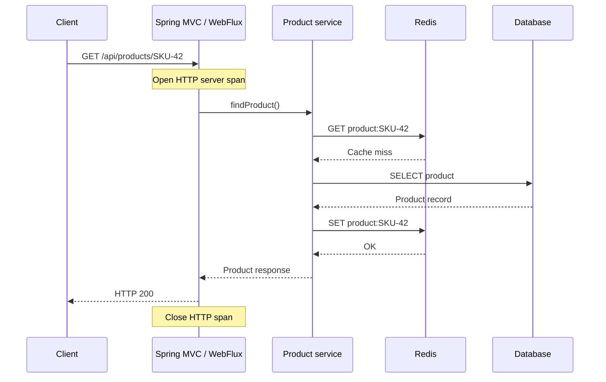
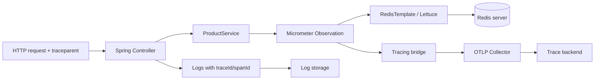

# Correlating Request Traces with Redis Operations in Spring Data Redis

## 1. The Problem: Is a Request Slow Because of the Application or Because of Redis?

A slow API response does not mean the Redis server itself executed commands slowly. During a single Spring Boot request, the application may perform authentication, run SQL queries, read a Redis cache, decode JSON, invoke another HTTP service, and serialize the response.

Example:

```text
GET /api/products/SKU-42
  ├── Request authentication              5 ms
  ├── Redis lookup                       80 ms
  │    ├── Acquire connection / queuing  35 ms
  │    ├── Network + Redis GET            3 ms
  │    └── Deserialize JSON payload      42 ms
  ├── On cache miss: query database     120 ms
  └── Build HTTP response                 6 ms
```

If you only inspect `INFO commandstats` or Redis `SLOWLOG`, `GET` looks fast and cannot explain the 80 ms on the application side. Conversely, looking only at an access log entry `GET /api/products... duration=211ms` does not tell you which step caused the delay.

**Distributed tracing** stitches stages into **the same request trace** (*trace*). Each meaningful stage becomes a **span** carrying duration, parent–child links, status, and bounded attributes. When Spring Data Redis is properly instrumented, Redis spans appear underneath the request span, revealing which Redis operation contributed latency or errors.

Goals of this lesson:

1. Understand `trace ID`, `span ID`, parent–child links, and correlation IDs.
2. Link inbound HTTP requests to services, Redis commands, and surrounding steps.
3. Configure Micrometer Observation/Tracing with OpenTelemetry in a Spring Boot app.
4. Distinguish automatic driver instrumentation from manual spans wrapping Redis operations.
5. Preserve trace context across WebFlux, Reactor, `@Async`, and messaging boundaries.
6. Track Redis Cache hits/misses without leaking sensitive keys or values.
7. Design safe sampling, cardinality, error tagging, and retention.
8. Verify with real exported traces rather than guessing from logs or dependencies.

## 2. How Do Trace, Span, and Correlation ID Differ?

A **trace** represents a causally linked chain of work, potentially spanning multiple services.

A **span** represents a single segment of that work: handling an HTTP request, querying a database, executing Redis `GET`, evaluating a cache miss, or calling a downstream API.

Example:

```text
Trace ID: aaaaaaaaaaaaaaaaaaaaaaaaaaaaaaaa
  Span HTTP GET /api/products/{sku}      [SERVER]  140 ms
    └── Span ProductService.findBySku     [INTERNAL] 133 ms
         ├── Span Redis GET               [CLIENT]   12 ms
         └── Span SQL SELECT              [CLIENT]  110 ms
```

Key concepts:

| Concept | Meaning | Characteristics |
| --- | --- | --- |
| `traceId` | Identifier for the entire related execution flow | All spans in the same trace share the same trace ID |
| `spanId` | Identifier for one individual stage | Each span has its own span ID |
| `parentSpanId` | Link to the parent span | Used to reconstruct the timeline tree |
| `SpanKind.SERVER` | Stage handling an incoming call | e.g. HTTP server handling a request |
| `SpanKind.CLIENT` | Stage calling an external system | e.g. HTTP client, Redis client |
| `SpanKind.INTERNAL` | Internal application work | e.g. computation or service method |
| Business correlation ID | ID used to match business flows or support cases | May be a request ID/order ID; not required to be a trace ID |

**A trace ID is not a Redis key, cache key, or business transaction ID.** Never embed trace IDs into Redis key names just for correlation: doing so breaks cache sharing, explodes key cardinality, and complicates queries.

A business correlation ID may live for days, whereas a trace covers a single observed request or workflow. Keep the two IDs for their distinct purposes.

## 3. Where Do Redis Spans Sit Inside a Trace?

Consider a cache-backed read request:



A properly linked trace can look like:

```text
HTTP GET /api/products/{sku}      SERVER
└─ ProductService.findProduct     INTERNAL
   ├─ Redis GET                   CLIENT
   ├─ DB SELECT                   CLIENT
   └─ Redis SET                   CLIENT
```

What you verify is **the same trace ID and valid parent relationships**, not merely three log lines containing the word `Redis`.

In an app using auto-instrumentation, HTTP, SQL, and Redis spans may come from different libraries. Note carefully: **not every Spring Boot, Spring Data Redis, or Lettuce version creates Redis spans automatically just because a tracing dependency is present**. Verify your version's actual observability configuration and inspect real exported traces.

## 4. Observability Architecture with Spring Data Redis

Layers that may participate:

| Layer | Common Tools | Responsibility |
| --- | --- | --- |
| HTTP request | Spring MVC/WebFlux instrumentation | Creates server span, extracts inbound trace context |
| Service | Micrometer Observation or OpenTelemetry API | Creates business-level spans to observe |
| Redis client | Spring Data Redis/driver integration or custom observation | Tracks Redis command/client latency |
| Outbound HTTP | Instrumented HTTP client | Propagates trace context to downstream services |
| Metrics | Micrometer Registry, e.g. Prometheus | Measures latency, counts, hit/miss, and errors over bounded tags |
| Tracing bridge | Micrometer Tracing + OpenTelemetry bridge | Translates observations into trace/span backends |
| Exporter | OTLP exporter/collector | Ships spans to the collection backend |
| Backend | Jaeger, Tempo, Zipkin, or equivalent | Searches by trace ID and renders timelines |
| Logs | SLF4J/MDC and log aggregation | Finds logs by trace ID / span ID |

Overall flow:



This diagram does not imply the Redis server itself sends spans to the collector. Most Redis command spans are recorded **on the client side**, wrapping the Redis call. To inspect detailed server-internal events, rely on Redis metrics, slow logs, latency monitoring, and operational tools.

## 5. What a Redis Client Span Measures—and What It Does Not

A client span can measure:

- Elapsed time from when the library starts the command until a result or error returns.
- Command or operation group: `GET`, `SET`, `HGETALL`...
- Logical Redis connection endpoint if recorded by instrumentation.
- Error category, timeout, retry, or call cancellation.
- Relationship of the command to the active HTTP request.

Yet a client span usually **cannot separate precisely**:

```text
60 ms total:
  10 ms waiting for connection/resource
  15 ms in client queue
   3 ms Redis server execution
  12 ms network
  20 ms decoding JSON
```

Exact coverage depends on where instrumentation attaches. Wrapping `RedisTemplate.get()` may include serialization/deserialization. Driver-deep instrumentation may measure only the command itself without service-level object encoding. Never label an unsplit client-side measurement as `redis.server.time`.

Instead combine:

1. **Client-side traces** to see which request called Redis, when, and for how long.
2. **Application metrics** for cache hits/misses, serializer latency, and queue waits.
3. **Redis server metrics** such as CPU, commandstats, network, connections, and slowlog.
4. **Topology events** when Sentinel or Cluster fails over or swaps nodes.

## 6. Spring Boot: Preparing the Tracing Stack

Modern Spring Boot applications typically use Micrometer Observability with an OpenTelemetry tracing bridge. Maven example:

```xml
<dependencies>
    <dependency>
        <groupId>org.springframework.boot</groupId>
        <artifactId>spring-boot-starter-web</artifactId>
    </dependency>

    <dependency>
        <groupId>org.springframework.boot</groupId>
        <artifactId>spring-boot-starter-data-redis</artifactId>
    </dependency>

    <dependency>
        <groupId>org.springframework.boot</groupId>
        <artifactId>spring-boot-starter-actuator</artifactId>
    </dependency>

    <dependency>
        <groupId>io.micrometer</groupId>
        <artifactId>micrometer-tracing-bridge-otel</artifactId>
    </dependency>

    <dependency>
        <groupId>io.opentelemetry</groupId>
        <artifactId>opentelemetry-exporter-otlp</artifactId>
    </dependency>
</dependencies>
```

This assumes a Spring Boot stack with dependency management; WebFlux apps can swap the MVC starter for `spring-boot-starter-webflux`. Verify exact artifact names, auto-configuration behavior, and versions against your Spring Boot release.

An illustrative `application.yml`:

```yaml
spring:
  application:
    name: catalog-service
  data:
    redis:
      host: localhost
      port: 6379

management:
  tracing:
    sampling:
      probability: 1.0
  otlp:
    tracing:
      endpoint: http://localhost:4318/v1/traces
```

Explanation:

- `spring.application.name` identifies the service in the trace backend.
- Sampling `1.0` is helpful in **local/test** environments so every request appears.
- The OTLP endpoint points to a collector/backend accepting traces over HTTP. Adjust port and protocol to match your collector.
- In production, do not default to 100% sampling because span volume and storage costs can grow huge.

**Note:** Configuring HTTP tracing does not guarantee the Redis driver is instrumented. If requests show up without Redis client spans, verify Spring Data Redis/Lettuce integration or add deliberate manual observations.

## 7. Verifying Inbound HTTP Traces Are Working

Before troubleshooting Redis spans, confirm HTTP requests carry trace context:

1. Send an HTTP request to a controller.
2. Check the backend for a server span such as `GET /api/products/{sku}`.
3. Verify application logs contain matching `traceId` and `spanId`.
4. If sending a `traceparent` header from a trusted upstream, confirm the service continues that trace per W3C standard or configured propagator.
5. Cross-check timestamps and service name.

Example W3C Trace Context header:

```http
traceparent: 00-aaaaaaaaaaaaaaaaaaaaaaaaaaaaaaaa-bbbbbbbbbbbbbbbb-01
```

Here:

- The 32-hex segment is the trace ID.
- The next 16-hex segment is the parent span ID passed across HTTP.
- The trailing flag byte represents sampling/trace flags per spec.

Do not invent an arbitrary `trace-id` header and expect tools to link automatically. Compliant tracing tools support W3C `traceparent`/`tracestate` per propagator configuration.

If no valid inbound context arrives, the service starts a fresh trace—which is normal for requests originating at that service.

## 8. Example Service Wrapping Redis Operations in Observation

A clean way to ensure a Redis call is observed is creating a **Micrometer Observation** in the service. This example uses `StringRedisTemplate` and a string-valued cache:

```java
package com.example.catalog;

import io.micrometer.observation.Observation;
import io.micrometer.observation.ObservationRegistry;
import org.springframework.data.redis.core.StringRedisTemplate;
import org.springframework.stereotype.Service;

@Service
public class CatalogCacheReader {

    private final StringRedisTemplate redis;
    private final ObservationRegistry observationRegistry;

    public CatalogCacheReader(
            StringRedisTemplate redis,
            ObservationRegistry observationRegistry) {
        this.redis = redis;
        this.observationRegistry = observationRegistry;
    }

    public String findStatus(String sku) {
        String key = "catalog:status:" + sku;

        return Observation
                .createNotStarted("app.redis.cache.read", observationRegistry)
                .contextualName("Catalog cache lookup")
                .lowCardinalityKeyValue("cache.name", "catalog-status")
                .lowCardinalityKeyValue("redis.operation", "GET")
                .observe(() -> redis.opsForValue().get(key));
    }
}
```

This snippet:

- Creates an observation around the `GET` call.
- Attaches a cache name and Redis operation from bounded sets.
- Lets the tracing bridge emit a span tied to the active observation when tracing is active.
- Records Redis exceptions per the observation handler while rethrowing them to the caller.
- Keeps raw SKUs and Redis keys out of span attributes.

If the controller request has an active server observation and propagation works properly, the cache-read observation appears as a child of the request/service span.

### Meaning of Manual Observation

The span in this example measures **the operation as seen from the service layer**. If automatic Redis instrumentation is also enabled, you may see:

```text
HTTP GET /api/products/{sku}
└─ Catalog cache lookup          (manual)
   └─ Redis GET                   (automatic)
```

This is not necessarily an error: one span represents the business cache lookup while the other reflects the Redis driver call. However, creating two spans describing the exact same scope clutters traces. Distinguish names and purposes to avoid redundant instrumentation.

## 9. Never Write High-Cardinality or Sensitive Data into Attributes

Dangerous tagging:

```java
// AVOID in metrics/tracing that may be exported externally:
observation.highCardinalityKeyValue(
        "redis.key", "session:secret-token-123");

observation.lowCardinalityKeyValue(
        "user.id", "user-987654");
```

Risks:

- Raw session keys can expose tokens, emails, customer IDs, or private data.
- Distinct per-request user IDs cause unbounded metric series growth if placed in low-cardinality keys.
- Trace backends and log stores often have broad access, turning telemetry into a data leak channel.
- Command arguments can hold passwords, API keys, or personal data.

Use bounded attribute values instead:

```text
cache.name       = catalog-status
redis.operation  = GET
redis.keyspace   = catalog
cache.result     = hit | miss | error
redis.role       = primary | replica | unknown
service.name     = catalog-service
```

When you genuinely need to trace a specific request, look up its trace ID and correlate with access-controlled logs—never cram millions of SKUs or user IDs into low-cardinality metric tags.

**Note:** high-cardinality tracing attributes must still respect limits on secrets, length, and volume. High-cardinality support never authorizes dumping PII into traces.

## 10. Distinguishing Redis Operation Spans from Cache Hit/Miss

A protocol-level successful Redis `GET` is not automatically a **cache hit**. When a key is missing, Redis returns a valid nil reply and the application receives `null` or an empty publisher.

Example:

```text
GET catalog:status:SKU-42
Redis replies nil
Command result: success
Cache result: miss
```

Separate these signals:

| Signal | Question |
| --- | --- |
| `redis.operation=GET` + span status | Did the Redis call succeed or fail? |
| `cache.result=hit/miss` | Was a useful value found in cache? |
| `cache.fallback=db` | Did the request have to read an origin store? |
| `cache.populate=success/error` | Did repopulating the cache succeed? |
| `request.duration` | What total latency did the user experience? |

Example instrumenting outcome at the service layer:

```java
public String getWithObservedResult(String sku) {
    Observation observation = Observation
            .createNotStarted("app.catalog.cache.lookup", observationRegistry)
            .lowCardinalityKeyValue("cache.name", "catalog-status");

    observation.start();
    try (Observation.Scope ignored = observation.openScope()) {
        String value = redis.opsForValue()
                .get("catalog:status:" + sku);

        observation.lowCardinalityKeyValue(
                "cache.result",
                value == null ? "miss" : "hit");

        return value;
    } catch (RuntimeException ex) {
        observation.error(ex);
        observation.lowCardinalityKeyValue("cache.result", "error");
        throw ex;
    } finally {
        observation.stop();
    }
}
```

This snippet creates an observation and attaches the result once known. `lowCardinalityKeyValue` uses a tiny three-value set `hit/miss/error`, without attaching key names or SKUs to metrics.

You could place `cache.result` in high-cardinality context if only needed on traces, though with three stable values low cardinality is generally appropriate.

## 11. Joining Controller, Service, Redis, and Database in One Trace

Suppose a business flow looks like:

```java
@RestController
@RequestMapping("/api/products")
public class ProductController {

    private final ProductService productService;

    public ProductController(ProductService productService) {
        this.productService = productService;
    }

    @GetMapping("/{sku}")
    public ResponseEntity<ProductView> get(@PathVariable String sku) {
        ProductView view = productService.find(sku);

        return view == null
                ? ResponseEntity.notFound().build()
                : ResponseEntity.ok(view);
    }
}
```

A service:

```java
@Service
public class ProductService {

    private final CatalogCacheReader cache;
    private final ProductRepository repository;

    public ProductService(
            CatalogCacheReader cache,
            ProductRepository repository) {
        this.cache = cache;
        this.repository = repository;
    }

    public ProductView find(String sku) {
        String cachedStatus = cache.findStatus(sku);

        if (cachedStatus != null) {
            return new ProductView(sku, cachedStatus);
        }

        ProductEntity entity = repository.findBySku(sku);
        if (entity == null) {
            return null;
        }

        return new ProductView(sku, entity.status());
    }
}
```

`ProductRepository`, `ProductEntity`, and `ProductView` are illustrative application types to define per your domain. This snippet illustrates only the read path and omits repopulating the cache after a miss.

A sensible trace looks like:

```text
traceId = 2a2b...   HTTP GET /api/products/{sku}
  └─ app.catalog.cache.lookup       4 ms; cache.result=miss
      └─ Redis GET                  3 ms (if instrumented)
  └─ JDBC SELECT product            8 ms (if instrumented)

HTTP 200: 15 ms
```

A trace does not have to match these exact span names. Generated names and attributes depend on Micrometer/Spring Data/driver/OTel semantic conventions. What matters is accurate causal hierarchy and timings.

## 12. Log Correlation: From a Redis Error Back to the Origin Request

When the tracing bridge integrates with logging, `traceId` and `spanId` appear in MDC so logs across components sharing a context link together.

Example logs:

```text
2026-11-13T09:00:00Z INFO  [traceId=abc...,spanId=111...]
  ProductController - get product started

2026-11-13T09:00:00Z WARN  [traceId=abc...,spanId=222...]
  CatalogCacheReader - Redis command failed: timeout

2026-11-13T09:00:00Z ERROR [traceId=abc...,spanId=111...]
  ProductController - Request failed
```

You do not need to log full Redis keys, values, or auth tokens. Logging an error code, operation type, cache group, and trace ID is usually enough to pivot into the trace backend.

Example logging pattern configuration in some Spring Boot versions:

```yaml
logging:
  pattern:
    correlation: "[%X{traceId:-},%X{spanId:-}] "
```

Property support and patterns depend on your Boot and logging stack version. Confirm logs actually contain trace/span IDs before relying on this config; some setups already inject correlation by default, so duplicating it produces double output.

### Do Not Invent a Random traceId Per Method

Common mistake:

```java
String traceId = UUID.randomUUID().toString();
log.info("traceId={} Redis get...", traceId);
```

A fresh UUID inside each method **is not a shared trace ID** linking controller, Redis, and downstream calls. It is just an ad-hoc log token outside any parent–child span tree.

If the app needs a separate business correlation ID, generate it once at the request boundary and pass it by explicit contract. Let the tracing framework manage `traceId` and `spanId`.

## 13. OpenTelemetry: Spans Are Client-Side Observations, Not Redis Server Traces

With OpenTelemetry, attribute names typically center around:

```text
db.system.name = redis
db.operation.name = GET
server.address = redis.internal
server.port = 6379
network.protocol.name = redis
error.type = timeout
```

Exact names vary by semantic convention and instrumentation version. Older setups emit names such as `db.system` or `db.statement`. When observing services on mixed versions, normalize in the collector/queries or pick consistent naming rather than hardcoding an attribute missing in your backend.

Avoid recording full command statements by default:

```text
SET session:secret-user-key secret-token-value
```

Doing so can leak secrets into traces. If recording command names, stick to `SET`/`GET`/`HGETALL` and bounded Redis keyspaces without raw arguments.

### Should You Install the OpenTelemetry Java Agent?

You can use the Java agent or library instrumentation, though you should not blindly combine every mechanism at once.

Two common setups:

1. **Application/library instrumentation:** Spring Boot + Micrometer Tracing + driver hooks configured in-app, with app-managed exporters.
2. **Java agent instrumentation:** agent instruments supported APIs/frameworks at JVM startup with its own exporter/resource config.

Enabling both the agent and in-app auto/manual instrumentation together can produce duplicate Redis or HTTP spans. Pick one strategy and inspect real traces to decide what stays enabled.

## 14. RedisTemplate and Lettuce: Where Does Instrumentation Live?

Spring Data Redis provides `RedisTemplate`; Lettuce is the standard Redis driver in Spring Boot.

Call path:

```text
Service method
  |
  v
RedisTemplate
  |
  v
RedisConnectionFactory
  |
  v
Lettuce / Redis connection
  |
  v
Redis server
```

Instrumentation can attach at multiple layers:

| Observation Point | Pros | What Not to Assume |
| --- | --- | --- |
| Manual Observation around service | Clear business names; easy cache hit/miss tagging | Cannot separate internal driver waiting phases |
| `RedisTemplate`/connection integration | Covers many template commands | Must confirm version and configuration actually enable it |
| Lettuce client instrumentation | Closer to commands/connections; covers calls outside template | Unaware of cache hit, tenant, or business result |
| Java agent | Minimal code changes; instruments many frameworks | May not cover every API, version, or custom client |
| Redis server metrics | Reveals server state and load | Does not know which HTTP request triggered a command |

**Never claim Redis is traced solely because `lettuce-core` is on the classpath.** Verify in your backend that Redis `CLIENT` spans appear under the same trace ID as the HTTP server span.

With custom connection factories or multiple factories (such as read/write splits), each path may need separate instrumentation wiring.

## 15. Synchronous Call Flows and Active Context

In Spring MVC with `StringRedisTemplate`:

```java
@GetMapping("/status/{id}")
public String status(@PathVariable String id) {
    return service.findStatus(id);
}
```

When the framework opens a server span for the request and the service calls Redis on the same active context, a manual service observation naturally becomes a child span.

However, when spawning an asynchronous task, trace context does not automatically cross thread boundaries:

```java
CompletableFuture.supplyAsync(() ->
        redis.opsForValue().get("catalog:status:SKU-42"));
```

`CompletableFuture.supplyAsync` without a context-aware executor runs on a separate pool thread and loses the active tracing scope. Consequences:

- The Redis span may become an orphan root span.
- Logs on the worker thread lack the trace ID.
- Callback errors disappear from the request trace.
- Operators cannot tie the Redis call back to the original HTTP request.

Never build a static `ThreadLocal<String> traceId` without disciplined clear/restore handling; pooled threads will leak context between unrelated requests.

## 16. Propagating Context Across `@Async` and Executors

Tracing toolkits provide wrappers for tasks/executors or context snapshots captured prior to dispatch.

Conceptual pattern using Micrometer Context Propagation:

```java
import io.micrometer.context.ContextSnapshot;
import io.micrometer.context.ContextSnapshotFactory;

import java.util.concurrent.Executor;

public final class ContextAwareTasks {

    private final Executor executor;
    private final ContextSnapshotFactory snapshots;

    public ContextAwareTasks(
            Executor executor,
            ContextSnapshotFactory snapshots) {
        this.executor = executor;
        this.snapshots = snapshots;
    }

    public void submit(Runnable operation) {
        ContextSnapshot captured = snapshots.captureAll();

        executor.execute(() -> {
            try (ContextSnapshot.Scope ignored =
                         captured.setThreadLocals()) {
                operation.run();
            }
        });
    }
}
```

This illustrates capturing context at **submission time** and restoring it at **execution time**. Exact factory classes, context accessor registration, and auto-propagation depend on your Micrometer and Spring Boot versions. In real apps, verify tracing context is registered; having `ContextSnapshot` alone does not emit a child span unless the operation itself creates one.

For `@Async`, Spring Boot may integrate context propagation on Spring-managed executors. Never assume a raw `Executors.newFixedThreadPool(...)` behaves the same way. Check executor type, `TaskDecorator`/wrappers, and active scope at dispatch time.

### Context Propagation and Span Lifetimes

If the HTTP request completes before a background job runs, forcing the job to appear as a long child span under the HTTP span distorts lifecycles. Instead, start a new trace with a **span link** to the origin trace, or store a business correlation ID linking both workflows.

Never keep an HTTP span open for hours waiting on an asynchronous background task.

## 17. Spring WebFlux/Reactor: Do Not Rely on Plain ThreadLocals

Reactive pipelines hop threads during execution:

```text
HTTP event-loop
     |
     v
flatMap / async Redis GET
     |
     v
Lettuce response callback
     |
     v
map / fallback / zip
     |
     v
HTTP response
```

Assuming "every line of an HTTP request runs on the same thread" breaks in reactive pipelines. Trace context is carried via **Reactor Context** and bridged into `ThreadLocal`/MDC when needed.

Example controller:

```java
import org.springframework.web.bind.annotation.GetMapping;
import org.springframework.web.bind.annotation.PathVariable;
import org.springframework.web.bind.annotation.RestController;
import org.springframework.data.redis.core.ReactiveStringRedisTemplate;
import reactor.core.publisher.Mono;

@RestController
public class ReactiveCatalogController {

    private final ReactiveStringRedisTemplate redis;

    public ReactiveCatalogController(ReactiveStringRedisTemplate redis) {
        this.redis = redis;
    }

    @GetMapping("/api/catalog/{sku}/status")
    public Mono<String> status(@PathVariable String sku) {
        return redis.opsForValue()
                .get("catalog:status:" + sku)
                .defaultIfEmpty("UNKNOWN");
    }
}
```

When WebFlux and the Redis client are properly instrumented, this request links the server span and Redis client span. Still, **a `Mono` does not carry traces automatically unless instrumentation and context propagation are properly configured**.

### Never Open and Close a Span Before the Publisher Subscribes

Anti-pattern:

```java
public Mono<String> getStatus(String key) {
    Observation observation = Observation
            .createNotStarted("app.redis.get", registry)
            .start();

    try (Observation.Scope ignored = observation.openScope()) {
        return reactiveRedis.opsForValue().get(key);
    } finally {
        observation.stop();
    }
}
```

The method returns the publisher almost instantaneously; `GET` executes only **upon subscription**. The span above closes immediately and misses the actual async work.

Use Reactor-lifecycle-aware observation/instrumentation where the span starts at subscription and ends on completion, error, or cancellation.

Use Micrometer–Reactor integration or driver tracing supported by your versions. If writing custom operators manually, manage `onSubscribe`, `onError`, `onComplete`, and `cancel` completely—never wrap `Mono` construction in a plain `ThreadLocal` scope.

## 18. Automatic Context Propagation in Reactor

In Reactor and Spring Boot versions supporting Micrometer Context Propagation, automatic or selective propagation options exist.

Example configuration supported in certain Spring Boot versions:

```yaml
spring:
  reactor:
    context-propagation: auto
```

Verify exact modes and property names against your Boot and Reactor versions. Enabling auto propagation solves context crossing boundaries, yet **does not make every library emit spans by itself**.

A thorough verification test should answer:

1. Does the HTTP span have a trace ID?
2. Inside callbacks after `flatMap` or upon Redis reply, do logs share that trace ID?
3. If a Redis client span exists, does it sit in the same trace?
4. Across `publishOn` or `subscribeOn` boundaries, does context survive?
5. On request cancellation or timeout, does the span close with an accurate status?

### Never Call `block()` Just to Keep Trace Context

```java
// AVOID inside a WebFlux request handler:
String value = reactiveRedis.opsForValue().get(key).block();
```

That blocks the thread and defeats reactive I/O. Fix instrumentation and context propagation instead of turning the pipeline blocking just for logging.

## 19. Redis Cache: Method-Level vs. Driver-Level Tracing

With Spring Cache:

```java
@Cacheable(cacheNames = "productSnapshotCache", key = "#sku")
public ProductSnapshot findProduct(String sku) {
    return repository.load(sku);
}
```

Two cases occur:

**Cache hit:** `repository.load` is not invoked; Redis Cache returns the stored value.

**Cache miss:** Redis Cache gets nil, executes the real method, and writes the cache entry.

A trace might show:

```text
HTTP GET /api/products/{sku}
  ├─ Cache GET productSnapshotCache
  └─ Cache MISS
      ├─ DB SELECT
      └─ Cache SET productSnapshotCache
```

An observation placed **inside the body of `findProduct`** will **not run on a cache hit**, because the caching proxy short-circuits the call. To measure every lookup, instrument at:

- The caller wrapping the caching proxy.
- An appropriate cache abstraction/`CacheManager` instrumentation.
- Redis client instrumentation.
- Or an orchestration service positioned outside the cached method.

**Never conclude "no repository span appeared, so the request ignored the cache".** It may have been a cache hit skipping the method body as intended.

### Avoid Turning Cache Names into High-Cardinality Data

`cache.name=productSnapshotCache` is a bounded name suitable for metrics.

In contrast, `cache.key=product:sku-42` or `cache.key=session:user-<id>` spans millions of values. Never attach raw keys to low-cardinality tags; when debugging a single request, pivot via trace ID into access-controlled logs with masked IDs.

## 20. Tracing When Redis Encounters Errors

A Redis command can fail due to:

- Timeout or connection reset.
- Bad ACLs or credentials.
- `READONLY` when a write hits a replica.
- `MOVED`/`ASK` in Redis Cluster when client topology lags.
- `WRONGTYPE` when a key holds another data type.
- Server overload, OOM, or persistence failure.
- JSON/serialization codec error inside the application.

Distinguish carefully:

| Error Type | Redis Span Status | Extra Context to Record |
| --- | --- | --- |
| Redis connection timeout | Error if operation failed | Error type, retry count, timeout budget |
| Valid cache miss | Success | `cache.result=miss` |
| `WRONGTYPE` | Error | Command name + namespace; never log values |
| `READONLY` | Error | Role/topology event, driver reconnect |
| JSON parse error after `GET` | Likely error at service/cache decode layer | Separate codec span or layer-appropriate error |
| Request cancelled | Span must close; status per instrumentation | Cancellation is not always a Redis server error |

A request can **return HTTP 200** after Redis fails and the app falls back to the database:

```text
HTTP GET /api/products/{sku}     success
  ├─ Redis GET                    error: timeout
  └─ SQL SELECT                   success
```

Watching only HTTP error rates hides that Redis outage. Track separate metrics for fallbacks and Redis error rates.

### Retries Lengthen and Complicate Traces

```text
HTTP GET /products/{sku}
└─ Cache lookup (logical operation)
   ├─ Redis GET attempt 1 -> timeout
   ├─ backoff 100 ms
   └─ Redis GET attempt 2 -> success
```

You can create one span for the logical operation tracking retry count, or individual attempt spans if supported. Avoid generating unbounded spans during retry storms.

**Retrying is not safe for every command.** Retrying `INCR`, `LPUSH`, `XADD`, or `PUBLISH` after a timeout can duplicate side effects. Tracing reveals retry attempts, yet does not solve idempotency on its own.

## 21. Redis Cluster/Sentinel: One Trace Can Touch Multiple Nodes

When Redis uses Sentinel or Cluster:

- Clients may hit primaries or replicas depending on read preference.
- Commands may be redirected within the cluster.
- Failovers trigger reconnects or `READONLY` errors.
- Replicas may return stale data when read routing allows it.

A client trace may include logical endpoint attributes like:

```text
db.system.name = redis
db.operation.name = GET
server.address = redis-node-2.internal
redis.role = replica
```

Do not assume every instrumentation auto-detects and emits `redis.role`. Attributes like `redis.role` may require custom enrichment if your application has reliable topology mapping.

### Do Not Put Arbitrary Hostnames/Endpoints in Low-Cardinality Metrics for Dynamic Topologies

A small static cluster with fixed hostnames has manageable cardinality, whereas auto-scaling environments spawning thousands of pod names or instance IDs explode tag counts. Stick to stable labels like `cluster=cache-prod` and `node.role=primary/replica` in aggregate metrics, while keeping specific endpoints in traces/logs when permitted and useful.

### Redis Command Spans Do Not Replace Topology Monitoring

A `READONLY` error in a trace hints at stale routing or a role switch, yet root-cause analysis still requires Sentinel/Cluster logs, replication state, and driver topology refresh telemetry. Never use trace IDs to claim Redis replicated or fsynced a write.

## 22. Pub/Sub and Redis Streams: Propagation Crosses Message Boundaries

Over HTTP, trace context travels in headers like `traceparent`. Redis Pub/Sub sends channels and payloads, and Redis Streams store record fields/values. **The Redis protocol does not automatically attach HTTP trace context to business messages.**

If a service publishes an event:

```java
redis.convertAndSend("orders.created", eventJson);
```

a subscriber in another service starts an unrelated trace unless the payload carries context.

To link them, design an **envelope** or metadata fields:

```json
{
  "eventId": "evt-1001",
  "eventType": "OrderCreated",
  "schemaVersion": 1,
  "traceparent": "00-aaaaaaaaaaaaaaaaaaaaaaaaaaaaaaaa-bbbbbbbbbbbbbbbb-01",
  "orderId": "42"
}
```

At publish time, the producer injects valid trace context from the tracing framework into the envelope. The consumer validates and **extracts context** via the appropriate propagator.

Notes:

- Never copy a `traceId` string and invent your own `spanId`.
- Never trust raw user-supplied `traceparent` headers without validation and trust rules.
- An event may be processed hours after publication; starting a new trace with a **span link** to the producer context often fits better than stretching a single massive tree.
- Redis Pub/Sub does not persist events; if a subscriber is offline, trace context inside lost messages cannot bring them back.
- Redis Streams persist records with consumer groups; redeliveries can emit multiple consumer processing spans for the same event ID. That is accurate observability, not a tracing bug.

### Producer Spans and Consumer Spans

An event timeline may look like:

```text
Trace A:
  HTTP POST /orders
    └─ CreateOrder
        └─ Publish Redis event

Trace B:
  Consume Redis event evt-1001
    └─ Write order projection

Trace B carries a span link or correlation to Trace A's producer context.
```

Choose **parent–child** vs. **span link** based on lifecycle, latency, and messaging semantics. Never hold an HTTP server span open waiting for an asynchronous consumer to finish.

## 23. Redis Streams Provides Additional Correlation Metadata

Beyond trace IDs, Redis Streams supplies:

- Stream key, e.g. `orders:events`.
- Record ID, e.g. `1730000000000-0`.
- Consumer group.
- Consumer name.
- Pending/ACK/retry metadata.
- Application business event ID if stored.

During consumer processing, attach bounded attributes:

```text
messaging.system = redis
messaging.destination.name = orders.events
messaging.operation = process
messaging.consumer.group.name = order-workers
event.type = OrderCreated
```

Exact attribute names follow your conventions and instrumentation. Never push raw event IDs or record IDs into low-cardinality metrics; unique per-message IDs are high-cardinality.

When debugging a specific record, log the record ID in access-controlled logs or bounded trace attributes with volume and sensitivity controls. Aggregate metrics should stick to stream/group name, command, and outcome.

## 24. Sampling: Why Is a Request Missing from the Trace Backend?

**Sampling** determines which traces are collected and exported. With 10% sampling in production, most requests will not have saved traces.

Example:

```yaml
management:
  tracing:
    sampling:
      probability: 0.1
```

This 10% example is not a universal recommendation. Choose rates based on traffic, storage budget, operational needs, and error rarity.

Questions to weigh:

1. For rare errors, will random head sampling drop important traces?
2. Does your collector/backend support tail sampling or error-aware sampling?
3. When downstream services receive a sampled flag from upstream, do they honor keep/drop decisions consistently?
4. When each request opens many Redis spans, how much does trace volume expand?
5. How long are traces retained and who has access?
6. Even when a trace is sampled out, do **aggregate metrics** like Redis latency and error counts remain complete?

### Do Not Run 100% Sampling in Production Just for Convenience

If each request generates 20 Redis spans at 10,000 requests/s:

```text
Pre-sampling Redis spans ≈ 200,000 spans/s
```

This is illustrative; real workloads vary, and collectors, backends, and agents all pay CPU, network, and storage costs. High-throughput workloads need proper limits and sampling.

In integration tests, 100% sampling helps verify single requests. In production, use lower baseline sampling and raise it carefully only during controlled incident investigations.

## 25. Trace Sampling Differs from Metrics Cardinality

Key rule:

- **Traces:** each span is a discrete event record with identity and attributes; sampling controls storage volume.
- **Metrics:** time series are partitioned by label combinations; tags with unbounded values multiply cost rapidly.
- **Logs:** individual lines; trace IDs tie related lines together.

Dangerous metric example:

```text
redis_get_duration_seconds{redis_key="session:user-1"}
redis_get_duration_seconds{redis_key="session:user-2"}
...
redis_get_duration_seconds{redis_key="session:user-5000000"}
```

Replace with:

```text
redis_get_duration_seconds{cache="session",operation="GET"}
```

A bounded cache group is far cheaper and safer to operate. To find which user failed, query access-controlled traces/logs or support tooling using a business correlation ID.

## 26. Interpreting Numbers: Redis Latency or Codec Latency?

Scenario:

```text
HTTP request p95 = 130 ms
Redis GET span p95 = 9 ms
Deserialize JSON = 75 ms
Application mapping = 30 ms
Response encode = 10 ms
```

Seeing slow requests alongside Redis calls can mislead teams into blaming the Redis server. Tracing paired with manual observation around codecs reveals where latency actually sits.

Example instrumenting deserialization during benchmarking:

```java
ProductSnapshot decodePayload(byte[] raw) {
    return Observation
            .createNotStarted("app.redis.decode", observationRegistry)
            .lowCardinalityKeyValue("codec", "json")
            .lowCardinalityKeyValue("model", "ProductSnapshot")
            .observe(() -> serializer.deserialize(raw));
}
```

`serializer` is a bean decoding typed `ProductSnapshot` objects. This illustrates targeted manual measurement for expensive decode steps; in small hot loops, avoid wrapping microsecond Java calls in spans.

Over-instrumenting fine-grained steps can add more span overhead than the work being measured. Choose appropriate granularity and lean on metrics/histograms for hot paths.

## 27. Which Redis Commands Should You Observe?

Command groups commonly worth tracking:

| Group | Examples | What to Measure |
| --- | --- | --- |
| String cache | `GET`, `SET`, `MGET` | Command latency, hit/miss, payload bytes |
| Hash | `HGET`, `HSET`, `HGETALL` | Field count, decode time, response size |
| Key/TTL | `EXISTS`, `EXPIRE`, `DEL` | Outcome, failures/retries, expiration behavior |
| Counters | `INCR`, `INCRBY` | Retry ambiguity, failure rate |
| Lua | `EVAL`, `EVALSHA` | Script group/name, timeouts, errors; never log sensitive scripts/`ARGV` |
| Pub/Sub | `PUBLISH`, `SUBSCRIBE` | Connection state, publish errors, subscriber lifecycle |
| Redis Streams | `XADD`, `XREADGROUP`, `XACK` | Publish/consume latency, lag, pending, retries |
| Cluster | Redirects, reconnects, topology refresh | Failover/role events, command errors |
| Serialization | JSON encode/decode, compression | Codec latency, bytes, GC |
| Cache fallback | Redis miss/error → SQL | Total request duration, fallback rate |

Never create tags from full command arguments. An `EVAL` carrying a large internal script or thousands of `ARGV` entries bloats telemetry and leaks data.

## 28. Redis Pub/Sub Notifications vs. Trace Context Propagation

Redis keyspace notifications emit on channels like:

```text
__keyevent@0__:expired
__keyspace@0__:session:42
```

These notifications are generated by the Redis server when configured key events occur. They **do not automatically carry the W3C `traceparent` of the HTTP request that issued `EXPIRE` or `SET`**.

If the application needs to know "which request set the TTL that later expired this key", keyspace notifications alone are not enough. Persist business metadata or an audit event carrying the appropriate request/operation ID.

Furthermore, `expired` events can fire minutes or hours after the original request, so attaching them as direct child spans of the original HTTP span misrepresents execution lifetimes.

## 29. Testing Observability: Verify Parent–Child Relationships

An integration test should verify not just HTTP 200, but **trace relationships**.

Scenario:

1. Start Spring Boot test context alongside an isolated test Redis.
2. Enable tracing with test-appropriate sampling, usually 100%.
3. Send a request with a known `traceparent` or let the server initiate a trace.
4. Have the controller trigger an instrumented `RedisTemplate` `GET` via the service.
5. Wait for spans to arrive in a test tracing backend or in-memory exporter.
6. Verify the HTTP server span and Redis/client/manual observation share the same `traceId`.
7. Verify the Redis-related span links to the expected parent in the hierarchy.
8. Verify zero raw Redis keys or secrets appear in attributes.
9. Verify error span recording on Redis timeout.
10. Clean up Testcontainers and telemetry resources after the test.

**Tests do not require a live external collector.** Use an in-memory span exporter or test observation registry supported by your Micrometer/OpenTelemetry version. However, merely asserting an `ObservationRegistry` bean exists does not prove spans are actually exported.

### Never Use `Thread.sleep` to Wait for Exporters

Exporters ship spans asynchronously. Hardcoding a 1-second sleep makes tests slow and flaky. Instead, poll with a bounded condition like "in-memory exporter holds two spans with matching trace ID" up to a timeout, or call the SDK's flush API during teardown.

Pseudo-code assertion condition:

```text
await().atMost(5 seconds).until:
  contains HTTP server span
  contains catalog cache span
  both have same trace ID
  child span parentSpanId points to relevant parent
```

This pseudo-code illustrates the check independently of any specific exporter API version. Never assert hardcoded semantic-convention attribute names without confirming what your library version actually emits.

## 30. Testing Manual Observations with Spring Test

For `CatalogCacheReader`, business logic can be unit-tested independently of remote trace exporters.

Conceptual example:

```java
@Test
void cacheReadReturnsValue() {
    when(redis.opsForValue().get("catalog:status:SKU-42"))
            .thenReturn("ACTIVE");

    String result = service.findStatus("SKU-42");

    assertThat(result).isEqualTo("ACTIVE");
}
```

This test verifies the service calls Redis and returns the value, **not tracing**. To verify the observation itself and its tags:

- Attach a `TestObservationRegistry` or recording handler.
- Invoke `findStatus`.
- Assert observation name `app.redis.cache.read`, low-cardinality keys, and recorded errors.
- To verify `traceId` and parent–child hierarchy, add a separate integration test layer using a tracing bridge and in-memory exporter.

Separating unit/business tests from tracing integration tests keeps collector dependencies out of everyday tests.

## 31. Investigation Workflow for a Request Experiencing Redis Timeouts

Suppose support reports slow API responses coinciding with Redis errors:

**Step 1 — Locate the request trace.** Grab the trace ID from correlated HTTP logs or approved tracing tools.

**Step 2 — Inspect the span timeline.** Find where request time was blocked and spot slow or errored Redis spans.

**Step 3 — Check operation and scope.** Which cache `GET`? `SET` or `EVAL`? Were there retries? You do not need raw values.

**Step 4 — Check retry pattern.** Did one request suffer three sequential Redis timeouts or one single call? How much time went into backoff?

**Step 5 — Compare server metrics.** CPU, memory, network, connection count, Redis latency, replication/failover, disk I/O, and app serializer CPU.

**Step 6 — Check topology.** Was there a Sentinel failover, Cluster `MOVED`/`ASK`, or replica read routing?

**Step 7 — Assess fallback.** Did the request succeed via DB fallback or fail? Did fallbacks trigger a DB load storm?

**Step 8 — Remediate the root cause.** Adjust pools, timeout budgets, serializers, network, or Redis capacity—never raise timeouts blindly without identifying why.

Traces pinpoint the request and stage; full root-cause analysis still pulls in metrics and topology state.

## 32. Common Observability Design Pitfalls

| Symptom | Possible Cause | Remediation |
| --- | --- | --- |
| HTTP span exists, no Redis span | Driver instrumentation disabled or unsupported for current API | Check Spring Data/Lettuce/agent integration; add manual observation if needed |
| Redis span exists under a different trace ID | Context lost across thread/executor/reactive boundary | Configure proper context propagation and test parent links |
| Trace ID in logs yet absent from backend | Sampling dropped it or exporter/collector failed | Check sampling rate, endpoint, and exporter metrics |
| Redis command span fast yet API slow | Serialization, queue wait, backoff, or DB fallback outside span | Instrument service/codec steps and check metrics |
| Duplicate spans | Java agent + library + manual instrumentation measuring same call | Audit instrumentation layers and keep only valuable levels |
| Millions of metric time series | Raw key or `userId` attached to low-cardinality labels | Use bounded operation and cache names |
| Passwords or tokens inside traces | Logging full command arguments or payloads | Disable/redact attributes and enforce access controls |
| Tracing raises p99 latency | Excessive spans or synchronous export/sampling overload | Reduce granularity, tune sampling, batch exports |
| WebFlux span closes before Redis `GET` | Manual observation closed around `Mono` creation instead of subscription | Use reactive-aware instrumentation |
| Pub/Sub failures detached from origin request | Message omitted trace context | Propagate via envelope or attach span links |
| HTTP 200 despite Redis timeout | Fallback masked the failure in HTTP status | Monitor Redis errors and fallback metrics separately |
| Redis failover missing from traces | Failover is a cluster/system event, not a command span | Correlate Sentinel/Cluster logs, metrics, and annotations |
| Mismatched trace IDs across services | Different propagators, proxy stripping headers, or context recreated | Standardize on W3C propagation and check gateways |
| Cannot locate a rare failing request | Head sampling dropped it | Combine metrics/logs with error/tail sampling |

## 33. Observing Without Compromising Data Security

Request traces carry rich metadata. Enforce least-privilege hygiene:

- Never record Redis passwords, credential-bearing URLs, or tokens in spans or logs.
- Never store raw Redis values.
- Never store session IDs, API tokens, or personal info extracted from key names without explicit protection controls.
- Never attach raw `Authorization` headers or cookies to traces.
- Never dump full `XADD`/`PUBLISH` payloads into span attributes.
- Cap attribute sizes and counts per span/event.
- Enforce trace retention periods and search permissions in the backend.
- Prevent exporters from shipping telemetry to unapproved endpoints.
- Use TLS between app–collector and collector–backend where appropriate.
- If business ID correlation is necessary, use controlled pseudonymization/hashing with matching retention policies.

Even an internal Redis environment can cache PII or secrets. Telemetry often persists longer and has broader viewer access than Redis itself, so treat it as a sensitive data plane.

## 34. Tracing Cost and Incremental Rollout Strategy

You do not need spans on every line of Java. Start with:

1. HTTP `SERVER` spans.
2. Redis `CLIENT` spans or a manual `Observation` around meaningful command groups.
3. Database and outbound HTTP spans.
4. Cache hit/miss metrics.
5. Selected `INTERNAL` spans for genuinely heavy work: large JSON decodes, fallback queries, or Lua/Stream flows.

Expand only when diagnostic questions remain unanswered.

For example, an API reading 50 Redis keys:

```text
Option A:
  1 HTTP span
  1 service span
  50 Redis GET spans

Option B:
  1 HTTP span
  1 batch/cache-lookup span
  1 metric for command count and total duration
  Driver-level Redis spans sampled as needed
```

Which option fits depends on whether you need per-command detail or batch totals. Too many spans make traces unreadable and expensive to store; too few hide bottlenecks.

Also consider batching via `MGET`/pipelining or fixing data models rather than merely tracing hundreds of sequential round trips per request.

## 35. Walkthrough: Tracing from HTTP Request to Redis GET

This exercise uses a Spring Boot application and a test Redis instance.

### Step 1 — Set Up the Observation Environment

Prepare:

- A test Redis at `localhost:6379` or via Testcontainers.
- A Spring Boot app using MVC or WebFlux.
- Actuator + Micrometer Tracing bridge.
- A tracing backend/OTLP collector or in-memory exporter.
- 100% sampling **only in test/local** for visibility.

You do not need to write trace IDs into Redis keys; traces live in application telemetry.

### Step 2 — Write the Endpoint

```java
@GetMapping("/api/catalog/{sku}/status")
public String status(@PathVariable String sku) {
    return catalogCacheReader.findStatus(sku);
}
```

In a real app, handle cache misses and exceptions per your API contract; this short snippet focuses purely on linking spans.

### Step 3 — Enable Manual Observation Around Redis GET

Use `CatalogCacheReader` from Section 8.

Set tags:

```text
cache.name      = catalog-status
redis.operation = GET
```

Never attach `sku` or raw Redis keys.

### Step 4 — Seed Test Data

```redis
SET catalog:status:SKU-42 ACTIVE
```

### Step 5 — Send an HTTP Request

```bash
curl -i http://localhost:8080/api/catalog/SKU-42/status
```

The response should return `ACTIVE` once the app and Redis are wired and the key exists.

### Step 6 — Inspect the Trace

In your trace backend:

- Filter for service `catalog-service`.
- Locate the server span for route `/api/catalog/{sku}/status`.
- Expand the child span `Catalog cache lookup`.
- Verify matching trace ID and durations.
- If Redis driver instrumentation is active, inspect the `GET` client span underneath the logical cache lookup.

If no driver span appears, the manual observation still measures the application boundary around `GET`—document that scope rather than mistaking it for full driver instrumentation.

### Step 7 — Simulate Failure in Test

In your **test Redis instance**, simulate an unreachable connection or invalid endpoint so the service hits an error.

Observe:

- Does the Redis/cache lookup span record an error?
- Does the HTTP request return an error or fall back?
- Do logs carry the linked trace ID?
- Do retries inflate latency?

Never shut down production Redis to test observability.

### Step 8 — Audit for Secrets

Inspect span attributes and events. Confirm none of the following appear:

```text
catalog:status:SKU-42 if policy forbids raw keys
session tokens
redis password
Authorization header
full command arguments containing sensitive values
```

Fix any leaks via filters or redaction before rolling out tracing broadly.

## 36. Practical Implementation Checklist

Before declaring request tracing linked with Redis, verify:

1. Does an **HTTP server span** get created with a trace ID?
2. Does each **Redis operation** emit a span or observation?
3. Do both spans share the **same trace ID**?
4. Do parent–child links or span links represent causality accurately?
5. Do you know whether the Redis span measures the service layer or driver layer?
6. Are **cache misses** distinguished from **Redis errors**?
7. Do you track metrics for Redis latency, timeouts, fallbacks, and hit/miss?
8. Is context propagation wired across executors, `@Async`, and Reactor?
9. For Pub/Sub/Streams, do event envelopes propagate context or span links?
10. Is trace context handled properly when consumers run long after the HTTP request?
11. Are operation and cache names bounded in cardinality?
12. Are raw keys, values, PII, and credentials excluded from telemetry?
13. Have you checked for duplicate spans across agents, libraries, and manual code?
14. Are sampling and exporters tuned appropriately for test vs. production?
15. Do collectors and backends enforce reasonable latency, retention, and ACLs?
16. Do trace IDs appear in logs to investigate individual requests?
17. Are Redis server metrics and slowlog tracked alongside traces?
18. Have you tested timeout and reconnect/failover scenarios in the lab?
19. Have you verified reactive publisher spans close only after actual execution?
20. Have you measured tracing overhead under heavy load?

## 37. Common Misconceptions

**"Seeing a trace ID in HTTP logs means Redis `GET` is traced."**  
No. Trace IDs in logs confirm logging MDC integration; Redis client spans may still be absent.

**"Redis natively understands and stores `traceparent` for every `GET`."**  
No. The Redis protocol does not natively carry distributed tracing headers. Clients/drivers create spans; the Redis server does not receive HTTP trace IDs as command metadata.

**"A slow Redis span proves the Redis server is slow."**  
No. The span may encompass client queuing, network, serialization, or timeouts. Cross-check server metrics.

**"A `GET` returning nil should mark the span as an error."**  
No. A cache miss is a successful Redis command; record `cache.result=miss` instead of marking an error.

**"I should put every Redis key into a metric label for easier debugging."**  
No. That causes high-cardinality metrics, higher costs, and potential data exposure.

**"Every request must always have a saved trace."**  
No. Sampling, collector/exporter limits, or propagation gaps can legitimately omit individual traces.

**"Calling `Observation.start()` around creating a `Mono` measures the Redis operation."**  
No. A `Mono` executes upon subscription; the observation closes far too early.

**"Using `CompletableFuture.supplyAsync` automatically carries traces across threads."**  
Do not assume that. Use a context-aware executor/wrapper or framework propagation support.

**"Every Redis error must cause HTTP 500."**  
No. Caches can fall back to databases. Still record Redis errors in metrics and traces so failures are not hidden.

**"Publishing a message automatically carries producer trace context to subscribers."**  
No. Propagate metadata explicitly in an envelope or payload if linking producer and consumer.

**"Span links and parent–child links mean the exact same thing."**  
No. Parent–child suits direct execution within one call chain; span links suit asynchronous multi-source processing or decoupled lifecycles.

**"Running the OpenTelemetry agent plus Spring tracing always gives better data."**  
No. It can cause duplicate instrumentation, extra overhead, and confusing traces.

## 38. Self-Check Questions

1. How do `traceId` and `spanId` differ in scope and purpose?
2. Why is an HTTP span typically the parent of a Redis `CLIENT` span?
3. Why can `RedisTemplate.get()` duration in the app exceed `GET` execution time on the Redis server?
4. If you add the Micrometer Tracing bridge and still see no Redis spans, what should you check next?
5. Why are raw Redis keys unsuitable as low-cardinality metric labels?
6. Is `GET` returning nil a Redis error?
7. When a cache miss falls back to SQL, which stages should the trace show?
8. Why doesn't a service-level `Observation` automatically reveal driver connection-queue delays?
9. With `@Cacheable`, why doesn't instrumentation inside the method body run on a cache hit?
10. When calling Redis inside `@Async` or a custom executor, where can trace context get lost?
11. Why does starting a span and calling `stop()` before subscribing to a `Mono` fail to measure the operation?
12. What role does Reactor Context play in a WebFlux application?
13. Conceptually, how is `traceparent` transmitted over HTTP?
14. Does Redis Pub/Sub automatically carry producer trace context to consumers?
15. When a message is processed hours later, why is a span link preferable to a parent–child relationship?
16. Which IDs and metadata in Redis Streams help correlate redeliveries?
17. Why can an HTTP 200 response still contain a Redis error span?
18. How does 10% sampling affect searching for a specific request?
19. How do trace backends and Redis server metrics answer different diagnostic questions?
20. When an application combines an agent and manual observations, how do you detect duplicate spans?
21. Why must you audit attributes to avoid exposing passwords or PII?
22. Why does tracing not replace idempotency, retry policies, and durability guarantees?
23. If p99 latency climbs after enabling tracing, what components should you measure to locate overhead?
24. What kind of integration test proves Redis spans belong to the same trace as the inbound HTTP span?

**Key takeaway:** To correlate request traces with Redis operations in Spring Data Redis, you need **HTTP trace context**, **service/Redis-client instrumentation**, **context propagation across thread, reactive, and messaging boundaries**, and **an exporter/backend to inspect span trees**. Trace IDs connect logs and calls; Redis client spans isolate latency and errors; Redis server metrics identify infrastructure causes. Stick to bounded-cardinality tags, keep sensitive data out, and verify against real traces rather than assuming one dependency instruments everything automatically.

## References

- [Spring Boot — Observability](https://docs.spring.io/spring-boot/reference/actuator/observability.html): Micrometer Observation, HTTP instrumentation, and operational configuration.
- [Spring Boot — Tracing](https://docs.spring.io/spring-boot/reference/actuator/tracing.html): Micrometer Tracing, propagation, and OTLP export.
- [Spring Data Redis — Observability](https://docs.spring.io/spring-data/redis/reference/observability.html): Redis observability capabilities by Spring Data version.
- [Spring Data Redis — RedisTemplate](https://docs.spring.io/spring-data/redis/reference/redis/template.html): Redis operation paths and serialization.
- [Spring Data Redis — Reactive Redis](https://docs.spring.io/spring-data/redis/reference/redis/reactive.html): reactive APIs for Redis.
- [Micrometer — Observation](https://docs.micrometer.io/micrometer/reference/observation.html): scope management, observation lifecycle, and key/value tags.
- [Micrometer — Context Propagation](https://docs.micrometer.io/context-propagation/reference/): propagating context across execution boundaries.
- [OpenTelemetry — Traces](https://opentelemetry.io/docs/concepts/signals/traces/): traces, spans, attributes, and links.
- [W3C — Trace Context](https://www.w3.org/TR/trace-context/): `traceparent` and `tracestate`.
- [Redis — Latency Monitoring](https://redis.io/docs/latest/operate/oss_and_stack/management/optimization/latency-monitor/): server-side Redis latency observation.
- [Redis — SLOWLOG](https://redis.io/docs/latest/commands/slowlog/): commands with high execution time on Redis.
