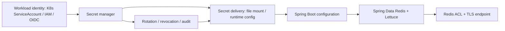
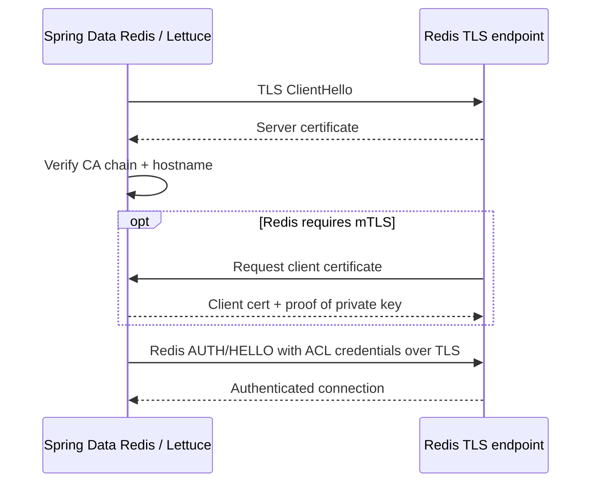
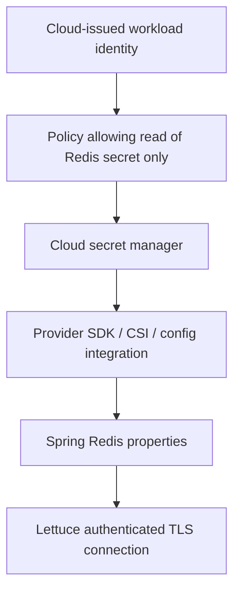
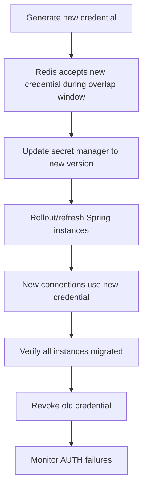

# Managing Passwords and Certificates with a Secret Store in Spring Data Redis

A Spring Boot application using Spring Data Redis typically needs a **Redis password**, sometimes a **Redis ACL username**, and in TLS-enabled environments may need a **CA certificate**, **client certificate**, **client private key**, or keystore password. These values must be managed as operational secrets—not Java constants or configuration properties shared freely.

A simple example that is unsuitable for production:

```yaml
spring:
  data:
    redis:
      host: redis.internal
      password: "password-used-in-production"
```

This configuration puts the password at risk of appearing in Git, build outputs, pipelines, backups, and developer workstations. Enabling Redis ACLs or TLS will not solve the problem if **the credentials and private keys themselves are exposed**.

A sound design clearly separates:

1. **Redis server**: enforces appropriate authentication, authorization, and TLS.
2. **Secret manager**: stores, access-controls, versions, and rotates credentials/certificates.
3. **Workload identity**: allows the right application to read the right secret without embedding a root password in source code.
4. **Secret delivery mechanism**: supplies secrets to the Spring process at runtime, such as protected file mounts, externalized configuration, or Vault integration.
5. **Spring Data Redis/Lettuce**: uses credentials and TLS material to establish connections, along with a reconnection/rotation plan.
6. **Observability and operations**: detects expirations, authentication failures, TLS errors, and leaks without logging secret values.

In this lesson, we establish how to manage **Redis passwords and TLS certificates using a secret store** in Spring Data Redis, from core principles to Spring Boot, Vault, Kubernetes examples, and safe rotation procedures.

> **Scope:** this lesson focuses on secret management for the Redis client. Hostnames, secret paths, certificates, and roles in examples are illustrative only and contain no real secrets. SSL bundle support, Vault configuration, and property names must be verified against your project's Spring Boot/Spring Data Redis version when applying them.

## 1. Which Data Items Are Secrets?

Not every value in `application.yml` carries the same sensitivity.

| Data | Is It a Secret? | Reason |
|---|---|---|
| Redis hostname/port | Usually configuration, not a secret | Does not grant access on its own; still infrastructure metadata to restrict |
| Redis ACL username | Usually an identifier, not a full credential | Insufficient to authenticate without the password; avoid unnecessary disclosure |
| Redis ACL password | **Yes** | Can be used to authenticate to Redis |
| Secret manager access token | **Yes** | Can grant access to retrieve multiple secrets |
| Client TLS private key | **Yes, highly sensitive** | Proves client identity in mTLS |
| Client TLS certificate | Usually not secret | Contains public key and identity; integrity and lifecycle must still be managed |
| CA certificate/trust bundle | Usually not secret | Trust anchor data; unauthorized replacement can break peer verification |
| Keystore/truststore password | **Yes** if protecting keys/sensitive material | Can unlock keystore contents |
| Server TLS private key | **Yes, belongs to Redis server side** | Must never be given to client applications |
| Redis namespace and logical DB | Usually configuration | Does not replace ACLs or network isolation |

**Distinguish secrets from integrity-critical data:** A CA certificate is not a secret in the sense of hiding its contents, but if an attacker replaces the CA trust bundle, the application may trust a spoofed server. Therefore, the CA bundle must still be distributed from a trusted source with controlled updates.

### 1.1. ACL Passwords and TLS Private Keys Solve Different Problems

- **Redis AUTH/ACL** authenticates the client's permission to execute commands and access keys.
- **TLS server authentication** lets the client verify it is connecting to the legitimate Redis endpoint and encrypts traffic in transit.
- **mTLS** (mutual TLS) allows the server to verify the client's certificate as well, depending on Redis/infrastructure configuration.

A connection may require both Redis ACLs and TLS/mTLS. Having a valid client certificate **does not automatically mean** Redis has granted `GET`, `SET`, or access to every namespace.

### 1.2. Goals of Secret Management

The goal is not "never having a password in RAM"—the Redis client needs credentials to authenticate. The goals are:

- Never store long-lived secrets in source code, Git, images, artifacts, or documentation.
- Grant only the right workload permission to read only the right secret.
- Deliver over a protected channel, minimizing copies.
- Enable rotation and revocation without editing code or re-publishing credentials in Git.
- Prevent leakage via logs, exceptions, traces, metrics, dumps, or CI.
- When secrets cannot be fetched or verified, fail according to an explicit policy rather than falling back to a weak default password.

## 2. Reference Architecture Diagram



In this model:

1. The Pod/VM or service has a platform-issued **identity**.
2. The secret manager verifies that identity and enforces a specific policy.
3. Credentials and TLS material are supplied to the instance at startup or refreshed through a controlled mechanism.
4. Spring Boot binds the values into Redis client configuration.
5. Lettuce opens a TLS connection, verifies certificates, and runs AUTH with Redis ACL credentials.
6. When secrets change, you must **ensure the client actually establishes connections with the new material**; updating a secret in the secret manager does not mean live connections immediately switch over.

### 2.1. Three Boundaries to Protect

```text
Boundary A — Secret manager -> workload
  IAM/role/policy, HTTPS/mTLS, file permissions, audit

Boundary B — Workload -> Redis
  TLS hostname verification, ACL username/password,
  network policies, timeouts

Boundary C — Inside the workload
  No secret logging, no ad-hoc debug dumps,
  avoid exposing credentials via Actuator/HTTP
```

Protecting only the wire path to Redis while letting the application log the password at startup is still an insecure design.

## 3. Why Hardcoding Passwords Is a Serious Mistake

Java example:

```java
RedisStandaloneConfiguration redis =
        new RedisStandaloneConfiguration("redis.internal", 6379);
redis.setPassword(RedisPassword.of("actual-production-password"));
```

Risks:

- The secret remains in Git history even if removed in a later commit.
- Build artifacts, Docker images, and source archives may embed the literal.
- Developers or CI runners with source read access can retrieve the password.
- Rotation requires code changes and manual redeployments.
- Credentials often end up reused between staging and production.
- Accidentally pasting a snippet into a ticket or chat widens exposure.

Reading the password from environment variables is better than hardcoding, but still distinguish **where secrets are stored** from the **delivery channel**. An environment variable is a way to pass values to a process; it does not on its own provide versioning, auditing, rotation, or identity-based access.

### 3.1. Using Placeholders in application.yml

```yaml
spring:
  data:
    redis:
      host: redis.internal
      port: 6379
      username: ${REDIS_USERNAME}
      password: ${REDIS_PASSWORD}
      ssl:
        enabled: true
```

`REDIS_USERNAME` and `REDIS_PASSWORD` must be injected by the platform at runtime. This is **separating configuration from code**, not a complete secret management solution.

In production, you should know exactly where that secret comes from, who can read it, when it must be rotated, and every surface where it could appear.

## 4. What Does a Secret Manager Provide?

A secret manager typically provides capabilities such as:

| Capability | Purpose |
|---|---|
| Encryption at rest and in transit | Reduces risk of secret exposure in storage or during retrieval |
| Identity-based access | Applications authorize via IAM/Kubernetes/OIDC rather than a master password |
| Secret versioning | Distinguishes current and previous versions |
| Audit trail | Records which workload read or updated a secret and when |
| Secret rotation | Replaces passwords/keys/certificates on schedule or via workflow |
| Revocation | Revokes compromised or unauthorized credentials |
| Lease/TTL | Fits short-lived secret models |
| Per-environment policies | Separates dev, staging, production, and different applications |

Products implementing this model include HashiCorp Vault, AWS Secrets Manager, Azure Key Vault, Google Cloud Secret Manager, or an internal secret management system. **Specific authentication, versioning, and rotation capabilities vary by service**; not every tool can dynamically generate Redis ACL credentials.

### 4.1. A Secret Manager Does Not Automatically Make Redis Passwords Dynamic

There are two models:

**Managed static secret:**

```text
Secret manager stores operator-created Redis username/password.
Authorized pods read the same secret version.
Rotation requires coordinating credential updates on the Redis server.
```

**Dynamic/leased secret when supported by infrastructure:**

```text
Secret backend issues per-workload credentials,
attaches lease/expiry, and revokes them per policy.
```

Never claim a Redis connection uses "short-lived credentials" just because the client's Vault token has a TTL. **The TTL of a Vault access token differs from the TTL of a Redis ACL password.** For Redis credentials to actually expire when a lease ends, the backend must support and execute that revocation on Redis.

## 5. Designing Access Policies: Applications Read Only What They Need

An illustrative path structure:

```text
secret/
  dev/
    catalog-api/
      redis/
  staging/
    catalog-api/
      redis/
  prod/
    catalog-api/
      redis/
    session-service/
      redis/
```

Suppose production `catalog-api` only needs:

```text
secret/prod/catalog-api/redis
```

It must not have permission to read:

```text
secret/prod/session-service/redis
secret/staging/*
secret/prod/database-admin/*
```

The **least privilege** principle applies to both the secret manager and Redis:

- **Secret manager policy:** allows the workload to read a narrow set of secrets, without listing entire namespaces unnecessarily.
- **Redis ACL:** allows only commands and key patterns matching the application's role.
- **Network policy:** allows only legitimate services to connect to Redis and the secret manager.
- **Operational role:** separate permission to modify or rotate secrets from runtime read permissions where appropriate.

### 5.1. Workload Identity Matters More Than Pod Names

On Kubernetes, a Pod typically uses a **ServiceAccount**. On cloud VMs or managed services, it may use an IAM role or workload identity. The secret manager must verify platform-attested identity rather than trusting an HTTP header or environment variable self-declared by the app.

Example:

```text
namespace = production
serviceAccount = catalog-api
vaultRole = catalog-redis-reader
allowed path = secret/prod/catalog-api/redis
```

These role and path names are illustrative. Ensuring only the intended ServiceAccount and namespace bind to the role is the responsibility of identity provider and Vault policy configuration.

### 5.2. Never Share One Redis Superuser Across Every Service

If all microservices use the `default` user with broad permissions, one compromised application can affect every other service's data.

Better:

```text
catalog-api -> Redis ACL user catalog-app -> ~catalog:*
session-api -> Redis ACL user session-app -> ~session:*
```

Actual command permissions must include the operations used by Spring Data Redis/the driver: data commands, scripting, pub/sub, and cluster topology as needed. Avoid copying an overly restrictive sample ACL that breaks production, but never grant `+@all` just to "make errors go away."

## 6. Redis ACL: Identity and Command/Key Permissions

Redis 6 and newer support ACL users. A Redis ACL user can have:

- A username.
- One or more configured passwords.
- Permissions per command or command category.
- Allowed key patterns.
- Channel permissions when using Pub/Sub according to Redis version/policy.

Example permission specification:

```text
User: catalog-app
Keys: catalog:cache:*
Commands: GET, SET, DEL, EXPIRE, PING, and only actually required commands
Channels: only permitted business channels if Pub/Sub is used
```

This is a **permission specification**, not a copy-paste ACL string for every deployment. Redis Cluster, Spring Cache clear, Lua scripts, Redis Repositories, Pub/Sub, and monitoring may require different commands; permissions must be derived from observed application behavior.

### 6.1. Clients Must Send the Correct Username/Password

In Spring Boot:

```yaml
spring:
  data:
    redis:
      username: ${REDIS_USERNAME}
      password: ${REDIS_PASSWORD}
```

If Redis uses the `default` user with only a password, `username` may not be required. If Redis requires a dedicated ACL user, a password alone will not suffice.

**Never log password values to debug `NOAUTH`/`WRONGPASS` errors.** Instead, log the application name, environment, sanitized endpoint, error category, and non-sensitive secret version.

### 6.2. ACLs Across Every Node in a Cluster

Redis Cluster requires consistent authentication policies across every node a client may connect to. A client does not stay on the seed node; it may be routed to another primary based on hash slots.

If node A's ACL permits a request while node B rejects the same credentials, the application may see "only some keys fail." When investigating, verify ACL synchronization, topology, and secret distribution across **all relevant Redis nodes**.

## 7. TLS: Securing the Client–Redis Channel

Do not think only about passwords; if `AUTH` and Redis data traverse an unencrypted connection in an environment where network sniffing is possible, both credentials and payloads can be exposed.

TLS provides:

1. **Encryption in transit** between the application and Redis endpoint.
2. **Server identity verification** via certificate chain and hostname checks.
3. **Client identity verification** if the environment enables mTLS.

Diagram:



TLS and ACLs complement one another; a Redis server can enforce both simultaneously.

### 7.1. Where Does Each Certificate/Key Belong?

| Material | Where Is It Stored? | How Does the Spring Client Use It? |
|---|---|---|
| Redis server certificate | Redis/server proxy side | Client receives and verifies it |
| Redis server private key | **Redis/server side only** | Never provided to Spring client |
| CA certificate | Client truststore/trust bundle | Verifies server certificate |
| Client certificate (mTLS) | Spring client side | Presents certificate to server |
| Client private key (mTLS) | **Secret manager and protected client mount** | Proves ownership of certificate |
| Keystore password | Secret manager if keystore is password-protected | Unlocks protected key material |

An important design question: **does the Redis deployment actually require mTLS?** If not, the application only needs to trust the CA and send ACL credentials; do not unnecessarily provision client private keys without a requirement.

## 8. Spring Boot: Configuring TLS and ACL Connections

With Spring Boot 3.x using Spring Data Redis and Lettuce, for example:

```yaml
spring:
  data:
    redis:
      client-type: lettuce
      host: redis.internal.example
      port: 6380
      username: ${REDIS_USERNAME}
      password: ${REDIS_PASSWORD}
      ssl:
        enabled: true
      connect-timeout: 3s
      timeout: 3s
```

This is a **skeleton configuration**:

- `6380` is an illustrative port; use your deployment's actual TLS port.
- `ssl.enabled: true` instructs the client to use TLS as supported by Boot/Lettuce.
- The JVM's default truststore may suffice if the server certificate is signed by a CA already trusted by the JVM.
- If using a private/internal CA or mTLS, add trust material configuration and possibly a client certificate/private key.

### 8.1. Enabling SSL Does Not Automatically Mean Safe Configuration

You must also verify:

- The certificate chain is valid.
- The server hostname matches a Subject Alternative Name in the certificate.
- Certificates are not expired or revoked under infrastructure policy.
- The port actually serves TLS.
- No leftover configuration disables hostname verification from past debugging.
- Redis Cluster nodes discovered later also use TLS and valid certificates.

Never use "trust all certificates" or disable peer verification in production. Those shortcuts defeat one of TLS's primary goals.

## 9. Spring Boot SSL Bundles and File-Based Certificate Material

In Spring Boot versions supporting SSL bundles for Redis, you can configure a PEM bundle. Illustrative example when **only server verification is needed**:

```yaml
spring:
  ssl:
    bundle:
      pem:
        redis-client:
          truststore:
            certificate: file:/run/redis-secrets/ca.crt
  data:
    redis:
      host: redis.internal.example
      port: 6380
      username: ${REDIS_USERNAME}
      password: ${REDIS_PASSWORD}
      ssl:
        enabled: true
        bundle: redis-client
```

Here:

- `ca.crt` contains the CA certificate trusted by the application.
- The file is mounted from a trusted certificate/secret management source.
- `redis-client` is an application-chosen bundle name.
- Spring Boot auto-configuration must support binding SSL bundles to the Redis client in the **selected Boot version**.

If Redis requires **mTLS**, the bundle can include the client certificate and private key:

```yaml
spring:
  ssl:
    bundle:
      pem:
        redis-client:
          truststore:
            certificate: file:/run/redis-secrets/ca.crt
          keystore:
            certificate: file:/run/redis-secrets/client.crt
            private-key: file:/run/redis-secrets/client.key
  data:
    redis:
      ssl:
        enabled: true
        bundle: redis-client
```

This shows only the TLS portion of an mTLS setup; host, port, and ACL username/password still need to be configured per deployment.

### 9.1. When to Use PEM vs. JKS/PKCS12?

| Format | Characteristics | What Must Be Protected |
|---|---|---|
| PEM | Certificate and private key can live in separate files | Private key read permissions, CA bundle integrity |
| JKS | Traditional Java keystore/truststore | Store password, key material, and lifecycle |
| PKCS12 | Bundle format holding certificates/private keys | File, password if set, key material |

No format guarantees automatic rotation/reloading by itself. Updating a certificate on the filesystem may **not take effect in existing SSLContexts or open connections** until the client is refreshed or recreated.

### 9.2. Handle Truststore Passwords Carefully

A truststore holding CA certificates usually does not carry the same secrecy level as a client private key, yet its password and file must still be protected for integrity. Never write `trustStorePassword` onto command lines or into operational logs.

For JVM system properties like `javax.net.ssl.trustStorePassword`, note that many ways of passing command-line arguments are visible to process inspection tools. Prefer Boot or infrastructure-supported secret injection mechanisms.

## 10. Secret Delivery via Environment Variables: Simple but Limited

One deployment pattern:

```text
Secret manager
       |
       v
Deployment controller injects REDIS_USERNAME / REDIS_PASSWORD
       |
       v
Spring Boot reads placeholders at startup
```

Example:

```yaml
spring:
  data:
    redis:
      username: ${REDIS_USERNAME}
      password: ${REDIS_PASSWORD}
```

Advantages:

- Minimal Java code changes.
- Works naturally with Spring Boot externalized configuration.
- Supported by most runtime platforms for injecting environment variables.

Limitations:

- Environment variables may appear in diagnostic dumps or tools with process/container inspect access.
- Some platforms allow operators to view env vars in deployment specs.
- Updating a secret in the secret manager **does not update environment variables in a running process**.
- Usually requires a restart/rollout to pick up new secrets.
- If printed by a CI script, values can persist in build logs.

Thus, environment variables can be a **delivery channel**, not a complete secret management store by themselves.

### 10.1. Never Provide a Production Default Password

Dangerous example:

```yaml
password: ${REDIS_PASSWORD:default123}
```

If a deployment forgets to inject the secret, the application silently falls back to an exposed default password. In production, prefer failing startup whenever a required secret is missing or invalid.

Test profiles may use clearly dummy credentials, but they must remain isolated from production configuration.

## 11. Secret File Mounts and Spring Boot Config Trees

A useful pattern in containers/Kubernetes is having a **secret manager or CSI driver mount secret contents as read-only files**. Spring Boot supports importing a config tree directory as properties.

Example file tree:

```text
/run/redis-secrets/
    spring.data.redis.username
    spring.data.redis.password
```

The file `spring.data.redis.username` contains the ACL username; `spring.data.redis.password` contains the password. Each file holds only the raw value, not `key=value` syntax.

Usage:

```yaml
spring:
  config:
    import: "configtree:/run/redis-secrets/"
  data:
    redis:
      host: redis.internal.example
      port: 6380
      ssl:
        enabled: true
```

Through `configtree:`, Spring Boot reads files in that directory and binds them into the configuration environment under their matching property names.

### 11.1. Why Omit `optional:` in Production?

```yaml
spring:
  config:
    import: "configtree:/run/redis-secrets/"
```

When the secret directory is mandatory, do not add `optional:` just to let startup continue if the directory is missing. A broken secret mount must fail loudly.

Local development may have a separate profile using `optional:configtree:...`, provided it cannot cause production to silently fall back to default credentials.

### 11.2. File Permissions

Files containing passwords or private keys should:

- Be readable only by the required application process user/group.
- Not be writable by the application unless needed.
- Never reside inside a web root or static-resource directory.
- Never be baked into a Docker image layer.
- Never be copied into artifact, test report, or log directories.
- Have access revoked/cleaned up when the Pod/VM terminates per platform mechanisms.

A **read-only** mount alone does not prove only the intended process can read the file: you also need Linux UID/GIDs, file modes, container isolation, and node access restrictions.

### 11.3. Updating Files Does Not Automatically Refresh Redis Connections

A secret manager may update mounted file contents in place. However:

```text
Secret file changes
    ≠ Spring Environment necessarily rebinds beans
    ≠ LettuceConnectionFactory immediately swaps password
    ≠ Open Redis sockets automatically re-AUTH
```

You must design an explicit **rollout/connection recreate flow** or an officially supported refresh mechanism. Never assume a live-mounted secret provides automatic end-to-end hot reloading.

## 12. Kubernetes Secrets: A Delivery Mechanism, Not Automatically the Final Secret Store

A Kubernetes `Secret` can pass credentials into a Pod:

```yaml
apiVersion: v1
kind: Pod
metadata:
  name: catalog-api-example
spec:
  serviceAccountName: catalog-api
  containers:
    - name: app
      image: example/catalog-api:1.0.0
      env:
        - name: REDIS_USERNAME
          valueFrom:
            secretKeyRef:
              name: catalog-redis
              key: username
        - name: REDIS_PASSWORD
          valueFrom:
            secretKeyRef:
              name: catalog-redis
              key: password
```

This is an **illustrative Kubernetes API example**, not a complete production deployment.

Notes:

- Kubernetes Secrets are base64-encoded in manifests by default; **base64 is not encryption**.
- Configure encryption at rest for etcd per cluster policy, minimal RBAC, auditing, and node access controls.
- If a controller syncs secrets from an external secret manager into a Kubernetes Secret, another copy of the secret now lives in **Kubernetes API/etcd** and expands the access surface to protect.
- Environment variables in running Pods do not update automatically when a Secret changes.

### 12.1. External Secrets Operator

An operator can sync secrets from a cloud secret manager/Vault into a Kubernetes Secret for Pod mounts or env injection.

```text
External secret manager -> External Secrets Operator
                       -> Kubernetes Secret
                       -> Pod
                       -> Spring Data Redis
```

Trade-off: convenient and idiomatic for Kubernetes workflows, but creates an additional copy of the secret in the Kubernetes API.

### 12.2. Secrets Store CSI Driver

Another model mounts secrets directly into the Pod via a deployed CSI provider:

```yaml
volumes:
  - name: redis-secret-files
    csi:
      driver: secrets-store.csi.k8s.io
      readOnly: true
      volumeAttributes:
        secretProviderClass: catalog-redis
```

Pod container mount:

```yaml
volumeMounts:
  - name: redis-secret-files
    mountPath: /run/redis-secrets
    readOnly: true
```

Requirements:

- CSI driver and provider are installed.
- `SecretProviderClass` is configured properly.
- Workload identity has read permissions at the backend.
- Mounted filenames match what Spring Boot `configtree:` or SSL bundles reference.
- Handle cases where the mount is unavailable or the provider fails to fetch secrets.

Do not assume every CSI provider rotates files automatically or that every application picks up updates automatically. **Verify rotation capabilities across the driver, provider, and connection lifecycle.**

## 13. HashiCorp Vault with Spring Boot

One approach is letting Spring Boot pull configuration from Vault via **Spring Cloud Vault**, if the project uses that stack.

Model:

```text
Kubernetes ServiceAccount / workload identity
             |
             v
        Vault auth method
             |
             v
      Vault policy + KV secret
             |
             v
 Spring Boot Config Data / properties
             |
             v
       Lettuce Redis client
```

Spring Cloud Vault typically integrates into Spring's externalized configuration mechanism. Directional example:

```yaml
spring:
  application:
    name: catalog-api
  config:
    import: "vault://"
  cloud:
    vault:
      uri: https://vault.internal.example:8200
      authentication: KUBERNETES
      kubernetes:
        role: catalog-api
      kv:
        enabled: true
        backend: secret
```

This example requires a compatible **Spring Cloud Vault Config** dependency for your Spring Boot version, a live Vault server, and configured Kubernetes auth. Secret paths/context names depend on Spring Cloud Vault resolution and Vault KV mount/version; **do not assume** from a snippet that an arbitrary secret path will automatically load.

### 13.1. Values Stored in Vault

At the path actually read by Spring Cloud Vault, store configuration pairs such as:

```text
spring.data.redis.username = catalog-app
spring.data.redis.password = <secret value held only in Vault>
```

The snippet above is schematic only; never pass real passwords into `vault kv put` commands saved in shell history, tickets, or CI stdout.

### 13.2. Vault Tokens and Redis Passwords Are Two Separate Credential Layers

- The Vault token or workload identity authorizes **reading Vault secrets**.
- The Redis password retrieved from Vault authorizes **AUTH with Redis**.

If the Vault token is revoked, existing Redis connections do not close automatically. If the Redis password changes, a still-valid Vault token does not update open Redis sockets automatically.

Both lifecycles must be managed independently.

### 13.3. Never Put a Vault Root Token in application.yml

A configuration like:

```yaml
spring:
  cloud:
    vault:
      token: "vault-root-token"
```

puts you right back at square one. In Kubernetes, prefer workload auth bound to ServiceAccount/namespace; on cloud, use provider-supported identity methods; on VMs, use short-lived credential issuance with scoped policies.

### 13.4. KV Secrets Do Not Auto-Rotate Redis Passwords

A KV path is only versioned storage. If you want scheduled Redis password rotation, you need:

- A rotation controller/workflow with proper authorization.
- Safe credential updates on the Redis server.
- Writing the new secret version.
- Refreshing/recreating client connections.
- Revoking old credentials once all consumers are confirmed migrated.

Never promise "installing Spring Cloud Vault automatically rotates Redis passwords."

## 14. Vault Agent / Sidecar as a Delivery Mechanism

Instead of the application calling Vault directly, a Vault Agent or sidecar can:

1. Authenticate to Vault using workload identity.
2. Read secrets under policy.
3. Render contents into a protected volume.
4. Maintain or refresh rendered files via agent mechanisms.

Example mount directory:

```text
/run/redis-secrets/
    spring.data.redis.username
    spring.data.redis.password
    ca.crt
    client.crt
    client.key
```

Spring Boot configuration:

```yaml
spring:
  config:
    import: "configtree:/run/redis-secrets/"
  ssl:
    bundle:
      pem:
        redis-client:
          truststore:
            certificate: file:/run/redis-secrets/ca.crt
          keystore:
            certificate: file:/run/redis-secrets/client.crt
            private-key: file:/run/redis-secrets/client.key
  data:
    redis:
      ssl:
        enabled: true
        bundle: redis-client
```

For deployments requiring only server-authenticated TLS, omit the client certificate/private key `keystore` section.

### 14.1. Agent Rendering Is Not the Same as Client Reloading

An agent may write updated secrets to the volume while Spring/Lettuce continues holding old credentials or an old SSL context. You need an explicit **reload trigger** or rolling restart to construct a new client.

Even with Spring Boot SSL bundle reload support in compatible versions, verify **whether the Redis connection factory and Lettuce actually consume the updated bundle**, rather than assuming file updates propagate automatically.

### 14.2. Never Use an Uncontrolled Shared Volume

If multiple containers in a Pod or on a node can read the same mount containing a Redis private key, the exposure scope widens. Mount only to the intended container, apply minimal filesystem permissions, and avoid copying secrets to unnecessary shared volumes.

## 15. Cloud Secret Managers: Common Patterns

With AWS Secrets Manager, Azure Key Vault, Google Cloud Secret Manager, or equivalent services, the typical architecture is:



Integration options:

- **Provider SDK at bootstrap:** the application fetches the secret before creating the Redis factory.
- **Spring Config Data integration:** the provider populates the Spring `Environment` when a compatible library is present.
- **External Secrets Operator:** syncs into a Kubernetes Secret.
- **CSI file mount:** mounts files for Spring to read.
- **Sidecar/agent:** application reads from a local volume with restricted permissions.

These options differ across several dimensions:

| Dimension | Question |
|---|---|
| Bootstrap | If the secret manager is slow or offline, should startup fail? |
| Credential cache | How long are secrets cached in process memory or on disk? |
| Rotation | Who detects a new version? Who recreates Redis connections? |
| Permission | What permissions does the workload hold at the provider? |
| Audit | Are secret reads logged and anomalies detected? |
| Exposure | Is an extra copy created in Kubernetes Secrets or env vars? |
| Availability | Does a secret manager outage after startup break live connections? |

No single option fits every organization. Where supported, **workload identity + scoped secret-store policies + officially supported file/config integration** provide a clean foundation to eliminate hardcoded secrets.

## 16. Direct Java Configuration Using RedisStandaloneConfiguration

When not using Boot auto-configuration or when building a custom connection factory, Spring Data Redis can accept bound credentials:

```java
package com.example.redis.security;

import java.time.Duration;

import org.springframework.beans.factory.annotation.Value;
import org.springframework.context.annotation.Bean;
import org.springframework.context.annotation.Configuration;
import org.springframework.data.redis.connection.RedisPassword;
import org.springframework.data.redis.connection.RedisStandaloneConfiguration;
import org.springframework.data.redis.connection.lettuce.LettuceClientConfiguration;
import org.springframework.data.redis.connection.lettuce.LettuceConnectionFactory;

@Configuration
public class RedisClientConfiguration {

    @Bean
    LettuceConnectionFactory redisConnectionFactory(
            @Value("${app.redis.host}") String host,
            @Value("${app.redis.port:6380}") int port,
            @Value("${spring.data.redis.username}") String username,
            @Value("${spring.data.redis.password}") String password) {

        if (password == null || password.isBlank()) {
            throw new IllegalStateException(
                    "Redis password is required");
        }

        RedisStandaloneConfiguration server =
                new RedisStandaloneConfiguration(host, port);

        server.setUsername(username);
        server.setPassword(RedisPassword.of(password));

        LettuceClientConfiguration client =
                LettuceClientConfiguration.builder()
                        .useSsl()
                        .commandTimeout(Duration.ofSeconds(3))
                        .build();

        return new LettuceConnectionFactory(server, client);
    }
}
```

Notes:

- `@Value` simply reads properties already supplied to Spring; it does not know whether they came from Vault, CSI, or env vars.
- This example uses TLS; trust certificates and mTLS material must be configured additionally if required by the deployment.
- If using Boot SSL bundles, prefer letting Boot construct the Lettuce factory or wire SSL material explicitly via the appropriate API; do not assume `useSsl()` automatically picks up a Boot-declared bundle.
- Declaring a custom `LettuceConnectionFactory` bean typically causes Boot auto-configuration to back off for that factory, meaning other `spring.data.redis.*` properties may not auto-apply unless read explicitly in code.
- Passwords reside in JVM memory for AUTH; never print the configuration object or serialize it into responses.

### 16.1. When Redis Uses the Default User

Some Redis deployments require only the `default` user's password without a separate username. In that case, you may omit `setUsername(...)`, but verify against your Redis server's actual ACL configuration; never pass an arbitrary empty username where client and server handle it differently.

## 17. Configuring Redis Cluster with Credentials from a Secret Manager

For Redis Cluster:

```yaml
spring:
  data:
    redis:
      client-type: lettuce
      cluster:
        nodes:
          - redis-a.internal.example:6380
          - redis-b.internal.example:6380
          - redis-c.internal.example:6380
      username: ${REDIS_USERNAME}
      password: ${REDIS_PASSWORD}
      ssl:
        enabled: true
```

In Java, `RedisClusterConfiguration` also supports credentials per version:

```java
RedisClusterConfiguration cluster =
        new RedisClusterConfiguration(List.of(
                "redis-a.internal.example:6380",
                "redis-b.internal.example:6380"));

cluster.setUsername(username);
cluster.setPassword(RedisPassword.of(password));
```

Ensure that:

- All seeds belong to the same cluster.
- ACL credentials match all nodes the client may contact.
- Redis topology advertises hostnames/ports **reachable** from the application.
- Server certificates are trusted **not only for seeds**, but also for discovered nodes.
- TLS bundles/truststores cover actual hostnames encountered after `MOVED`/`ASK`.

A setup where "seed connect is OK, node B TLS handshake fails" may break only keys mapped to certain hash slots, making it look like an intermittent bug.

### 17.1. Consistent Secret Versions Across Instances

If a new password is rolled out and only some Pods have received the new secret version, older Pods may continue working with the old password during transition. Design a sufficiently long overlap window before revocation.

Never update a password on Redis and immediately delete the old password before all consumers have received the update.

## 18. Redis Sentinel Also Has Its Own Secrets

Redis Sentinel is used for master discovery in replication/sentinel setups—**not Redis Cluster sharding**.

A deployment may require:

1. Credentials for the client to talk to **Sentinel endpoints**.
2. Credentials for the client to talk to **Redis data nodes**.
3. Separate TLS configuration for Sentinel and Redis if required by the topology.

In Spring Data Redis, Sentinel authentication properties/methods have separate APIs depending on version. Do not assume setting `spring.data.redis.password` automatically covers Sentinel ACLs or vice versa.

When using a secret manager, you can separate:

```text
secret/prod/catalog-api/redis-data
secret/prod/catalog-api/redis-sentinel
```

if the two endpoint tiers use different credentials. Even if infrastructure shares one credential, still understand the responsibilities and manage rotation carefully.

## 19. Rotation: Replacing Redis Passwords Without Service Disruption

A safe rotation is not just writing a new value into the secret manager.

General flow:



### 19.1. Why Is an Overlap Window Needed?

Suppose three instances are running:

```text
App A: password version 1
App B: password version 1
App C: password version 1
```

If Redis accepts only version 2 before the app rolls out, all **new connections** using version 1 will fail. Existing open connections may keep running for a while, causing failures to surface delayed during reconnection.

Therefore, rotation typically needs a window where Redis accepts **both old and new** per ACL/server capabilities, letting apps transition to the new secret before revoking the old one.

### 19.2. Redis ACLs Can Support Multiple Passwords During Transition

Redis ACLs support multiple credentials/passwords for one user in supported versions/configurations. You can leverage this for a **dual-password window**, provided operational steps are tightly controlled.

Never put real passwords into `ACL SETUSER` commands recorded in terminal history, CI logs, or tickets. Use protected secret/Redis management tooling with auditing and secure parameter passing.

### 19.3. Detailed Operational Procedure

1. **Generate the new credential** using a secure random source.
2. **Configure Redis to accept the new credential** without revoking the old one yet, using your infrastructure's mechanism.
3. **Create the new secret version in the secret manager**, updating metadata and read policies.
4. **Roll out a canary instance** to fetch the new credential.
5. **Verify the canary actually opens a new Redis connection** and authenticates successfully.
6. **Expand rollout** to the remaining instances.
7. **Monitor reconnect/AUTH errors**, latency, and application errors.
8. **Confirm no process still uses the old credential**; check pools and long-lived connections.
9. **Revoke the old credential** after the safety window.
10. **Record audit entries** with version and timestamp, never the password.

If rotating due to a suspected credential leak, balance the overlap window against security risk; you may need to cut off the old credential sooner and accept controlled disruption.

### 19.4. Update Secret Manager First or Redis First?

If the application reads the new secret **before the Redis server accepts it**, new connections will fail with `WRONGPASS`/AUTH errors. A smooth rotation normally ensures Redis accepts the new password before clients begin using it.

However, updating Redis ACLs and the secret manager does not share a distributed transaction. Maintain a rollback plan and per-phase verification; never treat the whole workflow as atomic just because you use a secret store.

## 20. Alternative Rotation Pattern: Rotating the ACL User Itself

When you prefer not to keep dual passwords on the same user, you can rotate users:

```text
redis-client-v1 -> ACL user app-v1
redis-client-v2 -> ACL user app-v2
```

Procedure:

1. Create the new user with equivalent required permissions.
2. Provision the new username/password through the secret manager.
3. Roll out the app using the new user.
4. Verify all traffic uses the new user.
5. Revoke/disable the old user.

Pros: clearly distinguishes old vs. new users in audits and makes rollback straightforward. Cons: requires syncing ACL policies across nodes, temporarily managing two users, and confirming no stale connections remain.

Never give the new user broader permissions just to get the canary working; start with the exact permission model.

## 21. Rotating Certificates and Private Keys

TLS certificates also have lifecycles:

- Server certificates have `notBefore`/`notAfter`.
- CAs may be rotated or revoked.
- Client certificates/private keys for mTLS may require periodic or incident-driven rotation.
- Keystore passwords may need rotation.

A certificate rotation workflow:

```text
CA trust overlap (if changing CA)
       |
       v
Issue new certificate valid for hostname/role
       |
       v
Mount new material / update SSL bundle
       |
       v
Recreate TLS sessions/connections cleanly
       |
       v
Verify handshake & AUTH across all nodes
       |
       v
Revoke old material once safe
```

### 21.1. Rotating Server Certificates

If the new certificate is signed by a **CA already trusted by clients** and the hostname still matches, clients may not need truststore updates, though new connections must complete handshakes cleanly.

If migrating to a new CA, client trust bundles must receive the new CA before servers switch to certificates signed solely by the new CA; a period **trusting both the old and new CAs** is typically needed.

### 21.2. Rotating Client Certificates (mTLS)

The secret manager supplies a new `client.crt`/`client.key`. Verify:

- The key matches the new certificate.
- The certificate has the right EKU and identity per server policy.
- File modes and private key ownership are properly restricted.
- Spring/Lettuce actually uses the new material for new connections.
- Redis/proxy mTLS trust policy accepts the new certificate.
- The old certificate is revoked or removed from policy once rotation completes.

**Merely updating files on a mount does not guarantee live mTLS connections switch certificates.** Reconnection or recreating the client SSL context is usually required.

### 21.3. Never Share One Private Key Across All Environments

Dev, staging, and prod should each have separate certificates and private keys. If a staging key leaks, it must never be able to authenticate to production Redis.

When multiple services require mTLS, ideally each workload or justified role group holds its own identity rather than sharing one system-wide client private key.

## 22. Practical Limits of SSL Bundle Reloading

Some Spring Boot versions support reloading SSL material and notifying listeners of bundle changes. However, **framework reload capability does not guarantee every client consuming the bundle automatically rebuilds its SSL context or sockets**.

Distinguish the layers:

| Layer | What Can Change? |
|---|---|
| File mount | New certificate/key file contents appear |
| Secret integration | Configuration or secret data updates |
| Spring SSL bundle | Material may reload depending on version support |
| Lettuce client resources | May retain old SSL context/connections |
| TCP/TLS connection | Does not renegotiate full identity on its own after file change |
| Redis ACL auth | Connection may retain prior auth state until reconnect |

A reliable, operationally simple approach is a controlled **rolling restart/connection recreate**, especially when live reload behavior across your stack has not been verified.

### 22.1. Never Arbitrarily Destroy and Recreate the Factory Inside a Request

`LettuceConnectionFactory` is managed by Spring and may serve multiple templates and repositories concurrently. Calling `destroy()`/`afterPropertiesSet()` mid-request can break active subscribers and connections.

If zero-restart rotation is required, design dedicated lifecycle management, atomic factory/client swapping, connection draining, and rollback strictly within API contracts—never deploy an untested ad-hoc "reload" snippet to production.

## 23. Secret TTL and Redis Key TTL Are Two Different Concepts

Example:

```text
Redis cache key:
    cache:product:42
    TTL = 10 minutes

Secret manager credential:
    redis-password version 7
    rotation policy = 30 days
```

A cache key's TTL controls only **how long application data lives in Redis**. It does not change the Redis password or client certificate.

Conversely, rotating the Redis password does not cause `cache:product:42` to expire; the Redis key remains subject to its normal TTL, memory, and availability.

Add a third layer:

```text
Workload identity token:
    Has its own TTL for calling the secret manager.
```

Never conflate these three TTLs:

1. Redis data key TTL.
2. Redis credential validity/rotation period.
3. Token/lease TTL for reading the secret manager.

Each has a distinct purpose and refresh mechanism.

## 24. When the Secret Manager Is Unavailable

This scenario can occur:

```text
T0: Pod prepares to start
T1: Secret manager times out
T2: Spring has not received the Redis password
```

Desired behavior must be explicitly defined:

- **Fail startup** when required credentials are unavailable and no approved secret cache exists.
- Apply bounded retry/backoff at the secret fetch layer within startup budgets.
- Never fall back to a hardcoded or guessable password.
- Never send unauthenticated Redis requests or relax security on `NOAUTH`.
- Log "secret unavailable" **without logging secret contents or access tokens**.

### 24.1. What If the App Is Already Running?

An already running application that has fetched credentials and holds a Redis connection may continue working during a temporary secret manager outage, depending on the driver and infrastructure. However:

- If credentials expire or are revoked, reconnection will fail.
- If new server certificates are deployed, new connections may fail handshakes against an outdated truststore.
- If a mandatory refresh workflow fails to obtain new secrets, apply an explicit degrade/fail-closed policy.

Never claim a secret manager outage always takes Redis down immediately; nor assume the app can safely run indefinitely on stale credentials.

### 24.2. Never Put the Secret Store on the Critical Path of Every GET

An anti-pattern:

```text
Every HTTP request:
    -> call Vault to read Redis password
    -> create new LettuceConnectionFactory
    -> Redis GET
```

This adds latency, loads Vault, multiplies connections, and ties Redis availability to the secret manager on every request.

Better practice is **fetching secrets at bootstrap or on a controlled lease/refresh cadence**, then reusing client/connection infrastructure with a well-defined lifecycle.

## 25. Places Credentials Leak Outside Git

### 25.1. CI/CD Logs

Avoid:

```bash
echo "$REDIS_PASSWORD"
printenv
set -x
```

These commands can print secrets to logs; `set -x` causes shell tracing to echo sensitive commands and arguments.

In CI, enable platform secret masking, but do not treat masking as an absolute guarantee: transforming or encoding a secret can bypass redaction rules.

### 25.2. Docker Images and Build Layers

Never copy `.env.production`, `client.key`, or `keystore.p12` into a Docker image. Even if deleted in a later layer, the contents persist in earlier layers and build caches.

Secret injection should happen at runtime rather than image build time, unless a build genuinely requires a secret via a build-time secret mount that leaves no trace in artifacts.

### 25.3. JVM Heap Dumps and Thread Dumps

Credentials can exist in framework/client memory. Heap dumps taken for debugging can contain Strings, passwords, and certificate material.

Control:

- Who can generate or download heap dumps.
- Where dumps are stored and for how long.
- Encryption, access permissions, and deletion after investigation.
- Never upload dumps to public tickets.

### 25.4. Spring Actuator

`env` and `configprops` endpoints include sanitization/visibility controls depending on Boot version and configuration, yet must never be treated as safe for broad exposure.

Never expose sensitive Actuator management endpoints to the Internet; enforce authentication, authorization, network restrictions, and rules hiding secret values.

### 25.5. Exceptions and Debug Logging

A connection error can cause logs to contain hosts, usernames, or partial configs. Avoid:

```java
log.info("Redis config = {}", redisProperties);
```

if the object exposes a `password` getter or prints fields in `toString()`.

Instead log:

```text
component=redis-client
environment=production
secretVersion=v7
tls=true
outcome=authentication_failed
```

Never log raw passwords, Vault tokens, client private keys, or credential-bearing URLs.

## 26. Secret Redaction and "Encrypted" Are Not Equivalent to Secure

Some systems store:

```text
REDIS_PASSWORD_BASE64 = c2VjcmV0
```

and Base64-decode it at runtime. That is **encoding**, not encryption; anyone reading the string can decode it trivially.

Likewise, encrypting a password with a "master key" and placing that master key right next to the ciphertext in Git does not solve the core risk.

A secret manager is valuable because it provides **access control, auditing, rotation, and separation of key management from code**—not simply because secrets are stored in a different text format.

### 26.1. Never Use a Secret to Encrypt Itself

For example, an application holding:

```text
encryptedRedisPassword = ...
decryptionKey = "hardcoded-in-Java"
```

Anyone with the source or image can still decrypt it. Far better is workload identity with restricted access to a key-management or secret-management service.

## 27. Comparing Secret Delivery Models

| Model | Strengths | Caveats |
|---|---|---|
| Environment variables from secret store | Easy Spring Boot integration | Runtime env can be inspected; requires restart for updates |
| Kubernetes Secret volume | Mounted file, not hardcoded in image | Needs RBAC/etcd encryption; does not auto-reload Lettuce |
| External Secrets Operator | Syncs provider into Kubernetes workflow | Creates a copy of the secret in Kubernetes API |
| Secrets Store CSI | Mounts directly from provider via driver | Depends on CSI/provider; file updates may not reload client |
| Vault Agent template | Workload auth, renders secret files, supports refresh | Must design app restart/reconnect |
| Spring Cloud Vault Config | Integrates into Config Data on Boot startup | Version/auth/lease/reload must be configured properly |
| Direct provider SDK | Full control over refresh and secret versions | Increases application code and lifecycle responsibility |

No approach eliminates the time a secret exists in the Redis client's RAM. Designs should minimize **access scope**, **lifetime**, and **number of copies**, rather than promising secrets "never exist inside the application."

## 28. Observing Rotation Without Exposing Secrets

Useful metrics:

| Metric / Event | Meaning |
|---|---|
| `redis_auth_failures_total` | Count of failed AUTH attempts, from a valid measurement source |
| `redis_tls_handshake_failures_total` | TLS verification/handshake errors |
| `secret_fetch_failures_total` | Failures reading secrets from the backend |
| `secret_refresh_success_total` | Successful secret updates at the delivery layer |
| `secret_version_loaded` | Non-sensitive version currently loaded by the app |
| `certificate_not_after` | Certificate expiration timestamp for alerting |
| `redis_connection_reconnects_total` | Reconnection frequency per client metrics |
| `redis_command_latency` | Request latency impact after rotation |

**Never use passwords, raw secret IDs containing PII, Vault tokens, or private keys as metric labels.** If a secret path includes sensitive application names, consider emitting a normalized service ID.

### 28.1. Alerting Before Certificate Expiration

If a client certificate expires in fewer than seven days:

```text
cert_not_after - current_time < 7 days
```

trigger an alert so operations can issue and roll out a new certificate. In multi-cert/multi-node setups, monitor the entire chain and all endpoints—not just the seed Redis node's certificate.

### 28.2. Detecting Incomplete Rollouts

Tracking:

```text
App A -> secret version 8
App B -> secret version 8
App C -> secret version 7
```

If an instance is still on v7, do not blindly revoke the old credential. Use canary/health checks and verify whether new connections genuinely use version 8.

A `readinessProbe` returning `UP` does not prove Redis connections use the new version: existing connections may still be alive, or the health check may not perform a new handshake.

## 29. Verifying TLS Without Printing Passwords

In authorized environments, check the Redis endpoint's certificate using a TLS tool:

```bash
openssl s_client \
  -connect redis.internal.example:6380 \
  -servername redis.internal.example \
  -CAfile /run/redis-secrets/ca.crt
```

This command demonstrates checking the TLS handshake and certificate chain; its output does not prove Redis ACL credentials are valid or that the application has sufficient command permissions.

When using the Redis CLI:

```bash
redis-cli --tls \
  --cacert /run/redis-secrets/ca.crt \
  -h redis.internal.example -p 6380 \
  --user catalog-app --askpass
```

Options and authentication flags vary by `redis-cli` version. Interactive password entry is safer than passing plaintext passwords directly on the command line, though terminal/session logging must still be protected.

With mTLS, the client may also need appropriate certificate/key options. Never paste private key contents directly into command text.

### 29.1. Sequential Verification Steps

1. DNS and network reach the intended hostname/port.
2. TLS handshake succeeds with CA verification.
3. Hostname verification succeeds.
4. Redis ACL AUTH succeeds.
5. Command/key permissions match business needs.
6. For Cluster, test keys across multiple nodes/slots.
7. For Sentinel, test both Sentinel discovery and Redis data nodes.

If step 2 fails, changing the Redis password will not fix a CA/certificate issue. If step 4 fails, increasing Lettuce command timeouts will not fix wrong credentials.

## 30. Distinguishing Authentication Errors from TLS Errors

| Symptom | Layer | Where to Investigate |
|---|---|---|
| `NOAUTH Authentication required` | Redis AUTH incomplete | Username/password and connection factory |
| `WRONGPASS` | Invalid Redis ACL credentials or user | Secret version, ACL user/password on server |
| `NOPERM` | Authenticated but lacking permissions | ACL command/key/channel policy |
| TLS handshake failure | TLS/certificate/protocol | CA, client cert, private key, TLS versions |
| Hostname mismatch | Server identity verification | Certificate SANs, DNS, advertised addresses |
| Certificate expired | Certificate lifecycle | `notAfter`, secret rotation |
| Connect timeout | Network/endpoint or overload | Host, port, firewalls, network policies |
| Only certain Cluster keys fail | Partial topology/node drift | ACL/TLS on target node, cluster announce |
| Fails only after reconnect | Rotation/lifecycle | Stale credential, stale SSL context, new connection |

Never use "add retries" as the first fix for wrong passwords or bad certificates. Retrying invalid credentials only adds load and hides the root cause.

## 31. Failure Scenario: Secret Updated but Spring Still Uses Old Password

Suppose:

```text
T0: Spring starts with REDIS_PASSWORD=v1.
T1: Secret manager updates to v2.
T2: Redis server begins accepting only v2.
T3: Lettuce reconnects.
```

At T3, if the Spring factory still holds v1, AUTH fails.

This is a **secret propagation/lifecycle** issue, not a Spring Data Redis mapping bug.

Remediation:

- Design rotations with an overlap window.
- Roll out Spring instances to pick up the new version.
- Verify new connections actually authenticate with the new version.
- Revoke v1 only after verification.
- Keep a controlled rollback path if v2 fails.

Do not mutate `Environment` values manually and assume `LettuceConnectionFactory` has rebound.

## 32. Failure Scenario: New CA Certificate Deployed, Redis Handshake Fails

Failure pattern:

```text
Secret manager: new ca.crt is ready.
Pod volume: new ca.crt is mounted.
JVM: old SSL context still holds old CA.
Redis: server certificate is signed by new CA.
```

Resolution depends on the stack:

- Recreate the Redis client or perform a rolling Pod restart.
- Or use SSL bundle reload and client integration verified to support it.
- Ensure a CA overlap period when changing trust anchors.
- Verify SANs and hostnames across both seed nodes and discovered nodes.

Never disable hostname verification or trust all certificates to work around this failure.

## 33. Failure Scenario: Overly Broad Secret Manager Read Permissions

Suppose an application uses only its own Redis cache, yet its IAM role grants:

```text
Read secret/prod/*
Write secret/prod/*
```

If the application is compromised, an attacker can read or modify credentials belonging to other systems.

Restrict permissions:

```text
Read secret/prod/catalog-api/redis only
No write
No list across other apps
No permission to manage policies
```

At the same time, the app's Redis ACL user should access only required namespaces and commands. **Secret manager policies and Redis ACLs must be designed together.**

## 34. Failure Scenario: Sharing a Client Private Key

Example:

```text
catalog-api, session-api, analytics-worker
    -> mount the same client.key
    -> present the same certificate identity to the Redis proxy
```

Consequences:

- Cannot distinguish which service made a request based on mTLS identity.
- If the key leaks, all workloads must rotate simultaneously.
- Cannot revoke one workload without impacting the rest when identity is shared.

Better to issue separate identities/certificates per service or justified permission group. During rotation, the blast radius is smaller and auditing is clearer.

## 35. Security in CI/CD

A deployment pipeline for Spring Data Redis should separate:

```text
Build:
    compile/test/package app without production Redis secrets

Deploy:
    configure workload identity + secret mount/reference

Run:
    Pod/VM retrieves secret under runtime policy
    Spring creates authenticated TLS Redis client
```

Avoid:

- Writing Redis passwords into `Dockerfile` `ARG`/`ENV` instructions.
- Copying client private keys into `src/main/resources`.
- Putting production secrets into test fixtures.
- Printing `kubectl get secret -o yaml` in CI logs.
- Running `printenv` or verbose debug output across all variables.
- Producing shared GitHub/GitLab artifacts containing `.env.production`.

### 35.1. Secret Scanning Remains Essential

Even with proper processes, developers can accidentally commit a secret. Organizations can use secret scanners in pre-commit hooks and pipeline policies.

If a secret is committed:

1. **Rotate/revoke** the secret immediately according to severity.
2. Assess exposure across repos, forks, caches, and CI artifacts.
3. Remediate Git history according to organizational policy.
4. Never treat "deleting the line in a new commit" as re-securing the old credential.

## 36. Production Configuration Pattern with Separation of Concerns

A combined pattern:

**A. Secret manager stores:**

```text
prod/catalog-api/redis/username
prod/catalog-api/redis/password
prod/catalog-api/redis/ca-cert
prod/catalog-api/redis/client-cert   (if mTLS)
prod/catalog-api/redis/client-key    (if mTLS)
```

**B. CSI/Vault Agent renders files:**

```text
/run/redis-secrets/
    spring.data.redis.username
    spring.data.redis.password
    ca.crt
    client.crt
    client.key
```

**C. Application configuration contains no secrets:**

```yaml
spring:
  config:
    import: "configtree:/run/redis-secrets/"
  ssl:
    bundle:
      pem:
        redis-client:
          truststore:
            certificate: file:/run/redis-secrets/ca.crt
          keystore:
            certificate: file:/run/redis-secrets/client.crt
            private-key: file:/run/redis-secrets/client.key
  data:
    redis:
      client-type: lettuce
      host: redis.internal.example
      port: 6380
      ssl:
        enabled: true
        bundle: redis-client
      connect-timeout: 3s
      timeout: 3s
```

If Redis requires only TLS server authentication, omit the client mTLS `keystore` section. If your Boot version does not support Redis SSL bundles, configure Lettuce TLS via compatible APIs or a properly managed JVM truststore/SSL context.

**D. Deployment identity:** ServiceAccount/IAM role can read only production `catalog-api`'s secret scope.

**E. Rotation:** Controller updates Redis ACLs and secret manager with overlap; deployer rolls out a canary then all instances; only after verification is the old credential revoked.

### 36.1. Why Keep Secrets Out of application.yml?

Files in the repository should describe only:

- Host/port/timeouts.
- Where secrets are loaded from (`configtree`/SSL bundle resources).
- Bundle names or namespaces.

Actual passwords and client private keys are delivered only into runtime mounts by a component with authorized identity.

### 36.2. Startup Must Not Ignore Required Secret Errors

If the mount does not exist or `spring.data.redis.password` is missing, the application must fail startup or fail readiness per security design. Never fall back to unauthenticated local Redis or default passwords.

## 37. Testing Configuration and Rotation

You do not need production credentials in tests. Spin up a Redis test instance with ACL/TLS using **test-only** certificates and keys.

Scenarios to verify:

| Scenario | Expected Outcome |
|---|---|
| Missing required Redis password | App fails to start under production configuration |
| Wrong password | Redis AUTH fails; password is not logged |
| ACL missing GET | Connection succeeds, `GET` returns `NOPERM` |
| Untrusted CA | TLS handshake fails |
| Certificate hostname mismatch | Connection rejected per hostname verification policy |
| Missing mTLS client certificate | Rejected by server when mTLS is required |
| New password accepted by Redis | Canary client opens new connection successfully |
| Secret file updated, process not reloaded | System performs designed rollout/recreate |
| One Cluster node holds stale ACL | Commands hitting that slot/node detect the error |
| Secret manager temporarily down at startup | Fails per policy, no hardcoded fallback |
| Secret manager down after startup | Observed behavior matches chosen cache/refresh design |
| Audit/metrics | Records secret version and outcome, never secret values |

### 37.1. Never Test TLS by Disabling Verification

Some test code enables "trust all certificates" for convenience. That can make tests pass even when production fails CA or hostname checks. For security tests, issue a **test CA** and certificates with valid SANs to verify real behavior.

### 37.2. Inspecting Runtime Configuration Without Reading Out Secrets

You can confirm:

```text
redis_tls_enabled = true
redis_secret_version = v8
redis_endpoint = redis.internal.example:6380
redis_connection_test = success
```

Never print:

```text
redis_password = ...
client_private_key = ...
vault_token = ...
```

To verify a process picked up a new secret, use version metadata or test AUTH with a **new connection**—never log plaintext passwords to compare them.

## 38. Frequently Asked Questions

### 38.1. Is putting the password in environment variables secure enough?

It is better than hardcoding, but insufficient by itself. You still need a managed secret source, workload identity, least-privilege read access, protection from env dumps/logging, and a rotation/restart workflow.

### 38.2. Is a CA certificate a secret?

A public CA certificate is normally not secret, though its integrity and distribution source must be protected. A client private key **must be kept secret**.

### 38.3. Is turning on `spring.data.redis.ssl.enabled` enough?

Not if the server certificate uses a private CA or requires a client certificate. You need matching trust material/mTLS configuration and hostname verification.

### 38.4. Can Vault KV auto-rotate Redis passwords?

Not automatically. KV stores secret versions; rotating Redis credentials requires a workflow updating the server, secret store, and clients.

### 38.5. When a secret file changes, does Lettuce immediately use the new value?

Do not assume so. Depending on your stack, properties may be read only at startup while live connections and SSL contexts retain old values. Verify reload support or perform a rollout.

### 38.6. Does Redis TLS replace ACLs?

No. TLS secures the channel and verifies peers; ACLs control Redis identities, command permissions, and keyspaces.

### 38.7. Should the server private key be stored in the Spring app?

Neither necessary nor appropriate. The Spring client needs only CA trust material and a client private key if mTLS is used; the Redis server private key belongs strictly on the server.

### 38.8. Should the same password be used for standalone Redis, Sentinel, and Cluster?

Not by default. Each endpoint tier has distinct authentication models and privileges; sharing vs. separating must follow architecture and policy, preferring separation where feasible.

### 38.9. Does rotation require downtime?

Not necessarily if Redis supports overlapping credentials, secret distribution/rollout is well designed, and the app runs multiple instances. Still, never promise zero downtime without testing your stack and understanding connection lifecycles.

### 38.10. Should Spring call Vault on every Redis GET?

Generally no. Fetch/refresh secrets at bootstrap or on a controlled lifecycle, then reuse Redis connections; never place the secret manager on the critical path of every command.

## 39. Common Mistakes to Avoid

### Mistake 1 — Hardcoding Redis passwords in Java or YAML

Exposes secrets through repos, builds, and history. Replace with a secret manager and runtime injection.

### Mistake 2 — Treating base64 as encryption

Base64 is only encoding. Use a KMS/secret manager with proper access controls.

### Mistake 3 — Baking secrets into Docker images

Secrets persist in image layers and caches even if deleted in a subsequent layer.

### Mistake 4 — Granting `secret/prod/*` read access to a small service

Violates least privilege; scope policies by workload and environment.

### Mistake 5 — Using the broad Redis `default` user for every application

When one app is compromised, the blast radius spans all of Redis. Create scoped ACL users and key patterns.

### Mistake 6 — Enabling TLS while disabling hostname verification

Can accept connections to spoofed endpoints. Verify the CA chain and SAN/hostname.

### Mistake 7 — Giving the server TLS private key to clients

Clients do not need the server private key. Provision a separate client private key only when mTLS is required.

### Mistake 8 — Updating a Vault secret and assuming Redis rotation is complete

The Redis server and open connections have independent lifecycles; update Redis ACLs and roll out/reconnect.

### Mistake 9 — Deleting the old credential before clients receive the new one

Causes outages. Design overlap, canary testing, and verification before revocation.

### Mistake 10 — Sharing one secret across dev, staging, and prod

Expands the blast radius if a lower environment is compromised.

### Mistake 11 — Logging a Redis config object containing a password

`toString()`, binding output, or debug logs can leak secrets. Log outcomes and version metadata instead of values.

### Mistake 12 — Printing environments or `kubectl get secret` to CI logs

Secret masking is not foolproof. Suppress unnecessary log output.

### Mistake 13 — Disabling secret validation so the app "can start"

Falling back to default credentials or unauthenticated Redis in production is dangerous.

### Mistake 14 — Forgetting to verify certificates of Redis Cluster-discovered nodes

A working seed node does not guarantee every node has valid TLS/hostnames.

### Mistake 15 — Confusing Vault token TTL with Redis password TTL

They are two distinct credentials requiring separate rotation/lease policies.

### Mistake 16 — Expecting CSI file rotation to auto-reload all SSL contexts

Updated files do not mean Lettuce connections or Java SSL contexts changed. Design explicit rollout/recreate steps.

### Mistake 17 — Passing real credentials via command-line arguments

Arguments can be captured in process lists, shell history, or CI logs. Use protected input or secret delivery mechanisms.

### Mistake 18 — Having no rotation rollback plan

If the new credential fails after the old one is revoked, recovery becomes messy. Plan controlled rollback without leaving old passwords around indefinitely.

### Mistake 19 — Mistaking TLS failures for wrong passwords

TLS handshakes occur before Redis `AUTH` on standard TLS connections. Classify errors so you fix the right layer.

### Mistake 20 — Overlooking private keys in heap dumps or backups

Private keys and passwords can end up in artifacts, debug dumps, or backups. Manage access and retention according to sensitivity.

## 40. Practice Exercises

### Exercise 1 — Convert Hardcoded Config to Secret Injection

Given:

```yaml
spring:
  data:
    redis:
      host: redis.internal
      password: "not-a-real-example-password"
```

Rewrite it so the password comes from `REDIS_PASSWORD`, and explain why an environment variable is only a delivery channel rather than a complete secret manager.

### Exercise 2 — Spring Boot configtree

Create a **test environment** with files:

```text
/run/redis-secrets/spring.data.redis.username
/run/redis-secrets/spring.data.redis.password
```

Write `spring.config.import` so Spring Boot loads both properties. Explain why production should omit `optional:` when the mount is mandatory.

### Exercise 3 — Distinguish CA vs. Client Private Key

Suppose Redis uses TLS server authentication without requiring mTLS. Identify which of `ca.crt`, `client.crt`, and `client.key` the app needs, and explain which is a secret vs. which requires integrity protection.

### Exercise 4 — mTLS with an SSL Bundle

Create a PEM SSL bundle configuration pointing to three dummy files `ca.crt`, `client.crt`, and `client.key`. Use test files only, never committing production keys to the repository.

### Exercise 5 — Design a Vault/Kubernetes Policy

A production `catalog-api` needs read-only access to its Redis secret. Sketch the matching policy scope, separating secret read permissions from admin/rotation permissions.

### Exercise 6 — Zero-Downtime Rotation

Suppose three Pods use Redis password v1 and Redis supports two overlapping passwords. Outline the sequence for applying v2 to Redis, the secret manager, the canary, and all Pods before revoking v1.

### Exercise 7 — Certificate Rotation

The Redis server migrates from CA-A to CA-B. Propose a trust overlap phase, bundle update steps, connection restart/recreation, and handshake verification across every Redis Cluster node.

### Exercise 8 — Secret Manager Outage

The secret manager loses connectivity right as a Pod starts. Describe startup behavior, bounded retries, safe logging, and why you must not fall back to a default password.

### Exercise 9 — Failures Appearing Only After Reconnect

The application keeps running `GET` successfully after the Redis password changes, and `WRONGPASS` appears only later when network blips force Lettuce to reconnect. Explain which lifecycle causes this and how to handle it.

### Exercise 10 — Redis Cluster Credentials

An application lists three seed nodes, and Pods can reach only two nodes over TLS. Explain why `PING` succeeding on one seed does not prove all keys work, and how to verify advertised endpoints and certificates.

### Exercise 11 — Auditing Without Secret Leakage

Propose log fields and metric labels to track rotation (secret version, outcome, service, environment) while avoiding raw passwords, URLs, tokens, or private keys.

### Exercise 12 — Remediating an Accidentally Committed Credential

A configuration file containing a production Redis password was committed to a private repository and used by CI. List priority remediation steps: rotating/revoking, scoping exposure, checking artifacts/logs, and fixing secret injection.

## 41. Quick Reference Table

| Question | Answer |
|---|---|
| Where should Redis passwords live? | A secret manager or protected runtime secret injection |
| Should passwords be committed to `application.yml`? | No |
| Are environment variables a secret manager? | No; they are a delivery channel |
| Is Base64 encryption? | No |
| Is a CA certificate a secret? | Usually not, though its integrity must be protected |
| Is an mTLS private key a secret? | Yes |
| Should the Redis server private key be given to Spring? | No |
| Do Redis ACLs and TLS replace each other? | No; they address different security layers |
| How does Spring Boot load secret files as properties? | `spring.config.import=configtree:/...` |
| How is TLS enabled in Boot? | `spring.data.redis.ssl.enabled` and appropriate trust/SSL bundle |
| When is a client certificate required? | When the endpoint requires mTLS |
| What is workload identity used for? | Letting an app read secrets under policy without embedding master tokens |
| Does Vault KV auto-rotate Redis passwords? | No |
| When a secret file changes, does Lettuce auto-use it? | Never assume so; requires refresh/reconnect/rollout |
| What does safe password rotation involve? | New credential, overlap, secret version, rollout, verify, revoke old |
| Is secret manager token TTL the Redis password TTL? | No |
| What should never be logged? | Passwords, Vault tokens, client private keys, credential-bearing URLs |
| Where must Redis Cluster TLS be verified? | Every node endpoint reached via discovery/redirects |
| Should the app fall back to a default password if Vault is down? | No |
| Should retries be increased infinitely on AUTH failure? | No; inspect secret version and ACLs first |

**Conclusion:** Managing passwords and certificates in Spring Data Redis goes far beyond replacing a hardcoded password with an environment variable. A secure system requires a **policy- and audit-backed secret manager**, **workload identity**, **secret delivery outside source code**, **least-privilege Redis ACLs**, **TLS/mTLS with proper peer verification**, and a **well-designed rotation/reconnection lifecycle**.

The most critical operational takeaway is that **updating a secret in a store does not mean the Redis server or Lettuce client is already using the new version**. Coordinate ACL/certificate updates, secret distribution, canary rollouts, connection lifecycles, and old credential revocation in an observable, rollback-capable sequence—while guarding every leak surface including Git, images, CI logs, environment dumps, Actuator, APM, and heap dumps.

### References

- [Spring Data Redis — Connecting to Redis](https://docs.spring.io/spring-data/redis/reference/redis/redis-connection.html)
- [Spring Data Redis — LettuceConnectionFactory API](https://docs.spring.io/spring-data/redis/reference/api/java/org/springframework/data/redis/connection/lettuce/LettuceConnectionFactory.html)
- [Spring Data Redis — Redis Cluster](https://docs.spring.io/spring-data/redis/reference/redis/cluster.html)
- [Spring Boot — Externalized Configuration](https://docs.spring.io/spring-boot/reference/features/external-config.html)
- [Spring Boot — SSL](https://docs.spring.io/spring-boot/reference/features/ssl.html)
- [Spring Boot — Redis](https://docs.spring.io/spring-boot/reference/data/nosql.html#data.nosql.redis)
- [Spring Cloud Vault — Reference](https://docs.spring.io/spring-cloud-vault/reference/)
- [Redis — Access Control Lists (ACL)](https://redis.io/docs/latest/operate/oss_and_stack/management/security/acl/)
- [Redis — TLS](https://redis.io/docs/latest/operate/oss_and_stack/management/security/encryption/)
- [Redis — Security](https://redis.io/docs/latest/operate/oss_and_stack/management/security/)
- [Kubernetes — Secrets](https://kubernetes.io/docs/concepts/configuration/secret/)
- [Secrets Store CSI Driver](https://secrets-store-csi-driver.sigs.k8s.io/)
- [HashiCorp Vault — Kubernetes Authentication](https://developer.hashicorp.com/vault/docs/auth/kubernetes)
- [OWASP — Secrets Management Cheat Sheet](https://cheatsheetseries.owasp.org/cheatsheets/Secrets_Management_Cheat_Sheet.html)
