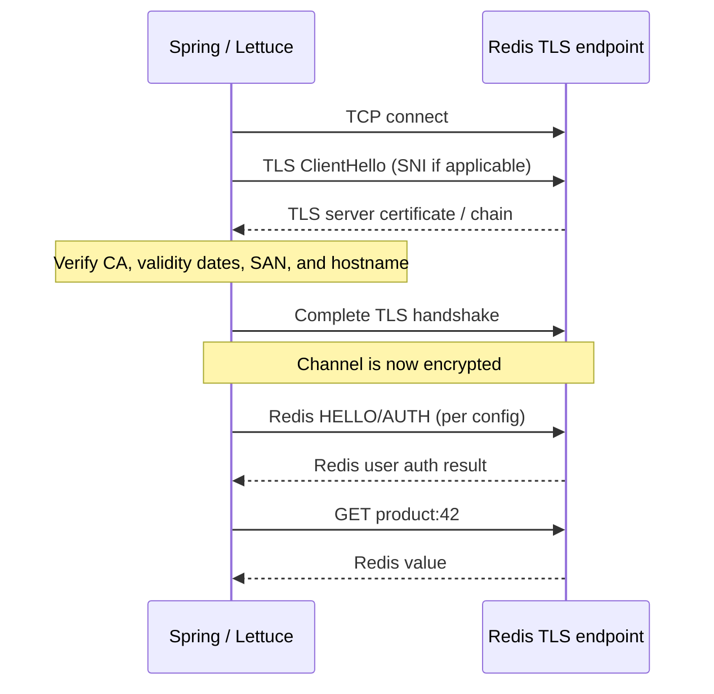
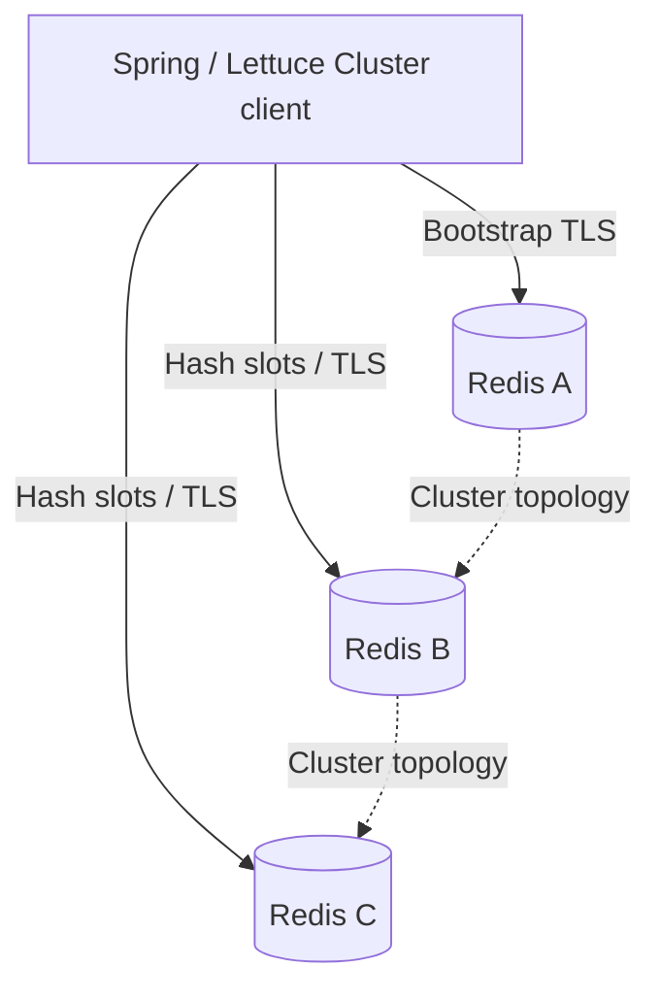
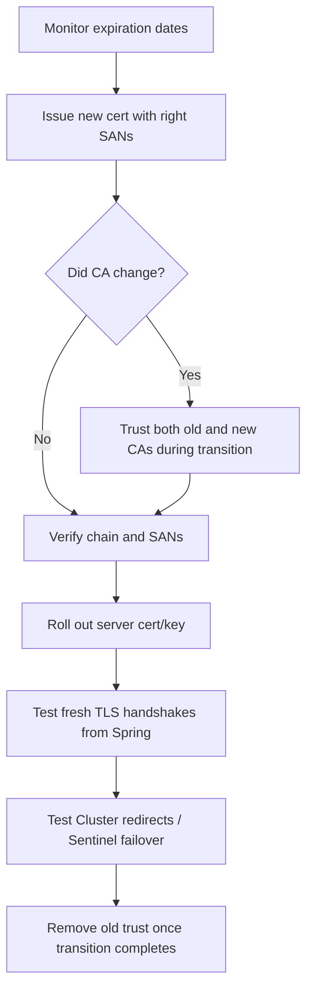

# Enabling TLS and Server Identity Verification in Spring Data Redis

## 1. Why Is Successfully Connecting to Redis Not Enough?

Suppose a Spring Boot application uses Redis to store sessions, cache customer data, and hold business state. The application connects to `redis.prod.example.com` over an internal network:

```text
Spring Boot / Lettuce
        |
        | TCP
        v
redis.prod.example.com:6380
        |
        v
Redis server
```

If the connection is unprotected, data transmitted over the network—including Redis commands, keys, values, and credentials—can be observed or tampered with by an attacker who gains suitable access along the network path.

Enabling **Transport Layer Security (TLS)** solves encryption and data integrity in transit. However, TLS truly protects an application from impersonated servers only when the client also **verifies server identity**. If the application accepts any certificate, a rogue endpoint can still complete a TLS connection and receive everything the application sends.

A secure connection must answer two questions:

1. Is data exchanged over the network protected by TLS?
2. Is the Redis endpoint we are talking to genuinely the server the application intends to connect to?

In Spring Data Redis, especially when using **Lettuce**, configuring TLS belongs in the Redis client/connection factory. It does not live inside calls like `opsForValue().get()` or `opsForHash().put()`.

After this lesson, you will know how to configure the Redis server and Spring Boot, verify CAs, SANs, hostnames, and SNI, use SSL bundles/truststores, configure mTLS when needed, handle Redis Sentinel/Cluster, test invalid certificates, and build a certificate rotation workflow.

## 2. Four Protective Layers That Must Not Be Conflated

| Mechanism | Purpose | Does Not Automatically Guarantee |
|---|---|---|
| **TLS encryption** | Encrypts traffic and detects tampering in transit | Right server if certificate verification is skipped |
| **Certificate chain validation** | Certificate was issued by a trusted CA and is valid per policy | Certificate names the right Redis endpoint |
| **Hostname verification** | DNS/IP identity in certificate matches the connected host | Which keys/commands the Redis user can access |
| **Redis ACL/AUTH** | Authenticates users and authorizes commands/keys/channels | Transport encryption if the client uses plaintext |

For example, an application with a valid Redis username and password sent over plaintext TCP still risks credential exposure. Conversely, an application with TLS enabled that uses a trust-all manager has no genuine server verification.

**Principle:** TLS + CA trust + hostname verification + Redis ACLs are complementary layers, not substitutes for one another.

## 3. The TLS Handshake Happens Before Redis Commands



This diagram illustrates the logical flow, not every TLS 1.2 or TLS 1.3 packet. If the client does not trust the certificate or the hostname mismatches, the connection must be rejected **before sending Redis credentials**.

Key components:

- **Server certificate:** the certificate presented by the server during the handshake.
- **CA (Certificate Authority):** the issuer/trust anchor used to validate the chain.
- **Truststore:** the set of trust anchors or certificates trusted by the client.
- **SAN (Subject Alternative Name):** the DNS names and IP addresses authorized by the certificate.
- **SNI (Server Name Indication):** the hostname sent by the client in the handshake so the server/proxy can select the right certificate.
- **mTLS:** the Redis server also verifies the client's certificate.

A certificate can be properly signed yet lack a matching identity. Hence, **chain validation and hostname verification are two separate requirements**.

## 4. SAN: Where Valid Hostnames Are Defined

Suppose a certificate contains:

```text
Subject: CN=redis.prod.example.com
Subject Alternative Name:
    DNS:redis.prod.example.com
    DNS:redis-read.prod.example.com
```

An application connecting to `redis.prod.example.com` can verify the name against the matching DNS SAN. If the application switches to `redis-other.prod.example.com` and the certificate does not list it, a client performing proper hostname verification will reject it.

### 4.1. Do Not Rely Only on Common Name

Modern standards and TLS implementations prefer or require **SANs** to represent server identity. Never issue new certificates with only a CN and expect every Java/JDK/client version to accept a fallback.

When issuing server certificates, list the exact hostnames used by applications and Redis clients.

### 4.2. DNS SAN Differs from IP SAN

Suppose a certificate has:

```text
DNS:redis.prod.example.com
```

but the application connects using:

```text
10.20.30.40
```

A DNS name in SAN does not validate a literal IP address. Connecting by IP requires an **exact IP SAN**, or switching to a DNS name present in SAN.

Replacing a hostname with an IP to work around DNS errors can break hostname verification—especially in Redis Cluster or Kubernetes where nodes may advertise internal IPs.

### 4.3. Wildcard Certificates Have Limits

A certificate for `*.redis.example.com` should not be assumed valid for arbitrary subdomain depths. Wildcard matching typically covers a single DNS label level and does not automatically match deeper names like `node-a.cluster.redis.example.com`.

For multi-node Redis setups, design SANs around real hostnames rather than assuming a wildcard covers every case.

## 5. SNI Is Not Hostname Verification

SNI indicates which hostname the client is requesting during the TLS handshake. It helps a TLS proxy serving multiple hostnames on the same IP choose the right certificate:

```text
Client wants redis.prod.example.com
        |
        +-- SNI: redis.prod.example.com
        |
Proxy presents certificate for redis.prod.example.com
        |
Client validates SAN against redis.prod.example.com
```

**SNI does not prove the certificate is valid.** If the server returns the wrong certificate, the client must still reject it.

In environments with a TLS termination proxy or managed Redis endpoint, missing or wrong SNI can cause the client to receive a default certificate. Investigate:

1. The hostname configured in Spring.
2. The SNI value sent by the client.
3. The certificate the server actually returns.
4. The certificate's SANs.
5. The CA truststore used by the JVM.

Never "fix" this by disabling hostname verification.

## 6. Redis Must Actually Support TLS

Before configuring Spring, verify:

- Does the Redis endpoint support TLS?
- Which port serves TLS?
- Which CA signed the server certificate and chain?
- Does the server require a client certificate (mTLS)?
- Does Redis require AUTH/ACL username/password?
- Does a proxy, Sentinel, or Redis Cluster change endpoints at runtime?

**Port 6380 is only a common convention, not a mandatory TLS port.** Managed Redis may use 6379 or another endpoint/port.

If Spring sends plaintext Redis protocol to a TLS port, or sends a TLS handshake to a plaintext port, protocol/handshake errors occur. Changing the port number alone does not enable TLS.

## 7. Example Redis OSS Configuration Serving TLS

For self-managed Redis OSS built with TLS support:

```conf
# Do not serve plaintext client traffic.
port 0

# Example TLS port.
tls-port 6380

# Redis server certificate and private key.
tls-cert-file /etc/redis/tls/server.crt
tls-key-file /etc/redis/tls/server.key

# Certificate Authority per system PKI.
tls-ca-cert-file /etc/redis/tls/ca.crt

# Example verifies server only; no client cert required.
tls-auth-clients no
```

Certificate files must match the Redis version, TLS configuration, and formats accepted by the server. The certificate must include SANs for hostnames called by applications.

### 7.1. Protect the Private Key

`server.key` is the TLS server's secret:

- Never put it in Git or public Docker images.
- Restrict file read permissions to the Redis process.
- Mount it from secret management or controlled storage.
- Track issuance, replacement, and revocation.
- Never print private key contents in logs or tickets.

### 7.2. Enabling Client TLS Does Not Mean the Server Disabled Plaintext

If Redis still opens:

```conf
port 6379
tls-port 6380
```

other clients can still speak plaintext over 6379. Where encryption is mandatory, audit server ports, firewalls, network policies, and every other access path.

### 7.3. Node-to-Node TLS Requires Separate Configuration

For TLS-enabled Redis replication or Redis Cluster, server settings may include:

```conf
tls-replication yes
tls-cluster yes
```

These govern connections between Redis nodes. **Client→Redis TLS does not automatically mean replication or cluster bus traffic is encrypted.** Verify topology and TLS on every hop.

## 8. Enabling TLS in Spring Boot

With Spring Boot 3.x and a Redis certificate trusted by the JVM:

```yaml
spring:
  data:
    redis:
      host: redis.prod.example.com
      port: 6380
      username: app-cache
      password: ${REDIS_PASSWORD}
      ssl:
        enabled: true
      timeout: 3s
```

Meaning:

- `host` must be a hostname permitted by the certificate.
- `port` is the actual Redis TLS endpoint port.
- `ssl.enabled: true` enables TLS on the Redis client.
- `username/password` authenticate the Redis ACL user.
- `REDIS_PASSWORD` comes from environment secret configuration, never hardcoded.
- The driver and JVM must trust the CA that signed the Redis server certificate.

**Keep certificate/peer verification and hostname verification enabled.** If the handshake reports an invalid certificate, fix the truststore or certificate—never use a trust-all mechanism.

### 8.1. When Is a Custom CA Not Needed?

If the certificate is signed by a CA already trusted by the current JVM, default trust configuration may suffice. However, many internal Redis instances use a private CA; the Java runtime inside your container may not trust your company CA by default.

Verify against the **actual JVM running in production**, not just the truststore on a developer laptop.

### 8.2. Redis AUTH Does Not Enable TLS

Setting a `password` while forgetting `ssl.enabled` does not encrypt traffic. Redis ACLs govern command authorization, whereas TLS protects credentials and data in transit.

## 9. Spring Boot SSL Bundles for a Redis Private CA

In Spring Boot versions supporting SSL bundles and Redis SSL bundles, you can configure a PEM CA specifically for Redis:

```yaml
spring:
  ssl:
    bundle:
      pem:
        redis-client:
          truststore:
            certificate: file:/etc/app/tls/redis-ca.pem

  data:
    redis:
      host: redis.prod.example.com
      port: 6380
      username: app-cache
      password: ${REDIS_PASSWORD}
      ssl:
        enabled: true
        bundle: redis-client
```

Meaning:

1. The `redis-client` bundle specifies trust material specifically for Redis.
2. Redis connection configuration references that bundle.
3. The client verifies the certificate chain against the trusted CA.
4. Hostname validation still applies via the driver/JVM.

The advantage of a bundle is scoping trust and avoiding edits to the global default truststore for the entire application.

**Version dependency:** if an older Spring Boot release does not support the Redis SSL bundle property, it will not be applied as expected. Choose a mechanism compatible with your running version.

### 9.1. Never Use a Bundle as an Excuse to Skip Hostname Verification

One CA can sign certificates for many different servers. Simply because a certificate is signed by this CA does not prove it belongs to the requested Redis endpoint. SAN verification remains mandatory.

### 9.2. Custom Connection Factories Must Explicitly Apply SSL Configuration

If a project manually creates a `LettuceConnectionFactory` and Spring Boot auto-configuration backs off, declaring a bundle in YAML **does not guarantee** that factory automatically picks up the bundle.

Choose one clear path:

- Use Spring Boot auto-configuration together with the SSL bundle.
- Or construct the factory manually and wire full trust material and credentials.

Avoid accidentally creating two connection factories so that `RedisTemplate` and `ReactiveRedisTemplate` connect under different TLS policies.

## 10. JKS/PKCS12 Truststores

When an organization manages CAs using Java KeyStore or PKCS12, supported Spring Boot versions can use:

```yaml
spring:
  ssl:
    bundle:
      jks:
        redis-client:
          truststore:
            location: file:/etc/app/tls/redis-truststore.p12
            password: ${REDIS_TRUSTSTORE_PASSWORD}
            type: PKCS12

  data:
    redis:
      host: redis.prod.example.com
      port: 6380
      ssl:
        enabled: true
        bundle: redis-client
```

**Truststore vs. keystore:**

- A client-side truststore holds CAs or certificates used to verify servers.
- A client-side keystore (mTLS) holds the client certificate and private key to prove client identity to the server.
- The Redis server also has its own certificate and private key.

The truststore password is not the Redis ACL password. Keep these secrets out of Git, image layers, and build logs.

### 10.1. JVM-Level Java Truststore

Another option uses JVM system properties:

```text
-Djavax.net.ssl.trustStore=/etc/app/tls/redis-truststore.p12
-Djavax.net.ssl.trustStoreType=PKCS12
-Djavax.net.ssl.trustStorePassword=<provided-securely>
```

This sets trust configuration JVM-wide for libraries using default JSSE. It can affect other HTTPS, database, or gRPC connections in the same application. If the truststore contains only the Redis CA, connections to other services that depend on the default truststore may break.

Therefore, prefer Redis-scoped trust configuration whenever possible and manage secrets through proper deployment tooling.

## 11. Configuring Lettuce in Java

When not using Boot auto-configuration, you can construct a TLS-enabled Redis connection factory:

```java
package com.example.redis.security;

import java.time.Duration;

import org.springframework.context.annotation.Bean;
import org.springframework.context.annotation.Configuration;
import org.springframework.data.redis.connection.RedisStandaloneConfiguration;
import org.springframework.data.redis.connection.lettuce.LettuceClientConfiguration;
import org.springframework.data.redis.connection.lettuce.LettuceConnectionFactory;

@Configuration
public class SecureRedisConnectionConfig {

    @Bean
    LettuceConnectionFactory redisConnectionFactory() {
        RedisStandaloneConfiguration redis =
            new RedisStandaloneConfiguration(
                "redis.prod.example.com", 6380
            );

        // Supply username/password via secret configuration
        // matching the environment and Redis ACL account.

        LettuceClientConfiguration lettuce =
            LettuceClientConfiguration.builder()
                .useSsl()
                .and()
                .commandTimeout(Duration.ofSeconds(3))
                .build();

        return new LettuceConnectionFactory(redis, lettuce);
    }
}
```

This example assumes the JVM already trusts the CA and the Redis certificate includes a SAN for the hostname. If using a private CA, wire that CA into the appropriate trust configuration.

### 11.1. Preserve Peer Verification and Hostname Verification

Never call methods equivalent to `disablePeerVerification()` or install a `TrustManager` that accepts every certificate.

Lettuce/TLS APIs can vary across versions, but security requirements remain constant:

```text
TLS enabled
AND chain validated against approved CA
AND hostname/SAN validated
AND Redis ACL applied as required
```

To confirm the driver configuration is genuinely secure, test it: **a wrong hostname or untrusted CA must cause the handshake to fail**.

### 11.2. Custom SSLContexts Must Retain Full Checks

If customizing `SSLContext` for truststores, client keys, or TLS versions, ensure the implementation still uses proper trust managers and endpoint identification.

Never replace a trust manager with an implementation that always succeeds. Such code easily passes happy-path integration tests while silently stripping identity verification.

## 12. Redis URIs and `rediss://`

Redis connection URIs can be written as:

```text
redis://redis.example.com:6379
rediss://redis.example.com:6380
```

Normally, `rediss://` indicates TLS. However:

- A URI does not by itself solve private CA trust.
- The driver must still verify certificates and hostnames.
- Usernames/passwords in URLs may need URL encoding and can easily leak in logs.
- If both `spring.data.redis.url` and `host`/`port` are set, understand property precedence in your Boot version.

For production, configuring host, port, SSL bundle, and secrets separately is usually cleaner and safer than embedding credentials in a URI.

## 13. Mutual TLS: When Redis Requires a Client Certificate

Standard one-way TLS:

```text
Spring verifies Redis server certificate.
Redis verifies application using ACL credentials.
```

With **mTLS**, Redis also requires a client certificate:

```conf
tls-auth-clients yes
```

In this mode, the application must present a matching client certificate and private key.

With a PEM-capable Spring Boot SSL bundle:

```yaml
spring:
  ssl:
    bundle:
      pem:
        redis-mtls:
          keystore:
            certificate: file:/etc/app/tls/client.crt
            private-key: file:/etc/app/tls/client.key
          truststore:
            certificate: file:/etc/app/tls/redis-ca.crt

  data:
    redis:
      host: redis.prod.example.com
      port: 6380
      username: app-cache
      password: ${REDIS_PASSWORD}
      ssl:
        enabled: true
        bundle: redis-mtls
```

Here:

- The client uses the truststore to **verify the Redis server**.
- The client uses the keystore to **present its certificate to Redis**.
- Redis validates the client certificate against server CA/policy rules.
- Redis ACLs are still enforced when configured.

Never confuse mTLS with skipping server identity checks. **Both sides must verify each other**, not just the server checking the client.

### 13.1. Protect the Client Private Key

Never commit `client.key` to Git, place it inside widely shared images, or print PEM contents into logs. Use secret management, tight volume permissions, and a rotation policy.

### 13.2. mTLS Does Not Automatically Grant All Commands

Even when an mTLS handshake succeeds, Redis may still return `NOPERM` if the ACL user is not permitted to run `HGET` or access that key pattern. That is an authorization failure, not a certificate chain failure.

## 14. OpenSSL: Checking Trust Chains and Hostnames

From a machine with network access to the Redis TLS endpoint:

```bash
openssl s_client \
  -connect redis.prod.example.com:6380 \
  -servername redis.prod.example.com \
  -verify_hostname redis.prod.example.com \
  -verify_return_error \
  -CAfile /etc/app/tls/redis-ca.pem
```

Meaning:

| Option | Purpose |
|---|---|
| `-connect` | Host:port of the endpoint to inspect |
| `-servername` | Sends SNI to select the right certificate |
| `-verify_hostname` | Enforces hostname verification |
| `-verify_return_error` | Surfaces verification errors clearly and exits per policy |
| `-CAfile` | Specifies the CA used for the check |

OpenSSL helps inspect the certificate actually served by the endpoint. However, **OpenSSL's truststore is not necessarily the same as the Java truststore**, and a successful handshake does not prove Redis ACL credentials are valid.

### 14.1. Inspecting SANs and Certificate Validity

For a server certificate file:

```bash
openssl x509 \
  -in /etc/app/tls/redis-server.crt \
  -noout -subject -issuer -dates -ext subjectAltName
```

Check `notBefore`, `notAfter`, issuer, and SANs. Be careful not to inspect the CA certificate by mistake and assume its attributes are the server's SANs.

### 14.2. Why Testing from a Laptop Is Not Enough

A laptop and a Spring pod may use different DNS resolution, CA trust anchors, TLS proxies, or network routes. Run an equivalent check **from the application's network environment**, and follow up with Java integration tests.

## 15. `redis-cli` Over TLS

With TLS-capable `redis-cli`:

```bash
redis-cli \
  --tls \
  -h redis.prod.example.com \
  -p 6380 \
  --sni redis.prod.example.com \
  --cacert /etc/app/tls/redis-ca.pem \
  PING
```

The output may be `PONG` if the command is allowed by Redis. If the server enforces ACLs, pass credentials via a secure environment mechanism (such as `REDISCLI_AUTH`); never put literal passwords on command lines visible in shell history or process lists.

If Redis requires mTLS:

```bash
redis-cli \
  --tls \
  -h redis.prod.example.com \
  -p 6380 \
  --cacert /etc/app/tls/redis-ca.pem \
  --cert /etc/app/tls/client.crt \
  --key /etc/app/tls/client.key \
  PING
```

**Never use `--insecure` as proof of a secure TLS connection.** Verify CA, SAN, and hostname; if you want strict CLI hostname verification outside Java, OpenSSL `-verify_hostname` is a helpful tool.

### 15.1. PONG Is Not Full Proof of TLS Security

A plaintext Redis endpoint can also return `PONG`. A `PING` result is meaningful only after confirming:

- The client used TLS.
- Certificates were validated.
- The hostname matched.
- No verification-bypass option was enabled.

## 16. Integration Testing with Spring Data Redis

Example using JUnit and `StringRedisTemplate`:

```java
import static org.assertj.core.api.Assertions.assertThat;

import java.time.Duration;
import java.util.UUID;

import org.junit.jupiter.api.Test;
import org.springframework.beans.factory.annotation.Autowired;
import org.springframework.boot.test.context.SpringBootTest;
import org.springframework.data.redis.core.StringRedisTemplate;

@SpringBootTest
class RedisTlsIntegrationTest {

    @Autowired
    StringRedisTemplate redis;

    @Test
    void canAccessRedisThroughConfiguredTlsEndpoint() {
        String key = "test:tls:" + UUID.randomUUID();

        try {
            redis.opsForValue().set(key, "safe", Duration.ofMinutes(2));
            assertThat(redis.opsForValue().get(key))
                .isEqualTo("safe");
        } finally {
            redis.delete(key);
        }
    }
}
```

This test confirms Redis commands work over the configured connection factory. It is **not enough** to prove hostname verification, because a configuration that disables certificate checks would also read and write successfully.

You must add **negative tests** for untrusted CAs and mismatched hostnames.

## 17. Negative Tests: Mismatched Identity Connections Must Fail

A solid TLS test suite covers:

| Case | Expectation |
|---|---|
| Trusted CA, matching SAN, valid dates | Handshake succeeds |
| CA not in truststore | Handshake fails |
| Validly signed cert with another hostname's SAN | Handshake fails |
| Expired cert | Handshake fails |
| Cert before `notBefore` | Handshake fails |
| Connecting by IP when cert has only DNS SAN | Rejected if IP is not authorized |
| Redis requires mTLS, client has no cert | Handshake fails |
| Client cert signed by CA untrusted by Redis | Handshake fails |
| Valid TLS, wrong Redis password | Redis AUTH fails |
| TLS client connecting to plaintext port | Protocol/handshake fails |
| Plaintext client connecting to TLS-only port | Protocol/handshake fails |

### 17.1. Why Is Testing a Wrong Hostname So Critical?

If you run only happy-path checks:

```text
GET test:key -> expected data
```

a driver configured with **trust-all** still passes. A failing wrong-hostname test proves identity verification has not been disabled.

### 17.2. Test Setup

Build an **isolated** TLS Redis or TLS proxy test environment with:

1. A test-only CA.
2. A server certificate with a SAN matching the test hostname.
3. Another server certificate signed by the same CA with the wrong SAN.
4. A truststore containing only the test CA.
5. Spring profiles for positive and negative tests.

Never disrupt production by swapping certificates on a live user-facing Redis instance.

## 18. Spring ReactiveRedisTemplate Also Depends on Connection Factory TLS

Reactive APIs do not enable TLS on their own; they inherit it from the configured Redis connection factory:

```java
import org.springframework.data.redis.core.ReactiveStringRedisTemplate;
import org.springframework.stereotype.Service;
import reactor.core.publisher.Mono;

@Service
public class SecureReactiveCache {

    private final ReactiveStringRedisTemplate redis;

    public SecureReactiveCache(ReactiveStringRedisTemplate redis) {
        this.redis = redis;
    }

    public Mono<String> get(String key) {
        return redis.opsForValue().get(key);
    }
}
```

A `Mono` performs work only upon subscription. If the TLS handshake fails, the error propagates down the reactive pipeline and may be wrapped by Spring Data or Lettuce in another exception.

Never write an `onErrorResume` that automatically **retries with SSL verification disabled**. If Redis is an optional cache, you may fall back to the authoritative source per policy, while still recording and alerting on the certificate failure.

### 18.1. TLS Errors Differ from Timeouts

A certificate verification error is an **identity or trust** issue, not a transient network blip. Retrying 100 times against the same mismatched hostname and truststore will not fix the cause.

Circuit breakers or bounded retries can protect resources, but never downgrade security to "recover."

## 19. Redis Sentinel: TLS on Both Discovery and Data Paths

When using Sentinel, clients connect to two sets of endpoints:

```text
Lettuce
  |
  +-- Sentinel nodes: discover current primary
  |
  +-- Redis primary/replicas: execute GET, SET...
```

Example Spring topology:

```yaml
spring:
  data:
    redis:
      sentinel:
        master: mymaster
        nodes:
          - sentinel-a.internal.example:26379
          - sentinel-b.internal.example:26379
          - sentinel-c.internal.example:26379
      ssl:
        enabled: true
```

This illustrates topology and TLS intent—it is **not a guarantee that every Sentinel connection inherits the same TLS policy across all Boot/Lettuce versions**.

Verify independently:

- Do Sentinel endpoints serve TLS or plaintext?
- Does your client/driver/version/infrastructure support TLS for Sentinel?
- Are each Sentinel's hostname and SAN valid?
- Do Redis data nodes after failover have valid certificates?
- Does discovery return hostnames or IPs, and do they match SANs?

**Sentinel failover is never a reason to disable hostname verification.** If a promoted primary has an invalid certificate or mismatched advertised address, fix the certificate or endpoint.

## 20. Redis Cluster: Every Discovered Node Must Be Verifiable

Redis Cluster splits keys across 16,384 hash slots. Lettuce can bootstrap from a seed node and then connect directly to other Redis nodes after topology discovery or `MOVED`/`ASK` redirects.



If only seed A has a valid certificate, the application will still fail when accessing slots owned by B or C.

| Issue | Symptom |
|---|---|
| Node B lacks matching cert SAN | Errors occur only on commands routed to B |
| New node uses an untrusted CA | Errors appear after resharding/failover |
| Redis advertises internal IP | TLS hostname mismatch or network unreachable |
| Node B opens plaintext port instead of TLS | Handshake error after redirect |
| TLS proxy obscures cluster topology | Client cannot reach advertised endpoints |

### 20.1. MOVED to an IP Not Listed in SAN

Suppose Redis replies:

```text
MOVED 9134 10.244.3.17:6380
```

while the node certificate lists only:

```text
DNS:redis-b.cluster.internal.example
```

A client connecting by IP may fail identity verification. This is an **advertised-address/certificate design error**, not a Redis hash-slot bug.

Solutions:

- Use stable hostnames resolvable by clients.
- Issue certificates with SANs matching the actual endpoints.
- Verify topology refresh and provider-supported NAT/proxy mapping.
- Never disable verification just to follow redirects.

### 20.2. Cluster Bus and Replication TLS

If policy mandates internal encryption, verify `tls-cluster` and `tls-replication` settings across Redis nodes. Enabling TLS in Spring proves only one segment—the path from the application to data endpoints.

## 21. When Redis Sits Behind a Proxy or Load Balancer

Some infrastructures look like:

```text
Spring -- TLS --> Redis proxy -- TLS or plaintext --> Redis
```

The certificate Spring sees belongs to the **proxy**. Verify the proxy's hostname and trust chain accordingly.

If proxy→Redis is plaintext, Spring→proxy TLS **does not mean end-to-end encryption**.

Check:

- Does the proxy return the right certificate per SNI?
- Is backend Redis traffic TLS-protected per policy?
- Does the proxy support Redis Pub/Sub, Streams, blocking commands, and long-lived connections?
- Are Redis Cluster redirects handled properly by the proxy/client?
- Do connections to each endpoint after failover still validate hostnames?

Never put a generic TCP load balancer in front of Redis Cluster assuming it understands hash slots.

## 22. Common TLS Errors

| Error / Symptom | Common Cause | Remediation |
|---|---|---|
| `PKIX path building failed` | JVM does not trust CA or intermediate is missing | Inspect chain and truststore |
| `No subject alternative DNS name matching` | Hostname absent from SAN | Use matching DNS name or reissue cert |
| `No subject alternative names present` | Cert lacks required SANs | Issue cert with SANs |
| `certificate expired` | Past `notAfter` date | Rotate certificate |
| `certificate not yet valid` | Before `notBefore` or clock skew | Check certificate and system clocks |
| `handshake_failure` | TLS version/cipher/mTLS mismatch | Check JSSE and server/proxy logs |
| `wrong version number` | Plaintext/TLS hitting wrong port/protocol | Check endpoint configuration |
| `unrecognized_name` | SNI mismatch | Check DNS/SNI and cert selection |
| `connection reset` during handshake | Server/proxy/network rejected connection | Inspect logs, ports, and policies |
| Redis `WRONGPASS` | Invalid Redis ACL credentials | Verify username/password |
| Redis `NOPERM` | ACL lacks command/key permission | Grant minimal required Redis ACL |
| Errors only after `MOVED` | Target node has wrong endpoint/cert | Inspect every Cluster node |
| Errors after CA rotation | Client truststore not yet updated | Overlap CAs and roll out |

Spring Data Redis may wrap Lettuce/JSSE exceptions, so always inspect the **root cause**, not just the outermost exception.

### 22.1. Do Not Fix PKIX Errors with Trust-All

When you see:

```text
SunCertPathBuilderException:
unable to find valid certification path to requested target
```

check:

1. Does Redis present the complete certificate chain?
2. Is an intermediate CA missing?
3. Did the JVM load the intended truststore or SSL bundle?
4. Is a custom factory ignoring Spring SSL properties?
5. Is the truststore mounted and readable inside the app container?
6. Is a TLS proxy presenting a different certificate than the Redis backend?

Never switch to trusting all certificates.

## 23. The OS Truststore and Java Truststore Are Not the Same

A successful `openssl` command on the same host does not guarantee Spring Java succeeds:

```text
OpenSSL:
  CA file / OS trust anchors -> certificate accepted

JVM:
  separate cacerts / SSL bundle -> CA may be absent
```

In Kubernetes, laptops and containers can also resolve DNS differently. Therefore verify:

- The actual Java runtime (JDK distribution and version).
- The SSL bundle/truststore consumed by the application.
- Hostname DNS resolution from the app pod.
- The certificate chain observed along the real network path.
- Which connection factory the template actually injects.

Never rely on a test from an admin workstation outside the application's network path to conclude Java is configured properly.

## 24. Certificate Chains and Intermediate CAs

A typical chain looks like:

```text
Trusted Root CA
    |
    +-- Intermediate CA
            |
            +-- Redis server certificate
```

If Redis or a proxy omits the intermediate CA, the JVM may fail to build a path back to the Root CA.

Fix server configuration to serve the full PKI chain. Do not randomly import leaf certificates into truststores and forget rotation planning.

### 24.1. Trust the CA or Pin Leaf Certificates?

Trusting an internal CA is usually easier during rotation because leaf certificates can be replaced while still signed by the trusted CA.

Leaf certificate pinning may suit strict policies, provided a process updates pins before certificates rotate. Whichever strategy you choose, still validate SAN/hostname and manage trust material carefully.

## 25. Certificate Rotation and Zero-Downtime Planning

A workflow:



Notes:

- Existing TLS connections may keep running after server certs change; test **fresh connections**.
- If some Redis nodes still use the old CA, removing the old CA from truststores too early will break part of the traffic.
- If DNS names change, new certificates must include matching SANs.
- If clients use mTLS, rotate client certs/keys as well.
- If the server/proxy needs a reload or restart to pick up new certs, plan the rollout accordingly.

### 25.1. Monitor Expiration Dates

Track `notAfter` for every TLS endpoint and alert early enough for issuance and rollout to complete. In Redis Cluster, do not monitor only the seed node's certificate—other nodes have certificates that can expire independently.

## 26. TLS Handshake Latency and Long-Lived Connections

TLS adds handshake and encryption/decryption overhead, but an application using Lettuce reuses connections rather than running a TLS handshake per Redis command.

```text
Redis GET execution:      0.1 ms
Lettuce RTT:              4.0 ms
New TCP/TLS connection: 120.0 ms
```

These numbers are illustrative only. If an application continually opens new connections, request latency can spike even while Redis `SLOWLOG` stays empty.

Solutions:

- Reuse a properly scoped `LettuceConnectionFactory`.
- Never create a new Redis client per HTTP request.
- Monitor reconnects, handshake failures, and command RTT.
- Choose TLS protocols/ciphers well suited to both server and JDK.
- Never disable certificate verification to shave off a few milliseconds.

## 27. Observing and Diagnosing TLS in Spring

Signals worth tracking:

| Metric / Log | Goal |
|---|---|
| TLS handshake failure count | Spot cert/trust/protocol problems |
| Redis connect/reconnect attempts | Detect continuous driver reconnect loops |
| Redis command timeouts | Check whether I/O has recovered |
| Certificate expiry date | Plan timely rotation |
| Redis connection pool wait | Detect connection starvation |
| Lettuce command latency | Measure RTT impact under TLS |
| Redis `INFO`/`SLOWLOG` | Check whether Redis server execution is slow |
| Spring API p95/p99 | Assess end-user impact |

Never write Redis passwords, client private keys, or full payloads into logs.

### 27.1. Use JSSE Debugging Only Under Control

In isolated testing you can enable:

```text
-Djavax.net.debug=ssl,handshake
```

Output can be very verbose and include certificate and handshake metadata. Never enable it broadly in production and paste raw logs into public tickets.

Focus on the root cause and error code. If a certificate is invalid, fix the CA/SAN/trust—do not flood logs with infinite retries.

## 28. Kubernetes Scenario: Pod IP Missing from Certificate

Suppose a Redis node is named:

```text
redis-0.redis-headless.svc.cluster.local
```

while Cluster/Sentinel advertises:

```text
10.244.5.21:6380
```

The certificate lists:

```text
DNS:redis-0.redis-headless.svc.cluster.local
```

If Lettuce connects by IP, hostname verification can fail.

You need to:

1. Configure advertised DNS names matching SANs and reachable from app pods.
2. Or issue IP SANs matching target IPs (hard to maintain if pod IPs churn).
3. Verify Cluster topology refresh, Sentinel discovery, and DNS behavior.
4. Never hardcode a fixed pod IP.
5. Never skip hostname verification.

Proper server TLS can still break the whole application after resharding or failover if topology advertises mismatched addresses.

## 29. Scenario: Valid Redis Certificate but Redis AUTH Fails

If TLS completes, yet Redis returns:

```text
WRONGPASS invalid username-password pair
```

the failure is at the Redis user authentication layer. Check credentials, user status, environment variable injection, and ACL configuration.

If Redis returns:

```text
NOPERM this user has no permissions to run the command
```

TLS and AUTH both succeeded, and the user lacks permissions. Fix the minimal ACL scope—do not alter truststores or remove TLS.

Conversely, `PKIX` or `No subject alternative DNS name` errors occur before Redis AUTH. Do not try to "fix" them by changing Redis passwords.

## 30. Hands-On Lab: Configuring and Verifying TLS

Run this on a **dedicated test Redis instance**, never interfering with production Redis.

### Step 1 — Prepare Certificates

Create a test-only private CA and issue a server cert with SAN:

```text
DNS:redis-test.internal.example
```

Ensure test DNS/hosts resolves to the Redis TLS endpoint, dates are valid, and the chain is intact.

### Step 2 — Enable TLS on Test Redis

Use the Redis TLS server configuration from Section 7. Never start by disabling verification on the client.

### Step 3 — Verify with OpenSSL

```bash
openssl s_client \
  -connect redis-test.internal.example:6380 \
  -servername redis-test.internal.example \
  -verify_hostname redis-test.internal.example \
  -verify_return_error \
  -CAfile ./test-ca.pem
```

If it fails, inspect the chain and SANs. Never switch to insecure mode.

### Step 4 — Configure the Spring SSL Bundle

Point the Redis bundle to the test CA and enable `spring.data.redis.ssl.enabled`. Connect using the hostname in the SAN—do not switch to an IP unless the cert carries an IP SAN.

### Step 5 — Run the Spring GET/SET Test

Run the integration test from Section 16 against an isolated keyspace. Confirm both writes and reads succeed through the configured connection.

### Step 6 — Negative Test: Wrong Hostname

Change the hostname verified by the client to a name **not in the SAN**, keeping the server cert and CA unchanged. Expect TLS rejection.

If the test still passes, investigate whether hostname verification was disabled or the client reached a different endpoint.

### Step 7 — Negative Test: Wrong CA

Create a truststore containing only a different CA and attempt to connect. Expect chain validation failure.

### Step 8 — Test mTLS If Required

Configure the Redis server to require a client cert; test once without a cert and once with a valid cert/key. Never allow leaked or committed private keys in source.

### Step 9 — Test Certificate Rotation

Issue a new server cert with the same hostname/SAN, swap it on test Redis, and open a new Java connection. If changing CAs, verify the trust overlap phase.

### Step 10 — Test Topology

For a test Redis Cluster or Sentinel setup, confirm endpoints used after failovers and redirects have matching SANs, chains, and hostnames.

## 31. Dangerous Anti-Patterns

### "Enabling `ssl.enabled` is enough"

Not enough; CA trust and hostname verification must also work properly alongside ACLs and network policy.

### "Any cert signed by a valid CA works for any hostname"

False. The certificate must authorize the **connected hostname** in its SANs.

### "Having a CN means SAN isn't needed"

Do not rely on CN fallbacks; always issue server certs with explicit SANs.

### "SNI itself verifies identity"

False. SNI selects a certificate; the client must still verify that certificate.

### "Hit a PKIX error? Call `disablePeerVerification`"

That is a dangerous security downgrade. Fix the trust, chain, or certificate instead.

### "Switching to an IP to dodge DNS won't affect TLS"

If the cert has only DNS SANs, IP connections fail verification.

### "`redis-cli` PONG proves Spring verifies the server"

No. CLI and JVM may use different truststores or protocols.

### "Client→Redis TLS means replication and Cluster bus are encrypted"

No. Configure and verify each hop independently.

### "mTLS means ACLs aren't needed"

Not necessarily. mTLS authenticates the client certificate; Redis ACLs authorize operations.

### "WRONGPASS is a certificate error"

False. `WRONGPASS` is a Redis authentication error, not TLS chain validation.

### "Cert was swapped and GET still works, so rotation is done"

No. `GET` may be reusing an old connection; verify fresh handshakes on all nodes.

### "Only the Redis Cluster seed needs a valid cert"

False. Clients connect to all nodes in the topology, especially after `MOVED`/`ASK`.

### "TLS is slow, so turn off hostname verification"

No. Optimize connection reuse/handshakes and analyze metrics instead of lowering security.

## 32. Pre-Production Checklist

1. Redis server supports TLS on the actual host/port.
2. Plaintext ports are closed or restricted per policy.
3. Server certificate is unexpired and its SAN matches the DNS name/IP clients connect to.
4. Full certificate chain is served; CA is in the proper truststore/SSL bundle.
5. Peer validation and hostname verification are enabled.
6. SNI is accurate when using proxies or multiple certificates.
7. Redis ACL credentials are managed as secrets with least privilege.
8. Client private keys (if mTLS) are protected and rotated.
9. Spring Boot/Lettuce versions support the configured TLS properties/bundles.
10. Custom connection factories do not bypass SSL bundles or username/password settings.
11. TLS has been verified from the application's network location, not just a laptop.
12. Sentinel discovery and Redis data endpoints are verified separately.
13. All Redis Cluster nodes carry certificates/SANs matching advertised endpoints.
14. Replication/Cluster bus TLS is enabled if required by policy.
15. Negative tests exist for wrong CA, wrong hostname, and expired certs.
16. mTLS is tested if Redis requires client certificates.
17. Alerts cover certificate expiration and handshake failures.
18. Plans exist for CA overlap and server/client certificate rotation.
19. A runbook distinguishes PKIX, SAN mismatch, protocol mismatch, and ACL errors.
20. No automatic fallback to plaintext or disabled verification exists.

## 33. Conclusion

**Enabling TLS in Spring Data Redis must go hand-in-hand with verifying Redis server identity.** A secure setup rests on four pillars:

1. The client speaks TLS to the intended Redis endpoint.
2. The client trusts a valid CA/chain and checks certificate validity periods.
3. The client verifies a SAN matching the actual connected hostname or IP.
4. Redis ACLs/mTLS (if applicable) enforce client-side identity and permissions.

Spring Boot enables TLS via `spring.data.redis.ssl.enabled: true`; on supported versions, SSL bundles cleanly manage private CAs and mTLS. Lettuce must keep peer and hostname verification enabled rather than switching to trust-all when errors arise.

For Redis Sentinel and Cluster, a safe configuration must also account for **endpoints that change after discovery, failover, and resharding**, not just the initial seed node. Test both that valid connections **succeed** and mismatched-identity connections **are rejected**.

**Key takeaway:** TLS without server verification can still encrypt traffic straight to the wrong party. Never fix certificate errors by dropping identity verification; fix the CA trust, SAN, DNS, or topology.

## References

- [Redis Documentation — TLS](https://redis.io/docs/latest/operate/oss_and_stack/management/security/encryption/)
- [Redis Documentation — Security](https://redis.io/docs/latest/operate/oss_and_stack/management/security/)
- [Redis Documentation — ACL](https://redis.io/docs/latest/operate/oss_and_stack/management/security/acl/)
- [Redis Documentation — Redis Cluster specification](https://redis.io/docs/latest/operate/oss_and_stack/reference/cluster-spec/)
- [Redis Documentation — Sentinel](https://redis.io/docs/latest/operate/oss_and_stack/management/sentinel/)
- [Spring Boot Reference — SSL Bundles](https://docs.spring.io/spring-boot/reference/features/ssl.html)
- [Spring Boot Reference — Connecting to Redis](https://docs.spring.io/spring-boot/reference/data/nosql.html)
- [Spring Data Redis Reference — Redis Connections](https://docs.spring.io/spring-data/redis/reference/redis/drivers.html)
- [Spring Data Redis Reference — Connection Modes](https://docs.spring.io/spring-data/redis/reference/redis/connection-modes.html)
- [Spring Data Redis API — LettuceClientConfiguration](https://docs.spring.io/spring-data/redis/docs/current/api/org/springframework/data/redis/connection/lettuce/LettuceClientConfiguration.html)
- [Lettuce — Advanced Usage / SSL](https://redis.github.io/lettuce/advanced-usage/)
- [OpenSSL Documentation — s_client](https://docs.openssl.org/master/man1/openssl-s_client/)
- [OpenSSL Documentation — x509](https://docs.openssl.org/master/man1/openssl-x509/)
- [RFC 6125 — Service Identity](https://www.rfc-editor.org/rfc/rfc6125)
- [RFC 8446 — TLS 1.3](https://www.rfc-editor.org/rfc/rfc8446)
