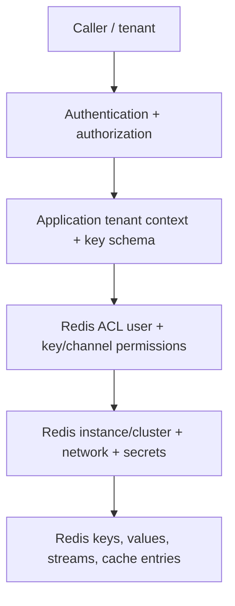
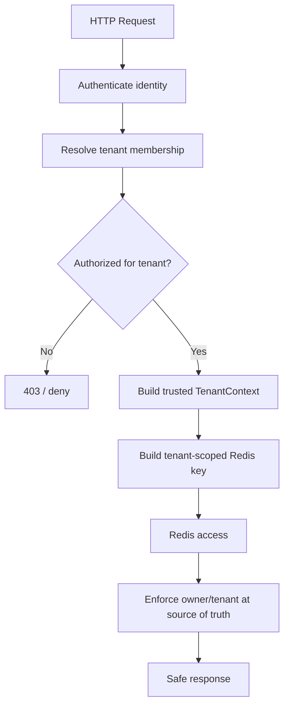

# Isolating Data Between Environments and Tenants in Spring Data Redis

> **Module:** Spring Data Redis  
> **Chapter:** Security  
> **Topic:** Designing and implementing Redis data isolation across development, staging, and production, and across tenants in multi-tenant Spring Boot applications; combining infrastructure boundaries, Redis ACLs, key namespaces, tenant identity, Spring Cache/RedisTemplate/Repositories, and cross-tenant leak testing.

## 1. Why Is Redis Data Isolation a Security Requirement?

A SaaS application shares Spring Boot services and Redis across multiple organizations:

```text
Tenant A: Company A
Tenant B: Company B

Spring Boot instances
        |
        v
     Redis
        |
        +-- cache:orders:101
        +-- cache:orders:102
        +-- session:abc
```

If a service looks up an order by ID **without scoping to the tenant**, two customers can share the same business ID. A cache key `cache:orders:101` risks:

- Tenant B's user receiving Tenant A's data due to cache key collision.
- Tenant B's update/evict wiping Tenant A's cached data.
- Staging and production writing to the same key when sharing Redis.
- `RedisCacheManager` clearing keys across multiple tenants at once.
- A background job scanning Redis and accidentally processing all tenants.
- Sessions, rate limits, or idempotency state being improperly shared.
- Workers or event consumers picking up another tenant's messages.

**Redis data isolation** establishes boundaries so one environment or tenant cannot read, modify, delete, or unduly impact another environment or tenant's data.

Distinguish two dimensions:

1. **Security isolation:** Who is allowed to read/write which Redis keys?
2. **Resource isolation:** Can one tenant overload Redis and degrade service for other tenants?

Key prefixes reduce naming collisions, yet **do not solve both problems on their own**.

### 1.1. Scenarios Requiring Protection

| Scenario | Risk Without Isolation |
|---|---|
| Dev accidentally connects to production Redis | Production data gets modified or deleted |
| Staging runs a cache-purge job | Wipes production caches |
| Two tenants share `orderId=101` | Wrong order returned |
| Cache key contains only ID | Cross-tenant cache hit |
| All tenants share one rate-limit key | Tenant A gets throttled by Tenant B's traffic |
| One Redis ACL user has access to all keys | Every tenant exposed if app/credentials compromised |
| A large tenant writes massive data | Eviction, CPU, and memory pressure hurt smaller tenants |
| Un-namespaced Redis Pub/Sub | Subscribers receive another tenant's events |
| Backups/replicas hold multiple tenants | A single backup leak exposes every tenant |

### 1.2. Design Goals

- **Zero key collisions** across environments, services, tenants, and entities.
- **Never trust a tenant ID from a request** without authentication and authorization.
- **Apply tenant scope across every access path**, not just one `GET`.
- **Restrict Redis client permissions** by least privilege.
- **Separate environments with different risk profiles**, especially production.
- **Support deleting/rotating/migrating one tenant's data** without unacceptable impact on other tenants.
- **Prevent noisy neighbors** via capacity planning and appropriate quotas/partitioning.
- **Test cross-tenant behavior**, not merely happy paths for a single tenant.

## 2. Three Isolation Layers: Infrastructure, Redis Credentials, and Application

One way to structure the design is three defensive rings:



| Layer | Primary Guarantee | Limitation |
|---|---|---|
| **Infrastructure** | Dedicated production Redis, networks, secrets, and backups | Does not stop tenant routing bugs inside the same app |
| **Redis ACL** | Restricts commands, key patterns, and Pub/Sub channels per user | A shared app credential can still read all tenant keys inside its allowed prefix |
| **Application** | Authenticates tenants, builds scoped keys, enforces ownership, filters responses | App bugs or overly broad credentials can still leak data |

**Defense in depth:** Never treat any single mechanism as an absolute barrier.

For example, `app:prod:orders:tenant:A:101` is a cleanly namespaced key. Yet if the app lets a client pass `tenant=B` arbitrarily and the Redis ACL grants `app:prod:orders:*`, the key prefix **does not stop** user A from reading B's order.

## 3. Choosing Isolation Levels by Business Requirements

### 3.1. Shared Redis Instance Distinguished Only by Key Prefix

```text
app:prod:tenant:a:...
app:prod:tenant:b:...
```

Pros:

- Low cost.
- Simple operations.
- Shared connection pools and Redis capacity.

Cons:

- All tenants share memory, CPU, and network.
- App credentials typically have broad scope.
- `FLUSHDB` or uncontrolled deletions affect everyone.
- Backups/replicas mix data from many tenants.
- A single key-routing bug can cause cross-tenant access.

**Suitable** when data sensitivity is lower, tenant boundaries are rigorously verified in the application, and shared-resource risk is acceptable. This is **logical isolation**, not infrastructure isolation.

### 3.2. Using Redis ACLs and Key Patterns

You can restrict a service account to a single namespace, such as `~app:prod:orders:*`.

Pros:

- Shrinks service privileges.
- Reduces mistakes across services and environments when prefixes differ.
- Can block dangerous commands.

Limitations:

- Key-pattern ACLs do not know which tenant is logged into an HTTP request.
- If a credential can access all of `app:prod:orders:*`, it can access both tenant A and tenant B.
- Managing per-tenant ACL users/credentials creates significant operational and connection-pool overhead.
- Redis ACLs do not grant separate memory/CPU quotas per key prefix.

### 3.3. Redis Logical Databases with SELECT

Traditional standalone Redis supports logical DB indexes (`SELECT 0`, `SELECT 1`, …) depending on configuration. However:

- They share the same Redis process, memory, CPU, and configuration.
- Server, backup, or capacity issues affect all DBs together.
- They are not a strong security boundary.
- `FLUSHALL` affects all databases if the account is permitted.
- Redis Cluster supports only database 0 and does not support isolating tenants via `SELECT` across DB indexes.

**Never use DB indexes as the primary mechanism for hard multi-tenant isolation**, especially if the project might move to Cluster.

### 3.4. Dedicated Redis Instances/Clusters

```text
Production application --> Production Redis
Staging application    --> Staging Redis
Development application--> Development Redis
```

For tenants with strict isolation requirements:

```text
Tenant A --> Redis resource A
Tenant B --> Redis resource B
```

Pros:

- Clearer boundaries for resources, backups, secrets, and permissions.
- A `FLUSHDB` on resource A cannot wipe resource B.
- Capacity and availability can be managed independently.
- Easier to satisfy per-tenant data residency/isolation requirements when designed properly.

Trade-offs:

- Higher cost for multiple Redis resources.
- More complex connection management, failover, monitoring, and lifecycle automation.
- Provisioning, rotation, and backups must be automated.
- An app bug can still route data to the wrong resource if routing/auth fails.

**Default production recommendation:** Keep production Redis separate from dev/staging. Apply key prefixes and ACLs as additional defense layers. For tenants with strict isolation needs, consider dedicated resources.

### 3.5. Comparison Table

| Isolation Level | Key Collisions | App Credential Compromise | Noisy Neighbor | Cost |
|---|---|---|---|---|
| Prefixes in shared Redis | Reduced with proper key builder | High risk if credential is broad | Shared | Low |
| Prefixes + per-service ACL | Reduced; namespace-scoped | Scoped to service | Shared | Low–Medium |
| Per-tenant ACL in shared Redis | Reduced when right credential is used | Scoped to tenant | Shared CPU/RAM | Medium–High |
| Dedicated Redis resource per environment | Strong env separation | Env credentials blocked across envs by network/secrets | Isolated across envs | Medium |
| Dedicated Redis resource per tenant | Strong resource/secret isolation | Blast radius limited per tenant | Better isolated | High |

This is a qualitative comparison. Actual security also depends on identity governance, network policies, key management, backups, and operations.

## 4. Isolating Development, Staging, and Production Environments

### 4.1. Key Prefixes Alone Are Not Enough

It is unsafe for production if:

```text
DEV service   --> redis.company.internal
STAGE service --> redis.company.internal
PROD service  --> redis.company.internal
```

and every service shares the same password, even if keys carry `dev:`, `stage:`, and `prod:` prefixes.

A misconfiguration or cleanup script can still wipe production data if permissions are not blocked.

### 4.2. Safer Architecture

```text
DEV VPC/namespace       -> DEV Redis / dev ACL / dev backups
STAGING VPC/namespace   -> STAGING Redis / staging ACL / staging backups
PROD VPC/namespace      -> PROD Redis / prod ACL / prod backups
```

Separate:

- Redis endpoints and service discovery.
- Credentials, ACL users, and secrets.
- Network policies and security groups.
- Backup/snapshot destinations.
- Monitoring and alerts.
- IaC resources and deployment permissions.
- Application profiles and feature flags.
- Data restoration procedures.

### 4.3. Per-Environment Spring Boot Configuration

Example profile configurations:

`application-dev.yml`:

```yaml
spring:
  data:
    redis:
      host: redis-dev.internal
      port: 6379

app:
  redis:
    namespace: app:dev:orders:v2
```

`application-prod.yml`:

```yaml
spring:
  data:
    redis:
      host: redis-prod.internal
      port: 6379
      ssl:
        enabled: true

app:
  redis:
    namespace: app:prod:orders:v2
```

Examples follow Spring Boot 3.x property structure; some versions use different SSL prefixes or properties. Passwords are never hardcoded in YAML examples. Use a secret manager or Kubernetes Secrets with access controls and rotation.

**Important:** A Redis namespace is an application parameter; it does not turn a dev endpoint into production or prevent pointing to the wrong server. Enforce deployment policies checking profile–endpoint–credential alignment.

### 4.4. Fail Fast on Environment Misconfiguration

Useful controls:

- Environment name/identity supplied by the deployment platform, never by requests.
- Production allowed to connect only to allowlisted endpoints.
- Production Redis credentials never present in dev/staging runtimes.
- Alerting if a service unexpectedly uses an endpoint or ACL user mismatched with its deployment.
- IAM/network policies blocking non-production workloads from reaching production Redis.

Never rely solely on `if (profile.equals("prod"))` in Java, as code or environment variables can be misconfigured.

### 4.5. Never Copy Production Snapshots Arbitrarily to Development

Redis dumps/backups may hold:

- PII.
- Sessions and tokens.
- Sensitive cached payloads.
- Idempotency results.
- Rate-limiting keys.
- Auth-related state.

To reproduce bugs, prefer synthetic data or snapshots sanitized under an approved security process. Never assume Redis is "only cache so it contains no sensitive data."

## 5. Key Namespaces: First Line of Defense in the Application

A key schema should explicitly encode its full scope:

```text
<application>:<environment>:<domain>:<schema-version>:tenant:<tenantId>:<entity>:<entityId>
```

Example:

```text
app:prod:orders:v2:tenant:t-17:order:o-101
app:prod:orders:v2:tenant:t-18:order:o-101
app:staging:orders:v2:tenant:t-17:order:o-101
```

Three distinct keys despite having the same `orderId=o-101`.

### 5.1. Namespace Components

| Component | Example | Role |
|---|---|---|
| Application | `app` or `billing` | Prevents collisions across services |
| Environment | `prod` | Prevents mixing dev/staging/prod |
| Domain | `orders` | Separates orders, sessions, and caches |
| Version | `v2` | Supports key/data schema migrations |
| Tenant | `t-17` | Prevents cross-tenant collisions |
| Entity type | `order` | Prevents order/session ID collisions |
| Entity ID | `o-101` | Identifies the resource |

Even when production Redis is physically isolated, keep `prod` in key prefixes for clearer observability and collision safety during migrations. Yet prefixes **never replace** separate infrastructure.

### 5.2. Key Builder Rules

Do not assemble keys ad hoc in every controller:

```java
String key = "order:" + orderId;
```

Instead, centralize key schema logic:

```java
public final class TenantRedisKeys {

    private final String namespace;

    public TenantRedisKeys(String namespace) {
        if (namespace == null || namespace.isBlank()) {
            throw new IllegalArgumentException("Namespace is required");
        }
        this.namespace = namespace;
    }

    public String order(String tenantId, String orderId) {
        return namespace
                + ":tenant:" + validate(tenantId)
                + ":order:" + validate(orderId);
    }

    public String orderLock(String tenantId, String orderId) {
        return namespace
                + ":tenant:" + validate(tenantId)
                + ":lock:order:" + validate(orderId);
    }

    private static String validate(String value) {
        if (value == null
                || !value.matches("[A-Za-z0-9_-]{1,64}")) {
            throw new IllegalArgumentException(
                    "Invalid Redis key component");
        }
        return value;
    }
}
```

Suppose `namespace="app:prod:orders:v2"`:

```text
order(t-17, o-101)
=> app:prod:orders:v2:tenant:t-17:order:o-101
```

Benefits:

- Consistent key schema.
- Prevents IDs containing `:` or `{}` from altering namespace boundaries.
- Simplifies version bumps.
- Simplifies collision tests.
- Simplifies domain-level Redis ACL key patterns.

**Never embed raw user input directly into Redis keys** if it can contain delimiters, wildcards, hash tags, or abnormally long strings.

### 5.3. Does Hashing a Tenant ID Replace Authorization?

You can apply SHA-256/HMAC to tenant identifiers to avoid exposing tenant names directly in Redis keys or logs. However:

- Hashing is not authorization.
- Unkeyed SHA-256 of predictable tenant IDs is vulnerable to dictionary guessing when entropy is low.
- HMAC depends on secret rotation and key schema migrations.
- The app must still verify tenant identity and resource ownership.

Never treat "hard-to-guess keys" as your only access control barrier.

## 6. Tenant Identity Must Come from a Trusted Source

The biggest threat is not an ugly key prefix, but **client-supplied tenant IDs**.

Unsafe:

```http
GET /orders/o-101
X-Tenant-Id: tenant-b
```

if the backend trusts that header to build the Redis key while the caller actually belongs to tenant A.

### 6.1. Proper Flow



Tenant identity must come from:

- **Verified** security principals or token claims.
- Membership/authorization services.
- Authenticated session state.
- Service-to-service identities authorized for the tenant.

If an API lets callers pick a tenant via URL or header, verify the caller **is authorized to act within that tenant** before constructing any key.

### 6.2. Distinguish Authentication from Authorization

- **Authentication:** verifies who the caller is.
- **Authorization:** verifies whether the caller can access tenant T, resource R, and action A.

A valid JWT does not mean every `tenantId` in a request is permitted. If a principal belongs to multiple tenants, select the active tenant explicitly and verify membership and roles.

### 6.3. Never Let Controllers Decide Tenants from Raw Input

Example abstraction:

```java
public interface VerifiedTenantResolver {
    String currentTenantId();
}
```

`VerifiedTenantResolver` is an **application-defined** interface backed by Spring Security context/membership. It must return a verified tenant, not read an arbitrary header.

Service:

```java
public class TenantOrderCache {

    private final StringRedisTemplate redis;
    private final TenantRedisKeys keys;
    private final VerifiedTenantResolver tenantResolver;

    public TenantOrderCache(
            StringRedisTemplate redis,
            TenantRedisKeys keys,
            VerifiedTenantResolver tenantResolver) {
        this.redis = redis;
        this.keys = keys;
        this.tenantResolver = tenantResolver;
    }

    public String getOrderJson(String orderId) {
        String tenantId = tenantResolver.currentTenantId();
        String key = keys.order(tenantId, orderId);
        return redis.opsForValue().get(key);
    }
}
```

This pattern standardizes key construction. Real authorization also requires:

- Checking the caller holds `read:order`.
- Ensuring the order actually belongs to that tenant at the source of truth.
- Never treating Redis key existence as proof of access rights.
- Never caching another tenant's JSON under the current tenant's key.

### 6.4. Tenant Scope in Background Jobs

Not all Redis access comes from HTTP requests. Batch jobs, scheduled tasks, and message consumers may lack a user `SecurityContext`.

Pass an **explicit tenant context** derived from trusted job metadata:

```java
public void refreshOrderForTenant(
        VerifiedJobTenant tenant,
        String orderId) {
    // tenant must be constructed after verifying job metadata.
    String key = keys.order(tenant.id(), orderId);
    // ...
}
```

`VerifiedJobTenant` is an application type, not a built-in Spring API. Never fall back to a `"default"` tenant when context is missing: a buggy job could write multi-tenant data into a shared namespace.

## 7. ThreadLocal, @Async, and Reactor Context

### 7.1. ThreadLocal Tenant Context Can Leak Across Requests

Multi-tenant apps sometimes store:

```java
TenantContextHolder.set(tenantId);
```

in a `ThreadLocal`. If `clear()` is omitted in `finally`, a reused worker thread retains the previous request's tenant:

```text
Request A -> Thread-7 -> tenant=t-17
Request B -> Thread-7 -> tenant context still t-17
```

This is a severe cross-tenant vulnerability.

If the project must use `ThreadLocal`, enforce strict scoping:

```java
try {
    TenantContextHolder.set(verifiedTenant);
    chain.doFilter(request, response);
} finally {
    TenantContextHolder.clear();
}
```

This illustrates filter logic. Always authenticate and authorize the tenant **before** setting context.

### 7.2. `@Async` Does Not Automatically Propagate All ThreadLocals

`@Async` methods, executor threads, scheduled jobs, and `CompletableFuture` tasks can run on different threads. Never assume tenant context propagates automatically.

Solutions:

- Pass verified tenant IDs explicitly as method parameters.
- Use properly designed and tested context propagation if needed.
- Never store mutable tenant state in singleton services.
- Fail fast when context is missing.
- Test interleaved requests from two tenants across the thread pool.

### 7.3. WebFlux: Reactor Context and Reactive Security

In reactive pipelines, do not rely on `ThreadLocal` tenant context across scheduler boundaries. One approach resolves the tenant from the authenticated reactive security context.

Structural example:

```java
public Mono<String> getOrderJson(String orderId) {
    return ReactiveSecurityContextHolder.getContext()
            .map(context -> context.getAuthentication())
            .flatMap(authentication ->
                    verifiedTenantService.resolve(authentication))
            .flatMap(tenantId ->
                    reactiveStringRedisTemplate.opsForValue()
                            .get(keys.order(tenantId, orderId)));
}
```

`verifiedTenantService.resolve(authentication)` is an **application-defined** method that must verify membership/authorization. In some architectures, `VerifiedTenant` is placed into Reactor `Context`; only store values created after authentication, never raw user-supplied values.

### 7.4. Never Store the Current Tenant in a Singleton Field

Wrong:

```java
@Service
class CurrentTenantService {
    private String currentTenant;
}
```

Under concurrent requests, a shared mutable field is overwritten across tenants. Tenant state must live strictly in request/security context or appropriately scoped method parameters.

## 8. RedisTemplate: Every Operation Must Use Scoped Keys

A good key builder only helps if every code path uses it.

### 8.1. Reading and Writing

```java
public void saveOrderJson(
        String tenantId,
        String orderId,
        String json) {
    String key = keys.order(tenantId, orderId);

    redis.opsForValue().set(
            key, json, Duration.ofMinutes(15));
}
```

Here `tenantId` must arrive across a trusted service boundary, never straight from an unvalidated HTTP header.

### 8.2. Evicting Cache Entries

```java
public boolean evictOrder(
        String tenantId,
        String orderId) {
    String key = keys.order(tenantId, orderId);

    Boolean deleted = redis.delete(key);
    return Boolean.TRUE.equals(deleted);
}
```

Never write:

```java
redis.delete("order:" + orderId);
```

as it can delete a shared key or collide across tenants.

### 8.3. Collection Operations

For Sets, Lists, Hashes, and ZSets, **Redis keys** must still be scoped:

```text
app:prod:orders:v2:tenant:t-17:order-index
app:prod:orders:v2:tenant:t-18:order-index
```

A Set holding tenant `t-17`'s order IDs must never be shared with `t-18`.

Example:

```java
String indexKey = namespace
        + ":tenant:" + tenantId + ":order-index";

redis.opsForSet().add(indexKey, orderId);
```

If the service later uses the Redis index to fetch orders, still check entity tenant/ownership at the authoritative source for sensitive data.

### 8.4. Serializers and Key Bytes

Redis stores keys as raw bytes. If a Java key looks like:

```text
app:prod:orders:v2:tenant:t-17:order:o-101
```

yet the serializer wraps bytes using JDK serialization, Redis ACL patterns, hash tags, and CLI diagnostics behave unexpectedly.

Use a predictable key serializer, usually `StringRedisSerializer`:

```java
@Bean
RedisTemplate<String, String> scopedRedisTemplate(
        RedisConnectionFactory connectionFactory) {

    RedisTemplate<String, String> template =
            new RedisTemplate<>();

    template.setConnectionFactory(connectionFactory);
    template.setKeySerializer(new StringRedisSerializer());
    template.setValueSerializer(new StringRedisSerializer());
    template.setHashKeySerializer(new StringRedisSerializer());
    template.setHashValueSerializer(new StringRedisSerializer());
    template.afterPropertiesSet();

    return template;
}
```

For String keys and values, the built-in `StringRedisTemplate` is usually simpler. Ensure all readers and writers use the same format.

## 9. Spring Cache Abstraction: Risk of Cross-Tenant Cache Hits

This bug is easy to miss:

```java
@Cacheable(cacheNames = "orders", key = "#orderId")
public OrderDto getOrder(String orderId) {
    return database.loadOrder(orderId);
}
```

Suppose Tenants A and B both have `orderId=o-101`. The cache key becomes identical:

```text
orders::o-101
```

If one tenant calls first, the second tenant receives the first tenant's cached result—**even when the database query filters by tenant properly**. Reason: `@Cacheable` returns the cached hit **without invoking the method body**.

### 9.1. Include the Tenant in the Cache Key

An explicit approach:

```java
@Cacheable(
        cacheNames = "orders",
        key = "#tenantId + ':' + #orderId")
public OrderDto findOrder(
        String tenantId,
        String orderId) {
    return repository.findByTenantIdAndId(tenantId, orderId)
            .orElseThrow();
}
```

Preconditions: `tenantId` is **authenticated/authorized** by the caller layer, and the repository query filters by both tenant and order ID.

**Do not** assume having `tenantId` in the method parameters is enough. If the controller lets the client supply any tenant ID, the cache key can still be abused.

### 9.2. Using a KeyGenerator or Key Builder Bean

When many methods share the same policy, create a `KeyGenerator` or helper bean producing keys from the verified tenant.

Conceptual example:

```java
@Component("tenantCacheKeys")
public class TenantCacheKeys {

    private final VerifiedTenantResolver tenantResolver;

    public TenantCacheKeys(VerifiedTenantResolver tenantResolver) {
        this.tenantResolver = tenantResolver;
    }

    public String order(String orderId) {
        return tenantResolver.currentTenantId() + ":order:" + orderId;
    }
}
```

Used with SpEL:

```java
@Cacheable(
        cacheNames = "orders",
        key = "@tenantCacheKeys.order(#orderId)")
public OrderDto findOrder(String orderId) {
    return orderSource.loadAuthorizedOrder(orderId);
}
```

Requirements:

- `currentTenantId()` returns a verified tenant.
- `loadAuthorizedOrder()` also enforces resource ownership.
- Context works properly across threads, async, and reactive calls.
- Never use a Spring MVC `ThreadLocal` helper lacking propagation in WebFlux.

### 9.3. RedisCacheManager Prefix

Configure prefixes to separate applications and environments:

```java
@Configuration
public class RedisCacheConfig {

    @Bean
    RedisCacheManager redisCacheManager(
            RedisConnectionFactory connectionFactory) {

        RedisCacheConfiguration defaults =
                RedisCacheConfiguration.defaultCacheConfig()
                    .computePrefixWith(cacheName ->
                            "app:prod:orders:v2:cache:"
                            + cacheName + "::")
                    .entryTtl(Duration.ofMinutes(10))
                    .serializeKeysWith(
                            RedisSerializationContext
                                    .SerializationPair
                                    .fromSerializer(
                                            new StringRedisSerializer()));

        return RedisCacheManager.builder(connectionFactory)
                .cacheDefaults(defaults)
                .build();
    }
}
```

Imports come from Spring Data Redis cache/config/serialization packages and Java `Duration`.

Example generated key:

```text
app:prod:orders:v2:cache:orders::t-17:o-101
```

**Both conditions are required:**

1. `RedisCacheManager` prefix separates service and environment.
2. Cache key or cache namespace separates tenants.

Setting `computePrefixWith(cacheName -> "app:prod:...")` while leaving the key as `orderId` **does not** prevent cross-tenant cache collisions.

### 9.4. `@CacheEvict(allEntries=true)` Is a Major Risk

Example:

```java
@CacheEvict(cacheNames = "orders", allEntries = true)
public void clearOrdersCache() {
}
```

If the `orders` cache is shared across tenants, `allEntries=true` clears the **entire cache name**, not just the active tenant. Tenant A can wipe Tenant B's cache.

Consequences:

- Cache miss storms across multiple tenants.
- Stale/fresh data inconsistencies during refreshes.
- Loss of resource isolation.
- Other tenants suffer high latency because of Tenant A's action.

Mitigations:

- Prefer evicting specific tenant-scoped keys.
- For per-tenant clearing, design per-tenant namespaces/versions or a genuinely tenant-scoped clearing mechanism.
- Never invoke `clear()` on a global cache to clear one tenant.
- If scanning/deleting by tenant prefix, use bounded batched scans aware of Redis Cluster/replication; never run `KEYS *` arbitrarily.
- Test that clearing A's cache leaves B's keys untouched.

### 9.5. Cache Put and Cache Evict Must Share the Exact Same Key Schema

Another bug:

```java
@Cacheable(key = "#tenantId + ':' + #orderId")
@CacheEvict(key = "#orderId")
```

When key expressions diverge, eviction either targets the wrong key or leaves stale data behind. Centralize key construction and test read/write/evict together.

### 9.6. Cached Responses Still Require Authorization

When caches hold sensitive data, never treat "successfully reading a cached DTO" as authorization. Check caller permissions **before** returning a cache hit via service boundaries or authorization infrastructure.

Especially when permissions change (role revoked, tenant membership removed), a key scoped only by tenant ID may not suffice. Consider principal/role scoping, active invalidation, short TTLs, or per-read authorization checks.

## 10. Redis Repositories and Secondary Indexes

Spring Data Redis Repositories with `@RedisHash`, `@Id`, and `@Indexed` generate multiple keys automatically:

- Entity Hash.
- Keyspace metadata.
- Secondary indexes.
- TTL-related metadata.

Example:

```java
@RedisHash("orders")
public class OrderCacheEntity {

    @Id
    private String id;

    @Indexed
    private String status;
}
```

If `id=o-101` exists for two tenants and `@Id` holds only `orderId`, entities **collide** in Redis keyspace.

### 10.1. Application-Managed Compound IDs

You can use a scoped ID:

```text
t-17:o-101
t-18:o-101
```

or a consistent key builder. However, never assume a scoped entity ID makes **every secondary index or repository finder tenant-scoped**.

For example, a finder:

```java
findByStatus("PENDING")
```

can return entries from multiple tenants unless the query/index includes a tenant filter. Repository APIs do not infer the active tenant automatically.

### 10.2. Inspect the Index Keyspace Too

A repository may create:

```text
orders:<id>
orders:status:<value>
metadata/index keys ...
```

Names are illustrative, not fixed contracts across all Spring Data Redis versions. If a shared index holds multiple tenants, querying by status can expose another tenant's IDs unless the service filters or authorizes results.

For strict isolation:

- Model the tenant in both entity IDs and queries.
- Inspect the actual index keys created by your Spring Data Redis version.
- Never expose broad finders lacking a tenant boundary.
- Evaluate whether keyspace/index generation controls meet your requirements.
- Consider `RedisTemplate` with self-managed key schemas if repositories do not fit.
- The database/source of truth must also enforce tenant filtering.

### 10.3. TTL and Keyspace Events

Repositories may use TTLs and keyspace notifications. Expiration event listeners can receive keys/IDs from multiple tenants. Handlers must parse and validate tenant scope and act on the right tenant—never falling back to a default tenant.

Never assume TTL events carry a verified tenant context automatically.

## 11. Redis Cluster and Hash Tags in Multi-Tenant Key Schemas

Redis Cluster maps keys across 16,384 hash slots. Hash tags `{...}` force keys sharing the same tag into the same slot.

Example for an order belonging to tenant `t-17`:

```text
app:prod:orders:v2:{t-17|o-101}:state
app:prod:orders:v2:{t-17|o-101}:items
app:prod:orders:v2:{t-17|o-101}:payment
```

All three keys share the tag and land in the same slot, allowing valid multi-key Redis commands on the same shard.

### 11.1. Why Must the Tag Include the Tenant?

Suppose you tag only the order ID:

```text
app:prod:orders:v2:tenant:t-17:order:{o-101}:state
app:prod:orders:v2:tenant:t-18:order:{o-101}:state
```

The keys are distinct so data does not collide, yet sharing `{o-101}` co-locates different tenants onto the same slot. When co-location is needed **per tenant + aggregate**, include both in the tag.

### 11.2. Never Tag an Entire Tenant Unless Required

```text
app:prod:orders:v2:{tenant-t-17}:order:1
app:prod:orders:v2:{tenant-t-17}:order:2
app:prod:orders:v2:{tenant-t-17}:order:3
```

Every key for tenant `t-17` lands in a single slot. A large tenant can trigger a **hot shard**.

Co-locate only the smallest scope that genuinely requires atomic multi-key commands, such as `{t-17|o-101}`. Let independent orders distribute across slots.

### 11.3. Hash Tags Are Not Authorization

Even when a tag includes the tenant ID, Redis has no concept of tenant membership. A credential with namespace-wide access can still read another tenant's key if the app sends that key name.

Hash tags control **slot placement**, not security.

### 11.4. Do Not Rely on SELECT DB for Redis Cluster

Redis Cluster does not support multiple logical database indexes like standalone Redis. Isolating tenants by database number will fail in Cluster deployments.

## 12. Redis ACLs: Restricting Commands and Key Patterns

Redis ACLs let you create users with scoped command and key pattern permissions depending on Redis version.

Conceptual example for a production orders service:

```redis
ACL SETUSER svc_orders_prod on >REPLACE_WITH_STRONG_SECRET ~app:prod:orders:* +GET +SET +DEL +HGET +HSET +EXPIRE
```

**This is illustrative syntax requiring proper admin procedures and secret protection; never paste real secrets into terminals, source control, or logs.** Additional commands needed by the framework may need to be granted after testing.

### 12.1. ACLs Protect Services, Not Individual Tenants Automatically

The pattern:

```text
~app:prod:orders:*
```

grants access to all keys in the given namespace, including:

```text
app:prod:orders:v2:tenant:t-17:...
app:prod:orders:v2:tenant:t-18:...
```

Meaning Redis ACLs on a **shared service credential** do not replace application-level tenant authorization.

### 12.2. Per-Tenant ACLs When Stronger Protection Is Needed

In principle, you can create credentials scoped to a specific tenant's key pattern:

```text
~app:prod:orders:v2:tenant:t-17:*
```

Operational challenges include:

- Growing number of ACL users/credentials.
- Managing connection pools per credential.
- Rotating secrets per tenant.
- Ensuring Tenant A's credentials are never used for Tenant B's requests.
- Cross-tenant jobs/aggregations require controlled admin mechanisms.
- CPU, RAM, and the Redis process are still shared.

For hard isolation requirements and large tenants, dedicated Redis resources are often easier to reason about than complex multi-tenant ACL architectures.

### 12.3. Restrict Dangerous Commands

Service accounts should not have arbitrary access to:

- `FLUSHALL`, `FLUSHDB`.
- `CONFIG` administration.
- `ACL` management.
- `DEBUG` and sensitive admin commands.
- `KEYS`/`SCAN` unless serving a controlled use case.
- Unused Pub/Sub, Function, or scripting commands.

In production, grant **only actually required commands** instead of `+@all`, and check whether the framework sends extra commands for transactions, health checks, or Cluster routing.

### 12.4. Pub/Sub Channel ACLs

Redis ACLs also support channel pattern rules in compatible Redis versions. When using Pub/Sub, scope channel names:

```text
app:prod:orders:tenant:t-17:events
app:prod:orders:tenant:t-18:events
```

Services can be restricted to subscribing only to their permitted channels when Redis permissions are structured accordingly. Yet if a shared app credential subscribes to `app:prod:orders:*`, the app must still validate tenant context so events never reach the wrong caller.

## 13. Redis TLS, Network Segmentation, and Credentials

Key prefixes do not help if credentials or traffic are intercepted.

### 13.1. Protect Traffic in Transit

- Enable TLS with Redis when required by environment policy.
- Verify server certificates.
- Avoid disabling certificate verification in production.
- Place Redis on a private network with tight inbound rules.
- Never expose Redis ports publicly without strict controls.
- Restrict workload network identities.
- Set sensible timeouts and connection policies.

### 13.2. Protect Secrets

- Give each environment its own secrets.
- Never commit passwords or ACL credentials to Git.
- Use a secret manager or runtime secret injection.
- Plan regular credential rotation.
- Consider the blast radius of a secret leak.
- Never log URIs containing passwords.

### 13.3. Backups and Replication

Redis backups and replicas hold data across all tenants in that instance. Protect them at the same level as the primary store:

- Encryption at rest per platform capabilities.
- IAM/ACLs on snapshot buckets and control planes.
- Retention policies.
- Tenant-aware deletion/retention workflows where required.
- Procedures to restore only into matching environments.
- Never restore production backups into uncontrolled dev environments.

Never assume key TTLs mean data vanishes immediately from all snapshots or backups.

## 14. Pub/Sub and Redis Streams Also Require Tenant Scoping

### 14.1. Pub/Sub

If all tenants share:

```text
orders:events
```

a subscriber can receive events for multiple tenants.

Name channels by tenant:

```text
app:prod:orders:tenant:t-17:events
app:prod:orders:tenant:t-18:events
```

Or if architecture dictates a shared channel, embed a verified tenant identifier in every message and authorize/filter in consumers. Still, shared channels raise the risk of misconfigured consumers seeing all events; dedicated channels and ACLs are often safer.

Redis Pub/Sub does not guarantee durable replay or exactly-once delivery; that is orthogonal to tenant isolation.

### 14.2. Redis Streams

Keys:

```text
app:prod:orders:v2:tenant:t-17:stream:events
app:prod:orders:v2:tenant:t-18:stream:events
```

Consumers must:

- Read only from assigned tenant streams.
- Avoid shared consumer-group logic mixing IDs/offsets across tenants.
- Verify the tenant before updating databases.
- Handle retries/reclaims without crossing events to another tenant.
- Cap stream retention/length so a large tenant cannot exhaust memory.

If sharing one stream, include tenant identity in the event schema and enforce authorization/validation in consumers—never blindly trust unverified producer fields.

### 14.3. Keyspace Notifications

Keyspace notifications can reveal key names or metadata from other tenants to broadly subscribed clients. Enable and subscribe only as needed; enforce channel permissions, namespaces, and event ownership checks.

Never build security controls assuming keyspace notifications are always delivered, as Pub/Sub events can drop and providers may restrict configuration.

## 15. Sessions and Token Caches

Keys storing session or authorization state are highly sensitive:

```text
app:prod:auth:v2:tenant:t-17:session:s-abc
app:prod:auth:v2:tenant:t-18:session:s-def
```

Requirements:

- Bind sessions to user and tenant, checking authorization on use.
- Tenant switching must not reuse cached permissions from the previous tenant.
- Handle logout and revocation cleanly.
- Set TTLs matching authentication policy.
- Never use session IDs as Redis ACL credentials.
- Never put raw tokens in Redis key names or logs.
- Protect Redis sessions via network isolation, ACLs, and at-rest backup controls.

When using Spring Session Redis, the framework generates internal keys and indexes. **Never assume every generated key embeds the tenant** simply because the app knows the tenant. Inspect actual namespace and session repository behavior, and test tenant switching, revocation, and indexing.

## 16. Per-Tenant Rate Limiting

If sharing one key:

```text
rate:api:requests
```

Tenant A's traffic throttles Tenant B, and vice versa.

Instead use:

```text
app:prod:api:v2:tenant:t-17:rate:POST-orders
app:prod:api:v2:tenant:t-18:rate:POST-orders
```

For per-user quotas within a tenant:

```text
app:prod:api:v2:tenant:t-17:user:u-55:rate:POST-orders
```

Define:

- Is the quota per tenant or per user?
- Window period and TTL.
- Algorithm: fixed window, sliding window, token bucket, etc.
- Behavior when a user switches tenants.
- Fairness across tenants.
- Fail-open vs. fail-closed behavior if Redis becomes unavailable.

**Redis does not automatically enforce per-key-prefix CPU/memory quotas.** Application rate limits help regulate request volume, not replace Redis resource isolation.

## 17. Idempotency Keys, Distributed Locks, and Caches Must Be Tenant-Scoped

### 17.1. Idempotency Keys

Wrong:

```text
idem:request-123
```

because two tenants can both send `Idempotency-Key: request-123`.

Better:

```text
app:prod:orders:v2:tenant:t-17:idem:POST-orders:request-123
app:prod:orders:v2:tenant:t-18:idem:POST-orders:request-123
```

An operation scope should include:

- Environment.
- Service/domain.
- Verified tenant.
- Operation name/version.
- Client idempotency key.

When replaying a cached result, confirm the current caller still holds rights to that tenant and resource. An unguessable key alone is not enough to return sensitive responses.

### 17.2. Distributed Locks

Wrong:

```text
lock:order:o-101
```

If order IDs overlap across tenants, one tenant blocks another tenant's work.

Better:

```text
app:prod:orders:v2:tenant:t-17:lock:order:o-101
```

Leases/owner tokens and Lua compare-and-delete remain necessary so stale workers do not delete newer locks. Tenant scoping does not solve lease expiration or fencing.

### 17.3. Cache-Aside

Caches must be partitioned:

```text
Tenant A -> app:prod:orders:v2:tenant:t-17:order:o-101
Tenant B -> app:prod:orders:v2:tenant:t-18:order:o-101
```

If a DB query omits the tenant filter even though the key has Tenant A's prefix, Tenant B's data can be cached under Tenant A's key. Protect **database query + cache key + response authorization** together.

## 18. Deleting One Tenant's Data Without Impacting Others

Common requirements: tenant closes an account, migrates data region, or needs scoped cache purging.

Avoid:

```redis
FLUSHDB
FLUSHALL
```

on a shared Redis.

### 18.1. Delete Exact Known Keys

When key names are known, call `DEL`/`UNLINK` for that tenant's exact keys. Avoid uncontrolled broad wildcards.

### 18.2. Scanning by Namespace with SCAN

You can use `SCAN` with a match pattern inside a controlled admin workflow:

```text
MATCH app:prod:orders:v2:tenant:t-17:*
```

Caveats:

- `SCAN` is cursor-based; it does not provide a consistent snapshot while keys mutate.
- Redis Cluster requires scanning every primary node or using a cluster-aware API.
- Keep batches small and rate-limited to avoid blocking Redis.
- Use a strictly validated tenant ID—never user input containing wildcards.
- Never run `KEYS *` on large production datasets.
- Account for concurrent application writes during cleanup.
- Maintain audit logs and dry-run/preview checks for high-impact runs.

### 18.3. Versioned Namespaces

One cache invalidation technique embeds a per-tenant generation number into the key:

```text
app:prod:orders:v2:tenant:t-17:gen:7:order:o-101
app:prod:orders:v2:tenant:t-17:gen:8:order:o-101
```

Once the generation increments, new reads ignore the older generation. However:

- Old entries remain in RAM until TTL or cleanup.
- Generation state must be consistent and securely managed.
- Generations must never be reset arbitrarily.
- Ignoring keys does not delete data from backups.
- For highly sensitive offboarding, perform actual deletion rather than merely dropping references.

### 18.4. Do Not Delete Only the Cache

During tenant offboarding, also review:

- Primary database records.
- Redis caches.
- Redis sessions.
- Stream/pubsub retention.
- Repository secondary indexes.
- Background jobs and in-flight operations.
- Backups/snapshots under retention policies.
- Logs and observability stores holding related data.

Deleting a Redis key alone does not clear every location where data exists.

## 19. Noisy Neighbor: Data Isolation Does Not Mean Resource Isolation

Suppose a shared Redis holds 10 tenants, and one large tenant suddenly writes 2 million cache keys.

Consequences:

- Redis memory surges.
- Eviction may evict keys belonging to other tenants.
- CPU and network load increase.
- Tail latency degrades for all tenants.
- Replication and persistence overhead climb.
- Redis client connection pools saturate.

Key prefixes separate names, **not RAM or CPU quotas**.

### 19.1. Application-Layer Safeguards

- Rate-limit requests per tenant.
- Cap key counts, value sizes, and TTLs per use case.
- Bound concurrent Redis operations per tenant.
- Apply cache admission policies for heavy tenants.
- Never cache unbounded oversized responses.
- Separate workloads like sessions vs. analytics caches with different priorities.
- Monitor per-tenant memory/ops at the app layer using aggregated metrics.

### 19.2. Limits of Prefix-Based Quotas

Redis does not enforce hard CPU/memory quotas per arbitrary key prefix in a shared instance out of the box. App-level quota logic helps, though buggy or direct credential access can bypass it.

When hard resource isolation is required, choose dedicated Redis instances/clusters or tiered pools with explicit capacity policies.

### 19.3. Per-Tenant Metrics Can Cause High Cardinality

Measuring per-tenant QPS and cache footprint is helpful, yet with hundreds of thousands of tenants a `tenantId` metric label blows up cardinality.

Tips:

- Label by tier/plan/bucket instead of every raw tenant ID in Prometheus.
- Identify top-N tenants via logs, tracing, or sampled analytics.
- Track exceptions, evictions, and latency by service and workload.
- Protect tenant IDs in observability data.

## 20. Protect Permissions at the Source of Truth, Not Only in Cache

If the source database queries orders as:

```sql
SELECT *
FROM orders
WHERE id = :orderId;
```

missing `tenant_id`, a request from tenant A can load tenant B's order even if the Redis key uses A's prefix.

Require:

```sql
SELECT *
FROM orders
WHERE tenant_id = :tenantId
  AND id = :orderId;
```

And the authorization layer must confirm `tenantId` belongs to the caller. If the database supports row-level security or tenancy policies, add them as defense in depth.

### 20.1. Cross-Tenant Cache Poisoning

A broken flow:

```text
Caller A -> key tenant:A:order:101 -> MISS
DB query by orderId only -> returns B's order
App SET tenant:A:order:101 = B's data
Caller A retries -> HIT and keeps receiving B's data
```

The key prefix is right, yet the wrong data entered at load time.

Prevention:

1. Tenant-scoped source queries.
2. Domain objects carry `tenantId`, verified before caching.
3. Cache keys use verified tenant IDs.
4. Authorization checks run before returning responses.
5. Integration tests intentionally use matching resource IDs across A and B.

### 20.2. Cache-Aside and Invalidation

An update for tenant A must evict tenant A's key, never a global prefix. Moreover, if permissions are revoked, previously cached data needs tight TTLs or re-authorization.

## 21. Migrating Key Schemas Without Exposing Legacy Data

When migrating from single-tenant to multi-tenant:

```text
Old: order:o-101
New: app:prod:orders:v2:tenant:t-17:order:o-101
```

You cannot just swap the key builder and assume legacy data is safe.

### 21.1. Migration Risks

- Legacy keys lack tenant context, making ownership ambiguous.
- Dual-read fallbacks to legacy keys can serve another tenant's data.
- Legacy cache invalidations may delete the wrong entries.
- Old Repository indexes hold unscoped IDs.
- Two running app versions may write incompatible formats.
- Legacy keys persist in backups.

### 21.2. Safer Approach

1. Define the new schema and canonical key builder.
2. Verify tenant ownership at the source of truth.
3. Backfill legacy entries only when ownership is proven.
4. If ownership cannot be proven, discard legacy caches and rebuild from the source of truth.
5. Never fall back automatically from new keys to unscoped legacy keys without proven tenant mapping.
6. Cut over all producers, consumers, and evictors.
7. Monitor whether legacy keys are still read or written.
8. Clean up legacy data on a controlled schedule.
9. Test both rollout and rollback; avoid rolling back to an unscoped key schema.

If Redis is the primary store rather than a cache, use transactional/reconciliation migration workflows—never wipe legacy data blindly.

## 22. Logging, Tracing, and Auditing

During a cross-tenant incident, you need to identify:

- Authenticated caller identity/role.
- Verified tenant.
- Operation: GET/SET/DEL/CACHE_EVICT/PUBLISH/XREAD...
- Key namespace (without logging raw secrets or key payloads).
- Redis ACL user/service account.
- Application environment.
- Cache hit/miss/error.
- Authorization decision.
- Correlation/trace ID.

### 22.1. Suggested Structured Log

```json
{
  "event": "REDIS_ORDER_CACHE_READ",
  "environment": "prod",
  "service": "orders",
  "tenantRef": "hashed-tenant-reference",
  "keyNamespace": "app:prod:orders:v2",
  "operation": "GET",
  "cacheResult": "HIT",
  "traceId": "trace-example"
}
```

Never log session tokens, secrets, raw personal data, or full Redis values. Where logs retain tenant identifiers, apply matching retention and access controls.

### 22.2. Alerting

Alert on:

- Key accesses outside expected namespaces.
- Unusual Redis ACL `NOPERM`/`NOAUTH` denials.
- App instances connecting to the wrong environment endpoint.
- Bulk delete or `FLUSH` attempts.
- Broad-scope cache clears.
- Redis memory/eviction spikes triggered by tenant traffic bursts.
- Sudden jumps in key counts or bytes.
- Redis connection counts or command QPS nearing capacity.
- Cross-tenant canary/test failures.

## 23. Testing Against Cross-Tenant Access

This test group matters even more than testing happy-path cache hits.

### 23.1. Two Tenants Sharing the Same Resource ID

Setup:

```text
Tenant A, orderId=o-101, value=A-data
Tenant B, orderId=o-101, value=B-data
```

Expectations:

- A reads A-data.
- B reads B-data.
- Cache hits are isolated.
- A updating/evicting never alters B-data.
- B cannot spoof headers to read A-data.

### 23.2. Testing Spring Cache Collisions

An integration test:

1. Authenticate as tenant A.
2. Call the cached method for orderId `o-101`.
3. Authenticate as tenant B.
4. Call the same method with the same order ID.
5. Verify B's response contains zero data from A.
6. Trigger `@CacheEvict` as A.
7. Verify B's cache still holds its entry and was not wiped.

### 23.3. Testing Tenant Context Propagation

Test:

- Spring MVC thread-pool reuse.
- `@Async` tasks.
- Scheduled jobs.
- WebFlux Reactor context and scheduler switches.
- Nested service calls.
- Interleaved concurrent requests from A and B.
- Missing tenant context failing fast.

Goal: ensure no singleton or thread retains a previous request's tenant context.

### 23.4. Testing Redis ACLs

In a dedicated test environment:

- Service A can read its permitted key patterns.
- Service A is denied when accessing ungranted namespaces.
- `FLUSHDB`/`FLUSHALL` are rejected.
- Subscribing to out-of-scope Pub/Sub channels is rejected.
- Shared production credentials are never used in tests.

Verify any extra commands needed by framework features explicitly rather than reflexively opening `+@all`.

### 23.5. Testing Redis Cluster

- Confirm key builders and serializers produce expected namespaces and bytes.
- Confirm aggregate hash tags co-locate operations needing one slot.
- Confirm tenant keys are not all forced into a single hot slot.
- Confirm multi-key scripts never span slots.
- Confirm failover/topology refreshes preserve tenant routing.

### 23.6. Testing Cleanup and Offboarding

After purging tenant A:

- A's keys are handled per policy.
- B's keys remain intact.
- Sessions, jobs, and events tied to A are invalidated per contract.
- No global `FLUSH` was executed.
- Migration/backup retention rules are respected.

## 24. Example Architecture for a Multi-Tenant Orders Service

### 24.1. Boundaries

```text
Authenticated client
       |
       v
Spring Security: identity + tenant membership
       |
       v
OrderService
       |
       +-- TenantRedisKeys
       |     +-- app:prod:orders:v2:tenant:t-17:order:o-101
       |
       +-- StringRedisTemplate (Redis ACL svc_orders_prod)
       |     +-- Production Redis (private/TLS)
       |
       +-- OrderRepository
             +-- DB query tenant_id = t-17 AND order_id = o-101
```

These boundaries enforce three guarantees:

1. Identity and authorization decide which tenant may be accessed.
2. Redis namespaces prevent collisions and support ACLs/operations.
3. Database/source of truth enforces tenant ownership independently of cache.

### 24.2. A Safer Read Path

```java
public OrderDto findOrder(String orderId) {
    String tenant = verifiedTenantResolver.currentTenantId();

    authorization.checkCanReadOrders(tenant);

    String key = tenantRedisKeys.order(tenant, orderId);

    String json = redis.opsForValue().get(key);
    if (json != null) {
        OrderDto cached = objectMapper.readValue(
                json, OrderDto.class);
        if (!tenant.equals(cached.tenantId())) {
            throw new SecurityException(
                    "Tenant mismatch in cached order");
        }
        return cached;
    }

    OrderDto order = orderRepository
            .findByTenantIdAndOrderId(tenant, orderId)
            .orElseThrow();

    redis.opsForValue().set(
            key,
            objectMapper.writeValueAsString(order),
            Duration.ofMinutes(10));

    return order;
}
```

This snippet illustrates business flow; `authorization`, `verifiedTenantResolver`, `OrderDto`, and `OrderRepository` are application abstractions, and JSON exceptions must be handled or declared per implementation.

**Do not treat this code sketch as a complete copy-paste component** without adding dependencies, try/catch handling, transaction/fallback policy, authorization, and DTO contracts.

### 24.3. Fail-Open Cache Must Never Mean Fail-Open Authorization

If the Redis cache errors, falling back to the database is acceptable **only if** Redis is strictly a cache and the database enforces tenant filtering. Never return another tenant's data or skip authorization because the cache is unavailable.

Example policy:

```text
Redis GET fails
    -> record metrics
    -> DB query WHERE tenant_id = verifiedTenant
    -> verify owner/authorization
    -> return result or appropriate error
```

## 25. Common Mistakes

### 25.1. Using `SELECT` Database Indexes to Isolate Production and Staging

Logical DBs are neither strong security nor resource boundaries; Redis Cluster does not support multiple DB indexes. Use separate Redis resources and credentials per environment.

### 25.2. Relying Solely on Key Prefixes for Security

If a credential accesses the entire namespace and the app allows arbitrary tenant selection, prefixes will not prevent cross-tenant access. Combine auth, ACLs, and infrastructure boundaries.

### 25.3. Trusting `X-Tenant-Id` Without Verification

Callers can forge headers. Resolve tenant scope from verified identity and membership.

### 25.4. `@Cacheable(key="#id")` in Multi-Tenant SaaS

Two tenants sharing an ID can receive each other's cached values. Cache keys must include the verified tenant or use a tenant-specific namespace.

### 25.5. `@CacheEvict(allEntries=true)` for One Tenant

Clears the entire shared cache and impacts other tenants. Use key-specific eviction or tenant-scoped cache designs.

### 25.6. Redis Repository Entity ID Scoped, Secondary Index Unscoped

Finders and indexes can still return IDs across tenants. Audit repository mapping and enforce tenant filters.

### 25.7. ThreadLocal Tenant Not Cleared After Request

Thread-pool reuse can leak one request's tenant into the next. Always clear in `try/finally` and test concurrency, or pass context explicitly.

### 25.8. Tagging an Entire Tenant in One Hash Tag

A large tenant gets pinned to one Redis Cluster hash slot, creating a hot shard. Co-locate only the smallest aggregate needing atomicity.

### 25.9. Sharing One ACL Credential Across All Environments

A compromised dev app could access production if networks/credentials overlap. Separate least-privilege ACLs, secrets, and networks.

### 25.10. Shared Pub/Sub Channels Without Tenant Filtering

Consumers can receive other tenants' events. Use scoped channels or strict message authorization.

### 25.11. Running `FLUSHDB` When Offboarding One Tenant

Wipes every tenant sharing that database. Delete only scoped keys following a controlled cleanup workflow.

### 25.12. Embedding Sensitive Data in Redis Key Names

Keys surface in logs, monitoring, slowlogs, snapshots, and CLI sessions. Keep raw tokens, emails, and PII out of keys unless strictly required.

### 25.13. Assuming Prefixed Shared Redis Grants Per-Tenant Quotas

False. Memory, CPU, and network remain shared. Add application quotas or true resource isolation.

### 25.14. Tenant-Scoped Cache Key with Unfiltered DB Query

Can poison Tenant A's key with Tenant B's data. Enforce tenant ownership at the source of truth before caching.

### 25.15. Auto-Fallback Migration Reading Unscoped Legacy Keys

Legacy keys may belong to another tenant. Backfill only when ownership is known; rebuild regenerable caches from the source of truth.

## 26. Frequently Asked Questions

**1. Is adding `tenantId` to the Redis key enough for security?**

No. It reduces key collisions, yet does not replace authentication, authorization, Redis ACLs, and tenant-filtered data sources.

**2. Are Redis logical databases suitable for isolating tenants?**

They separate names in standalone setups, not hard isolation; resources are shared and Redis Cluster supports only DB 0.

**3. Can production and staging share Redis if prefixes differ?**

Technically possible, yet higher-risk and generally discouraged. Separate production resources, networks, credentials, and backups whenever possible.

**4. Do Redis ACLs understand the tenant inside a JWT?**

No. ACLs inspect Redis user, command, key, and channel patterns—not HTTP authenticated tenants. The application must enforce tenant authorization.

**5. Can a credential be restricted to keys of a single tenant?**

Yes, via ACL key patterns if your architecture uses per-tenant users/credentials, though it adds operational complexity and still shares CPU/RAM.

**6. Why does Spring Cache leak data more easily than explicit `RedisTemplate` code?**

Cache interception can return hits before the method body executes. If the cache key omits the tenant, a tenant-filtered repository call inside the method never runs on cache hits.

**7. Should `userId` also be included in cache keys?**

Depends on data scope. Tenant scope is the minimum for tenant-wide data; user/role-dependent data may need principal scope or per-read authorization.

**8. Are Redis Repositories multi-tenant automatically?**

Never assume so. Entity IDs, secondary indexes, TTL metadata, and finders must be verified against your version and data model.

**9. Are hash tags a security isolation mechanism?**

No. Hash tags affect only Redis Cluster hash slot placement.

**10. Should one `{tenantId}` hash tag be used for all keys of a tenant?**

Only if multiple keys truly require the same slot. Large tenants create hot shards; usually tag by a smaller aggregate.

**11. Can tenant caches be purged with `KEYS tenant:*` then `DEL`?**

Avoid `KEYS` on large production keyspaces. Use bounded `SCAN`/batched deletes with validated prefixes, aware of Cluster topology, concurrent writes, and load.

**12. Does TLS prevent cross-tenant cache hits?**

No. TLS secures transport, not key or authorization logic.

**13. Does a per-tenant Redis instance eliminate all cross-tenant bugs?**

No. Broken app routing can still talk to the wrong instance; test verified tenant-to-resource mapping.

**14. Can tenant IDs be cached inside sessions?**

Yes, if session lifecycles, tenant switching, revocation, and authorization are validated. Never blindly trust unverified session metadata.

**15. Can Redis Pub/Sub leak across tenants?**

Yes, if channels, credentials, and consumers are shared without filtering. Enforce namespaces, channel ACL patterns, and validation.

**16. Do Redis key prefixes include per-tenant memory quotas?**

No. Shared Redis shares RAM and CPU; enforce quotas in the app or isolate infrastructure when strict limits are needed.

**17. During a Redis outage, can the app skip tenant checks and read the DB?**

No. Fallback is valid only while preserving tenant authorization and tenant-scoped DB queries.

**18. Should full Redis keys be logged for debugging?**

Not by default, since keys may expose tenant IDs or tokens. Prefer namespaces, hashed references, correlation IDs, and redaction.

## 27. Multi-Tenant Redis Security Implementation Checklist

1. **Separate production Redis** from dev/staging at resource, network, and secret layers where appropriate.
2. **Enforce least-privilege Redis ACLs** per service/domain; avoid shared admin credentials.
3. **Require TLS and private networking** to protect traffic.
4. **Define a key schema** encoding service, environment, version, and tenant.
5. **Validate/encode key components** so delimiters and hash tags cannot be injected.
6. **Resolve tenant from verified security context/membership**, never raw headers.
7. **Check authorization** per resource/action, including on cache hits.
8. **Enforce tenant filters at the database/source of truth**.
9. **Include verified tenant in Spring `@Cacheable` keys**.
10. **Ensure cache evictions never clear shared caches** for a single tenant.
11. **Keep Redis Repository indexes/finders scoped** and explicitly tested.
12. **Verify Reactive/`@Async` context propagation**; prevent `ThreadLocal` leaks.
13. **Tenant-scope Pub/Sub, Streams, sessions, rate limits, idempotency, and locks**.
14. **Prevent Redis Cluster hash tags** from causing hot shards or acting as fake security boundaries.
15. **Avoid using `SELECT` DB indexes for hard isolation**.
16. **Maintain quota/capacity plans** against noisy neighbors.
17. **Use controlled `SCAN`/batched deletions**, never `FLUSH` for offboarding.
18. **Backfill only keys with verified ownership during migrations**.
19. **Protect secrets, backups, logs, and monitoring** with appropriate access and retention.
20. **Write cross-tenant tests** covering matching resource IDs, concurrency, and cache hit/evict.
21. **Alert on ACL failures, endpoint mismatches, abnormal deletes, and eviction spikes**.
22. **Verify against your actual Redis/Spring Data Redis version** for ACLs, Cluster, and key generation.

## 28. Summary

Isolating Redis data between environments and tenants **takes far more than adding a prefix to keys**.

A reliable solution requires three layers:

1. **Infrastructure:** Production, staging, and dev should have separate Redis resources, networks, credentials, and backups. Tenants needing strict isolation can use dedicated resources.
2. **Redis security:** TLS, ACLs, and command/key/channel restrictions limit service account blast radius; ACLs do not inspect JWT tenants automatically.
3. **Application:** Verified tenant identity, resource authorization, scoped key builders, proper Spring Cache keys/evictions, Repository indexes, and tenant-scoped Pub/Sub/Streams/sessions/jobs.

In addition, control shared capacity, cleanup, migrations, logs, and backups. **Key prefixes prevent collisions; authorization prevents unauthorized access; resource isolation prevents noisy-neighbor impact.** Only when all three are intentionally designed is Spring Data Redis secure in a multi-tenant system.

## References

- Redis — [ACL](https://redis.io/docs/latest/operate/oss_and_stack/management/security/acl/): users, command permissions, key/channel patterns.
- Redis — [Security](https://redis.io/docs/latest/operate/oss_and_stack/management/security/): Redis network and security principles.
- Redis — [TLS support](https://redis.io/docs/latest/operate/oss_and_stack/management/security/encryption/): encryption in transit.
- Redis — [Redis Cluster specification](https://redis.io/docs/latest/operate/oss_and_stack/reference/cluster-spec/): hash slots, hash tags, Cluster limitations.
- Redis — [SCAN](https://redis.io/docs/latest/commands/scan/): cursor-based keyspace traversal.
- Redis — [Key eviction](https://redis.io/docs/latest/reference/eviction/): maxmemory, eviction, and shared capacity.
- Spring Data Redis — [RedisTemplate](https://docs.spring.io/spring-data/redis/reference/redis/template.html): serializers and Redis operations.
- Spring Data Redis — [Redis Cache](https://docs.spring.io/spring-data/redis/reference/redis/redis-cache.html): cache prefixes and cache managers.
- Spring Data Redis — [Redis Repositories](https://docs.spring.io/spring-data/redis/reference/redis/redis-repositories.html): entity mapping and secondary indexes.
- Spring Data Redis — [Redis Cluster](https://docs.spring.io/spring-data/redis/reference/redis/cluster.html): cluster configuration and operations.
- Spring Framework — [Cache Abstraction](https://docs.spring.io/spring-framework/reference/integration/cache.html): `@Cacheable` and `@CacheEvict`.
- Spring Security — [Architecture](https://docs.spring.io/spring-security/reference/servlet/architecture.html): authenticated security context and authorization.
- Spring Security — [Reactive Security](https://docs.spring.io/spring-security/reference/reactive/configuration/webflux.html): reactive security integration.
