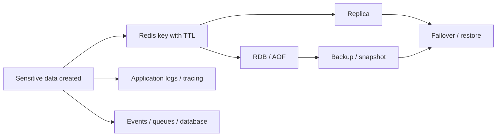
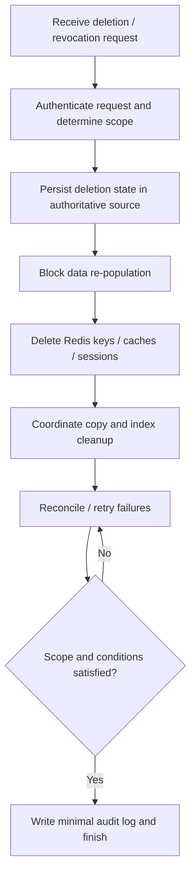

# Defining TTLs and Sensitive Data Deletion Policies in Spring Data Redis

## 1. Security Problem: Data in Redis Does Not Become Safe Just Because It Is "Only Cache"

Redis is often chosen for its speed and built-in TTL (time to live) support. In a Spring Data Redis application, Redis may store:

- Login sessions, temporary authentication state, and OTP codes.
- One-time tokens, email verification codes, and password reset tokens.
- Computed access permissions, cached user profiles, or query results containing personal data.
- Shopping carts, shipping addresses, temporary balances, or order states.
- Rate-limit counters, distributed locks, and idempotency keys.
- Entity Redis Hashes, secondary indexes, Stream events, and performance-oriented copies.

Some data can be regenerated from a primary store; other data exists only in Redis. Both can contain sensitive information. Setting a TTL too long—or forgetting a TTL altogether—keeps data around longer than the business requires. Setting a TTL too short logs users out or interrupts authentication flows. And "deleting" via a single `DEL` command can leave copies behind in RDB, AOF, backups, or other systems.

This lesson focuses on two security questions that must be answered **together**:

1. **How long is each class of sensitive data kept in Redis at most, and why?**
2. **When it expires, a user requests deletion, permissions are revoked, or a security incident occurs, across which scopes must the data be purged?**

These two questions correspond to a **data lifecycle policy** and a **verifiable deletion/revocation policy**. TTL is an essential technical tool, yet does not fully substitute for those two policies.

> **Principle:** store only strictly necessary data, retain it for the shortest duration fitting its purpose, restrict who can read it, and design deletion paths when designing the key schema.

---

## 2. Distinguishing TTL, Business Validity, and Retention Periods

Three concepts are frequently conflated:

| Concept | Meaning | Example |
|---|---|---|
| **Redis key TTL** | How long Redis allows a key to exist before expiring | OTP key has a 300-second TTL |
| **Business validity window** | Cutoff after which data is no longer accepted for an action | OTP code invalid after 5 minutes |
| **Data retention period** | Rules governing keeping and purging all related copies, including backups/logs/archives | Token leaves active store after 5 minutes; backups follow their own retention policy |

Normally, a sensitive key's TTL **must not exceed** how long the data is needed for its stated purpose. Still, the two do not always align:

- A token may need **immediate revocation** when a user changes their password, even with 20 minutes of TTL left.
- A 15-minute login counter is temporary security state; audit records meant for long-term retention belong in a **separate** store with its own access controls and retention.
- Removing a value from the Redis keyspace does not mean those bytes vanished from every snapshot, log, replica, or physical memory page.
- A cached entry holding personal data with a 1-hour TTL still violates purpose limits if the user requested deletion minutes earlier.

### 2.1. TTL Is an Upper Bound on Key Lifetime, Not a Precise Scheduler

Redis uses both active and passive expiration. Once TTL elapses, the key is no longer treated as valid data to return under expiration semantics, yet emitting `expired` notifications and freeing resources do not necessarily occur at the **exact millisecond** of expiration.

Therefore:

- Relying on TTL to bound key accessibility is reasonable.
- Never use `expired` events as an exact timer for mandatory tasks.
- When verifying token expiration, also check an explicit `expiresAt` in business logic where strict enforcement matters.
- Never take "no expired notification received yet" as proof a token is still valid.

### 2.2. One Data Item Can Spawn Multiple Copies with Different Lifetimes



A policy stating only `EXPIRE key 300` addresses only part of the picture. Map out every replication/copy path and its retention window.

---

## 3. Classify Data Before Choosing TTLs

Never apply `Duration.ofDays(7)` uniformly to all Redis keys. First assess sensitivity and the impact of loss or exposure.

A pragmatic classification:

| Category | Examples | Primary Risk | Direction |
|---|---|---|---|
| **Authentication secrets** | OTP, reset tokens, bearer tokens | Account takeover, token replay | Very short TTL, single-use, never logged, revocable |
| **Sessions/authorization** | Sessions, temporary access grants | Session hijacking, stale permissions | Proportionately short TTL, idle + absolute deadlines |
| **Personal data** | Names, emails, addresses in cache | PII exposure, retention beyond purpose | Minimize stored fields, short TTL, deletable per subject |
| **Sensitive business state** | Carts, transaction states | Information disclosure, inconsistency | Business-justified TTL, authoritative source, clear deletion |
| **Security signals** | Rate-limit counters, failed-login state | Bypass on reset, identity correlation | TTL matching risk window, fallback plan |
| **Derived data** | Permission caches, profile caches, per-user feature flags | Stale authorization, stale displays | Short TTL and active invalidation on permission changes |
| **Observability data** | Redis keys in logs, traced commands | Secret and identifier leaks | Mask/redact at collection time, separate retention |

This table is a design guide, not a legal determination of what must be kept by law or contract. Formal policies require approval from business owners, security, and privacy stakeholders under applicable regulations.

### Recommended Classification Documentation

For each key group, document:

- Group name, namespace, and owner.
- Stated purpose.
- Whether the data genuinely needs storing or can be hashed/minimized.
- Whether Redis is the source of truth.
- Maximum TTL and whether extension is allowed.
- Immediate deletion triggers: logout, password change, account lock, deletion request.
- How to locate and purge related keys.
- Replica, persistence, backup, and log lifecycles.
- How the policy is verified in tests and production.

---

## 4. TTL Decision Table by Data Type

The values below are **study examples only**, not universal defaults or legal commitments:

| Data | Example TTL | Renewable? | Early Deletion Triggers |
|---|---|---|---|
| OTP code | 2–5 minutes | Usually not extended on the same code | Successful use, replacement code issued, request canceled |
| Password reset token | 10–20 minutes | Usually issue a new token rather than extending old one | Password changed, revocation requested |
| Email verification challenge | 10–30 minutes | Per policy | Verified, account locked |
| Access permission cache | 30 seconds–5 minutes | Per refresh mechanism | Permission revoked, role changed |
| Idle session | 15–30 minutes | Can extend on activity | Logout, password change, account locked |
| Absolute session lifetime | Hours or per policy | Never extended past max cutoff | Revocation and absolute expiry |
| Personal profile cache | 1–15 minutes | As needed | Profile updated/deleted, view rights changed |
| Login attempt counter | 5–30 minutes | May use sliding window | Window expiry per policy |
| Idempotency key | Safe retry window | Bounded | Workflow finished and retry window elapsed |
| Shopping cart cache | Product goals/behavior | Possibly | Checkout completed, cart cleared, account deleted |

**A TTL is not an arbitrary number:** start from the minimum duration the feature genuinely needs. When someone asks to lengthen a TTL, document the added risk, who approves it, and whether deletion workflows must change.

### 4.1. Computing Expiration with a Formula

For tokens with an absolute expiration:

\[
TTL_{\text{write}} =
\max(0,\ \min(TTL_{\text{policy}},\ expiresAt-now))
\]

If `expiresAt` has already passed, **do not write a new token** or resurrect it as valid. Never fall back to a default 5 minutes if the token is already expired at the authentication source.

In Java:

```java
Instant now = clock.instant();
Duration remaining = Duration.between(now, expiresAt);

if (remaining.isZero() || remaining.isNegative()) {
    throw new IllegalArgumentException("Token already expired");
}

Duration ttl = remaining.compareTo(MAX_TTL) > 0
        ? MAX_TTL
        : remaining;
```

This snippet illustrates policy enforcement. If client and Redis server clocks drift apart, actual TTLs shift with clock skew; for tight windows, use trusted time sources and monitor clock skew.

### 4.2. Combine Idle Timeouts with Absolute Timeouts

For sessions:

- **Idle timeout:** session expires after a period of inactivity.
- **Absolute timeout:** session expires at a fixed maximum cutoff from issuance, even if the user remains active.

Example:

```text
Session issued at:     09:00
Idle timeout:          20 minutes
Absolute timeout:      17:00

09:15 activity -> projected idle expiry 09:35
16:55 activity -> can extend only until 17:00
17:01          -> session hits absolute expiry
```

Never simply call `EXPIRE key 20m` on every request if that lets a session stay alive indefinitely.

---

## 5. How Redis Key TTLs Work: Commands and Return Values

### 5.1. Setting TTL Atomically at Creation Time

Redis CLI example:

```redis
SET auth:otp:challenge-123 hashed-verifier EX 300
```

`SET ... EX 300` writes the value and sets the TTL **in one Redis command**, closing the gap where a key is written without an expiration.

You can use milliseconds:

```redis
SET auth:otp:challenge-124 hashed-verifier PX 300000
```

Or an absolute timestamp via `EXAT`/`PXAT` on supported Redis versions:

```redis
SET auth:token:opaque-1 verifier EXAT 1800000000
```

`EXAT` uses Unix seconds; `PXAT` uses milliseconds. Ensure any timestamp is valid for business logic—never copy an example timestamp into production.

### 5.2. Setting TTL on an Existing Key

```redis
EXPIRE auth:otp:challenge-123 300
PEXPIRE auth:otp:challenge-123 300000
```

These update expiration only on an existing key.

Understand the risk of splitting write and expiration:

```redis
SET auth:otp:challenge-123 hashed-verifier
EXPIRE auth:otp:challenge-123 300
```

If the app crashes or drops the connection between `SET` and `EXPIRE`, the key persists **with no TTL**. For sensitive data, prefer **atomic write-with-expiration** rather than two separate round trips.

### 5.3. Reading TTL and PTTL

```redis
TTL auth:otp:challenge-123
PTTL auth:otp:challenge-123
```

Key return values:

| Result | Interpretation |
|---|---|
| Positive integer or 0 | Remaining time in seconds (`TTL`) or milliseconds (`PTTL`) |
| `-1` | Key exists with no expiration |
| `-2` | Key does not exist |

If a key group **requires a TTL**, `-1` is an anomaly warranting alerting or policy-driven cleanup—never treat it as "safe because it won't expire."

### 5.4. Commands That Can Accidentally Alter TTLs

| Operation | Watch Out For |
|---|---|
| `SET key value` without EX/PX | Overwrites the key and typically strips any prior TTL |
| `SET key value KEEPTTL` | Preserves existing TTL when supported by Redis version |
| `EXPIRE`/`PEXPIRE` | Resets expiration for the entire key |
| `PERSIST key` | Removes expiration, making the key permanent |
| `HSET` on an existing hash | Normally keeps the hash's TTL, yet hashes do not expire individual fields under standard key TTL |
| `DEL`/`UNLINK` | Removes the key from the keyspace |
| `GETEX` | Reads and modifies expiration in one command depending on flags |

Any API that "touches" or extends TTL must be reviewed as a **security-sensitive change**, especially for sessions and permission caches.

### 5.5. Hashes Containing Fields with Different Lifetimes

In standard usage, TTL applies to the **Redis key**. If a hash holds:

```text
user-profile:42
  displayName
  phone
  verificationChallenge
```

and `verificationChallenge` must expire after 5 minutes, do not assume `EXPIRE user-profile:42 300` removes only the challenge field: it expires the **entire hash**.

Certain newer Redis versions offer hash-field expiration commands, though server, client, and Spring Data Redis support must be verified for your exact deployment versions. For broad compatibility and simpler security policies, prefer **splitting data with distinct lifetimes into separate keys**.

---

## 6. Setting TTLs in StringRedisTemplate

Spring Data Redis exposes `ValueOperations` overloads on `StringRedisTemplate`.

Example:

```java
import java.time.Duration;

import org.springframework.data.redis.core.StringRedisTemplate;
import org.springframework.stereotype.Service;

@Service
public class TemporaryDataStore {

    private final StringRedisTemplate redis;

    public TemporaryDataStore(StringRedisTemplate redis) {
        this.redis = redis;
    }

    public void putSensitiveValue(
            String opaqueId,
            String value
    ) {
        String key = "app:v1:temporary:" + opaqueId;

        redis.opsForValue().set(
                key,
                value,
                Duration.ofMinutes(5)
        );
    }
}
```

`set(key, value, timeout)` is the right choice when writing a value alongside its TTL. It maps to a single atomic Redis operation rather than separate `SET` and `EXPIRE` round trips.

**However:** this example does not automatically make the stored value safe. Whether it needs storing, encryption/minimization, read permissions, and deletion paths still require separate decisions.

### 6.1. Create Once Without Overwriting an Existing Token

When issuing a new challenge or idempotency record, you may need "only if absent" semantics:

```java
Boolean inserted = redis.opsForValue().setIfAbsent(
        key,
        value,
        Duration.ofMinutes(5)
);

if (!Boolean.TRUE.equals(inserted)) {
    throw new IllegalStateException("Key already exists");
}
```

`setIfAbsent` with a TTL prevents two concurrent callers from overwriting the same key under normal conditions. Never replace it with `hasKey` followed by `set`, which introduces a race condition.

### 6.2. Delete Immediately Instead of Waiting for TTL

```java
Boolean removed = redis.delete(key);
```

When a token is revoked, a user logs out, or a workflow completes, **delete proactively** before TTL expires. TTL is a backstop for normal expiration, not a replacement for revocation.

### 6.3. Never Confuse `null` with Redis Errors

With `StringRedisTemplate`:

- `get(key) == null` may indicate the key does not exist.
- Redis timeouts or disconnects normally throw exceptions.
- Serialization or permission errors raise distinct exceptions.

For authentication decisions, a Redis error **must never silently convert into "allow login."** Choose fail-closed behavior or an equally trusted fallback source by design.

---

## 7. One-Time Tokens: Store Fingerprints Only and Consume Atomically

Password-reset or action-confirmation tokens are **bearer secrets**: anyone holding the token can perform a sensitive action. Never store raw tokens in Redis keys, application logs, or traces.

A typical design:

1. Generate a high-entropy random token via `SecureRandom`.
2. Deliver the raw token **once** to the user over an appropriate channel.
3. Store an **HMAC/fingerprint** for lookup instead of the raw token.
4. Set a short TTL atomically at write time.
5. When redeemed, validate/start the workflow and **consume the key atomically**.
6. Disallow reuse; if the business step fails after consuming the token, handle re-issuance or recovery per policy.

### 7.1. Why Use HMAC Instead of Putting Raw Tokens in Keys?

Bad example:

```text
reset-token:eyJ...raw-secret...
```

Key names surface in Redis `SCAN`, `MONITOR`, command tracing, diagnostic logs, and backups. A keyed HMAC keeps the raw bearer token out of the key name.

For sufficiently high-entropy random tokens, a strong cryptographic hash can also provide irreversible verification in many scenarios. HMAC adds server-side secret protection, while requiring safe HMAC key management and rotation—never hardcode the secret in source code.

### 7.2. Sample `OneTimeTokenStore` Implementation

This example assumes the application injects a valid HMAC `SecretKey` from a secret management system. It is an injected dependency, so no secret material appears in the lesson.

```java
package com.example.security;

import java.nio.charset.StandardCharsets;
import java.security.GeneralSecurityException;
import java.security.SecureRandom;
import java.time.Clock;
import java.time.Duration;
import java.time.Instant;
import java.util.Base64;
import java.util.HexFormat;

import javax.crypto.Mac;
import javax.crypto.SecretKey;

import org.springframework.data.redis.core.StringRedisTemplate;

public final class OneTimeTokenStore {

    public record IssuedToken(
            String token,
            Instant expiresAt
    ) {
    }

    private static final Duration TOKEN_TTL =
            Duration.ofMinutes(10);

    private final StringRedisTemplate redis;
    private final SecretKey hmacKey;
    private final Clock clock;
    private final SecureRandom random = new SecureRandom();

    public OneTimeTokenStore(
            StringRedisTemplate redis,
            SecretKey hmacKey,
            Clock clock
    ) {
        this.redis = redis;
        this.hmacKey = hmacKey;
        this.clock = clock;
    }

    public IssuedToken issue() {
        byte[] tokenBytes = new byte[32];
        random.nextBytes(tokenBytes);

        String rawToken = Base64.getUrlEncoder()
                .withoutPadding()
                .encodeToString(tokenBytes);

        String key = keyFor(rawToken);

        Boolean stored = redis.opsForValue().setIfAbsent(
                key,
                "issued",
                TOKEN_TTL
        );

        if (!Boolean.TRUE.equals(stored)) {
            throw new IllegalStateException(
                    "Could not allocate unique token"
            );
        }

        return new IssuedToken(
                rawToken,
                clock.instant().plus(TOKEN_TTL)
        );
    }

    public boolean consume(String rawToken) {
        if (rawToken == null || rawToken.isBlank()) {
            return false;
        }

        String key = keyFor(rawToken);

        // getAndDelete maps to GETDEL where supported.
        String previous = redis.opsForValue()
                .getAndDelete(key);

        return "issued".equals(previous);
    }

    private String keyFor(String rawToken) {
        try {
            Mac mac = Mac.getInstance("HmacSHA256");
            mac.init(hmacKey);

            byte[] fingerprint = mac.doFinal(
                    rawToken.getBytes(StandardCharsets.UTF_8)
            );

            return "app:v1:one-time:" +
                    HexFormat.of().formatHex(fingerprint);
        } catch (GeneralSecurityException ex) {
            throw new IllegalStateException(
                    "Token fingerprint unavailable",
                    ex
            );
        }
    }
}
```

**Requirements for this example:** `getAndDelete` requires Spring Data Redis and Redis server support (Redis `GETDEL` was added in Redis 6.2). On older stacks, implement an atomic alternative such as a server-side Lua check-and-delete script.

**Important scope limitation:** this class illustrates **storing and consuming a bearer token** only—it does not implement authorization, binding the token to an account/purpose, or the password-update transaction. Real systems must bind tokens to specific users, actions, and policies; never treat a bare `"issued"` token as license to modify an arbitrary account.

### 7.3. Why Not Separate `GET` and `DEL`?

Unsafe pattern:

```java
String value = redis.opsForValue().get(key);

if (value != null) {
    redis.delete(key);
    // Perform sensitive action.
}
```

Two concurrent requests can both `GET` the token before either deletes it. `GETDEL` reads and deletes **in a single command**, so only one request on an active Redis primary receives the value before deletion.

Still:

- If a Redis primary fails over before replicating the deletion, token reappearance risk must be assessed in your threat model.
- If business side effects occur in a separate database, `GETDEL` does not form a distributed transaction with that database.
- If a request consumes the token and then fails, plan safe re-issuance or recovery.

For high-risk actions, maintain a durable single-use/idempotency record in the primary business database rather than relying solely on a Redis key.

---

## 8. Avoid Unintended TTL Extensions

A common security bug is "reading to check" in a way that **extends the lifetime**.

For example, Redis supports `GETEX`:

```redis
GETEX app:v1:temporary:abc EX 600
```

This reads the value and resets its TTL to 600 seconds. Run on every verification API call, a token meant to expire in 10 minutes can stay alive indefinitely.

### 8.1. There Is No Universal "Sliding TTL" Policy

- OTPs / reset tokens: normally have an **absolute expiry**; never extend the same token.
- Sessions: may use a **sliding idle timeout**, while still enforcing an **absolute expiry**.
- Personal profile cache: may refresh while valid, yet must invalidate upon access revocation.
- Anti-replay keys: TTL matches the retry window; never shrink it so short that replays succeed after the record vanishes.

### 8.2. Enforcing an Absolute Deadline When Extending a Session

Suppose a session has:

```text
idleMs = 20 minutes
absoluteExpiresAtMs = final session cutoff
nowMs = trusted current time
```

The new TTL must be capped:

\[
newTTL = \min(idleMs,\ absoluteExpiresAtMs-nowMs)
\]

Using a Redis Lua script, you can verify key existence, read server time, and update TTL atomically:

```lua
-- KEYS[1]: existing session key.
-- ARGV[1]: idle timeout in milliseconds.
-- ARGV[2]: absolute expiration in Unix milliseconds.
-- 1 = extended, 0 = missing or expired.

local key = KEYS[1]
local idleMs = tonumber(ARGV[1])
local absoluteMs = tonumber(ARGV[2])

if not idleMs or idleMs <= 0 or not absoluteMs then
    return redis.error_reply('invalid session expiry policy')
end

local t = redis.call('TIME')
local nowMs = tonumber(t[1]) * 1000
    + math.floor(tonumber(t[2]) / 1000)

if redis.call('EXISTS', key) == 0 then
    return 0
end

local remainingMs = absoluteMs - nowMs

if remainingMs <= 0 then
    redis.call('DEL', key)
    return 0
end

local ttlMs = math.min(idleMs, remainingMs)
return redis.call('PEXPIRE', key, ttlMs)
```

Useful properties:

- Never resurrects a deleted session, since `EXISTS` must hold.
- Never sets a TTL past the absolute deadline.
- Check and update run atomically without interleaving on the Redis server.
- On Redis errors, the application must apply an appropriate fail-closed session policy.

This script does not verify that the caller is authorized to refresh the session; authentication and account-status checks must still precede it.

### 8.3. Absolute `expiresAt` Must Come from a Trusted Source

If the absolute cutoff sits inside a caller-editable session payload or is lost during failover, the policy breaks. For sensitive sessions, store or validate the cutoff against a trusted authentication source with reliable revocation.

---

## 9. Spring Cache: Configure TTLs Per Cache Name

With `@Cacheable`, Redis Cache can store serialized Java objects. Without explicit expiration settings, `RedisCacheConfiguration` defaults may **set no TTL at all**, keeping entries until manually evicted.

Never assume `@Cacheable` picks a safe TTL for sensitive data automatically.

### 9.1. Grouping Caches by Purpose

Example:

| Cache | Contents | Example TTL | When to Evict Immediately |
|---|---|---|---|
| `publicCatalog` | Public product details | 30 minutes | Price or product attributes change |
| `userProfile` | Authorized personal details | 2 minutes | Profile updated or deleted |
| `authorizationSnapshot` | Computed permissions | 30 seconds | Role/permission revoked, logout |
| `checkoutPricing` | Temporary user pricing | 1 minute | Checkout started or completed |
| `securityChallenge` | Tokens/OTPs | Automatic caching discouraged | Use a dedicated store with one-time semantics |

Data like reset tokens or OTP codes do not fit `@Cacheable`, because they require atomic single-use consumption, careful logging, strict absolute TTLs, and tighter access controls than general caches.

### 9.2. Configuring `RedisCacheManager`

```java
package com.example.security.config;

import java.time.Duration;
import java.util.Map;

import org.springframework.context.annotation.Bean;
import org.springframework.context.annotation.Configuration;
import org.springframework.data.redis.cache.RedisCacheConfiguration;
import org.springframework.data.redis.cache.RedisCacheManager;
import org.springframework.data.redis.connection.RedisConnectionFactory;

@Configuration
public class CacheSecurityConfiguration {

    @Bean
    RedisCacheManager cacheManager(
            RedisConnectionFactory factory
    ) {
        RedisCacheConfiguration defaults =
                RedisCacheConfiguration.defaultCacheConfig()
                        .entryTtl(Duration.ofMinutes(5))
                        .computePrefixWith(
                                cacheName ->
                                        "app:v1:cache:" + cacheName + "::"
                        )
                        .disableCachingNullValues();

        RedisCacheConfiguration profile =
                defaults.entryTtl(Duration.ofMinutes(2));

        RedisCacheConfiguration auth =
                defaults.entryTtl(Duration.ofSeconds(30));

        return RedisCacheManager.builder(factory)
                .cacheDefaults(defaults)
                .withInitialCacheConfigurations(
                        Map.of(
                                "userProfile", profile,
                                "authorizationSnapshot", auth
                        )
                )
                .build();
    }
}
```

In this example:

- Default cache TTL is 5 minutes.
- `userProfile` has a 2-minute TTL.
- `authorizationSnapshot` has a 30-second TTL.
- Consistent prefixes separate namespaces and aid controlled cleanup.
- Null caching is disabled.

**Check your Spring Data Redis version:** TTL APIs, cache writers, serializers, and time-to-idle options differ across versions. This snippet alone does not guarantee safe serialization or removal from backups.

### 9.3. Evict Caches Immediately When Data or Permissions Change

```java
@CacheEvict(
        cacheNames = "userProfile",
        key = "#p0"
)
public void invalidateUserProfile(String userId) {
    // Call must pass through the Spring caching proxy.
}
```

In production, tie invalidation to authoritative source mutations:

```text
Update profile in database
   |
   v
Confirm transaction committed
   |
   v
Evict matching profile cache
   |
   v
Subsequent reads load fresh state
```

If the source update commits while cache eviction fails, stale data persists until TTL expiry. For permission caches, **stale authorization** is an especially serious risk.

Consider permission versioning/epochs, short TTLs, reading the source of truth at critical gates, or durable invalidation mechanisms. **A short TTL only bounds the assumed stale window**; it does not replace immediate revocation when business rules demand it.

### 9.4. Clearing an Entire Cache Can Impact Unrelated Data

`@CacheEvict(allEntries = true)` or `Cache.clear()` deletes an entire cache region, sometimes via `KEYS` or `SCAN` depending on the `RedisCacheWriter` batch strategy.

On a shared Redis, cache prefixes must be exact and isolated from other datasets. An overly broad clear removes unrelated data; an overly narrow one misses sensitive entries.

Never run `FLUSHDB`/`FLUSHALL` to "clear one user's cache" on a multi-workload Redis.

---

## 10. Redis Repositories and Entity TTLs

Spring Data Redis Repositories persist entities as Redis Hashes, commonly via `@RedisHash` and `@TimeToLive`.

Example:

```java
package com.example.security.model;

import org.springframework.data.annotation.Id;
import org.springframework.data.redis.core.RedisHash;
import org.springframework.data.redis.core.TimeToLive;

@RedisHash("temporary-user-state")
public class TemporaryUserState {

    @Id
    private String id;

    private String status;

    @TimeToLive
    private Long ttlSeconds;

    public TemporaryUserState() {
    }

    public TemporaryUserState(
            String id,
            String status,
            Long ttlSeconds
    ) {
        this.id = id;
        this.status = status;
        this.ttlSeconds = ttlSeconds;
    }

    // Getters/setters omitted.
}
```

Saving the entity:

```java
TemporaryUserState state = new TemporaryUserState(
        "opaque-state-123",
        "PENDING",
        300L
);

repository.save(state);
```

This assumes a configured Repository and Spring Data Redis Repository setup. `@TimeToLive` semantics depend on your Spring Data Redis version; verify actual behavior in integration tests.

### 10.1. Entity TTL Differs from Per-Attribute TTL

An entity TTL applies to the primary entity key rather than giving each field an independent expiry. If an entity holds an email kept for days alongside an OTP valid for only 5 minutes, never pack both into one hash expecting the OTP field to expire on its own.

Better:

```text
user:v1:{id}:profile         -> allowed cached profile data
security:v1:{id}:otp:{flow}  -> OTP/challenge fingerprint, short TTL
```

### 10.2. Secondary Indexes Can Retain Stale References

When using `@Indexed`, Spring Data Redis Repositories create secondary index structures. When the primary entity expires via TTL, Redis does not automatically clean up application-managed index sets.

Spring Data Redis's keyspace notification/expiration listener can clean up indexes, yet listeners depend on Pub/Sub and can miss events during disconnects.

Therefore:

- Never assume all keys/indexes vanish completely merely because the main hash expired.
- Review index cleanup behavior and fallbacks when notifications drop.
- For sensitive data, evaluate whether secondary index key names reveal PII.
- Design reconciliation if indexes must not retain dangling references to expired entities.

### 10.3. Shadow Copies / Phantom Copies

Spring Data Redis Repositories can create a **shadow/phantom copy** of an expiring entity so expiration events can still emit the entity payload after the primary key disappears. This can keep **a copy of the data alive longer than the primary key**.

For sensitive entities:

- Check whether expiration events genuinely need the entity payload.
- If not, review configuration options to disable shadow copies in your Spring Data Redis version.
- If needed, bring shadow copies and their TTLs into your retention policy.
- Never treat `@TimeToLive(300)` as proof that all entity copies vanish at second 300.

Repository configuration offers options controlling copy retention, though exact enum and API names must be checked against your Spring Data Redis version; never guess settings for sensitive data.

---

## 11. Data Minimization: Data Never Stored Never Needs Deleting

Before choosing a TTL, ask: **does Redis even need all of this data?**

Suppose an API checks whether a user finished a verification step:

Avoid storing:

```json
{
  "email": "person@example.com",
  "phone": "000-000-000",
  "rawOtp": "123456",
  "sessionBearerToken": "secret...",
  "isVerified": true
}
```

If business logic needs only status and cutoff, store a minimal structure:

```json
{
  "challengeId": "opaque-id",
  "status": "VERIFIED",
  "expiresAt": "2026-11-13T12:00:00Z"
}
```

Or even better in some flows, store only an existence key with a non-sensitive value checked via an HMAC token.

Benefits:

- Shrinks impact if Redis is read without authorization.
- Reduces sensitive data flowing into backups, logs, and replication.
- Simplifies deletion obligations.
- Lowers PII leakage through Redis key names and command telemetry.
- Cuts fields needing synchronization when authoritative sources update.

### Fields That Should Never Become Raw Redis Keys

Avoid:

```text
session:eyJhbGciOi...
otp:123456
password-reset:raw-reset-token
profile:person@example.com
payment:card-number:...
```

Use opaque identifiers or controlled fingerprints:

```text
app:v1:session:58a4...opaque-id...
app:v1:reset:7a0f...hmac-digest...
app:v1:profile:{opaque-user-id}
```

Key names are data too. They appear in `CLIENT LIST`, `MONITOR`, `SLOWLOG`, admin tools depending on permissions, and persistence files.

---

## 12. Proactive Deletion: TTL Is a Safety Net, Not the Sole Revocation Mechanism

A system must delete data proactively whenever:

- A user logs out.
- A token is consumed or suspected compromised.
- A password or authentication factor changes.
- An account is locked, downgraded, or deleted.
- A user submits a data-deletion request under applicable policy.
- A workflow completes, such as checkout finishing and drafts no longer needed.
- Data is invalid or exceeds its retention purpose.

### 12.1. DEL and UNLINK

Redis:

```redis
DEL app:v1:session:opaque-session-id
UNLINK app:v1:profile:{user-id}
```

Both remove keys from the keyspace. Main difference:

- `DEL` deletes synchronously per command semantics.
- `UNLINK` unlinks the key from the keyspace immediately and reclaims memory asynchronously.

In Spring Data Redis:

```java
Boolean deleted = redis.delete(key);
```

Recent Spring Data Redis versions also expose `unlink` via templates and connections.

**Never equate `UNLINK` or `DEL` with byte-level "secure erase."** Copies may persist in persistence files, replicas, backups, copy-on-write pages, crash dumps, or lower storage tiers. Keyspace deletion is essential, yet insufficient to claim permanent erasure of every copy.

### 12.2. Delete Exact Known Keys Rather Than Scanning All of Redis

When session IDs or challenge IDs are known:

```java
redis.delete("app:v1:session:" + opaqueSessionId);
```

When you must delete all sessions for a user, design a **mechanism to locate all keys belonging to that user** up front in the schema. Never wait until a deletion request arrives to discover you cannot enumerate a user's sessions.

Never run:

```redis
KEYS *user*
FLUSHDB
FLUSHALL
```

to purge a single user in production. `KEYS` triggers broad blocking scans; `FLUSHDB`/`FLUSHALL` wipes data belonging to other users, caches, and workloads.

---

## 13. Design Per-User / Per-Tenant Deletion Up Front

A system may hold several key groups per user:

```text
app:v1:session:{user-42}:session-a
app:v1:session:{user-42}:session-b
app:v1:challenge:{user-42}:request-1
app:v1:profile:{user-42}
app:v1:authorization:{user-42}
```

To wipe all user-related data, the application needs to know every namespace and how to locate keys accurately.

### 13.1. Using a Key Registry / Index

A Redis-side pattern:

```text
app:v1:keys:{user-42}
  SET:
    app:v1:session:{user-42}:session-a
    app:v1:session:{user-42}:session-b
    app:v1:challenge:{user-42}:request-1
    app:v1:profile:{user-42}
```

When creating a key, record its name in the index set. When purging, read the set and delete that user's exact keys.

Limitations of this approach:

- If writing the key succeeds while updating the index fails, the registry misses the key.
- If keys expire via TTL without index cleanup, the registry accumulates stale names.
- If multiple services write outside the same abstraction, the registry is incomplete.
- The registry itself needs a TTL/retention and cleanup plan.
- Deleting thousands of keys in a single request can blow latency budgets.
- In Redis Cluster, multi-key scripts/commands must obey hash slot rules.
- The registry holds sensitive key names and needs protection too.

Thus a Redis-side registry is trustworthy only when **all writers go through a controlled key-creation path** backed by reconciliation. For strict deletion obligations, keep a durable registry in an authoritative store outside Redis.

### 13.2. Never Rely Solely on SCAN to Prove Complete Deletion

`SCAN` can assist bounded prefix inspection or cleanup, yet:

- It does not produce an atomic snapshot of the keyspace.
- It can yield duplicates or empty batches mid-cursor.
- Concurrent writers can create new keys while scanning runs.
- Redis Cluster requires scanning across every relevant node per topology/driver.
- If serializers alter raw key bytes unexpectedly, string prefixes may fail to match.

A user-deletion workflow must **block or coordinate with writers**, then delete and verify. Never treat "scan found 0 keys" as absolute certification while writers remain active.

### 13.3. Prevent Deleted Data from Being Re-Populated

A classic race bug:

```text
T0  User requests account deletion.
T1  Worker A reads old data from database.
T2  Cleanup deletes the user's Redis keys.
T3  Worker A writes old data back into cache.
T4  Sensitive key reappears.
```

Mitigations:

1. Mark deletion/revocation state at the authoritative source first.
2. Stop or disable data-producing flows for that subject.
3. Invalidate user/tenant caches.
4. Delete targeted keys across identified namespaces.
5. Reconcile and monitor for key reappearance.
6. Ensure workers read the latest deletion status before repopulating caches.

In event-driven architectures, emit durable deletion events with controlled retries. Plain Pub/Sub is unsuitable as the **sole guarantee** that every service processed a deletion command.

---

## 14. Login Sessions: Revoking Differs from Expiring

Suppose a session has a 30-minute TTL, and the user logs out at minute 2.

Waiting for TTL alone:

```text
Minute 0: session created, TTL 30m
Minute 2: user logs out
Minutes 2–30: Redis session key still exists
```

Anyone holding a stolen session identifier can continue using it if authentication still accepts that key.

Proper policy:

- Logout → delete/revoke session immediately.
- Password change → invalidate sessions per policy.
- User disabled → check trusted account state rather than relying solely on stale cached permissions.
- Idle session → expire after inactivity period.
- Absolute deadline → cap maximum session lifetime.

### 14.1. Map Sessions to Users

When users hold multiple sessions, retain a way to enumerate a user's sessions. Never store isolated `session:<random-id>` keys with no index if you ever need "log out all devices."

Maintain an application-managed session registry. If global session revocation requires high durability, keep durable revocation state alongside Redis.

### 14.2. TTL Does Not Defeat All Session Hijacking

TTL narrows the window for a stolen session, yet does not replace:

- TLS.
- Cookies with `HttpOnly`, `Secure`, and appropriate `SameSite`.
- CSRF protection for cookie-based auth.
- Session rotation and anomaly detection.
- Keeping session identifiers out of logs and traces.
- Account-status checks at authorization enforcement points.

### 14.3. Permission Caches Need Immediate Invalidation

A cache entry:

```text
authz:v1:{user-42} -> ["ROLE_ADMIN"]
TTL: 10 minutes
```

If the user's role is revoked at minute 1, the remaining 9 minutes create a stale-authorization window.

For sensitive authorization checks:

- Short TTLs shrink the stale window if invalidation fails.
- Invalidate proactively whenever roles change.
- Consider permission versions/epochs to reject outdated cache entries.
- At critical decision gates, query the authoritative store rather than failing open when Redis errors.

---

## 15. Redis Streams and Pub/Sub Have Different Retention Semantics from Caches

### 15.1. Redis Streams Retain Entries Inside Keys

A Redis Stream holds entries until trimmed, deleted, or expired at the key level. Streams do not automatically apply per-entry TTLs to PII inside messages.

Example:

```text
orders:events
  170...-0 -> {userId: "...", address: "..."}
  170...-1 -> {userId: "...", address: "..."}
```

Because Stream keys are often long-lived, PII inside entries can remain far longer than expected without an explicit retention plan.

Options:

- Length-based trimming via `XTRIM MAXLEN` where business rules allow.
- ID/time-based trimming per Redis version support, choosing exact cutoff IDs carefully.
- Minimal event schemas: publish **opaque reference IDs** instead of embedding sensitive fields.
- Keep full payloads in an authoritative source with independent access controls and retention.
- Include Stream purge/reconciliation in user-deletion workflows.

**Note:** `XDEL`/`XTRIM` stops normal reads of those entries, yet does not prove sensitive bytes disappeared from AOF, RDB, backups, or metadata.

### 15.2. Consumer Groups and Pending Entries

When trimming or deleting messages while a consumer group has pending entries (PEL), check your Redis version's PEL/ack semantics and how the application handles missing entries. You cannot blindly "delete sensitive events immediately" without considering waiting consumers.

For short-retention sensitive events, publish an opaque reference ID; consumers query currently valid details from the authoritative store, minimizing PII replication into Streams.

### 15.3. Pub/Sub Keeps No Replay Log, Yet Payloads Can Still Persist

Redis Pub/Sub retains no message history for late subscribers. However, payloads can still be:

- Logged by publishers or subscribers.
- Captured in distributed traces.
- Forwarded into queues or databases.
- Recorded by debug tools.

Never publish bearer tokens, OTPs, passwords, or unnecessary personal data over Pub/Sub just because Redis does not store a backlog.

---

## 16. Redis Persistence and Backups Change What "Deleted" Means

Running:

```redis
DEL app:v1:profile:{user-42}
```

removes the key from the active keyspace on that Redis node. Yet Redis deployments may also use:

- **RDB:** point-in-time dataset snapshots.
- **AOF:** append-only write command logs for recovery.
- **Replication:** copies on replicas or newly promoted primaries after failover.
- **Backups:** storage or managed-service snapshots.
- **Copy-on-write memory/disk snapshots:** copies persisting per underlying storage lifecycles.

### 16.1. `DEL` Does Not Erase Bytes Inside Existing Backups

If a backup ran before `DEL`:

```text
09:00 RDB backup captures profile
09:05 DELETE profile on Redis primary
09:06 Redis keyspace no longer has profile
09:10 09:00 backup still exists per retention
```

Therefore, deletion policies must explicitly govern **backup retention** and restore handling. Never claim "permanently erased everywhere" merely because `redis.delete(key)` returned true.

### 16.2. AOF Rewrite Is Not Certified Secure Erase

AOF logs historical write commands; AOF rewrites compact live state into a cleaner representation. Still, older log segments or snapshots may persist on filesystems, backups, or storage layers depending on the environment.

Never treat `BGREWRITEAOF` or `BGSAVE` as proof that all sensitive copies were physically scrubbed.

### 16.3. Delete from Active Keyspace First, Manage Backups Under Approved Lifecycles

A complete policy can distinguish:

1. **Active deletion:** key is no longer reachable for business reads.
2. **Deletion propagation:** replicas, caches, and downstream consumers reflect the change.
3. **Backup retention:** backups are encrypted, access-restricted, time-bounded, and purged per policy.
4. **Post-backup restore:** deleted data is never re-exposed when restoring an older snapshot.
5. **Audit evidence:** record minimal proof of deletion without archiving the deleted sensitive data itself.

Exact timeframes depend on policy, regulations, and infrastructure capabilities. Never invent blanket rules like "delete backups immediately" or "keep backups forever" without justification.

---

## 17. Preventing Deleted Data from Resurrecting on Restore

This risk is critical and easily overlooked:

```text
Day 1: Redis backup captures session/user profile.
Day 2: User requests deletion; key is deleted via DEL.
Day 3: Redis suffers an outage.
Day 3: Operator restores Day 1 backup.
```

If entries in that backup have not expired and restoration does not replay post-snapshot deletions/revocations, deleted records return to life.

### 17.1. Recovery Workflows Must Honor Revocations and Deletions

A sound design:

- Maintain a minimal **deletion/revocation ledger** in a durable, well-protected store.
- When restoring Redis, keep the instance **out of live traffic** initially.
- Reconcile subjects/tokens revoked after the snapshot timestamp.
- Delete or invalidate those entries before serving traffic.
- Confirm no background service repopulates deleted data.
- Record reconciliation timestamps and outcomes.

The ledger should store minimal identifiers needed to verify deletion, never copying raw PII or secret tokens into a permanent "deletion log."

### 17.2. Restored TTLs Differ from Proactive Deletions

Redis stores key expiration semantics; already-expired keys are skipped on load or access after restore. However, a **key explicitly deleted before its TTL elapsed** still sits intact inside an older backup. Therefore:

- TTL prevents retaining data beyond its scheduled ceiling.
- TTL does not automatically replay "user deleted/revoked" actions taken after a snapshot.
- You need a replay or reconciliation step for security-significant deletions and revocations.

---

## 18. Encryption and Key Management Do Not Replace TTLs

TTLs shorten how long data lives. They do not protect data **while the key is active** or **while copies rest in backups**.

Corresponding controls across layers:

| Layer | Control |
|---|---|
| Transport | TLS from applications to Redis when supported |
| Access | Redis ACLs, network isolation, least privilege |
| Data in Redis | Data minimization, no raw secrets, app-level encryption where required |
| Data on disk/backups | Encryption at rest and backup access controls per platform |
| Key names | Opaque IDs/HMACs, avoiding emails/raw tokens |
| Logs/traces | Redact/mask command arguments and identifiers |
| Operational secrets | Secret manager, rotation, never hardcoded in source |
| Retention | TTLs and copy-purge policies |
| Recovery | Restore reconciliation so deleted data stays deleted |

### 18.1. Application-Layer Encryption

If storing a sensitive value is unavoidable, apply well-managed encryption before `SET`. Still, the application must:

- Select proper authenticated encryption algorithms and modes.
- Manage nonces/IVs safely without dangerous reuse.
- Protect and rotate encryption keys.
- Account for locating and deleting user data.
- Define retention lifetimes for ciphertexts and backups.

Encryption does not exempt data from retention rules. Ciphertext often remains regulated data requiring lifecycle management.

### 18.2. Limits of Crypto-Shredding

In some architectures, deleting a dedicated encryption key makes old ciphertexts unreadable. Yet this requires rigorous validation: key hierarchies, key backups, key rotation, access controls, and whether plaintext copies leaked elsewhere.

Never treat deleting a Redis key holding ciphertext as automatically fulfilling every data-deletion obligation.

---

## 19. Redis ACLs and Least Privilege for Sensitive Data

When multiple services share Redis, never allow every service to read, write, and delete every key.

For instance, a service managing only temporary tokens:

```text
app:v1:one-time:*
```

Configure Redis ACLs restricting key scopes and command sets according to Redis version and operational capabilities.

Goals:

- The token service accesses only its own namespace.
- Unrelated services cannot read the token store.
- Never grant `FLUSHALL`, `CONFIG SET`, or debug commands to standard application accounts.
- Avoid key-wide read access when only one prefix is needed.
- Restrict Pub/Sub channels if events are used.
- Separate monitoring/exporter rights from business write/delete rights.

### Never Rely Solely on Prefixes for Access Control

Namespaces are naming conventions, not automatic security walls. If all services share a credential holding `@all` across all keys, a single buggy or compromised service can still touch another service's namespace.

ACLs, network policies, secret isolation, and auditing are the real enforcement boundaries.

---

## 20. Keyspace Notifications Do Not Guarantee Deletion Workflows

Redis can emit `expired` events when `notify-keyspace-events` is enabled, and Spring Data Redis can subscribe via `RedisMessageListenerContainer`.

Never build:

```text
On expired event:
    delete personal data in another database
```

as the **sole path** for mandatory deletions.

Reasons:

- Expiration notifications may fire after the exact TTL deadline.
- Redis Pub/Sub stores no replay backlog for offline subscribers.
- Listeners can disconnect during Redis failovers.
- If a callback fails, Redis does not retry like a durable queue.
- Events typically omit the expired key's previous value since the key is already gone.

### Better Design

When deletion spans multiple systems:

1. Record the deletion decision/request in an authoritative source.
2. Have a durable workflow/job coordinate deletion across every target system.
3. Make each step retryable and idempotent.
4. Actively delete Redis keys immediately upon decision.
5. Reconcile and mark completion.
6. Keep TTLs as a safety net for temporary entries the workflow has not yet reached.

TTL notifications can feed supplementary metrics or best-effort cleanup, **never the sole foundation for mandatory deletion**.

---

## 21. Avoid Leaking Sensitive Data Through Monitoring and Debugging

Sometimes a system configures TTLs and key deletion cleanly, yet raw secrets still leak through logs:

```text
Redis SET auth:reset:<raw-token> <raw-value>
Redis GET session:<session-id>
Redis WRONGTYPE key=user:<email>
```

These surface when verbose debug logs, argument-capturing interceptors, tracing, or `MONITOR` are active.

### Sources to Control

- `MONITOR`: streams live commands, adding overhead and risking argument exposure.
- `SLOWLOG`: may capture command arguments depending on duration and config.
- Driver debug logs in the application.
- APM traces attaching `db.statement` or raw command arguments.
- HTTP access logs containing tokens in URLs or query strings.
- Error stack traces and dead-letter messages.
- Backup logs or memory dumps copied to personal laptops.

Log by **operation category**, never raw keys or values:

```text
component=otp-store
operation=consume
outcome=missing
durationMs=3
traceId=opaque-trace-id
```

Never use emails, raw tokens, session IDs, or per-user HMAC fingerprints as metric labels—doing so leaks data and explodes cardinality.

### Auditing Deletion Actions

An audit record should capture:

```text
deletionRequestId=opaque-id
subjectReference=opaque-internal-id
dataClass=session-and-profile-cache
requestedAt=...
completedAt=...
systemsChecked=redis-primary,backup-reconciliation
result=completed
```

Never store the deleted personal payload inside the audit log, or the audit log itself becomes a new sensitive data store requiring purging.

---

## 22. Checking TTLs with Redis CLI

In a test Redis environment, try:

```redis
SET it:security:otp-1 verifier EX 5
TTL it:security:otp-1
PTTL it:security:otp-1
```

Initially `PTTL` is positive and at most roughly 5,000 ms, barring exceptional timing/command situations.

After expiration:

```redis
GET it:security:otp-1
TTL it:security:otp-1
```

Once expired, `GET` returns nil and `TTL` typically returns `-2`.

### Testing "No TTL" as an Error Condition to Detect

```redis
SET it:security:unsafe-key verifier
TTL it:security:unsafe-key
```

A result of `-1` confirms the key exists without a TTL.

This check helps verify that monitoring or tests catch sensitive keys written without policy-compliant expiration.

### Verifying `SET` Overwrites Strip TTLs

```redis
SET it:security:example original EX 120
TTL it:security:example

SET it:security:example updated
TTL it:security:example
```

`TTL` after the second `SET` normally returns `-1`: expiration was dropped. This subtle security bug occurs whenever a developer switches from a `Duration` overload to a timeout-less `set` overload.

---

## 23. Unit and Integration Testing for TTLs

### 23.1. Unit Test: Require the Expected TTL

In a Mockito unit test, verify the service invokes:

```java
verify(redis.opsForValue()).set(
        eq("app:v1:temporary:opaque-123"),
        eq("some-value"),
        eq(Duration.ofMinutes(5))
);
```

This proves **Java logic passes the expected timeout**, though not that a real Redis server applied a TTL, since Mockito does not run Redis.

### 23.2. Integration Test: Verify Real Key TTLs

Against a test Redis server or Testcontainers:

```java
String key = "it:ttl:" + java.util.UUID.randomUUID();

try {
    redis.opsForValue().set(
            key,
            "sample",
            Duration.ofSeconds(30)
    );

    Long pttl = redis.getExpire(
            key,
            java.util.concurrent.TimeUnit.MILLISECONDS
    );

    assertThat(pttl)
            .isNotNull()
            .isGreaterThan(0L)
            .isLessThanOrEqualTo(30_000L);

} finally {
    redis.delete(key);
}
```

Tests must not assert `pttl` equals **exactly** 30,000 ms, because time passes between `SET` and `PTTL`.

### 23.3. Integration Testing Real Expiration

For short TTLs, poll with a deadline rather than sleeping for the exact TTL with `Thread.sleep`:

```java
redis.opsForValue().set(
        key,
        "temporary",
        Duration.ofSeconds(1)
);

// Example when test dependencies include Awaitility:
org.awaitility.Awaitility.await()
        .atMost(Duration.ofSeconds(5))
        .untilAsserted(() ->
                assertThat(redis.hasKey(key)).isFalse()
        );
```

Note: add the Awaitility dependency if used. Checking key disappearance tests **Redis state**, without needing to wait for `expired` notifications.

### 23.4. Testing Immediate Revocation

Create a token with a 10-minute TTL, then invoke the revocation path:

1. Token exists before revocation.
2. Revocation succeeds.
3. Token is unreachable after revocation.
4. Consumers presenting that token cannot perform further actions.
5. When two requests redeem the token concurrently, at most one succeeds when using `GETDEL` or an atomic script.
6. Connection errors fail closed rather than pretending the token is valid.

### 23.5. Testing Restore and Backup Handling

A single Redis container does not prove deleted data vanished from backups. Test backup/restore in a dedicated environment:

- Write test keys with TTLs.
- Capture a test snapshot via your infrastructure's process.
- Proactively delete the keys.
- Restore the snapshot into an isolated instance.
- Inspect which deleted keys reappear.
- Run deletion/revocation reconciliation.
- Verify cleanup before opening service traffic.

Never run `FLUSHALL`, destructive `CONFIG`, or test restores over production Redis.

---

## 24. Detecting Sensitive Keys Missing TTLs

A real operational risk is a new code path accidentally omitting `Duration` or invoking `PERSIST`. You may need ways to spot sensitive keys lacking expiration.

### 24.1. Enforcing at Write Time Is Best

- Encapsulate TTL policies inside dedicated adapters or repositories.
- Do not expose arbitrary raw key-writing APIs to services unnecessarily.
- Unit-test that timeouts are passed.
- Integration-test that `PTTL > 0`.
- Audit commands that strip expirations.
- Emit **aggregated** metrics/logs for TTL violations without leaking raw key names.

### 24.2. Periodic Namespace Audits

To audit existing keys, an operations worker can run `SCAN` over owned namespaces and inspect `PTTL` with strict rate caps:

```text
SCAN MATCH app:v1:temporary:* COUNT 200
PTTL <each-key>
If PTTL == -1:
    record conditional metric/alert
    handle per approved policy
```

Caveats:

- `SCAN MATCH` still traverses the keyspace by cursor; it is not a prefix-indexed query.
- Never stop on an empty batch while cursor is non-zero.
- Keys may expire between `SCAN` and `PTTL`, yielding `-2` normally.
- Never slap arbitrary TTLs onto every `-1` key automatically, or you risk expiring data meant to persist.
- For multi-node Redis Cluster, use a topology-aware scan strategy.
- Throttle carefully so production Redis latency does not spike.

---

## 25. Sensitive Data Deletion Policies in Multi-Tenant Environments

A multi-tenant system must prevent:

- Tenant A's user creating keys colliding with Tenant B.
- Tenant A's cleanup job accidentally deleting Tenant B's keys.
- Sharing permission/PII caches simply because internal user IDs match.
- A shared service Redis ACL lacking tenant boundaries.
- Restoring backups into a less-secure environment.

Keys should encode safe, scoped identifiers:

```text
app:v1:tenant:{opaque-tenant-id}:user:{opaque-user-id}:profile
```

Still, naming alone creates no automatic authorization. On a shared Redis instance, enforce application-level checks, scoped ACL/credentials where fitting, and key-generation tests.

### Redis Cluster Keys with Hash Tags

When writing multi-key scripts on Redis Cluster, hash tags co-locate a subject's keys onto the same slot:

```text
app:v1:session:{opaque-user-id}:a
app:v1:session:{opaque-user-id}:b
app:v1:index:{opaque-user-id}
```

If multiple tenants share user IDs, ensure the hash tag and namespace distinguish the tenant. Never force **all users** into one fixed hash tag, which creates hotspots.

Multi-key script deletions are atomic only across keys satisfying Redis Cluster slot rules; cross-system or cross-tenant deletion workflows are not guaranteed distributed transactions.

---

## 26. Deletion and Reconciliation When Multiple Services Cache Data

Suppose a user's profile exists across:

```text
Source database
    |
    +--> user-service Redis cache
    |
    +--> recommendation-service Redis cache
    |
    +--> analytics temporary store
    |
    +--> event Stream
```

Deleting keys in `user-service` does not erase copies held in `recommendation-service` or analytics.

Maintain a system-wide **data inventory**:

| Component | Data Type | TTL/Retention | Deletion Method | Verification |
|---|---|---|---|---|
| User service cache | Profile cache | 2 minutes | Evict by user | Readback key/counter |
| Auth service Redis | Sessions/challenges | 5–30 minutes by type | Revoke/delete | Confirm sessions invalid |
| Recommendation cache | Derived data | 10 minutes | Invalidate by subject | Query cache shows no subject records |
| Redis Stream | Events holding references | Stream retention | Trim/purge per policy | Audit entries and authoritative checks |
| Backup store | Historical snapshots | Backup retention policy | Expire/purge + restore reconciliation | Backup inventory report |
| Central logging | Request trails | Log retention | Redact/delete per policy | Audit results |

When well designed, user-related events carry only **opaque IDs** rather than full PII, reducing how many downstream stores ever need sensitive-data scrubbing.

### Why Not Just Broadcast Pub/Sub "delete-user"?

Any subscriber offline during broadcast misses the deletion command. Use a durable workflow with retries, acknowledgments, and reconciliation, or propagate authoritative state changes checked on read.

---

## 27. Handling Redis Errors During Deletion and Authentication

Suppose logout calls:

```java
redis.delete(sessionKey);
```

and Redis times out. You cannot immediately assume:

- The key was deleted.
- The key was not deleted.
- A newly promoted replica after failover received the deletion.

### 27.1. Never Confirm Success Until State Is Known

For security-critical actions like revoking sessions or reset tokens, you may need to:

1. Persist revocation state in an authoritative durable store.
2. Attempt Redis key deletion.
3. Verify outcomes and retry within safe bounds.
4. Reject authentication against the authoritative revocation source if the Redis cache failed to update.
5. Confirm completion only once policy guarantees are met.

Without a separate revocation store, define disconnect behavior explicitly—usually never fail open on authentication or access checks.

### 27.2. Retrying `DEL` Differs from Retrying `INCR`

`DEL key` on the same key is roughly idempotent with respect to final existence: repeating it keeps the key absent. Still consider:

- A key may have been recreated between retries.
- If key names are reused across sessions or objects, a late retry can delete fresh valid state.
- Replication state can diverge across failovers.
- A per-user purge workflow must block re-creation of stale data.

Therefore, even for `DEL`, **versioned keys / unique opaque IDs per session** and clean lifecycles remain essential.

---

## 28. Never Mix Sensitive State and General Caches Under the Same Eviction Policy

Redis `maxmemory-policy` can evict keys under memory pressure according to configured eviction rules.

For normal caches, eviction is acceptable. For:

- Token revocation registries.
- Critical idempotency records.
- Anti-replay state.
- Security-critical session/authorization state.
- Business event checkpoints.

losing a key to eviction breaks correctness, not just performance.

Example:

```text
revoked-token:<id> exists = token is banned
Redis evicts key under memory pressure
System checks only "no revoked key found"
=> accidentally accepts revoked token as valid
```

This is a **denylist-in-evictable-Redis** flaw. Back revocations with a durable authoritative source, fail closed at critical gates, or isolate onto non-evicting deployments/memory policies.

**Never treat memory eviction as retention enforcement.** Eviction does not wait for scheduled expiration; it fires unpredictably under memory pressure and can drop keys early.

---

## 29. Evaluating TTLs Across Multi-Tier Caches

A system may cache across multiple tiers:

```text
Browser / CDN
   |
   v
API Gateway
   |
   v
Application local cache
   |
   v
Redis Cache
   |
   v
Database
```

If a sensitive Redis key has a 1-minute TTL while a CDN caches personalized responses for 1 hour, Redis retention fixes nothing at the CDN.

Whenever personal data or authorization changes, check:

- HTTP `Cache-Control` headers and whether user-specific responses are cacheable.
- Whether the CDN isolates caches by identity/tenant.
- Whether in-JVM local caches share matching TTLs and invalidation.
- Whether Redis TTLs outlive authoritative permission lifetimes.
- Whether deletion events reach every caching tier.
- Whether backups/logs retain payload copies.

**Redis TTL governs only that specific Redis key**, not copies elsewhere in the architecture.

---

## 30. Common Mistakes and Prevention Strategies

| Mistake | Consequence | Prevention |
|---|---|---|
| `SET` without TTL for OTP/session | Sensitive key lives indefinitely | Use `set(..., Duration)`, integration-test `PTTL` |
| Overwriting value with `SET` and losing TTL | Previously bounded key becomes permanent | Review overloads and `KEEPTTL` per version/policy |
| Waiting solely on `expired` events for token expiry | Delayed or dropped handling | Enforce TTL/expiry at check time, durable jobs for mandatory actions |
| Separate `GET` then `DEL` for tokens | Race condition lets two requests redeem token | `GETDEL` or atomic Lua script |
| Extending OTP with `GETEX` on every check | Token outlives policy limit | Enforce absolute expiry, never extend the same token |
| Sliding sessions with no max cap | Sessions live forever | Idle TTL + absolute deadline |
| Using `@Cacheable` for raw reset tokens | Hard to enforce single-use and key safety | Dedicated token store with fingerprints |
| Overly long permission cache TTL | Revoked privileges remain active | Invalidate immediately, short TTL, authoritative source |
| Treating `DEL` as absolute secure erase | Copies survive in backups/AOF/replicas | Copy retention policies, restore reconciliation |
| Restoring old backup resurrects deleted keys | Violates revocation/deletion | Deletion ledger and pre-traffic reconciliation |
| Redis keys embedding raw emails/tokens | Leaks via logs/`SCAN`/`MONITOR` | Opaque IDs/HMACs and data minimization |
| Repository entity expires while index/shadow copy lingers | Auxiliary PII copies survive | Manage indexes, shadow copies, listeners, reconciliation |
| Deleting only entity hash with `DEL` | Repository secondary indexes stay orphaned | Delete via repository and audit metadata |
| Using `FLUSHDB` to delete one user | Wipes other users' data | Explicit registry/namespaces, bounded cleanup |
| Running `SCAN` while writers keep repopulating cache | Sensitive keys reappear | Block writers, authoritative revocation |
| Using Pub/Sub as the sole deletion workflow | Offline subscribers miss deletions | Durable events/jobs, retries, auditing |
| Treating memory eviction as retention | Keys drop early or unpredictably | Policy-driven TTLs, capacity and memory settings |
| Logging raw Redis commands | Leaks TTL-bounded secrets permanently | Mask/redact metrics, logs, and traces |
| Allowing auth on Redis errors | Fail-open bypasses security | Fail closed or use trusted fallback store |
| Changing code TTL without updating policy | Ops and business expectations diverge | Version policies, test, and document |

---

## 31. Building a Verifiable Deletion Policy

A strong policy does not just say "delete after 10 minutes"—it answers **who, what, when, how, where, and how it is verified**.

Illustrative policy spec:

```yaml
dataClass: password-reset-challenge
purpose: verify-password-reset-request
owner: identity-team

storage:
  system: redis
  keyNamespace: "app:v1:reset:*"
  value: "HMAC fingerprint / minimal state"
  rawTokenStored: false

lifetime:
  ttl: 10m
  renewable: false
  absoluteExpiration: required

deletion:
  onSuccess: "consume atomically"
  onRevoke: "delete immediately"
  onAccountDisable: "invalidate all active challenges"
  onTtlExpiry: "expire key naturally"

replicasAndBackups:
  backupRetention: "Defined by infrastructure policy"
  restoreReconciliation: required
  encryptionAndAccessControl: required

verification:
  unitTest: "write includes timeout"
  integrationTest: "PTTL positive; consume only once"
  operationalAudit: "deletion outcome without raw token"

failurePolicy:
  redisUnavailable: "deny token validation"
  cleanupRetry: "bounded, auditable, idempotent"
```

This YAML is a **policy documentation template**, not a file automatically parsed by Spring Data Redis or Redis. Every rule must translate into real configuration, code, operations, and tests.

### 31.1. Where Should Absolute Policy Timestamps Live?

If you store only a remaining TTL inside Redis, re-creating keys or unexpected restores/replications can obscure why data was valid until a given time.

For critical tokens/sessions, store `issuedAt` and `expiresAt` in a trusted policy source or authenticated payload. However, **never create a new record storing extra PII just to audit TTLs** unnecessarily.

### 31.2. Are Policy Changes Retroactive?

Suppose profile cache TTL shrinks from 60 minutes to 5 minutes. Keys written under the old policy still keep their 60-minute TTL.

Decide explicitly whether to:

- Purge old keys and regenerate under the new policy.
- Re-apply expirations cleanly.
- Cut over to a new versioned namespace so old entries are ignored.
- Accept a documented transition window if approved.

Never assume editing `RedisCacheConfiguration.entryTtl(...)` updates TTLs on keys already sitting in Redis.

---

## 32. Operating Deletion Policies with Durable Workflows

When deletion spans multiple systems, use a stateful workflow:



Key takeaways:

- A successful Redis `DEL` does not mean the full workflow is finished.
- Deletion must synchronize with authoritative source state to prevent cache repopulation.
- Transient failures need bounded retries, backoff, and monitoring.
- Backups require explicit retention rules and restore reconciliation.
- Audit logs must never capture raw secrets or PII.

### Claimable Completion Tiers

| Tier | Meaning |
|---|---|
| Redis active key deleted | Key is no longer reachable in inspected Redis keyspace |
| Application revocation effective | System rejects revoked tokens/sessions/permissions |
| Downstream data cleanup complete | Related caches, indexes, queues, and services reconciled |
| Backup lifecycle addressed | Backups governed by retention and restore reconciliation |
| Full deletion policy satisfied | Entire approved policy scope met |

Never claim "completely deleted" when only the first tier is complete.

---

## 33. Practice Case 1: 5-Minute OTP

Requirements:

- OTP lives at most 5 minutes.
- Code is strictly single-use.
- Never write raw codes into Redis or logs.
- Issuing a new OTP invalidates the prior one per policy.
- Redis outages must never cause OTP acceptance by default.

Design:

1. Generate codes/challenges from a proper CSPRNG.
2. Store an HMAC verifier or hash suited to the security model.
3. Use `SET ... EX 300` or Spring `set(..., Duration.ofMinutes(5))`.
4. Verify and consume atomically where the scenario fits.
5. Protect against brute force with per-account and source rate limits.
6. If revoked, delete immediately and block reuse.
7. Assert `PTTL > 0` and key absence post-consumption.

For short user-entered OTPs (unlike high-entropy tokens), **never assume simply hashing a 6-digit OTP prevents offline guessing if an attacker obtains a Redis dump**. Use server-secret HMAC, strict attempt caps, user/purpose binding, and minimal verifiers.

---

## 34. Practice Case 2: Session with Both Idle TTL and Absolute Expiry

Requirements:

- Session expires after 20 minutes of inactivity.
- Regardless of continuous activity, session never exceeds 8 hours.
- Logout revokes immediately.
- Password changes revoke all sessions per policy.
- Raw session IDs never appear in logs.

Design:

1. At issuance, record `issuedAt` and `absoluteExpiresAt` from a trusted clock.
2. Set initial TTL to `min(20 minutes, time remaining until absolute cutoff)`.
3. On valid requests, extend TTL only up to the absolute deadline.
4. On logout, delete the session key by session ID.
5. Maintain a session registry for "log out all sessions."
6. Distinguish Redis timeouts from missing sessions; fail closed on authentication.
7. Assess failover behavior so easily lost Redis-only revocation data is not relied upon blindly.

---

## 35. Practice Case 3: User Requests Profile Deletion

Requirements:

- Delete profile in authoritative source per approved workflow.
- Stop Redis Cache from serving stale profile data.
- Prevent background workers from repopulating deleted cache entries.
- Support infrastructure restores without resurrecting revoked access.

Design:

1. Persist deletion status and block reads/cache writes at the authoritative source.
2. Dispatch durable deletion workflows to services holding copies.
3. Evict profile caches for the exact user ID/tenant.
4. Delete auxiliary keys and repository indexes/data within policy scope.
5. Reconcile that keys are absent from checked Redis instances and services stop returning data.
6. Govern backup and log lifecycles under separate policies.
7. On restoring older backups, run reconciliation before accepting traffic.
8. Emit minimal audit records without copying profile payloads.

The greatest risk is rarely "one leftover Redis key," but a worker or old backup **recreating data after the user was told deletion finished**.

---

## 36. Practice Case 4: Redis Cache Holding Access Permissions

Requirements:

- Removing a user's role must revoke privileges quickly.
- Caching reduces load on the authorization system.
- On Redis failure, never grant permissions by default.
- Cache has a short TTL, yet is never the source of truth.

Design:

1. Authoritative roles/permissions live in a trusted store.
2. Redis caches use short TTLs and isolated prefixes.
3. When roles change, evict the user/tenant key immediately.
4. Optionally enforce permission versions/epochs to reject stale cached permissions.
5. For high-risk operations, verify fresh permission state from the authoritative source.
6. On Redis timeout → fail closed or fall back safely to authoritative checks, never returning allow.
7. Never place sensitive per-user permission lists in metric labels or logs.

If relying on "a 10-minute TTL means privileges vanish within 10 minutes," confirm that stale window is explicitly accepted by policy; many domains reject such a delay.

---

## 37. Questions to Answer Before Going to Production

1. Which Redis keys contain sensitive data? Is there a complete per-service/namespace inventory?
2. On what business rationale was each group's TTL approved?
3. Can any sensitive key be created by `SET` without a TTL?
4. Do updates/overwrites accidentally drop TTLs?
5. Can any code/token be extended past its absolute deadline?
6. Is single-use data consumed via atomic operations?
7. Do logout, password reset, and role revocation delete or invalidate data immediately?
8. How do you find **all** keys belonging to one user or tenant?
9. Do Repositories create secondary indexes or shadow copies covered by policy?
10. Do Redis Streams carry raw PII without clear retention bounds?
11. Do logs, traces, `SLOWLOG`, `MONITOR`, or cache keys contain raw secrets?
12. How are Redis replicas, AOF, RDB, and backups protected and retained?
13. Does restoring an old backup replay post-snapshot deletions and revocations?
14. Could a Redis outage cause authentication to fail open?
15. Could eviction/memory pressure drop critical revocation or idempotency state?
16. Do integration tests verify TTLs, single-use consumption, immediate revocation, and cleanup?
17. Does telemetry flag sensitive keys lacking TTLs without leaking keys or values?
18. Who owns verifying system-wide deletion completion?
19. Are there procedures for partial cleanup failures or services repopulating caches?
20. When shortening TTLs in a new release, how are existing keys from the old policy handled?

Saying "Redis deletes keys when TTL expires" fails to answer most of these questions.

---

## 38. Summary

In Spring Data Redis, **TTL is a mechanism bounding a key's lifetime**, while a **sensitive data deletion policy** is the combined business, security, storage, and operational specification defining when, where, and how data disappears and is verified.

Key principles:

- **Classify data before picking TTLs.** OTPs, sessions, permissions, and profile caches must not share one generic timeout.
- **Write TTLs atomically.** Use `SET EX/PX` or `StringRedisTemplate.opsForValue().set(key, value, Duration)` so sensitive keys are never created without expiration.
- **Never extend past absolute deadlines.** Sessions may combine idle timeouts with absolute caps; reset tokens and OTPs need non-renewable absolute expiries.
- **Delete proactively upon revocation.** Logout, password changes, token redemption, role revocation, and deletion requests cannot wait for TTL.
- **Design discoverable, deletable keys upfront.** Separate namespaces, use opaque IDs, and keep raw tokens/PII out of keys.
- **Account for framework-generated data.** Spring Cache manages prefixes/TTLs; Redis Repositories create indexes and shadow copies; Streams have retention independent of key TTLs.
- **Never equate `DEL` with erasing every copy.** AOF/RDB, replicas, backups, logs, and downstream stores all require matching policies.
- **Prevent resurrection.** Restore reconciliation and writer coordination are mandatory whenever revocation/deletion guarantees matter.
- **Protect access across the full lifetime.** TLS, ACLs, secret management, data minimization, log redaction, and real tests remain vital even with very short TTLs.
- **Verify behavior empirically.** Test `PTTL`, consume-once, immediate revocation, fail-closed errors, and restore/deletion workflows against real failure modes.

A strong design answers not only **"when will this key expire?"**, but also **"who can read it while alive, when is it actively deleted, which copies remain, and how do we guarantee it never comes back?"**

### References

- [Redis — EXPIRE](https://redis.io/docs/latest/commands/expire/)
- [Redis — TTL](https://redis.io/docs/latest/commands/ttl/)
- [Redis — PTTL](https://redis.io/docs/latest/commands/pttl/)
- [Redis — SET](https://redis.io/docs/latest/commands/set/)
- [Redis — GETDEL](https://redis.io/docs/latest/commands/getdel/)
- [Redis — GETEX](https://redis.io/docs/latest/commands/getex/)
- [Redis — DEL](https://redis.io/docs/latest/commands/del/)
- [Redis — UNLINK](https://redis.io/docs/latest/commands/unlink/)
- [Redis — Key eviction](https://redis.io/docs/latest/develop/reference/eviction/)
- [Redis — Persistence](https://redis.io/docs/latest/operate/oss_and_stack/management/persistence/)
- [Redis — Access control lists (ACL)](https://redis.io/docs/latest/operate/oss_and_stack/management/security/acl/)
- [Redis — Keyspace notifications](https://redis.io/docs/latest/develop/pubsub/keyspace-notifications/)
- [Spring Data Redis — RedisTemplate](https://docs.spring.io/spring-data/redis/reference/redis/template.html)
- [Spring Data Redis — Redis Cache](https://docs.spring.io/spring-data/redis/reference/redis/redis-cache.html)
- [Spring Data Redis — Redis Repository Time To Live](https://docs.spring.io/spring-data/redis/reference/redis/redis-repositories/expirations.html)
- [Spring Data Redis — ValueOperations API](https://docs.spring.io/spring-data/redis/reference/api/java/org/springframework/data/redis/core/ValueOperations.html)
