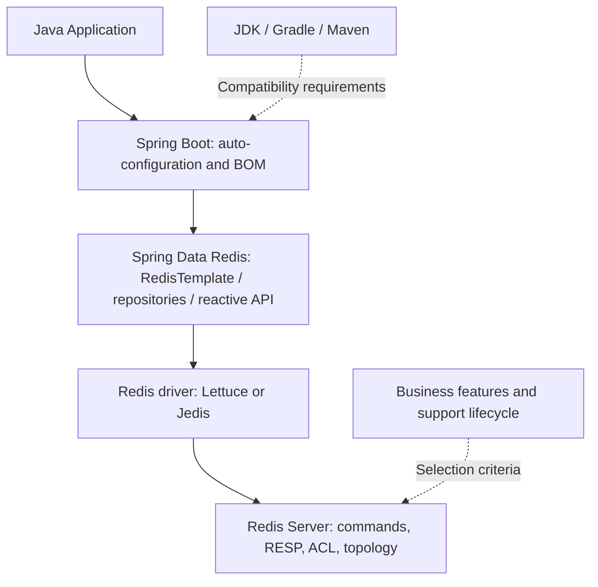
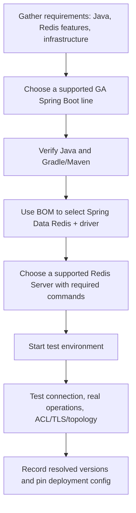

# Choosing Compatible Spring Boot, Spring Data Redis, and Redis Server Versions

When bootstrapping a Java application that uses Redis, you do not just pick an arbitrary Spring Boot version and an arbitrary Redis Server version. The application runs across multiple layers: **JDK and build tools → Spring Boot → Spring Data Redis → Redis driver → connection protocol → Redis Server**. These layers follow different versioning rules. Compatibility errors can surface at build time, during Spring Context startup, upon connecting, or only when executing a specific command.

This guide explains how to **choose, declare, and verify a compatible set of versions**, focusing on practical decisions when creating a new project, maintaining an existing application, or upgrading Redis Server.

> **Reference point: November 2026.** The specific versions in the examples are chosen based on stable releases and official documentation at this reference point. Patch numbers, infrastructure requirements, and maintenance schedules continue to evolve, so check the release notes when deploying in practice.

## 1. Distinguishing the Components Whose Versions Are Being Chosen



| Component | Role | Version Selection Question |
|---|---|---|
| **JDK** | Runs and compiles the application | What minimum Java version do Boot and its dependent libraries require? |
| **Spring Boot** | Manages the Spring ecosystem, configuration, and dependencies | Which Boot line is stable, still maintained, and runs on the existing toolchain? |
| **Spring Data Redis** | Provides APIs such as `RedisTemplate`, `StringRedisTemplate`, and `ReactiveRedisTemplate` | Which Spring Data line corresponds to Spring Boot / Spring Framework? |
| **Lettuce or Jedis** | Sends Redis commands and handles connections and responses | Which client supports the topology, API, and protocol in use? |
| **Redis Server** | Stores data and executes Redis commands | Which version has the required commands, security, and features while still being supported? |
| **Gradle/Maven** | Resolves dependencies and builds the application | Does the target Boot plugin still support the build tool version? |

**There is no rule that "Spring Boot 4 must go with Redis Server 4."** Redis Server has its own versioning, while Spring Data Redis is released within the Spring Data ecosystem. A Boot 4.x application can connect to a Redis Server 7.x instance if the driver, protocol, and commands used are compatible.

## 2. Starting Your Selection with Spring Boot

### 2.1. Why Should Boot Be the Primary Anchor?

Spring Boot provides a **BOM (Bill of Materials)** to manage a coordinated set of versions for Java dependencies. For a typical application, you only need to pick a Spring Boot version and add the Redis starter:

```groovy
dependencies {
    implementation 'org.springframework.boot:spring-boot-starter-data-redis'
}
```

Do not specify a version number on the starter because Spring Boot manages its dependencies. The starter typically brings in Spring Data Redis, Lettuce, and the appropriate integration libraries.

As a result, you avoid mixing a newer `spring-data-redis` release with an older Spring Framework version. **The BOM is a mechanism for selecting a coordinated set of dependencies**, not a guarantee that every Redis Server version supports every new API.

### 2.2. Reference Java Version Line Matrix

| Spring Boot | Spring Data release train | Spring Data Redis | Spring Framework | Minimum Java per Boot | Usage Guidance |
|---|---|---|---|---|---|
| **3.5.x** | **2025.0.x** | **3.5.x** | **6.2.x** | **17** | Existing Boot 3 systems needing patch upgrades or compatibility with older libraries. |
| **4.0.x** | **2025.1.x** | **4.0.x** | **7.0.x** | **17** | Projects that have already migrated to Boot 4.0 and need maintenance within that line. |
| **4.1.x** | **2026.0.x** | **4.1.x** | **7.0.x** | **17** | New applications or deliberate upgrades onto the Boot 4.1 line. |

At the reference point, **Spring Boot 4.1.2** and **Spring Data Redis 4.1.2** are published stable releases. However, **do not assume that the patch versions of Boot and Spring Data Redis must always match**: check the actual version selected by Boot's BOM.

The Java version in the table represents the minimum required by **Spring Boot**, without accounting for higher requirements from third-party libraries or deployment platforms. For example, choosing **JDK 21** as the toolchain for a new project is a valid decision, though it does not mean Boot 4.1 only runs on Java 21.

### 2.3. You Must Also Check Gradle or Maven

Compatibility does not stop at Redis libraries:

- **Spring Boot 3.5.x:** according to system requirements, supports Gradle 8.4+ in the 8.x line; some late 7.x versions are also supported.
- **Spring Boot 4.1.x:** supports **Gradle 8.14+ in the 8.x line** or supported Gradle 9.x releases.
- **Maven:** the lines above require at least Maven 3.6.3.

If a project uses Gradle Wrapper 8.5 and switches the plugin directly to Boot 4.1.x, errors may appear **before the application ever connects to Redis**. Upgrade the Wrapper according to the target Boot version's requirements.

### 2.4. Boot Selection Strategy

**New applications:** choose a GA release from a maintained Boot line with a suitable ecosystem and build tool support. Then adopt newer patches within the chosen line according to project policy. Avoid M/RC/SNAPSHOT builds in everyday environments when there is no specific experimental need.

**Existing applications:** if only maintenance is needed, prioritize evaluating patch upgrades within the same line first. When performing a major upgrade from Boot 3 to Boot 4, read the migration guide and review Spring Framework, Spring Data, auto-configuration settings, security, tests, and Gradle/Java together.

**Multi-service systems:** services do not need the exact same Spring Boot version to access Redis together, but they must agree on **data schema, serializers, key names, TTLs, and data-sharing conventions** if they share keys.

## 3. Spring Data Redis and Driver: Avoiding Mismatched Release Trains

### 3.1. Standalone Gradle Example

A sample configuration for **Spring Boot 4.1.2**, Java 21, and default Lettuce:

```groovy
plugins {
    id 'java'
    id 'org.springframework.boot' version '4.1.2'
    id 'io.spring.dependency-management' version '1.1.7'
}

group = 'com.example'
version = '0.0.1-SNAPSHOT'

java {
    toolchain {
        languageVersion = JavaLanguageVersion.of(21)
    }
}

repositories {
    mavenCentral()
}

dependencies {
    implementation 'org.springframework.boot:spring-boot-starter-data-redis'
    testImplementation 'org.springframework.boot:spring-boot-starter-test'
}

tasks.named('test') {
    useJUnitPlatform()
}
```

Key points to note:

1. The version on the **Spring Boot plugin** is the anchor for the dependency set.
2. `spring-boot-starter-data-redis` has no separate version.
3. Do not declare separate versions for `spring-data-redis` or `lettuce-core` without a verified requirement.
4. `JavaLanguageVersion.of(21)` is the **chosen toolchain** for this example; in a real project, also check plugins, CI, and other libraries.
5. If the project already manages dependencies using Gradle's native `platform` instead of the `io.spring.dependency-management` plugin, keep a single consistent strategy.

Maven example with Boot parent:

```xml
<project xmlns="http://maven.apache.org/POM/4.0.0"
         xmlns:xsi="http://www.w3.org/2001/XMLSchema-instance"
         xsi:schemaLocation="http://maven.apache.org/POM/4.0.0
           https://maven.apache.org/xsd/maven-4.0.0.xsd">
    <modelVersion>4.0.0</modelVersion>

    <parent>
        <groupId>org.springframework.boot</groupId>
        <artifactId>spring-boot-starter-parent</artifactId>
        <version>4.1.2</version>
        <relativePath/>
    </parent>

    <groupId>com.example</groupId>
    <artifactId>redis-compat-demo</artifactId>
    <version>0.0.1-SNAPSHOT</version>

    <properties>
        <java.version>21</java.version>
    </properties>

    <dependencies>
        <dependency>
            <groupId>org.springframework.boot</groupId>
            <artifactId>spring-boot-starter-data-redis</artifactId>
        </dependency>
        <dependency>
            <groupId>org.springframework.boot</groupId>
            <artifactId>spring-boot-starter-test</artifactId>
            <scope>test</scope>
        </dependency>
    </dependencies>
</project>
```

These two examples illustrate **dependency management**; they do not yet include a `@SpringBootApplication` class or a real Redis Server.

### 3.2. Lettuce or Jedis?

`spring-boot-starter-data-redis` uses **Lettuce by default**. Spring Boot also supports configuring Jedis, but you need to swap the dependency if you want to use Jedis.

| Criterion | Lettuce | Jedis |
|---|---|---|
| Default Redis starter driver | Yes | No |
| Synchronous Redis operations via Spring Data | Yes | Yes |
| Spring Data Redis reactive | **Yes** | **No** via standard reactive connector |
| Standalone, Cluster, Sentinel | Yes depending on configuration and features | Yes depending on configuration and features |
| TLS, Pub/Sub, pipelining, transactions | Yes, check specific support | Yes, check specific support |
| When to choose? | Good default for many applications, especially reactive ones | Specific driver requirements or systems standardized on Jedis |

Switching to Jedis in Gradle:

```groovy
dependencies {
    implementation('org.springframework.boot:spring-boot-starter-data-redis') {
        exclude group: 'io.lettuce', module: 'lettuce-core'
    }

    implementation 'redis.clients:jedis'
}
```

Still let Boot's BOM determine the Jedis version. Do not pull in both Lettuce and Jedis unintentionally just because multiple dependencies bring them in. When switching drivers, verify connection semantics, transactions, pipelining, and Cluster/Sentinel behavior in your actual configuration.

### 3.3. Example of an Error-Prone Version Mismatch

```groovy
// Example to avoid: Boot 3.5 uses Framework 6.2, yet forces
// Spring Data Redis 4.1 separately, which belongs to Framework 7.
dependencies {
    implementation 'org.springframework.boot:spring-boot-starter-data-redis'
    implementation 'org.springframework.data:spring-data-redis:4.1.2'
}
```

Overriding Spring Data Redis alone does not upgrade the rest of the Spring Framework APIs. Errors may manifest as `NoSuchMethodError`, `NoClassDefFoundError`, `ClassNotFoundException`, or bean configuration failures at startup. The fix is to inspect the dependency tree and revert to the synchronized BOM, or plan a full platform upgrade.

## 4. Choosing Redis Server by Features, Support, and Environment

### 4.1. Redis Server Has an Independent Lifecycle from Spring Boot

Spring Boot does not install Redis Server and does not determine the version of your Docker image, Redis Cloud, or Redis Software. Even when Java starters resolve cleanly, the server may still lack a command the application needs.

Criteria for choosing Redis Server:

- **Commands:** Does Redis Server support every command and option the application uses?
- **Features:** ACLs, Redis Functions, Streams, Cluster, Sentinel, Pub/Sub, advanced TTLs, modules, or provider-specific capabilities.
- **Operations:** Is there a GA release that receives patches and remains within its support window?
- **Infrastructure:** Is the engine available in the target cloud or container platform?
- **Upgrades:** Are persisted data, snapshots, AOF/RDB, replication, and rollback plans covered?
- **Security:** Does the version support the authentication, ACL, and TLS mechanisms required by the environment?

### 4.2. Redis Server Lines Worth Considering

According to the Redis Open Source versioning policy at the reference point:

| Redis Server | Release Type and Published Lifecycle | When Does It Make Sense? |
|---|---|---|
| **Redis 7.4** | **Extended**, published EOL **12/2029** | Already running stably on 7.4 and do not yet need commands exclusive to 8.x. |
| **Redis 8.2** | **Extended**, published EOL **09/2030** | New projects with infrastructure supporting Redis 8.x; wanting a long maintenance lifecycle. |
| **Redis 6.2** | Previous **Extended** line, published EOL **04/2027** | Legacy systems under constraints; should have an upgrade roadmap rather than choosing it by default for new projects. |

This information applies to **Redis Open Source**. Redis Cloud, Redis Software, and managed services may publish their own supported versions, EOL policies, capabilities, and upgrade paths. Always cross-check the documentation of the specific product you deploy.

Choose a maintained **GA** release that receives security patches. For environments requiring strict reproducibility, pin the image version/digest according to operational procedures rather than using `redis:latest` and assuming every environment matches.

### 4.3. Redis Commands Have Their Own Minimum Versions

| Feature / Command | Typical Minimum Redis Open Source Version | Implication for Server Selection |
|---|---|---|
| `GET`, `SET`, `INCR`, `EXPIRE` | Existed long before modern lines | Usable on most supported servers; still verify semantics and permissions. |
| ACL and username-based authentication | **6.0** | If infrastructure uses Redis ACLs, the client must send the appropriate username and password. |
| RESP3 / `HELLO 3` | **6.0** | The driver must support protocol negotiation; not every application needs RESP3. |
| `GETEX`, `XAUTOCLAIM` | **6.2** | Older servers will not recognize the command. |
| Redis Functions / `FCALL` | **7.0** | Requires server support for functions, ACL permissions, and proper deployment practices. |
| Hash field expiration, e.g., `HEXPIRE` | **7.4** | Engine support is required first, then verify whether the Spring Data/driver API exposes it. |

For example, if the application needs `HEXPIRE`, upgrading only `spring-data-redis` will **not make Redis Server 7.2 understand the new command**. The reverse is also true: upgrading the server does not automatically add a high-level Java method to an older driver.

Extended capabilities such as search or data structures provided by modules or managed services must also be checked against **the specific distribution and service**, rather than inferred solely from the Redis Server version name.

### 4.4. How Does the RESP Protocol Affect Compatibility?

Redis drivers send commands and receive responses over **RESP (Redis Serialization Protocol)**. RESP2 is widely supported; Redis Open Source introduced RESP3 support starting in Redis 6.0. Drivers and servers can negotiate the protocol version.

Points to keep in mind:

- A newer Redis Server version normally still speaks RESP2 for RESP2-capable clients.
- If a feature relies on data types or server push messages tied to RESP3, check support on both the **client and server**.
- Protocol behavior on Redis Cloud/Redis Software may depend on service configuration, not just the engine version number.
- Do not force RESP3 just because the server supports it; let Spring's driver manage it according to configuration and actual requirements.

## 5. Sample Version Sets for Different Contexts

The following table illustrates **reasonable candidates to verify by functionality**, not an official certification that every combination is compatible with every command or topology:

| Scenario | Spring Boot | Spring Data Redis | Suggested Redis Server to Test | Rationale |
|---|---|---|---|---|
| New project, JDK 21, and modern Gradle | **4.1.x** | **4.1.x**, managed by Boot | **8.2 Extended** | Uses the current Spring line and a Redis release with a long lifecycle. |
| Maintaining a Boot 3.5 app on Redis 7.4 infrastructure | **3.5.x** | **3.5.x**, managed by Boot | **7.4 Extended** | Avoids unnecessary major changes when not needed. |
| Upgrading Boot 3.5 to 4.1 without upgrading Redis yet | **4.1.x** | **4.1.x**, managed by Boot | **7.4**, if used commands are supported | Separates the framework upgrade from the server upgrade. |

A Boot 3.5 application can also communicate with Redis 8.2 through a suitable driver when the functionality is verified. There is no inherent constraint requiring Boot and Redis Server to share the same major version. What matters is the driver, protocol, commands, and actual topology.

### 5.1. Decision Workflow for a New Project



If Redis Server is already managed by an infrastructure team, the starting point can be **the existing engine and available features**; from there, choose a maintained Spring Boot line and verify the driver. The application team does not always decide the server version.

### 5.2. When Should You Avoid Upgrading Everything at Once?

If a project is currently on Boot 3.5 and Redis 7.4, upgrading simultaneously to Boot 4.1 and Redis 8.2 increases the number of variables that can break. You can split the effort:

1. Upgrade the Java application first while keeping the server on the older version, and verify.
2. Once the application is stable, upgrade Redis Server in staging and verify again.

However, the order must be adjusted if a new business command **requires** the newer Redis Server; in that case, prepare the server first. Server upgrades involving persistence or replication must follow a dedicated Redis upgrade plan.

## 6. Setting Up a Sample Environment: Spring Boot 4.1 + Redis 8.2

### 6.1. Running Redis with Docker

Assuming Docker is installed and no other service occupies port 6379:

```bash
docker run --rm --name redis-compat-lab \
  -p 127.0.0.1:6379:6379 \
  redis:8.2
```

Equivalent with Docker Compose:

```yaml
services:
  redis:
    image: redis:8.2
    ports:
      - "127.0.0.1:6379:6379"
    restart: unless-stopped
```

This is a **local learning configuration**; it does not include authentication, persistence, or production sizing. When the Spring application runs on the host, the endpoint is `127.0.0.1:6379`. If Spring runs inside a container on the same Compose network, the host is typically **`redis`** — the service name — because `localhost` inside the Spring container points to the Spring container itself.

### 6.2. Inspecting the Running Server

```bash
redis-cli -h 127.0.0.1 -p 6379 PING
redis-cli -h 127.0.0.1 -p 6379 INFO server
redis-cli -h 127.0.0.1 -p 6379 COMMAND INFO GETEX
```

Read the `redis_version` field in `INFO server` to see which Redis version is serving connections. Running `redis-cli --version` only shows the **local CLI tool version**, not the remote server. `COMMAND INFO GETEX` helps verify whether a command is recognized by the server.

### 6.3. Spring Boot Configuration

A minimal `application.yml`:

```yaml
spring:
  data:
    redis:
      host: localhost
      port: 6379
      database: 0
      timeout: 3s
```

When using environment variables in a real environment:

```yaml
spring:
  data:
    redis:
      host: ${REDIS_HOST}
      port: ${REDIS_PORT:6379}
      username: ${REDIS_USERNAME:}
      password: ${REDIS_PASSWORD}
      ssl:
        enabled: true
```

The second example only applies when the target server is configured with matching TLS and authentication. Placeholders must be supplied in the deployment environment; never commit passwords directly into the repository.

If `spring.data.redis.url` is configured, check the precedence rules of the target Boot version. Starting in Boot 3.5, the Redis URL determines the database as well (defaulting to 0 if omitted in the URL), and `spring.data.redis.database` is not used to override it once a URL is declared.

### 6.4. Verifying That Java Can Call Redis

Assuming the application has the Redis starter, a `@SpringBootApplication` class, and a running Redis Server, a simple service looks like this:

```java
import java.time.Duration;
import java.util.UUID;

import org.springframework.data.redis.core.StringRedisTemplate;
import org.springframework.stereotype.Service;

@Service
public class RedisCompatibilityProbe {

    private final StringRedisTemplate redis;

    public RedisCompatibilityProbe(StringRedisTemplate redis) {
        this.redis = redis;
    }

    public boolean canReadBackValue() {
        String key = "lab:compat:" + UUID.randomUUID();

        try {
            redis.opsForValue().set(key, "ready", Duration.ofSeconds(30));
            String value = redis.opsForValue().get(key);
            return "ready".equals(value);
        } finally {
            redis.delete(key);
        }
    }
}
```

An integration test against local Redis:

```java
import static org.junit.jupiter.api.Assertions.assertTrue;

import org.junit.jupiter.api.Test;
import org.springframework.beans.factory.annotation.Autowired;
import org.springframework.boot.test.context.SpringBootTest;

@SpringBootTest
class RedisCompatibilitySmokeTest {

    @Autowired
    RedisCompatibilityProbe probe;

    @Test
    void redisRoundTripWorks() {
        assertTrue(probe.canReadBackValue());
    }
}
```

This is a **verification pattern** for learners, not pre-executed test output. It exercises the path from Spring through the driver to Redis with `SET`, `GET`, and `DEL`. Success does not automatically prove that Streams, Lua, Sentinel, Cluster, Pub/Sub, failover, or persistence features are all compatible.

## 7. Checking the Actual Resolved Dependency Versions

Lines in a build file express **declared intent**; Gradle or Maven determines the final resolved versions. Direct dependencies, transitive dependencies, constraints, and BOMs can all affect the outcome.

### 7.1. Gradle

```bash
./gradlew dependencyInsight --dependency spring-data-redis --configuration runtimeClasspath
./gradlew dependencyInsight --dependency lettuce-core --configuration runtimeClasspath
./gradlew dependencies --configuration runtimeClasspath
```

On Windows PowerShell, you can use `.\gradlew.bat` instead of `./gradlew`. Check:

- Which version of `spring-data-redis` was selected and why?
- Which version of `lettuce-core` or `jedis` was selected?
- Are there libraries from two different Spring Framework/Spring Data lines?
- Is a manual version override shadowing the BOM?
- Are both Lettuce and Jedis present unintentionally?

### 7.2. Maven

```bash
mvn dependency:tree -Dincludes=org.springframework.data:spring-data-redis
mvn dependency:tree -Dincludes=io.lettuce:lettuce-core
mvn dependency:tree -Dincludes=redis.clients:jedis
```

You can inspect the effective POM when dependencies are managed through a parent/BOM. **You do not need to force every artifact to the exact same version number**; compare them against the dependency set managed by Spring Boot for that specific Boot version.

### 7.3. Version Profile to Store with the Project

```yaml
# Example decision profile, not application.yml
application:
  java: "21"
  springBoot: "4.1.2"
  springDataRedis: "managed by Spring Boot BOM"
  redisDriver: "Lettuce - managed by Spring Boot BOM"

infrastructure:
  redisServer: "8.2.x"
  topology: "standalone"
  tls: false

requiredCommands:
  - SET
  - GET
  - INCR
  - EXPIRE

verification:
  - "dependency tree inspected"
  - "INFO server reviewed on target Redis"
  - "round-trip read/write smoke test"
```

This profile helps distinguish between **intended versions**, **actually resolved dependency versions**, and **actual server versions** in each environment.

## 8. Understanding the Levels of "Compatibility"

| Level | Evidence Obtained | What Cannot Be Concluded Yet |
|---|---|---|
| **Build** | Dependencies resolve and code compiles. | Server supports commands and connects properly. |
| **Connection** | `PING` responds, authentication succeeds. | Reads/writes and serializers work correctly. |
| **Basic Operations** | `SET`, `GET`, TTL, counters work. | Cluster, transactions, Pub/Sub, Lua, or failover work correctly. |
| **Product Features** | All Redis operations used by business logic are tested. | Performance, high load, and failure recovery. |
| **Operations** | Latency, reconnects, backup/restore, and failover observed. | Automatic compatibility with future versions. |

### 8.1. Data and Serializer Compatibility

Redis Server stores bytes. Spring Data Redis converts Java objects to bytes via serializers. Therefore, even if the server version does not change, upgrading a JSON library or changing how `RedisTemplate` is configured can still break reading previously stored data.

For example, service A stores a `User` object as JSON, while service B reads the key using Java's native serializer. Redis returns valid bytes, but service B cannot interpret them correctly. You must check:

- serializers for key, value, hash key, and hash value;
- JSON schema version, data types, and class names;
- key prefixes, TTLs, and naming conventions;
- services sharing the same keys;
- ability to read data written by older application versions.

### 8.2. Topology Compatibility

A configuration that runs on standalone Redis does not automatically work on Sentinel or Cluster.

- **Standalone:** single Redis endpoint, permissions, TLS, and database configured appropriately.
- **Sentinel:** the driver must discover the primary and use separate Sentinel/Redis authentication settings if required.
- **Cluster:** the driver must understand hash-slot routing; multi-key commands may require keys in the same slot.
- **Managed Redis:** proxies, admin permissions, TLS, restricted commands, and engine versions may differ from self-managed Redis.

In Cluster, `CROSSSLOT` errors or `MOVED`/`ASK` redirections must be analyzed at the keyslot/driver layer rather than immediately blamed on a Spring Data Redis version mismatch.

## 9. Diagnosing Typical Errors

| Symptom | First Cause Category to Check | How to Verify |
|---|---|---|
| `NoSuchMethodError`, `ClassNotFoundException` | Java dependencies mismatched across major versions or incorrect BOM override | Check `dependencyInsight` / `dependency:tree`. |
| `ERR unknown command` | Redis Server does not support the command or service restricts it | Check `redis_version` and `COMMAND INFO`. |
| `NOAUTH`, `WRONGPASS`, `NOPERM` | Wrong authentication or ACL | Check username, password, and command/key permissions. |
| SSL handshake errors | Client/server TLS mismatch or certificate issue | Check Redis endpoint, TLS config, and trust store. |
| `Connection refused`, timeout | Server not running, wrong host/port, firewall, networking | Check the endpoint from the exact environment running Spring. |
| `CROSSSLOT` | Multi-key command in Cluster spans different hash slots | Check topology and key naming / hash tags. |
| Reading data throws type conversion exception | Incompatible serializer or cached schema | Inspect stored bytes, serializer, and pre-upgrade data. |

### 9.1. Distinguishing Build Errors from Redis Server Errors

If the app fails to build because the Boot plugin requires a newer Gradle version, changing `redis:8.2` to `redis:7.4` will not fix it. Conversely, if the server returns `ERR unknown command 'HEXPIRE'`, upgrading the Java toolchain will not add that command to Redis Server.

Identifying the right failure layer avoids upgrading unrelated components.

### 9.2. Successful Connection Does Not Prove Every Command Works

`PING` is only a basic check. `NOPERM` can occur when a user is allowed to `PING` but denied a data command. `GET` may work while a newer command is absent on the server. Therefore, you must test **the commands your application actually needs**, especially when changing engine versions.

### 9.3. Timeouts Are Not Necessarily Version Errors

Timeouts can come from networking, pool wait saturation, blocking commands, or an overloaded server. The client not receiving a response does not prove the command was not executed. For state-mutating operations like `INCR`, blind retries can duplicate the effect. This is a resilience design issue, not solely a version-selection issue.

## 10. Upgrading via a Verifiable Process

### 10.1. If Upgrading Spring Boot

1. Identify the current Boot, JDK, Gradle/Maven, Spring Data Redis, and driver versions.
2. Choose a maintained target Boot line and verify system requirements.
3. Read the migration guides across all relevant major/minor versions.
4. Upgrade Boot and let the BOM re-manage Spring Data Redis and the driver.
5. Inspect the dependency tree; test Spring Context, repositories, templates, serializers, and used Redis APIs.
6. Verify operations against the actual Redis Server before changing the server.
7. Record the results and resolved versions.

### 10.2. If Upgrading Redis Server

1. Record the current `redis_version`, topology, persistence, replication, ACLs, and TLS setup.
2. Choose a supported GA Redis Server release that provides required business commands.
3. Read the release notes, compatibility notes, and upgrade guide for the exact Redis product or managed service.
4. Test in staging with production-like data and topology.
5. Verify reads/writes, TTLs, scripting, transactions, streams, Pub/Sub, or Cluster depending on the application.
6. Verify backup/restore, failover, rollback, and monitoring plans.
7. After deployment, confirm the version from the live endpoint and monitor errors/latency.

**Server rollback is not always just switching back a Docker tag.** RDB/AOF snapshots, replication, or data written by a newer engine version can constrain downgrading to an older release. You need a pre-verified recovery procedure.

### 10.3. Pinning Environments to Prevent Dev/Prod Drift

Using `redis:latest` in development while production pins Redis 6.2 is an easy way for commands to work in dev and fail in production. You should:

- Pin the Redis line and patch/digest according to deployment procedures.
- Pin the Boot version in the build and use the Wrapper.
- Align Java toolchains and CI configurations.
- Check `INFO server` in each environment.
- Maintain a staging environment close to production, especially for topology and ACLs.

## 11. Reasoning Scenarios

**Scenario 1:** A Boot 3.5 application runs stably with Redis 7.4. Operations wants to upgrade the server to 8.2. Is upgrading Boot to 4.1 mandatory?

**Answer:** Not because of the major version number. Evaluate Lettuce/Jedis and the commands used against Redis 8.2, test in staging, and check other infrastructure components. You can stay on Boot 3.5 if the Spring line remains supported under project policy and verification passes.

**Scenario 2:** Adding the `HEXPIRE` feature when the environment runs Redis Server 7.2. The team wants to upgrade only Spring Data Redis.

**Answer:** Not sufficient. The command requires Redis Server support, typically from 7.4 onward. After upgrading the server, also check whether the driver/Spring API supports the chosen invocation style.

**Scenario 3:** Configured Spring Boot 4.1.2 with Gradle Wrapper 8.5, and the application does not build.

**Answer:** First check the Gradle requirements for Boot 4.1.x (8.14+ in the 8.x line). This is a build-tool error; there is no basis to blame Redis Server.

**Scenario 4:** An app uses Boot 3.5 but forces `spring-data-redis:4.1.2` and hits `NoSuchMethodError`.

**Answer:** Spring Data Redis 4.1 belongs to the generation built on Spring Framework 7; Boot 3.5 uses Spring Framework 6.2. Inspect the dependency tree and restore the matching BOM, or plan a full Spring stack upgrade.

**Scenario 5:** Same Redis version, dev works while production returns `NOPERM`.

**Answer:** Check the Redis ACL for the production user. Command/key permissions may differ even when Redis Server and Spring Data Redis versions are identical.

## 12. Key Principles to Remember

**Choose Spring Boot first to establish the Java dependency set.** Spring Data Redis and Lettuce/Jedis should take their versions from Boot's BOM unless a justified override is required.

**Choose Redis Server by features and support lifecycle.** A suitable Redis version must provide the desired commands and behavior, match topology/security requirements, and meet operational patching policies.

**Verify at the actual level of usage.** A successful build does not guarantee a suitable server; a successful `PING` does not guarantee advanced commands work. Record resolved dependency details, actual server versions, and verification results for the operations your application uses.

### Official References

- [Spring Boot — System Requirements](https://docs.spring.io/spring-boot/system-requirements.html) and [System Requirements 3.5](https://docs.spring.io/spring-boot/3.5/system-requirements.html): Java, Gradle, and Maven requirements.
- [Spring Boot — Managed Dependency Coordinates](https://docs.spring.io/spring-boot/appendix/dependency-versions/coordinates.html): dependency versions managed by the BOM.
- [Spring Boot — Redis](https://docs.spring.io/spring-boot/reference/data/nosql.html): starters, connection configuration, and drivers.
- [Spring Boot — 4.1 Release Notes](https://github.com/spring-projects/spring-boot/wiki/Spring-Boot-4.1-Release-Notes): Spring Data BOM and baseline changes.
- [Spring Data Redis — Dependencies](https://docs.spring.io/spring-data/redis/reference/data-commons/dependencies.html): release trains and BOM management.
- [Spring Data Redis — Redis Drivers](https://docs.spring.io/spring-data/redis/reference/redis/drivers.html): Lettuce and Jedis support scope.
- [Redis Open Source — Version Management](https://redis.io/docs/latest/operate/oss_and_stack/install/version-mgmt/): Extended lifecycle, supported server versions, and EOL dates.
- [Redis Commands](https://redis.io/commands/): checking minimum versions and semantics per command.
- [RESP Protocol Specification](https://redis.io/docs/latest/develop/reference/protocol-spec/): request/response protocol.
