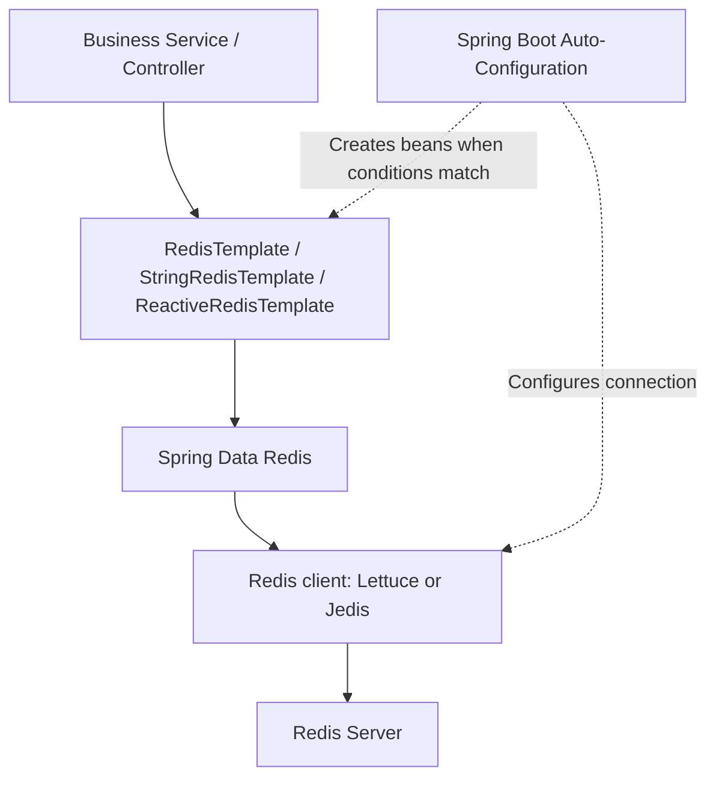

# Declaring Spring Data Redis Dependencies with Gradle or Maven

When initializing a Java application that uses Redis, the first step is adding the required libraries to the application's **classpath**. With Spring Boot, the most common approach is declaring `spring-boot-starter-data-redis` in Gradle or Maven. This starter brings Spring Data Redis, the default Redis client, and the necessary Spring Boot integration into the project with a compatible set of versions.

This lesson focuses on choosing the right dependencies, writing declarations for each build tool, managing versions, and verifying that the application can connect to Redis. The examples use Spring Boot with the Spring Data Redis ecosystem; specific version numbers are illustrative and must match the Spring Boot version used in your actual project.

## 1. Understanding the Components Before Adding Dependencies

Redis is a data storage server. A Spring application cannot communicate with a Redis server on its own without a client library and connection configuration. You can visualize the layers as follows:



| Component | Role | Need to Declare Manually in Typical Spring Boot? |
| --- | --- | --- |
| `org.springframework.boot:spring-boot-starter-data-redis` | Starter for synchronous/blocking Spring Data Redis | **Yes**, when using `RedisTemplate`, `StringRedisTemplate`, or standard Redis repositories |
| `org.springframework.data:spring-data-redis` | Spring-style Redis access API managing templates/repositories/connections | Usually **no** need to add separately because the starter pulls it in |
| `io.lettuce:lettuce-core` | Lettuce Redis client connecting over TCP, supporting sync and async/reactive operations | Usually **no** need to add separately; the standard Redis starter includes Lettuce |
| `redis.clients:jedis` | Alternative Redis client, typically used via synchronous APIs | Add only when intentionally choosing Jedis |
| `org.springframework.boot:spring-boot-starter-data-redis-reactive` | Starter for reactive Redis APIs in Spring Boot | Choose when `ReactiveRedisTemplate` and Reactor pipelines are needed |
| `org.apache.commons:commons-pool2` | Pooling support in Lettuce configuration when needed | **Optional**, not a default requirement |
| `org.springframework.boot:spring-boot-starter-test` | Support for JUnit, Spring Test, and testing libraries | Usually added in test scope; does **not** provide a built-in Redis server for tests |

**Important distinction:** adding dependencies only prepares the library layer inside the application. It does not install, start, or guarantee that a Redis server is running. After the build step, you still need to configure the Redis address and have an actual server to connect to.

## 2. Choosing Dependencies Based on Needs

| Application Type | Primary Dependency | Commonly Used API Style |
| --- | --- | --- |
| Spring Boot, standard Redis read/write | `spring-boot-starter-data-redis` | `StringRedisTemplate`, `RedisTemplate` |
| Spring Boot, data flowing through reactive pipelines | `spring-boot-starter-data-redis-reactive` | `ReactiveStringRedisTemplate`, `ReactiveRedisTemplate` |
| Spring Boot, using Jedis instead of Lettuce | Redis starter + Jedis, excluding Lettuce from default dependencies | Synchronous APIs via `RedisTemplate` |
| Plain Spring Framework, without Spring Boot | `spring-data-redis` + compatible Redis client | Manually create `RedisConnectionFactory`, templates, and bean configuration |

In most Spring Boot projects starting with Redis, you only need:

```text
org.springframework.boot:spring-boot-starter-data-redis
```

Do not simultaneously add `spring-data-redis` and `lettuce-core` with manually chosen versions when the starter already manages them. Specifying a different version can skew the Spring library set, causing class or method errors at runtime.

## 3. Declaring in Gradle Groovy DSL (`build.gradle`)

This is the usual approach if the project has a `build.gradle` file. Assuming the project **already configures the Spring Boot plugin and dependency management**, add the following:

```groovy
dependencies {
    implementation 'org.springframework.boot:spring-boot-starter-data-redis'

    testImplementation 'org.springframework.boot:spring-boot-starter-test'
}
```

Meaning:

- `implementation`: dependencies required to compile and run the application.
- `testImplementation`: dependencies required only when compiling/running tests.
- Do not append `:version` after the starter name because versions should be managed by Spring Boot.

Example of a standalone `build.gradle` using Spring Boot 3.3.5 to illustrate the structure:

```groovy
plugins {
    id 'java'
    id 'org.springframework.boot' version '3.3.5'
    id 'io.spring.dependency-management' version '1.1.6'
}

group = 'com.example'
version = '0.0.1-SNAPSHOT'

java {
    toolchain {
        languageVersion = JavaLanguageVersion.of(21)
    }
}

repositories {
    mavenCentral()
}

dependencies {
    implementation 'org.springframework.boot:spring-boot-starter-data-redis'
    testImplementation 'org.springframework.boot:spring-boot-starter-test'
}

tasks.named('test') {
    useJUnitPlatform()
}
```

The two plugin version numbers here are **a consistent example for a Spring Boot 3.3.x project**, not a recommendation to pin those exact numbers for every new project. Use the Spring Boot version your project has selected while ensuring Java and Gradle are compatible with it.

If the project already has `plugins`, `repositories`, or `dependencies` blocks, only add what is missing. Do not create duplicate configuration blocks or plugin declarations just to install Spring Data Redis.

### Managing Dependencies in Gradle via the Spring Boot BOM

A Gradle project can use native BOM support instead of the `io.spring.dependency-management` plugin:

```groovy
dependencies {
    // Version 3.3.5 is illustrative only; it must match the application's Spring Boot version.
    implementation platform('org.springframework.boot:spring-boot-dependencies:3.3.5')

    implementation 'org.springframework.boot:spring-boot-starter-data-redis'
}
```

`platform(...)` brings the BOM's version constraints into dependency resolution. Both approaches — the dependency-management plugin or Gradle platform/BOM — serve the goal of synchronizing versions. Pick one that fits existing build conventions; avoid managing the same set of dependencies with multiple BOMs of different versions.

In a multi-module Gradle project, the Redis dependency should be declared in **the module that actually uses Redis**. If the parent project already applies the plugin and BOM via shared configuration, child modules usually only need the `implementation` line without reconfiguring plugin versions.

## 4. Declaring in Gradle Kotlin DSL (`build.gradle.kts`)

If the project uses `build.gradle.kts`, the equivalent syntax is:

```kotlin
dependencies {
    implementation("org.springframework.boot:spring-boot-starter-data-redis")

    testImplementation("org.springframework.boot:spring-boot-starter-test")
}
```

A sample project with the Spring Boot plugin and dependency management:

```kotlin
plugins {
    java
    id("org.springframework.boot") version "3.3.5"
    id("io.spring.dependency-management") version "1.1.6"
}

group = "com.example"
version = "0.0.1-SNAPSHOT"

java {
    toolchain {
        languageVersion = JavaLanguageVersion.of(21)
    }
}

repositories {
    mavenCentral()
}

dependencies {
    implementation("org.springframework.boot:spring-boot-starter-data-redis")
    testImplementation("org.springframework.boot:spring-boot-starter-test")
}

tasks.test {
    useJUnitPlatform()
}
```

If the Kotlin DSL project already uses Gradle platform:

```kotlin
dependencies {
    implementation(platform("org.springframework.boot:spring-boot-dependencies:3.3.5"))
    implementation("org.springframework.boot:spring-boot-starter-data-redis")
}
```

The differences between Groovy DSL and Kotlin DSL are mainly string syntax, function call syntax, and plugin declarations. **The Redis artifact coordinates are identical**.

## 5. Declaring in Maven (`pom.xml`)

In a Spring Boot Maven project using `spring-boot-starter-parent`, the dependencies section can be written as:

```xml
<dependencies>
    <dependency>
        <groupId>org.springframework.boot</groupId>
        <artifactId>spring-boot-starter-data-redis</artifactId>
    </dependency>

    <dependency>
        <groupId>org.springframework.boot</groupId>
        <artifactId>spring-boot-starter-test</artifactId>
        <scope>test</scope>
    </dependency>
</dependencies>
```

You do not need `<version>` on each starter because Maven inherits version management rules from the Spring Boot parent.

Full `pom.xml` example for an illustrative project:

```xml
<?xml version="1.0" encoding="UTF-8"?>
<project xmlns="http://maven.apache.org/POM/4.0.0"
         xmlns:xsi="http://www.w3.org/2001/XMLSchema-instance"
         xsi:schemaLocation="http://maven.apache.org/POM/4.0.0
                             https://maven.apache.org/xsd/maven-4.0.0.xsd">
    <modelVersion>4.0.0</modelVersion>

    <parent>
        <groupId>org.springframework.boot</groupId>
        <artifactId>spring-boot-starter-parent</artifactId>
        <version>3.3.5</version>
        <relativePath/>
    </parent>

    <groupId>com.example</groupId>
    <artifactId>redis-demo</artifactId>
    <version>0.0.1-SNAPSHOT</version>

    <properties>
        <java.version>21</java.version>
    </properties>

    <dependencies>
        <dependency>
            <groupId>org.springframework.boot</groupId>
            <artifactId>spring-boot-starter-data-redis</artifactId>
        </dependency>
        <dependency>
            <groupId>org.springframework.boot</groupId>
            <artifactId>spring-boot-starter-test</artifactId>
            <scope>test</scope>
        </dependency>
    </dependencies>

    <build>
        <plugins>
            <plugin>
                <groupId>org.springframework.boot</groupId>
                <artifactId>spring-boot-maven-plugin</artifactId>
            </plugin>
        </plugins>
    </build>
</project>
```

In Maven, the default scope of a dependency is `compile`, so the Redis starter does not need `<scope>compile</scope>`. The test starter uses `<scope>test</scope>` so it is not included as a runtime dependency in production.

### If the Maven Project Does Not Use Spring Boot Parent

You can import the Spring Boot BOM inside `dependencyManagement` in `pom.xml`. For example:

```xml
<properties>
    <!-- Example; choose a version compatible with the application. -->
    <spring-boot.version>3.3.5</spring-boot.version>
</properties>

<dependencyManagement>
    <dependencies>
        <dependency>
            <groupId>org.springframework.boot</groupId>
            <artifactId>spring-boot-dependencies</artifactId>
            <version>${spring-boot.version}</version>
            <type>pom</type>
            <scope>import</scope>
        </dependency>
    </dependencies>
</dependencyManagement>

<dependencies>
    <dependency>
        <groupId>org.springframework.boot</groupId>
        <artifactId>spring-boot-starter-data-redis</artifactId>
    </dependency>
</dependencies>
```

`dependencyManagement` only establishes **version selection**. It does not put the Redis starter onto the classpath by itself. Therefore, you still need the actual declaration under `<dependencies>`. The BOM also does not automatically turn a plain Spring Framework project into an auto-configured Boot application; to get that behavior, the project still needs proper Spring Boot application setup.

## 6. Why Let Spring Boot Manage Versions?

A starter pulls in multiple interrelated libraries. Example logical structure:

```text
spring-boot-starter-data-redis
  ├─ Spring Boot starter/auto-configuration
  ├─ spring-data-redis
  │    └─ Spring Data Commons and related Spring components
  └─ lettuce-core (default client)
```

This diagram illustrates the relationships, not the exact `dependency:tree` output of every version. Specific transitive dependency lists and branches may change across Spring Boot releases.

The Spring Boot BOM defines versions chosen to work together within the same release line. If you pin versions independently:

```groovy
// Example of a mismatch-prone setup; do not copy into your project.
implementation 'org.springframework.boot:spring-boot-starter-data-redis:3.3.5'
implementation 'org.springframework.data:spring-data-redis:4.0.0'
```

you risk combining one Spring Boot release line with a Spring Data version from a different line. Errors can appear at runtime, such as `NoSuchMethodError`, `ClassNotFoundException`, or failures during bean creation.

Working principles:

1. Identify the **current Spring Boot version** from the project's shared configuration.
2. Declare the Redis starter without a version when using the Spring Boot BOM/parent.
3. Only override transitive libraries when there is a clear reason, such as a security patch or compatibility requirement, and inspect the entire dependency graph.
4. In a multi-module monorepo, inspect the actual classpath of the runnable module; shared configurations or conventions may govern dependencies.

## 7. Lettuce by Default, Jedis as an Option

### Lettuce: The Common Starting Choice

The standard Spring Boot Redis starter already puts Lettuce on the classpath. When choosing the default starter, you do not need to write:

```groovy
implementation 'io.lettuce:lettuce-core'
```

unless your project's dependency configuration excludes it or you are using plain Spring Framework. Lettuce supports synchronous, asynchronous, and reactive APIs; it can be used in regular Spring Boot applications without turning the entire program reactive.

### Switching to Jedis with Gradle

Do this only if the application specifically requires Jedis. Groovy DSL example:

```groovy
dependencies {
    implementation('org.springframework.boot:spring-boot-starter-data-redis') {
        exclude group: 'io.lettuce', module: 'lettuce-core'
    }

    implementation 'redis.clients:jedis'
}
```

In Spring Boot, you can explicitly specify the selected client:

```yaml
spring:
  data:
    redis:
      client-type: jedis
```

If Lettuce is still brought in via another dependency, verifying and explicitly setting `client-type` helps prevent unintended configuration. Do not choose Jedis for a Spring Data Redis reactive pipeline because Spring's reactive Redis support relies on Lettuce.

### Switching to Jedis with Maven

```xml
<dependencies>
    <dependency>
        <groupId>org.springframework.boot</groupId>
        <artifactId>spring-boot-starter-data-redis</artifactId>
        <exclusions>
            <exclusion>
                <groupId>io.lettuce</groupId>
                <artifactId>lettuce-core</artifactId>
            </exclusion>
        </exclusions>
    </dependency>

    <dependency>
        <groupId>redis.clients</groupId>
        <artifactId>jedis</artifactId>
    </dependency>
</dependencies>
```

In both build tools, Jedis's version should be managed by the Spring Boot BOM if the current Spring Boot line supports and manages this client. Do not add Jedis to a project already running smoothly on Lettuce just for "completeness."

## 8. When Do You Need the Redis Reactive Starter?

When the application actually uses Reactor with `Mono`/`Flux` and reactive Redis APIs, replace the main dependency with the Redis reactive starter:

**Gradle Groovy**

```groovy
dependencies {
    implementation 'org.springframework.boot:spring-boot-starter-data-redis-reactive'
}
```

**Gradle Kotlin**

```kotlin
dependencies {
    implementation("org.springframework.boot:spring-boot-starter-data-redis-reactive")
}
```

**Maven**

```xml
<dependency>
    <groupId>org.springframework.boot</groupId>
    <artifactId>spring-boot-starter-data-redis-reactive</artifactId>
</dependency>
```

Example API using reactive Spring Data Redis:

```java
import reactor.core.publisher.Mono;
import org.springframework.data.redis.core.ReactiveStringRedisTemplate;
import org.springframework.stereotype.Service;

@Service
public class ReactiveTokenService {
    private final ReactiveStringRedisTemplate redis;

    public ReactiveTokenService(ReactiveStringRedisTemplate redis) {
        this.redis = redis;
    }

    public Mono<String> findToken(String tokenId) {
        return redis.opsForValue().get("token:" + tokenId);
    }
}
```

Here `get(...)` returns `Mono<String>`; the operation is actually triggered upon subscription. Do not call `.block()` in reactive flows just to obtain a synchronous result, as doing so can block the processing thread. Add `spring-boot-starter-webflux` if the project also needs to expose reactive HTTP endpoints; that is a web-layer requirement, not a mandatory dependency solely for reactive Redis access.

Do not declare both the blocking and reactive starters out of habit. Choose based on your API/architecture style, then inspect the concrete dependency graph to avoid pulling in unused libraries.

## 9. Optional Dependency for Connection Pooling

Lettuce can share a single connection across many typical operations; not every application needs a large pool. If you choose to configure Lettuce pooling in Spring Boot, add Apache Commons Pool 2:

**Gradle**

```groovy
dependencies {
    implementation 'org.springframework.boot:spring-boot-starter-data-redis'
    implementation 'org.apache.commons:commons-pool2'
}
```

**Maven**

```xml
<dependency>
    <groupId>org.apache.commons</groupId>
    <artifactId>commons-pool2</artifactId>
</dependency>
```

Example configuration with Spring Boot 3.x:

```yaml
spring:
  data:
    redis:
      lettuce:
        pool:
          enabled: true
          max-active: 8
          max-idle: 8
          min-idle: 0
          max-wait: 2s
```

Whether a pool is needed and how big it should be depend on load, operation types, and how the application uses connections. Do not treat adding `commons-pool2` as a default speedup for Redis: a pool that is too small can make requests wait; a pool that is too large can create unnecessary connections. For long-lived blocking operations such as waiting on messages, evaluate connection management separately.

## 10. Plain Spring Framework Without Spring Boot

If the application does not use Spring Boot starters or auto-configuration, you can add them directly:

**Gradle**

```groovy
dependencies {
    implementation 'org.springframework.data:spring-data-redis'
    implementation 'io.lettuce:lettuce-core'
}
```

**Maven**

```xml
<dependencies>
    <dependency>
        <groupId>org.springframework.data</groupId>
        <artifactId>spring-data-redis</artifactId>
    </dependency>
    <dependency>
        <groupId>io.lettuce</groupId>
        <artifactId>lettuce-core</artifactId>
    </dependency>
</dependencies>
```

These snippets are only complete regarding **dependency names**. Without a managing BOM/parent, you must add compatible versions or import a BOM managing Spring Data and related libraries. A plain Spring application must also define connection beans manually, for example:

```java
import org.springframework.context.annotation.Bean;
import org.springframework.context.annotation.Configuration;
import org.springframework.data.redis.connection.RedisConnectionFactory;
import org.springframework.data.redis.connection.lettuce.LettuceConnectionFactory;
import org.springframework.data.redis.core.StringRedisTemplate;

@Configuration
public class RedisConfig {
    @Bean
    public RedisConnectionFactory redisConnectionFactory() {
        return new LettuceConnectionFactory("localhost", 6379);
    }

    @Bean
    public StringRedisTemplate stringRedisTemplate(
            RedisConnectionFactory connectionFactory) {
        return new StringRedisTemplate(connectionFactory);
    }
}
```

The configuration above only illustrates the relationship between `RedisConnectionFactory` and `StringRedisTemplate`. In standard Spring Boot, auto-configuration handles most of this work, and defining beans manually can alter auto-configuration behavior. Only create beans manually when there is an actual need.

## 11. Configuring the Connection After Adding Dependencies

With Spring Boot 3.x, Redis auto-configuration typically uses `spring.data.redis.*` properties:

```yaml
# src/main/resources/application.yml
spring:
  data:
    redis:
      host: localhost
      port: 6379
      timeout: 2s
```

Or with `application.properties`:

```properties
spring.data.redis.host=localhost
spring.data.redis.port=6379
spring.data.redis.timeout=2s
```

`localhost` means Redis is listening on the same network environment as the application process. If the application runs inside a Docker container and Redis runs in another container, `localhost` points to **the application container**, not the Redis container. In that case, use the service name or host appropriate for the deployment topology.

When Redis requires a password, account, TLS, or Sentinel/Cluster modes, configure them according to the real infrastructure. Do not hardcode production passwords in configuration files committed to the repository; use the environment's secret/configuration mechanism.

With Spring Boot 2.x, many older guides and projects use the `spring.redis.*` prefix. Always match the project's Spring Boot branch; do not mix configuration examples from two different release lines.

### Quick Read/Write Verification

Once a Redis server is running and properly configured, a simple service can use `StringRedisTemplate`:

```java
import java.time.Duration;
import org.springframework.data.redis.core.StringRedisTemplate;
import org.springframework.stereotype.Service;

@Service
public class RedisConnectionDemo {
    private final StringRedisTemplate redis;

    public RedisConnectionDemo(StringRedisTemplate redis) {
        this.redis = redis;
    }

    public String writeThenRead() {
        String key = "demo:spring-data-redis:connection";
        redis.opsForValue().set(key, "connected", Duration.ofSeconds(30));
        return redis.opsForValue().get(key);
    }
}
```

If configured properly, calling `writeThenRead()` in an experimental environment will read back `"connected"`. The 30-second TTL lets the test key expire automatically. On shared Redis instances, namespace keys by environment or lab exercise to avoid collisions.

The difference between three commonly confused error categories:

- **Build cannot find dependency:** artifact/repository/proxy resolution issue or BOM configuration error.
- **Application fails to create bean:** starter is missing from runtime classpath, auto-configuration is excluded, or bean configuration is unsuitable.
- **Application has beans but cannot reach Redis:** Redis server is not running, host/port/TLS/authentication is wrong, or there is a network error. This is a runtime connectivity failure and does not automatically indicate a wrong dependency declaration.

## 12. Inspecting Actually Resolved Dependencies

After updating the build file, the build tool must download and resolve the dependencies. In a Gradle project, you can check using:

```bash
./gradlew dependencies --configuration runtimeClasspath
./gradlew dependencyInsight --dependency spring-data-redis --configuration runtimeClasspath
```

On Windows, use the corresponding wrapper, such as `gradlew.bat`. In a multi-project Gradle build, run the task for the specific subproject (for example `:redis-demo:dependencies`) to inspect the classpath containing Redis.

In Maven:

```bash
mvn dependency:tree
mvn dependency:tree -Dincludes=org.springframework.data:spring-data-redis
```

Inspect the output to answer:

1. Is `spring-boot-starter-data-redis` or `spring-boot-starter-data-redis-reactive` present in the application module that needs Redis?
2. Does `spring-data-redis` resolve to a single version matching Spring Boot?
3. Is the actual Redis client Lettuce, Jedis, or both? Does that match the application's configuration choice?
4. Are there unexpected version overrides caused by direct dependencies, another BOM, or a convention plugin?

Do not rely solely on artifact names in the build file to assume libraries were downloaded properly: the resolved output for the runnable module reflects the true classpath.

## 13. Common Errors When Declaring Redis Dependencies

| Symptom | Common Cause | What to Check |
| --- | --- | --- |
| `Could not find ... spring-boot-starter-data-redis` | Missing repository or unable to resolve Maven Central/internal repository | Check `repositories`, Maven settings, network/proxy, and artifact coordinates |
| Gradle/Maven asks for starter `version` | Project does not apply Spring Boot parent/BOM/dependency-management as expected | Check version management configuration; do not patch in arbitrary versions |
| `NoSuchMethodError` at runtime | Spring Boot/Spring Data/Redis client libraries may be version-mismatched | Inspect the dependency graph and remove unnecessary overrides |
| `NoSuchBeanDefinitionException: RedisConnectionFactory` | Bean not created, missing client, or auto-configuration inactive | Check runtime classpath, auto-configuration report, and configuration |
| `RedisConnectionFailureException` | Redis unreachable via configured address and connection settings | Check server, network, host, port, TLS, and authentication |
| `Connection refused: localhost/127.0.0.1:6379` | No Redis listening at the address of **the current process** | Check Docker networking and Redis host |
| Reactive project but only blocking APIs present | Wrong starter selected or required reactive beans missing | Use the Redis reactive starter with Lettuce and `ReactiveRedisTemplate` types |
| Added Redis starter but tests still cannot connect | The starter does not start a Redis server for tests | Start a test Redis instance separately, such as a lifecycle-managed Redis container |

### A Diagnostic Example

A project has the following `build.gradle`:

```groovy
dependencies {
    implementation 'org.springframework.data:spring-data-redis'
}
```

Then the application tries to inject `StringRedisTemplate`, but no matching bean exists. For a Spring Boot application wishing to use default configuration, check whether replacing it with:

```groovy
dependencies {
    implementation 'org.springframework.boot:spring-boot-starter-data-redis'
}
```

and ensuring Boot auto-configuration is enabled resolves the issue. The starter brings the standard components into the project, though a valid Spring Boot application context without conflicting exclusions is still required.

## 14. Practical Selection Scenarios

**Scenario A — Spring MVC CRUD using Redis to cache sessions or temporary values:** choose `spring-boot-starter-data-redis`. Use `StringRedisTemplate` or `RedisTemplate` for synchronous operations; only add `spring-boot-starter-cache` if you also want to use the Spring Cache abstraction (`@Cacheable`, `@CacheEvict`, etc.) with suitable cache configuration.

**Scenario B — WebFlux with an end-to-end reactive request pipeline:** choose `spring-boot-starter-data-redis-reactive` and Lettuce. Return `Mono`/`Flux` from services instead of performing blocking operations on the event loop.

**Scenario C — Organization uses a Gradle convention plugin to manage Spring Boot:** declare the Redis dependency only in modules that need it. Do not add a different Spring Boot version in child modules, as it may conflict with shared build conventions.

**Scenario D — System mandates Jedis due to internal standardization:** exclude Lettuce, add Jedis, configure `client-type` accordingly, and inspect the dependency tree. Confirm the application uses synchronous APIs before switching clients.

**Scenario E — Plain Spring Framework project:** add Spring Data Redis and a Redis client with compatible versions, then define connection beans manually. Do not assume Spring Boot auto-configuration is present.

## 15. Self-Practice Questions

1. **Why does a Spring Boot application usually only need `spring-boot-starter-data-redis` without separately adding `spring-data-redis` and `lettuce-core`?**  
   Hint: the starter aggregates transitive dependencies and the Spring Boot BOM manages versions.

2. **A Gradle project reports it cannot find the Redis starter version even though the artifact name is correct. Where should you look?**  
   Hint: plugins, `dependency-management`, or `platform(BOM)`; `repositories` determines where artifacts are fetched.

3. **A project uses Maven without inheriting `spring-boot-starter-parent`. How can you still omit `<version>` from the Redis starter declaration?**  
   Hint: import the `spring-boot-dependencies` BOM under `dependencyManagement`.

4. **After adding `spring-boot-starter-data-redis` and running the app, you get `Connection refused`. Should you add a newer version of `lettuce-core` next?**  
   Hint: distinguish between classpath errors and network connection errors to the Redis server.

5. **When should you choose `spring-boot-starter-data-redis-reactive`? Should you replace Lettuce with Jedis in a reactive pipeline?**  
   Hint: `Mono`/`Flux` APIs, `ReactiveRedisTemplate`, and client reactive capabilities.

## Key Takeaways

In Spring Boot, **start with the right starter**: `spring-boot-starter-data-redis` for standard access or `spring-boot-starter-data-redis-reactive` for reactive APIs. Gradle and Maven differ only in declaration syntax; both should use the Spring Boot parent/BOM to align versions. Lettuce is normally already included in the starter. Jedis and Commons Pool 2 are targeted choices for specific needs. After adding dependencies, inspect the resolved classpath and configure the Redis server separately — correct dependencies are only the prerequisite for an application to access Redis successfully.
