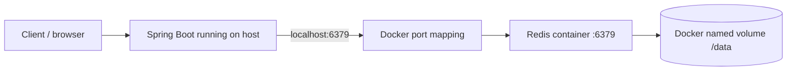
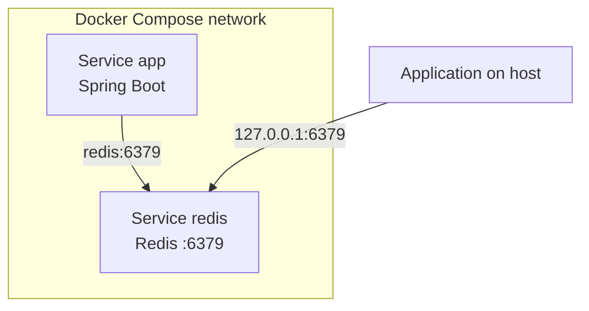

# Initializing Redis for Development with Docker Compose

In a Spring Boot application using **Spring Data Redis**, you need a Redis server to experiment with caching, sessions, counters, or data structures such as Hashes, Sets, and Sorted Sets. **Docker Compose** lets you launch Redis using a reusable YAML file instead of installing Redis directly onto your operating system and memorizing a sequence of manual startup commands.

This lesson sets up a **local Redis instance for development**, then connects from Spring Boot, tests reading and writing data, preserves data across restarts, and troubleshoots common errors. The configuration is designed for a developer workstation and is not intended as a production configuration.

## 1. Expected Outcomes

Once completed, your development machine will have:

- A Redis server running inside a Docker container, listening on port **6379** inside the container.
- The Redis port mapped to **`127.0.0.1:6379`** on the development machine so Spring Boot running directly on the host can connect.
- A **named volume** holding Redis data, allowing data stored on the volume to survive when the container is removed and recreated.
- A **healthcheck** so Compose reports when Redis is ready to answer commands.
- `spring.data.redis` configuration for Spring Boot and a verification test with `StringRedisTemplate`.

Architecture when Spring Boot runs on the host machine:



`localhost` in this diagram is the **localhost of the machine running Spring Boot**. When moving Spring Boot into another container on the same Docker Compose network, the connection host must change to **the `redis` service name**; do not use `localhost` inside the application container to look for Redis.

## 2. What Do Redis, Docker, and Docker Compose Handle?

| Component | Responsibility |
|---|---|
| **Redis** | Processes data commands, such as `SET`, `GET`, `INCR`, `HSET`, `EXPIRE` |
| **Docker image** | Packages the Redis binary and a defined runtime environment |
| **Docker container** | A running Redis process instantiated from an image, with its own network and filesystem |
| **Docker Compose** | Declares and manages services/containers, networks, volumes, ports, and healthchecks in YAML |
| **Docker named volume** | Persistent storage location independent of container lifecycle |
| **Spring Data Redis** | Library enabling Java/Spring Boot code to interact with Redis via connection factories, templates, or other integrations |

Important distinction: **a container can be replaced without necessarily losing data**, provided the data to keep has been written to the volume and Redis persistence is properly configured. Creating a volume alone is not enough: Redis must actually write persistence files to `/data`.

Docker Compose V2 uses the `docker compose` syntax (with a space). Throughout the documentation and commands below, always use this syntax.

## 3. Prerequisites

Your machine needs a running Docker Engine and the Docker Compose V2 plugin. On Windows/macOS, you can use Docker Desktop; on Linux, you can use Docker Engine with the Compose plugin.

Verify in a terminal or PowerShell:

```bash
docker --version
docker compose version
docker info
```

- `docker --version` confirms the Docker CLI is present.
- `docker compose version` confirms the Compose plugin is functional.
- `docker info` indicates the Docker daemon/engine can be reached.

If the CLI is installed but Docker Engine is not running, `docker info` typically returns a daemon connection error. On Windows, ensure Docker Desktop is started and the virtualization/WSL 2 backend is configured per Docker Desktop's instructions if using that mode.

Your machine needs container registry access on the first image pull. Host port `6379` must also be free; if it is already occupied, you can change the **left** port in the port mapping to `6380` as shown in the troubleshooting section.

## 4. Creating the `compose.yaml` File

Place a file named `compose.yaml` in the root directory of your test project:

```text
redis-local/
└── compose.yaml
```

Contents:

```yaml
services:
  redis:
    image: redis:7.4-alpine
    ports:
      - "127.0.0.1:6379:6379"
    command: ["redis-server", "--appendonly", "yes"]
    volumes:
      - redis_data:/data
    healthcheck:
      test: ["CMD", "redis-cli", "ping"]
      interval: 5s
      timeout: 3s
      retries: 10
      start_period: 5s

volumes:
  redis_data:
```

The `7.4-alpine` Redis tag here is **an example pinning a minor branch to make the exercise repeatable**. For real projects, agree on a version across the team, check security patches, and consider pinning an image digest if exact byte-level reproducibility is needed. Do not rely carelessly on the `latest` tag.

### 4.1. Explaining Each Setting

**`services.redis`** is the service name in Compose. This name is also used to resolve Redis via internal DNS when another application container joins the same Compose network.

**`image: redis:7.4-alpine`** tells Docker to pull the corresponding Redis image. Alpine keeps the image relatively compact; choosing an image distribution should match your operational requirements, diagnostic tooling, and project policies.

**`ports: "127.0.0.1:6379:6379"`** consists of:

```text
127.0.0.1 : 6379   : 6379
host IP     host port container port
```

- `127.0.0.1`: binds the published port only on the development machine's loopback interface.
- First `6379`: the port that programs running on the **host** connect to.
- Second `6379`: the Redis port **inside the container**.

Loopback binding reduces external network exposure from outside your machine. It **does not replace authentication, authorization, or network isolation** when security requirements are strict; other containers on the same Docker network can still reach the service over the internal network.

**`command: ["redis-server", "--appendonly", "yes"]`** starts Redis with **AOF (Append Only File)** enabled. Redis logs data-mutating operations to support recovery rather than relying solely on RAM. This does not mean every write is guaranteed completely durable under all failures: potential data loss still depends on disk sync policy, filesystem behavior, and how Redis shuts down.

**`volumes: - redis_data:/data`** mounts the Docker named volume to Redis's `/data` directory. When Redis writes persistence files there, data lives outside the container's ephemeral filesystem layer.

**`healthcheck`** executes `redis-cli ping` inside the Redis container. When Redis responds successfully, Docker marks the status as `healthy`. This status measures responsiveness to the probe command; it does not guarantee every application flow or data requirement will succeed.

**`volumes.redis_data`** declares a named volume managed by Docker Compose. Docker prefixes volume names with the Compose project name, allowing different projects to have separate volumes even when sharing the logical name `redis_data`.

### 4.2. Why Avoid `container_name`?

Compose automatically generates container names scoped to the project and service. Omitting `container_name` avoids global name collisions when multiple projects or copies of a dev environment run on the same machine. Administrative commands can still target the service easily via `docker compose exec redis ...`.

## 5. Starting Redis

Open a terminal in the directory containing `compose.yaml`.

Before running, you can ask Compose to parse and print the resolved configuration:

```bash
docker compose config
```

Create the network/volume if needed, pull the image if absent, and start the Redis service in detached mode:

```bash
docker compose up -d redis
```

Check status:

```bash
docker compose ps
```

Example expected status after startup:

```text
NAME                 SERVICE   STATUS                   PORTS
redis-local-redis-1  redis     Up ... (healthy)         127.0.0.1:6379->6379/tcp
```

Container names, uptime, and column formatting in Compose may vary. What matters is that the `redis` service is running, the healthcheck reaches `healthy`, and the port mapping is correct.

View Redis logs:

```bash
docker compose logs --tail=100 redis
```

Follow logs continuously:

```bash
docker compose logs -f redis
```

Press `Ctrl+C` to stop **following logs**, not to stop the detached Redis container.

If you need to explicitly wait for Redis to become healthy before running a dependent step, observe `docker compose ps` or use `depends_on.condition: service_healthy` when both the app and Redis live in the same Compose file.

## 6. Testing Redis with `redis-cli`

The Redis image includes the `redis-cli` command-line tool. To run commands inside the container, you do not need Redis CLI installed on the host machine.

Quick connection check:

```bash
docker compose exec redis redis-cli PING
```

Expected output:

```text
PONG
```

Open an interactive CLI session:

```bash
docker compose exec redis redis-cli
```

At the Redis prompt, enter:

```redis
PING
SET demo:greeting "Hello Redis" EX 120
GET demo:greeting
TTL demo:greeting
INCR demo:counter
INCR demo:counter
GET demo:counter
DEL demo:greeting
GET demo:greeting
```

Meaning:

| Command | What to Observe |
|---|---|
| `PING` | Returns `PONG` when Redis responds |
| `SET ... EX 120` | Stores a String value with a 120-second expiration |
| `GET demo:greeting` | Returns `"Hello Redis"` while the key is still valid |
| `TTL demo:greeting` | Returns remaining seconds, counting down over time |
| `INCR demo:counter` | Increments the counter and returns the new value |
| `DEL demo:greeting` | Deletes the key |
| `GET` after deletion | Returns `(nil)` because the key no longer exists |

`TTL` returns `-1` when a key exists with no expiration, or `-2` when the key does not exist. The `demo:counter` key created by `INCR` here has no TTL; if you only need temporary data, set an expiration or delete it after testing.

Exit Redis CLI with:

```redis
QUIT
```

You can also try working with Hashes:

```redis
HSET demo:user:1 name "An" level "beginner"
HGET demo:user:1 name
HGETALL demo:user:1
EXPIRE demo:user:1 300
TTL demo:user:1
```

Redis stores the Hash structure under a single key. The `name` and `level` entries are fields of the hash, not two independent Redis keys.

### 6.1. Distinguishing In-Container `PING` from Host Connectivity

The command:

```bash
docker compose exec redis redis-cli PING
```

runs the CLI **inside** the container, so it mainly confirms that the Redis server inside the container is working. It **does not prove** that a Spring Boot application on the host can connect through the `127.0.0.1:6379` port mapping.

If the host has `redis-cli` installed, you can test directly:

```bash
redis-cli -h 127.0.0.1 -p 6379 PING
```

If the host lacks the CLI, the Spring Boot test in the next section will verify the actual connection path from the application.

## 7. Connecting from Spring Boot Running Directly on the Host

### 7.1. Declaring the Dependency

With Spring Boot using Gradle Groovy DSL, add the Spring Data Redis starter:

```groovy
dependencies {
    implementation 'org.springframework.boot:spring-boot-starter-data-redis'
}
```

The starter typically configures the Redis connection via Lettuce and auto-configures `RedisConnectionFactory`, `RedisTemplate`, and `StringRedisTemplate` when auto-configuration conditions match. You do not need to write a manual connection factory just to connect to a simple Redis instance.

If the application needs caching via `@Cacheable`, Spring Cache can be added separately:

```groovy
dependencies {
    implementation 'org.springframework.boot:spring-boot-starter-data-redis'
    implementation 'org.springframework.boot:spring-boot-starter-cache'
}
```

Spring Data Redis is the Redis data access library; Spring Cache is a method-level caching abstraction. The two needs are related, but they are not the same feature.

### 7.2. Configuring `application.yml`

Use the following configuration for Spring Boot 3.x:

```yaml
spring:
  data:
    redis:
      host: ${REDIS_HOST:127.0.0.1}
      port: ${REDIS_PORT:6379}
      timeout: 2s
```

If Spring Boot runs on the **same host machine** as Docker, the defaults `127.0.0.1:6379` match the port mapping in `compose.yaml`.

The `${REDIS_HOST:127.0.0.1}` syntax means: use the `REDIS_HOST` environment variable if set, otherwise fall back to `127.0.0.1`. This lets you reuse the same `application.yml` whether running on the host or inside another Compose service.

Example using `application.properties` instead of YAML:

```properties
spring.data.redis.host=${REDIS_HOST:127.0.0.1}
spring.data.redis.port=${REDIS_PORT:6379}
spring.data.redis.timeout=2s
```

Choose **one configuration style** that fits the project and avoid duplicate properties that make it hard to trace the final effective value.

### 7.3. Verifying the Read/Write Cycle with `StringRedisTemplate`

Add a temporary bean to verify Spring Boot connecting, writing, reading, and deleting a key:

```java
import java.time.Duration;

import org.springframework.boot.CommandLineRunner;
import org.springframework.context.annotation.Bean;
import org.springframework.context.annotation.Configuration;
import org.springframework.data.redis.core.StringRedisTemplate;

@Configuration
public class RedisDevelopmentProbe {

    @Bean
    CommandLineRunner verifyRedisConnection(StringRedisTemplate redis) {
        return args -> {
            String key = "demo:spring:roundtrip";

            redis.opsForValue()
                    .set(key, "spring-boot-connected", Duration.ofMinutes(1));

            String value = redis.opsForValue().get(key);
            System.out.println("Redis round-trip: " + value);

            redis.delete(key);
        };
    }
}
```

In the startup logs, expected output:

```text
Redis round-trip: spring-boot-connected
```

The write/read calls verify the Spring Data Redis connection path, Redis String operations, and `StringRedisTemplate`'s string serializer. This code is only for **an environment check**; once connectivity is confirmed, you can remove the probe bean from the application.

A few notes:

- `StringRedisTemplate` works with string keys and values; when storing Java objects, choose a serializer aligned with your format and compatibility needs.
- The 2-second timeout is illustrative; tune it for your environment and application requirements.
- If Redis is down, `set`/`get` calls can throw connection or timeout exceptions. Having the dependency on the classpath does not mean Redis is ready to serve requests.
- If placed in a package outside Spring's component scan, `RedisDevelopmentProbe` will not run. Put the class within Spring Boot's component scan scope.

### 7.4. Checking the Key from Outside Spring Boot

After Spring Boot finishes the test round-trip, the code explicitly calls `redis.delete(key)`, so `GET demo:spring:roundtrip` will return `(nil)`. To observe the key while it exists, temporarily omit the delete line for one run, then execute:

```bash
docker compose exec redis redis-cli GET demo:spring:roundtrip
```

The demo key has a one-minute TTL, so it expires automatically after that time. In real applications, avoid leaving test keys around indefinitely and always use a dedicated prefix such as `demo:`.

## 8. Spring Boot Running in Docker Compose: Using Host `redis`

A common mistake is setting the Redis host to `localhost` inside an application container and getting `Connection refused`.

Why: inside the Spring Boot container, `localhost` refers to **the Spring Boot container itself**, not the Redis container and not the host loopback interface.

When both services are in the same Compose project/network, the application uses the **service name** as the hostname:

```text
Spring Boot on host:
    spring.data.redis.host=127.0.0.1
    spring.data.redis.port=6379

Spring Boot in Compose network:
    spring.data.redis.host=redis
    spring.data.redis.port=6379
```

Diagram:



If your project **already has a Dockerfile for Spring Boot**, you can extend `compose.yaml` with an `app` service:

```yaml
services:
  redis:
    image: redis:7.4-alpine
    ports:
      - "127.0.0.1:6379:6379"
    command: ["redis-server", "--appendonly", "yes"]
    volumes:
      - redis_data:/data
    healthcheck:
      test: ["CMD", "redis-cli", "ping"]
      interval: 5s
      timeout: 3s
      retries: 10

  app:
    build: .
    environment:
      REDIS_HOST: redis
      REDIS_PORT: "6379"
    depends_on:
      redis:
        condition: service_healthy

volumes:
  redis_data:
```

This is an **optional extension**. `build: .` assumes a suitable Dockerfile and build source exist in the current directory; the `app` service cannot start unless those prerequisites are in place.

`depends_on` with `condition: service_healthy` instructs Compose to wait for Redis's healthcheck to succeed before starting the `app` service. This only addresses **initial startup ordering**; if Redis loses network connectivity or restarts while the application is running, the application still needs timeouts, sensible retry policies, and proper error handling.

Containers on the same Compose network connecting via `redis:6379` **do not need** Redis to publish ports to the host. `ports` is only useful when accessing Redis from the host; you can omit publishing the port if all clients run inside the Compose network.

## 9. Verifying Data When Redis or the Container Restarts

In-memory Redis can lose data without persistence. In our practice configuration, two pieces work together:

1. Redis enables `--appendonly yes` to write AOF logs to storage.
2. The named volume `redis_data` mounts to `/data` so storage outlives the container.

Test with a key that has no TTL so it will not expire during the check:

```bash
docker compose exec redis redis-cli SET demo:persist "remember-me"
docker compose exec redis redis-cli GET demo:persist
```

Restart the service:

```bash
docker compose restart redis
```

Read it back:

```bash
docker compose exec redis redis-cli GET demo:persist
```

After a normal Redis restart with AOF having flushed the data, you should get `"remember-me"`. This tests **a controlled restart in development**, not a guarantee against data loss during power failure, disk corruption, or failover.

You can check AOF status:

```bash
docker compose exec redis redis-cli CONFIG GET appendonly
```

Expected output includes the value `yes`.

### 9.1. Distinguishing Restart, Stop, Down, and Volume Removal

| Command | Primary Effect | Named Volume |
|---|---|---|
| `docker compose restart redis` | Restarts the existing Redis container | Preserved |
| `docker compose stop redis` | Stops the Redis service | Preserved |
| `docker compose start redis` | Starts a previously created service again | Preserved |
| `docker compose down` | Stops and removes containers/networks created by Compose | **Preserved by default** |
| `docker compose up -d redis` | Recreates/starts Redis, attaching the existing volume | Reused |
| `docker compose down -v` | Stops, removes containers, and deletes Compose project volumes | **Volume data is deleted** |

**`docker compose down -v` is a destructive command** for volumes belonging to the Compose project. Use it only when you intentionally want to reset the test environment and are certain no data needs to be kept. If the Compose file manages multiple services, `down` affects all services in the project, not just Redis.

To clean up specific test keys without wiping the entire volume, use `DEL` with the exact key names:

```bash
docker compose exec redis redis-cli DEL demo:persist demo:counter
```

## 10. Alternate Port Configuration When `6379` Is Already in Use

If your development machine already runs another Redis instance or a process occupying port 6379, Docker may report an error such as `port is already allocated` or `bind: address already in use`.

In `compose.yaml`, replace:

```yaml
ports:
  - "127.0.0.1:6379:6379"
```

with:

```yaml
ports:
  - "127.0.0.1:6380:6379"
```

Now:

```text
Spring Boot on host → 127.0.0.1:6380 → Redis container:6379
```

Update the Spring Boot host port accordingly:

```yaml
spring:
  data:
    redis:
      host: 127.0.0.1
      port: 6380
```

Or pass the environment variable `REDIS_PORT=6380` if placeholders are configured.

Run again so Compose applies the container configuration change:

```bash
docker compose up -d redis
docker compose ps
```

**Do not change the container's internal port to 6380 just because you changed the host port.** Other containers on the same Compose network still reach Redis via `redis:6379`.

## 11. Optional Password and Safety Limits for Development

The main example intentionally omits a password to focus on initialization and connectivity testing on a personal machine with loopback-only port binding. If running on a shared host, CI, remote workstation, or accessible network, review authentication, permissions, and network exposure.

For **local exercises** that need to test a password, you can use an environment variable in an alternate configuration. Example Redis service section:

```yaml
services:
  redis:
    image: redis:7.4-alpine
    environment:
      REDIS_PASSWORD: ${REDIS_PASSWORD:?Set REDIS_PASSWORD first}
    command:
      - sh
      - -c
      - exec redis-server --appendonly yes --requirepass "$${REDIS_PASSWORD}"
    ports:
      - "127.0.0.1:6379:6379"
    volumes:
      - redis_data:/data
    healthcheck:
      test: ["CMD-SHELL", "REDISCLI_AUTH=\"$$REDIS_PASSWORD\" redis-cli ping | grep -q PONG"]
      interval: 5s
      timeout: 3s
      retries: 10

volumes:
  redis_data:
```

Set `REDIS_PASSWORD` in the Compose process environment or a local `.env` file excluded from Git. With Compose interpolation, `${REDIS_PASSWORD:?...}` is evaluated **before** the container starts; `$$` in the command keeps the literal `$` so the shell inside the container reads the environment variable. This option is for learning the configuration flow and is **not a production secret-management pattern**: environment variables and command lines can be inspected by users with Docker admin privileges; production still requires ACLs, TLS, proper secret storage, and network scoping.

When a password is set, Spring Boot must use the same password:

```yaml
spring:
  data:
    redis:
      host: ${REDIS_HOST:127.0.0.1}
      port: ${REDIS_PORT:6379}
      password: ${REDIS_PASSWORD}
```

When using the CLI against a password-protected server, avoid leaving plaintext passwords in command history; you can use the `REDISCLI_AUTH` variable as supported by `redis-cli`. On a practice machine, scope environment variables to the working session and clear or rotate them when done.

**Note:** the password-enabled snippet above is an **alternative** to the Redis service in Section 4; do not merge two conflicting `services.redis` definitions with incompatible commands/healthchecks into the same file. When a password is enabled, an unauthenticated `redis-cli ping` is no longer a valid healthcheck.

## 12. Common Errors and Root-Cause Identification

### 12.1. `docker: command not found` or Cannot Connect to Daemon

Verify the Docker CLI, Compose plugin, and Docker Engine:

```bash
docker --version
docker compose version
docker info
```

If the CLI exists but the engine is not running, open Docker Desktop or start the Docker daemon via your OS service manager. If `docker compose` is not recognized, install the Compose V2 plugin or update Docker accordingly.

### 12.2. Container Not Running or Stuck `unhealthy`

Inspect the service and logs:

```bash
docker compose ps
docker compose logs --tail=100 redis
```

Read the log errors to distinguish image pull issues, command syntax errors, volume permission issues, persistence corruption, or port conflicts. The `redis-cli ping` healthcheck applies to the **passwordless** Redis setup in the main example; if you change security settings, update the healthcheck accordingly.

### 12.3. `Connection refused` from Spring Boot

Check in order:

1. Is the Redis service running: `docker compose ps`?
2. Is the host port mapping right: `127.0.0.1:6379->6379/tcp`, or `6380->6379/tcp` if changed?
3. If Spring Boot runs on the **host**, is it connecting to `127.0.0.1:<host-port>`?
4. If Spring Boot runs **inside Compose**, is it connecting to `redis:6379`?
5. Does Spring Boot have the effective configuration you expect, without environment variables or another profile overriding it?
6. Do timeouts/logs point to a network failure, authentication error, or serialization error?

`docker compose exec redis redis-cli PING` can succeed even while Spring Boot connects to the wrong hostname, because the CLI inside the container and the app on the host travel over two different network paths.

### 12.4. `UnknownHostException: redis`

The DNS name `redis` is normally resolved **inside the Docker Compose network**, not as a default hostname on the host machine. If Spring Boot runs directly from your IDE, set `REDIS_HOST` to `127.0.0.1`. If Spring Boot runs inside a container, verify the app container is attached to the same Compose network as Redis.

### 12.5. `NOAUTH Authentication required`

Redis is configured with authentication, but the Redis client did not send credentials. Check whether the environment enables a password/ACL; update `spring.data.redis.password` or matching properties. Do not disable authentication just to bypass the error if Redis serves shared users.

### 12.6. Data Exists at Runtime, Then Disappears After Recreating the Container

Check whether AOF is enabled, the volume is actually mounted at `/data`, the current command is correct, and the Docker volume was not removed. For the main example:

```bash
docker compose exec redis redis-cli CONFIG GET appendonly
docker compose exec redis redis-cli INFO persistence
docker compose ps
```

If a key had a TTL, disappearing after that duration is completely normal. Distinguish **key expiration** from **broken persistence** before concluding there is a bug.

### 12.7. Edited `compose.yaml` but Old Behavior Persists

`docker compose restart redis` only restarts the existing container and **does not apply declarative Compose changes** such as image, port mapping, or command. After modifying Compose configuration, run:

```bash
docker compose up -d redis
```

Compose evaluates changes and recreates the container when needed. Check `docker compose ps` and logs to confirm the active settings.

### 12.8. Running Multiple Projects That Each Use Redis

Two Compose projects can have separate networks and volumes, but they **cannot both bind the same host IP/port `127.0.0.1:6379`**. Change the host port for one project, such as `6380`, or publish the port only in projects where host clients need access. You do not need to force containers inside separate Compose projects to use different internal ports.

## 13. Choosing a Local Configuration per Need

| Need | Suitable Configuration | Limit to Keep in Mind |
|---|---|---|
| Testing `RedisTemplate`, `StringRedisTemplate` APIs | Single Redis container, loopback host port | Test data needs key namespaces/TTLs |
| Testing `@Cacheable`, `@CacheEvict` | Redis + Spring Cache | Cache invalidation and serializers do not behave identically in all cases |
| Testing shared sessions across multiple Spring Boot instances | Redis + Spring Session and multiple app instances | Must verify expiry, security, and session lifecycle |
| Testing app/containers on one network | Service name `redis` | `localhost` inside the app container points to the app itself |
| Keeping test data across container recreation | AOF + named volume | Does not guarantee zero data loss under every failure |
| Wanting a completely clean environment | Delete target keys or intentionally reset the test volume | `down -v` deletes volume data and may affect other services |
| Using Redis strictly as a short-lived cache | Can use minimal persistence settings | When the container fails, cache must be rebuilt from the primary source |

Your configuration should reflect your testing objective. For instance, if testing **fallback when Redis goes down**, intentionally stop the Redis service and observe the system; if testing persistence, keep AOF and the volume enabled. A single `PING` test cannot validate overall application behavior.

## 14. End-to-End Practice Workflow

Follow a complete session in order:

**Step 1.** Create the `redis-local` directory and `compose.yaml` per Section 4.

**Step 2.** Inside that directory, run:

```bash
docker compose config
docker compose up -d redis
docker compose ps
```

**Step 3.** Verify Redis responds and stores data:

```bash
docker compose exec redis redis-cli PING
docker compose exec redis redis-cli SET demo:course "spring-data-redis" EX 300
docker compose exec redis redis-cli GET demo:course
docker compose exec redis redis-cli TTL demo:course
```

**Step 4.** In Spring Boot running on the host, set `spring.data.redis.host=127.0.0.1`, `port=6379`, and add the starter dependency. Run `RedisDevelopmentProbe` from Section 7.3 and observe the successful write/read round-trip.

**Step 5.** Test persistence with a key without a TTL:

```bash
docker compose exec redis redis-cli SET demo:persist "remember-me"
docker compose restart redis
docker compose exec redis redis-cli GET demo:persist
```

**Step 6.** When finished with your study session, stop Redis:

```bash
docker compose stop redis
```

To remove the container while **keeping** the named volume for reuse:

```bash
docker compose down
```

Next time, start it again with:

```bash
docker compose up -d redis
```

Only when you have confirmed all demo data can be discarded, and that this Compose project manages no other important volumes, consider:

```bash
docker compose down -v
```

## 15. From Development to Real Deployment Environments

This lesson's Compose file is a minimal learning environment. When bringing Redis into a system serving real users, you must also decide:

- Is Redis purely a rebuildable cache, or does it hold data requiring strict RPO/RTO targets?
- How will the application layer handle Redis timeouts or disconnects? Is there a fallback, and could fallback traffic overload the database?
- How are memory limits, eviction policies, TTLs, and key/value sizes defined?
- Are authentication/ACLs, TLS, network isolation, secret management, and auditing required?
- Are backups, restore drills, replication, Sentinel, or Redis Cluster required by SLAs?
- How will command latency, connection counts, memory, evictions, persistence, and replica status be monitored?

These requirements **are not automatically solved by `docker compose up -d`**. Production setups must be designed specifically or use a managed Redis platform aligned with operational goals.

## Conclusion

Docker Compose provides a consistent, reproducible Redis server for learning **Spring Data Redis**. The baseline setup includes a `redis` service, a clearly pinned image, a loopback port mapping, AOF, a named volume, and a healthcheck. When Spring Boot runs on the host, use `127.0.0.1:<host-port>`; when Spring Boot runs inside the Compose network, use `redis:6379`.

Verify along the application's actual access path: **healthy Redis container → Redis CLI returns `PONG` → Spring Boot reads/writes via `StringRedisTemplate` → data recovers across restarts when persistence is enabled**. Once comfortable with this environment, you can confidently practice caching, expiration, counters, sessions, and Redis data structures in Spring.
