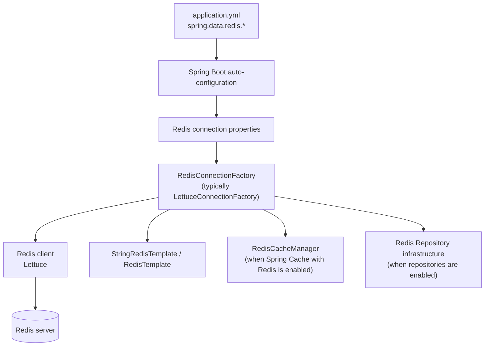
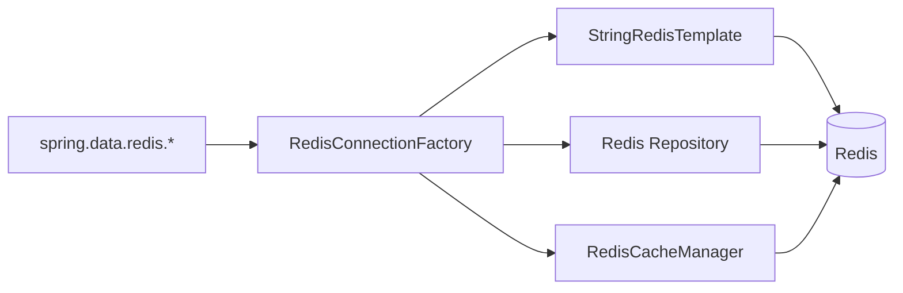

# Configuring `spring.data.redis` in `application.yml`

In a Spring Boot application using Spring Data Redis, most Redis connection settings are declared under the **`spring.data.redis`** property group in `application.yml`. Spring Boot reads these properties, creates the appropriate connection objects, and provides the underlying infrastructure for `RedisTemplate`, `StringRedisTemplate`, Redis Repositories, or Redis Cache.

This lesson progresses from a minimal configuration to per-environment profiles, connection limits, TLS security, and Redis Sentinel/Cluster. The examples use the standard syntax of **Spring Boot 3.x and Spring Data Redis 3.x**. For projects on other versions, check the configuration metadata of that exact Spring Boot version before copying properties.

## 1. Prerequisites for the Configuration to Work

For Spring Boot to connect to Redis, all of the following are required:

1. A running Redis server reachable from where the application executes.
2. The Spring Data Redis dependency in the application.
3. A `spring.data.redis` configuration pointing to the right Redis endpoint, with credentials if needed.

Example using Gradle Groovy:

```groovy
dependencies {
    implementation 'org.springframework.boot:spring-boot-starter-data-redis'
}
```

This starter integrates Spring Data Redis and uses **Lettuce** by default as the Redis client in standard Spring Boot setups. When auto-configuration conditions are satisfied, Spring Boot provides a `RedisConnectionFactory` and common Redis templates. You can inject `StringRedisTemplate` into a service without manually instantiating a connection factory with `new`.

Redis is an external service outside the JVM process. Declaring dependencies or YAML **does not start a Redis server**. If you do not have Redis running locally yet, you can launch a local instance for testing:

```bash
docker run --name redis-local -p 6379:6379 -d redis:7

redis-cli -h localhost -p 6379 PING
# PONG
```

This is a local learning example. Never expose an unauthenticated Redis port to the public Internet.

## 2. Minimal `application.yml` Configuration

If Redis runs at `localhost:6379`, declare:

```yaml
spring:
  data:
    redis:
      host: localhost
      port: 6379
      database: 0
```

For a standard standalone Redis instance, this configuration means:

| Property | Example Value | Role |
|---|---|---|
| `spring.data.redis.host` | `localhost` | Redis hostname or IP address |
| `spring.data.redis.port` | `6379` | TCP port Redis listens on |
| `spring.data.redis.database` | `0` | Logical database index in standalone Redis |

`localhost` is resolved from the perspective of **the Spring Boot process**. If Spring Boot runs on the host machine and a Redis container publishes port `6379`, `localhost:6379` works. If Spring Boot runs in another container, `localhost` refers to the Spring Boot container itself; you typically need the Redis service hostname in Docker Compose or an appropriate internal address.

Redis defaults to database index `0` in standalone mode. Depending on server configuration, you can select another index like `1`, but **Redis Cluster only supports database `0`**. Never set `database: 1` in a Cluster configuration.

### YAML Structure and How Spring Boot Binds Properties

YAML is hierarchical, so:

```yaml
spring:
  data:
    redis:
      host: redis.internal
      port: 6379
```

is bound by Spring Boot identically to the properties:

```properties
spring.data.redis.host=redis.internal
spring.data.redis.port=6379
```

Use **one consistent style** suited to your configuration file. In `application.yml`, indent consistently with spaces; never use tabs. Dot-separated flat keys are also supported by Spring Boot, though the nested structure is easier to read when setting many options.

In **Spring Boot 3.x**, the prefix used here is `spring.data.redis`. Many older Spring Boot 2.x guides use `spring.redis.*`; check your version before applying them. A misspelled key or a key from a different version can prevent binding and silently leave defaults active.

## 3. Diagram from YAML to Redis Server



Each component has its own responsibility:

- `application.yml` supplies **connection parameters**: host, port, password, TLS, timeouts, and topology.
- `RedisConnectionFactory` applies those parameters to provide the needed Redis connections.
- `RedisTemplate` / `StringRedisTemplate` send Redis commands from Java code.
- Redis Repositories map Java entities to Redis data structures using the Redis operations infrastructure.
- `RedisCacheManager` manages cache entries for Spring Cache if caching is enabled in the application.

These branches can share the same connection factory. However, serializers, TTLs, and key naming conventions for Templates, Repositories, and Cache **do not automatically become unified** just because they share `spring.data.redis`.

## 4. Common `spring.data.redis` Properties

| Property | Purpose | Notes |
|---|---|---|
| `host` | Standalone Redis host | Typically defaults to `localhost` |
| `port` | Standalone Redis TCP port | Typically defaults to `6379` |
| `database` | Logical database index | Redis Cluster only has DB 0 |
| `username` | Redis ACL username | Required when the system enforces user-level ACLs |
| `password` | Redis password | Never store real secrets in source code |
| `url` | Connection URI, e.g., `redis://...` or `rediss://...` | Alternative to individual host/port/auth fields; avoid conflicting duplicates |
| `client-type` | Selects a supported client, such as `lettuce` | Depends on starter/driver on the classpath |
| `connect-timeout` | Time limit for establishing a connection | Use a duration like `2s` |
| `timeout` | Timeout for Redis operations | Use a duration like `3s` |
| `ssl.enabled` | Enables TLS when connecting to Redis | The Redis endpoint must support TLS |
| `ssl.bundle` | Selects a configured SSL bundle | Useful with custom CAs/certificates |
| `lettuce.pool.*` | Connection pool settings if using Lettuce pooling | Requires pooling support on the classpath |
| `sentinel.master`, `sentinel.nodes` | Declares Redis Sentinel | Used for Sentinel topology |
| `cluster.nodes`, `cluster.max-redirects` | Declares Redis Cluster | Used for Cluster topology |

`port` is an **integer**, whereas `timeout` and `connect-timeout` are **durations**. Writing `timeout: 3s` makes the unit explicit compared to a bare number. Defaults and supported properties can vary by Spring Boot and Redis driver version.

Example standalone configuration with timeouts:

```yaml
spring:
  data:
    redis:
      host: localhost
      port: 6379
      database: 0
      client-type: lettuce
      connect-timeout: 2s
      timeout: 3s
```

Here:

- `connect-timeout: 2s` governs the wait time when establishing a connection.
- `timeout: 3s` sets the wait limit for Redis operations according to the client mechanism.
- This is not a guarantee that every Java call finishes within exactly 2 or 3 seconds: retries, DNS, topology discovery, and the network layer can affect observed execution times.

## 5. Connecting with Username and Password

If Redis requires authentication, add the appropriate credentials:

```yaml
spring:
  data:
    redis:
      host: redis.example.internal
      port: 6379
      username: app-user
      password: ${REDIS_PASSWORD}
      connect-timeout: 2s
      timeout: 3s
```

`${REDIS_PASSWORD}` is a Spring **placeholder**. At runtime, Spring reads the `REDIS_PASSWORD` environment variable. If the variable is missing, the configuration will fail to resolve where that property is required; this helps catch missing secrets in authenticated environments.

Example running from a shell whose environment variables are injected beforehand by a deployment tool or secret manager:

```bash
# REDIS_PASSWORD variable provided by the runtime environment
java -jar application.jar
```

With Redis ACLs, `username` can specify the configured user with appropriate permissions; if the server only uses the default user's password mechanism, `password` alone may suffice. It must match how the server actually authenticates clients.

**Never** put real passwords into an `application.yml` committed to Git, shared URLs, screenshots, or logs. In multi-environment systems, inject secrets via a secret manager or your deployment platform's secret mechanism. A Redis password provides authentication only; over untrusted networks, TLS is required.

### Direct Configuration via Environment Variables

Spring Boot supports relaxed binding. For example:

```text
SPRING_DATA_REDIS_HOST=redis.example.internal
SPRING_DATA_REDIS_PORT=6379
SPRING_DATA_REDIS_USERNAME=app-user
SPRING_DATA_REDIS_PASSWORD=(secret value provided by environment)
```

These variables bind directly to `spring.data.redis.host`, `.port`, `.username`, and `.password` without repeating placeholders in YAML. When multiple configuration sources exist (files, environment variables, command-line arguments, service connections), **Spring Boot's property precedence rules** decide the final value. When debugging, determine which source supplied the bound value without exposing credentials.

## 6. Replacing Host/Port with a Connection URL

Some Redis providers supply a connection URI instead of separate fields:

```yaml
spring:
  data:
    redis:
      url: ${REDIS_URL}
      connect-timeout: 2s
      timeout: 3s
```

Two common URI schemes:

```text
redis://redis.example.internal:6379
rediss://redis.example.internal:6380
```

`redis://` indicates a non-TLS connection; `rediss://` indicates a TLS-encrypted connection. A URI can embed credentials, so never commit URIs containing real passwords into repositories or print them to logs.

In Spring Boot 3.x, the `url` property encapsulates endpoint details and takes precedence over standalone `host`, `port`, `username`, and `password` properties per that version's binding contract. Therefore, **configure an endpoint either via URL or via individual fields**; avoid providing conflicting sources. Do not mix a standalone URL with cluster/sentinel settings unless intended and verified against your version's documentation.

## 7. Profiles: Separating Local, Test, and Production

An application typically runs in multiple environments with different endpoints. Separate shared defaults from profile-specific values.

### 7.1. Shared Configuration in `application.yml`

```yaml
spring:
  application:
    name: redis-demo
  data:
    redis:
      connect-timeout: 2s
      timeout: 3s
```

### 7.2. Development Profile in `application-local.yml`

```yaml
spring:
  data:
    redis:
      host: localhost
      port: 6379
      database: 1
```

### 7.3. Production Profile in `application-prod.yml`

```yaml
spring:
  data:
    redis:
      host: ${REDIS_HOST}
      port: ${REDIS_PORT:6379}
      database: 0
      username: ${REDIS_USERNAME}
      password: ${REDIS_PASSWORD}
      ssl:
        enabled: true
```

`${REDIS_PORT:6379}` uses `6379` as a fallback if `REDIS_PORT` is unset. For the production host, username, and password, the example intentionally **omits fallbacks** so the application never silently falls back to development Redis when deployment config is missing.

Run with the desired profile:

```bash
java -jar application.jar --spring.profiles.active=local

# In a deployment environment where REDIS_* variables are provided
java -jar application.jar --spring.profiles.active=prod
```

Spring Boot merges shared settings with the active profile's settings according to precedence order. If production Redis does not use TLS or uses a different TLS port, adjust exactly to the provider's endpoint; `ssl.enabled: true` does not enable TLS on the server side.

You can also use multi-document YAML separated by `---` inside a single `application.yml`:

```yaml
spring:
  data:
    redis:
      connect-timeout: 2s

---
spring:
  config:
    activate:
      on-profile: local
  data:
    redis:
      host: localhost
      port: 6379
```

However, when environments differ substantially, separate `application-{profile}.yml` files are usually easier to manage. Profiles also **do not replace** secret management.

## 8. Redis Address When Running with Docker Compose

A very common mistake is setting `localhost` inside an application container and expecting it to reach a separate Redis container.

Example of two services on Compose's default network:

```yaml
# compose.yml - local environment illustration
services:
  redis:
    image: redis:7
    ports:
      - "6379:6379"

  app:
    image: my-spring-app:local
    environment:
      SPRING_PROFILES_ACTIVE: docker
      SPRING_DATA_REDIS_HOST: redis
      SPRING_DATA_REDIS_PORT: "6379"
    depends_on:
      - redis
```

Here, the hostname `redis` resolves across the Compose network. The app inside the container connects to `redis:6379`; an app running directly on the host (with the port published) typically connects to `localhost:6379`.

| Where Spring Boot Runs | Where Redis Runs | Typical `host` |
|---|---|---|
| JVM directly on machine | Redis directly on machine | `localhost` |
| JVM directly on machine | Redis container publishing `6379:6379` | `localhost` |
| `app` container | `redis` service container on same Compose network | `redis` |
| Server/K8s workload | Managed Redis service | Dedicated DNS supplied by infrastructure |

`depends_on` in Compose enforces basic container start order, **not that Redis is ready to accept commands**; readiness requires healthchecks and suitable retry policies. With Spring Boot 3.1+ and Docker Compose integration, Spring Boot also offers a service connection mechanism that can supply connection details automatically. If your project uses that feature, inspect the effective configuration sources instead of assuming only `application.yml` applies.

## 9. TLS: Securing the Connection

If the Redis endpoint accepts TLS (common in cloud managed services or TLS-configured Redis deployments), enable it:

```yaml
spring:
  data:
    redis:
      host: redis.secure.internal
      port: 6380
      username: ${REDIS_USERNAME}
      password: ${REDIS_PASSWORD}
      ssl:
        enabled: true
      connect-timeout: 3s
      timeout: 5s
```

Port `6380` here **is only an example**; use the exact TLS port provided by your Redis server or provider. TLS connections require a TLS-configured endpoint and a valid certificate. Enabling TLS on the client while pointing to a plaintext port leads to handshake errors.

If your infrastructure uses a private CA or custom certificate, Spring Boot supports configuring **SSL bundles** and referencing them via `spring.data.redis.ssl.bundle` (in supported versions). Example referencing a bundle name:

```yaml
spring:
  data:
    redis:
      host: redis.secure.internal
      port: 6380
      ssl:
        enabled: true
        bundle: redis-client
```

The name `redis-client` must point to a real SSL bundle configured under `spring.ssl.bundle.*` containing the required trust material/certificates. The line `bundle: redis-client` **does not create certificates by itself**. Supply truststores via your deployment environment's secrets/certificate mechanism and verify the server certificate chain and hostname.

TLS protects transport; Redis authentication and ACL authorization remain separate concerns. Never disable certificate or hostname verification just to bypass errors in production.

## 10. Lettuce Timeouts and Connection Pool

An illustrative configuration:

```yaml
spring:
  data:
    redis:
      host: redis.internal
      port: 6379
      client-type: lettuce
      connect-timeout: 2s
      timeout: 3s
      lettuce:
        pool:
          enabled: true
          max-active: 16
          max-idle: 8
          min-idle: 2
          max-wait: 1s
```

Parameter groups:

- `connect-timeout`: wait limit for establishing a connection.
- `timeout`: client-side time limit for executing a Redis command.
- `max-active`: maximum connections that can be borrowed concurrently from the pool.
- `max-idle` / `min-idle`: idle connection bounds in the pool.
- `max-wait`: how long to wait for a connection when the pool is exhausted.

When enabling Lettuce pooling, the application needs a pooling library, typically Apache Commons Pool 2:

```groovy
dependencies {
    implementation 'org.springframework.boot:spring-boot-starter-data-redis'
    implementation 'org.apache.commons:commons-pool2'
}
```

Not every Lettuce application needs a pool. Lettuce can share a native connection across many standard operations. A pool is useful for scenarios requiring dedicated connections or specific workloads, though adding a pool introduces resource caps and wait risks when exhausted.

**Do not mechanically set `max-active` equal to HTTP request counts.** Consider Redis command types, held connections, number of app instances, server capacity, and actual latency. Running 20 app instances each with `max-active: 16` yields a far higher potential connection count than 16.

If your goal is simply learning to connect and run basic commands, start without pooling and add it later only when justified by operational needs.

## 11. Configuring Redis Sentinel

Redis Sentinel monitors and handles failover for Redis master nodes. Instead of hardcoding a single Redis master endpoint, Spring Boot can be configured to obtain master information from Sentinel nodes.

```yaml
spring:
  data:
    redis:
      sentinel:
        master: mymaster
        nodes:
          - sentinel-1.internal:26379
          - sentinel-2.internal:26379
          - sentinel-3.internal:26379
      username: ${REDIS_USERNAME}
      password: ${REDIS_PASSWORD}
      connect-timeout: 2s
      timeout: 3s
```

Here:

- `sentinel.master` is the **master name** managed by Sentinel, not necessarily an actual hostname.
- `sentinel.nodes` lists Sentinel server endpoints, commonly on port `26379`.
- `username` and `password` authorize access to the Redis data nodes when required by the server.

If **Sentinel itself also requires authentication**, Spring Boot provides dedicated properties such as `spring.data.redis.sentinel.username` and `spring.data.redis.sentinel.password` in supported versions; Sentinel credentials and Redis data node credentials can differ. Verify ACLs and networking for both layers.

Sentinel is not Redis Cluster: Sentinel handles master discovery and failover for a replication topology, whereas Cluster shards data by hash slots across multiple primary nodes. Do not mix `sentinel.*` and `cluster.*` in the same endpoint configuration.

## 12. Configuring Redis Cluster

With Redis Cluster, data is partitioned across multiple nodes and hash slots. Declare seed nodes so the client can bootstrap the topology:

```yaml
spring:
  data:
    redis:
      cluster:
        nodes:
          - redis-1.internal:6379
          - redis-2.internal:6379
          - redis-3.internal:6379
        max-redirects: 5
      username: ${REDIS_USERNAME}
      password: ${REDIS_PASSWORD}
      connect-timeout: 2s
      timeout: 3s
```

`cluster.nodes` is the initial list of nodes helping the client discover the Cluster. `cluster.max-redirects` limits Redis Cluster redirections when routing to the node owning a hash slot.

Keep in mind:

- **Do not use `database: 1`**. Redis Cluster only supports database `0`.
- Nodes must advertise addresses reachable from the application environment, not only internal to Redis's private network.
- Multi-key commands are constrained by hash-slot colocation; key design and transactions/scripts must respect Cluster rules.
- When using TLS, ensure all nodes contacted by the client support TLS with valid addresses and certificates.

This example only shows Spring Boot connection properties; it does not replace properly provisioning and operating a Redis Cluster.

## 13. Verifying That the Application Uses the Right Connection

After configuring properties, an easy observable check is executing a real command with `StringRedisTemplate`.

```java
import java.time.Duration;
import org.springframework.data.redis.core.StringRedisTemplate;
import org.springframework.stereotype.Service;

@Service
public class RedisConnectivityService {
    private final StringRedisTemplate redis;

    public RedisConnectivityService(StringRedisTemplate redis) {
        this.redis = redis;
    }

    public boolean canWriteAndRead() {
        String key = "demo:connectivity-check";
        String expected = "spring-data-redis-ok";

        redis.opsForValue().set(key, expected, Duration.ofSeconds(30));
        String actual = redis.opsForValue().get(key);
        redis.delete(key);

        return expected.equals(actual);
    }
}
```

This is an illustrative service that can be invoked intentionally in a test environment. It creates a short-lived key and deletes it; do not run this write operation unconditionally on every production startup.

An independent infrastructure check:

```bash
redis-cli -h localhost -p 6379 PING
# PONG

redis-cli -h localhost -p 6379 INFO server
```

When Redis requires a password, pass credentials securely to the CLI (such as via the `REDISCLI_AUTH` environment variable) and avoid putting passwords in command arguments that get saved in shell history or process lists. For TLS-enabled Redis, add `--tls` and suitable trust options. Perform the check from **the same network environment as the application** so DNS or firewall differences are not missed.

If the application uses Spring Boot Actuator:

```groovy
dependencies {
    implementation 'org.springframework.boot:spring-boot-starter-actuator'
}
```

Actuator can expose a Redis health indicator when Redis and actuator health infrastructure are properly configured. Health checks help detect broken connections, though endpoint access and exposure must be restricted appropriately in operational environments.

**Lifecycle note:** Spring Boot successfully creating the `RedisConnectionFactory` bean does not always mean the live Redis connection has been validated. Many DNS, authentication, or network failures only surface on the first Redis operation or health probe.

## 14. How `spring.data.redis` Relates to Redis Template, Repository, and Cache

Once Spring Boot creates the connection factory, you can use Redis in several ways depending on your needs:



### 14.1. Redis Template

`StringRedisTemplate` is suited for string keys and values:

```java
import java.time.Duration;
import org.springframework.data.redis.core.StringRedisTemplate;

public class VerificationCodeStore {
    private final StringRedisTemplate redis;

    public VerificationCodeStore(StringRedisTemplate redis) {
        this.redis = redis;
    }

    public void putCode(String userId, String code) {
        redis.opsForValue().set(
            "verify:" + userId,
            code,
            Duration.ofMinutes(5)
        );
    }
}
```

`spring.data.redis` provides the connection; `Duration.ofMinutes(5)` in code supplies the TTL **for this key**. Connection YAML does not set a default TTL for all keys in Redis.

### 14.2. Redis Repository

When using Redis Repositories, an entity can be declared as:

```java
import org.springframework.data.annotation.Id;
import org.springframework.data.redis.core.RedisHash;

@RedisHash(value = "login-sessions", timeToLive = 900)
public class LoginSession {
    @Id
    private String id;
    private String userId;

    public LoginSession() {}

    public String getId() { return id; }
    public void setId(String id) { this.id = id; }
    public String getUserId() { return userId; }
    public void setUserId(String userId) { this.userId = userId; }
}
```

`timeToLive = 900` means **900 seconds** for the entity. It belongs to Repository data mapping; it is not `spring.data.redis.timeout` (the Redis operation timeout).

### 14.3. Redis Cache

To use Redis as the Spring Cache backend, you need dedicated setup beyond connection properties:

```groovy
dependencies {
    implementation 'org.springframework.boot:spring-boot-starter-data-redis'
    implementation 'org.springframework.boot:spring-boot-starter-cache'
}
```

```yaml
spring:
  data:
    redis:
      host: localhost
      port: 6379
  cache:
    type: redis
    redis:
      time-to-live: 10m
      cache-null-values: false
```

Add `@EnableCaching` to an appropriate configuration class, then use:

```java
import org.springframework.cache.annotation.Cacheable;

@Cacheable(cacheNames = "products", key = "#productId")
public ProductView findProduct(String productId) {
    return productGateway.load(productId);
}
```

`ProductView` and `productGateway` represent application-defined business models and data sources. `spring.cache.redis.time-to-live` is the TTL for **cache entries**; it differs from `spring.data.redis.timeout` (Redis access timeout) and from Repository entity TTLs.

Never assume a custom `RedisTemplate`'s serializer configuration automatically applies to Repositories or Cache. When changing value formats, configure the exact layer being used.

## 15. Common Configuration Mistakes and How to Diagnose Them

| Symptom | Common Cause | What to Check |
|---|---|---|
| `Connection refused` | No Redis listening on bound host/port | Is Redis running, and did the container publish the right port? |
| `UnknownHostException` or unresolvable host | Wrong DNS/hostname; using Compose service name outside Compose network | Actual JVM network environment and provided hostname |
| `NOAUTH` / `WRONGPASS` | Missing or wrong Redis credentials | ACL user, password, secret injection; do not log secrets |
| TLS handshake failed | TLS client hitting plaintext port, invalid CA/hostname | TLS port, certificates, truststore/bundle |
| Operation timeout | Busy Redis, slow network, slow command, exhausted pool | Redis metrics, latency, timeouts, pool, and actual load |
| App hits wrong Redis environment | Profile inactive or overridden by env/service connection | Active profiles and effective config (masking credentials) |
| `localhost` works on host but fails in Docker | `localhost` inside container points to that container itself | Switch to service hostname or internal endpoint |
| `@Cacheable` has no effect | Only configured `spring.data.redis`, Spring Cache not enabled, or self-invocation bypassing proxy | Cache dependency, `@EnableCaching`, cache manager, invocation path |
| Setting `database: 1` with Cluster | Redis Cluster only supports DB 0 | Remove non-zero database selection |
| Redis keys appear as binary | Serializer used by Template/Repository/Cache | Identify which layer wrote the key; do not change serializers arbitrarily |

### 15.1. An Indentation Mistake

```yaml
# Wrong: host is not nested under spring.data.redis
spring:
  data:
    redis:
      port: 6379
  host: redis.internal
```

`spring.host` in this example is not `spring.data.redis.host`. As a result, Redis still uses the default `localhost`, even though the author sees the word `host` in the YAML.

### 15.2. Confusing Redis and Cache Namespaces

```yaml
spring:
  data:
    redis:
      timeout: 2s
  cache:
    redis:
      time-to-live: 5m
```

`timeout` is the connection/command operation deadline; `time-to-live` is the lifetime of entries in Spring Cache. These two lines are not interchangeable just because both express a duration.

### 15.3. Safe Logging and Observability

When debugging configuration, focus on the effective endpoint, active profiles, Redis driver, timeout values, health status, and exception types. Avoid logging `RedisProperties` verbatim because it can expose `password` or URIs containing credentials. When enabling verbose Redis library logging, do so only temporarily in controlled environments and inspect whether business keys or values might be logged.

## 16. Recommended Starter Configuration

For a Spring Boot 3.x application learning Spring Data Redis, a small, clear local configuration is sufficient:

```yaml
# application.yml - starting with local standalone Redis
spring:
  application:
    name: redis-learning
  data:
    redis:
      host: ${REDIS_HOST:localhost}
      port: ${REDIS_PORT:6379}
      database: 0
      connect-timeout: 2s
      timeout: 3s
```

Follow these steps:

1. Start Redis and confirm `PING` returns `PONG`.
2. Add `spring-boot-starter-data-redis` and configure `spring.data.redis`.
3. Launch Spring Boot in the proper network and profile.
4. Test a `StringRedisTemplate` operation with a short-lived key.
5. When moving to real environments, replace the endpoint and provide credentials via environment configuration; enable TLS if required by the endpoint.
6. Only add pooling, Sentinel, or Cluster when your infrastructure actually uses those mechanisms.

Whenever you inspect a Redis configuration, identify **where Redis runs, who supplies credentials, the topology type, timeouts, TLS, and which Spring components consume the connection**. Mastering those six points makes reading `application.yml` and troubleshooting most Spring Data Redis initialization issues systematic.
