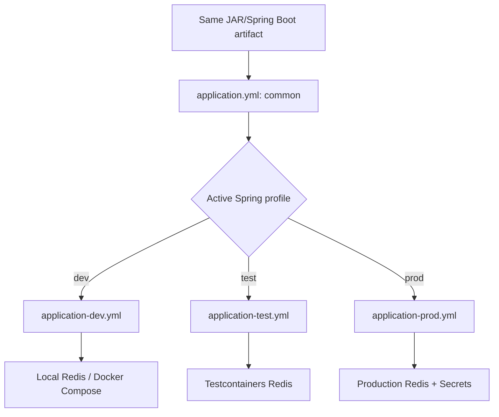

# Separating Development, Testing, and Production Configuration in Spring Data Redis

## 1. Goal: One Application, Multiple Environments, One Data Contract

Spring Data Redis enables Java applications to interact with Redis through `RedisTemplate`, `StringRedisTemplate`, repositories, Spring Cache, Redis Streams, or the reactive API. However, Redis deployments differ across development, test, and production environments.

- **Development:** local Redis connection, minimal dependencies, convenient to reset and debug.
- **Test/CI:** isolated Redis, reproducible data, no use of production resources or secrets.
- **Production:** stable connections, TLS/ACL, secrets, timeout and resource limits, Sentinel/Cluster if needed, monitoring, backups, and failover strategies.

For example, the same service:

```java
@Service
public class FeatureFlagService {
    private final StringRedisTemplate redis;

    public FeatureFlagService(StringRedisTemplate redis) {
        this.redis = redis;
    }

    public boolean enabled(String flag) {
        return "1".equals(
                redis.opsForValue().get("feature:" + flag));
    }
}
```

Service code does not need to ask which environment it is running in; Spring Boot creates the Redis connection from runtime configuration. You must separate **connection parameters** while keeping the **key format, serializer, and business semantics** compatible.

A dangerous mixed configuration:

```yaml
spring:
  data:
    redis:
      host: redis-production.internal
      username: app
      password: password-committed-to-git
```

If a developer machine or CI accidentally loads this file, tests can write to or delete production keys. Furthermore, the secret has already been exposed in source control.

**Desired outcome:** the application runs the same artifact, selects the environment explicitly, and uses controlled configuration; tests use an independent Redis; production fails fast if secrets are missing and rejects inappropriate local configurations.

## 2. Classify Configuration Before Splitting Profiles

Not every property should differ between environments.

| Configuration Type | Examples | Principle |
| --- | --- | --- |
| Data contract | Key names, key serializer, JSON codec, schema version | Shared/versioned; compatibility tested |
| Business policy | Session TTL, cache miss handling, idempotent retry | Keep the contract intact, do not change arbitrarily |
| Connection | Host, port, topology, TLS endpoint | Set per environment |
| Secrets | Username/password, client certificate, trust material | Managed secret source at runtime |
| Operations | Connect/command timeout, pool, concurrency | Tuned according to load and SLA |
| Redis server | Persistence, maxmemory, eviction, replication, backup | Per-environment infrastructure, do not assume Spring Boot manages it |
| Observability | Log level, tracing sampling, metrics | Detailed in dev, secure/volume-limited in prod |
| Test fixtures | Key prefix, container, data cleanup | Test only, must never run on production Redis |

For example, a security token's lifetime might be 15 minutes by business rule. It should not be changed to 24 hours in production just to reduce expirations. Conversely, having dev Redis at `127.0.0.1:6379` and a different private endpoint in production makes sense.

### Separate “Values” from “Behavior”

Changing host, port, and credentials is an operational configuration change. Changing the serializer, key prefix, TTL, or cache null policy changes **data semantics**. The second group requires migration/compatibility testing and should be rolled out like a functional change.

## 3. Organizing the Configuration Directory

A simple Spring Boot structure:

```text
src/
  main/
    java/
      com/example/catalog/
        RedisSettings.java
        RedisCacheConfig.java
        CatalogService.java
    resources/
      application.yml
      application-dev.yml
      application-prod.yml
  test/
    java/
      com/example/catalog/
        RedisIntegrationTest.java
        RedisSettingsTest.java
    resources/
      application-test.yml
```

Purpose:

- `application.yml`: common configuration and default values containing no secrets.
- `application-dev.yml`: local endpoint, low resource limits, dev namespace.
- `application-test.yml`: test policies, endpoint from Testcontainers.
- `application-prod.yml`: runtime endpoint, TLS/ACL, SLA-aligned timeouts, telemetry.

Diagram:



There is no need to write three different Redis service classes if only the connection environment differs.

## 4. Spring Profiles and Configuration Precedence

Spring Boot supports externalized configuration from:

- `application.yml`/`application.properties` files.
- Profile-specific files `application-{profile}.yml`.
- Environment variables.
- Java system properties.
- Command-line arguments.
- Config tree, secret provider, or config server depending on infrastructure.

Precedence follows Spring Boot rules; **environment variables or command-line arguments can override values in a profile file**. Do not just read a YAML file and conclude that the runtime uses those exact values.

Example running in dev:

```bash
java -jar catalog-service.jar --spring.profiles.active=dev
```

Example in a POSIX environment:

```bash
SPRING_PROFILES_ACTIVE=prod java -jar catalog-service.jar
```

For Windows PowerShell or Kubernetes, use the corresponding mechanism for setting variables.

**Do not hardcode the active profile `prod` in a shared file** if doing so could cause developers to accidentally use the production endpoint. Select the profile via local scripts, IDE run configurations, or deployment manifests.

### Profile Files and Multi-Document YAML

Spring Boot also supports a multi-document YAML file using `spring.config.activate.on-profile`. For example:

```yaml
app:
  redis:
    namespace: catalog:v1
---
spring:
  config:
    activate:
      on-profile: dev
app:
  redis:
    namespace: catalog:dev:v1
```

However, multiple smaller files are often easier to review for access permissions, config drift, and secret injection in systems with dedicated production deployments. Choose one structure and document which source wins when a property is overridden.

## 5. Safe Common Configuration

Example `src/main/resources/application.yml`:

```yaml
spring:
  application:
    name: catalog-service
  cache:
    type: redis

app:
  redis:
    namespace: catalog:v1
    cache:
      ttl: 10m
      cache-null-values: false
```

These are **custom application properties** for the business cache namespace and TTL; Spring Boot does not automatically apply `app.redis.*` unless the application binds them to the corresponding bean/configuration.

Things that should not be placed in the common file:

- Production Redis password/ACL token.
- Production host shared across all profiles.
- TLS client private key.
- Redis URL containing username/password.
- Configuration for `FLUSHALL` or server administration that runs automatically on startup.
- A default active `prod` profile.

An application running without an explicit profile should have safe behavior (or fail fast), and must never accidentally fall back to a production Redis endpoint.

## 6. Development: Local Redis

Example `application-dev.yml`:

```yaml
spring:
  data:
    redis:
      host: 127.0.0.1
      port: 6379
      connect-timeout: 1s
      timeout: 2s

app:
  redis:
    namespace: catalog:dev:v1
    cache:
      ttl: 2m

logging:
  level:
    org.springframework.data.redis: INFO
```

Dev prioritizes self-service and easy debugging. Local Redis can be started with Docker Compose:

```yaml
services:
  redis:
    image: redis:7.4-alpine
    ports:
      - "127.0.0.1:6379:6379"
    command:
      - redis-server
      - --save
      - ""
      - --appendonly
      - "no"
```

This example is for local/lab use only: no TLS/ACL, persistence disabled, no replication/HA. Do not copy it to production.

### Localhost Inside and Outside Docker

When the Spring JVM runs directly on your laptop, `127.0.0.1:6379` can be the host port mapped to the Redis container.

When the Spring app runs in **another container** on the same Docker Compose network, `127.0.0.1` points to the app's own container, not Redis. In that case, the host is usually the Compose service name `redis`:

```yaml
spring:
  data:
    redis:
      host: redis
      port: 6379
```

You can create a separate dev override via an env var to run on the host or in a container without manually editing source files.

### Do Not Debug by Logging Full Keys and Values

Even in dev, Redis keys may contain emails, session IDs, tokens, or customer data. Avoid enabling unredacted logging of command arguments. Use an intentional namespace and dummy data.

## 7. Test Profile: Isolating from the Developer's Redis

Example `src/test/resources/application-test.yml`:

```yaml
spring:
  cache:
    type: redis
  data:
    redis:
      connect-timeout: 2s
      timeout: 2s

app:
  redis:
    namespace: catalog:it:v1
    cache:
      ttl: 30s
```

Do not hardcode `host: localhost` in this file when tests must use Testcontainers: the address and mapped port are provided by the test runtime. If CI cannot run containers, tests should fail with a clear error, **not fall back to local or production Redis**.

Unit tests for pure key builders/serializers/mappers can run without a Redis server. Integration tests for TTL, Lua, Streams, Pub/Sub, Redis transactions, and connections require a real Redis or an appropriate test topology.

### Why Not Use One Shared Redis for All CI Jobs?

If two jobs create the same key:

```text
Job A: SET test:order:42 PAID
Job B: DEL test:order:42
Job A: GET test:order:42 -> nil
```

Tests become flaky and risk deleting data that does not belong to the job. Dedicated test Redis instances, UUID-based namespaces, and scoped cleanup help reduce collisions.

## 8. Testcontainers: Dynamic Redis Endpoint in JUnit 5

Example integration test with Spring Boot:

```java
package com.example.catalog;

import static org.assertj.core.api.Assertions.assertThat;

import org.junit.jupiter.api.Test;
import org.springframework.beans.factory.annotation.Autowired;
import org.springframework.boot.test.context.SpringBootTest;
import org.springframework.data.redis.core.StringRedisTemplate;
import org.springframework.test.context.ActiveProfiles;
import org.springframework.test.context.DynamicPropertyRegistry;
import org.springframework.test.context.DynamicPropertySource;
import org.testcontainers.containers.GenericContainer;
import org.testcontainers.junit.jupiter.Container;
import org.testcontainers.junit.jupiter.Testcontainers;
import org.testcontainers.utility.DockerImageName;

@Testcontainers
@SpringBootTest
@ActiveProfiles("test")
class RedisIntegrationTest {

    @Container
    static final GenericContainer<?> REDIS =
            new GenericContainer<>(
                    DockerImageName.parse("redis:7.4-alpine"))
                    .withExposedPorts(6379);

    @DynamicPropertySource
    static void redisProperties(DynamicPropertyRegistry registry) {
        registry.add("spring.data.redis.host", REDIS::getHost);
        registry.add("spring.data.redis.port",
                () -> REDIS.getMappedPort(6379));
    }

    @Autowired
    StringRedisTemplate redis;

    @Test
    void stringRoundTrip() {
        String key = "it:catalog:status:sku-42";

        redis.opsForValue().set(key, "ACTIVE");

        assertThat(redis.opsForValue().get(key))
                .isEqualTo("ACTIVE");
    }
}
```

Typical dependencies:

```xml
<dependency>
    <groupId>org.springframework.boot</groupId>
    <artifactId>spring-boot-starter-test</artifactId>
    <scope>test</scope>
</dependency>
<dependency>
    <groupId>org.testcontainers</groupId>
    <artifactId>junit-jupiter</artifactId>
    <scope>test</scope>
</dependency>
<dependency>
    <groupId>org.testcontainers</groupId>
    <artifactId>testcontainers</artifactId>
    <scope>test</scope>
</dependency>
```

Versions should be managed by the BOM/dependency management or the project's corresponding declarations. The Redis image should be pinned according to CI policy, especially when comparing version behavior.

`@ActiveProfiles("test")` only selects the profile; **it does not automatically start Redis**. `@Testcontainers`/`@Container` manages the Redis container and `@DynamicPropertySource` passes the mapped host/port into the Spring context.

Some Spring Boot versions support `@ServiceConnection` as an alternative to `@DynamicPropertySource`; with `GenericContainer`, you may need to declare the service name and the corresponding Boot testcontainers dependency. Choose one clear, version-appropriate mechanism.

## 9. Isolating Tests with Key Namespaces and Lifecycle

Even when a test class uses its own Testcontainers instance, test methods can still share Redis state.

Example:

```java
String prefix = "it:" + UUID.randomUUID() + ":";
String key = prefix + "catalog:status";
```

Each test gets its own prefix so it does not collide with keys from other tests. During cleanup, delete only keys created by that test, optionally tracking the key list in a fixture.

Avoid:

```java
// DO NOT use in a helper that might point to shared/prod Redis:
redisConnection.serverCommands().flushAll();
```

A test with an endpoint configuration bug must never be able to wipe all of Redis. If you need to test `FLUSHALL`, only run it against a Redis container **guaranteed to be owned by the test**, with strict boundaries.

### Do Not Use Database Numbers as an Isolation Strategy for Cluster

Redis standalone supports multiple logical DBs, whereas Redis Cluster normally supports only DB 0. Therefore:

```yaml
spring:
  data:
    redis:
      database: 5
```

may run on standalone dev and fail on a production Cluster. Cluster tests require a Cluster topology, not logical DBs as a substitute variant.

## 10. Production Standalone: Externalized Config, TLS, ACL

Example `application-prod.yml` for a **Redis standalone/managed primary endpoint**, not Sentinel or Cluster:

```yaml
spring:
  data:
    redis:
      host: ${REDIS_HOST}
      port: ${REDIS_PORT:6379}
      username: ${REDIS_USERNAME}
      password: ${REDIS_PASSWORD}
      ssl:
        enabled: true
      connect-timeout: 2s
      timeout: 3s

app:
  redis:
    namespace: catalog:prod:v1
    cache:
      ttl: 10m

management:
  tracing:
    sampling:
      probability: 0.1
```

`${REDIS_HOST}` is a Spring placeholder that resolves the value from runtime; `${REDIS_PORT:6379}` has a fallback value. Secrets such as passwords should have no public fallback. This example uses the Spring Boot 3.x configuration namespace; for other Boot versions, verify the property names and TLS support.

Practical requirements:

- The Redis endpoint is on a private network or properly protected by policy.
- TLS validates certificates and hostnames properly.
- The ACL user only has the necessary command and key patterns.
- Credentials are not stored in the repository or JAR.
- Timeouts fit within the application's SLA.
- Resource limits are calculated across the total number of pods/instances.
- Logs and traces do not contain passwords or sensitive raw Redis values.

### Do Not Treat Env Vars as a Perfect Secret Store

Environment variables can be exposed through process instrumentation, crash dumps, or operational tooling. Prefer a secret manager, Kubernetes Secrets with appropriate RBAC/encryption-at-rest, or a mounted secret volume with restricted read permissions. The delivery mechanism must be evaluated against your organization's threat model.

When configuring a Redis URL, avoid using URLs containing credentials in logs or command lines. Do not declare both a URL and host/port simultaneously without knowing which source your Spring Boot version selects.

## 11. Sentinel Profile: Discover the Primary Instead of Hardcoding

If production uses Redis primary–replica with Sentinel, connection configuration must point to the Sentinel endpoints:

```yaml
spring:
  data:
    redis:
      sentinel:
        master: catalog-primary
        nodes:
          - sentinel-1.internal:26379
          - sentinel-2.internal:26379
          - sentinel-3.internal:26379
      username: ${REDIS_USERNAME}
      password: ${REDIS_PASSWORD}
      connect-timeout: 2s
      timeout: 3s
```

This configuration **replaces** standalone settings; it is not an addition alongside a standalone host.

The master group name must match the Sentinel configuration. Sentinel authentication and Redis data-node authentication may differ; Sentinel TLS must also be configured properly for the client version and infrastructure.

Sentinel does not proxy every Redis command. A Sentinel-aware client discovers the current primary and sends commands directly to the Redis data node. During failover, you may still encounter:

- Connection refused/timeout while switching primaries.
- `READONLY` when an older connection points to a node that is no longer primary.
- Recent writes not yet replicated may not exist on the new primary.
- Reconnect, refresh, and idempotency are required for retried operations.

Standalone dev typically does not simulate these behaviors. If failover is a requirement, you must have a dedicated Sentinel staging/test environment.

## 12. Redis Cluster Profile: Pay Attention to Hash Slots and Routing

Production example using Cluster:

```yaml
spring:
  data:
    redis:
      cluster:
        nodes:
          - redis-node-1.internal:6379
          - redis-node-2.internal:6379
          - redis-node-3.internal:6379
        max-redirects: 5
      username: ${REDIS_USERNAME}
      password: ${REDIS_PASSWORD}
      ssl:
        enabled: true
      connect-timeout: 2s
      timeout: 3s
```

Key differences compared to standalone:

1. Redis Cluster partitions data across 16,384 hash slots.
2. Multi-key operations or Lua scripts involving multiple keys must satisfy the same-hash-slot contract.
3. `SCAN` executes per node; there is no single cluster-wide cursor.
4. Keyspace notifications are emitted on the node handling the key, not automatically relayed to a single-node listener.
5. Failover/resharding changes slot ownership and can trigger `MOVED`/`ASK`.
6. Cluster does not use logical DB numbers other than 0 like standalone.
7. Routing reads to replicas can cause stale reads.

Example of two Lua keys that must share a slot:

```text
counter:{sku42}:reserved
operation:{sku42}:req-9f3a
```

The shared hash tag `{sku42}` places both keys in the same slot. Do not assume a multi-key Lua script will run on Cluster just because it runs on local Redis.

**Do not mix Sentinel and Cluster properties in the same configuration and expect the client to auto-detect the right topology.** Choose one mode matching the deployment.

## 13. Use One `RedisTemplate`, Do Not Duplicate Business Logic

For most use cases, code does not need to branch by profile:

```java
@Service
public class OrderStatusCache {

    private final StringRedisTemplate redis;

    public OrderStatusCache(StringRedisTemplate redis) {
        this.redis = redis;
    }

    public String find(String orderId) {
        return redis.opsForValue()
                .get("orders:" + orderId + ":status");
    }

    public void put(String orderId, String status, Duration ttl) {
        redis.opsForValue().set(
                "orders:" + orderId + ":status",
                status,
                ttl);
    }
}
```

The connection factory changes according to runtime configuration, while business logic uses the same abstraction.

### When Should You Have `@Profile`-Specific Beans?

You can isolate **behavior that only exists in one environment**:

- Dev-only seed data.
- Test fixture publisher.
- Local-only diagnostic endpoint.
- Prod-only exporter or secret integration.
- Mock service in tests when you do not want to connect to an external dependency.

Example:

```java
@Configuration
@Profile("dev")
public class DevSeedConfig {

    @Bean
    ApplicationRunner sampleData(StringRedisTemplate redis) {
        return args -> redis.opsForValue()
                .setIfAbsent("demo:feature:checkout", "1");
    }
}
```

The example requires the corresponding Spring imports. Do not seed production user data, do not run `FLUSHALL`, and do not place dev-only beans in configuration enabled by default in production.

## 14. Bind Custom Application Configuration with `@ConfigurationProperties`

To avoid scattering hardcoded `@Value` annotations:

```java
import java.time.Duration;

import jakarta.validation.constraints.NotBlank;
import jakarta.validation.constraints.NotNull;
import org.springframework.boot.context.properties.ConfigurationProperties;
import org.springframework.validation.annotation.Validated;

@Validated
@ConfigurationProperties(prefix = "app.redis")
public record RedisSettings(
        @NotBlank String namespace,
        @NotNull Cache cache) {

    public record Cache(
            @NotNull Duration ttl,
            boolean cacheNullValues) {
    }
}
```

Registration:

```java
@Configuration
@EnableConfigurationProperties(RedisSettings.class)
public class RedisSettingsConfig {
}
```

Example YAML:

```yaml
app:
  redis:
    namespace: catalog:it:v1
    cache:
      ttl: 30s
      cache-null-values: false
```

Spring relaxed binding maps properties such as `cache-null-values` to the Java field `cacheNullValues` in versions that support record configuration properties.

You can add validation for a positive TTL, non-blank namespace, and other required constraints. **Fail-fast** helps detect missing configuration before the application receives traffic.

### Do Not Hide Errors with Overly Permissive Defaults

If production requires a password/TLS but the code falls back to an unauthenticated local Redis connection, a misconfigured deployment may silently run against the wrong backend. Make required properties explicit and ensure the runtime cannot select a dangerous fallback source.

## 15. `CacheManager` with Configurable TTL and Prefix

Example:

```java
import org.springframework.context.annotation.Bean;
import org.springframework.context.annotation.Configuration;
import org.springframework.data.redis.cache.RedisCacheConfiguration;
import org.springframework.data.redis.cache.RedisCacheManager;
import org.springframework.data.redis.connection.RedisConnectionFactory;

@Configuration
public class RedisCacheConfig {

    @Bean
    RedisCacheManager cacheManager(
            RedisConnectionFactory factory,
            RedisSettings settings) {

        RedisCacheConfiguration config =
                RedisCacheConfiguration.defaultCacheConfig()
                        .entryTtl(settings.cache().ttl())
                        .computePrefixWith(cacheName ->
                                settings.namespace()
                                        + ":" + cacheName + "::");

        if (!settings.cache().cacheNullValues()) {
            config = config.disableCachingNullValues();
        }

        return RedisCacheManager.builder(factory)
                .cacheDefaults(config)
                .build();
    }
}
```

With this configuration, the cache name also contributes to the key prefix. For example:

```text
catalog:dev:v1:products::SKU-42
catalog:it:v1:products::SKU-42
catalog:prod:v1:products::SKU-42
```

**Note:** defining an explicit `RedisCacheManager` bean may cause Spring Boot's auto-configuration to back off. The code above does not declare a value serializer, so it uses the default of the corresponding Spring Data Redis version. In applications storing object DTOs, proactively define and test the serializer rather than assuming defaults are suitable and safe across versions.

A dedicated cache prefix **is not a security layer**; dev/test connections must still be completely separated from production via network and permissions.

## 16. Serializers and Schemas Are Cross-Environment Contracts

Redis stores bytes, not Java object types that Spring automatically recognizes. Two `RedisTemplate` instances with different serializers may be unable to read each other's data.

Example:

```java
StringRedisTemplate stringTemplate;
RedisTemplate<String, ProductSnapshot> typedTemplate;
```

If one service stores typed JSON while another expects JDK serialization, sharing the same Redis key can still cause read errors.

Decisions that must be unified:

- Key serializer (usually UTF-8 String for key names).
- Value serializer and type metadata fields.
- JSON schema and version, null behavior.
- Key names and prefixes.
- TTL/expiration.
- Record format in Redis Streams or Pub/Sub payloads.
- Byte compatibility between previous and next versions.

In particular, changing the **key serializer** changes the key's bytes and therefore its hash slot placement in Redis Cluster.

### Do Not Roll Out a New Codec with a Simple Config Change

If the old cache is plain JSON and the new version uses JSON+GZIP, the old version may fail to read it. A safe approach:

```text
Version A: catalog:v1:products::SKU-42 -> JSON plain
Version B: catalog:v2:products::SKU-42 -> JSON+GZIP
```

During a rolling deploy, you can keep both prefixes and let the old cache expire by TTL. When changing the format of non-rebuildable data, controlled migration/double-read is required rather than just switching the prefix and abandoning data.

### Redis Repository and Spring Cache Are Different

`@RedisHash`/repository mapping can create Hashes and secondary indexes; Spring Cache typically uses key-value entries. The two abstractions do not necessarily share the same serializer, TTL, or index behavior. A profile should not accidentally switch from a repository to a generic cache without migration.

## 17. TTL and Eviction Differ from Application Configuration

Example:

```java
redis.opsForValue().set(
        "session:42:status",
        "ONLINE",
        Duration.ofMinutes(15));
```

This TTL is set by the method call; it does not automatically inherit from `RedisCacheConfiguration.entryTtl(...)`. Similarly:

- Spring Cache TTL applies to entries according to the cache policy.
- Redis Repository has its own TTL.
- `EXPIRE`/`GETEX` can change TTL per command.
- Redis server `maxmemory-policy` can evict keys before their TTL expires.

Tests may shorten the TTL of some fixtures to verify expiration, but must not alter business session lifetimes to the point where tests can no longer catch production logic bugs.

A key missing after a restart may be due to TTL, eviction, explicit deletion, or persistence/recovery—not always “data loss.” Infrastructure and application configuration must be observed together.

## 18. Timeouts, Pools, and Total Request Budget

Example:

```yaml
spring:
  data:
    redis:
      connect-timeout: 2s
      timeout: 3s
```

A 3-second command timeout may be too long if the HTTP API has a 500 ms deadline. Do not pick one fixed value and apply it to every operation.

Distinguish between:

- Connect timeout.
- Command timeout.
- Pool/connection borrow wait.
- HTTP request deadline.
- Retry backoff and total attempts.
- Blocking commands such as Redis Streams `XREADGROUP BLOCK`.

If using Lettuce connection pooling with the proper dependencies and client configuration:

```yaml
spring:
  data:
    redis:
      lettuce:
        pool:
          max-active: 16
          max-idle: 8
          min-idle: 2
          max-wait: 1s
```

Whether pool settings take effect depends on the setup and libraries such as `commons-pool2` in certain configurations. Do not assume that increasing connections always increases throughput.

For example, if production has 40 pods with up to 32 connections per pod, that is a potential total of 1,280 connections before even counting connections from Pub/Sub, blocking readers, and monitoring. You must calculate based on the total number of replicas/pods, not just a single instance.

## 19. Retry by Idempotency, Not by Environment

A connection error after `INCR` can occur when Redis has already incremented the counter but the client lost the response. Retrying will increment it again.

| Command | Safe to Auto-Retry? | Conditions |
| --- | --- | --- |
| `GET` | Usually yes | Transient error, bounded attempts/time |
| `SET key fixedValue` | Conditional | Do not overwrite a newer writer; note TTL |
| `SET ... EX` | Conditional | Retry refreshes TTL |
| `INCR/INCRBY` | Do not retry blindly | Can double-increment |
| `LPUSH/RPUSH` | Do not retry blindly | Can create duplicate elements |
| `XADD *` | Do not retry blindly | Each attempt can append a new record |
| `PUBLISH` | Do not retry blindly | Can broadcast duplicate messages |
| `DEL` | Conditional | Key may be recreated between attempts |

Production typically has more failover/network scenarios than dev, but **business retry policies must not differ just because prod is a profile**. Design proper idempotency, event IDs, versions, and bounded backoff from the start.

## 20. Securing Redis in Production: TLS, ACL, Private Network

A production deployment should evaluate:

1. Redis data nodes use an allowed private network/endpoint.
2. Clients connect over TLS and verify certificates/hostnames.
3. The ACL user only has permissions on the namespaces/commands actually needed.
4. If using Sentinel, Sentinel credentials/TLS may be separate from data nodes.
5. Secrets are stored/rotated according to policy, never committed to Git.
6. Restrict `CONFIG`, `FLUSHALL`, `KEYS`, and `EVAL` according to business needs.
7. Pub/Sub requires separate channel permissions, not inferred from key permissions.
8. Kubernetes network policies and security groups restrict connection sources.
9. Tracing/logs do not emit raw credentials, keys, or values.
10. Server administration is performed via runbooks, not triggered automatically from application startup.

### Do Not Fix TLS Errors by Disabling Verification

Causes may include a missing CA, hostname mismatch, wrong TLS port, unconfigured mTLS, or Redis Cluster advertising addresses that do not match the certificate. Fix the trust chain or endpoint instead of disabling hostname verification.

### Secret Rotation Does Not Automatically Update Existing Connections

Updating a Kubernetes Secret or env var does not guarantee the Spring connection factory automatically picks up new credentials. A rolling restart, refresh mechanism, and verified client reconnect may be needed. Test the secret rotation lifecycle in staging.

## 21. Health Checks: Is Redis Mandatory for Liveness?

Actuator can check Redis health:

```yaml
management:
  health:
    redis:
      enabled: true
  endpoint:
    health:
      probes:
        enabled: true
```

However, you must decide whether Redis is a **required or optional** dependency:

- If Redis is only a cache and the app falls back to the DB, a Redis outage does not necessarily mean the app needs to restart.
- If Redis holds sessions or coordination state required for the request path, readiness may need to reflect that dependency.
- Do not restart all pods simultaneously via liveness failures just because Redis is undergoing a brief failover.

Liveness generally reflects whether the process can still operate; readiness reflects the ability to accept traffic under the service contract. A health endpoint is only a point-in-time check—it does not prove TTL, codecs, Streams subscriptions, or Redis Cluster routing are all correct.

## 22. Observability in Dev and Production

Dev can use a high tracing sampling rate for inspection:

```yaml
management:
  tracing:
    sampling:
      probability: 1.0
```

Prod can sample lower depending on traffic and budget:

```yaml
management:
  tracing:
    sampling:
      probability: 0.1
```

The rates above are illustrative only. Metrics to monitor:

- Redis command latency and timeout rate.
- Cache hit/miss and fallback rate.
- Connection usage, reconnects, errors.
- Key evictions and Redis memory.
- Replica lag/failover if HA is used.
- RDB/AOF/backup status if Redis holds important state.
- Serializer/codec errors after rolling deployments.
- Pub/Sub subscriber health and Streams pending messages when used.

Do not put raw Redis keys, user IDs, or tokens into low-cardinality metric labels. Use stable tags such as command, cache name, result, and service name.

## 23. Deployment on Docker/Kubernetes

Three different scenarios:

```text
App running on laptop:
  Redis host = 127.0.0.1 (Redis port mapped to host)

App running in Compose:
  Redis host = redis (service name on Compose network)

App running on Kubernetes:
  Redis host = private Redis Service / managed Redis DNS
  Secrets   = injected by runtime
  TLS/ACL   = production policy
```

Do not hardcode localhost into production Docker images. Build artifacts should use the same binary across dev/test/prod; deployment selects the profile and configuration.

Conceptual deployment configuration example:

```text
ConfigMap / nonsecret:
  SPRING_PROFILES_ACTIVE=prod
  REDIS_HOST=redis.internal
  REDIS_PORT=6379

Secret provider:
  REDIS_USERNAME
  REDIS_PASSWORD
  TLS trust/client material if applicable
```

A Kubernetes Secret does not by itself replace encryption-at-rest, RBAC, or secret rotation. Follow your platform's security policies.

With mounted secret files, Spring Boot can import them via config trees using the externalized configuration features of the corresponding version, avoiding placing secrets in public manifests.

## 24. Persistence and Backups Belong to the Redis Server, Not `RedisTemplate`

Redis can run:

- In-memory only, no RDB/AOF.
- RDB snapshots.
- AOF with an fsync policy.
- Both RDB and AOF.
- Replica/Sentinel/Cluster with independent backups.

Java code like:

```java
redis.opsForValue().set("order:42:status", "PAID");
```

does not enable persistence or guarantee the command has been fsynced before the method returns. Asynchronous Redis replication may not have propagated the final write before failover.

For rebuildable Redis caches, durability does not need to match the source database; however, you must guard against cold-start storms and cache stampedes. If Redis holds non-rebuildable state, define RPO/RTO, backups, restore tests, and post-failover write-loss exposure.

Do not extrapolate production durability from dev's `appendonly no` setting; nor should you assume enabling AOF in prod automatically provides an independent backup.

## 25. Staging: Testing What Standalone Tests Cannot Prove

A standalone Redis in Testcontainers works well for many tests:

- Serializer round-trips.
- `GET`/`SET`/`HSET`/`INCR`.
- Single-node TTL and expiration.
- Single-key Lua scripts.
- Redis Cache behavior.
- Redis Repository mapping.

However, it **cannot replace** topology tests:

| Feature | Redis Standalone Test | Staging/Topology Test |
| --- | --- | --- |
| GET/SET/serializer | Yes | Yes |
| TTL and cache miss | Yes | Yes |
| Multi-key same-slot Lua | Does not test `CROSSSLOT` | Requires Redis Cluster |
| Sentinel failover | No | Requires Sentinel topology |
| Cluster `MOVED/ASK` | No | Requires Cluster |
| Read-from-replica lag | No | Requires replicas |
| Multi-node keyspace notifications | No | Requires Cluster |
| Production TLS/ACL | Can be configured separately | Should be verified |
| Multi-pod load | Insufficient | Requires production-like load |
| Persistence/recovery | Possible in lab | Requires RPO/RTO verification |

If production uses Cluster, you should have dedicated CI/staging cluster tests for any multi-key functions, Lua scripts, scanning, and Pub/Sub listeners used by the code.

## 26. Testing the Bound Configuration Itself

In addition to Redis operation integration tests, verify that the profile actually loads the expected namespace and TTL.

```java
import static org.assertj.core.api.Assertions.assertThat;

import java.time.Duration;
import org.junit.jupiter.api.Test;
import org.springframework.beans.factory.annotation.Autowired;
import org.springframework.boot.test.context.SpringBootTest;
import org.springframework.test.context.ActiveProfiles;

@SpringBootTest
@ActiveProfiles("test")
class RedisSettingsTest {

    @Autowired
    RedisSettings settings;

    @Test
    void bindsExpectedTestValues() {
        assertThat(settings.namespace())
                .isEqualTo("catalog:it:v1");
        assertThat(settings.cache().ttl())
                .isEqualTo(Duration.ofSeconds(30));
    }
}
```

If `@SpringBootTest` initializes a bean that connects to Redis at startup, this test may also need Testcontainers. If only testing property binding, you can use `ApplicationContextRunner` to narrow the scope and avoid connecting to Redis.

Properties to validate fail-fast:

- Non-blank namespace.
- Positive TTL.
- Production does not use localhost or test credentials.
- No dev-only seeder enabled in prod.
- Production Cluster does not configure a logical database other than 0.
- Required secrets are provided.
- Codec/key prefix matches the expected version.

Never use property tests to actually connect to production Redis in CI.

## 27. Config Drift: Same Files, Different Runtime

Two production pods can run the same image and profile yet still differ:

- One pod holds an old secret.
- One pod has an env var override.
- ConfigMap updated but the application has not restarted.
- One pod runs a different serializer version.
- Different trust store/certificate.
- Custom `RedisConnectionFactory` overrides auto-config.
- One pod connects to a different primary due to failover/topology refresh.
- Pod/namespace network policies differ.

Record the **application version and redacted config revision**, along with appropriate endpoint/role metrics. Do not expose Actuator environment/config endpoints publicly or log all resolved properties.

Rolling restarts or config refresh mechanisms must be clearly defined; do not assume updating a mounted file automatically updates running beans.

## 28. Migration and Rollback When Changing Cache Schemas

Suppose version A stores plain JSON and version B stores GZIP/binary. Rolling out both versions concurrently under the same prefix can prevent A from deserializing values written by B.

Safe procedure:

1. Identify the current value schema/version.
2. Test backward/forward compatibility as needed.
3. If incompatible, separate prefixes `catalog:v1:` and `catalog:v2:`.
4. Ensure capacity supports both cache sets coexisting during the rolling deploy.
5. Evaluate the cache miss storm of the new version.
6. Consider bounded dual-read if a new prefix cannot be used.
7. Deploy a canary and monitor decode errors, hit rate, and latency.
8. Verify rolling back to version A will not force it to read binary B.
9. Clean up old keys via TTL or a scoped operational task.
10. Do not use `FLUSHALL` as a substitute for migration.

Changing TTL from 10 minutes to 24 hours is also a data policy change that increases the stale window and Redis memory usage; review it with the same care.

## 29. Preventing Test and Development from Accidentally Deleting Production

Defense layers should be independent:

1. Dev/CI networks have no route to production Redis.
2. Dev/CI credentials are never granted production permissions.
3. Production secrets do not appear in regular CI jobs.
4. Test endpoints must come from containers created by the test.
5. The test profile has its own namespace and no silent fallback.
6. A startup guard blocks production hosts when dev/test profiles are active per policy.
7. Each test cleans up only the keys it created.
8. Never run `FLUSHALL`, `CONFIG SET`, or `CLUSTER FAILOVER` from application startup.
9. Redis admin accounts are separated from application accounts.
10. Connections should be audited by service identity.

**Prefixes do not create security boundaries.** A Redis user with broad permissions can still access keys in other namespaces. Network isolation and ACLs are the primary controls.

## 30. Startup Validation and Health Must Not Cause Dangerous Side Effects

Some applications want to verify Redis on startup. First determine whether Redis is required to serve requests.

Do:

- Validate typed properties before accepting traffic.
- Verify secrets are present without logging their values.
- Use a health probe or a low-cost read-only command when appropriate.
- Set bounded timeouts.
- Let readiness reflect status if Redis is a mandatory dependency.
- Account for multiple pods starting simultaneously to avoid connection storms.

Do not:

- Automatically run `FLUSHALL` or broad key deletions.
- Automatically alter `notify-keyspace-events` in production.
- Automatically change primary/replica roles.
- Run a full-cluster `SCAN` on startup.
- Run unauthorized persistence/backup operations from application code.

Redis server operations belong to infrastructure and runbooks, not a random application bean.

## 31. Environment-Specific Troubleshooting

| Symptom | Possible Cause | Resolution |
| --- | --- | --- |
| Production reports `127.0.0.1:6379 refused` | Running dev profile by mistake or config override | Check active profiles and property sources masking secrets |
| CI test connects to local Redis | Testcontainers mapped port not injected | Use `@DynamicPropertySource`, do not fall back to localhost |
| Prod reports SSL handshake | CA/hostname/port mismatch | Fix trust/certificate, do not disable verification |
| Prod reports `NOPERM` | ACL missing command/key pattern | Grant least-privilege permissions for the service |
| Dev passes Lua, prod `CROSSSLOT` | Prod is Cluster, test was standalone | Choose hash tags and test against Cluster |
| Prod reports `READONLY` after failover | Stale connection/topology | Sentinel/Cluster-aware reconnect, appropriate retry |
| Cache hit in dev but miss in prod | Different prefix/serializer/TTL/namespace | Check key bytes and codec |
| Deserialize exception after rollout | Two versions using incompatible codecs | Versioned prefix/dual-read/migration |
| Pool increased but p99 worsened | Too many connections/concurrency | Measure Redis latency, CPU, total pods |
| Redis outage causes restart storm | Redis mistakenly included in liveness | Separate readiness/liveness by dependency |
| Secret rotated but Redis auth still fails | Connections have not refreshed credentials | Rolling restart/rotation procedure |
| Cache lost after pod restart | Persistence files on ephemeral storage | Evaluate volumes, backups, and primary data source |
| Pub/Sub events lost during outage | Pub/Sub does not replay | Choose Redis Streams/outbox if durability is needed |
| Keyspace notifications seen on one node only | Node-local subscriptions in Cluster | Monitor each primary and topology |
| Traces contain secret keys/tokens | Unredacted command argument logging | Redact telemetry and restrict access |

## 32. Step-by-Step Sample Implementation Guide

**Step 1 — Define the key/value contract.** Specify namespace, serializer, schema/version, TTL, cache null policy, and ownership.

**Step 2 — Create common configuration.** Put non-sensitive properties in `application.yml`, without embedding production hosts or passwords.

**Step 3 — Create the dev profile.** Use local/Compose Redis, short timeouts, and a dev namespace.

**Step 4 — Create the test profile.** Use Testcontainers and dynamic host/port; do not connect to a shared Redis.

**Step 5 — Create typed configuration properties.** Validate namespace/TTL and required constraints.

**Step 6 — Choose the production topology.** Standalone, Sentinel, or Cluster; do not mix them.

**Step 7 — Provision secrets/TLS/ACL.** Use private endpoints, certificate trust, least privilege, and a rotation plan.

**Step 8 — Run production-like tests.** Test schemas/serializers, TTL, and relevant cluster/failover/security cases.

**Step 9 — Deploy a canary.** Monitor cache misses, decode errors, Redis latency, connection/failover events, memory, and fallbacks.

**Step 10 — Prepare rollback.** Can the old app version read cache keys/values created by the new version? Is a versioned prefix needed?

**Step 11 — Post-release operations.** Record the config revision, Redis namespace owner, connection/ACL/TLS error runbook, and backup/recovery policy.

## 33. Pre-Production Traffic Checklist

1. The artifact/JAR matches the tested build, differing primarily by controlled external configuration.
2. The `prod` profile is explicitly activated by the deployment.
3. Runtime does not fall back to dev/local hosts if properties are missing.
4. The Redis endpoint is private and belongs to the correct environment.
5. Secrets are not in Git, JARs, or logs.
6. TLS and hostname verification are working.
7. ACLs match the exact scope of commands, keys, and Pub/Sub channels.
8. Connection mode matches the actual standalone/Sentinel/Cluster topology.
9. Key serializer and value codec are tested.
10. Key prefix/version does not cause collisions or unexpected cache miss storms.
11. TTL/cache null policies match business rules.
12. Timeouts and retries align with the latency budget and idempotency.
13. Connection limits are calculated across total pods, not a single pod.
14. No dev seeders, test resets, or admin Redis commands are enabled in prod.
15. Readiness/liveness probes reflect Redis's actual role.
16. Metrics for Redis latency, timeouts, cache hit/miss, and connection health are available.
17. Telemetry does not expose raw tokens, passwords, or Redis values.
18. Sentinel/Cluster failover tests and runbooks exist if used.
19. Persistence/backup/RPO/RTO are confirmed by the owner if data is critical.
20. Secret rotation and rolling restarts are prepared.
21. A canary/rollback plan exists if changing serializers or TTL.
22. CI and developers have no write permissions to production Redis.
23. Resolved configuration is verified on each deployment revision without exposing secrets.
24. Runbooks exist for `NOPERM`, `READONLY`, `CROSSSLOT`, and codec errors.
25. Production-specific features are not completely skipped in the test suite.

## 34. Common Misconceptions

**“Three YAML files alone are enough to isolate environments.”**  
No. You also need network isolation, separate Redis permissions, separate secrets, and control over runtime property overrides.

**“Using a separate namespace is enough to stop tests from wiping production.”**  
No. A credential with broad permissions can still run `FLUSHALL`; ACLs, network isolation, and resource isolation are required.

**“`@ActiveProfiles("test")` automatically provisions test Redis.”**  
No. It selects configuration; test Redis requires Testcontainers or explicitly provisioned test infrastructure.

**“Redis Cluster is just like standalone, only with more nodes.”**  
No. Cluster has hash slots, multi-key restrictions, node-local operations, and failover routing.

**“Spring Cache and `RedisTemplate` automatically share the same TTL.”**  
No. Each abstraction and operation can have its own TTL policy.

**“If Java code does not change, changing the serializer in YAML is always safe.”**  
No. Existing wire formats stored in Redis may be incompatible.

**“Putting a password in an environment variable makes the secret completely safe.”**  
No. Secret managers, RBAC, rotation, and process/telemetry controls are needed.

**“Passing a `GET` in a smoke test proves failover/persistence works.”**  
No. It only verifies a single read at a single point in time.

**“Increasing Redis pool size always improves performance.”**  
No. It can increase total connections, concurrency, and pressure on Redis.

**“If Redis cache is down, pods must be killed.”**  
Not necessarily; if there is a fallback, a restart storm can make the outage worse.

**“Prod Redis has replicas, so writes are safe and backups are unnecessary.”**  
No. Asynchronous replication does not replace persistence and backups.

## 35. Self-Check Questions

1. Which types of properties belong in the shared `application.yml`, and which belong in profile-specific files?
2. Why should production Redis passwords never be committed to any configuration file?
3. How are `SPRING_PROFILES_ACTIVE` and `@ActiveProfiles` used in different situations?
4. Why should the test environment not fall back to localhost Redis when Testcontainers fails?
5. What port mapping problem does `@DynamicPropertySource` solve?
6. Can a standalone Redis test detect Cluster `CROSSSLOT` errors?
7. Why is isolating tests with logical database number 5 unsuitable for Redis Cluster?
8. When both the Spring app and Redis run in Docker Compose, what is the Redis host usually set to?
9. Why can the key serializer affect hash slots in Redis Cluster?
10. What are the risks of changing the JSON serializer across rolling versions?
11. Does `RedisCacheConfiguration.entryTtl` automatically override the TTL of `opsForValue().set`?
12. Why can a custom `RedisCacheManager` bean affect auto-configuration?
13. When is `@Profile("dev")` appropriate for a bean?
14. Why should dev/test/prod not have three separate implementations of the same business rule if only the endpoint differs?
15. How do Redis standalone and Sentinel differ in how the client locates the primary?
16. Can Redis Cluster and Sentinel be configured in the same config block?
17. When Redis uses TLS, why must hostname and CA verification be enabled?
18. Why should application ACL users be separated from administrative accounts?
19. How does increasing pool size affect total connections across multiple application pods?
20. If a cache is only an optional dependency, must Redis be included in liveness?
21. Why does updating an environment variable not necessarily update a running `RedisConnectionFactory`?
22. Why do separate dev/prod cache prefixes still not replace ACLs?
23. Does Redis replication guarantee that every write acknowledged by the primary is durable on disk?
24. Which metrics should be monitored after rolling out a Redis config/serializer change?
25. In what cases does staging need to replicate production's exact TLS/ACL/Cluster topology?
26. During an app rollback, why might the old version fail to read Redis cache values just written by the new version?
27. How can you verify the active profile and config revision without leaking secrets?
28. Why should production not have startup hooks that run `FLUSHALL`, `CONFIG SET`, or full cluster scans?
29. When is a durable source of truth needed instead of Redis cache-only?
30. What independent defense layers prevent CI from accidentally writing data to production Redis?

**Remember:** Separating development, testing, and production configurations for Spring Data Redis is a **deployment lifecycle management** problem, not just swapping hosts or passwords. Keep a clear data contract, use Spring profiles and externalized configuration, run isolated test Redis with Testcontainers, manage TLS/ACL/secrets and the right topology in production, test codecs/TTLs/failover appropriately, and deploy with metrics, canaries, and rollback plans. Never use prefixes as a substitute for security, never let CI depend on production, and never treat standalone tests as proof that all Cluster/Sentinel behaviors are correct.

## References

- [Spring Boot — Externalized Configuration](https://docs.spring.io/spring-boot/reference/features/external-config.html): configuration sources, precedence, and config data.
- [Spring Boot — Profiles](https://docs.spring.io/spring-boot/reference/features/profiles.html): profile-specific config and profile activation.
- [Spring Boot — Data Redis](https://docs.spring.io/spring-boot/reference/data/nosql.html): Redis auto-configuration and client properties.
- [Spring Boot — Testcontainers](https://docs.spring.io/spring-boot/reference/testing/testcontainers.html): testing Redis and dynamic connections.
- [Testcontainers — Java](https://java.testcontainers.org/): container isolation in JUnit/CI.
- [Spring Data Redis — RedisTemplate](https://docs.spring.io/spring-data/redis/reference/redis/template.html): connections and serialization.
- [Spring Data Redis — Redis Cache](https://docs.spring.io/spring-data/redis/reference/redis/redis-cache.html): `RedisCacheManager`, TTL, and serializers.
- [Spring Data Redis — Redis Cluster](https://docs.spring.io/spring-data/redis/reference/redis/cluster.html): cluster topology and slot-related commands.
- [Spring Data Redis — Connection Modes](https://docs.spring.io/spring-data/redis/reference/redis/connection-modes.html): Sentinel/standalone/Cluster.
- [Spring Boot — Actuator Endpoints](https://docs.spring.io/spring-boot/reference/actuator/endpoints.html): health and readiness.
- [Redis — Security](https://redis.io/docs/latest/operate/oss_and_stack/management/security/): ACL, TLS, and network isolation.
- [Redis — Persistence](https://redis.io/docs/latest/operate/oss_and_stack/management/persistence/): RDB/AOF and durability.
- [Redis — Replication](https://redis.io/docs/latest/operate/oss_and_stack/management/replication/): async replication and failover.
