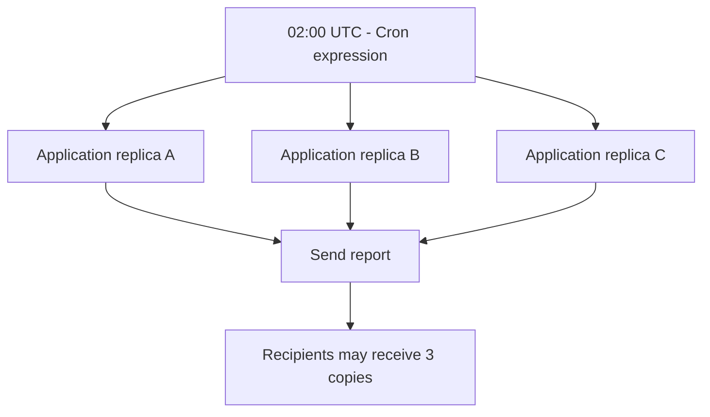
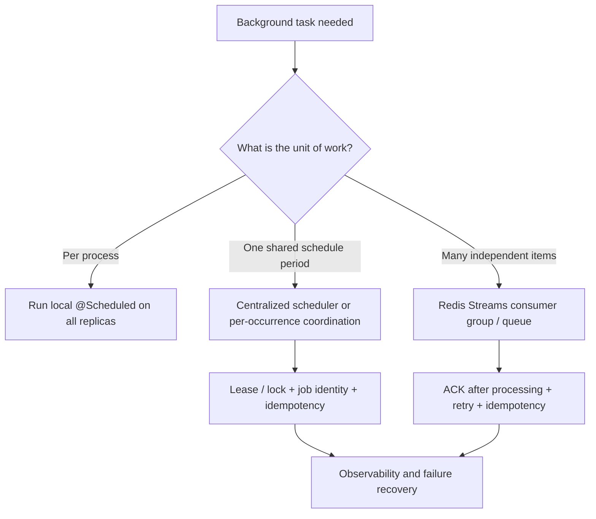
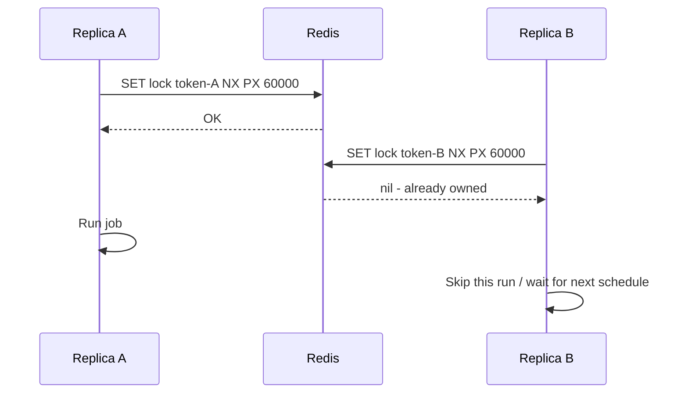
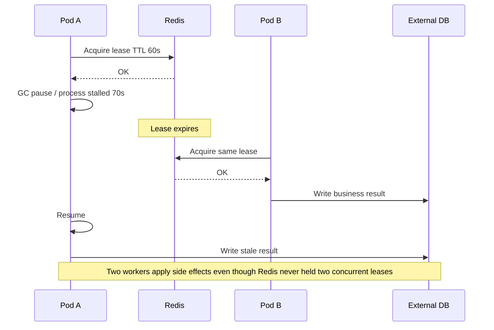
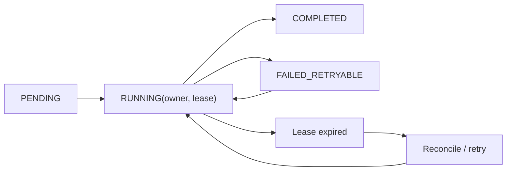
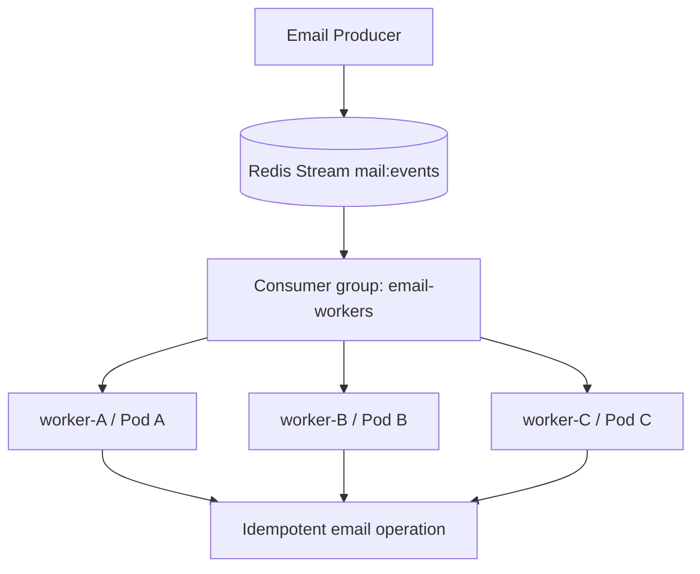
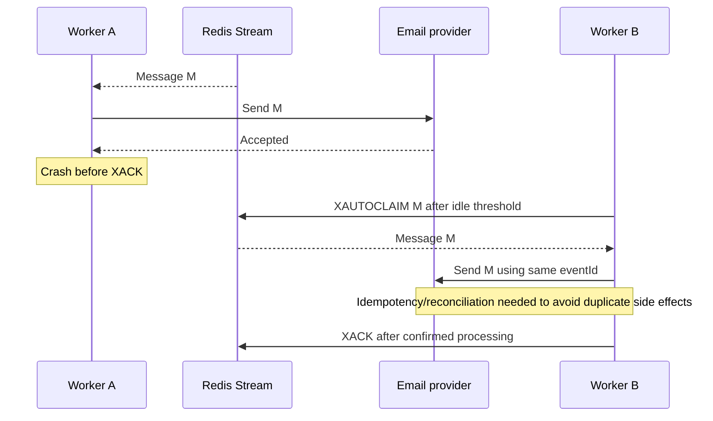

# Deploying Multiple Application Replicas and Preventing Duplicate Background Jobs

When deploying a **Spring Boot + Spring Data Redis** application to Kubernetes, Docker Swarm, or multiple hosts, you normally run **multiple application replicas** to distribute load and improve availability. This works naturally for stateless HTTP requests; a load balancer can route any request to any instance.

Background tasks are different. A method annotated with `@Scheduled` is typically registered **inside every Spring `ApplicationContext`**. If five replicas run with scheduling enabled, a cron job can fire **five times** instead of once cluster-wide. When that job sends emails, runs end-of-day settlement, purges records, renews subscriptions, or syncs with third parties, the consequences go far beyond wasted CPU.

**Redis** can help coordinate using a **distributed lease/lock** or distribute work through a **Redis Streams consumer group**. Still, three goals must be separated:

1. **No concurrent overlap:** at most one worker is authorized to start the task at a given time.
2. **Each scheduled occurrence processes once in business terms:** late replicas or retries do not produce a second outcome for the same period.
3. **No missed work and crash recovery:** if a worker crashes, stalls, or failover occurs, there is still a safe path to re-run or resume.

A Redis key with a TTL primarily addresses the first goal under specific assumptions. **It does not automatically provide exactly-once semantics, does not replace durable completion state, and does not prevent every race across failovers.**

## 1. Why Running Multiple Replicas Duplicates Background Jobs

Suppose the application defines:

```java
import org.springframework.scheduling.annotation.Scheduled;
import org.springframework.stereotype.Component;

@Component
public class DailyReportJob {

    @Scheduled(cron = "0 0 2 * * *", zone = "UTC")
    public void generate() {
        generateDailyReport();
    }

    private void generateDailyReport() {
        // Aggregate data and send report.
    }
}
```

With scheduling enabled:

```java
import org.springframework.context.annotation.Configuration;
import org.springframework.scheduling.annotation.EnableScheduling;

@Configuration
@EnableScheduling
public class SchedulingConfiguration {
}
```

When deploying three replicas:

```text
02:00:00 UTC  pod-A  -> generateDailyReport()
02:00:00 UTC  pod-B  -> generateDailyReport()
02:00:00 UTC  pod-C  -> generateDailyReport()
```

All three have their own Spring context and scheduler. `@Scheduled` does not automatically ask Redis or Kubernetes for a “leader instance”; therefore, **there is no default cluster-wide scheduler**.



This happens even when all three instances share **one Redis primary**, **one SQL database**, and **the same Spring Boot configuration**. Redis cannot coordinate operations the application was never designed to coordinate.

### 1.1. Not Every Job Must Run on Only One Replica

| Job Type | Should Multiple Replicas Run It? | Reason |
|---|---|---|
| Collecting in-process metrics | **Yes**, each replica measures itself | Each process has distinct state |
| Cleaning **local** in-process caches | Usually yes | Each replica owns its own cache |
| Refreshing credentials or local connections | Usually yes, per lifecycle | Resources belong to each instance |
| Sending a system-wide summary report | Usually **no** | Can send duplicates |
| Scanning and processing all `PENDING` jobs | Needs work partitioning or locking | Workers can double-process |
| Sending individual event-driven emails | Needs a queue and deduplication | Do not broadcast one event to every worker |
| Cleaning Redis keys across a global namespace | Needs coordination/throttling | Multiple replicas scanning the same keyspace multiply load |
| Rebuilding a full search index | Needs clear ownership/partitioning | Concurrent runs waste load and can overwrite each other |

**The first decision** is not picking a locking library, but determining whether a task should run **per replica**, **once system-wide**, or **once per item handled by one worker**.

## 2. Three Task Patterns Need Three Different Strategies



**A single cron job** and **thousands of independent job items** should not be solved with the same long-lived global lock. For queues, running many consumers in parallel is an advantage; what you must prevent is **two workers applying side effects twice for the same item**.

## 3. Why `synchronized` and Local Locks Are Insufficient

```java
private final Object mutex = new Object();

public void doWork() {
    synchronized (mutex) {
        processGlobalJob();
    }
}
```

`mutex` exists only inside **one JVM**. Pod A has mutex A; Pod B has mutex B. They cannot see each other.

Similarly:

- `ReentrantLock` only guards threads sharing the same object inside one process.
- `AtomicBoolean running` only prevents re-entry within one instance.
- A Spring singleton bean is singleton **per `ApplicationContext`**, not cluster-wide.
- `@Scheduled(fixedDelay = ...)` coordinates runs **within the same scheduler**, not across instances.
- Running the same container image across nodes does not create shared memory.

Coordinating replicas requires a **shared coordination point**: a Redis lock, SQL lock/job table, centralized scheduler, Kubernetes `CronJob`, or a work queue with consumer coordination.

## 4. Redis Lease: Using `SET NX PX/EX`

Redis provides an atomic command:

```redis
SET job-lock:cleanup owner-token NX PX 60000
```

Components:

| Part | Meaning |
|---|---|
| `job-lock:cleanup` | Key representing permission to run the task |
| `owner-token` | Unique random token for **this acquisition attempt** |
| `NX` | Set the key only if it **does not already exist** |
| `PX 60000` | Set a 60,000-millisecond TTL atomically in the same command |

If set succeeds, Redis returns `OK`. If the key already exists, the command denies the lock. The TTL lets the key expire automatically if the lock-holding process crashes without releasing.



**Always set the TTL atomically when creating the lock.** Never split it into two independent commands:

```redis
SETNX job-lock:cleanup owner-token
EXPIRE job-lock:cleanup 60
```

If the process crashes after `SETNX` and before `EXPIRE`, the lock can remain forever and halt the job. `SET key value NX PX ttl` eliminates that window.

### 4.1. The Token Should Not Be a Fixed Pod Name

Do not reuse a static instance name like `pod-A` as the lock value forever. Generate a **fresh random token on every acquire**, such as a UUID:

```text
pod-A attempt 1 -> token 3b0f...
pod-A attempt 2 -> token d7ad...
```

If the same pod restarts or loses ownership via TTL expiry, the old token must **never be able to delete a new lock** created by a later acquisition.

## 5. Spring Data Redis: Issuing a Redis Lease

`StringRedisTemplate` provides `setIfAbsent(key, value, Duration)` to execute conditional creation with a TTL:

```java
package com.example.jobs;

import java.time.Duration;
import java.util.Optional;
import java.util.UUID;
import org.springframework.data.redis.core.StringRedisTemplate;
import org.springframework.stereotype.Component;

@Component
public class RedisJobLease {

    private final StringRedisTemplate redis;

    public RedisJobLease(StringRedisTemplate redis) {
        this.redis = redis;
    }

    public Optional<Lease> tryAcquire(
            String lockKey, Duration ttl) {

        if (lockKey == null || lockKey.isBlank()) {
            throw new IllegalArgumentException("lockKey is required");
        }
        if (ttl == null || ttl.isNegative() || ttl.isZero()) {
            throw new IllegalArgumentException("ttl must be positive");
        }

        String token = UUID.randomUUID().toString();

        Boolean acquired = redis.opsForValue()
                .setIfAbsent(lockKey, token, ttl);

        if (Boolean.TRUE.equals(acquired)) {
            return Optional.of(new Lease(lockKey, token));
        }
        if (Boolean.FALSE.equals(acquired)) {
            return Optional.empty();
        }

        // In some execution modes the result may not be immediately available.
        // Do not run the job unless ownership is explicitly confirmed.
        throw new IllegalStateException("Lock acquisition result unknown");
    }

    public record Lease(String key, String token) {
    }
}
```

This example uses **normal synchronous execution**; do not invoke `setIfAbsent` inside a pipeline or transaction expecting an immediate `Boolean` confirmation. In Spring Data Redis, depending on execution context, the API may return `null`; that **never means acquisition succeeded**.

When `RedisConnectionFailureException` or a timeout occurs after sending the command, the lock **may have been created** even though the client never received the reply. When the outcome is uncertain, **fail closed**: **do not run the job**, let the lock expire, or use explicit reconciliation.

### 5.1. Use Dedicated Namespaced Keys

Example:

```text
jobs:lock:cleanup:session-cache
jobs:lock:refresh:exchange-rates
jobs:lock:report:daily
```

Assign one lock key per resource or task requiring mutual exclusion. Do not share one lock key across unrelated jobs or they will block each other needlessly.

In Redis Cluster, a **single-key** lock operation routes to that key's slot. Multi-key scripts must obey Redis Cluster hash-slot rules. Use hash tags for **related key groups**, without funneling your entire workload onto one hot slot unnecessarily.

## 6. Unlocking Must Verify Ownership

Wrong way to unlock:

```redis
DEL jobs:lock:cleanup:session-cache
```

Why is it wrong?

```text
T0: Pod A acquires lock token-A, TTL=10s
T1: Pod A stalls for a long time (GC pause / network)
T2: token-A's TTL expires
T3: Pod B acquires the same lock key with token-B
T4: Pod A wakes up and runs DEL
T5: Lock token-B is deleted even though B is the valid owner
```

Now Pod C can acquire the lock and run concurrently with B. Therefore, delete the lock **only if the key's value still equals your own token**.

### 6.1. Atomic Lua Compare-and-Delete

```lua
-- KEYS[1]: lock key
-- ARGV[1]: owner token of the current acquisition

if redis.call('GET', KEYS[1]) == ARGV[1] then
    return redis.call('DEL', KEYS[1])
end

return 0
```

Checking and deleting happen inside **one Redis script**, preventing any other client from interleaving between `GET` and `DEL`.

Never split into two Java calls:

```java
// UNSAFE: between GET and DELETE, the lock can expire or change owners.
if (token.equals(redis.opsForValue().get(lockKey))) {
    redis.delete(lockKey);
}
```

### 6.2. Invoking Lua via Spring Data Redis

Add to the `RedisJobLease` class above:

```java
import java.util.List;
import org.springframework.data.redis.core.script.DefaultRedisScript;

private static final DefaultRedisScript<Long> UNLOCK =
        new DefaultRedisScript<>(
            "if redis.call('GET', KEYS[1]) == ARGV[1] then " +
            "return redis.call('DEL', KEYS[1]) else return 0 end",
            Long.class);

public boolean release(Lease lease) {
    Long result = redis.execute(
            UNLOCK,
            List.of(lease.key()),
            lease.token());
    return Long.valueOf(1L).equals(result);
}
```

`true` means the script deleted the **lock owned by that exact acquisition**. `false` can mean the lock expired, was replaced by another owner, or no longer exists. Never retry an unconditional `DEL` just because `release` deleted nothing.

If a network error occurs during release, the lock may already be deleted or still exist; the TTL guarantees eventual recovery. **Never “fix” it with an unconditional `DEL`.**

## 7. Integrating with `@Scheduled` in a Bounded Way

One pattern lets the scheduler run on every replica, while only the instance holding the lease invokes the worker.

```java
package com.example.jobs;

import java.time.Duration;
import java.util.Optional;
import org.springframework.scheduling.annotation.Scheduled;
import org.springframework.stereotype.Component;

@Component
public class CacheCleanupSchedule {

    private static final String LOCK =
            "jobs:lock:cleanup:session-cache";

    private final RedisJobLease leases;
    private final CacheCleanupWorker worker;

    public CacheCleanupSchedule(
            RedisJobLease leases, CacheCleanupWorker worker) {
        this.leases = leases;
        this.worker = worker;
    }

    @Scheduled(
        fixedDelayString = "${jobs.cache-cleanup.delay-ms:60000}")
    public void cleanupOnce() {
        Optional<RedisJobLease.Lease> acquired =
                leases.tryAcquire(LOCK, Duration.ofSeconds(60));

        if (acquired.isEmpty()) {
            return; // Another replica is currently working.
        }

        try {
            // A small batch with a strict upper execution bound
            // shorter than the TTL, e.g., 100 keys / 20 seconds.
            worker.processSmallBoundedBatch();
        } finally {
            leases.release(acquired.get());
        }
    }
}
```

In this example, `CacheCleanupWorker` is an application-implemented service/bean. `processSmallBoundedBatch()` must bound **time, key count, and concurrency**—never an unbounded full-dataset scan/delete.

**Limitation of this example:** the 60-second lease **does not auto-renew**. If `processSmallBoundedBatch` runs past 60 seconds due to slow Redis, a JVM pause, or a stalled process, another replica can acquire the lock while the old worker is **still running**. Thus this pattern suits small, best-effort jobs with bounded duration and tolerable duplicate side effects.

When strict exclusion is required for long or critical jobs, add conditional lease renewal, mid-batch ownership checks, **fencing**, and idempotency at the target data store.

## 8. Lease TTL Is Not a Maximum JVM Execution Time

Setting `PX 60000` does not stop a running Java thread after 60 seconds. Redis simply expires the key when the TTL elapses.

Consider this scenario:



**Mutual exclusion inside Redis during a lease window** does not prove **two processes are not executing concurrently**. A lease cannot “revoke” running CPU threads or external side effects outside Redis.

### 8.1. How to Choose the TTL

Consider:

- Typical and p99 job execution time.
- Expected worst-case duration for the batch size.
- JVM GC pauses and scheduling delays.
- Network timeouts, retries, and backoffs.
- Redis failover and topology refresh windows.
- Acceptable delay before cleaning up after a truly dead worker.

Longer TTLs delay recovery when a worker dies; overly short TTLs raise the risk of overlapping execution. No single fixed value fits every job.

## 9. Lease Renewal (Heartbeat) Must Match the Token

If a job legitimately runs longer than the initial TTL, the worker can renew its lease periodically. However, renewal **must only succeed if it still holds the matching token**:

```lua
-- KEYS[1] = lock key
-- ARGV[1] = owner token
-- ARGV[2] = new TTL in milliseconds

if redis.call('GET', KEYS[1]) == ARGV[1] then
    return redis.call('PEXPIRE', KEYS[1], ARGV[2])
end

return 0
```

Unconditionally extending with `PEXPIRE` could extend another worker's lease. A safe heartbeat must:

1. Run **before the TTL expires**, with generous buffer for network/Redis delays.
2. Compare the token atomically as in the script above.
3. If renewal fails or returns an unknown outcome, the worker **must no longer assume ownership**.
4. Cap retries/timeouts rather than busy-looping while Redis is overloaded.
5. For batched work, re-check ownership between batches where feasible.
6. Enforce fencing/idempotency at the **target resource** to guard against already-started operations that cannot be halted.

**Limitation:** even with working renewals, a long GC pause or network partition can expire a lease. Renewal lowers risk; **it does not prove exactly-once execution**.

## 10. Fencing Tokens: Protecting the Target Resource from Stale Workers

A **fencing token** is a **monotonically increasing** value proving newer authorization. The target system tracks the highest accepted token and rejects requests bearing older tokens.

Example:

```text
Pod A obtains token 104 and begins writing.
A's lease expires.
Pod B obtains token 105 and writes to the database.
Pod A wakes up and sends a write with token 104.
Database rejects it because 104 < 105.
```

A conceptual schema:

```sql
CREATE TABLE controlled_resource (
    resource_id       VARCHAR(100) PRIMARY KEY,
    current_value     TEXT,
    last_fence_token  BIGINT NOT NULL
);
```

When updating:

```sql
UPDATE controlled_resource
SET current_value = :value,
    last_fence_token = :token
WHERE resource_id = :id
  AND last_fence_token < :token;
```

The application must inspect the updated row count. `0` can mean the token is stale or the resource does not exist; distinguish them per contract. Initial records must be seeded with a valid `last_fence_token`.

**Important point:** do not assume `INCR jobs:fence` under asynchronous Redis replication is an **unbreakable monotonic fencing source across all failovers**. A counter can lose updates when the primary changes. Where strong safety is mandatory, tokens must come from a source with **durable monotonic allocation** (such as a transactional database sequence), and the target resource must **actually validate the token**.

A Redis lock does not automatically enforce fencing on SQL databases, object storage, or external APIs. If the target system does not verify tokens, a worker whose lease expired can still apply side effects.

## 11. Redis Failover and Distributed Lock Limits

Redis may run with Sentinel or Redis Cluster, where primary-to-replica replication is typically **asynchronous**.

```text
T1. Pod A SET lock=A NX PX 60000 -> OK on old primary.
T2. Old primary dies before promoted replica receives lock.
T3. Replica becomes new primary without lock=A.
T4. Pod B SET lock=B NX PX 60000 -> OK on new primary.
```

Pod A received confirmation and may still be executing; Pod B is also granted the lock on the new primary. That is why **a single-primary Redis lock with async replication is not a consensus lock guaranteeing safety across every failover**.

Even multi-node Redis locking algorithms like Redlock require evaluating timing assumptions, clock/latency bounds, concurrent failure modes, and required safety guarantees. Never claim any lock algorithm automatically achieves exactly-once external side effects.

**Decision guide:**

- Cache cleanup or idempotent refresh jobs: Redis lease + idempotency is usually suitable.
- Best-effort deduplication of retryable tasks: a Redis lease is a useful building block.
- Money movement, ledger settlement, or strict resource allocation: rely on the authoritative transactional store, fencing, and idempotency—never just a Redis key.

## 12. Critical Distinction: Locks Prevent Overlap, Not Duplicate Scheduled Occurrences

Suppose a job runs daily at 02:00 UTC and replicas receive triggers a few seconds apart:

```text
02:00:00  Pod A acquires lock.
02:00:01  Pod A finishes and releases lock.
02:00:03  Pod B triggers @Scheduled, acquires lock.
02:00:04  Pod B runs the exact same report again.
```

**No two jobs overlapped**, yet the report was still sent twice. Therefore distinguish:

| Goal | Mechanism |
|---|---|
| Prevent two jobs from **running concurrently** | Lease/lock |
| Prevent the same **scheduled occurrence** from running again | Per-period job ID + completed/dedup state |
| Re-run if a worker dies before finishing | Job state with recovery/lease |
| Prevent duplicate emails/charges/payments | Idempotency at the side-effect boundary |

This is a classic multi-replica `@Scheduled` mistake: slapping a Redis lock onto a job and assuming it now “runs strictly once per day.”

### 12.1. Designing `jobOccurrenceId`

Each scheduled period needs a deterministic ID:

```text
jobName       = daily-report
businessDate  = 2026-11-13 (UTC)
occurrenceId  = daily-report:2026-11-13
```

Never generate `UUID.randomUUID()` as the **occurrence ID** per replica: three replicas would produce three different IDs and fail to deduplicate the same run. A per-attempt UUID for **acquiring a lock** is right; the **schedule period ID** must be identical across all replicas.

If schedules follow a business timezone, use `LocalDate`/`ZoneId` appropriately. “Every 24 hours” differs from “every calendar day” across DST transitions. Cron triggers firing slightly past midnight also need clear rules for which business date they represent.

## 13. Durable Job Run Table: Tracking Occurrences at the Source of Truth

For critical workflows, store job state in a **transactional database**:

```sql
CREATE TABLE job_runs (
    job_name       VARCHAR(100) NOT NULL,
    occurrence_id  VARCHAR(160) NOT NULL,
    status         VARCHAR(20) NOT NULL,
    owner_id       VARCHAR(120),
    lease_until    TIMESTAMP,
    started_at     TIMESTAMP,
    finished_at    TIMESTAMP,
    PRIMARY KEY (job_name, occurrence_id)
);
```

The unique constraint on `(job_name, occurrence_id)` stops two concurrent transactions from **inserting two separate job rows** for the same period. Yet a unique constraint alone **is not enough** to ensure recovery if a job crashes mid-run.

A simple state machine:



Design requirements:

1. Claim an occurrence via transaction/CAS so only one owner transitions the current state.
2. Write `COMPLETED` only after the required side effects are confirmed.
3. If an owner crashes, another worker can reclaim an expired lease.
4. If the job performed a side effect and crashed before `COMPLETED`, **a retry will happen**; side effects must be idempotent.
5. A SQL transaction only protects updates **in the same database**. It does not make Redis or external email APIs atomic with the DB.

### 13.1. Persist Results and Markers in the Same Transaction When Possible

If the job computes and writes results to the **same database**, you can combine:

```text
UPDATE business_summary ...
UPDATE job_runs SET status='COMPLETED' ...
COMMIT
```

inside a conditional transaction with valid uniqueness checks. On rollback, both results and marker roll back together. On commit, both persist atomically per the database contract.

If the job calls an external email or payment API, use an **outbox**, provider idempotency keys, or verification/reconciliation. You cannot wrap a network call in a SQL transaction and pretend both commit atomically.

### 13.2. Combining SQL Occurrence State with a Redis Lease

You can use a Redis lease to reduce unnecessary contention while keeping `job_runs` as the **source of truth** for occurrence state:

```text
Redis lease            -> reduces contention / best-effort overlap prevention
SQL job_runs           -> tracks occurrence, owner, completion state
Business idempotency   -> prevents duplicate side effects on retry/recovery
```

If a Redis failover drops the lock, SQL transactions/unique keys still prevent committing two results for the same occurrence—provided the write path actually enforces those checks rather than merely logging a row.

## 14. Completion Markers in Redis: When Are They Acceptable?

For jobs touching only Redis or rebuildable data, you can record:

```text
jobs:run:daily-report:2026-11-13:done
```

to mark an occurrence complete. However:

- Two replicas must not perform check-then-set with separate commands and assume no race exists.
- Writing the marker **before** the task means a crash can **skip** work.
- Writing the marker **after** the task means a crash can **re-run** work.
- Redis markers remain subject to replication, persistence, and failover risks.
- The marker's TTL must outlive the entire retry window and late-trigger possibilities.

For work confined **to a single Redis hash slot**, a Lua script can check the marker and update Redis data **atomically in one script**. That eliminates command interleaving on the current primary, though **it does not turn Redis Sentinel/Cluster replication into a globally durable commit**.

For legally or financially binding state, a Redis marker should not be the sole source of truth.

## 15. Never Use One Global Lock for an Entire Work Queue

Suppose there are 50,000 emails to send. An inefficient design:

```text
Replica A acquires global lock
Replica A processes all 50,000 emails
Replicas B, C, D sit idle
```

Drawbacks:

- One worker becomes a bottleneck.
- The lease must be renewed for hours, increasing stale-owner risk.
- If the worker dies midway, knowing which items finished is hard.
- A lock provides no per-item ACK or retry.

When work **splits into independent messages**, use competing consumers such as **Redis Streams consumer groups** or an appropriate message broker.

## 16. Redis Streams Consumer Groups: Sharing Work Across Replicas

Redis Streams lets multiple consumers join **one group** and compete for **new records**. Each delivery assigns a message to one consumer in the group, though failures/reclaims can re-deliver it; this is an **at-least-once** model, not exactly-once side effects.

Stream setup:

```redis
XGROUP CREATE mail:events email-workers 0 MKSTREAM
```

`0` lets the group read retained records from the beginning. `$` starts at the tail at creation time, suitable when only **subsequently added** records are desired.

Producer appends events:

```redis
XADD mail:events * eventId email-001 to user-101 template welcome
XADD mail:events * eventId email-002 to user-102 template welcome
XADD mail:events * eventId email-003 to user-103 template welcome
```

Consumer A:

```redis
XREADGROUP GROUP email-workers worker-A COUNT 10 BLOCK 2000 STREAMS mail:events >
```

Consumer B:

```redis
XREADGROUP GROUP email-workers worker-B COUNT 10 BLOCK 2000 STREAMS mail:events >
```

`>` reads messages **never yet delivered to any consumer in the group**. When all replicas share the **same group name** with **distinct consumer names**, they process different new messages in parallel.



### 16.1. A Different Group Is a Separate Subscription

If each replica creates a **different group**, every group receives its own logical copy of messages:

```text
mail-group-A -> sees message M
mail-group-B -> also sees message M
mail-group-C -> also sees message M
```

That fits when three **different applications/functions** must each receive the event (e.g., audit, analytics, email), yet is **wrong** when three replicas of the same email service should divide the workload.

Conversely, sharing the same **consumer name** across multiple processes in the same group makes PEL ownership hard to manage and obscures worker diagnostics. Give each instance a unique consumer name for its lifecycle, such as pod name plus instance ID where needed.

## 17. Pending Entries List and ACKing After Side Effects

When a consumer group delivers a record, Redis tracks it in the **Pending Entries List (PEL)** until `XACK`.

Example:

```redis
XACK mail:events email-workers 1731000000000-0
```

Replace the illustrative record ID with the real ID returned by `XREADGROUP`.

**Order matters:**

```text
1. Read message.
2. Validate payload / check event ID.
3. Execute business logic idempotently.
4. Only after durable success, XACK.
```

If you `XACK` **before** sending the email or updating the database, a consumer crash after ACK drops the work. If you **ACK after**, a worker crashing between side effect and ACK leaves the message pending for redelivery.

Hence **at-least-once delivery + idempotent processing** is far more realistic than promising “delivered strictly once.”

### 17.1. Inspecting Pending Entries

```redis
XPENDING mail:events email-workers
XPENDING mail:events email-workers - + 20
```

These show pending counts, consumer owners, and idle times per command output. Pending does not automatically mean a consumer is dead: a slow operation may still be legitimately running.

Never auto-reclaim every pending record after 1 second when an email call can take 20 seconds; doing so creates two workers processing the same message simultaneously.

## 18. Recovering When a Consumer Dies: `XAUTOCLAIM`

Suppose Pod A receives a message and crashes. The message stays in the PEL. Pod B can claim entries idle long enough using `XAUTOCLAIM` (Redis 6.2+):

```redis
XAUTOCLAIM mail:events email-workers worker-B 60000 0-0 COUNT 100
```

Parameters:

| Part | Meaning |
|---|---|
| `mail:events` | Stream |
| `email-workers` | Consumer group |
| `worker-B` | Consumer taking ownership |
| `60000` | Consider only records idle for at least 60,000 ms |
| `0-0` | Starting cursor in the PEL |
| `COUNT 100` | Target batch size |

The response includes the **next cursor** and claimed records. Loop using the cursor with bounded work; never assume a single claim scans the entire PEL. On newer Redis versions, responses also report IDs of deleted/trimmed entries per command contract.

If consumer A already sent the email yet crashed **before ACK**, B reclaims it and can send a duplicate unless the send path enforces idempotency.



**`XACK` does not delete records from the Stream.** It clears pending state within the group. Stream retention/trimming is separate and must preserve entries long enough for recovery.

## 19. Spring Data Redis: Application-Level Consumer Groups

Spring Data Redis supports `StreamOperations`, `StreamMessageListenerContainer`, and equivalent reactive APIs for reading Streams.

A controlled polling sketch using `StringRedisTemplate`:

```java
import java.time.Duration;
import java.util.List;
import java.util.UUID;
import org.springframework.data.redis.connection.stream.Consumer;
import org.springframework.data.redis.connection.stream.MapRecord;
import org.springframework.data.redis.connection.stream.ReadOffset;
import org.springframework.data.redis.connection.stream.StreamOffset;
import org.springframework.data.redis.core.StreamReadOptions;
import org.springframework.data.redis.core.StringRedisTemplate;

String consumerName = "mail-worker-" + UUID.randomUUID();

List<MapRecord<String, Object, Object>> records =
        stringRedisTemplate.opsForStream().read(
            Consumer.from("email-workers", consumerName),
            StreamReadOptions.empty()
                    .count(10)
                    .block(Duration.ofSeconds(2)),
            StreamOffset.create(
                    "mail:events",
                    ReadOffset.lastConsumed()));

if (records != null) {
    for (MapRecord<String, Object, Object> record : records) {
        // 1. Extract and validate eventId and payload.
        // 2. Apply side effect per idempotency contract.
        // 3. ACK only once work has durably succeeded.
        processEmailIdempotently(record);
        stringRedisTemplate.opsForStream().acknowledge(
                "mail:events", "email-workers", record.getId());
    }
}
```

In this example, `processEmailIdempotently` is an **application-implemented** business method, not a Spring API. The snippet shows **one poll iteration**, not a complete background worker; polling lifecycle, threads, timeouts, shutdown, retry/poison messages, and PEL recovery must be structured separately.

When using listener containers with automatic acknowledgement, understand **when ACK fires** and how exceptions behave. For non-repeatable side effects, never turn on auto-ack without reviewing the processing contract.

### 19.1. Do Not Use Redis Pub/Sub as a Competing Queue

Redis Pub/Sub is **broadcast**: every subscriber listening on a channel receives the same message.

```text
PUBLISH events:email ...
  -> Pod A subscriber
  -> Pod B subscriber
  -> Pod C subscriber
```

If all three send emails, the side effect triples. Pub/Sub also lacks PEL, ACK, and offline replay. When you want **one message handled by one worker at a time**, use a consumer group or an appropriate work queue/broker—never broadcast Pub/Sub.

## 20. Idempotency Is a Mandatory Safety Layer for Side Effects

Even with locks or consumer groups, duplicates still arise from:

- Retries after network timeouts.
- Worker crashes after a side effect before ACK.
- Lease expiry or renewal failure.
- Redis failover and replication lag.
- Producers emitting the same event multiple times.
- Deploys/rollbacks with overlapping app versions.

Therefore, attach a business-stable **idempotency key**:

```text
eventId = email-001
idempotencyKey = email:welcome:user-101:campaign-2026-11
```

If your email or payment provider supports idempotency keys, pass the same key on every attempt. Otherwise, maintain a ledger and reconciliation flow at the source of truth to prevent duplicate side effects.

### 20.1. Example Deduplication Table

```sql
CREATE TABLE processed_events (
    consumer_group  VARCHAR(100) NOT NULL,
    event_id        VARCHAR(160) NOT NULL,
    processed_at    TIMESTAMP NOT NULL,
    PRIMARY KEY (consumer_group, event_id)
);
```

Suitable pattern when the side effect **also writes to the same database**:

```text
BEGIN TRANSACTION
  INSERT processed_events ... ON CONFLICT DO NOTHING
  If inserted: update business tables
COMMIT
After commit: XACK
```

In PostgreSQL, `INSERT ... ON CONFLICT DO NOTHING` deduplicates inside the transaction. Inspect the **inserted row count** to tell a new event apart from an already-processed event.

When business updates and processed markers share a transaction, they commit or roll back together. However, if the side effect is an **HTTP call to an email or payment provider**, adding a table does not make the external call atomic with SQL. You need an outbox, provider idempotency keys, `UNKNOWN` state tracking, and reconciliation.

### 20.2. Never Mint a New Event ID on Retry

Wrong:

```text
Attempt 1: eventId=UUID-A
Attempt 2: eventId=UUID-B
Attempt 3: eventId=UUID-C
```

Three attempts look like three distinct jobs. Keep the **same idempotency key** per logical event, while attempt IDs can differ for tracing.

## 21. Separate Time-Based Scheduling from Data-Driven Execution

A pattern that scales cleanly:

```text
Scheduler at 02:00
    |
    +-- Create one durable job occurrence
    +-- Split into 10,000 item IDs
    +-- Publish each item to Stream/Queue
                      |
                      +-- Worker A
                      +-- Worker B
                      +-- Worker C
                      +-- Worker D
```

The scheduler does only **light, idempotent** work: ensuring one batch/job identity exists for the period. Workers process retryable items in parallel.

Advantages:

- No global lock held for hours.
- Workers scale with backlog.
- Easy to measure throughput, pending count, and DLQ.
- Each item carries its own idempotency key.
- Supports partial failure and resumption.

**Ensure the producer never emits two batches with new IDs for the same period**; ideally derive deterministic item IDs from `occurrenceId` and entity ID, or store a job-items table with a unique constraint.

## 22. Coordination Alternatives Beyond Redis Locks

Redis is not the only answer for every scheduler:

| Solution | Best For | Limits to Understand |
|---|---|---|
| **Redis lease** (`SET NX PX`) | Short jobs, best-effort mutual exclusion | Expiry/failover/stale owners; does not prevent per-period reruns alone |
| **ShedLock with Redis provider** | Adding named locks to Spring `@Scheduled` | Understand `lockAtMostFor`, `lockAtLeastFor`, provider/version, and Redis limits |
| **Kubernetes `CronJob`** | Running schedules at the platform layer instead of inside web replicas | Jobs can be recreated or missed; needs idempotency |
| **Quartz JDBC `JobStore` cluster** | Complex schedules with persistent triggers, misfire/recovery, DB coordination | Cluster/job-store config; side effects still need idempotency |
| **Database `job_runs`/locks** | Critical jobs tied to SQL data | Requires transactions, lease/recovery, contention tuning |
| **Redis Streams consumer group** | Many independent items, competing consumers, retries/pending | At-least-once; needs dedup, ACK, and reclaim |
| **Dedicated message broker** | High event/task volume, retention/replay/partitioning needs | Requires operating broker and understanding semantics |
| **Dedicated `replicas=1` scheduler Deployment** | Simple setups with few cron jobs | `replicas=1` alone is not exactly-once across restarts or rolling updates |

Pick the tool by **unit of work and consequence of duplication/loss**, not because the app already has Redis so “let's use Redis for everything.”

## 23. ShedLock with Spring `@Scheduled`

Libraries like **ShedLock** add a locking layer to Spring scheduled methods using a Redis or SQL storage provider. Conceptual annotation usage (verify exact ShedLock version and provider configuration):

```java
@Scheduled(cron = "0 0 2 * * *", zone = "UTC")
@SchedulerLock(
        name = "dailyReport",
        lockAtMostFor = "PT10M",
        lockAtLeastFor = "PT30S")
public void runDailyReport() {
    // Idempotent business operation.
}
```

Meaning:

- `lockAtMostFor`: maximum lease duration to avoid permanent lockup if the owner dies.
- `lockAtLeastFor`: minimum lock hold duration to reduce immediate re-acquisition when one node finishes very quickly. It does not replace occurrence IDs or deduplication.
- `name`: all replicas of the same job must use the **exact same lock name**.

**Warning:** this annotation snippet compiles only after adding the appropriate ShedLock dependency and configuration. Spring Framework **does not include** `@SchedulerLock`; it comes from an external library.

ShedLock does not make Redis replication strongly consistent, cannot halt stale workers when a lease expires, and does not turn external side effects into exactly-once operations. If `lockAtMostFor` is shorter than actual runtime, two runs can overlap. Different APIs, providers, and versions vary in lease-extension features; consult the documentation for your exact version before deploying.

## 24. Kubernetes `CronJob` Instead of In-App Cron on Every Web Pod

On Kubernetes, you can **decouple scheduling from HTTP-serving replicas**:

```yaml
apiVersion: batch/v1
kind: CronJob
metadata:
  name: daily-report
spec:
  schedule: "0 2 * * *"
  timeZone: "Etc/UTC"
  concurrencyPolicy: Forbid
  startingDeadlineSeconds: 600
  jobTemplate:
    spec:
      backoffLimit: 3
      template:
        spec:
          restartPolicy: OnFailure
          containers:
            - name: report
              image: example.org/report-worker:1.0
              args: ["--job=daily-report"]
```

The image address is a placeholder. Add namespace, service account, resource limits, secrets, logging, and policies per your Kubernetes cluster.

In a `CronJob`:

- `schedule` defines the cron schedule.
- `timeZone` sets the schedule's timezone where supported by your Kubernetes version.
- `concurrencyPolicy: Forbid` prevents **a new Job for that same CronJob** from starting while the previous Job is still active per controller logic.
- `startingDeadlineSeconds` bounds how late a missed schedule may still start.
- `backoffLimit` configures Job retries on pod failure.

**Do not treat `Forbid` as a system-wide exactly-once guarantee.** Kubernetes documentation notes a `CronJob` can occasionally miss creating a Job or create more than one Job; therefore workloads must be **idempotent**. `concurrencyPolicy` also applies only within **that single `CronJob`**, not across two separate `CronJob`s running similar logic.

When using `CronJob`, **do not also leave `@Scheduled` enabled in web replicas for the same task** unintentionally, or you will have two independent trigger sources.

## 25. Quartz Clustered Scheduler with a Persistent Store

For complex schedules, misfire handling, persistent jobs, pause/resume, and cluster coordination, consider **Quartz** with a JDBC `JobStore`.

Unlike a DIY Redis lease:

- Triggers and job metadata live in a database.
- Multiple Quartz nodes coordinate claiming triggers via `JobStore` clustering.
- Configurable misfire and recovery rules exist.
- Richer schedule management than basic `@Scheduled`.

Still, **Quartz does not make external side effects exactly-once**. If a node dies after calling a payment API but before committing job completion, recovery can re-execute it. Occurrence identity, idempotency, and reconciliation remain necessary.

Do not enable Quartz cluster mode on one node and assume other nodes share its DB/config. `JobStore` and cluster identifiers must be configured consistently across every node.

## 26. Rolling Deployments and Graceful Shutdown

Duplication happens not only with steady replicas; **rolling updates** run old and new versions side by side:

```text
T0: 3 v1 pods running
T1: Kubernetes creates new v2 pod
T2: Both v1 + v2 exist concurrently
T3: v1 pod starts terminating
T4: v2 pod starts serving traffic and running schedulers
```

Ensure:

1. Avoid firing jobs simply because a container started up.
2. When using consumer groups, give each process its own consumer identity.
3. Stop accepting **new work** before shutdown where framework hooks allow.
4. Give in-flight work a grace window to finish and ACK.
5. For tasks that do not finish before the deadline, rely on retry/idempotency rather than expecting Kubernetes to wait forever.
6. Never release locks owned by another process.
7. Keep v1 and v2 compatible on schemas, keys, and stream payloads during overlap.

### 26.1. Shutdown Is Not a Transaction

Kubernetes sends a termination signal and grants a grace period, yet processes can still die abruptly from node failure, OOM, or grace timeout. `@PreDestroy` or graceful shutdown **is never guaranteed to run in every crash**.

Therefore you must still have lease expiration, PEL recovery, and idempotency. Never rely solely on a `finally` block to release processing rights.

## 27. Retries, Timeouts, and Uncertain Outcomes

A job acquiring a lock:

```text
App -> SET key token NX PX 60000
Redis executes and replies OK
TCP connection drops before App receives reply
```

The app sees a timeout, yet the lock may exist in Redis.

**Do not do this:**

```java
tryAcquire(lock);
// Timeout -> assume we acquired it and run anyway
```

Without explicit confirmation, **you do not hold authority** to run the job. Wait for TTL expiry or verify ownership via token—recognizing even a follow-up `GET` after a timeout cannot eliminate every race or failover edge case.

In Redis Streams:

```text
Worker processes message successfully
XACK times out
```

`XACK` may or may not have executed. The message may be redelivered/claimed, so business logic must be idempotent. Never turn a network timeout into “re-run the side effect with a brand-new event ID.”

### 27.1. Do Not Retry Infinitely When Redis Is Down

If Redis is unavailable:

- Do not let all replicas busy-loop `SET NX` thousands of times per second.
- Use exponential backoff, jitter, and bounded attempts/deadlines.
- Emit metrics for failures and job downtime.
- For critical jobs, keep pending work in durable storage.
- Maintain runbooks to reschedule or reconcile after outages.

Failing closed on locks lowers duplicate execution risk, yet can cause **missed runs** unless a retry/catch-up mechanism exists. Balance safety and liveness explicitly.

## 28. Avoid Creating a Permanent Leader from a Redis Key

A dangerous design:

```text
SETNX jobs:leader pod-A
```

without a TTL. If Pod A dies, the leader key stays forever and all scheduling halts.

Another flawed design sets a TTL and lets the leader refresh unconditionally without checking its token, accidentally extending a new process's lease.

If continuous **leader election** is truly required:

- Define lease duration, renewal interval, and ownership rules.
- Handle stale leaders, reconnects, and failovers.
- Separate leader election from specific job occurrence tracking.
- Enforce fencing/transactions on resources with strict invariants.
- Consider platform control-plane leader election or databases with appropriate semantics.

If you just have a daily cron job, **do not build complex leader election across all replicas**. A centralized scheduler plus per-occurrence idempotency is usually far simpler to maintain.

## 29. Integration Testing with Multiple Replicas

A unit test calling `runJob()` once cannot verify coordination. Test multiple Spring contexts/processes sharing **the same test Redis**.

### 29.1. Minimum Test Scenarios for Redis Leases

1. Start an isolated Redis for tests (e.g., Testcontainers).
2. Point two `RedisJobLease` instances/contexts at that Redis.
3. Have two threads invoke `tryAcquire` concurrently on the **same lock key**.
4. Assert **only one acquire succeeds** under normal Redis operation.
5. Have the owner release via Lua and verify another contender can then acquire.
6. Simulate TTL expiration and acquisition of the lock with a new token.
7. Have the old owner call release and confirm it **does not delete the new owner's token**.

Illustrative snippet:

```java
String lockKey = "test:jobs:lock:cleanup";

var first = leaseA.tryAcquire(
        lockKey, Duration.ofSeconds(5)).orElseThrow();

assertThat(leaseB.tryAcquire(
        lockKey, Duration.ofSeconds(5))).isEmpty();

assertThat(leaseA.release(first)).isTrue();

var second = leaseB.tryAcquire(
        lockKey, Duration.ofSeconds(5)).orElseThrow();

// Stale token cannot delete B's lease.
assertThat(leaseA.release(first)).isFalse();
assertThat(redis.opsForValue().get(lockKey))
        .isEqualTo(second.token());
```

This is an illustrative JUnit/AssertJ test; `leaseA` and `leaseB` share one Redis instance. It verifies acquire/release semantics, **not safety across primary failover**.

### 29.2. Test Overlap Prevention vs. Occurrence Deduplication

Let Pod A finish quickly and release its lock, then trigger Pod B for the **same occurrence** 2 seconds later.

Expected results for the two designs:

```text
Redis lock only:
    Pod B can run again -> design does not stop duplicate occurrences.

Durable job_runs COMPLETED + unique (job, occurrence):
    Pod B sees occurrence already completed -> no duplicate side effect.
```

This test is crucial because concurrent two-thread tests often miss staggered triggers.

### 29.3. Testing Redis Streams Recovery

- Worker A reads a record and stops without ACKing.
- Worker B must not see the pending record as a new `>` entry immediately.
- After the idle threshold, B reclaims via `XAUTOCLAIM`.
- Reprocessing the same `eventId` produces no second side effect.
- After ACK, the record disappears from the group's PEL.
- If a message is trimmed/deleted before recovery, the system detects/handles the loss per policy.

### 29.4. Testing Shutdown and Failover

In a controlled test environment:

- Simulate a JVM pause longer than the lease TTL.
- Inject timeouts before and after sending commands.
- Perform a rolling deployment with v1 and v2 running together.
- Simulate Redis Sentinel/Cluster failover where test infrastructure allows.
- Check for stale locks, duplicate side effects, lost events, and recovery times.

Never induce failovers or network partitions in production to test locking without an approved operational procedure.

## 30. Observability and Alerting to Catch Duplicate Jobs

A well-instrumented coordination layer should explain **who ran what, for which period, and why**.

| Metric / Log Field | Meaning |
|---|---|
| `job_name` | Bounded job name |
| `occurrence_id` | Run period ID; put in structured logs/DB, not high-cardinality metric tags |
| `replica_id` / `pod_name` | Identifies worker; keep in logs/traces per policy |
| `lock_acquired_total` | Successful acquisitions |
| `lock_busy_total` | Attempts seeing another worker holding the lock |
| `lock_error_total` | Acquire/release/renew errors |
| `job_duration_seconds` | Execution duration, p95/p99 |
| `job_completed_total` | Completed occurrences |
| `job_failed_total` | Failed occurrences |
| `job_duplicate_suppressed_total` | Runs skipped because occurrence already completed |
| `job_stale_fence_rejected_total` | Stale worker writes rejected by target resource |
| `stream_pending` | Pending backlog in consumer group |
| `stream_oldest_pending_age` | Age of oldest pending record |
| `dlq_events_total` | Messages routed to dead-letter handling |

With Micrometer, tag metrics by bounded dimensions such as **job name, result, and environment**—never by per-run `occurrenceId` or UUID.

### 30.1. Structured Logs for an Occurrence

Example:

```text
event=JOB_ACQUIRE
job=daily-report
occurrence=2026-11-13
replica=report-pod-7c
result=ACQUIRED

event=JOB_COMPLETED
job=daily-report
occurrence=2026-11-13
replica=report-pod-7c
elapsedMs=3248
```

If Pod B logs:

```text
event=JOB_SKIPPED
job=daily-report
occurrence=2026-11-13
reason=ALREADY_COMPLETED
```

that means something very different from `reason=LOCK_BUSY`: one indicates **the period is already done**, while the other only indicates **another worker currently holds the lock**.

### 30.2. When to Alert?

- No completion recorded for an occurrence past its deadline.
- More than one side effect recorded for the same occurrence/item.
- Repeated lock renewal failures.
- A job holding a lease abnormally long.
- Stream pending count or oldest pending age breaching SLO.
- Retry/DLQ spikes after a deployment or failover.
- An old replica still processing after replacement.

Do not alert merely because `lock_busy_total` increases: in multi-replica deployments, **most replicas failing to acquire the lock** is completely normal.

## 31. Common Anti-Patterns

### 31.1. “Just Use `@Scheduled`; Spring Picks One Replica”

False. Scheduling activates in every Spring context. All replicas can run concurrently.

### 31.2. “`synchronized` or a `static boolean` Is Enough”

False. Local locks cannot coordinate separate processes.

### 31.3. “`SETNX` Then `EXPIRE` in Two Commands”

Unsafe if the process crashes between the two commands. Use `SET ... NX PX/EX` or an equivalent atomic API.

### 31.4. “Release Lock with `DEL` Regardless of Owner”

False. After TTL expiry, another worker may hold the key. Use token-checked Lua compare-and-delete.

### 31.5. “With a TTL, Two Workers Can Never Run Together”

False. A stalled worker can resume after its lease expires; fencing, idempotency, and side-effect guards are needed.

### 31.6. “A Lock Ensures Every Cron Runs Exactly Once”

False. Two replicas can run sequentially after the first releases the lock. Occurrence IDs/dedup are required.

### 31.7. “Redis Failover Preserves Every ACKed Lock”

Not guaranteed. Replication can be asynchronous; a newly created lock may not have reached the new primary.

### 31.8. “`XREADGROUP` Means Zero Duplicate Messages”

False. Pending/reclaims, retries, and crashes between side effect and ACK make processing at-least-once.

### 31.9. “One Group Per Pod Splits Messages Evenly”

False for competing consumers. **Same group, different consumer names** distributes new messages across replicas.

### 31.10. “Redis Pub/Sub Replaces a Competing-Worker Queue”

False. Pub/Sub broadcasts to current subscribers and has no ACK or replay.

### 31.11. “ACK Early to Prevent Duplicates”

ACKing before side effects causes **lost work** if the worker dies. ACK after processing and make handlers idempotent.

### 31.12. “A Scheduler Deployment with `replicas=1` Is Exactly-Once”

Not guaranteed. Rolling updates, restarts, network failures, and re-schedules can still overlap or duplicate runs.

### 31.13. “`CronJob` `concurrencyPolicy: Forbid` Guarantees No Duplicates”

No. It limits controller-level overlap within one `CronJob`; it does not provide exactly-once side effects across failures.

### 31.14. “Generate a Fresh `operationId` on Retry”

False. Retries must keep the logical work item/occurrence ID, using a separate attempt ID only for tracing.

### 31.15. “Every Batch Must Hold One Global Lock for Hours”

Unnecessary. Independent items scale much better via queues/consumer groups with per-item deduplication.

## 32. Solution Selection Matrix

| Requirement | Preferred Design |
|---|---|
| Each replica refreshes local memory/cache | Local `@Scheduled`, no global lock |
| Periodic safe Redis key cleanup | Redis lease, small batches, TTL, token-checked release |
| One daily report | Stable `occurrenceId` + durable completion state; Redis lease or `CronJob` to limit overlap |
| Periodic invoicing/billing | Database transactions / idempotency keys / source of truth; never Redis lock alone |
| 10,000 independent email items | Redis Streams consumer group or broker, ACK + dedup |
| Task taking hours | Split work, queue/recovery; or durable scheduler + fencing |
| Complex schedules, misfires/recovery | Quartz JDBC cluster or managed scheduler |
| Dedicated Kubernetes cron workload | `CronJob` + idempotent execution |
| Strictly one writer per external resource | Lease + fencing token verified by target resource |
| Zero missed runs across Redis failovers | Durable work store, reconciliation, and idempotent retries |

## 33. Design Process for Multi-Replica Background Jobs

Before shipping a new `@Scheduled` job to production, answer:

1. **Unit of work:** per process, per schedule period, per tenant, or per message?
2. **Impact of duplicate execution:** wasted CPU, duplicate emails, corrupted inventory, or double charges?
3. **Impact of missed execution:** can it wait for the next run, or must it recover immediately?
4. **What is the occurrence/job ID?** Is it deterministic across retries and replicas?
5. **Where is the source of truth?** Redis, SQL, a broker, or an external API?
6. **What is the coordinator?** Redis lease, DB job table, Kubernetes `CronJob`, Quartz, or Streams?
7. **How are TTLs/timeouts chosen?** Do they cover p99 runtime, GC pauses, and network jitter?
8. **How are stale workers stopped?** Token compare-release, renewals, fencing, and idempotency.
9. **Who recovers crashed workers?** Lease expiry, PEL reclaim, misfire/recovery scheduler?
10. **How are network timeouts handled?** Never retry blindly without checking outcomes.
11. **What happens during Redis failover?** Re-granting, lost locks/markers, pending recovery.
12. **What happens during rolling deployments?** v1/v2 overlap, schema compatibility, graceful shutdown.
13. **How is it observed?** Job run table, lock logs, pending counts, latency, error rates.
14. **How is it tested?** Concurrent replicas, staggered replicas, crash before ACK, crash after side effect.

Not every job needs every safeguard. Match **protection level to risk** and state clearly what the system actually **guarantees**, instead of calling a Redis lock “exactly-once.”

## 34. Summary

When Spring Boot runs multiple replicas, `@Scheduled` methods and background workers **do not automatically become cluster singletons**. A job can fire on every replica, causing duplicate emails, reports, cleanups, or business side effects.

A **Redis lease** via `SET key token NX PX ttl` helps reduce concurrent execution; always use unique tokens and Lua **compare-and-delete** on release. Still, TTLs can expire while an old worker runs, locks can disappear across Redis failovers, and two replicas can run **sequentially for the same period** without overlapping.

For **periodic cron jobs**, combine deterministic `occurrenceId`s, durable completion state, and idempotency; where strong guarantees are required, enforce transactions and fencing at the source of truth. For **many independent items**, Redis Streams consumer groups provide competing consumers while PEL/`XAUTOCLAIM` and ACKs enable retry and recovery—still requiring idempotent side effects. Kubernetes `CronJob`, ShedLock, or Quartz can simplify coordination depending on architecture, yet none relieve the application of handling failure modes.

**Core rule:** distinguish **no overlap**, **no duplicate per occurrence**, and **no lost work**. Pick the right coordination level, build recovery paths, test against real multi-replica setups, and measure duplicates/completions instead of merely checking whether a lock key exists in Redis.

### References

- [Spring Framework — Task Execution and Scheduling](https://docs.spring.io/spring-framework/reference/integration/scheduling.html): `@Scheduled`, scheduling, and scheduler configuration.
- [Redis — Distributed Locks](https://redis.io/docs/latest/develop/use/patterns/distributed-locks/): Redis locks, tokens, limitations, and safety conditions.
- [Redis — SET](https://redis.io/docs/latest/commands/set/): `NX`, `PX`/`EX`, and conditional key creation.
- [Redis — EVAL](https://redis.io/docs/latest/commands/eval/): Lua scripts and command atomicity in Redis.
- [Redis — Replication](https://redis.io/docs/latest/operate/oss_and_stack/management/replication/): async replication characteristics and failover risks.
- [Redis — Streams](https://redis.io/docs/latest/develop/data-types/streams/): consumer groups, ACK, and pending entries.
- [Redis — XREADGROUP](https://redis.io/docs/latest/commands/xreadgroup/): competing consumers and delivery state.
- [Redis — XAUTOCLAIM](https://redis.io/docs/latest/commands/xautoclaim/): reclaiming abandoned pending records.
- [Spring Data Redis — Redis Streams](https://docs.spring.io/spring-data/redis/reference/redis/redis-streams.html): `StreamOperations`, stream listeners, and consumer groups.
- [Spring Data Redis — RedisTemplate](https://docs.spring.io/spring-data/redis/reference/redis/template.html): `StringRedisTemplate`, key operations, and Lua scripts.
- [ShedLock — Project documentation](https://github.com/lukas-krecan/ShedLock): `@SchedulerLock`, `lockAtMostFor`, and lock providers.
- [Kubernetes — CronJob](https://kubernetes.io/docs/concepts/workloads/controllers/cron-jobs/): concurrency policy, deadlines, and idempotency responsibilities.
- [Quartz — Clustering](https://www.quartz-scheduler.org/documentation/quartz-2.3.0/configuration/ConfigJDBCJobStoreClustering.html): JDBC `JobStore` and coordination across scheduler nodes.
