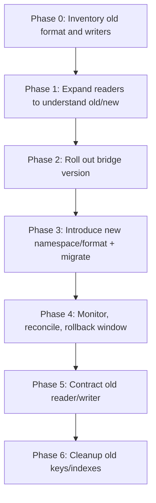

# Migrating Serializers or Keyspaces Across Coexisting Application Versions in Spring Data Redis

> **Module:** Spring Data Redis  
> **Chapter:** Deployment  
> **Topic:** Designing transitions for Redis value serializers, key serializers, or keyspace namespaces when old and new Spring Boot versions run concurrently during rolling deployments, blue–green deployments, canaries, or rollbacks. The focus is read/write compatibility, key lifecycles, data consistency, and safe phased rollouts.

## 1. The Problem: Deploying a New Version While Redis Still Holds Old Data

A Spring Boot application uses Redis to cache products. Version V1 writes Java objects using the JDK serializer:

```text
Key:   product:101
Value: Java serialization bytes (AC ED 00 05 ...)
```

Version V2 wants to store JSON:

```text
Key:   product:101
Value: {"schemaVersion":2,"productId":"101","name":"Desk"}
```

If you merely swap the `RedisTemplate` value serializer and deploy V2, multiple risks arise:

1. **V2 cannot decode V1 data.** Jackson tries to parse Java-serialized bytes as JSON.
2. **V1 cannot decode V2 data.** The JDK serializer does not understand JSON.
3. If either version writes back to the **same key**, the value flips formats back and forth depending on which pod handled the request.
4. While V1 and V2 run together, errors appear intermittently: one pod succeeds while another fails.
5. Rolling back from V2 to V1 may be unsafe because Redis now holds entries in the new format.

The same phenomenon occurs when changing keyspaces:

```text
V1: product:101
V2: cache:catalog:v2:product:101
```

V2 misses V1 keys, causing cache misses. If two versions read/evict different namespaces while sharing the same business data source, **stale caches** or duplicated entries can result.

**Key takeaway:** Redis is shared state that outlives any single Spring Boot pod. Deploying new Java code does not upgrade all existing Redis data at the same instant.

### 1.1. Common Scenarios Requiring Migration

- Switching from `JdkSerializationRedisSerializer` to JSON.
- Switching from `GenericJackson2JsonRedisSerializer` to a serializer with a fixed DTO/schema.
- Changing `StringRedisSerializer` or the key `RedisSerializer`.
- Adding a version to prefixes: `user:` → `app:prod:users:v2:`.
- Adding `tenantId` to prevent multi-tenant key collisions.
- Moving from String JSON to Redis Hashes.
- Renaming or restructuring fields inside a Redis Hash.
- Changing `RedisCacheManager` prefixes or value serializers.
- Changing `@RedisHash` keyspaces, `@Id` format, or `@Indexed` fields.
- Moving from one Redis instance to another, or from standalone to Cluster.
- Migrating session data, idempotency state, counters, or Redis Streams.

Not all of these use the same strategy. **Rebuildable caches** can often switch to a new keyspace and let old entries expire naturally. **Redis as the authoritative data source** demands stricter migration protocols, reconciliation, and concurrency handling.

## 2. Serializers and Keyspaces Are Two Separate Things

### 2.1. Serializers Determine Actual Bytes

Redis stores **bytes**. Java objects, JSON, Strings, and Hash fields have meaning only when clients apply matching serializers/codecs.

| Component | Example | Impact If Changed |
|---|---|---|
| Key serializer | `StringRedisSerializer` | Byte-level key name; can create completely separate keys |
| Value serializer | JDK serialization, JSON serializer | Format of String values; old versions may fail to read |
| Hash key serializer | Encoding of field names | `HGET` on old fields may miss |
| Hash value serializer | Encoding of field values | May fail decoding or misinterpret types |
| Cache key conversion | Spring `ConversionService`, `KeyGenerator` | Logical key name changes |
| Cache prefix | `RedisCacheConfiguration` | Namespace changes |
| Repository keyspace/indexes | `@RedisHash`, indexes | Old entities, secondary indexes, or TTL metadata become invisible |

A migration that updates only the value serializer **must not** overlook key serializers, cache prefixes, or Redis Hash fields if those change as well.

### 2.2. Example: Identical Logical Keys with Different Bytes

In Java:

```java
String key = "product:101";
```

With `StringRedisSerializer`, the key is normally written as UTF-8:

```text
70 72 6f 64 75 63 74 3a 31 30 31
```

With JDK serialization, the Redis key is a byte sequence carrying Java serialization headers and metadata; `redis-cli GET product:101` will not find that key using its plain UTF-8 name.

Therefore:

> **Changing the key serializer can cause a “mass cache miss” even though old data still exists in Redis.** Reading it back requires the exact legacy key serializer or reading raw bytes directly.

### 2.3. Changing Namespaces Does Not Automatically Convert Values

Example:

```text
Old key: product:101
New key: app:prod:catalog:v2:product:101
```

Even if the JSON format is identical between V1 and V2, V2 still misses because it queries a **different key**. Conversely, changing only the JSON serializer while keeping the key causes a format mismatch.

### 2.4. Redis Commands and Serialization Are Separate Layers

The Redis server has no knowledge of `ProductDto` or Java packages. It receives `GET key` and returns bytes. Whether an application version can read them depends on the **client serializer, DTO mapping, and application schema**.

Redis `RENAME`, `COPY`, `DUMP`, and `RESTORE` do not convert Java-serialized values into new JSON. They manipulate bytes/keys without translating application data models.

## 3. Rolling Deployments, Blue–Green, and Canaries Create Mixed-Version States

During a rolling update:

```text
10:00 — Pods: 4 × V1, 0 × V2
10:01 — Pods: 3 × V1, 1 × V2
10:02 — Pods: 2 × V1, 2 × V2
10:03 — Pods: 1 × V1, 3 × V2
10:04 — Pods: 0 × V1, 4 × V2
```

For minutes or hours, V1 and V2 **read and write Redis concurrently**.

Blue–green deployments can keep both fleets alive even longer. Canaries may route only 1% of traffic to V2, yet V2 still shares Redis keys with V1. On rollback, the older version returns and reads data written by the newer version.

### 3.1. What Can Coexist Simultaneously

- **Application code versions:** V1, Bridge, V2.
- **Redis keys:** old prefixes and new prefixes.
- **Value schemas:** JDK bytes, JSON V1, JSON V2.
- **Cache entries:** values created before and after deploy.
- **Writers:** old pods, new pods, background jobs, event consumers.
- **Read paths:** APIs, scheduled jobs, cache managers, repositories, and admin scripts.
- **Rollback targets:** previous application versions that may still be rolled back to.

Successful migration requires accounting for all of these dimensions, not just editing one Spring bean.

### 3.2. Failures Typically Manifest Intermittently

A V2 canary reading a key just written by V2 passes. The next V1 pod reading that same key throws an exception. Because user requests hit load balancers, errors appear sporadically.

That makes single-version unit tests or non-mixed staging runs **insufficient** to prove rolling-deploy safety.

## 4. Compatibility Matrix: Know Who Can Read Whose Data

Suppose formats are:

- **F1:** JDK-serialized `ProductV1`.
- **F2:** JSON schema v2.

Application versions:

- **A1:** reads/writes only F1.
- **Abridge:** reads both F1 and F2, initially writes F1.
- **A2:** reads both F1 and F2, writes F2; may dual-write F1 for rollback during a transition period.

Matrix:

| Application | Reads F1 | Reads F2 | Default Write |
|---|---|---|---|
| A1 legacy | Yes | No | F1 |
| Abridge compatible reader | Yes | Yes | F1 |
| A2 compatible | Yes | Yes | F2 or dual-write per protocol |
| A3 final | Unneeded after cutover | Yes | F2 |

**Safety condition when two versions coexist:** Every byte sequence any active writer can produce during overlap must be readable by every reader that can touch that key, or writers must use **separate namespaces** so older readers never encounter newer bytes.

### 4.1. Never Write a New Format to the Same Key Before Old Readers Upgrade

Unsafe:

```text
V1 GET product:101 -> reads F1
V2 SET product:101 -> writes F2
V1 GET product:101 -> fails to deserialize F2
```

Even if V2 serves only a tiny canary slice, Redis keys are shared state—there is no such thing as “the canary only corrupts 1% of keys” unless the keyspace itself is isolated.

### 4.2. Reader Backward Compatibility vs. Writer Forward Compatibility

- **Backward-compatible reader:** new code reads data written by old code.
- **Forward-compatible reader:** old code reads data written by new code.

Older versions usually **cannot** read newer formats unless prepared ahead of time. Deployment order must therefore be planned carefully.

### 4.3. Mixed Writers Are Harder Than Mixed Readers

Having V2 read V1 is not enough. If V1 keeps mutating data or writing to the old key while V2 reads the new key, V2 can serve stale data.

Example:

```text
t0: V2 warms cache:v2:product:101 = price 100
t1: V1 updates DB price to 90
t2: V1 evicts cache:v1:product:101
t3: V2 GET cache:v2:product:101 -> returns price 100 (stale)
```

No serialization exception occurs, yet **data correctness is broken**. You must design **cross-version invalidation**, cache TTL/freshness limits, or source version checks.

## 5. Classify Data Before Choosing a Migration Strategy

### 5.1. Rebuildable Cache

Example: product catalog cache:

```text
Database/API source -> Redis cache
```

Redis is not the authoritative source; losing cache causes a performance penalty, not business data loss while the source remains intact.

A sensible strategy:

1. V2 uses a new namespace.
2. V2 cache misses read from the authoritative source.
3. V1 continues using the old namespace.
4. All versions enforce invalidation/freshness per policy.
5. After the rollback window and TTL pass, clean up old cache entries in a controlled manner.

You do not always need to dual-write cached entries if the cache can rebuild safely.

### 5.2. Redis as the Authoritative Data Source

Examples:

- Counters enforcing quotas/limits.
- Job leases and processing state.
- Session/token state where data loss impacts security.
- Order/payment idempotency records.
- Redis Streams holding pending work.
- Redis Hashes acting as the sole store of state.

In these cases, **never spin up a new namespace and treat misses as “no data exists.”** Plan canonical writers, conflict resolution, atomicity/CAS, retention, recovery, and reconciliation.

### 5.3. Initial Decision Table

| Data Category | Recommended Migration | What to Protect |
|---|---|---|
| DB-backed catalog cache | Versioned namespace + lazy rebuild | Stale data, DB stampede |
| User/tenant-scoped cache | Namespace + verified scope | Cross-user/tenant leakage |
| Redis sessions | Compatibility or dedicated session migration | Logouts/invalidation, security |
| Idempotency records | Durable ledger / controlled dual-read | Never execute side effects twice |
| Canonical counters/quotas | Single writer + atomic migration | Never double-increment or lose count |
| Streams/consumer state | Dedicated consumer transition plan | Never drop or duplicate events |
| Repository entities/indexes | Mapping + index migration | Orphaned or missing indexes |
| Distributed locks | Never swap keys casually while holders are active | Two locks guarding one resource |

Cache migrations prioritize *availability/performance*; authoritative Redis state migrations prioritize *correctness/durability*.

## 6. General Strategy: Expand → Migrate → Contract

A multi-phase deployment strategy:



### 6.1. Expand

Upgrade reading capability **before** writing the new format:

- New app understands both F1 and F2.
- DTO schemas have versioned converters.
- Key builders know both old and new prefixes.
- Metrics distinguish read hits by format.
- Error paths flag unrecognized values cleanly.
- Readers do not silently treat deserialization failures as cache misses on critical data.

### 6.2. Migrate

Gradually transition data or the write path:

- Cache: lazy rebuild from authoritative source or warm-up.
- Authoritative data: migration jobs, writer fencing, CAS/version checks.
- Conditional dual-read, dual-write, or read-repair as warranted.
- Ensure new data never breaks running old apps.
- Establish rollback checkpoints.

### 6.3. Contract

Remove legacy support only after:

- Zero old code needing the old format remains running.
- Zero old writers/background workers remain running.
- The rollback window has closed, or rollback targets are also compatible.
- Legacy read rates have been observed at 0 over a sufficient window.
- Retention-bound data has been handled.
- Cleanup will not delete keys still actively used.

**Contracting too early** is a frequent cause of production incidents during rollbacks.

## 7. Two Fundamental Migration Patterns

### 7.1. In-Place Format Change on the Same Redis Key

Example:

```text
product:101 => bytes F1
product:101 => bytes F2
```

Advantages:

- No new namespace needed.
- Does not double key count.
- Application keeps the same logical key.

Disadvantages:

- Old readers crash immediately upon encountering F2.
- Rollback is difficult.
- Requires guaranteeing every active reader understands F2 before switching writes.
- Concurrent old writers can overwrite F2 back with F1.
- No natural marker identifies the format unless bytes carry a reliable envelope.

Choose this only with a strict **reader-first rollout**, tight writer control, an explicit schema/version envelope, and a verified rollback path.

### 7.2. Versioned Keyspace (New Key Prefix)

Example:

```text
product:v1:101 => F1
product:v2:101 => F2
```

Advantages:

- Old apps touch only `v1`.
- New apps stay isolated from legacy bytes.
- Rolling back to `v1` is easier if `v1` stays maintained.
- Easy to observe old vs. new hit ratios.
- Easy to clean up by namespace/version.

Disadvantages:

- Memory and key counts rise during overlap.
- Data can diverge if a writer updates only `v1`.
- Cache invalidation must address both versions.
- V2 cold-start can increase DB load.
- Keyspace migration also affects indexes, TTLs, and ACL permissions.

**For rebuildable caches, a versioned keyspace is usually easier to control than an in-place format change.**

## 8. Versioned Keyspace Structure and Tenant Boundaries

An example key schema:

```text
<app>:<env>:<domain>:<version>:tenant:<tenantId>:<entity>:<id>
```

Example:

```text
shop:prod:catalog:v1:tenant:t-17:product:p-101
shop:prod:catalog:v2:tenant:t-17:product:p-101
shop:staging:catalog:v2:tenant:t-17:product:p-101
```

### 8.1. Essential Components

- Application/service namespace.
- Environment.
- Domain/cache purpose.
- Version.
- Tenant or user scope when access is restricted.
- Entity type and ID.

Never blindly trust a raw `tenantId` from an HTTP header. Tenant identity must be verified through authentication/authorization. During key versioning, **never drop tenant scope in legacy fallbacks**.

### 8.2. Key Builder

```java
public final class ProductCacheKeys {

    private final String namespace;

    public ProductCacheKeys(String namespace) {
        this.namespace = requireComponent(namespace);
    }

    public String v1(String tenantId, String productId) {
        return namespace + ":v1:tenant:"
                + validate(tenantId) + ":product:"
                + validate(productId);
    }

    public String v2(String tenantId, String productId) {
        return namespace + ":v2:tenant:"
                + validate(tenantId) + ":product:"
                + validate(productId);
    }

    private static String requireComponent(String input) {
        if (input == null || input.isBlank()) {
            throw new IllegalArgumentException("namespace required");
        }
        return input;
    }

    private static String validate(String input) {
        if (input == null
                || !input.matches("[A-Za-z0-9_-]{1,64}")) {
            throw new IllegalArgumentException("invalid key component");
        }
        return input;
    }
}
```

With `namespace="shop:prod:catalog"`:

```text
v1(t-17,p-101) -> shop:prod:catalog:v1:tenant:t-17:product:p-101
v2(t-17,p-101) -> shop:prod:catalog:v2:tenant:t-17:product:p-101
```

Validation prevents `{}`, `:`, or client-supplied wildcards from breaking key structure. Still, key schemas never replace authorization checks.

### 8.3. Key Version vs. JSON Payload Version

You can simultaneously have:

```text
Key version: v2
JSON schemaVersion: 3
```

This is valid when intentional: key version reflects namespace and routing strategy, while payload version reflects DTO schema. Document the mapping explicitly rather than letting the two version numbers drift undocumented.

## 9. Redis Serializers in Spring Data Redis

### 9.1. Common Serializers

| Serializer | Characteristics | Migration Notes |
|---|---|---|
| `StringRedisSerializer` | UTF-8 Strings | Good for keys and text values |
| `JdkSerializationRedisSerializer` | Java object serialization bytes | Coupled to Java class/package/`serialVersionUID`; deserialization risk |
| JSON serializer with explicit DTO | JSON bytes | Requires schema compatibility/versioning |
| Generic polymorphic JSON serializer | Embeds type metadata in some setups | Can depend on Java class names; harden polymorphic handling |
| Custom serializer | Binary/envelope/compressed | Must maintain clear encoder/decoder/versioning |
| Hash serializers | Encode Redis Hash fields/values | Changing field serializer can make `HGET` miss |

Never change a serializer simply because “JSON is easier to read” without auditing existing bytes and mixed-version readers.

### 9.2. Extra Caution with JDK Serialization

JDK serialization:

- Typically begins with Java stream magic bytes `AC ED`.
- Depends on class names, packages, and `serialVersionUID`.
- Breaks easily when domain classes are refactored.
- Deserializing untrusted bytes poses security risks; enforce allowlists and trust boundaries.
- Is poorly suited for long-lived data when class evolution is frequent.

If you must read legacy JDK bytes, isolate the reader strictly, access only authorized keys in a trusted Redis, and restrict permitted classes/serializers. **Never build an uncontrolled “try every serializer fallback” chain.**

### 9.3. JSON Is Not Automatically Forward-Compatible

Example V1:

```json
{"id":"p-101","price":125000}
```

V2:

```json
{"schemaVersion":2,"productId":"p-101","priceMinor":125000,"currency":"VND"}
```

If V1's serializer expects DTO fields `id` and `price`, it will not automatically understand `productId` or `priceMinor`. Changing JSON schemas still requires explicit mapping.

When adding fields, define compatibility rules:

- Do old readers ignore unknown fields or fail?
- Do existing fields preserve identical semantics?
- What defaults apply for missing fields?
- Will old readers accept new enum values?
- Are monetary amounts integer minor units or decimals?
- What are timestamp timezones and precision?
- How do `null` and missing fields differ?

**Schema evolution is a data contract**, not just serializer configuration.

## 10. V2 Serializer Pattern: DTOs Decoupled from Java Domain Internals

Java 17 example:

```java
public record ProductCacheV1(
        String id,
        String name,
        long price) {
}

public record ProductCacheV2(
        int schemaVersion,
        String productId,
        String name,
        long priceMinor,
        String currency) {
}
```

Explicit mapper:

```java
public final class ProductCacheMapper {

    public ProductCacheV2 upgrade(ProductCacheV1 old) {
        if (old == null
                || old.id() == null
                || old.name() == null) {
            throw new IllegalArgumentException("invalid legacy record");
        }

        return new ProductCacheV2(
                2,
                old.id(),
                old.name(),
                old.price(),
                "VND");
    }
}
```

Here the example assumes V1's price is already in VND/minor units. If V1 meant something else (e.g., decimal major units), **never simply copy** the number; convert it per business rules.

New DTOs should avoid serializing entire Java entity graphs into cache. Use explicit schema versions and round-trip serialization tests.

## 11. Implementing Dual-Read with a Versioned Keyspace

Illustrative case: Redis is a **cache**, and a database/source API is the source of truth. Both V1 and V2 store JSON via `StringRedisTemplate`, differing in DTO schema and namespace. This clearly illustrates the protocol before tackling legacy JDK bytes.

### 11.1. Contract

- V2 reads the new key first.
- If absent, it may fall back to reading the old key during the compatibility window.
- V1 JSON is mapped to the V2 DTO.
- V2 cache entries carry a TTL.
- When the old key has very little TTL remaining, do not extend freshness arbitrarily with an unbounded read-repair TTL.
- V1 decode failures differ from Redis misses: never silently treat corruption as a miss or cast blindly to the new DTO.
- Read only within the verified tenant scope.
- Fall back to the source of truth when neither cache version is trustworthy.

### 11.2. Reading v2, Falling Back to v1 and Source

```java
import java.time.Duration;
import java.util.concurrent.TimeUnit;

import com.fasterxml.jackson.core.JsonProcessingException;
import com.fasterxml.jackson.databind.ObjectMapper;
import org.springframework.data.redis.core.StringRedisTemplate;

public class MigratingProductCache {

    private static final Duration NEW_TTL = Duration.ofMinutes(10);

    private final StringRedisTemplate redis;
    private final ObjectMapper mapper;
    private final ProductCacheKeys keys;
    private final ProductCacheMapper converter;
    private final ProductSource source;

    public MigratingProductCache(
            StringRedisTemplate redis,
            ObjectMapper mapper,
            ProductCacheKeys keys,
            ProductCacheMapper converter,
            ProductSource source) {
        this.redis = redis;
        this.mapper = mapper;
        this.keys = keys;
        this.converter = converter;
        this.source = source;
    }

    public ProductCacheV2 get(
            String verifiedTenantId,
            String productId) {

        String v2Key = keys.v2(verifiedTenantId, productId);
        String v1Key = keys.v1(verifiedTenantId, productId);

        String v2Json = redis.opsForValue().get(v2Key);
        if (v2Json != null) {
            ProductCacheV2 v2 = parse(
                    v2Json, ProductCacheV2.class);
            checkV2(v2, productId);
            return v2;
        }

        String v1Json = redis.opsForValue().get(v1Key);
        if (v1Json != null) {
            ProductCacheV1 v1 = parse(
                    v1Json, ProductCacheV1.class);
            ProductCacheV2 upgraded = converter.upgrade(v1);
            checkV2(upgraded, productId);

            // Warm v2 only for v1's remaining TTL
            // so legacy entry freshness is not extended.
            Long remainingMs =
                    redis.getExpire(v1Key, TimeUnit.MILLISECONDS);

            if (remainingMs != null && remainingMs > 0) {
                Duration remaining = Duration.ofMillis(remainingMs);
                Duration ttl = remaining.compareTo(NEW_TTL) < 0
                        ? remaining : NEW_TTL;

                if (!ttl.isZero() && !ttl.isNegative()) {
                    redis.opsForValue().set(
                            v2Key, toJson(upgraded), ttl);
                }
            }

            return upgraded;
        }

        // Cache miss on both versions: load from authoritative source.
        ProductCacheV2 fresh =
                source.load(verifiedTenantId, productId);
        checkV2(fresh, productId);

        redis.opsForValue().set(
                v2Key, toJson(fresh), NEW_TTL);
        return fresh;
    }

    private static void checkV2(
            ProductCacheV2 value, String expectedProductId) {
        if (value == null
                || value.schemaVersion() != 2
                || !expectedProductId.equals(value.productId())) {
            throw new IllegalStateException(
                    "Incompatible product cache record");
        }
    }

    private <T> T parse(String json, Class<T> type) {
        try {
            return mapper.readValue(json, type);
        } catch (JsonProcessingException ex) {
            throw new IllegalStateException(
                    "Cache schema decode failed", ex);
        }
    }

    private String toJson(Object value) {
        try {
            return mapper.writeValueAsString(value);
        } catch (JsonProcessingException ex) {
            throw new IllegalStateException(
                    "Cache encode failed", ex);
        }
    }
}
```

`ProductSource` is an application-provided interface that strictly queries data scoped by verified tenant ID. In production code, also validate tenant ownership inside cached values or domain objects when caches hold tenant-specific data. The DTO above omits the tenant field for brevity; never rely on it in place of authorization.

### 11.3. What This Code Solves and What It Does Not

It demonstrates:

- New-first dual-read.
- Legacy DTO mapping.
- TTL-bounded read-repair.
- Explicit `v1`/`v2` namespaces.
- Authoritative source fallback.

It **does not** guarantee freshness when a V1 writer updates the database yet evicts only the `v1` key. In that case, V2 can keep serving stale cache entries. You need **cross-version invalidation**, or postpone enabling `v2` reads until all writers run a compatible protocol.

It also does not address:

- Redis connection failures.
- Cache decode-failure recovery policies.
- Cache stampedes.
- Concurrent writes across versions.
- Detailed authorization checks.
- Expiration races between `GET` and `PTTL`.
- Distributed transactions with the database.

Address these per business requirements rather than treating a dual-reader alone as a complete migration.

## 12. Spring Beans to Read a Legacy Serializer Alongside a New Serializer

If V1 uses `JdkSerializationRedisSerializer` and V2 uses JSON String values, a single `StringRedisTemplate` **cannot** decode the legacy JDK bytes on its own.

You can configure two `RedisTemplate` beans with different serializers sharing **the same connection factory**, keeping namespaces and keys cleanly separated.

### 12.1. Example Legacy `RedisTemplate`

```java
import org.springframework.context.annotation.Bean;
import org.springframework.context.annotation.Configuration;
import org.springframework.data.redis.connection.RedisConnectionFactory;
import org.springframework.data.redis.core.RedisTemplate;
import org.springframework.data.redis.serializer.JdkSerializationRedisSerializer;
import org.springframework.data.redis.serializer.StringRedisSerializer;

@Configuration
public class LegacyRedisConfig {

    @Bean("legacyJdkRedisTemplate")
    RedisTemplate<String, Object> legacyJdkRedisTemplate(
            RedisConnectionFactory factory) {

        RedisTemplate<String, Object> template =
                new RedisTemplate<>();
        template.setConnectionFactory(factory);
        template.setKeySerializer(new StringRedisSerializer());
        template.setValueSerializer(
                new JdkSerializationRedisSerializer());
        template.setHashKeySerializer(new StringRedisSerializer());
        template.setHashValueSerializer(
                new JdkSerializationRedisSerializer());
        template.afterPropertiesSet();
        return template;
    }
}
```

**Critical assumption:** V1 used `StringRedisSerializer` for keys and JDK serialization for values. If V1 also used JDK serialization for keys, you must use that exact legacy key serializer to find legacy keys—you cannot swap it to String just for convenience.

Never enable generic JDK deserialization for data from untrusted sources. Strictly control access to the Redis instance and key namespace.

### 12.2. New `StringRedisTemplate` + Explicit JSON Mapping

```java
@Bean("newJsonStringRedisTemplate")
StringRedisTemplate newJsonStringRedisTemplate(
        RedisConnectionFactory factory) {

    return new StringRedisTemplate(factory);
}
```

V2 maps JSON DTOs via Jackson in the service, or configures a dedicated JSON serializer on `RedisTemplate<String, ProductCacheV2>`.

**Note:** Spring Boot may already auto-configure a `StringRedisTemplate`. When registering multiple beans of the same type, use `@Qualifier`/bean names so injection is unambiguous and existing code does not accidentally switch defaults.

### 12.3. Safer Reading of Legacy Values

Inside an adapter:

```java
Object legacy = legacyJdkRedisTemplate
        .opsForValue()
        .get(legacyKey);

if (legacy instanceof LegacyProduct legacyProduct) {
    // Verify tenant/id/field contract,
    // then map to ProductCacheV2.
} else if (legacy != null) {
    throw new IllegalStateException(
            "Unexpected legacy value type");
}
```

`LegacyProduct` is either the preserved legacy class or a tightly controlled compatibility type. If the old class already changed package or `serialVersionUID`, `instanceof` will not fix a deserialization failure.

Do not keep legacy JDK reading active indefinitely once your goal is eliminating JDK serialization for security and maintainability. Set a clear sunset milestone after legacy data has aged out.

## 13. Envelope Serialization to Reduce Future Migration Costs

Instead of relying entirely on Java class metadata:

```json
{
  "schemaVersion": 2,
  "contentType": "product-cache",
  "payload": {
    "productId": "p-101",
    "name": "Desk",
    "priceMinor": 125000,
    "currency": "VND"
  }
}
```

Readers:

1. Inspect `schemaVersion`.
2. Validate the expected `contentType`.
3. Select the matching DTO converter.
4. Validate tenant/resource identity.
5. Map to a stable domain model.
6. Reject unknown schemas if no converter exists.

### 13.1. Do Not Accept Arbitrary Java Class Names in JSON

Some polymorphic serializers embed Java type metadata. To stay safe:

- Never enable unrestricted Jackson default typing on untrusted bytes.
- Use explicit DTO type allowlists / polymorphic type validators where needed.
- Do not embed type metadata just to “avoid writing a converter” if it couples your schema to internal package/class names.
- Restrict Redis ACLs and networking.
- Maintain an explicit versioning policy.

### 13.2. Unknown Future Versions

If a reader understands schemas 1 and 2 yet encounters `schemaVersion=3`, it must not blindly parse it as version 2 and overwrite it, stripping fields.

Depending on data class:

- Cache: treat as incompatible; safely evict/refetch from the authoritative source if appropriate.
- Canonical state: do not overwrite; fail closed and require upgrading the reader.
- Critical records: quarantine, alert, and reconcile.

Never silently drop unknown fields when they can affect semantics.

## 14. Dual-Read Is Not Dual-Write

**Dual-read**:

```text
GET v2
  -> hit: read v2
  -> miss: GET v1
       -> hit: decode/map/rebuild v2
       -> miss: read source
```

**Dual-write**:

```text
Business update
  -> write v1 representation
  -> write v2 representation
```

They serve different roles:

- Dual-read helps transition data gradually.
- Dual-write keeps older readers working until cutover completes.
- Yet dual-write can create **two independent states**, non-atomic and prone to divergence.

### 14.1. Dual-Write Can Fail Halfway

```text
SET v1:key -> success
SET v2:key -> timeout/error
```

Or:

```text
SET v2:key -> success
SET v1:key -> error
```

The application cannot be certain both copies match. On rollback, the older version may read stale or incomplete state.

### 14.2. Define Which Record Is Canonical

Example:

```text
Phase 1: V1 canonical; V2 cache is derived.
Phase 2: Source DB canonical; both v1 and v2 are caches.
Phase 3: V2 canonical after controlled cutover; V1 compatibility mirror.
```

Never claim “writing both is safe” without specifying:

- Write ordering.
- Partial-failure handling.
- Divergence reconciliation.
- Writer ownership and versioning.
- Per-record TTLs.
- Which readers may see stale state.
- When stopping writes to the old version is safe.

## 15. Writer-First vs. Reader-First Rollout Order

### 15.1. Writer-First Directly on Shared Keys: Error-Prone

Avoid:

```text
1. Turn on V2 writer for product:101 (writes JSON)
2. V1 readers still running (expect JDK bytes)
3. V1 throws deserialization exceptions
```

### 15.2. Reader-First: Safer

```text
A1: Legacy reader/writer
Abridge: Reader understands F1+F2; writer still writes F1
A2: Reader understands F1+F2; writer may write F2 per rollout policy
A3: Reader F2-only after contraction
```

Once every pod is at `Abridge` or newer, you can switch writes to F2 without leaving F1-only readers exposed—**provided** no old V1 background workers/services remain and rollback targets have been accounted for.

### 15.3. Feature Flags for Serializers and Keyspaces

Instead of coupling write format switches directly to binary deployment:

```yaml
app:
  redis-migration:
    read-new-first: false
    write-new-enabled: false
    legacy-read-enabled: true
    dual-invalidate: true
```

These properties are custom application definitions, not built-in Spring Boot settings.

Sequence:

1. Deploy code supporting both schemas with `write-new-enabled=false`.
2. Wait until all consumers are upgraded and emitting metrics.
3. Enable reading new entries on controlled canaries once new data is safe.
4. Enable the new writer or migration job per source/canonical rules.
5. Monitor; toggle the flag back off on errors before losing compatibility.
6. Keep legacy reads enabled until the rollback window closes.

Feature flags may be cached or locally configured; keep consistency across pods and avoid rapid flip-flopping that yields mixed-format writes.

## 16. Cross-Version Cache Invalidation: The Most Overlooked Gap

Suppose two namespaces exist:

```text
catalog:v1:product:101 = price 100
catalog:v2:product:101 = price 100
```

A V1 pod updates the database price to 90 and evicts only `catalog:v1:product:101`. V2 keeps returning `price 100`.

**This must be solved before V2 serves cached state for any extended period.**

### 16.1. Invalidate Both `v1` and `v2` After Source Updates

```java
public void invalidateProduct(
        String verifiedTenantId, String productId) {

    redis.delete(keys.v1(verifiedTenantId, productId));
    redis.delete(keys.v2(verifiedTenantId, productId));
}
```

In Java, two separate `DEL` calls are not a distributed transaction. If one fails, one cache version stays stale. You can use Spring Redis batching/transactions if semantics and same-slot placement allow, yet there is still no atomic transaction spanning Redis and the database.

### 16.2. After-Commit Invalidation

When a database is the source of truth:

```text
DB transaction:
  UPDATE product
  COMMIT
After commit:
  evict v1 + v2 cache keys
```

Never evict before commit where a concurrent reader can repopulate the cache with pre-commit DB state, leaving stale entries cached after commit.

With Spring:

```java
@TransactionalEventListener(
        phase = TransactionPhase.AFTER_COMMIT)
public void onProductChanged(ProductChanged event) {
    invalidateProduct(
            event.verifiedTenantId(),
            event.productId());
}
```

`ProductChanged` is an application-defined event. `@TransactionalEventListener` fires after commit when paired with an appropriate transaction event, yet **does not guarantee invalidation persists durably** if the application crashes right after commit.

When freshness requirements are strict, use an outbox, durable event/repair loop, versioned cache keys, or source version checks.

### 16.3. When V1 Code Does Not Know About the `v2` Namespace

You cannot simply “add dual invalidation to V2” and expect V1 writers to know about `v2` cache keys.

Options:

1. Roll out a bridge version to all writers before enabling `v2` cached reads.
2. Route writes through a single service/API authorized to invalidate both namespaces.
3. Emit a database outbox/change event consumed by a subscriber that invalidates both `v1` and `v2`.
4. Use short TTLs as a safety net **only when business rules tolerate that stale window**.
5. Do not enable long-lived V2 caching until compatible cross-version invalidation is in place.

**Without cross-version invalidation, a new namespace can introduce correctness bugs even when serializers are 100% bug-free.**

## 17. TTL, Expiry, and Retention When Copying Data

### 17.1. Legacy Key TTL

Redis TTL returns special values:

- `TTL`/`PTTL > 0`: key has remaining lifetime.
- `-1`: key exists with no expiration.
- `-2`: key does not exist.

Spring Data Redis offers overloads such as `getExpire(key, TimeUnit.MILLISECONDS)`, typically returning a corresponding `Long`; pipeline/transaction contexts may represent results differently.

### 17.2. Never Arbitrarily Extend Old Data's Lifetime

If an old cache key has 30 seconds of TTL left, copying it to `v2` with a 24-hour TTL artificially extends a nearly expired entry.

A conservative cache rule:

\[
TTL_{new} = \min(TTL_{old\_remaining}, TTL_{new\_policy})
\]

If the old key has no TTL (`-1`), do not assume it is permanently fresh. Rebuild from the authoritative source or apply a short business-approved TTL.

### 17.3. `GET` Followed by `PTTL` Has a Race

```text
t0 GET oldKey => valueA
t1 Another writer updates oldKey => valueB
t2 PTTL oldKey => 5 min
t3 Migrator writes v2Key => valueA
```

`v2Key` now holds stale data. Separate Redis `GET` and `PTTL` calls **do not form a snapshot**. For eventually consistent caches, TTL/read-repair may be acceptable; for authoritative data, use versions, CAS, or atomic transfers.

### 17.4. Differing TTLs Across Versions

During overlap you may have:

```text
v1 cache TTL 10 minutes
v2 cache TTL 15 minutes
```

If writers/invalidation are not yet synchronized, `v2` can stay stale for up to 15 minutes regardless of `v1`. Publish clear freshness SLAs and configure retention accordingly.

### 17.5. Prevent Unbounded Key Growth During Migration

If V1 and V2 both hold millions of keys, memory usage can nearly double during overlap—before accounting for payload/metadata growth. This causes:

- Eviction of both old and new entries.
- Lower cache hit ratios.
- Higher DB load.
- Higher latency and CPU.
- OOMs if `noeviction` or tight limits apply.
- Higher replication and persistence overhead.

Monitor key counts, `used_memory`, fragmentation, evictions, and TTL distributions.

## 18. Lazy Migration, Eager Backfill, and Hybrid

### 18.1. Lazy Migration (Read-Repair)

```text
V2 GET v2Key -> miss
V2 GET v1Key -> hit
V2 decode/map -> set v2Key
V2 returns result
```

Advantages:

- Migrates only active hot keys.
- Avoids scanning all of Redis.
- Shifts workload to `v2` organically with traffic.

Disadvantages:

- Cold keys remain unmigrated.
- Extra reads/writes on cache misses.
- Races against old writers.
- Hard to tell when migration is “complete” if keys sit unread.
- Unsafe for authoritative state without concurrency control.

### 18.2. Eager Backfill

A migration worker scans legacy keys, decodes them, and writes the new version.

Advantages:

- Measurable progress.
- Rarely read keys still get migrated.
- Fits hard deadlines for retiring old formats.

Disadvantages:

- Adds Redis CPU and network load.
- Can trigger cache evictions.
- `SCAN` is not a snapshot.
- Keys change or expire mid-migration.
- Converters can fail on malformed records.
- Requires resumability and checkpoints.

### 18.3. Hybrid

Common pattern:

1. Deploy dual-read.
2. Backfill hot keys first or use lazy migration.
3. Run a rate-limited background backfill.
4. Use source versions/CAS to prevent stale overwrites.
5. Monitor legacy reads and unmigrated counts.
6. Contract once all consumers are ready.

### 18.4. Strategy Selection Table

| Strategy | Best For | Primary Risk |
|---|---|---|
| New keyspace, cold rebuild | Rebuildable caches | DB stampede, cold-start latency |
| Lazy read-repair | Caches with skewed hot keys | Races, accidental TTL extension |
| Eager `SCAN`/backfill | Many keys needing migration | Redis load, non-snapshot consistency |
| In-place versioned serializer | Reader-first rollouts with tight writer control | Old readers crash on F2 |
| Dual-write | Must keep old consumers/rollback alive | Partial writes, divergence |
| Separate Redis resource migration | Environment/tenant or topology moves | Sync/cutover, replication lag |
| Single authoritative writer/ledger | Critical Redis data | Complex atomicity and recovery design |

## 19. `SCAN`-Based Backfill: Operating Safely

Never run `KEYS product:*` on large production datasets. Redis provides cursor-based `SCAN` to iterate in batches, though note:

- `SCAN` **does not provide a point-in-time snapshot** while the keyspace mutates.
- The same key can be returned multiple times during a scan.
- `COUNT` is only a hint.
- Keys can expire before being migrated.
- On Redis Cluster, scan every primary node or use a cluster-aware client.
- Never scan/deserialize untrusted namespaces.

### 19.1. Logical Loop

```text
cursor = 0
repeat:
    cursor, keys = SCAN cursor MATCH legacyPrefix* COUNT 500
    for each key:
        read old value
        validate ownership/version
        convert to new DTO
        write new key conditionally
        record progress/metrics
until cursor == 0
```

`COUNT 500` is illustrative only. Tune batch size to payload sizes and Redis headroom.

### 19.2. Sample `RedisTemplate` Scan

```java
ScanOptions options = ScanOptions.scanOptions()
        .match("shop:prod:catalog:v1:tenant:*:product:*")
        .count(200)
        .build();

try (Cursor<String> cursor = redis.scan(options)) {
    while (cursor.hasNext()) {
        String oldKey = cursor.next();
        // Validate parsed namespace and tenant.
        // Read, convert, and conditionally store new entry.
        // Rate-limit and record progress.
    }
}
```

Types belong to `org.springframework.data.redis.core` and `org.springframework.data.redis.core.ScanOptions`; the snippet illustrates `StringRedisTemplate` and version-appropriate APIs.

Warnings:

- `SCAN` APIs and cursor serialization can behave differently on Cluster.
- `StringRedisTemplate.scan()` may not perform a cluster-wide scan as expected across all drivers/versions; verify actual behavior.
- Tenant IDs extracted from key names must be validated/parsed safely rather than naive string splitting on unvalidated IDs.
- For legacy **JDK-serialized keys**, UTF-8 match patterns will not match keys that are not plain UTF-8 Strings.

### 19.3. Do Not Delete Old Keys Immediately After Copying

While V1 still runs:

```text
Migrator copies v1 -> v2
Migrator deletes v1
V1 GET v1 -> MISS
V1 may repopulate v1 / overwrite source
```

Never delete legacy keys while old readers/writers still depend on them. Retain them through the cutover/rollback window and appropriate TTL.

### 19.4. Checkpoints and Idempotent Jobs

Backfills must be resumable:

- Migration run ID.
- Cursor/chunk or logical partition checkpoints.
- Counts of processed/succeeded/skipped/failed keys.
- Quarantine for malformed records.
- Bounded retries.
- CAS/version checks so stale copies never overwrite newer data.
- Audit error logs without printing PII or value bytes.

**A `SCAN` cursor is not a durable global snapshot**: after a restart, keys may be rescanned or start from 0, so migration writes must be idempotent.

## 20. Concurrent Writers: Never Overwrite Newer Data with Stale Copies

Suppose the `v2` key already holds newer data:

```text
t0 DB/Product version 5 -> V2 cache v2 (version 5)
t1 Delayed migration job reads old v1 (version 4)
t2 Job SET v2 -> version 4 (overwrites newer data)
```

This is a very dangerous migration bug.

### 20.1. `SET NX` Only Solves Part of the Problem

A backfill might run:

```redis
SET newKey json NX EX 600
```

to avoid overwriting an **already existing** new key. Yet it does not guarantee:

- That the old value is newer than the source.
- That `newKey` still exists when the old record is stale.
- Against concurrent source updates/invalidations after the job read `v1`.
- Against `newKey` being evicted and the stale migration re-inserting stale data.

For caches, `SET NX` is a helpful safety check, not a consistency proof.

### 20.2. Include Data Versions and CAS

A versioned record:

```json
{
  "schemaVersion": 2,
  "entityVersion": 42,
  "productId": "p-101",
  "priceMinor": 90000
}
```

Apply an update only if the candidate version is **at least as new as** the current version, with clear tie-breaking rules.

Use a compare-and-set Lua script on the key or optimistic locking in the source DB. If multiple Redis keys require atomic updates, Redis Cluster demands they share a hash slot, and Redis transactions still do not span the DB.

### 20.3. Who May Mint `entityVersion`?

Versions must come from a trustworthy source:

- Database row version/sequence.
- Authoritative event sequence.
- An appropriate canonical Redis atomic sequence.
- A monotonic fencing token verified by downstream stores.

Never treat wall-clock timestamps from distributed clocks as absolute versions if clock skew can reorder writes.

### 20.4. Migrating When Data Lacks Versions

If legacy values have no `entityVersion`, you cannot tell by inspection which is newer. Options:

- Rebuild the new cache straight from the authoritative DB.
- Pause/isolate writes during a brief planned window.
- Funnel updates through a single canonical writer service.
- Skip backfilling from stale legacy keys when freshness is strict.
- Quarantine/reconcile if Redis is the source of truth.

## 21. Dual-Write and Atomicity in Redis

### 21.1. Two Sequential `SET` Calls Are Not Atomic

```java
redis.opsForValue().set(oldKey, oldPayload);
redis.opsForValue().set(newKey, newPayload);
```

If the process crashes between the two calls, only one format is updated.

### 21.2. `MULTI`/`EXEC` Also Has Limits

Redis `MULTI`/`EXEC` follows Redis transaction semantics, not SQL transactions with automatic rollback on every runtime error. On Cluster, multi-key commands must obey same-slot rules.

Even when two Redis writes execute atomically on one shard, **there is no automatic distributed transaction with the database**. If the DB commits and the Redis write fails, caches drift out of sync.

### 21.3. Lua on the Same Hash Slot

For two keys in the same slot, a Lua script can perform conditional updates atomically on the Redis shard, e.g., checking `entityVersion`. Still:

- Validate keys and arguments strictly.
- Never write long scripts scanning the keyspace.
- Account for Redis failover/durability limits.
- There is no transaction spanning external systems.
- Client timeouts can occur **after** the script ran; retries must be idempotent.

### 21.4. Never Force Both Version Keys onto One Global Hash Tag

If you write:

```text
cache:{all}:v1:...
cache:{all}:v2:...
```

every key lands on one slot, creating a hot shard. When entity-level atomic updates are needed, scope the hash tag tightly:

```text
cache:{tenant-t17|product-p101}:v1
cache:{tenant-t17|product-p101}:v2
```

Remember hash tags provide co-location only—they **never** enforce tenant authorization.

## 22. `RedisCacheManager`: Changing Serializers and Prefixes Changes the Entire Cache Contract

An app with:

```java
@Cacheable(cacheNames = "products", key = "#productId")
public ProductView find(String productId) {
    return source.load(productId);
}
```

With Spring Cache, the actual Redis key depends on:

- Cache name.
- Prefix strategy.
- `KeyGenerator` / SpEL expression.
- Cache key conversion/serializer.
- Version/tenant scope if included.

Changing the value serializer does not make legacy cache entries readable by the new serializer.

### 22.1. Explicitly Configure Prefix and Serializer

Example V2 configuration:

```java
@Bean
RedisCacheManager redisCacheManagerV2(
        RedisConnectionFactory factory) {

    RedisCacheConfiguration config =
            RedisCacheConfiguration.defaultCacheConfig()
                    .computePrefixWith(cacheName ->
                            "shop:prod:catalog:v2:cache:"
                            + cacheName + "::")
                    .entryTtl(Duration.ofMinutes(10))
                    .serializeKeysWith(
                            RedisSerializationContext.SerializationPair
                                    .fromSerializer(
                                            new StringRedisSerializer()))
                    .serializeValuesWith(
                            RedisSerializationContext.SerializationPair
                                    .fromSerializer(
                                            new GenericJackson2JsonRedisSerializer()));

    return RedisCacheManager.builder(factory)
            .cacheDefaults(config)
            .build();
}
```

Imports come from the Spring Data Redis cache/serializer/config packages and Java `Duration`.

**Note:** `GenericJackson2JsonRedisSerializer` is a common JSON option, though it can emit polymorphic type metadata depending on configuration; evaluate data trust and type restrictions. For high security and stability, fixed-schema DTO JSON is often preferable.

### 22.2. Serializer-Only Mismatch

If V1 `RedisCacheManager` uses JDK value serialization and V2 switches to JSON **while keeping the same prefix**, a V1 cache hit on a key written by V2 will fail deserialization. Adding a `v2` namespace is far easier to control.

### 22.3. `@Cacheable` Still Risks Stampedes on Namespace Switches

V2 uses a new prefix, so the entire warm cache misses:

```text
V1 product cache warm
V2 product cache cold
N requests -> N database reads
```

Mitigations:

- Traffic-bounded warm-up/canaries.
- TTL jitter.
- Single-flight / stampede protection if needed.
- Capacity planning for DB fallback.
- Avoid flipping 100% of traffic to a cold namespace at once if the source cannot absorb it.
- Per-version hit/miss metrics.

### 22.4. `@CacheEvict(allEntries=true)`

If two versions share a cache name or prefix, `allEntries=true` may clear more broadly than intended. If V1 clears only `v1`, `v2` stays stale. If prefixes accidentally span tenants, one clear impacts other tenants.

Design:

- Consistent keys for read/write/evict within each version.
- Cross-version invalidation on source mutations.
- Tenant-aware keys.
- Never use global cache clearing as a “migration step” in multi-tenant production.

### 22.5. `@CachePut`

`@CachePut` writes directly using the active serializer and prefix. If V1 and V2 invoke it on the same cache namespace with different serializers, format flip-flopping occurs just like with `RedisTemplate.set()`.

Audit not only `@Cacheable`, but also `@CachePut`, `@CacheEvict`, scheduled cache warmers, and cache-clear endpoints.

## 23. Spring Data Redis Repositories: Entity Keys and Secondary Indexes

Redis Repositories can create multiple keys per entity:

- Entity Hash.
- Secondary index sets.
- TTL metadata and keyspace bookkeeping.
- Reference/association metadata depending on mapping.
- Keyspace notifications and expired-object shadow copies in applicable configurations.

Example:

```java
@RedisHash("products")
public class ProductEntity {

    @Id
    private String id;

    @Indexed
    private String category;
}
```

Changing to:

```java
@RedisHash("productsV2")
```

does not migrate existing entities or indexes. V2 repositories will fail to find legacy entities or query empty indexes.

### 23.1. Changing `@Id` Alters Lookups

If V1 used `@Id = productId` and V2 changes to `@Id = tenantId + ":" + productId`, the mapped key paths diverge. V2 `findById()` will not automatically locate legacy keys.

### 23.2. Secondary Indexes

If V2 reads entities without backfilling secondary indexes, `findByCategory()` misses records. Conversely, stale old indexes keep pointing to deleted keys, causing ghost references and wasted memory.

You must:

1. Inventory entity keyspaces and index structures.
2. Design migrations for both entities and indexes.
3. Verify how your Spring Data Redis version generates keys.
4. Backfill or rebuild indexes per documentation.
5. Test both `findById` and indexed queries.
6. Account for TTLs and expired indexes.
7. Remove old indexes only after old readers/writers stop.

Never assume Repository migration is just swapping a `RedisSerializer` bean.

## 24. Other Redis Structures Are Also Affected

### 24.1. Redis Hash Fields

If V1 stored:

```redis
HSET product:101 name "Desk" price "100000"
```

and V2 renames fields:

```redis
HSET product:v2:101 productName "Desk" priceMinor "100000"
```

you must migrate field names, content semantics, hash key serializers, and hash value serializers—not just Java DTO fields.

### 24.2. ZSet Scores

If changing score units from seconds to milliseconds:

```text
V1 timestamp score: 1700000000
V2 timestamp score: 1700000000000
```

that is a schema migration even if key/value serializers stay identical. Mixed versions will misread timestamps or sort in the wrong order.

### 24.3. Counters

`INCR`/`DECR` have non-idempotent side effects. Moving a counter from `rate:v1:user:101` to `rate:v2:user:101`:

- Never treat an absent `v2` counter as zero while `v1` already holds consumed quota.
- Never copy a counter and let `v1` and `v2` increment independently without a canonical path.
- Use atomic migration, consistent quota windows, or generation/time-interval boundaries.
- Account for Redis Cluster slot placement for multi-key atomic ops.

### 24.4. Idempotency Keys

If changing the namespace of idempotency records:

```text
idem:v1:operation-123
idem:v2:operation-123
```

a retry may look like a **brand-new request**, executing the side effect twice.

Ensure:

- Consistent logical operation IDs across versions.
- Dual-read or lookup against a durable ledger.
- Never shorten TTL retention abruptly.
- Block retries when legacy outcomes are uncertain.
- Use provider/database idempotency for sensitive operations.

### 24.5. Distributed Locks

If V1 locks:

```text
lock:v1:order:101
```

and V2 locks:

```text
lock:v2:order:101
```

both versions can enter the critical section simultaneously because they **do not contend on the same lock**.

For locks and leases, never switch keyspaces casually like a cache. Cut over only when all legacy lock holders have stopped or share the exact same lock/fencing protocol.

### 24.6. Pub/Sub and Streams

Changing Pub/Sub channel namespaces stops older consumers from receiving new events, and Pub/Sub has no replay.

Changing Redis Stream keys or consumer groups needs a dedicated plan:

- Producer cutover.
- Old/new consumer coexistence.
- Pending entries and acknowledgements.
- Consumer group offsets and ownership.
- Event schema compatibility.
- Deduplication / idempotent processing.
- Never delete old streams before pending work is verified complete.

Never apply cache-style keyspace swaps directly to Stream work queues.

### 24.7. Session/Authorization State

When using Spring Session Redis, changing namespaces or serializers can log out active users or fail to verify valid sessions.

Review:

- Spring Session serialization contract.
- Session key and index structures.
- TTL/expiration.
- Logout/revocation semantics.
- Cookie/session ID handling.
- Sensitive data and trusted deserialization.

**Never blindly copy session bytes across formats and call it safe** without verifying authentication and session semantics.

## 25. Migrating Between Two Redis Endpoints/Clusters

Keyspace changes sometimes coincide with infrastructure changes:

```text
Redis old (standalone) -> Redis new (Cluster)
```

This combines **data movement migration** with format/keyspace migration.

### 25.1. Avoid Bundling Every Change Into One Step When Possible

If you change simultaneously:

- Redis endpoint.
- Lettuce/Jedis version.
- Key serializer.
- JSON schema.
- Redis Cluster routing.
- TTLs.
- Cache prefix.

diagnosing failures becomes very hard. Split deployment phases or validate dimensions independently.

### 25.2. Endpoint Cutover Plan

1. Identify the canonical source.
2. Deploy readers supporting both old/new endpoints or behind a single canonical API.
3. Backfill/replicate data per contract.
4. Cut over writers in a controlled sequence.
5. Monitor replication/copy lag and divergence.
6. Canary traffic.
7. Finalize cutover once readers and writers align.
8. Keep a tested rollback plan.
9. Decommission the old endpoint after the retention window.

When Redis holds authoritative state, switching endpoints may require write pauses or replication/fencing protocols with clear guarantees. Never assume `DUMP`/`RESTORE` yields an atomic system-wide snapshot while Redis is actively mutating.

### 25.3. Cluster and Key Hash Tags

In Cluster, multi-key Lua scripts or transactions require keys in the same hash slot. Changing namespaces can shift slot placement unless hash tags match.

Example:

```text
old:{tenant-17|cart-101}:state
new:{tenant-17|cart-101}:state
```

Matching tags keep both keys in the same slot; yet never use a global tag like `{all}` that creates a hot shard. Hash tags handle co-location, **never** tenant access control.

## 26. Never Use `RENAME` as a Serializer Converter

Redis offers `RENAME`, `RENAMENX`, `COPY`, `DUMP`, and `RESTORE` with distinct semantics.

### 26.1. `RENAME`

```redis
RENAME oldKey newKey
```

It renames a key and preserves its value and TTL, yet **does not** convert JDK bytes to JSON and can overwrite an existing destination key. On Redis Cluster, slot constraints apply; cross-slot renames fail.

### 26.2. `RENAMENX`

```redis
RENAMENX oldKey newKey
```

Renames only if destination does not exist. Still:

- Does not convert serializers.
- Moving the key causes old readers to miss.
- Races with concurrent old writers.
- Requires verifying TTL and Cluster slot constraints.

### 26.3. `DUMP`/`RESTORE`

`DUMP` emits Redis's internal serialized value format for restoring into Redis—**not** Java DTO JSON. `DUMP`/`RESTORE` never replaces application schema conversion.

### 26.4. `COPY`

`COPY` duplicates a Redis value at the Redis data-type level per command semantics, without transforming Java serialization or JSON schemas.

**When changing serializers, you must decode the legacy format and encode the new format, or rebuild from the canonical source.**

## 27. Failures and Rollback Must Be Designed Before Cutover

### 27.1. Rolling Back Code Does Not Roll Back Data

Example:

```text
V1 writes F1
V2 deploys and writes F2
V2 fails; app rolls back to V1
V1 cannot read F2
```

Rolling back can worsen the outage if Redis already holds new-format bytes on shared keys.

### 27.2. Rollback Options

- **Versioned namespace:** V1 resumes reading `v1`, provided legacy entries stayed valid.
- **Dual-write compatibility:** V2 maintains `v1` copies during the rollback window, with reconciliation.
- **Reader-first bridge:** roll back to the bridge version that still reads both F1 and F2.
- **Pause new writers** before rollback if required by the protocol.
- **Source rebuild:** for caches, delete the `v2` namespace safely and rebuild `v1` from the DB.
- **Recovery tools:** snapshots/reconciliation when Redis is source of truth; never blindly restore a snapshot that drops other valid writes.

### 27.3. Never Roll Back to an Incompatible Version

In some authoritative migrations, once writers switch to `v2`, rolling back to pure V1 **is no longer safe**. In that case, roll back only to the bridge-compatible release or fix forward.

State the exact **rollback target** in the deployment plan—never rely blindly on “`kubectl rollout undo`.”

### 27.4. Fallback on Decode Errors

A dangerous pattern:

```java
try {
    return parseNew(redis.get(key));
} catch (Exception ex) {
    return null; // Treat as cache miss
}
```

This swallows connection failures, data corruption, unauthorized access, and programming bugs alike.

Replace with an explicit policy:

- Missing new key: read old key or source.
- Known legacy format: invoke tested converter.
- Unknown format: alert and emit metrics; evict/rebuild in a controlled manner for caches.
- Redis unavailable: fall back to DB where permitted, never disguise it as a miss.
- Canonical data decode failure: fail closed and reconcile—never overwrite.

## 28. Canaries, Monitoring, and Success Criteria

### 28.1. Metrics to Track

| Suggested Metric | Meaning |
|---|---|
| `redis_migration_reads_total{format="v1"}` | Remaining legacy reads |
| `redis_migration_reads_total{format="v2"}` | Adoption of new reads |
| `redis_migration_decode_errors_total` | Failures decoding old/new payloads |
| `redis_migration_convert_errors_total` | DTO mapping failures |
| `redis_migration_writes_total{format="v1/v2"}` | Writer format split |
| `redis_migration_dual_write_partial_total` | Only one representation updated |
| `redis_migration_backfill_processed_total` | Backfill progress |
| `redis_migration_backfill_failed_total` | Failed backfill records |
| `redis_migration_reconcile_total` | Divergences requiring reconciliation |
| `redis_migration_cache_hit_total{version="v1/v2"}` | Hit ratio per namespace |
| `redis_migration_stale_detected_total` | Detected stale/mismatched records |
| `redis_migration_rollback_trigger_total` | Canary rollback triggers |
| `redis_evicted_keys` | Eviction pressure during overlap |

Metric names are illustrative application definitions. Never put raw Redis keys or tenant IDs in labels due to high cardinality.

### 28.2. System Telemetry

- HTTP p50/p95/p99 and error rates.
- Redis client command latency, timeouts, and connection failures.
- Redis CPU, memory, `evicted_keys`, and keyspace hit/miss.
- Database fallback QPS and latency.
- Cache payload sizes and per-version key counts.
- Migration job throughput and error rates.
- JVM GC and serialization CPU.
- Redis Cluster per-node hot slots and traffic.

A migration that decodes cleanly yet spikes memory evictions can still destabilize production.

### 28.3. Canary Checkpoints

Example stages:

1. 1% of readers read the `v2` namespace.
2. Check decode errors, cache hit/miss, and DB load.
3. 5% canary; verify stale detection and invalidation.
4. 25% once zero correctness failures occur.
5. 100% compatible readers.
6. Enable new writer per protocol.
7. Wait out the rollback window + TTL/retention.
8. Contract legacy keys.

Percentages are examples only, not rigid rules for every organization. Gate progression on **SLOs and correctness**, not merely elapsed time.

## 29. Pre-Production Compatibility Testing

### 29.1. Essential Test Matrix

| Writer | Value/Keyspace | Reader | Expected Result |
|---|---|---|---|
| V1 | F1/`v1` | V1 | Reads cleanly |
| V1 | F1/`v1` | Bridge | Reads cleanly |
| V2 | F2/`v2` | V1 | Never touches `v2`, never crashes |
| V2 | F2/`v2` | Bridge | Reads cleanly |
| V2 | F2/`v2` | V2 | Reads cleanly |
| V1 write after V2 warm | `v1` updated | V2 | Never serves `v2` stale past policy |
| Late migration job | stale old value | V2 newer value | Never overwrites newer data |
| Old key expired | `v1` missing | V2 | Falls back to source per policy |
| Redis timeout | unknown write outcome | Mixed | Never replays non-idempotent side effects |
| Rollback | V2 data exists | Bridge rollback | Zero deserialization failures |

### 29.2. Cross-Version Integration Test

Run a test exercising two real application versions or compatibility fixtures:

1. V1 writes real keys/values via the legacy serializer.
2. V2 reads and converts them.
3. V2 writes the new format/namespace.
4. V1 keeps reading the old format safely.
5. V1 updates the source and invalidates per protocol.
6. V2 never serves stale values.
7. Disable V2 writer and roll back to bridge.
8. All valid data still reads cleanly.

Simple mock serializers miss raw Redis byte mismatches. Test against real Redis/Testcontainers in your test suite.

### 29.3. Byte-Level Key Serializer Test

Inspect a sample key:

```text
logical name: product:101
legacy raw bytes: ...
new UTF-8 raw bytes: ...
```

Confirm migration jobs use the exact key serializer needed to locate legacy entries. If old key bytes are JDK-serialized, `StringRedisTemplate.scan()` using a UTF-8 prefix will miss them.

### 29.4. TTL Tests

- V1 key with 10 seconds left → V2 warm does not stretch it to 24 hours.
- `PTTL=-1` → policy does not assume infinite freshness.
- `PTTL=-2` or key just expired → handles miss/re-read cleanly.
- Value changes between `GET` and `PTTL` → handled by version control or acceptable cache consistency bounds.
- Differing old/new TTLs → invalidation still suffices.

### 29.5. Concurrency and Race Tests

- Concurrent V1 writes alongside V2 read-repair.
- Migration job scan racing a producer updating the same key.
- V2 `SET NX` racing cache invalidation.
- Redis Cluster resharding.
- Duplicate `SCAN` visits.
- Failover and client timeouts mid-dual-write.
- Two pods toggling feature flags at different times.

Never test only single-threaded happy paths.

### 29.6. Security and Tenant Tests

- Two tenants sharing identical product/order IDs.
- Legacy fallback never reads keys outside tenant scope.
- Converters validate `contentType` and schema.
- Redis ACLs match the new namespace.
- Unsafe JDK deserialization stays disabled for untrusted bytes.
- Metadata/logs never leak PII.

## 30. Illustrative Rollout Plan: JSON v1 Cache → JSON v2 Cache

Assume:

```text
Old: shop:prod:catalog:v1:tenant:t17:product:p101
New: shop:prod:catalog:v2:tenant:t17:product:p101
Source: SQL database
```

### Phase A — Inventory

- List all Redis consumers and writers.
- Inspect cache key prefixes, serializers, TTLs, and evictions.
- Inspect database sources and freshness requirements.
- Audit `@Cacheable`, `@CachePut`, `@CacheEvict`, and scheduled jobs.
- Determine rollback window, key cardinality, and extra RAM needed.

### Phase B — Deploy Compatibility/Invalidation

- Deploy code aware of both old and new namespaces.
- Keep legacy writers writing `v1` as before.
- Have all source updates invalidate **both** `v1` and `v2`.
- Keep old readers isolated from F2.
- Monitor invalidation error metrics.

### Phase C — Enable New Readers

- V2 starts reading `v2`.
- Fall back to old values where safe by policy.
- Rebuild `v2` from source DB when freshness is uncertain.
- Gradually expand canaries while monitoring DB load.
- Never enable long-lived new caches while old writers still omit dual invalidation under strict freshness rules.

### Phase D — Warm-Up and Stabilization

- Perform lazy migration or rate-limited backfill.
- Cap concurrency and write rates.
- Measure extra memory and evictions.
- Detect mismatches via sampled comparisons against the source.
- Keep rollback ready via `v1` cache or source rebuild.

### Phase E — Retire Legacy Consumers

- Confirm zero old pods or jobs remain.
- Route all logic to `v2`.
- Stop legacy writes once the rollback window allows.
- Disable dual-read only when reading `v1` is no longer needed.

### Phase F — Cleanup

- Let `v1` TTL/retention expire, or delete via scoped `SCAN` batches.
- Never run `FLUSHDB` on shared Redis.
- Remove retired converter code and feature flags.
- Observe Redis memory and key counts drop.
- Record migration completion.

## 31. Illustrative Rollout Plan: Redis Canonical State

Suppose Redis holds a **quota counter** with no backing DB.

### 31.1. Risk Level

Never take shortcuts like:

```text
v1 counter = 42
v2 counter absent => initialize to 0
```

Quotas would silently reset.

### 31.2. Required Protocol

- Define a single canonical counter version.
- Route all increments through a unified abstraction/gateway.
- Use atomic operations, versions, or fencing by design.
- Maintain explicit migration state/records.
- Include a reader-compatibility phase.
- Never run two independent counters where each app version mutates only its own key.
- Reconcile timeouts after writes.
- Cut over only after legacy writers stop.
- Define a compatible rollback target; never roll back blindly.
- Align Redis durability and replication policies.

### 31.3. When Atomic Dual-Write Cannot Be Guaranteed

You may need to temporarily route writers through a **single-writer gateway**, migrate inside a controlled maintenance window, or back state with a durable ledger. Never claim “zero downtime” without proving consistency guarantees.

### 31.4. TTL and Failover Warnings

Redis TTLs, evictions, and failovers can still drop canonical state if misconfigured. Migration does not eliminate those limits; retain proper persistence and business recovery plans.

## 32. When Is It Safe to Delete Old Keys?

Never pick an arbitrary number of days. Confirm:

1. All active application instances run compatible versions.
2. Old background jobs, schedulers, and consumers have stopped or upgraded.
3. No rollback target still needs old keys.
4. Legacy read/write metrics have stayed at 0 over an adequate observation window.
5. Old cache TTL/retention windows have elapsed, or cleanup is scheduled.
6. In-flight jobs, leases, and idempotency windows have closed.
7. No Spring Repository secondary indexes or session references point to old keys.
8. Backups, restores, and data retention rules are satisfied.
9. The new namespace shows stable capacity.
10. Snapshots/rollback/reconciliation exist for durable data.

### 32.1. Delete Carefully by Namespace

Use `SCAN` with a validated prefix and batched `UNLINK`/`DEL`. Never run `KEYS *` or `FLUSHALL` on shared production Redis. On Cluster, traverse every primary via cluster-aware APIs.

### 32.2. Old Keys Deleted Followed by an App Rollback

If rolling back to V1 reads only old keys, the app will suffer a mass miss. For DB-backed caches, that can overload the DB; for canonical state, it loses data or corrupts business logic.

Treat old-key cleanup as **its own risky deployment step**, not harmless housekeeping.

## 33. Common Mistakes

### 33.1. Swapping `RedisTemplate` Value Serializer In Place

V1 and V2 overwrite the same key with incompatible bytes, causing erratic deserialization failures.

**Fix:** use versioned keyspaces or controlled reader-first transitions.

### 33.2. Forgetting the Key Serializer

V2 uses UTF-8 keys while V1 used JDK-serialized keys; new code thinks Redis is empty.

**Fix:** inspect raw legacy key bytes and configure a matching legacy template/serializer.

### 33.3. Dual-Read Without Cross-Version Invalidation

The new `v2` namespace serves stale values because V1 writers evict only `v1`.

**Fix:** roll out bridge invalidation, an outbox, source versioning, or explicit staleness limits.

### 33.4. Dual-Writing and Assuming Eventual Consistency

Partial failures and concurrent writes cause `v1` and `v2` to diverge.

**Fix:** designate one canonical source, add idempotent reconciliation, and use CAS/version checks.

### 33.5. Migrator Overwriting Newer Values with Stale Legacy Values

A job reads legacy version 4 while `v2` has already moved to version 5.

**Fix:** use `SET NX` where suitable for caches, and source versions/CAS for critical data.

### 33.6. Read-Repair Resetting TTL Too Long

A nearly expired legacy entry gets extended to a full day.

**Fix:** preserve/bound TTL or rebuild from the canonical source.

### 33.7. Treating One `SCAN` Pass as a Consistent Snapshot

`SCAN` is not a snapshot under concurrent writes; it can revisit or miss keys.

**Fix:** idempotent backfills, re-scans/reconciliation, and writer coordination.

### 33.8. Deleting Old Keys Immediately After V2 Canary Passes

Legacy pods, background jobs, or rollback targets still need the old namespace.

**Fix:** contract only after the compatibility window closes and zero legacy traffic is observed.

### 33.9. Using `RENAME`/`DUMP` as Serializer Converters

Redis commands do not understand Java DTOs or JSON schemas.

**Fix:** decode legacy → validate/map → encode new, or rebuild from source.

### 33.10. Changing `RedisCacheManager` Prefix Without Tenant Scope

Two tenants collide inside the `v2` namespace.

**Fix:** enforce verified tenant scope in cache keys and source authorization.

### 33.11. Enabling Polymorphic JSON Typing for Migration Convenience

Introduces security risks and couples schemas to Java class internals.

**Fix:** use explicit DTO schemas, envelopes, or strict type allowlists.

### 33.12. Assuming Redis Transactions Roll Back Everything

Redis `MULTI`/`EXEC` differs from SQL; a failing command does not undo prior commands.

**Fix:** understand atomicity/partial writes and design consistent migration protocols.

### 33.13. Migrating Locks or Idempotency Keys Like Caches

V1 and V2 acquire separate locks/keys and allow duplicate side effects.

**Fix:** keep a shared logical key/coordination protocol or perform a quiescent cutover.

### 33.14. Failing to Budget Extra Memory

Keeping two namespaces alive concurrently triggers evictions and DB load spikes.

**Fix:** capacity-plan overlap, tune TTLs, canary slowly, and monitor memory/evictions.

### 33.15. Rolling Back the App Without Data Compatibility

V1 returns to find F2 bytes or deleted `v1` keys.

**Fix:** maintain compatible rollback targets, versioned namespaces, and data recovery plans.

## 34. Frequently Asked Questions

**1. Can `JdkSerializationRedisSerializer` be swapped to JSON immediately?**  
Only if zero legacy readers/writers touch the same keys and existing data is handled. For rolling deploys, use a `v2` namespace or reader-first migration.

**2. If Redis is only a cache, is dual-write required?**  
Not always. A new namespace rebuilding from the DB on misses often suffices, provided cross-version invalidation or acceptable staleness bounds exist.

**3. Why did the old app crash right after the new app wrote JSON?**  
The old app likely used a JDK deserializer or older DTO schema on the same key.

**4. Is JSON always backward-compatible?**  
No. Renaming fields, changing enum meanings, changing currency units, or altering null semantics breaks older readers.

**5. Does changing the key serializer affect `redis-cli`?**  
Yes. Redis keys are raw bytes; when JDK key serialization is used, searching UTF-8 names in `redis-cli` will not find legacy keys.

**6. Should versions live in the key or the value?**  
Both serve distinct purposes. Key versions separate namespaces and reader compatibility; value schema versions guide converters. Use one or both depending on the case.

**7. Does dual-read prevent staleness across versions?**  
No. It only locates data. If an older writer fails to invalidate the new cache, `v2` remains stale.

**8. Should read-repair preserve TTLs?**  
For caches, yes—avoid extending the age of stale entries. Use the minimum of remaining legacy TTL and new policy TTL, or rebuild from source.

**9. Are two dual-write Redis commands atomic?**  
No. Use same-slot atomic Redis mechanisms where feasible, or rely on a canonical source and reconciliation. There is no automatic distributed transaction with a SQL DB.

**10. When should you run a migration job instead of lazy migration?**  
When cold keys must also move, measurable progress is required, or the data is non-rebuildable authoritative state. Migration jobs still need checkpoints and concurrent-writer protection.

**11. Does `SCAN` visit every key exactly once?**  
Not guaranteed on a mutating keyspace; expect duplicates and make processing idempotent. `COUNT` is only a hint.

**12. Can old keys be deleted immediately after V2 finishes deploying?**  
Only after confirming old consumers/rollback targets no longer need them and retention/correctness checks are complete.

**13. How does `@Cacheable` migration differ from `RedisTemplate`?**  
Spring Cache also manages prefixes, key generators, clear/evict strategies, and cache manager serialization. Swapping the bean can alter the entire Redis key contract.

**14. Does Redis Repository automatically migrate `@RedisHash` and `@Indexed`?**  
Never assume so. Entity keys, secondary indexes, and TTL metadata need explicit migration plans.

**15. Does Redis Cluster affect keyspace migrations?**  
Yes. Hash tags, slot placement, multi-key restrictions, and per-node scanning must all be accounted for.

**16. Can `RENAME` convert a JDK-serialized object into JSON?**  
No. `RENAME` changes only the Redis key name, never value bytes or schemas.

**17. Which version is safest to roll back to?**  
Usually a bridge release capable of reading both formats, or the legacy version if `v1` data was maintained cleanly. Never roll back to a version that cannot parse live data.

**18. Can sessions, locks, and idempotency records migrate just like caches?**  
No. They carry security and side-effect guarantees; swapping keys carelessly can cause logouts, split-brain locks, or duplicate execution.

**19. How do you verify migration is complete?**  
Check active reader/writer versions, legacy access metrics, backfill/reconciliation counts, TTL/retention windows, rollback windows, and tests—not just `v2` key counts.

**20. What if Redis becomes unavailable during migration?**  
Fail open or fail closed by data class. Caches may fall back to the DB; canonical state should reject/reconcile rather than treating connection errors as key misses.

## 35. Pre-Deployment Checklist

1. **Inventory all Redis writers and readers**, including jobs, consumers, repositories, cache annotations, and admin tools.
2. **Inspect key serializers, value serializers, hash serializers, and raw bytes** of legacy entries.
3. **Classify cache vs. authoritative data** before picking a migration pattern.
4. **Document current keyspaces, prefixes, cache names, and TTLs**.
5. **Define explicit DTO schemas, key versions, and value versions**.
6. **Build a compatibility matrix** for old/bridge/new readers and writers.
7. **Deploy compatible readers before** allowing new bytes on shared keys.
8. **Consider a `v2` namespace** so old apps never misread new formats.
9. **Implement cross-version invalidation** if multiple versions update the source.
10. **Bound TTLs and freshness**, avoiding extending legacy stale values.
11. **Disable raw JDK deserialization for untrusted bytes**.
12. **Design canonical writers + CAS/versioning/reconciliation** for critical data.
13. **Avoid blind non-atomic dual-writes**.
14. **Account for Redis Cluster hash tags, slot rules, and `SCAN`** if using Cluster.
15. **Provision extra memory, eviction headroom, and DB fallback capacity** for overlap.
16. **Add format-specific metrics** for decode errors, partial writes, and legacy readers.
17. **Use controlled canaries and compatible rollback targets**.
18. **Test mixed-version concurrency, after-commit invalidation, TTLs, and failovers**.
19. **Never migrate locks, idempotency keys, or sessions like ordinary caches**.
20. **Contract legacy readers/writers only after the rollback window closes**.
21. **Rate-limit and audit scoped key/index cleanup**; never `FLUSH` production.
22. **Preserve tenant and security boundaries** in legacy fallbacks.
23. **Define explicit cutover triggers, owners, and checkpoints** rather than deploying by guesswork.

## 36. Summary

**Migrating serializers or keyspaces across coexisting Spring Boot versions is a data-compatibility and writer-coordination problem, not just swapping a `RedisTemplate` bean.**

Remember:

- **Serializers define bytes; keyspaces define where keys live.** Changing either can prevent old and new versions from understanding each other.
- **Rolling deployments create mixed-version readers and writers.** Stay safe by building a compatibility matrix and deploying reader-first or separating namespaces.
- **Caches backed by a source of truth** usually fit versioned keys, cold rebuilds/lazy migration, and cross-version invalidation.
- **Redis as source of truth** needs canonical writers, operation versions, atomicity/CAS, and reconciliation—never reset state or run split counters/locks.
- **Dual-read aids compatibility; dual-write is not automatically atomic.** Partial failures and concurrent writers cause divergence.
- **TTLs, `SCAN`, Redis Cluster, Spring Cache/Repository indexes, sessions, and Pub/Sub** are all part of migration scope, not just value serialization.
- **Rollbacks must preserve data compatibility**, not just revert container images.
- **Contract and clean up only after** legacy consumers stop, rollback windows close, and data integrity is verified.

The sustainable operational pattern is **expand → migrate → contract**, backed by metrics, canaries, true two-version integration tests, and pre-tested recovery plans.

## References

- Spring Data Redis — [Redis serialization](https://docs.spring.io/spring-data/redis/reference/redis/template.html): serializers and `RedisTemplate`.
- Spring Data Redis — [Redis Cache](https://docs.spring.io/spring-data/redis/reference/redis/redis-cache.html): cache prefixes, TTLs, and cache managers.
- Spring Data Redis — [Redis Repositories](https://docs.spring.io/spring-data/redis/reference/redis/redis-repositories.html): entity mappings, indexes, and keyspaces.
- Spring Data Redis — [Redis Pipelining](https://docs.spring.io/spring-data/redis/reference/redis/pipelining.html): pipelining and limits.
- Spring Data Redis — [Redis Transactions](https://docs.spring.io/spring-data/redis/reference/redis/transactions.html): `MULTI`/`EXEC`/`WATCH` semantics.
- Spring Data Redis — [Redis Cluster](https://docs.spring.io/spring-data/redis/reference/redis/cluster.html): cluster operations and key slots.
- Redis — [SCAN](https://redis.io/docs/latest/commands/scan/): cursor-based scanning.
- Redis — [SET](https://redis.io/docs/latest/commands/set/): conditional writes and TTLs.
- Redis — [TTL](https://redis.io/docs/latest/commands/ttl/): expiration state.
- Redis — [PTTL](https://redis.io/docs/latest/commands/pttl/): millisecond TTLs.
- Redis — [RENAME](https://redis.io/docs/latest/commands/rename/): key renaming semantics.
- Redis — [DUMP](https://redis.io/docs/latest/commands/dump/): Redis internal value serialization.
- Redis — [RESTORE](https://redis.io/docs/latest/commands/restore/): restoring Redis-serialized values.
- Redis — [Cluster specification](https://redis.io/docs/latest/operate/oss_and_stack/reference/cluster-spec/): hash slots, hash tags, and multi-key restrictions.
- Redis — [Key eviction](https://redis.io/docs/latest/reference/eviction/): `maxmemory`/eviction while two namespaces coexist.
- Spring Framework — [Caching abstraction](https://docs.spring.io/spring-framework/reference/integration/cache.html): `@Cacheable`, `@CachePut`, `@CacheEvict`.
