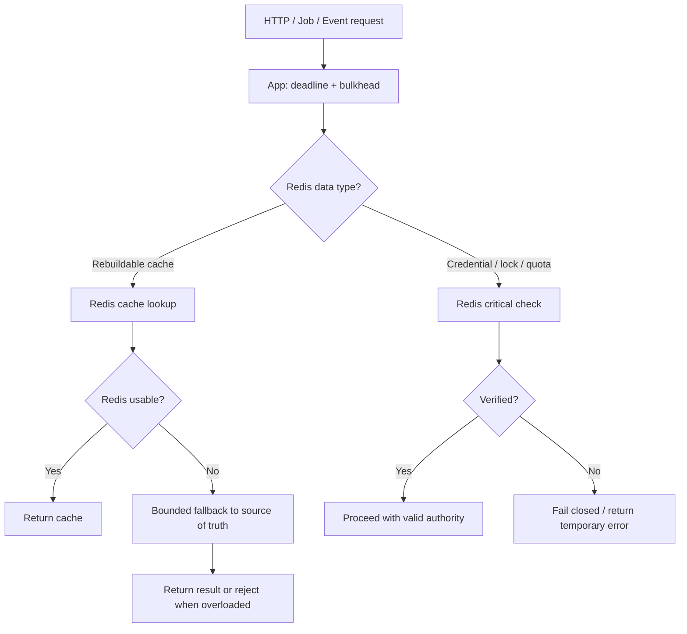
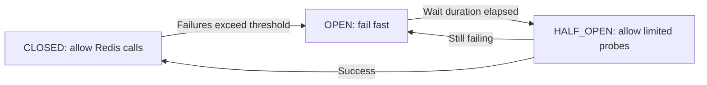
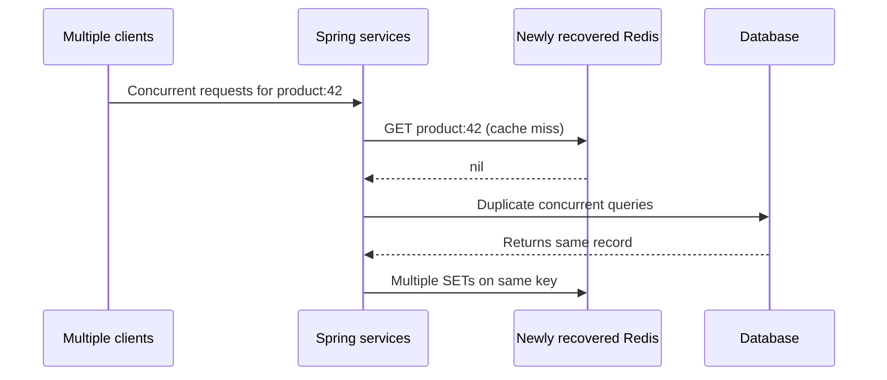
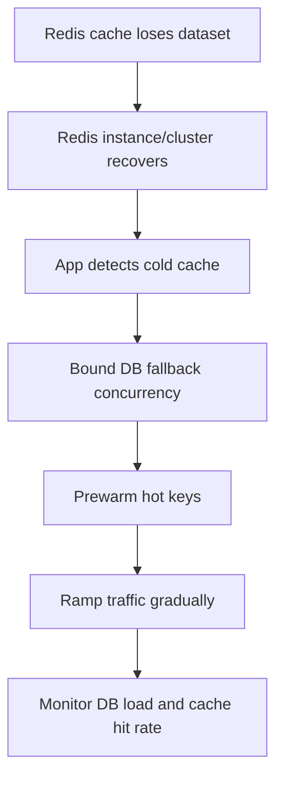

# Preparing for Slow Redis, Connection Loss, or Data Loss in Spring Data Redis

Redis often sits on an application's hottest execution paths: reading caches, storing sessions, enforcing rate limits, holding verification codes, managing distributed locks, consuming events via Redis Streams, or keeping transient state. When Redis is healthy, operations are very fast; yet when Redis **slows down**, **loses connectivity**, or **loses data**, those exact dependencies can turn an infrastructure hiccup into a full-system outage.

Examples:

- The Redis cache times out, causing the application to hit the database in unison and overload it.
- Redis Cluster fails over; some requests receive connection errors or timeouts where it is unclear whether writes succeeded.
- Redis acting as a session store loses data on restart, forcing users to log in again.
- A rate-limit key disappears due to eviction, resetting the request counter to zero.
- Redis Streams loses unprocessed entries; business logic thinks an event was delivered while no payload remains to process.
- A replica is promoted to primary before receiving all recent writes; writes acknowledged right before the failure are absent on the new primary.

No single Spring configuration setting makes every application “self-heal” across every failure mode. A sound plan must be designed across **multiple layers**: detecting failures, classifying what Redis is used for, bounding wait times, controlling retries and fallback traffic, choosing degraded modes, organizing failovers, protecting durable data, backing up and restoring, and rehearsing drills before production encounters real faults.

This guide builds a **Redis deployment and incident-response plan for Spring Data Redis**. The focus is not writing optimistic code assuming Redis is always available, but creating systems with **explicit, measurable, and safe behavior when Redis fails to meet expectations**.

> Guiding principle: **Is Redis a cache or an authoritative data source?** The answer determines whether you may skip errors, use a fallback, or rebuild data after an outage. A product cache can fall back to the database; an OTP verification step or a payment lock cannot casually “skip Redis” and proceed.

## 1. Three Failure Modes to Distinguish

### 1.1. Redis Is Slow but Still Responding

Example:

```text
Normal:
  cache GET p99 ≈ a few milliseconds

Incident:
  cache GET p99 spikes sharply
  Redis occasionally still returns valid values
  Some requests wait until timeout
```

Possible causes:

- High CPU on a Redis node.
- Hot keys, big keys, `O(N)` commands, heavy Lua scripts.
- Rising network RTT, packet loss, or queueing delays.
- Traffic surges saturating connection pools or client queues.
- Persistence, forks, or background jobs creating resource pressure.
- JVM GC, thread pools, or slow serialization on the Spring side—not necessarily the Redis server itself.

When Redis is slow, the first objective is **bounding the blast radius on request latency and downstream dependencies**, not raising timeouts indefinitely to wait for Redis.

### 1.2. Redis Loses Connectivity

Symptoms:

```text
RedisConnectionFailureException
Connect timeout
Read/command timeout
Connection reset
DNS lookup failure
TLS handshake failure
WRONGPASS / NOAUTH / NOPERM
```

Not all failures have the same nature:

- **Network loss, node failure:** may recover or require failover.
- **Wrong TLS/ACL credentials:** invalid configuration; repeated retries usually will not help.
- **Timeout after a write command:** uncertain whether the command executed on the server.
- **Stale topology in Redis Cluster:** the client may need to discover the new primary.

When connectivity drops, distinguish **unable to execute command** from **uncertain whether the command already executed**.

### 1.3. Redis Loses Data

Forms of data loss:

| Form | Example | Consequence |
|---|---|---|
| Key loss due to TTL | Cache expires as designed | Cache miss, rebuildable |
| Eviction from memory pressure | `maxmemory` and eviction policy remove keys | Entries lost earlier than TTL |
| Accidental deletion | `DEL` command or buggy app operation | Can lose needed state |
| `FLUSHDB`/`FLUSHALL` | Mistaken admin/system action | Widespread data loss |
| Restart without sufficient persistence | RDB/AOF did not save latest changes | Records lost since last persisted point |
| Asynchronous failover | Replica lacked the newest writes | Recent updates near the failure lost |
| Corruption / volume loss | Disk failure or bad storage setup | May require backup/restore |
| Data wiped by deploy to wrong environment | App/automation hits production by mistake | Data loss requiring access audit |

**A missing key does not always mean an infrastructure failure.** Cache misses from TTL expiration are normal behavior. What matters is distinguishing **intentional** expiration, **fault-induced** loss, and **unauthorized** deletion.

## 2. Decision Step: What Kind of Data Does Redis Hold?

An application may use Redis for several roles simultaneously.

| Redis Role | Authoritative Source | What Can Be Done When Redis Fails? |
|---|---|---|
| Product detail cache | PostgreSQL / source service | Bypass cache and read source, if load is controlled |
| Computed result cache | Recomputable inputs/formulas | Recompute with bounds, or return temporary error |
| HTTP sessions | Redis may be the sole session store | Require re-login or use designed fallback session flow |
| OTP / one-time tokens | Redis may decide validity | Never accept credentials when unverifiable |
| Rate limiter | Redis holds counters/quotas | Pick fail-open or fail-closed based on specific risk |
| Distributed locks | Redis holds lease/owner state | Never skip locks for mutually exclusive operations |
| Redis Streams | Redis may hold pending events | Needs durability/replay or another authoritative event source |
| Temporary shopping cart state | Redis may be the primary store | Needs backups, persistence, or accepted loss policy |
| Idempotency keys | Redis holds processed request history | Never retry side effects blindly when keys vanish |

### 2.1. Classify by Business Impact

Before deploying, document per namespace:

```text
redisPurpose: PRODUCT_CACHE
dataOwner: Product Service / PostgreSQL
rebuildable: yes
maximumStaleness: 30 seconds
behaviorWhenUnavailable: bounded DB fallback
criticality: medium
```

Another example:

```text
redisPurpose: PASSWORD_RESET_TOKEN
dataOwner: Redis token registry + account DB checks
rebuildable: no
behaviorWhenUnavailable: reject verification temporarily
criticality: high
```

Policies tailored to **data role** are far safer than a blanket “ignore everything if Redis errors.”

### 2.2. Why Can a Cache Fall Back While a Lock Cannot?

For a cache:

```text
Redis GET fails
      |
      v
Read product data from DB
      |
      v
Return product data
```

For a lock:

```text
Redis lock fails
      |
      v
Exclusive ownership cannot be proven
      |
      v
Do not run the mutually exclusive task
```

If a lock guards processing a critical transaction, “Redis is down so just run the task anyway” can let **two workers execute the same side effect concurrently**.

## 3. RTO, RPO, and SLO: Align Before an Incident Happens

Three standard concepts:

- **RTO (Recovery Time Objective):** target time to restore service after an outage.
- **RPO (Recovery Point Objective):** maximum acceptable data loss measured backward in time from the incident.
- **SLO (Service Level Objective):** target service level measured by latency, availability, or error rate over a window.

Example team-defined table:

| Component | Illustrative RTO | Illustrative RPO | Interim Behavior |
|---|---|---|---|
| Product cache | 15 minutes | Cache retention not required | Bounded DB fallback |
| Session store | 10 minutes | Some sessions may be lost per policy | Users may have to log in again |
| OTP registry | 5 minutes | Active codes may be lost | Allow requesting new codes; never bypass |
| Critical event stream | 5 minutes | Near 0 per business need | Pause producer or use durable outbox |
| Redis cart state | 10 minutes | 1 minute if acceptable | Restore from persistence/backup |

**These are illustrative values**, not guarantees from Redis or Spring Data Redis. Never declare RPO = 0 simply because a cluster has replicas; the architecture and verification must back it up.

### 3.1. Low RTO Does Not Equal Low RPO

A Redis Cluster may fail over quickly, restoring endpoint availability, while the promoted replica missed recent writes. Then:

```text
Availability recovery: fast
Recent data preservation: incomplete
```

Conversely, reliable backups that take long to restore yield better RPO at the cost of higher RTO.

### 3.2. Document Service Criticality

For each Redis dependency, record:

1. Can the endpoint be temporarily paused?
2. How long may stale data be served?
3. Must writes stay up, or can read-only mode serve?
4. When a write has an uncertain outcome, is retrying safe?
5. Without Redis, which actions must fail closed?
6. Who is authorized to approve restoring from backup?
7. Once Redis recovers, from where must data be reconciled?

This forms the basis of your **runbook**, not just technical settings.

## 4. Incident Response Matrix by Redis State

| State | DB-Backed Cache | OTP/Session | Critical Lock/Quota | Event Stream |
|---|---|---|---|---|
| Rising latency | Bounded fallback, coalescing | Short timeouts, temporary error if unverifiable | Never bypass controls | Backpressure, throttle producer |
| Connection failure | Circuit breaker and DB fallback | Cannot verify; guide retry/re-issue | Fail closed or dedicated degraded flow | Pause writes or route to controlled outbox |
| Failover | Controlled retry for reads | Never assume success | Re-verify lease validity and idempotency | Check consumer/producer and duplicates |
| Key loss | Rebuild from source | Invalidate token/session, re-issue or re-login | Never treat missing lock as permission | Reconcile from durable event source if available |
| Total dataset loss | Gradual cache warm-up | Enforce re-verification per policy | Halt risky features | Restore/replay and reconcile |

**Never enable global fail-open.** Especially for authentication, authorization, locks, and security rate limiters, letting requests “pass through” can be far worse than returning an explicit 503.

## 5. Three-Layer Architecture to Contain Blast Radius



Design this before an incident hits. Deciding “which APIs stay up?” only after Redis dies carries high risk of bypassing security controls and crushing primary databases.

## 6. Metrics to Watch Before Redis Breaks

**Redis server side:**

- Per-node CPU and memory usage.
- `used_memory`, `maxmemory`, fragmentation, `evicted_keys`.
- Commands/sec, command mix, error counters if available.
- `SLOWLOG` and Redis latency telemetry.
- `connected_clients`, network input/output.
- `expired_keys`, keyspace size, and TTL distribution.
- Persistence status: AOF/RDB saves and write errors.
- Replication lag, primary/replica roles, failover events.
- Redis Cluster topology, slot coverage, and node health.

**Spring/Lettuce side:**

- Command latency p50/p95/p99 by operation type.
- Redis connection error and timeout rates.
- Active/pending connections, pool waits if pooling.
- Retry counts, circuit breaker state, fallback counts.
- Cache hit/miss rates, fallback DB latency, and concurrency.
- HTTP requests failing due to Redis, grouped by affected endpoint.
- For Streams: consumer lag, pending entries, retry/dead-letter counts if designed.

### 6.1. Keep Metric Labels Low-Cardinality

Good:

```text
redis_operation_duration{
  namespace="product-cache",
  operation="get",
  outcome="timeout"
}
```

Avoid:

```text
redis_operation_duration{
  key="session:person@example.com:token-..."
}
```

Raw Redis keys can leak PII or tokens, and each unique key spawns a new time series that can overwhelm monitoring.

### 6.2. What Should a Dashboard Answer?

1. Is Redis slow **on the server**, or are requests slow in the JVM, network, or pool?
2. Is the issue isolated to **one node** or cluster-wide?
3. How long before HTTP errors did command timeouts begin rising?
4. Did evictions or persistence errors precede missing data?
5. Is DB fallback creating a secondary overload wave?
6. Did a failover or topology refresh happen?
7. Are critical Redis-backed workloads still operating correctly?

Alerts should fire before full outage thresholds, not only on failed `PING` checks.

## 7. Initial Diagnostics with the Redis CLI

When permitted access with proper credentials, collect:

```redis
PING
INFO server
INFO stats
INFO memory
INFO cpu
INFO clients
INFO persistence
INFO replication
INFO commandstats
SLOWLOG GET 20
LATENCY LATEST
```

These are **read-only observation commands**, yet on managed Redis, ACLs may block some of them. Never grant broad admin privileges to application services just for dashboards; use a dedicated monitoring/ops identity with scoped permissions.

### 7.1. `PING` Has Limited Meaning

A successful `PING` on one node shows that node answered that request at that instant. It **does not prove**:

- All Redis Cluster primaries are reachable.
- All slots are covered.
- Data reads/writes succeed.
- AOF/RDB persistence is healthy.
- Redis replication is caught up.
- The Spring app shares the same network route and credentials as the CLI operator.

Liveness, readiness, and data safety are three distinct questions.

### 7.2. Diagnosing Memory Incidents

```redis
INFO memory
INFO stats
```

If `evicted_keys` spikes alongside cache misses, Redis is likely dropping entries under memory pressure.

For data that must not vanish before TTL, **the eviction policy is part of correctness**. A Redis serving as a token registry, lock store, or critical queue should not rely on a policy that drops keys arbitrarily when RAM fills.

### 7.3. Checking Persistence

```redis
INFO persistence
```

Helpful fields depending on Redis version/config:

- Whether AOF is enabled.
- Result of the latest background save.
- Recent RDB/AOF write errors.
- Whether an AOF rewrite or RDB snapshot is currently running.
- Persistence backlog and write errors.

Synchronous `SAVE` or forcing snapshots via admin commands causes impact; never execute persistence-mutating commands in production just because `INFO persistence` looks concerning.

## 8. Distinguishing Client Timeouts from Server Latency

A Spring request timing out can stall at several points:

```text
HTTP request
   |
   +-- Waiting on executor / scheduler
   |
   +-- Waiting on connection / pool
   |
   +-- TCP/TLS network
   |
   +-- Redis command execution
   |
   +-- Network response
   |
   +-- Java deserialization and processing
```

`SLOWLOG` mainly captures Redis-side command execution time, excluding connection-pool waits, network round trips, and Java serialization.

If:

```text
Spring observed latency = 200 ms
Redis command execution = 1 ms
```

do not rush to resize the Redis server. Inspect networking, queues, pools, JVM GC, and response sizes.

### 8.1. Redis Slowing Down Due to Hot Keys / Big Keys

High-risk commands on large structures:

```redis
HGETALL giant:hash
SMEMBERS huge:set
LRANGE huge:list 0 -1
ZRANGE huge:zset 0 -1
KEYS *
```

Remedies include `HGET` instead of `HGETALL`, paginated reads, `SCAN`/`HSCAN` where appropriate, data sharding, or bounded retention.

Never “fix” a 100 MB `HGETALL` by raising the command timeout to minutes and tying up HTTP threads.

## 9. Spring Boot: Configuring Redis Connections and Timeouts

Example with **Spring Boot 3.x** and Lettuce for a standalone endpoint:

```yaml
spring:
  data:
    redis:
      client-type: lettuce
      host: redis.internal.example
      port: 6379
      username: ${REDIS_USERNAME}
      password: ${REDIS_PASSWORD}
      connect-timeout: 2s
      timeout: 2s
```

If the deployment requires TLS, add:

```yaml
spring:
  data:
    redis:
      ssl:
        enabled: true
```

along with appropriate CA/trust material or mTLS certificates if required by the Redis server.

**The 2-second value is illustrative only**, not a universal optimum. Tune timeouts based on baseline network latency, HTTP deadlines, failover behavior, concurrency, and retry budgets.

### 9.1. Connect Timeout vs. Command Timeout

| Setting | Scope |
|---|---|
| Connect timeout | Opening a connection to a Redis node |
| Command timeout | Waiting for a Redis command to complete |
| Pool wait / acquire timeout | Waiting to borrow a client connection |
| HTTP deadline | Total time the endpoint may consume |
| Resilience layer timeout | Bounds execution of the whole Redis/fallback branch |

Total elapsed wait time can **exceed any single timeout**, especially when stacked with retries, pool waits, and fallbacks.

### 9.2. Version- and Environment-Specific Configuration

Spring Boot 2.x and 3.x changed the Redis property namespace:

```properties
# Common on Spring Boot 2.x:
spring.redis.timeout=2s

# Common on Spring Boot 3.x:
spring.data.redis.timeout=2s
```

Match your project's Spring Boot version. Unbound properties silently fall back to unexpected defaults without failing loudly.

### 9.3. Do Not Define a Custom Factory Bean and Assume Properties Still Apply

If you declare:

```java
@Bean
RedisConnectionFactory redisConnectionFactory() {
    return new LettuceConnectionFactory(myConfig);
}
```

Spring Boot may back off its connection-factory auto-configuration. Not every `spring.data.redis.*` property will apply automatically to your custom bean. Configure everything explicitly or let Boot construct the bean and use a compatible customizer.

## 10. Example `LettuceClientConfiguration` Setup

When a custom connection factory is required:

```java
package com.example.redis.config;

import java.time.Duration;

import org.springframework.context.annotation.Bean;
import org.springframework.context.annotation.Configuration;
import org.springframework.data.redis.connection.RedisConnectionFactory;
import org.springframework.data.redis.connection.RedisStandaloneConfiguration;
import org.springframework.data.redis.connection.lettuce.LettuceClientConfiguration;
import org.springframework.data.redis.connection.lettuce.LettuceConnectionFactory;

@Configuration
public class RedisConnectionConfig {

    @Bean
    public RedisConnectionFactory redisConnectionFactory() {

        RedisStandaloneConfiguration server =
                new RedisStandaloneConfiguration(
                        "redis.internal.example", 6379);

        LettuceClientConfiguration client =
                LettuceClientConfiguration.builder()
                        .commandTimeout(Duration.ofSeconds(2))
                        .build();

        return new LettuceConnectionFactory(server, client);
    }
}
```

This minimal sample **omits credentials and TLS**; production requires authentication and transport security. Never swap this minimal snippet in place of a production connection factory configured with ACLs, TLS, or topology settings.

### 10.1. Timeouts Exist to Bound Damage

If an HTTP request has a 3-second deadline, budget explicitly:

```text
Redis lookup budget     = 0.5s (example)
Fallback DB budget      = 1.5s (example)
Business serialization  = 0.3s (example)
Remaining safety margin
```

These numbers illustrate a **deadline budget**, not a Redis rule. If Redis is allowed to block for 3 seconds and DB fallback takes another 3 seconds, a 3-second endpoint is almost guaranteed to fail even when fallback logic works.

## 11. Never Retry Unconditionally on Redis Timeouts

Retries help with transient glitches, yet can also:

- Trigger a **retry storm** when all instances retry together.
- Turn slowness into severe overload.
- Double side effects if the write executed before the response was lost.
- Stretch requests past API deadlines.

### 11.1. Idempotent vs. Non-Idempotent Commands

Examples:

| Command | Is Retrying Same Input After Timeout Always Safe? | Explanation |
|---|---|---|
| `GET key` | Usually safe regarding side effects | Reads do not mutate data |
| `SET key fixedValue` | Value-idempotent, still subject to races | Overwriting a newer update may be wrong |
| `DEL key` | Usually deletion-idempotent, workflow-dependent | Key could be recreated between attempts |
| `INCR counter` | **No** | Can increment twice |
| `LPUSH key value` | **No** | Can push element twice |
| `XADD stream * ...` | **No** | Can append two entries with different IDs |
| `SET lock NX PX ...` | Cannot retry blindly | Lock/lease ownership must be verified separately |
| Multi-key mutating Lua script | Depends on script logic | Script may have run while response was lost |

A timeout never proves Redis did not run the command. When writes must retry, design an **operation ID** or idempotency/fencing mechanism at the authoritative store.

### 11.2. Backoff and Jitter

When retrying retryable operations:

```text
Attempt 1: try immediately
Attempt 2: short backoff + jitter
Attempt 3: larger backoff + jitter
Deadline budget exhausted -> stop and fail
```

Do not let 1,000 requests retry at exact intervals of 100 ms, 200 ms, and 400 ms—synchronized waves amplify load.

### 11.3. Coordinate Retries Across Layers

If the driver reconnects, the service uses Resilience4j retries, and the HTTP gateway also retries, total executions multiply unexpectedly.

Example:

```text
Gateway retries 3 times
  Service retries 3 times
    Driver retries/reconnects per scenario
```

Never let each layer pile on independent retries. Enforce **one end-to-end budget** for attempts and elapsed time.

## 12. Circuit Breakers: Shed Calls When Redis Is Unhealthy

A circuit breaker tracks failures and slow calls, temporarily blocking new calls to Redis for a cooldown period.



Circuit breakers help when Redis disconnects or latency spikes would otherwise pin HTTP threads and request pipelines.

### 12.1. Do Not Rely Solely on Circuit Breakers

A circuit breaker **does not guarantee**:

- That new Redis connections establish cleanly after failover.
- That non-idempotent writes never duplicate.
- That caches rebuild cleanly.
- That fallback databases avoid overload.
- That lost keys recover.

It is a **damage-containment mechanism**, not a replacement for data architecture or backups.

### 12.2. Resilience4j Pattern (Integration Concept)

If using Resilience4j, you might configure an instance:

```yaml
resilience4j:
  circuitbreaker:
    instances:
      redisProductCache:
        slidingWindowType: COUNT_BASED
        slidingWindowSize: 50
        minimumNumberOfCalls: 20
        failureRateThreshold: 50
        slowCallRateThreshold: 70
        slowCallDurationThreshold: 500ms
        waitDurationInOpenState: 10s
        permittedNumberOfCallsInHalfOpenState: 5
```

**Declaring YAML alone does not wrap `RedisTemplate`.** You must add the dependencies, Spring configuration, and decorators/annotations around the right service methods. Thresholds above are illustrative and must be tuned from real telemetry.

When an app serves multiple Redis workloads, never share one global circuit breaker across cache reads and token verification with the same fallback behavior. Group breakers by criticality.

## 13. Bulkheads: Protecting Fallback Data Sources

Suppose the Redis product cache fails:

```text
10,000 requests/sec
        |
        v
Redis cache unavailable
        |
        v
10,000 DB queries/sec
        |
        v
DB overload
        |
        v
System outage worse than the initial Redis outage
```

The answer cannot simply be “if cache fails, hit DB.” You need:

- Bounded fallback concurrency.
- Rate limiting on non-essential endpoints.
- Short-lived local caches or bounded stale responses where permitted.
- Request coalescing / single-flight.
- Policy-driven 429/503 shedding when budgets saturate rather than crashing the DB.
- Scaling DB/read replicas where architecture supports it and consistency is evaluated.

### 13.1. Example: Limiting Concurrent Fallbacks

The Java sample below shows a **per-JVM bulkhead** for a fallback path:

```java
package com.example.catalog;

import java.util.concurrent.Semaphore;

import org.springframework.stereotype.Service;

@Service
public class ProductFallbackService {

    private final Semaphore fallbackSlots = new Semaphore(32);
    private final ProductRepository repository;

    public ProductFallbackService(ProductRepository repository) {
        this.repository = repository;
    }

    public ProductDto loadFromDatabase(String productId) {
        if (!fallbackSlots.tryAcquire()) {
            throw new FallbackOverloadedException(
                    "Product fallback is currently overloaded");
        }

        try {
            return repository.findDtoById(productId)
                    .orElseThrow(ProductNotFoundException::new);
        } finally {
            fallbackSlots.release();
        }
    }
}
```

`ProductRepository`, `ProductDto`, and exceptions represent application components. The permit count of 32 must be sized against your DB pool, other DB workloads, and total app instances.

**A local bulkhead is not a cluster-wide limit.** With 20 JVMs each allowing 32 concurrent fallbacks, total potential DB concurrency is still huge.

## 14. Spring Cache Pattern: Cache `GET` Errors and Fallbacks

When using `@Cacheable`:

```java
@Cacheable(cacheNames = "product-detail", key = "#productId")
public ProductDto findById(String productId) {
    return repository.findDtoById(productId)
            .orElseThrow(ProductNotFoundException::new);
}
```

If Redis fails, Spring Cache normally throws on cache operations. For **purely acceleration caches backed by a database**, you may treat cache `GET` errors as **controlled cache misses**.

Example custom `CacheErrorHandler`:

```java
package com.example.catalog.config;

import org.slf4j.Logger;
import org.slf4j.LoggerFactory;
import org.springframework.cache.Cache;
import org.springframework.cache.annotation.CachingConfigurer;
import org.springframework.cache.annotation.EnableCaching;
import org.springframework.cache.interceptor.CacheErrorHandler;
import org.springframework.context.annotation.Configuration;

@Configuration
@EnableCaching
public class ProductCacheFailureConfig implements CachingConfigurer {

    private static final Logger log =
            LoggerFactory.getLogger(ProductCacheFailureConfig.class);

    @Override
    public CacheErrorHandler errorHandler() {
        return new CacheErrorHandler() {

            @Override
            public void handleCacheGetError(
                    RuntimeException exception,
                    Cache cache,
                    Object key) {
                log.warn("Cache read unavailable; cache={}",
                        cache.getName());
                // Do not rethrow: Spring Cache runs the underlying method.
            }

            @Override
            public void handleCachePutError(
                    RuntimeException exception,
                    Cache cache,
                    Object key,
                    Object value) {
                log.warn("Cache write unavailable; cache={}",
                        cache.getName());
                // Do not fail DB reads when merely populating cache.
            }

            @Override
            public void handleCacheEvictError(
                    RuntimeException exception,
                    Cache cache,
                    Object key) {
                throw exception;
            }

            @Override
            public void handleCacheClearError(
                    RuntimeException exception,
                    Cache cache) {
                throw exception;
            }
        };
    }
}
```

**Important limitations:**

1. `CacheErrorHandler` belongs to the **Spring Cache abstraction**; it does not cover direct `RedisTemplate` calls.
2. Ignoring `GET`/`PUT` errors fits only **rebuildable caches**, never sessions, security tokens, or rate limiters.
3. The example rethrows evict/clear errors so failed invalidations are not silently skipped leaving stale caches. Still, rethrowing **does not make database transactions and cache invalidation atomic**.
4. Because cache `GET` errors fall through to the underlying source, pair this with **circuit breakers, bulkheads, and fallback limits** to avoid stampeding the DB.
5. Never log raw `key`/`value` if they could hold PII or tokens, and avoid full stack traces on every request during an outage so logs do not flood.
6. If the app manages caches with differing risk profiles, **one global handler can be too broad**. Separate cache managers/architectures by class or handle fallbacks explicitly in services.

### 14.1. Why Not Ignore Evict Errors Too?

Suppose:

```text
T1: Redis holds product:42 = old price
T2: DB commits new price
T3: Redis EVICT fails
T4: Other clients read stale Redis key
```

If the app silently treats T3 as success, it can serve **old prices** until TTL expiry or another invalidation occurs.

For strict freshness data, design **after-commit invalidation, versioned cache keys, outbox/retries, or direct DB reads** on critical operations. An error handler alone does not replace those guarantees.

## 15. Raw `RedisTemplate`: Fall Back Only on Appropriate Exceptions

Code calling `StringRedisTemplate` directly is not covered by `CacheErrorHandler`.

Example read path:

```java
package com.example.catalog;

import org.springframework.dao.QueryTimeoutException;
import org.springframework.data.redis.RedisConnectionFailureException;
import org.springframework.data.redis.core.StringRedisTemplate;
import org.springframework.stereotype.Service;

@Service
public class ProductReadService {

    private final StringRedisTemplate redis;
    private final ProductFallbackService fallback;

    public ProductReadService(
            StringRedisTemplate redis,
            ProductFallbackService fallback) {
        this.redis = redis;
        this.fallback = fallback;
    }

    public ProductDto findProduct(String productId) {
        String key = "cache:product:" + productId;

        try {
            String cached = redis.opsForValue().get(key);
            if (cached != null) {
                return ProductDto.fromCacheValue(cached);
            }
        } catch (RedisConnectionFailureException
                 | QueryTimeoutException unavailable) {
            // Record metric/log by namespace; never print sensitive keys.
            // Fall back only because this is a cache with a primary data store.
        }

        return fallback.loadFromDatabase(productId);
    }
}
```

This illustrates service design; `ProductDto.fromCacheValue` and the DB repository are project code.

### 15.1. Never Catch All `RuntimeException`s and Treat Them as Cache Misses

Anti-pattern:

```java
try {
    return parse(redis.opsForValue().get(key));
} catch (RuntimeException ignored) {
    return repository.loadFromDatabase();
}
```

This hides programming bugs, serializer failures, corrupt payloads, and more, making outages hard to diagnose.

Distinguish:

- Redis connection/timeout errors.
- Normal cache misses.
- Data corruption / serialization errors.
- DB fallback errors.
- Business validation errors.

If you want to fall back on a specific serializer error, enforce explicit rules, metrics, and cleanup of the bad entry.

### 15.2. Local Caching Is Possible, but Bound Staleness

For slowly changing config data, a bounded short-TTL local cache can serve recent values during brief Redis outages. However, that is a **stale-read policy**, never a safe default for balances, permissions, or read-after-write flows.

## 16. Reactive Redis: Never Turn Every `onError` Into a Valid Value

With `ReactiveStringRedisTemplate`:

```java
Mono<String> value =
        reactiveRedis.opsForValue().get("cache:product:42");
```

There are three main signals:

1. Emits `onNext(value)` then `onComplete` when the key exists.
2. Empty `onComplete` when the key does not exist (never emits `onNext(null)`).
3. Emits `onError` on Redis/connection/command errors.

Never conflate them:

```text
Mono.empty()  ≠ Redis outage
Mono.error()  ≠ Cache miss
```

### 16.1. Reactive Cache Fallback

Example:

```java
public Mono<ProductDto> getProduct(String productId) {
    String key = "cache:product:" + productId;

    Mono<ProductDto> fromRedis =
            reactiveRedis.opsForValue()
                    .get(key)
                    .map(ProductDto::fromCacheValue);

    Mono<ProductDto> fromDb =
            Mono.defer(() ->
                    productRepository.findReactiveById(productId));

    return fromRedis
            .onErrorResume(
                    RedisConnectionFailureException.class,
                    error -> fromDb)
            .onErrorResume(
                    QueryTimeoutException.class,
                    error -> fromDb)
            .switchIfEmpty(fromDb);
}
```

**Important:** this example shows separating cache misses from connection errors, yet lacks bulkheads and circuit breakers to protect the DB; add both for production.

`Mono.defer` ensures the fallback publisher is created/subscribed lazily per reactive semantics. In real code, check cancellation/deadlines, metrics, and retry policies so one HTTP request cannot fire multiple DB lookups.

### 16.2. Never Fall Back on Security Verification Steps

Broken example:

```java
return reactiveRedis.opsForValue()
        .get(otpKey)
        .onErrorReturn("VALID");
```

This is **fail-open** on a credential check. If Redis errors, an unverified code gets treated as valid. Verification flows must return a temporary error, block sensitive actions, and offer safe retry/re-issuance paths.

## 17. Cache Stampedes After Redis Recovers

Redis being down is not the only hazard. When Redis comes back empty:



An empty cache after restart or restore can leave Redis fast while **overloading the database**.

### 17.1. Anti-Stampede Layers

- **Request coalescing / single-flight** inside a JVM.
- Distributed leases/locks with fencing or TTLs when multi-instance coordination is needed.
- Capped concurrent DB fallbacks.
- Cache TTL jitter to spread expirations.
- Prewarming hot keys before opening full traffic.
- Phased traffic rollout so all instances do not reconnect and refill simultaneously.
- Where business rules allow, serving short-TTL stale values from local caches.

### 17.2. Never Serve Stale Data Indiscriminately

Stale low-risk feature flags might be tolerable for seconds. Stale permissions, checkout prices, inventory counts, or token states must be evaluated strictly against consistency requirements.

## 18. Redis Cluster and Sentinel: Different Availability Mechanisms

| Deployment Mode | Model | What to Design in Spring |
|---|---|---|
| Standalone | Single Redis server/endpoint | Accept downtime or build recovery/fallback paths |
| Redis Sentinel | Primary discovery/failover for a replication group | `RedisSentinelConfiguration`, auth for Sentinel and data nodes |
| Redis Cluster | Data sharded across 16,384 hash slots over multiple primaries | `RedisClusterConfiguration`, seed nodes, topology/redirects |
| Managed Redis | Provider operates failover/topology | Use the exact exposed endpoints, ACL/TLS, and supported semantics |

Moving from standalone to Redis Cluster does not fix missing cache fallbacks, durability gaps, or non-idempotent operations.

### 18.1. Redis Sentinel

Applications usually need:

- List of Sentinel endpoints.
- Logical primary/master group name monitored by Sentinel.
- Sentinel credentials if configured.
- Redis data-node credentials.
- Matching TLS configuration for both endpoint types if TLS is enabled.

Clients rediscover the primary on failover. During the switchover window, timeouts or failed writes can still occur.

### 18.2. Redis Cluster

Redis Cluster returns redirects:

```text
MOVED <slot> <node>
ASK <slot> <node>
```

Lettuce's cluster client tracks topology, yet recovery requires:

- Reachable seed nodes.
- All Redis-advertised node addresses reachable from the JVM.
- Redis Cluster maintaining slot coverage and availability.
- Topology refresh and reconnect enabled for your client version.
- Consistent ACLs and TLS across discovered nodes.

### 18.3. Cluster Does Not Strengthen Data Consistency

Redis Cluster still uses asynchronous replication by default. Failover restores service availability yet **does not guarantee every primary-ACKed write survived on the promoted replica**.

For tight RPO, examine persistence, replication, confirmation mechanisms, and authoritative boundaries—never rely on the word “cluster” as a consistency guarantee.

## 19. Lettuce Topology Refresh

With Redis Cluster, a client holding stale topology sends commands to a node that no longer owns a slot. Lettuce supports periodic and adaptive topology refreshes depending on version.

Java example:

```java
import java.time.Duration;
import io.lettuce.core.cluster.ClusterClientOptions;
import io.lettuce.core.cluster.ClusterTopologyRefreshOptions;

ClusterTopologyRefreshOptions refresh =
        ClusterTopologyRefreshOptions.builder()
                .enablePeriodicRefresh(Duration.ofSeconds(30))
                .enableAllAdaptiveRefreshTriggers()
                .build();

ClusterClientOptions options =
        ClusterClientOptions.builder()
                .topologyRefreshOptions(refresh)
                .build();
```

This options object must be wired into `LettuceClientConfiguration` or a matching Boot customizer. **Constructing the options object alone does not reconfigure a running client.**

The 30-second period is illustrative only. Refreshing too often adds topology polling traffic; refreshing too slowly delays reacting to cluster changes. Tune to failover/resharding rates and driver behavior.

### 19.1. Do Not Confuse Redirects with Business Retries

`MOVED`/`ASK` are Redis Cluster routing mechanics. They cannot undo duplicate side effects from an `INCR` whose reply timed out. Separate **routing recovery** from **business idempotency**.

## 20. Replication: Cuts Downtime, Does Not Guarantee Every Write

A Redis primary with a replica:

```text
Spring app
    |
    v
Primary A -- asynchronous replication --> Replica A'
    |
    v
ACK to client
```

What can happen:

```text
T1: Primary receives SET key=valueNew
T2: Primary returns ACK to client
T3: Primary crashes before replica receives change
T4: Replica is promoted
T5: valueNew may not exist on the new primary
```

Account for this whenever Redis holds critical state.

### 20.1. Does `WAIT` Guarantee Zero Data Loss?

Redis provides `WAIT` to block until a count of replicas acknowledges preceding writes on that connection. It **can reduce risk** in certain failure modes, yet does not turn Redis into a fully synchronous transactional database or guarantee writes survive every failure/failover scenario.

Distinguish:

- Replica received bytes in memory.
- Replica persisted bytes durably to disk.
- Which replica gets promoted during failover.
- Network partitions and split-brain old-primary writes.
- Whether the client actually learned the write's outcome.

Never drop `WAIT` into code and declare RPO = 0 without verified end-to-end guarantees.

### 20.2. Reading from Replicas Can Return Stale Data

If Lettuce is configured to read from replicas, replicas can lag behind primary writes. During mitigation or troubleshooting:

- Shift sensitive reads back to the primary.
- Monitor replication lag.
- Never use replica reads for strict read-after-write decisions.

## 21. Persistence: RDB and AOF

If Redis data must survive restarts, understand persistence instead of treating Redis as pure volatile RAM.

### 21.1. RDB Snapshots

RDB saves point-in-time dataset snapshots at configured intervals or triggers.

Advantages:

- Compact snapshots convenient for backups and restores.
- Less continuous write overhead than some AOF modes.

Limitations:

- Writes **after the latest snapshot** can be lost if the server crashes before the next one.
- Snapshots incur CPU, memory (COW), and disk I/O costs.
- Having an RDB file does not automatically prove it restores cleanly on target infrastructure.

### 21.2. Append Only File (AOF)

AOF logs mutations subject to fsync policies and Redis persistence mechanics.

Common fsync modes:

| Mode | Focus | Trade-Off |
|---|---|---|
| `appendfsync always` | Frequent fsyncs per write path | Higher disk latency / I/O overhead |
| `appendfsync everysec` | Common balance of speed and durability | Still leaves a data-loss window on crash |
| `appendfsync no` | Lets the OS decide when to flush | Potentially wider loss window and risk |

These describe trade-offs, not an exact number of seconds guaranteed across every crash. Real outcomes depend on I/O, crash type, OS, Redis version, replication, and storage.

### 21.3. Combining RDB and AOF

A deployment can enable both. On restart, Redis loads persistence files according to version and configuration rules.

Never modify `appendonly` or `save` directives in production via a hasty script. Initial AOF generation, rewrites, disk headroom, and restore behavior must be tested in an equivalent environment.

### 21.4. Sample `redis.conf` for Discussion

```conf
# Illustrative only; not a default template to copy straight to production.
appendonly yes
appendfsync everysec

# Example RDB snapshot rules:
save 900 1
save 300 10
save 60 10000
```

Evaluate these alongside memory, disk throughput, write rate, SLAs, and managed Redis constraints. Some services disallow editing `redis.conf` directly, requiring parameter groups or provider APIs.

## 22. Data Safety: Turning On Persistence Is Not Enough

A system with AOF/RDB can still lose data if:

- The volume fails or is deleted.
- The disk fills up and persistence stalls/errors.
- Backups reside on the same machine or zone as Redis.
- Backup files are unreadable or missing decryption keys.
- Backups are older than the RPO.
- An accidental `FLUSHDB`/`FLUSHALL` replicates and writes to persistence.
- An application bug deletes or overwrites critical keys.

Therefore, combine **independent backups, restore testing, and destructive-operation controls**.

### 22.1. Never Treat Redis Key TTL as a Durability Promise

TTL specifies when a key expires; it does not promise the key survives until its final second. Keys can vanish earlier via eviction, explicit deletion, failover, or persistence loss.

If data must not disappear before a deadline, TTL alone is insufficient.

### 22.2. Eviction Policy Connects to Correctness

A cache-only Redis works well with eviction. Yet if one instance mixes:

```text
cache:product:...
otp:reset-password:...
lock:payment:...
```

an eviction policy can wipe **verification state or active locks**, causing failures far worse than cache misses.

Separating Redis deployments or aligning memory limits and policies per criticality class is safer than co-locating every key type on one instance.

## 23. Backups: What to Back Up and Where to Store It

A backup plan should define:

| Component | Decision Needed |
|---|---|
| Redis dataset | Snapshots/persistence files via provider-supported method |
| Redis version | Record exact version needed for restore compatibility |
| Topology | Standalone, Sentinel, Cluster, or managed |
| Redis configuration | Memory, persistence, eviction, TLS/ACL, namespaces |
| Secret material | Managed separately via secret manager, never embedded in public backups |
| Backup location | Separate failure domain from Redis, least-privilege access |
| Encryption | Encrypt backups at rest and in transit |
| Retention | How many copies and how long per RPO/compliance |
| Restore time | Time to load data, rebuild indexes, and reopen traffic |
| Validation | Practice restores and verify business data |

### 23.1. Backups Do Not Replace Replication

Replication helps failover, yet accidental deletions or logical corruption replicate right to replicas.

Example:

```text
Primary receives accidental FLUSHDB
      |
      v
Replicas apply the deletion
      |
      v
Replicas cannot act as an independent backup against logic errors
```

Isolated backups let you recover state from before a logical error occurred, provided retention covers detection time.

### 23.2. Backups Must Pass Restore Drills

Seeing an RDB/AOF file in object storage does not prove it is usable.

Drill steps:

1. Provision a separate Redis instance in a test environment.
2. Restore from the chosen snapshot.
3. Confirm the Redis server boots and loads the dataset.
4. Compare key counts and non-sensitive sample records.
5. Verify TTLs and schemas/serializers under restore conditions.
6. Exercise expected Spring Data Redis operations.
7. Measure end-to-end restore duration.

Never run restore tests over a live production Redis dataset.

## 24. Recovery Plan After Losing the Entire Redis Cache

When Redis is purely a cache:



When data can be rebuilt from the database, **restoring a cache backup may be unnecessary**. Wiping corrupted cache state and warming cleanly is often safer than restoring an old snapshot.

Still, verify:

- Can the DB absorb the initial cache-miss burst?
- Which hot keys need prewarming?
- Was stale data invalidated after the snapshot?
- Must invalidation events replay during recovery?

### 24.1. Risk of Restoring a Stale Cache Snapshot

Suppose:

```text
T0: Backup caches product:42 price=100
T1: DB updates price=120 and invalidates cache
T2: Redis loses dataset
T3: Restore T0 snapshot -> cache has price=100 again
```

If restored TTLs remain long, the app serves **stale prices**. For non-authoritative caches, consider **not restoring cache snapshots** or enforcing version checks, clears, and policy-compliant warm-ups.

This is why **restoring data bytes** does not automatically mean **restoring system correctness**.

## 25. Recovery When Redis Holds Sessions

If Spring Session stores sessions in Redis, losing the dataset wipes session keys.

Symptoms:

- Users are logged out or hold invalid sessions.
- Session-dependent flows lose state.
- Frontends receive authorization errors or login prompts.

Mitigations can include:

- Accepting forced re-logins and communicating clearly.
- Keeping sensible session TTLs and avoiding storing sole copies of business data inside sessions.
- Configuring HA and persistence/backups if session loss is unacceptable.
- Guarding against session fixation and honoring token revocations across restores.

**Never reconstruct “authenticated” sessions from unverified cookies or client-supplied user IDs** when the Redis session store is lost.

### 25.1. Session Stores Are Not Business Databases

Do not store critical cart, order, or payment state solely in Redis sessions without durable persistence or re-validation. Sessions support workflows, not necessarily authoritative records.

## 26. Recovery When Redis Holds Temporary OTPs/Tokens

An OTP can vanish before its TTL due to failover or eviction. When verification state is missing:

- Reject tokens that cannot be verified.
- Allow users to request a fresh code with rate limits/cooldowns.
- Never treat a token as valid just because “Redis is having errors.”
- Never extract codes/tokens from logs to manually reconstruct state.

### 26.1. Replay Risk When Restoring an Old Snapshot

Suppose:

```text
T0: Token A exists in snapshot.
T1: Token A is consumed via GETDEL.
T2: Redis crashes and restores snapshot T0.
T3: Token A reappears.
```

This is **token resurrection** caused by restoring a pre-consumption snapshot. If Redis is the sole tracker of one-time usage, restoring backups opens a replay window.

For sensitive actions, track **consumed/version/idempotency state in an authoritative database** or equivalent guard—never rely solely on `GETDEL` and Redis persistence.

## 27. Recovery When Redis Holds Distributed Locks

For locks:

```text
Worker A holds lock:job:42.
Redis primary drops.
Replica lacked lock state.
Replica is promoted.
Worker B sees lock absent.
```

If Worker A keeps executing under its old lease, **two workers run the task concurrently**.

Safeguards:

- Random owner tokens with atomic compare-and-delete unlocks.
- Appropriate lease TTLs; never treat a network partition as proof ownership remains valid.
- **Fencing tokens / monotonic versions** verified by target resources when strict exclusion is required.
- Database unique constraints and idempotency on critical side effects.
- For tasks requiring linearizable/strong coordination, evaluate a consensus-backed coordinator instead of relying solely on Redis failover.

Redis HA improves uptime yet does not guarantee **distributed mutual exclusion correctness** across partitions.

## 28. Recovery When Redis Streams Acts as a Queue

With `XADD` and consumer groups:

```text
Producer -> Redis Stream -> Consumer -> Database
```

Account for at least:

1. Producer writes an entry successfully, yet loses the reply.
2. Consumer commits to DB yet crashes before `XACK`.
3. Stream loses unpersisted entries during failover.
4. Consumer group offsets or pending entries shift after snapshot restore.
5. Stream trimming removes payloads still needed.

### 28.1. At-Least-Once Implies Potential Duplicate Processing

If a consumer commits work and crashes before `XACK`, the entry can be redelivered. Therefore:

- Make consumers **idempotent** via event IDs or business operation IDs.
- Enforce unique constraints/transactions in the database.
- Implement pending entry reclaim and idle timeouts per consumer group.
- Add dead-letter and retry strategies as required.
- Never equate “`XACK`ed” with “DB committed” unless the order of operations enforces it.

### 28.2. Outbox Pattern for Critical Events

When primary state writes to PostgreSQL:

```text
DB transaction:
   INSERT business state
   INSERT outbox event
COMMIT

Outbox publisher:
   read unpublished events
   XADD to Redis Stream
   mark published
```

An outbox keeps events safely inside a **durable source of truth** when Redis is unavailable. Publishers can still double-publish after timeouts, so consumers still require idempotency.

Never claim “an outbox is end-to-end exactly-once” without proving every link in the chain.

## 29. Partial Key Loss in Redis: Detection and Reconciliation

Not every incident wipes all keys. You might lose only:

- One namespace prefix from a buggy cleanup job.
- Keys within a single hash slot.
- Keys of one TTL class evicted under pressure.
- Recent updates dropped during failover.

Detection methods:

1. Track **cache miss rates** per namespace.
2. Track `evicted_keys` and replication/persistence errors.
3. Maintain business invariants/checksums at the authoritative source.
4. Sample critical keys against the DB.
5. Watch for sudden cardinality drops and fallback traffic spikes.
6. Maintain safe namespace/index rebuild tooling when needed.

### 29.1. Do Not Reach for `KEYS *` as a First Reflex

When investigating missing keys in large production environments, avoid `KEYS *`. Use Redis metrics, per-namespace counts where tracked, bounded `SCAN`, or provider monitoring. A full keyspace scan can worsen an already degraded Redis.

### 29.2. Reconciliation Is Not Blind Copying

Suppose a Redis cache restores an old snapshot while the DB has newer updates. Rebuilding must check:

- Record versions.
- Source update timestamps.
- Entries requiring invalidation.
- Update event ordering if using CDC/outbox.
- Idempotency and batch sizing.

Never fire millions of concurrent `SET`s to “warm” the cache without throttling bandwidth and DB/Redis load.

## 30. Runbook 1 — When Redis Suddenly Slows Down

### Step 1 — Confirm and Scope Impact

Record:

```text
incidentId = INC-REDIS-SLOW-EXAMPLE
timeWindow = 14:00–14:20
affectedServices = catalog-api, checkout-api
symptoms = p99 spike, Redis timeouts
redisTopology = Cluster 3 primaries
```

Never look at one “Redis slow” alert and assume every service is impacted identically.

### Step 2 — Observe Before Mutating

Collect:

```redis
INFO stats
INFO memory
INFO cpu
INFO commandstats
SLOWLOG GET 20
LATENCY LATEST
```

Correlate high-CPU Redis nodes with Spring endpoints and command mixes.

### Step 3 — Shed or Throttle Load

Depending on Redis role:

- For caches: cap DB fallbacks, use short-TTL local caches, shed non-critical endpoints.
- For big-key commands: throttle batch jobs or endpoints calling oversized `HGETALL`/`SMEMBERS`.
- For locks/OTPs: never bypass verification or mutual exclusion.
- For Streams: apply producer backpressure if consumers or Redis fall behind.

### Step 4 — Fix the Root Cause

Actions may include:

- Replace full reads with paginated or bounded reads.
- Split hot keys via sharding or precomputation where semantics permit.
- Tune Redis resources or topology.
- Resolve network packet loss or pool waits.
- Adjust timeouts and retry budgets properly.

### Step 5 — Confirm Recovery

Watch p95/p99, CPU, request failure rates, fallback DB load, retry counts, and critical writes. Never close an incident simply because `PING` turns fast again.

## 31. Runbook 2 — When Redis Disconnects Completely

### Step 1 — Identify Error Type

| Error | First Question |
|---|---|
| Connection refused | Is the endpoint/port actually listening? |
| Connect timeout | DNS, network policy, firewall, routing? |
| TLS failure | Are CA, hostname, and client certs valid? |
| `WRONGPASS` | Was a password or secret version just rotated? |
| `NOPERM` | Is the ACL missing command or key permissions? |
| Cluster redirect failure | Is the target node reachable? |
| Redis node crash | Did HA/failover complete? |

### Step 2 — Bound Waiting Requests

Measures:

- Trip circuit breakers when errors cross thresholds.
- Keep short timeouts within request budgets.
- Avoid infinite retries.
- Return clean errors on endpoints that cannot serve safely.
- For caches, enable DB fallbacks **protected by bulkheads**.

### Step 3 — Restore Endpoint or Topology

Inspect nodes/pods/services, DNS, TLS/ACL, Sentinel/Cluster state, and managed-provider status. Never “point everything to localhost” or “disable TLS” to test in production.

### Step 4 — Let Clients Reconnect Controlledly

Lettuce reconnects per client settings; verify:

- How many connections reconnect concurrently?
- Is there a retry storm?
- Have Sentinel/Cluster advertised the new primary/slots?
- Are credentials and certificates still valid?

### Step 5 — Ramp Traffic Back Gradually

Once Redis accepts connections:

- Watch request p99 and Redis ops/s.
- Ease circuit breakers cautiously if needed.
- Prewarm hot caches with rate limits.
- Avoid releasing massive queued/fallback backlogs all at once.

## 32. Runbook 3 — When Redis Loses Data

### Step 1 — Stop Ongoing Loss

Check whether a job or app is still issuing `DEL`/`FLUSHDB`, or whether keys are evicting from memory pressure. If the destructive cause remains active, **restoring immediately will just lose data again**.

If malicious or broken automation is suspected, halt/revoke the offending job per operational procedure and preserve audit evidence safely.

### Step 2 — Scope the Loss

```text
Affected namespaces
Affected Redis nodes/slots
Approximate loss window
Last known-good backup
Redis persistence / replication status
Business criticality per namespace
```

### Step 3 — Choose Restore vs. Rebuild

| Data | Typical Appropriate Action |
|---|---|
| Pure cache | Rebuild from database, warm gradually |
| Sessions | Re-login or recover per policy |
| OTPs | Re-issue new codes; never trust unprovable legacy tokens |
| Critical write state | Restore + reconcile against source of truth |
| Streams | Replay from durable outbox/log if available |
| Idempotency state | Rely on ledger/constraints at authoritative store |

### Step 4 — Restore Into an Isolated Environment First

If time permits and backups are required:

1. Verify backup version and integrity.
2. Restore onto isolated/staging Redis.
3. Check keyspace, schemas, and persistence.
4. Reconcile against the DB at the matching point in time.
5. Determine the data gap and replay plan.

### Step 5 — Controlled Cutover

Point the app back to the recovered Redis per plan; verify connections, ACL/TLS, cache validity, Streams consumer groups, TTLs, and metrics.

### Step 6 — Post-Incident Reconciliation

Never treat key counts alone as proof of correctness. Reconcile business state, clean up duplicate/missed events, and verify token/lock/idempotency invariants.

## 33. Choosing Fail-Open vs. Fail-Closed by Capability

“Fail-open” means skipping a check/dependency to keep serving. “Fail-closed” means rejecting the action when a mandatory check cannot be verified.

| Scenario | Recommended Policy | Notes |
|---|---|---|
| Reading product cache | Fall back to source of truth | With bulkhead, deadline, and load caps |
| Unable to read session | Never forge a session | Require re-login or temporary error |
| Unable to verify OTP | Fail closed | Never grant access during Redis outages |
| Unable to acquire distributed lock | Fail closed for lock-guarded tasks | Protect side effects |
| Soft rate limit on low-risk resource | May consider fail-open | Only if threat model permits and secondary controls exist |
| Anti-credential-stuffing rate limit | Lean fail-closed / strict degradation | Never leave auth attempts unlimited |
| Reading feature flags | May use short-TTL last-known-good | Never for security policies without review |
| Event stream unavailable | Pause publishing or write durable outbox | Avoid silently dropping events |

You cannot apply a single fail-open/fail-closed rule to all rate limiters. A limiter capping external API spend differs fundamentally from a brute-force password limiter.

### 33.1. Design Security and UX Together

Failing closed does not mean returning cryptic HTTP 500s forever. You can:

- Return 503 with clear retry guidance.
- Log/display a request ID for customer support.
- Offer an alternative pre-designed verification channel.
- Allow rate-limited OTP re-issuance once backend health returns.

What you must never do is **skip credential checks** just to lower error rates.

## 34. Protecting the Database During Redis Fallback

Suppose the Redis product cache goes down and requests fall back to the DB:

```text
Before:
  90% cache hit
  10% DB read

During Redis outage:
  0% cache hit
  100% DB read
```

If total traffic is 10,000 requests/s, DB load increases sharply.

Mitigations:

- Bulkheads / semaphores.
- Read replicas matching consistency needs.
- Short-lived request caching.
- Per-key result coalescing.
- Rate limits on non-critical endpoints.
- Returning partial responses for optional UI components.
- Controlled autoscaling if the DB truly scales out.

### 34.1. Never Allow Unlimited Fallback

An “always fall back” pattern tricks teams into believing Redis outages never hurt availability. In practice, if the DB cannot survive 100% miss traffic, it simply turns a Redis outage into a database outage.

A solid plan includes **capacity testing as cache miss rate approaches 100%**.

## 35. Data Recoverability and Idempotency

A crucial question after any network timeout:

> Did the Redis command genuinely fail to run, or did it run while the reply got lost?

Example:

```redis
INCR invoice:sequence
```

The client times out, retries, and increments the sequence a second time. That leaves gaps or breaks invariants if sequence IDs carry business rules.

### 35.1. Use Business Operation IDs

Protecting side effects in the DB:

```text
operationId = request UUID

DB transaction:
  INSERT processed_operation(operationId) with UNIQUE constraint
  APPLY business change
COMMIT
```

On retries, the unique constraint catches duplicates. This is an **idempotency pattern**, not copy-paste SQL for every database engine.

### 35.2. Redis Locks Never Replace DB Invariants

Even when Redis locks are active, critical business writes still belong behind unique constraints and version checks in the database. When Redis loses lock state or fails over, invariants at the authoritative store serve as the final safety net.

## 36. Rehearsing Incidents in Staging via Fault Injection

A runbook is incomplete until exercised in a realistic environment. Drills include:

| Drill | Simulated Fault | What to Verify |
|---|---|---|
| Slow Redis | Inject latency/network jitter in test | Request deadlines, breakers, fallbacks |
| Disconnection | Block network / stop test container | Threads do not hang forever |
| Reconnect | Restore Redis connectivity | Client reconnects without retry storms |
| Empty cache | Wipe data **in test Redis** | Bounded warm-up, DB does not overload |
| Failover | Test HA topology | Recovery time, stale/missing writes |
| Password rotation | Rotate test ACL credentials | Canaries/reconnects adopt new version |
| TLS cert rotation | Rotate test certificates | Trust chain, hostname, reconnect |
| Disk full / persistence error | Simulate on test Redis | Alerts, write-error handling |
| Stream redelivery | Crash consumer after DB commit before `XACK` | Consumer idempotency |
| Lost lock state | Simulate Redis restart/failover | Tasks do not violate business invariants |

**Never run `FLUSHALL`, destroy volumes, or sever production networks** as routine drills. Dangerous tests require isolated environments or formally approved change procedures.

### 36.1. Testcontainers: Standalone Redis Connection Fault Setup

Example integration test skeleton:

```java
import org.junit.jupiter.api.Test;
import org.springframework.boot.test.context.SpringBootTest;
import org.springframework.test.context.DynamicPropertyRegistry;
import org.springframework.test.context.DynamicPropertySource;
import org.testcontainers.containers.GenericContainer;
import org.testcontainers.junit.jupiter.Container;
import org.testcontainers.junit.jupiter.Testcontainers;
import org.testcontainers.utility.DockerImageName;

@Testcontainers
@SpringBootTest
class RedisAvailabilityIT {

    @Container
    static final GenericContainer<?> REDIS =
            new GenericContainer<>(
                    DockerImageName.parse("redis:7.2-alpine"))
                    .withExposedPorts(6379);

    @DynamicPropertySource
    static void redisConnectionProperties(
            DynamicPropertyRegistry registry) {
        registry.add(
                "spring.data.redis.host", REDIS::getHost);
        registry.add(
                "spring.data.redis.port",
                () -> REDIS.getMappedPort(6379));
    }

    @Test
    void contextStartsWithTestRedis() {
        // Add cache, fallback, and metrics tests.
    }
}
```

Testcontainers isolates Redis from production. To inject disconnects or latency, place a network fault proxy like Toxiproxy or a suitable Redis test fixture in between.

### 36.2. Never Put All Tests on One Shared Redis

If a test suite executes `FLUSHDB` to simulate a cold cache, run it only against a **disposable test-only Redis**. Never rely on a `test:` key prefix assuming `FLUSHDB` touches only that prefix.

## 37. Rehearsing Timeouts with Toxiproxy

A fault proxy sits between the app and Redis:

```text
Spring app -> Toxiproxy -> Redis test container
```

Scenarios you can inject:

- Fixed latency or jitter.
- Connection drops.
- Bandwidth throttling.
- Timeouts and packet disruption in test environments.

Measurements:

1. Define the endpoint SLO beforehand.
2. Verify normal Redis behavior.
3. Inject the configured fault.
4. Observe request timeouts.
5. Verify circuit breakers and bulkheads engage.
6. Monitor DB fallback concurrency and queue depth.
7. Remove the fault and verify recovery.

### 37.1. Tests Must Verify Behavior, Not Just Exceptions

Example:

```text
Given: Redis reads time out after 500 ms
When: 100 concurrent product GET requests arrive
Then:
  API does not hold requests past deadline
  DB fallback stays within concurrency limit
  Product data stays accurate while source is up
  Redis error metrics increment
  No raw keys or passwords appear in logs
```

For OTP:

```text
Given: Redis is unreachable
When: User attempts OTP verification
Then:
  Verification does not succeed
  Returns temporary error / retry instructions
  Never simulates a valid token
```

## 38. Rehearsing Data Loss with Backups and Restores

A practical restore drill:

1. Create a **non-sensitive** Redis dataset in a test deployment.
2. Enable persistence and take a backup using the chosen method.
3. Write extra keys after the backup to simulate a data gap.
4. Boot a **fresh** Redis without reusing production volumes.
5. Restore the backup.
6. Identify keys missing from the snapshot.
7. Reconcile from durable sources if available.
8. Measure actual RTO and compare against target RPO.
9. Test Spring Data Redis reads/writes, serializers, TTLs, and cache invalidations post-restore.
10. Document findings and update runbooks for any gaps.

### 38.1. Watch Out for TTLs During Restores

Redis persists expirations using timestamps. After recovery time passes, expired keys may no longer exist or be treated as expired on read.

Never claim every OTP or cache key in a snapshot restores with its **full original TTL**. Restore testing must account for elapsed wall-clock time and expiration rules.

### 38.2. Never Restore Consumed Tokens Without Checking the Database

If an old snapshot resurrects a previously consumed token, business state in the database must reject replay. For password resets, authorization, and payments, maintain version/consumed state in the authoritative store.

## 39. Safe Change Rollout Procedure for Redis

Changes capable of causing outages:

- Upgrading Redis versions.
- Toggling persistence.
- Changing eviction policies or `maxmemory`.
- Migrating standalone to Sentinel/Cluster.
- Rotating ACL passwords or TLS certificates.
- Changing key naming or serializers.
- Altering timeout or retry defaults.
- Upgrading Lettuce versions or topology refresh settings.

Before rolling out:

1. Match backup/rollback plans to the risk level.
2. Confirm data compatibility and serializers.
3. Run a canary service/client exercising real Redis operations.
4. Watch before/after metrics.
5. Define quantitative rollout and rollback criteria.
6. Assign incident ownership.
7. Test critical Redis namespaces—not just cache `GET`s.

### 39.1. Do Not Change Client and Server Configurations Together Unnecessarily

Changing passwords, TLS, topology, and driver versions in one deploy makes root-cause analysis very difficult if an outage hits. Split changes, canary, and verify phase by phase.

### 39.2. Migrating Key Schemas

Moving from `cache:product:42` to `cache:v2:product:42`:

- Read `v2` schema with controlled fallback to `v1` if needed.
- Write the new version before retiring the old version.
- Manage retention/cleanup for `v1`.
- Guard against stale fills from writers still on `v1`.
- Verify TTLs and key serialization.
- During a Redis outage, prevent migration logic from writing bad data.

## 40. Incident Responsibility Split

A runbook typically defines roles:

| Role | Responsibility |
|---|---|
| Incident commander | Coordinates response, minimizes impact, declares/closes incident |
| Redis/platform operator | Inspects Cluster/Sentinel, persistence, topology, networking |
| Application owner | Activates degraded modes, checks fallbacks and business correctness |
| Database owner | Watches DB load surges during cache misses/fallbacks |
| Security owner | Evaluates credential/TLS/ACL issues on auth errors or leaks |
| SRE/Observability | Tracks timelines, dashboards, alerts, and confirms recovery |

Not every organization assigns separate individuals per role, yet you must clearly establish **who is authorized to act**—especially for data restores, manual failovers, credential revocations, and destructive commands.

### 40.1. Postmortem Timeline

Example:

```text
14:02  Redis p99 latency begins rising
14:04  Product cache timeouts spike
14:05  DB fallback concurrency hits limit
14:07  Circuit breaker opens; noncritical endpoints shed load
14:12  Redis node networking stabilizes
14:14  Canary reconnects cleanly
14:18  Traffic ramps back up; DB CPU drops
14:30  Data consistency verified; incident closed
```

This timeline illustrates how to document real incident telemetry, not a “standard 28-minute recovery.” The purpose is separating the **initial trigger** from **cascading secondary failures** driven by fallbacks and retries.

## 41. Pre-Production Deployment Decision Matrix Template

| Decision | Cache | Session | OTP | Lock | Stream |
|---|---|---|---|---|---|
| Rebuildable source? | Usually yes | Not always | Usually no | Never replay blindly | Yes if durable outbox/log exists |
| Redis unavailable | Bounded fallback | Re-login / temp error | Fail closed | Pause lock-guarded tasks | Backpressure / outbox |
| Safe to retry writes? | Depends on stale overwrites | Depends on versioning | Never retry consume blindly | Needs owner/fencing | Needs event ID |
| Key loss | Rebuild | Session invalid | Issue new code | Never grant lock from missing key | Reconcile |
| Backups required? | Depends on data | Depends on RPO | Often avoid restoring tokens | Backups are not valid leases | Depends on event source |
| Primary alerts | Hit/miss, DB load | Login failures | Verification unavailable | Leases / duplicate tasks | Lag / pending / replay |

This is an example classification template for team alignment, not a copy-paste security policy for all apps.

## 42. Go-Live Resilience Checklist

**Application:**

- [ ] Classified every Redis namespace as cache, critical state, stream, or lock.
- [ ] Set clear deadlines and timeouts for Redis and HTTP requests.
- [ ] Bounded retries with jitter, restricted to safe operations.
- [ ] Circuit breakers or fast-fail controls when Redis is unhealthy.
- [ ] DB fallbacks protected by bulkheads, rate limits, and coalescing.
- [ ] Never bypass OTP, authorization, or distributed locks during Redis outages.
- [ ] Retryable writes guarded by idempotency or versioning where needed.
- [ ] Metrics/alerts never expose credentials, tokens, or sensitive raw keys.

**Redis / Infrastructure:**

- [ ] Selected standalone, Sentinel, Cluster, or managed service matching availability needs.
- [ ] Verified ACL/TLS and secret rotation workflows.
- [ ] Observability active for memory, eviction, persistence, replication, and topology.
- [ ] Persistence tuned to RPO rather than left at blind defaults.
- [ ] Backups encrypted, stored outside primary failure domains, with clear retention.
- [ ] Practiced restore drills in an isolated environment.
- [ ] Cold-cache warm-up and reconciliation plans documented.
- [ ] Tested slowness, disconnects, and failovers in test environments.

**Operations:**

- [ ] Runbooks ready for slowness, disconnection, and data loss.
- [ ] Incident coordination roles and operational permissions assigned.
- [ ] Quantitative thresholds set for degraded mode, cutover, and rollback.
- [ ] Dashboards monitor downstream database impact.
- [ ] Post-incident data consistency verification plan ready.

This checklist is a **system deployment readiness tool**; it is not a document-verification step.

## 43. Practical Exercises

### Exercise 1 — Classify Redis Roles

An application uses Redis for a product cache, Spring Session, OTPs, and distributed locks. Build a fail-open/fail-closed table for Redis timeouts and justify each decision.

### Exercise 2 — Timeout Budgets

An HTTP endpoint has a 2-second deadline. Budget time for Redis reads, DB fallback, and result serialization. Explain why a 3-second Redis timeout is invalid here.

### Exercise 3 — Preventing Retry Storms

An API gateway retries 3 times, the service retries 3 times, and the driver reconnects. Describe retry amplification and propose an end-to-end retry budget plus backoff with jitter.

### Exercise 4 — Cache Fallback

Build a `@Cacheable` method backed by a database. On Redis `GET` failure, allow bounded fallback. Demonstrate why the same policy must never apply to OTP/token verification.

### Exercise 5 — Reactive Redis Error Handling

Write a `Mono` pipeline distinguishing cache misses (`Mono.empty()`) from Redis connection errors (`Mono.error(...)`). Enable DB fallback only for selected error types.

### Exercise 6 — Circuit Breakers and Bulkheads

Simulate an unresponsive Redis in tests. Cap concurrent DB fallbacks, verify requests never hang past deadline, and emit metrics for rejected requests.

### Exercise 7 — Failover and Lost Writes

Trace a timeline where a primary ACKs a write and crashes before replicating. Explain why failover restores availability without guaranteeing RPO = 0.

### Exercise 8 — RDB/AOF Backups

Compare RDB snapshots vs. AOF `everysec`. Propose a backup/restore plan tied to RPO and explain why file existence alone does not prove recoverability.

### Exercise 9 — Cold-Cache Recovery

Redis restarts empty. Design canary warm-ups, request coalescing, and DB fallback caps to avoid a cache stampede.

### Exercise 10 — Token Resurrection

A password-reset token stored in Redis is consumed via `GETDEL`, then an older snapshot is restored. Design database state that prevents the resurrected token from resetting the password a second time.

### Exercise 11 — Redis Streams

A consumer commits to the DB then crashes before `XACK`. Describe redelivery and add a unique operation ID/transaction guard to avoid duplicate processing.

### Exercise 12 — Distributed Locks

A promoted replica lacks lock state. Explain how both old and new workers can run simultaneously, and add fencing/version checks at the target resource.

### Exercise 13 — Incident Runbook

Assume Redis Cluster Primary B hits 100% CPU while other nodes are normal. Write steps to gather `INFO`/`SLOWLOG`/latency, spot hot slots, and shed load without running `FLUSHDB`.

### Exercise 14 — Restore Drill

Using a test Redis container, seed data, take a backup, write post-backup data, restore into another container, and compute data loss and recovery duration. Never run against shared Redis.

### Exercise 15 — Production Policy Design

A service stores both caches and OTPs in a Redis configured with eviction. Analyze the risk and propose separating deployments or updating memory/durability policies per data class.

## 44. Common Pitfalls

### 44.1. Ignoring All Redis Errors to “Keep the App Running”

Acceptable only for rebuildable caches with bounded fallbacks. For OTPs, locks, quotas, and auth state, it breaks correctness and security.

### 44.2. Inflating Timeouts When Redis Slows Down

Increases latency, pins threads and connections, and causes cascading failures. Always size from deadline budgets.

### 44.3. Retrying Every Write After Timeouts

`INCR`, `LPUSH`, `XADD`, and mutating Lua scripts may have already executed; retrying creates duplicates.

### 44.4. Unbounded Cache Fallbacks

Turns a Redis outage into a DB outage, delaying total recovery.

### 44.5. Assuming `PING` Success Means Redis Is Healthy

Proves nothing about memory, persistence, replication, cluster slot coverage, or app-level latency.

### 44.6. Assuming Replicas Prevent Write Loss in Redis Cluster

Replication is normally asynchronous, so failovers can lose un-replicated writes.

### 44.7. Assuming AOF Eliminates the Need for Backups

AOF remains vulnerable to disk failures, corruption, and logical deletions. Independent backups and restore drills remain essential.

### 44.8. Restoring Stale Cache Snapshots Immediately

Old cache snapshots resurrect stale data invalidated after the backup. Rely on the source of truth.

### 44.9. Ignoring `evicted_keys`

Critical keys can disappear early under memory pressure, causing hard-to-trace bugs.

### 44.10. Assuming Timeout Means the Command Never Executed

The command may have succeeded before the reply dropped; side effects require idempotency.

### 44.11. Thinking `@Transactional` Spans Redis and the Database

One annotation does not create a distributed ACID transaction across Redis and SQL. Use outboxes, versions, or explicit state machines.

### 44.12. Testing Only Standalone Redis When Production Uses Cluster

Misses redirects, cross-slot errors, failovers, and node reachability bugs.

### 44.13. Restarting Redis Without Warm-Up

Cold caches trigger database query floods. Use load shedding and prewarming.

### 44.14. Using Streams Without Replay or Idempotency

Consumers can receive redelivered events; lost Stream entries vanish forever without a durable upstream source.

### 44.15. Treating Redis Locks as the Last Line of Defense

Lock state can disappear across failovers; DB invariants and fencing remain essential for critical workflows.

### 44.16. Failing Open on OTP Verification When Redis Drops

This is a security vulnerability. Always fail closed with safe re-issuance UX.

### 44.17. Storing Backups in the Same Failure Domain

Backups sharing a volume or node with Redis can be lost in the same outage.

### 44.18. Restoring Backups Without Reconciliation

Failing to reconcile against DBs, event logs, or token/lock semantics leads to replays or stale data.

### 44.19. Closing Incidents Simply Because Redis Replies `PONG`

Wait until p99, error rates, fallback load, event backlogs, and business correctness recover.

### 44.20. Running Unbounded Chaos Tests in Production

Fault injection requires strict scope, authorization, rollback plans, and isolation—prefer staging and Testcontainers.

## 45. Quick-Reference Summary Table

| Question | Answer |
|---|---|
| First step when Redis slows down? | Scope impact, measure server/client latency, enforce deadlines and load caps |
| Should all commands retry on disconnect? | No; retry only when command semantics and deadlines allow |
| Does timeout prove a command never ran? | No |
| Can failing cache reads fall back to DB? | Yes, if data is rebuildable and fallback concurrency is bounded |
| Can OTP/locks be skipped when Redis fails? | Never for workflows requiring verification or mutual exclusion |
| Does a circuit breaker replace backups? | No; breakers shed failing calls while dependencies recover |
| What are bulkheads for? | Protecting DBs and fallback resources from concurrent overload |
| Does Redis Cluster guarantee zero write loss? | Not by default |
| What is RTO? | Target time to restore operational service |
| What is RPO? | Maximum acceptable data loss measured in time |
| What does RDB do? | Saves point-in-time dataset snapshots |
| What does AOF do? | Logs mutations per fsync/persistence policy |
| Does AOF `everysec` guarantee RPO = 0? | Cannot be guaranteed |
| Do replicas replace backups? | No; logical deletions replicate to replicas too |
| Must total cache loss restore a backup? | Not necessarily; rebuilding from the authoritative source is often cleaner |
| What risk comes with restoring an old cache? | Reintroducing stale data past invalidation |
| What happens if Redis loses consumed tokens? | Restoring old snapshots can resurrect and replay consumed tokens |
| What do Redis Streams need for retries/redeliveries? | Idempotency, plus outbox/replay as business needs dictate |
| Does an `OPEN` circuit breaker prove Redis is down? | Not necessarily; it reflects client-side policy state |
| Is Redis `PING` enough to verify recovery? | No |
| How to test outages safely? | Testcontainers and fault proxies in isolated environments |
| What to check after recovery? | Correctness, backlogs, latency, fallback load, missing/duplicate records |

**Conclusion:** preparing for slow Redis, connection loss, or data loss goes far beyond setting a `LettuceConnectionFactory` timeout or adding replicas. Systems must classify **what role Redis plays**, contain blast radius via deadlines, circuit breakers, and bulkheads, retry only when safe, degrade explicitly by data class, and manage RTO/RPO through persistence, backups, restores, and reconciliation.

When Redis comes back up, **the service may not yet be healthy**: an empty cache can crush the DB, old snapshots can serve stale prices, tokens can replay, and events can be missing or duplicated. A strong runbook addresses the **outage phase**, the **recovery phase**, and **post-recovery correctness verification**, rehearsed safely long before real incidents happen.

### References

- [Spring Data Redis — Connecting to Redis](https://docs.spring.io/spring-data/redis/reference/redis/redis-connection.html)
- [Spring Data Redis — Redis Templates](https://docs.spring.io/spring-data/redis/reference/redis/template.html)
- [Spring Data Redis — Transactions](https://docs.spring.io/spring-data/redis/reference/redis/transactions.html)
- [Spring Data Redis — Redis Cluster](https://docs.spring.io/spring-data/redis/reference/redis/cluster.html)
- [Spring Data Redis — Redis Streams](https://docs.spring.io/spring-data/redis/reference/redis/redis-streams.html)
- [Spring Framework — Cache Abstraction](https://docs.spring.io/spring-framework/reference/integration/cache.html)
- [Spring Boot — Redis](https://docs.spring.io/spring-boot/reference/data/nosql.html#data.nosql.redis)
- [Spring Boot — Actuator Metrics](https://docs.spring.io/spring-boot/reference/actuator/metrics.html)
- [Redis — Persistence](https://redis.io/docs/latest/operate/oss_and_stack/management/persistence/)
- [Redis — Replication](https://redis.io/docs/latest/operate/oss_and_stack/management/replication/)
- [Redis — High Availability with Sentinel](https://redis.io/docs/latest/operate/oss_and_stack/management/sentinel/)
- [Redis — Cluster specification](https://redis.io/docs/latest/operate/oss_and_stack/reference/cluster-spec/)
- [Redis — WAIT](https://redis.io/docs/latest/commands/wait/)
- [Redis — INFO](https://redis.io/docs/latest/commands/info/)
- [Redis — SLOWLOG](https://redis.io/docs/latest/commands/slowlog/)
- [Redis — Key eviction](https://redis.io/docs/latest/develop/reference/eviction/)
- [Redis — Streams](https://redis.io/docs/latest/develop/data-types/streams/)
- [Resilience4j — Documentation](https://resilience4j.readme.io/docs)
- [Testcontainers for Java — JUnit 5](https://java.testcontainers.org/test_framework_integration/junit_5/)
