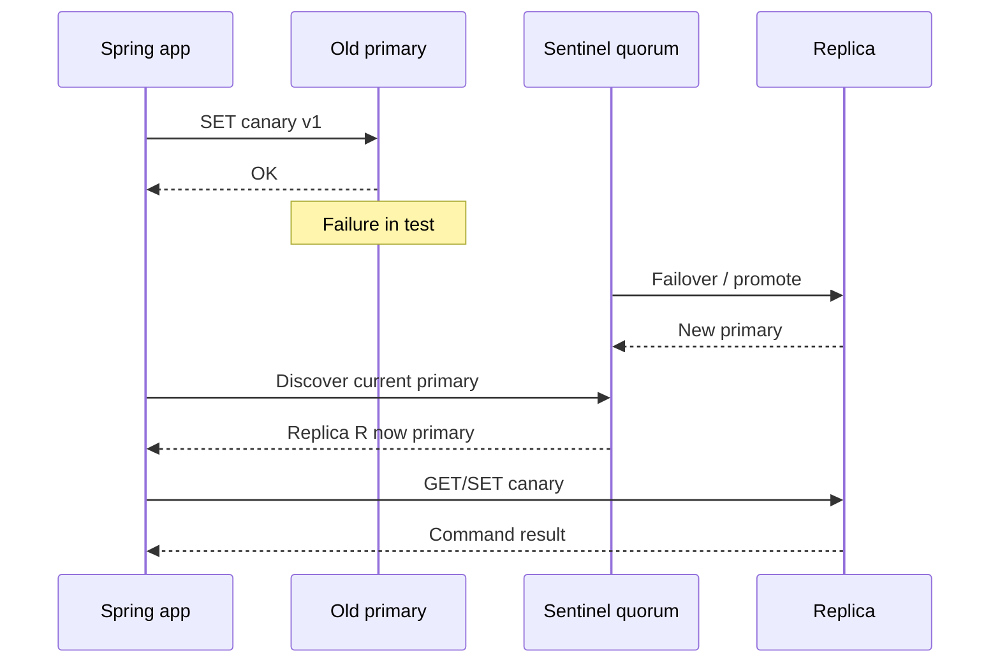

# Testing Backups, Restores, and Failover Drills with Spring Data Redis

## 1. Why a Redis System “with Replicas” Still Needs Restore Testing

Suppose a Spring Boot service uses Redis for sessions, product caches, job state, and Redis Streams. Redis runs with one primary and two replicas. Dashboards report healthy; `RedisTemplate` calls succeed.

One day, the operations team faces one of these situations:

- A buggy command deletes millions of keys.
- A deployment writes malformed data that the application cannot deserialize.
- The Redis primary disconnects and a replica is promoted to primary.
- An entire node volume is lost.
- A backup exists, yet cannot be loaded because an AOF manifest file or encryption key is missing.
- Redis recovers, yet the application still points at the old primary.
- Users saw success responses before the failure, yet the corresponding writes do not exist on the new primary.

All of these can happen even with replication configured. **Replication, failover, and backups are three distinct layers of protection**:

| Component | Primary Goal | What It Does Not Guarantee |
|---|---|---|
| **Backup** | Preserve a copy of data to restore to an earlier point in time | Instant traffic cutover when the primary fails |
| **Restore** | Load backed-up data into a target Redis instance/cluster | Proving automatically that data is complete and the app runs cleanly |
| **Replication** | Maintain copies for reads and failover support | Protection against accidental deletion: bad writes/deletes usually replicate too |
| **Failover** | Shift the primary role when the active primary fails | Guaranteeing every write ACKed by the old primary exists on the replica |
| **Spring Data Redis client recovery** | Discover the new endpoint, reconnect, and retry per policy | Recovering lost data or making non-idempotent writes safe |

A deployment is trustworthy only when **you have actually tested restoring from backups** and **rehearsed primary failover using the exact connection mode the application uses**.

### 1.1. Goals of This Lesson

You will learn how to:

1. Define RPO/RTO targets and acceptance criteria.
2. Inspect RDB, AOF, replica, and Redis topology configurations.
3. Create, store, and verify RDB/AOF backups properly.
4. Restore inside an isolated environment without overwriting live Redis.
5. Verify data, TTLs, Redis data types, serializers, and Redis Streams.
6. Rehearse failovers with Sentinel and Redis Cluster.
7. Measure Spring Data Redis outage and recovery durations.
8. Evaluate lost-write exposure, duplicate side effects, and business correctness.
9. Write repeatable runbooks, dashboards, and drill schedules.

## 2. Define the Failure Model Explicitly Before Testing

You cannot design a meaningful drill simply by saying “simulate Redis breaking.” Different failures produce different consequences:

| Failure | Example | Mechanism to Test |
|---|---|---|
| Process crash | Redis process terminates abruptly | Local persistence and restart |
| Host/VM outage | Server loses power or becomes unreachable | Failover and loss of un-fsynced data |
| Network partition | Application cannot reach the primary | Client timeouts, topology discovery, failover |
| Volume loss | Redis data disk is lost | Off-host backup and restore |
| Logical corruption | App writes bad data or deletes keys by mistake | Point-in-time backup and root-cause timeline |
| Replica lag | Primary ACKs before replica receives write | Failover RPO |
| Cluster node failure | One Cluster primary becomes unavailable | Slot coverage and replica promotion |
| Regional outage | Entire availability zone/region unavailable | Cross-region recovery per infrastructure capability |
| Credential/cert outage | Expired or invalid ACL/TLS secrets | Restoring/reconnecting with full security config |

**Never treat a `kill -9` test as an exact simulation of power loss.** When only the process dies, OS page caches can remain intact. Power loss, volume corruption, and losing an entire availability zone require separate tests.

## 3. RPO and RTO: Two Metrics to Quantify

**RPO — Recovery Point Objective:** the maximum amount of data loss in time the system is permitted to tolerate after a failure.

**RTO — Recovery Time Objective:** the maximum elapsed time allowed to restore service according to defined criteria.

Example:

```text
12:00:00  Backup completes
12:04:00  Redis continues accepting writes
12:05:00  Volume loss incident occurs
12:09:00  Restore finishes; application serves normally
```

In this example, if data only recovers back to 12:00, the recovery point steps back **5 minutes**, while application downtime lasted **4 minutes**. Never collapse both into a single vague claim like “recovered in 5 minutes.”

### 3.1. Distinguish Targets from Measured Results

| Concept | Illustrative Example |
|---|---|
| Target RPO | Lose no more than 60 seconds of critical data |
| Measured RPO in restore drill | Latest backup lacked roughly 42 seconds of writes |
| Target RTO | API returns to healthy serving within 5 minutes |
| Measured RTO | 4 minutes 20 seconds until read/write and health checks pass |

Do not infer RPO solely from `appendfsync everysec` or having a replica. It depends on failure mode, backup cadence, replication lag, and actual durable flushing.

Nor is RTO just how fast Redis answers `PONG`. Include endpoint updates, file transfers, dataset loading, connection rebuilding, cache warming, and bringing the application back to business readiness.

## 4. Classify Redis Data Before Backing Up

Redis can store multiple data classes with differing requirements:

| Data | What Happens If Lost? | Testing Focus |
|---|---|---|
| Database-backed cache | Rebuilt via cache-aside / warming | Measure warm-up speed and DB fallback load |
| Sessions | Users may have to log in again | Check TTL/session invalidation and UX |
| Rate-limit counters | May shift allow/deny decisions | Define fail-open/fail-closed by risk |
| Distributed locks | Old locks may vanish or resurrect | Use leases/owner tokens/fencing; test stale owners |
| Redis Streams | UnACKed records and consumer group state | Check pending/replay/duplicates |
| Job progress/checkpoints | Jobs may rerun or skip | Check idempotency and resumption |
| Unbacked business data | Needs strict durability, backups, reconciliation | Clear RPO/RTO; consider a more suitable authoritative store |

Never assume all Redis data is disposable cache. Conversely, if Redis holds only rebuildable caches, heavy persistence may be unnecessary; focus drills on **cache rebuild capacity and protecting the source database**.

### 4.1. Document the Source of Truth

For example, orders persist to PostgreSQL while Redis caches `order:42:status`. Losing Redis means falling back to PostgreSQL. If Redis is the sole place storing job progress, losing Redis can permanently erase progress.

Writing down the source of truth and reconciliation strategy clarifies what belongs in backups, what can be rebuilt, and what should not live solely in Redis.

## 5. Prepare a Redis and Config Inventory Before the Drill

Record at minimum:

- Redis version and topology: standalone, Sentinel, Cluster, or managed service.
- Primary/replica nodes and deployment zones.
- Redis databases/keyspaces, naming conventions, and hash tags.
- RDB/AOF policy, data directory, volume size, and backup schedule.
- Redis ACLs, TLS CAs, certificates, secret injection, and operational permissions.
- Clients using Lettuce or Jedis, and Spring Data Redis version.
- Services writing to Redis and when writes pause during restores.
- Dependents such as Streams consumers, schedulers, rate limiters, and session managers.
- Backup storage, encryption keys, retention, and copy locations.

Useful inspection commands:

```redis
INFO server
INFO persistence
INFO replication
INFO memory
INFO keyspace
ROLE
```

If using Redis Cluster:

```redis
CLUSTER INFO
CLUSTER NODES
CLUSTER SLOTS
```

Redis 7+ also supports:

```redis
CLUSTER SHARDS
```

**`INFO` and `ROLE` usually describe only the connected node.** Never mistake a single Redis seed endpoint for an automatic aggregate across the entire Cluster.

## 6. RDB Snapshots: Point-in-Time Copies

Redis uses **RDB snapshots** to persist a point-in-time representation of the dataset. Typical settings:

```conf
save 900 1
save 300 10
save 60 10000

dbfilename dump.rdb
dir /data
```

These three `save` lines are example auto-save triggers depending on Redis version/config—not a guarantee snapshots occur strictly every 900, 300, or 60 seconds.

RDB is typically well suited for:

- Producing a self-contained snapshot file for backup.
- Cloning a Redis dataset into a recovery environment.
- Measuring snapshot load times and verifying post-restore data.

### 6.1. `BGSAVE` and `SAVE`

```redis
BGSAVE
```

requests Redis to create a snapshot in the background when conditions permit. For a live serving system, this is normally far more suitable than synchronous `SAVE`, which blocks command processing.

Still, `BGSAVE` carries costs:

- Process `fork`, which can cause brief pauses.
- Copy-on-write memory overhead during concurrent writes.
- CPU and disk I/O to serialize and write the RDB.
- Sufficient free disk space for output.

Never run `BGSAVE` in production merely as a casual exercise without an operational plan and load assessment.

### 6.2. Confirming Snapshot Completion

After triggering a background save, inspect:

```redis
INFO persistence
LASTSAVE
```

Key fields:

```text
rdb_bgsave_in_progress:0
rdb_last_bgsave_status:ok
rdb_last_save_time:...
```

Consider a new RDB ready for backup copy only once the background save **has completed successfully** and the file is stable. `LASTSAVE` indicates the last successful save timestamp, yet does not confirm offsite copy/upload steps succeeded.

### 6.3. Never Copy a Partially Written RDB File

Backup jobs should wait for `BGSAVE` completion before copying the finished RDB file, or use a supported volume snapshot mechanism. Never grab an in-progress temp file and treat it as a complete backup.

Redis typically writes a temporary file and atomically swaps it upon completion; even so, backup jobs must verify the destination file is **the right snapshot, at the right timestamp, with complete bytes**.

## 7. AOF: Logging Mutations and Replaying on Recovery

Append Only File (AOF) logs dataset mutations for replay at startup. Example:

```conf
appendonly yes
appendfsync everysec
```

Three common policies:

| Policy | General Behavior | Trade-Off |
|---|---|---|
| `always` | Frequent fsyncs tied to writes | Stronger local durability, higher disk latency / I/O |
| `everysec` | Requests fsync roughly every second | Common balance, still leaves a loss window |
| `no` | Lets the OS decide flush cadence | Lower active fsync overhead, less predictable risk |

**`appendfsync everysec` does not guarantee a strict 1,000 ms maximum RPO** across every failure. Disk stalls, I/O errors, and failovers can widen the actual gap.

### 7.1. Process Crash vs. Power Loss

When only the Redis process crashes, OS page caches may still hold recent writes. On hardware power loss, un-fsynced data can vanish.

Therefore, never use stopping a container cleanly as proof of hardware power-loss resilience.

### 7.2. AOF Does Not Replace Historical Backups

If an app accidentally runs `DEL`, that deletion writes straight into the AOF and replicates. Recovering Redis from current state cannot roll back prior to the mistake.

Historical backups with retention and multiple recovery points remain essential to recover from logical errors or revert to pre-incident versions.

## 8. Redis 7 Multi-Part AOF: Preserve the Entire File Set

Redis 7 introduced **multi-part AOF**, generally comprising:

1. **Base AOF** — base state representation, often with an RDB preamble.
2. **Incremental AOF** — subsequent appended mutations.
3. **Manifest** — describes the valid file set and recovery order.

Directory layout:

```text
data/
  appendonlydir/
    appendonly.aof.manifest
    appendonly.aof.<sequence>.base.rdb
    appendonly.aof.<sequence>.incr.aof
```

Exact filenames and counts depend on version and configuration. What matters is **never copying only one incremental file while dropping the manifest and base files**.

### 8.1. Risk of Copying Multiple Files During an AOF Rewrite

Suppose a backup copies file A while Redis swaps the manifest to reference file set B. Copying files sequentially without a consistent snapshot can leave a backup containing the new manifest without its matching base file.

Recommended approaches:

- Use filesystem/volume snapshots with proper consistency and test restoring them.
- Use a completed RDB snapshot as a crisp backup boundary.
- Use managed Redis's official backup mechanism.
- If backing up multi-part AOF directly, use a Redis-version-compatible procedure capturing a **consistent set of files together with its manifest**.

Never manually delete, rename, concatenate, or “hand-edit” a manifest without an official recovery procedure.

### 8.2. AOF Rewrites Do Not Selectively Undo Business Mistakes

`BGREWRITEAOF` compacts current state rather than preserving full command history. It consumes CPU, copy-on-write memory, disk I/O, and temporary disk space.

Avoid running AOF rewrites alongside heavy snapshot stress tests in production without accounting for combined load.

## 9. When Both AOF and RDB Are Enabled, Which Does Redis Load?

A Redis instance may enable both:

```conf
appendonly yes
save 900 1
```

On startup with valid persistence files, Redis normally prioritizes AOF when AOF is enabled, because AOF typically reflects newer mutations than an RDB snapshot.

This directly impacts restore testing:

```text
You copy dump.rdb into the data directory
Yet an older AOF remains in that directory
Redis starts with appendonly yes
Redis may load the AOF instead of the dump.rdb you copied
```

To test a standalone RDB snapshot, start a test Redis instance with a **clean data directory containing only the target snapshot and matching persistence config**. Never judge an RDB restore by dropping it next to stale AOF files.

### 9.1. Never Mix Files Across Different Recovery Points

Never pair an AOF manifest from T2 with incremental files from T1, or a `dump.rdb` from shard A with incompatible cluster metadata, expecting Redis to repair consistency automatically.

Every backup set needs its own identity, timestamp, Redis version, topology, config, and file list managed as **one recovery unit**.

## 10. Operational Backup Manifests

Beyond Redis's internal AOF manifest, your backup system should keep **its own metadata** describing each backup set.

Example descriptor:

```yaml
backup_id: redis-prod-2026-11-13T020000Z
redis_version: "7.x"
topology: sentinel
source_role: replica
snapshot_type: rdb
backup_started_at: "2026-11-13T02:00:00Z"
backup_completed_at: "2026-11-13T02:02:20Z"
source_node: "redis-replica-b"
result: "completed"
files:
  - path: dump.rdb
    sha256: "<recorded-checksum>"
encryption: "enabled"
restore_test_status: "pending"
```

This is an example **backup-tool** metadata record, not a required Redis file format. For multi-part AOF, list all consistent component files Redis requires.

Metadata should help you:

- Identify which system/cluster owns the backup.
- Verify timestamps and source node/role.
- Validate checksums and file sizes.
- Identify the Redis version required for restoration.
- Identify the encryption key / key version.
- Track the latest restore-test status.

Never embed plaintext Redis passwords, private keys, or encryption keys inside backup manifests.

## 11. Verifying Backups: File Existence Is Only Step One

An evaluation process should separate four levels:

**Level 1 — File existence:** expected files and metadata exist.

**Level 2 — File integrity:** sizes and checksums match source/upload records, with no missing or corrupted files per checks.

**Level 3 — Redis readability:** a compatible Redis version loads the files cleanly without AOF/RDB errors.

**Level 4 — Application recoverability:** Spring Data Redis connects, deserializes all data types, preserves TTLs, and executes business operations after restore.

Each level builds on the previous one. **A valid checksum does not prove business data completeness**; it proves only that bytes matched during transfer.

### 11.1. Checksum Verification

On Linux/macOS:

```bash
sha256sum dump.rdb
```

On Windows PowerShell:

```powershell
Get-FileHash -Algorithm SHA256 .\dump.rdb
```

Store checksums and sizes alongside backup metadata. When downloading from offsite storage to a restore environment, recompute checksums to catch copy errors.

### 11.2. Redis File Inspection Tools

Redis provides utilities such as:

```text
redis-check-rdb
redis-check-aof
```

They check file formats and certain persistence errors depending on version. For multi-part AOF, run the tools following procedures compatible with your Redis version and manifest layout.

**Never run AOF auto-repair on your sole backup copy.** Repair modes can truncate corrupted tails and discard data; always work on a copy and preserve original evidence.

## 12. Protecting Backups from Logical Errors and Broad Outages

A backup stored on **the same volume** as the Redis primary can be lost simultaneously when that volume fails. A replica in the same cluster also receives accidental deletions.

Therefore, your backup strategy needs:

1. Copies stored outside the Redis primary's failure domain where required.
2. Encryption at rest and in transit.
3. Retention long enough to catch delayed logical errors.
4. Separate access controls for backups vs. the Redis application.
5. Protection against unauthorized deletion or tampering, such as immutable/object-lock storage where appropriate.
6. Monitoring backup age and alerting when the latest backup grows stale.
7. Scheduled restore tests.
8. Encryption key management and testing for scenarios where keys become inaccessible.

### 12.1. Redis Backups Can Contain Sensitive Data

RDB/AOF files can contain session tokens, identifiers, cached personal data, and business state. Never load production backups into unauthorized dev environments, never share RDB/AOF files over public chat, and never bypass retention/deletion policies.

When restoring in a lab, use **synthetic test data or sanitized copies per security policy**.

## 13. Backing Up from Replicas: Offloading the Primary While Watching Lag

A replica can generate RDB backups to spare the primary. That is an architectural option, not universally superior in every scenario.

Risks:

- The replica may lag behind the primary.
- The replica may have recently disconnected and resynced.
- A replica backup at time T may miss writes already ACKed by the primary.
- Snapshots still incur fork, CPU, memory, and disk I/O overhead on the replica.

Before backing up from a replica, check:

```redis
ROLE
INFO replication
INFO persistence
```

Assess lag and `master_link_status` for your deployment model. If RPO requirements are very tight, do not assume a replica backup equals a current primary snapshot.

### 13.1. `WAIT` and `WAITAOF` Do Not Replace Backups

`WAIT` blocks for replication acknowledgements on the session/offset; `WAITAOF` on supported Redis versions waits for specific AOF persistence conditions.

However:

- Neither creates historical recovery points to rescue accidental deletions.
- Neither replaces an offsite copy in an independent failure domain.
- Neither provides strong-consistency consensus or distributed transactions.
- Neither removes the need for restore drills and business reconciliation.

## 14. Preparing Test Fixtures Before Taking a Snapshot

To make restore drills meaningful, create an **intentional fixture** covering multiple Redis data types:

```redis
SET lab:backup:version v1
HSET lab:backup:user:42 name Linh tier GOLD
SADD lab:backup:features search checkout
ZADD lab:backup:scores 10 user42 20 user99
SET lab:backup:session:42 active EX 3600
XADD lab:backup:events * type CREATED orderId o-101
```

Keys prefixed `lab:backup:` are strictly for test environments.

Verify:

- String `GET` value.
- Hash `HGETALL` fields.
- `SMEMBERS` and `ZRANGE ... WITHSCORES`.
- Stream entries and consumer group state if fixtures include a group.
- Session `PTTL`/`TTL`.
- Version/canary written before the snapshot.

### 14.1. Pre- and Post-Snapshot Canary

A simple test to verify the exact recovery point:

```text
T0: SET lab:backup:version before-snapshot
T1: BGSAVE completes, snapshot file saved
T2: SET lab:backup:version after-snapshot
T3: Restore isolated RDB from T1
```

In the T3 restore, the canary should reflect the **snapshot state**, not the post-snapshot write. With background saves, the captured dataset reflects when the snapshot started (fork time), **not necessarily when `BGSAVE` finished**; place canary writes at controlled moments to confirm the exact boundary.

Never rely on one key alone to conclude durability across all data types; test a diverse fixture set.

## 15. RDB Lab Scenario: Snapshot and Restore to Another Redis

This walkthrough uses an **isolated test Redis**; never run stop/wipe actions on production.

### Step 1 — Start a Lab Redis with a Dedicated Volume

Example using Docker on a test machine with Docker Engine:

```bash
docker run -d \
  --name redis-backup-lab \
  -p 16379:6379 \
  -v redis-backup-lab:/data \
  redis:7.2-alpine \
  redis-server --appendonly yes --save 60 1
```

The `redis-backup-lab` volume is strictly for the lab, never production. Redis 7.2 is illustrative; pick a version matching the system under test.

### Step 2 — Write Fixture Data

Using Redis CLI against the local test port:

```bash
redis-cli -p 16379 SET lab:backup:version before-snapshot
redis-cli -p 16379 HSET lab:backup:profile name Linh role MEMBER
redis-cli -p 16379 SET lab:backup:session active EX 3600
```

### Step 3 — Trigger an RDB Snapshot

```bash
redis-cli -p 16379 BGSAVE
redis-cli -p 16379 INFO persistence
```

Wait until `rdb_bgsave_in_progress:0` and the latest `BGSAVE` status reports `ok`.

### Step 4 — Copy the Completed RDB

Inside a writable lab directory:

```bash
mkdir -p ./backup
docker cp redis-backup-lab:/data/dump.rdb ./backup/dump.rdb
sha256sum ./backup/dump.rdb
```

Record checksum and size in metadata. If Redis uses a different `dbfilename` or `dir`, adjust paths to match the actual test config.

### Step 5 — Write a Post-Snapshot Mutation

```bash
redis-cli -p 16379 SET lab:backup:version after-snapshot
```

### Step 6 — Prepare a Clean Restore Directory

On Linux/macOS test hosts:

```bash
mkdir -p ./restore
cp ./backup/dump.rdb ./restore/dump.rdb
```

Never copy into the source instance's volume. `./restore` is an isolated directory containing only the chosen RDB snapshot.

### Step 7 — Start an Isolated Restore Redis

```bash
docker run --rm -d \
  --name redis-restore-lab \
  -p 16380:6379 \
  -v "$PWD/restore:/data" \
  redis:7.2-alpine \
  redis-server --appendonly no --save ""
```

Here Redis restores from **RDB** because `appendonly no` is set and the data directory holds only `dump.rdb`. On Windows vs. Linux, adjust Docker bind-mount syntax and file permissions accordingly.

### Step 8 — Verify Restored Data

```bash
redis-cli -p 16380 GET lab:backup:version
redis-cli -p 16380 HGETALL lab:backup:profile
redis-cli -p 16380 PTTL lab:backup:session
```

Expected `version` is `before-snapshot`, not the Step 5 write. Real wall-clock time has elapsed on the TTL, so **do not expect exactly 3,600,000 ms as when created**.

### Step 9 — Record Restore Duration

Measure from the start of the restore procedure until Redis finishes loading and application assertions pass—not just until the container starts.

### Step 10 — Clean Up the Lab Environment

Delete lab containers/volumes only after confirming their identity and saving needed results. Never run cleanup commands with unchecked variables or paths that could hit production.

## 16. AOF Restores: Principles Before Practicing

When restoring **from AOF**, the workflow differs from copying an RDB file:

1. Confirm Redis version and AOF format (single-file vs. multi-part).
2. Retrieve a consistent file set, including the manifest and all required base/incremental files.
3. Verify checksums, file permissions, and Redis version.
4. Boot a lab instance with a clean data directory.
5. Enable AOF with compatible settings.
6. Ensure Redis does not load stale files outside the backup set.
7. Inspect Redis startup logs and `INFO persistence`.
8. Verify data types, TTLs, Stream state, and canaries.

Never run `BGREWRITEAOF` trying to “recover” lost data: rewriting only compacts current state rather than reverting to an earlier recovery point.

### 16.1. When an AOF Has a Truncated Tail

Redis provides options for handling truncated AOFs, such as `aof-load-truncated`. Tail corruption can sometimes be skipped on load, yet not all corruption is recoverable without data loss.

If Redis fails to start:

- Keep an untouched copy of the original backup.
- Run inspection utilities on a **copy**.
- Record how many bytes or commands were dropped during repair.
- Evaluate RPO impact and business recovery needs.

Never allow automated repair to truncate your sole production AOF file blindly.

## 17. What Must Be Verified After Restore Beyond `PONG`?

Redis replying:

```redis
PING
```

is a basic liveness signal, not certification that data is intact.

Verify at minimum:

| Item | Method |
|---|---|
| Redis startup/load | Inspect logs and `INFO persistence` |
| Dataset canaries | `GET`/`HGET` expected pre-snapshot keys |
| Key types | `TYPE` matches String/Hash/Set/ZSet/Stream |
| TTL | Reasonable `PTTL`; neither stripped TTLs nor extended sessions |
| Keyspace | Key counts and distributions match backup manifest |
| Serializers | Spring Data Redis decodes expected Java types |
| ACL/TLS | App authenticates cleanly with expected permissions and endpoints |
| Streams state | Entries, consumer groups, and PEL/pending state intact |
| Cache | Acceptable hit/miss rates and DB fallback load |
| Business correctness | Zero duplicate side effects or missing operations beyond accepted RPO |

### 17.1. Do Not Rely on Exact Total Key Counts When TTLs Exist

Between backup and restore, keys with TTLs legitimately expire. Post-restore key counts may therefore be lower than at snapshot time without indicating corruption.

Verify **non-expiring canaries** and TTL-aware groups, documenting expected variance instead of asserting a brittle total key count.

## 18. Spring Data Redis Needs the Exact Same Serialization Contract

Redis stores bytes. Whether Spring Data Redis uses `JdkSerializationRedisSerializer`, String serializers, or JSON serializers, restored data consists of the exact bytes written beforehand.

If an application deploys with an incompatible new serializer:

```text
Redis restored correctly
  |
  +-- String key serializer changed -> GET queries wrong keyspace
  |
  +-- JSON schema changed -> deserialization error
  |
  +-- JDK class version changed -> binary value cannot be decoded
```

Therefore, restore drills must boot the **exact application version planned for recovery**. Never read one value with `redis-cli` and assume the Spring app can read the entire dataset.

### 18.1. Serializer Cases to Test

- Key namespaces and key serializers before/after restore.
- Value serializers (String, JSON, JDK, or custom).
- Hash key and Hash value serializers.
- Redis Streams message decoding if used.
- Schema migrations and optional fields.
- TTL/expiration annotations if using Redis Repositories.

A healthy backup paired with an app version unable to decode it can blow up RTO.

## 19. Java Sample for Post-Restore Canary Verification

A service using `StringRedisTemplate`:

```java
package com.example.redis.recovery;

import java.util.Map;

import org.springframework.data.redis.core.StringRedisTemplate;
import org.springframework.stereotype.Component;

@Component
public class RedisRestoreProbe {

    private final StringRedisTemplate redis;

    public RedisRestoreProbe(StringRedisTemplate redis) {
        this.redis = redis;
    }

    public void assertFixture() {
        String version = redis.opsForValue()
            .get("lab:backup:version");

        if (!"before-snapshot".equals(version)) {
            throw new IllegalStateException(
                "Unexpected snapshot canary: " + version
            );
        }

        Map<Object, Object> profile = redis.opsForHash()
            .entries("lab:backup:profile");

        if (!"Linh".equals(profile.get("name"))) {
            throw new IllegalStateException(
                "Missing or incorrect restored profile"
            );
        }
    }
}
```

Here the fixture uses String/Hash, fitting `StringRedisTemplate`. In projects storing objects/JSON, add checks reading via the exact `RedisTemplate<K,V>` or repository used in production.

### 19.1. Separate Restore Verification from Readiness Probes

Readiness endpoints can perform cheap Redis connectivity checks. Full restore verification reading canaries and validating schemas should run in a **verification job**, never scanning/reconciling entire datasets on every HTTP health check.

## 20. Redis Streams and Pending State After Recovery

Redis Streams often run consumer groups. A record goes through:

```text
XADD -> store entry
XREADGROUP -> worker claims entry; entry becomes pending
Business side effect -> executes
XACK -> mark processed
```

If a worker dies after the side effect yet before `XACK`, the entry stays pending for recovery/reclaim.

A restore/failover drill should examine:

- Do Stream entries exist up to the expected recovery point?
- Were consumer groups restored intact?
- What is the state of pending entries/PEL?
- Are messages waiting for reclaim via `XPENDING`/`XAUTOCLAIM`?
- Are handlers idempotent if entries get reprocessed?
- Could producer retries with `XADD *` create duplicate entries?

**Never claim Stream restores provide exactly-once processing.** Redis Streams and databases/external side effects do not share a distributed transaction.

### 20.1. Pub/Sub Differs from Streams

Redis Pub/Sub does not keep durable backlogs for absent subscribers the way Redis Streams does. An RDB/AOF restore cannot “replay” past Pub/Sub messages unless stored elsewhere.

If replay is required, use Streams or an appropriate event store; never tie Pub/Sub RPO to RDB/AOF as if messages were persisted.

## 21. TTLs After Restore: Do Not Expect Clocks to Reset

Redis tracks expiration using real-world wall-clock semantics. If a session was created with a 1-hour TTL, backed up 10 minutes later, and restored 2 hours later, that session does not get another 60 minutes of life.

Inspect via:

```redis
PTTL lab:backup:session
TTL lab:backup:session
```

Special return values:

| `PTTL` | Meaning |
|---|---|
| Positive integer | Remaining TTL |
| `-1` | Key exists with no expiration |
| `-2` | Key does not exist |

Never let restores accidentally resurrect expired sessions. For security-sensitive expiring keys, verify they cannot become valid past policy bounds.

## 22. Failover Is Not Restore

**Failover** shifts serving responsibility from one node to another, usually a replica. It does not restore an earlier historical recovery point.

```text
Primary P  -- replication --> Replica R
   |
   X failure
   |
   +-- Sentinel/Cluster promotes R
                  |
                  +--> Client reconnects to new primary
```

If primary P accepted a write that was not yet sent to or applied by replica R, that write risks disappearing after failover.

### 22.1. Redis Replication Is Usually Asynchronous

Example:

```text
T0: Client SET order:o-101:status PAID -> P
T1: P returns OK
T2: P loses connectivity
T3: Replica R is promoted, missing write T0
T4: Client reads R -> PAID is missing
```

This is not a Redis bug; it is an inherent risk of asynchronous replication that must be designed around.

A real drill must test **writes acknowledged right around the failover**, not merely `GET`ting a key written yesterday.

## 23. Redis Sentinel: Rehearsing Primary Switchover

Sentinel monitors primary/replica nodes and coordinates failover when conditions are met. A Spring Boot app using Sentinel specifies the master name and multiple Sentinel nodes.

Example:

```yaml
spring:
  data:
    redis:
      sentinel:
        master: mymaster
        nodes:
          - sentinel-a.internal:26379
          - sentinel-b.internal:26379
          - sentinel-c.internal:26379
      timeout: 2s
      connect-timeout: 500ms
```

This illustrates Spring Boot 3.x configuration. When production uses TLS/ACL or distinct passwords for Sentinel and Redis data nodes, add the matching settings per driver version and topology.

### 23.1. Identify the Current Primary

From a test Sentinel node:

```redis
SENTINEL get-master-addr-by-name mymaster
SENTINEL master mymaster
```

On the Redis data nodes:

```redis
ROLE
INFO replication
```

Record the active primary, replica sync states, and timestamps. Never assume roles from hostnames like `redis-1` or pod ordinals, because roles flip during failovers.

### 23.2. Triggering Controlled Failover in the Lab

Redis Sentinel provides the admin command:

```redis
SENTINEL FAILOVER mymaster
```

This triggers a primary switch and **mutates topology**. Run it only on a **Sentinel test cluster** or per an approved runbook. Another option is stopping the test primary to observe automatic failover when quorum conditions hold.

### 23.3. Observing the Phases



Success criteria:

- The new primary holds the proper role.
- Spring/Lettuce needs no hardcoded IP for the new primary.
- Requests failing during the switchover window are classified cleanly with bounded timeouts.
- Post-failover reads and writes hit the right node.
- Writes around the failover window are reconciled.

**Never infer that all ACKed writes survived** just because the app reconnected cleanly.

## 24. Redis Cluster: Rehearsing Primary Failover and Slot Coverage

Redis Cluster partitions 16,384 hash slots across primary nodes. When a primary becomes unreachable, an eligible replica can take over via cluster failover.

Before the drill:

```redis
CLUSTER INFO
CLUSTER NODES
CLUSTER SLOTS
```

Record:

- `cluster_state` and assigned/ok slot counts.
- Node IDs, roles, replicas, and configuration epochs.
- Slot ranges owned by the primary under test.
- Replication status and inter-node network reachability.

### 24.1. Never Run Failover Drills on a Cluster Missing Slots or Quorum

A cluster already in `cluster_state:fail` or missing replicas may fail to recover if you deliberately take another node down. Start with a healthy lab cluster with full slot coverage and clear topology.

### 24.2. Triggering Controlled Failover

On an eligible replica in a **test Redis Cluster**, Redis provides:

```redis
CLUSTER FAILOVER
```

This is an administrative **role-changing command**, not a health check. Run it on the target replica per Redis rules—never in production merely for practice.

A fault-injection test can also kill a primary directly, distinguishing planned failovers from unplanned crashes: recovery times and write-loss exposure differ.

### 24.3. What Must Be Verified After Failover?

1. Slot ownership transfers cleanly to the new primary.
2. Cluster returns to serving all required slots.
3. Lettuce refreshes topology or follows redirects.
4. `GET`/`SET` for keys in the failed-over slots keep working.
5. `MOVED`/`ASK` redirects are not mistaken for data loss.
6. Command timeouts, reconnects, and p99 stay tracked.
7. Write consistency before and after failover is reconciled.

**A healthy connection to one seed node does not prove all 16,384 slots are reachable.** Fixtures must cover keys across many slots.

## 25. Redis Cluster: Restoring the Whole Dataset Is Not Copying One `dump.rdb`

Standalone Redis has one self-contained dataset; Redis Cluster shards keys across multiple primaries. Taking an RDB solely from Primary A misses every key on Primaries B and C.

Cluster backups therefore need:

- Data backups from every primary/shard to be restored.
- Topology/slot ownership mappings, node roles, and cluster configuration.
- A way to manage snapshot alignment across shards per consistency needs.
- A plan to provision the cluster and load/migrate data into the right slots.
- Application testing in Redis Cluster mode, not standalone.

### 25.1. Per-Shard Snapshots Are Not a Global Transactional Snapshot

If shard A snapshots at 12:00:00 and shard B at 12:00:30, a multi-shard business flow can restore to inconsistent points in time.

Redis Cluster also enforces multi-key limits per hash slot. If business logic demands a globally consistent cross-shard snapshot, use **application-level quiescence/snapshotting or an authoritative store** providing that consistency.

### 25.2. Avoid Dropping Old Files Directly Into Live Cluster Nodes

Replacing RDB/AOF files on one node of a running cluster can conflict with slot ownership, cluster metadata, and replication state. That is not a generally safe restore method.

Prefer:

- Restoring into a **fresh cluster or isolated environment**.
- Using official provider/operator restore workflows.
- Verifying data first, then executing planned cutover, replication, or migration.

Never copy persistence files and restart a live cluster node without a runbook written for that exact topology.

## 26. How Must Spring Data Redis Reconnect?

Applications using `RedisTemplate` or `ReactiveRedisTemplate` should never pin a single primary node address permanently when using Sentinel or Cluster.

| Topology | Discovery Mechanism | What to Test |
|---|---|---|
| Standalone | Fixed hostname/port | Restart/reconnect to same endpoint; no true automatic failover |
| Sentinel | Query Sentinel for primary | Discovery and reconnect after primary switch |
| Redis Cluster | Hash slot→node map, redirects/topology refresh | `MOVED`/`ASK`, role changes, refreshes |
| Managed Redis | Provider endpoint or SDK | Cutovers, TLS/DNS, provider-specific failover |

### 26.1. Redis Cluster with Lettuce Topology Refresh

When using Lettuce Cluster, enable periodic and adaptive refreshes:

```java
import java.time.Duration;
import io.lettuce.core.cluster.ClusterClientOptions;
import io.lettuce.core.cluster.ClusterTopologyRefreshOptions;

ClusterTopologyRefreshOptions refresh =
    ClusterTopologyRefreshOptions.builder()
        .enablePeriodicRefresh(Duration.ofSeconds(30))
        .enableAllAdaptiveRefreshTriggers()
        .build();

ClusterClientOptions options = ClusterClientOptions.builder()
    .topologyRefreshOptions(refresh)
    .build();
```

Wire `options` into the **actual** `LettuceClientConfiguration` and `LettuceConnectionFactory` used for Cluster. Never instantiate cluster options and assume Spring Boot auto-applies them if your factory uses a separate config.

### 26.2. Bound Timeouts and Reconnects

During failover, a request may go through:

```text
old primary unavailable
 -> connect timeout
 -> reconnect / discover new primary
 -> command retry per driver/policy
 -> success or error
```

Never set timeouts longer than the overall API deadline. Never retry infinitely, flooding the cluster with queued traffic while it recovers.

## 27. Continuous `GET`/`SET` Testing to Measure the Failover Window

A simple app test can write monotonically increasing canaries with timestamps while a reader checks `GET`:

```java
package com.example.redis.recovery;

import java.time.Instant;
import org.springframework.data.redis.core.StringRedisTemplate;
import org.springframework.stereotype.Component;

@Component
public class FailoverCanary {

    private final StringRedisTemplate redis;

    public FailoverCanary(StringRedisTemplate redis) {
        this.redis = redis;
    }

    public void write(String attemptId, long sequence) {
        String value = attemptId + "|" + sequence
            + "|" + Instant.now();
        redis.opsForValue().set("lab:failover:canary", value);
    }

    public String read() {
        return redis.opsForValue().get("lab:failover:canary");
    }
}
```

This tests canary reads and writes, yet by itself **is not a full RPO measurement tool**. Log every attempt ID and command acknowledgement to an external test store, then compare against Redis post-failover.

### 27.1. Never Use an In-Redis Counter as the Sole Audit Log

If Redis loses recent writes, a counter stored inside Redis disappears with them; you will never know which commands had returned `OK` to the client.

During drills, log timelines and ACKs outside the test Redis (such as a test coordinator log file or test database) to reconcile before and after failover.

### 27.2. Measure Three Key Timestamps

- Last successful write before role switch.
- First failed operation and duration of connection disruption.
- First successful write/read once the new primary serves.

Keep clocks/timestamps and request IDs correlatable. Across multiple machines, account for clock skew; use monotonic elapsed timers within one test coordinator where possible.

## 28. Timeouts After Writes Leave Uncertain Outcomes

This risk deserves dedicated testing:

```text
Client -> SET/INCR
Redis executes command
Response lost
Client times out
Client retries
```

For `GET`, retries normally cause no side effects. However:

| Command | What Can Happen on Retry? |
|---|---|
| `INCR` | Double-increment |
| `LPUSH` | Push same item twice |
| `XADD ... *` | Create two entries with distinct IDs |
| `SET key value EX n` | Reset TTL, extending lifetime |
| `SET NX PX` | Retry returns failure even though first attempt acquired the lock |
| `XACK` | Retry returns different count even though prior ACK succeeded |

Failover and reconnect do not make commands automatically execute-once.

### 28.1. Designing Retries

1. Cap attempt counts and total elapsed time.
2. Add backoff and jitter to avoid bursts.
3. Separate network/redirect/timeout errors from schema/ACL errors.
4. For writes with side effects, attach a deterministic request ID.
5. Enforce idempotency at the source of truth when correctness demands it.
6. Reconcile uncertain outcomes.

Never wrap an entire business transaction spanning PostgreSQL, Redis, and external APIs in a blind retry just because one Redis call timed out.

## 29. Distributed Lock Failovers: Do Not Assume Mutual Exclusion Holds

Suppose:

```text
T0: P receives SET lock tokenA NX PX 30000 -> OK
T1: P has not yet replicated lock to R
T2: P fails; R is promoted
T3: B acquires the same lock with tokenB on R
T4: A is still executing the task
```

Both Worker A and Worker B think they hold the lock. This is an inherent limit of Redis locks under asynchronous replication.

Tests should verify:

- Owner-token unlocks never delete the new owner's lock.
- TTLs and renewals follow protocol.
- Stale owners cannot overwrite newer state thanks to fencing/version checks where required.
- Simple Redis locks are never used as absolute guarantees for high-risk resources.

Backups cannot preserve lock ownership across failovers either; a lock restored from an older file may no longer reflect any live worker.

## 30. Testing Cache Warming and Fallbacks Post-Recovery

For cache-aside patterns:

```text
Redis finishes restoring, yet cache is empty or sparse
      |
      +-- requests miss
      |
      +-- database receives heavy query surge
      |
      +-- HTTP latency rises; DB risks overloading
```

If the app falls back to the DB, measure:

- Cache hit/miss ratio over time.
- DB queries per second.
- HTTP p95/p99 and error rates.
- Rate limiters and bulkheads when Redis is unavailable.
- Bounded warm-up capacity for hot keys.

**Never equate Redis returning `PONG` with full service recovery.** If a thundering herd hits the database after cache loss, effective RTO stays long.

### 30.1. Choosing the Right Warm-Up Strategy

- Lazy cache-aside for infrequently accessed data.
- Prewarm curated hot-key lists in a controlled fashion.
- Cap concurrent loads to protect the DB.
- Use TTL jitter to prevent synchronized expirations.
- Never sweep the whole production dataset with `KEYS *` causing load spikes.

## 31. DNS, TLS, and ACLs During Failover Drills

A newly promoted primary may have a different hostname, IP, or certificate:

```text
Old primary: redis-a.internal:6380
New primary: redis-b.internal:6380
```

When Spring/Lettuce reconnects to node B, verify:

- Endpoint B is reachable from the app network.
- TLS certificate SANs match the hostname.
- The Java truststore trusts the right CA.
- Redis ACL users/passwords are synchronized per policy.
- Firewalls/service discovery are not pinned strictly to A.

A failover drill can fail not because Redis lost data, but because of **TLS hostname mismatches or newly advertised unreachable node addresses**.

Never bypass peer/hostname verification. Fix SANs, CA trust, advertised addresses, and networking instead.

## 32. Snapshots and Failovers on Managed Redis

Managed Redis typically provides:

- Scheduled snapshots with policy retention.
- On-demand backups.
- Restores into a new instance or cluster.
- Automatic failover or multi-zone replication.
- Dedicated operational metrics and events.

Still, capabilities, snapshot timing, RPOs, and failover behavior vary across providers and tiers.

When using managed Redis:

1. Read the backup/restore specification for your exact service tier.
2. Confirm whether snapshots cover all shards.
3. Check whether point-in-time recovery exists or only scheduled snapshots.
4. Verify whether restores preserve endpoints, ACLs, and TLS settings.
5. Run failover tests via the official provider mechanism in a separate environment.
6. Compare when the provider reports “complete” versus when the application is actually healthy.

Never alter persistence files on a managed Redis node directly or run unsupported administrative commands.

## 33. Observability: Which Metrics to Collect During Drills?

| Group | Signals | Question |
|---|---|---|
| Backup | Last successful backup, age, size, checksum | Is the latest backup usable? |
| Restore | Start/end, load time, verification result | What was the actual measured RTO? |
| Redis persistence | `rdb_last_bgsave_status`, `aof_last_write_status` | Are files writing cleanly? |
| Redis replication | Role, master link, replica lag/offset | Is the replica current enough for promotion? |
| Cluster | `cluster_state`, slot coverage, failover events | Are any shards unserviceable? |
| Client | Connect failures, reconnects, timeouts | Did Spring switch to the new node? |
| Performance | Redis command p95/p99, API p95/p99 | How long were users disrupted? |
| Business | ACKed write loss, duplicate operations | Was correctness impacted? |
| Cache | Hits/misses, DB fallback rate | Did downstream systems overload? |
| Security | TLS/ACL failures, certificate expiry | Does the new node share security config? |

In Redis:

```redis
INFO persistence
INFO replication
INFO stats
INFO clients
INFO memory
```

For Cluster/Sentinel, add the topology commands noted earlier.

### 33.1. Aligning Timelines

A helpful timeline:

```text
T0     Test starts writing canaries
T1     Failover triggered
T2     Old Redis primary becomes unavailable
T3     New primary announced
T4     Spring client reconnects successfully
T5     Writes/reads and app checks pass continuously
```

Measure both **Redis failover duration** and **application-visible outage**. They are rarely identical.

## 34. Automating Post-Restore Verification

A verification job should check:

1. Expected Redis roles and topology.
2. `INFO persistence` and startup logs.
3. Expected canary reads.
4. Multiple data types, TTLs, and schemas.
5. String/Hash/Stream reads using the exact Spring serializers.
6. Keyspace coverage across Cluster slots.
7. ACL/TLS checks and negative security tests where appropriate.
8. A fresh write into a lab keyspace confirming the app can write post-restore.
9. Safe cleanup of test keys afterward.
10. Outputting a machine-readable report with PASS/FAIL, timestamps, Redis version, and backup ID.

Never scan the entire production keyspace inside routine health checks. Run deep checks in an **isolated restore environment** on authorized data.

### 34.1. Example Drill Report Schema

```yaml
drill_id: redis-restore-lab-001
backup_id: redis-prod-2026-11-13T020000Z
mode: isolated-restore
result: pass
rpo_observed_seconds: 42
rto_observed_seconds: 260
checks:
  - name: redis-startup
    status: pass
  - name: string-hash-ttl
    status: pass
  - name: spring-serializer
    status: pass
  - name: stream-consumer-recovery
    status: pass
notes: "Illustrative values, not real measurements."
```

This illustrates a report format, not an output from the Redis server.

## 35. Failure-Injection Drills: Safety Principles

A drill may test:

- Stopping a Redis process in a test cluster.
- Dropping network traffic between Spring test and Redis test.
- Injecting connection timeouts or packet loss via a test proxy.
- Triggering controlled failovers via Sentinel or Cluster test commands.
- Restarting a Spring instance still holding old endpoints.
- Taking down a test replica to see if failover requirements still hold.
- Restoring a snapshot from before a canary mutation.

Every test scenario requires **strict scope limits and abort conditions**.

**Never inject network partitions, delete Redis volumes, run `FLUSHALL`, alter ACLs, or kill primaries in production for practice.** Disruptive production exercises require formally approved change procedures and proven recovery paths.

### 35.1. Planned Failover vs. Unplanned Crash

Planned failovers can coordinate state handoff cleanly while the old node remains alive during transition. Unplanned crashes carry higher risk of replica lag and ambiguous write outcomes.

A passing planned failover drill does not guarantee identical RPO/RTO under power loss or network partitions.

## 36. Diagnostics: Backup Exists, Yet Redis Fails to Start

Possibilities:

| Symptom | Possible Cause |
|---|---|
| Redis reports RDB corrupted | Missing, damaged, or incomplete file |
| Redis reports AOF manifest error | Inconsistent AOF file set |
| Permission denied opening files | Wrong ownership or mount permissions |
| Redis loads unexpected stale data | Old AOF present in directory taking precedence over RDB |
| Insufficient memory to load | Dataset/allocator exceeds container limit |
| Redis process killed during load | OOM or overly aggressive health/lifecycle timeout |
| Incompatible Redis version | Persistence format or feature mismatch |
| Redis starts yet app errors | Mismatched serializer, ACL, TLS, namespace, or schema |

Procedure:

1. Preserve the original backup untouched.
2. Verify checksums and metadata.
3. Read detailed Redis startup logs.
4. Confirm Redis version, build, and config.
5. Inspect RDB/AOF files on a copy.
6. Restore in an isolated environment with adequate resource limits.
7. Once Redis starts, verify data and the Spring application.

**Never edit or delete the original backup file just “to make Redis boot.”** Destroying evidence hampers root-cause analysis.

## 37. Diagnostics: Redis Failed Over, Yet the App Still Errors

Scenario:

```text
Sentinel/Cluster: new primary elected
Redis CLI: GET/SET to new primary succeeds
Spring app: continuous RedisConnectionFailureException
```

Check:

- Is the app using `RedisStandaloneConfiguration` pinned to the old primary?
- Are Sentinel master name and node addresses correct?
- Is Cluster topology refresh wired into the right Lettuce factory?
- Is the new primary's IP/DNS reachable from the app?
- Does the TLS certificate's SAN match the advertised endpoint?
- Are Redis ACL usernames/passwords synced per policy?
- Are connection pools/queues jammed past deadlines?
- Is a circuit breaker `OPEN` and waiting for `HALF_OPEN`?

Do not treat Spring connection errors as proof that Redis failover failed. Separate **data-plane availability**, **discovery**, and **application resilience policy**.

## 38. Diagnostics: Snapshot Restored Cleanly, Yet App Returns Wrong Data

Example:

```text
redis-cli GET service:customer:42 -> bytes exist
Spring RedisTemplate GET -> null or deserialize error
```

Likely causes:

1. New app's key serializer differs from the old key serializer.
2. Value JSON schema or class mappings changed.
3. Incompatible Hash value serializer.
4. Wrong logical Redis database selected in standalone mode.
5. Namespace or key prefix changed after deployment.
6. Keys legitimately expired by TTL during restore elapsed time.
7. Spring app connected to the wrong Redis endpoint or cluster.

To confirm, test using the exact expected application version and serializer contract. Never overwrite keys on your sole restored copy before completing analysis.

## 39. Post-Deploy Drills and Rollbacks

Backups and restores are not only for server crashes. Deploying a breaking schema or key-naming change can cause logical corruption.

Before rolling out breaking changes:

- Determine whether Redis data is authoritative.
- Tag a backup set right before deployment.
- Record serializer versions and key prefixes.
- Test whether rollback code can read Redis entries written by the new version.
- Practice restoring a backup into an isolated environment alongside the rollback app version.
- Document which writes would be lost if reverting to an earlier point in time.

**Rolling back the application does not roll back the Redis dataset.** If the new version already wrote incompatible formats, reverting app binaries alone can fail.

### 39.1. Always Consider Dual-Write/Dual-Read Migrations

When changing key schemas or serializers in a live system, migrations may require:

- Versioned key prefixes.
- Read-old/write-new transition windows.
- Backward-compatible fallbacks.
- Idempotent migration jobs.
- Recorded write-freeze or cutover timestamps.

Never restore all of Redis just because one key family changed schemas; doing so wipes valid concurrent writes across unrelated key families since the backup.

## 40. Standard Drill Runbook

A complete runbook covers:

### Before the Drill

1. Designate a clear **test/restore Redis environment**.
2. Assign owners, permissions, and schedule.
3. Pick the failure model: snapshot restore vs. Sentinel/Cluster failover.
4. State target RPO/RTO and business invariants.
5. Capture baseline topology, replication, and persistence state.
6. Seed fixtures with canaries, TTLs, Hashes, Sets, and Streams as needed.
7. Verify backup IDs, checksums, versions, and decryption keys are ready.
8. Define stop conditions and test-environment recovery steps.

### During the Drill

9. Start logging an external timeline outside the test Redis.
10. Trigger the backup or chosen failover scenario.
11. Monitor client errors, redirects, timeouts, and role transitions.
12. Restore from backup in isolation or wait for new primary election.
13. Verify Redis roles, `PING`, dataset canaries, TTLs, serializers, and app I/O.
14. Measure lost acknowledged writes in scenarios designed to test them.
15. Measure application recovery duration against predefined criteria.

### After the Drill

16. Record PASS/FAIL, measured RPO/RTO, gaps, and root causes.
17. Reconcile duplicate side effects, pending Streams, and stale locks where relevant.
18. Confirm fault injection is stopped and test systems return to normal.
19. Update backup policies, runbooks, alerts, and remediation backlogs.
20. Declare success only when **measurable criteria** pass—not just because one command returned `OK`.

## 41. Common Misconceptions

### “We have replicas, so we don’t need backups”

False. Replication propagates accidental deletions and corruption, and can lag on recent writes.

### “Having a fresh `dump.rdb` guarantees restore will work”

False. Checksums, formats, loading on compatible Redis, and Spring application decoding must all be verified.

### “`BGSAVE` returning means the backup file is complete”

No. `BGSAVE` initiates background work; wait for and verify completion status.

### “Copying one AOF file is enough on Redis 7+”

Not by default. Multi-part AOF requires a consistent base, incremental files, and manifest.

### “AOF `everysec` guarantees strictly one second RPO in every crash”

No. It is a periodic sync policy, not an absolute zero-beyond-1s guarantee.

### “Because the primary fsynced AOF, the promoted replica definitely has the write”

No. Primary disk persistence is independent of replica replication state.

### “Redis `PONG` means RTO is met”

Not if the app has not reconnected, serializers fail to decode data, or fallback DBs are melting down.

### “Dropping an RDB into a folder with an old AOF always loads the RDB”

No. When AOF is enabled and valid, Redis normally loads AOF instead.

### “One RDB from one node captures the entire Redis Cluster”

No. Redis Cluster shards data across multiple primaries.

### “Testing Sentinel failover is equivalent to testing Redis Cluster”

No. Both topologies differ in discovery, slot ownership, and failover mechanics.

### “Retrying write commands after timeouts is always safe”

No. Redis may have executed the command before the reply was lost; `INCR`/`XADD` can duplicate.

### “Passing a planned failover proves resilience to power loss”

No. Planned switchovers and sudden primary crashes have different replication/durability windows.

### “Cache rebuilds don’t affect RTO”

No. Post-recovery cache misses can flood the database and prolong API recovery.

### “Restored data always keeps the same TTL as when the snapshot was taken”

No. Redis expiration uses real-world time; keys may already be expired upon restore.

### “Valid TLS cert on the seed node means every Cluster node is valid”

No. Failover/redirected nodes can have distinct CAs, SANs, or hostnames and must be verified individually.

### “A matching backup checksum proves business state is right”

No. Checksums verify raw bytes, not business logic or application outcomes.

## 42. Deployment and Operations Acceptance Checklist

| Item | Acceptance Criteria |
|---|---|
| Backup schedule | Matches RPO and is monitored |
| Backup integrity | Checksums/sizes verifiable across upload/download |
| Offsite/independent storage | Backups survive failure of Redis's own failure domain |
| Encryption/permissions | Backups protect sensitive data and keys remain accessible |
| Restore test | Successfully booted Redis from an isolated backup |
| Redis version/config | Compatible with persistence files |
| RDB/AOF consistency | Completed snapshots or consistent multi-part sets |
| Application serialization | Spring Data Redis decodes values cleanly |
| TTL/expiration | Expired data is not resurrected past policy |
| Redis Streams | Pending/replay/idempotency verified |
| Failover role/topology | Correct new primary and Cluster slot coverage |
| Client recovery | Lettuce reconnects and refreshes topology |
| Data correctness | ACKed writes / lost writes reconciled against targets |
| Retry/idempotency | No unintended duplicate side effects |
| Performance | HTTP p95/p99 and fallback load return to target |
| RPO/RTO | Measured rather than guessed from config |
| Runbooks | Clear, safe, repeatable operator procedures |
| Retest cadence | Drills repeated after significant changes |

## 43. Conclusion

In Spring Data Redis deployments, **backups**, **restores**, and **failovers** must be designed and tested as three related yet distinct disciplines:

- **Backups** create recovery points guarding against logical errors, file corruption, or full environment loss.
- **Restores** must be practiced on isolated Redis instances/clusters using consistent files, valid checksums, and matching versions.
- **Failovers** restore service availability via replicas/new primaries, yet never guarantee every ACKed write survived—especially under asynchronous replication.
- **Spring Data Redis / Lettuce** must discover new endpoints, reconnect, bound timeouts, and preserve serializer/ACL/TLS contracts across topology shifts.
- **Successful drills** measure RPO/RTO, verify real data, and check business impact; `PONG` or a startup log line alone is insufficient.

The single most important takeaway: **A backup is only trustworthy once you have restored it; a failover is only trustworthy once the application has recovered and post-switchover data has been reconciled.** Test these behaviors regularly in isolated environments, record verifiable results, and update runbooks with every architectural change.

## References

- [Redis Documentation — Redis Persistence](https://redis.io/docs/latest/operate/oss_and_stack/management/persistence/)
- [Redis Documentation — Backup and Restore](https://redis.io/docs/latest/operate/oss_and_stack/management/persistence/)
- [Redis Documentation — BGSAVE](https://redis.io/docs/latest/commands/bgsave/)
- [Redis Documentation — LASTSAVE](https://redis.io/docs/latest/commands/lastsave/)
- [Redis Documentation — INFO](https://redis.io/docs/latest/commands/info/)
- [Redis Documentation — ROLE](https://redis.io/docs/latest/commands/role/)
- [Redis Documentation — Replication](https://redis.io/docs/latest/operate/oss_and_stack/management/replication/)
- [Redis Documentation — Sentinel](https://redis.io/docs/latest/operate/oss_and_stack/management/sentinel/)
- [Redis Documentation — SENTINEL FAILOVER](https://redis.io/docs/latest/commands/sentinel-failover/)
- [Redis Documentation — Redis Cluster specification](https://redis.io/docs/latest/operate/oss_and_stack/reference/cluster-spec/)
- [Redis Documentation — CLUSTER FAILOVER](https://redis.io/docs/latest/commands/cluster-failover/)
- [Redis Documentation — CLUSTER INFO](https://redis.io/docs/latest/commands/cluster-info/)
- [Redis Documentation — WAIT](https://redis.io/docs/latest/commands/wait/)
- [Redis Documentation — WAITAOF](https://redis.io/docs/latest/commands/waitaof/)
- [Redis Documentation — Redis Streams](https://redis.io/docs/latest/develop/data-types/streams/)
- [Spring Data Redis Reference — Redis Connections](https://docs.spring.io/spring-data/redis/reference/redis/drivers.html)
- [Spring Data Redis Reference — Redis Cluster](https://docs.spring.io/spring-data/redis/reference/redis/connection-modes.html)
- [Spring Data Redis Reference — RedisTemplate](https://docs.spring.io/spring-data/redis/reference/redis/template.html)
- [Spring Data Redis Reference — Reactive Redis Support](https://docs.spring.io/spring-data/redis/reference/redis/reactive.html)
- [Lettuce — Redis Cluster](https://redis.github.io/lettuce/advanced-usage/#cluster)
