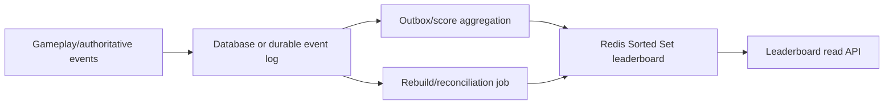
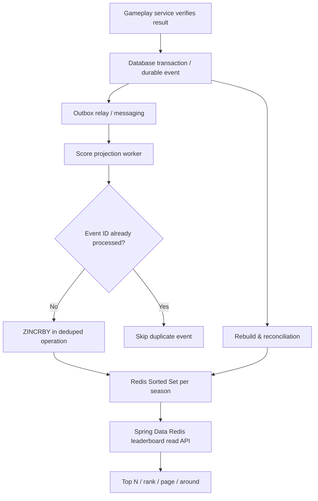

# Implementing a Leaderboard with Sorted Sets in Spring Data Redis

## 1. Practice Problem: Score-Based Leaderboard

Suppose a game application needs to display the **top 10 highest-scoring players** in a season. Each match can increase a player's score; users need to know their current rank, view a few nearby competitors, and paginate to see more results.

If you store data in a plain Hash and load all players to sort in Java, every request for the top 10 does unnecessary work. Redis has a better-suited data structure: **Sorted Set (ZSet)**.

With a Sorted Set, each *member* has a **score**. Redis maintains members ordered by score, allowing you to:

- Write or update a player's score.
- Increment scores atomically in a single Redis command.
- Retrieve the top N with scores.
- Find a player's rank.
- Paginate the leaderboard.
- Count players within a score range.
- Remove a player or delete an old season's board.

> Core mapping: **one Redis Sorted Set represents one leaderboard; the member is the player ID; the score is the ranking score**. There is no need to create a separate Redis key for each rank position.

Example:

```text
Redis key: lb:game:season-2026-w46:scores

member       score
player-102   250
player-201   180
player-305   180
player-411    90
```

When displayed in descending order, the player with 250 points ranks ahead of those with 180 points. Tied players need an explicit **tie-break** policy (see later section).

### 1.1. Expected Results

After this lesson, the application can provide illustrative operations:

| Feature | Primary Redis API | Spring Data Redis API |
|---|---|---|
| Set score | `ZADD` | `opsForZSet().add` |
| Add points | `ZINCRBY` | `opsForZSet().incrementScore` |
| Top 10 | `ZREVRANGE ... WITHSCORES` | `reverseRangeWithScores` |
| Rank | `ZREVRANK` | `reverseRank` |
| Current score | `ZSCORE` | `score` |
| Total players | `ZCARD` | `zCard` |
| Remove a player | `ZREM` | `remove` |
| Count by score | `ZCOUNT` | `count` |
| Delete old season | `UNLINK` or `DEL` key | `unlink` / `delete` |
| Keep board for a duration | `EXPIREAT` / `PEXPIREAT` | `expireAt` |

A production application also needs a **trusted score source, duplicate-write controls, score update authorization, memory limits, and a recovery plan**.

## 2. What Is a Sorted Set?

A Redis Sorted Set is a collection of **unique members**, each associated with a floating-point score. Redis orders members in ascending order of score. When you need a highest-first leaderboard, you read in **reverse order**.

Three characteristics:

1. **A member appears only once within the same ZSet.** `ZADD` with the same member updates the score rather than creating a second row.
2. **The score is a comparable and updatable number.** `ZINCRBY` adds a delta to the existing score, creating the member if it does not yet exist.
3. **Redis maintains the sorted structure.** There is no need to fetch every member to the application and sort again to view the top N.

CLI example:

```redis
DEL demo:lb:players

ZADD demo:lb:players 120 alice
ZADD demo:lb:players 200 bob
ZADD demo:lb:players 150 carol

ZRANGE demo:lb:players 0 -1 WITHSCORES
# alice 120, carol 150, bob 200

ZREVRANGE demo:lb:players 0 -1 WITHSCORES
# bob 200, carol 150, alice 120
```

`ZRANGE` by default reads from lowest to highest score; `ZREVRANGE` reads from highest to lowest. On Redis 6.2+, `ZRANGE ... REV` supports the same reverse reading idea in the newer syntax. `ZREVRANGE` remains familiar and is exposed by Spring Data Redis via `reverseRange...` operations.

### 2.1. How Does ZSet Differ from Set and Hash?

| Structure | Characteristics | Suitable For |
|---|---|---|
| Set | Unique members, no score for ranking | List of participating users |
| Hash | Multiple field/value pairs under one key | Detailed player profile info |
| Sorted Set | Unique members, with score and ordering | Ranking, top N, score-based pagination |
| List | Insertion order, allows duplicates | Ordered lists, simple queues |
| Stream | Entry IDs and consumer groups, event processing support | Storing score update streams, asynchronous processing |

A common design is **ZSet holds the ranking index**, while display information like name/avatar is read from a database or another cache by member ID.

Do not put player profile JSON into the member:

```text
Bad member:
{"id":"p42","name":"Alice","avatar":"/alice.png"}
```

If name/avatar changes, the member string changes, so Redis treats it as **a different member** and easily creates duplicate entries. A member should be an **immutable ID** without unnecessary personal data.

## 3. Data Design for the Leaderboard

Each season can have its own ZSet key:

```text
lb:game:season-2026-w46:scores
lb:game:season-2026-w47:scores
lb:game:season-2026-w48:scores
```

Inside the key:

```text
member = player:<opaque-player-id>
score  = total valid score for the season
```

Example:

```redis
ZADD lb:game:season-2026-w46:scores 180 player:1001
ZADD lb:game:season-2026-w46:scores 240 player:1002
ZADD lb:game:season-2026-w46:scores 120 player:1003
```

### 3.1. Why Does Each Season Need Its Own Key?

If you use a single ZSet for all time, the application has to figure out how to "reset" scores when seasons roll over. Resetting the entire key while producers are still writing can lose updates for the new season.

Using per-season keys:

- Clearly separates old and new rankings.
- Avoids mixing scores from two seasons.
- Allows viewing historical leaderboards.
- Sets different retention/TTLs per season.
- Lets you finalize an old season without blocking the new season from receiving scores.
- Makes building snapshots and verifying results easier.

Period names must be **standardized with a consistent rule**. If using ISO-8601 weeks, use the proper **week-based year**, not arbitrarily combining calendar year with week number at year-end boundaries.

### 3.2. Key Patterns and Input Limits

Use season IDs validated by the service, for example:

```text
season-2026-w46
season-2026-w47
```

Do not directly concatenate an arbitrary user-supplied string into the key:

```java
String key = "lb:game:" + request.getSeason() + ":scores";
```

without validation. Check length, character set, and valid period names to prevent creating unbounded keys, namespace collisions, or unexpected data in logs.

### 3.3. Members Must Be Stable and Free of Secrets

A member like:

```text
player:1001
```

can be fine in an internal system if the ID is non-sensitive. If the ID is an email, phone number, or token, use an appropriate opaque identifier. Redis members can appear in `ZRANGE` calls, backups, or operational tools, so do not treat them as secret storage.

## 4. Initializing the Leaderboard with redis-cli

Use a test key; do not touch production boards:

```redis
DEL demo:leaderboard:week46

ZADD demo:leaderboard:week46 300 p100
ZADD demo:leaderboard:week46 170 p200
ZADD demo:leaderboard:week46 250 p300
ZADD demo:leaderboard:week46 170 p400
ZADD demo:leaderboard:week46  80 p500

ZCARD demo:leaderboard:week46
# (integer) 5
```

### 4.1. Reading the Full Board Descending

```redis
ZREVRANGE demo:leaderboard:week46 0 -1 WITHSCORES
```

Result in descending score order:

```text
p100 300
p300 250
p400 170
p200 170
p500  80
```

Note that for the tied pair at 170, the reverse read uses reverse lexicographical order of the member strings for equal scores. **Do not assume this is a fair rule for who achieved the score first.** If business rules specify "earlier achiever ranks higher", design a dedicated tie-break.

### 4.2. Updating a Score

```redis
ZADD demo:leaderboard:week46 350 p300
ZREVRANK demo:leaderboard:week46 p300
# (integer) 0
```

`ZADD` on member `p300` updates its score from 250 to 350; it does not create a second `p300` row.

### 4.3. Adding Points

```redis
ZINCRBY demo:leaderboard:week46 50 p200

ZSCORE demo:leaderboard:week46 p200
# "220"
```

`ZINCRBY` performs score addition **atomically for a single member** in one Redis command. Two workers adding points concurrently will not suffer lost updates from both calling `GET` on the old score and overwriting it, provided they use the right primitive.

### 4.4. Reading One Player's Rank

```redis
ZREVRANK demo:leaderboard:week46 p100
```

Redis returns a **0-based** position when reading in descending score order:

- Redis rank 0 → display rank 1.
- Redis rank 1 → display rank 2.
- Non-existent member → nil/null.

If the API returns ranks to users, you usually need to add 1. Do not treat `ZREVRANK` as already being 1-based.

### 4.5. Removing a Player

```redis
ZREM demo:leaderboard:week46 p500

ZCARD demo:leaderboard:week46
```

`ZREM` removes the member from the ZSet. If scores come from business events that might be replayed, add safeguards so an old event does not re-add the member after removal.

## 5. Key Redis Sorted Set Commands to Remember

| Command | Result | Notes |
|---|---|---|
| `ZADD key score member` | Adds/updates member | If member already exists, score is replaced |
| `ZINCRBY key delta member` | New score | Atomic in one command |
| `ZSCORE key member` | Score or nil | Does not return rank automatically |
| `ZRANK key member` | Ascending rank, 0-based | Lowest score first |
| `ZREVRANK key member` | Descending rank, 0-based | Highest score first |
| `ZRANGE key start stop` | Ascending list | Supports `WITHSCORES` |
| `ZREVRANGE key start stop` | Descending list | Top N, pagination |
| `ZRANGE key start stop REV` | Reverse read with newer syntax | Redis 6.2+ |
| `ZCARD key` | Total members | Not the sum of scores |
| `ZCOUNT key min max` | Count of members with score in range | Supports open/closed bounds |
| `ZREM key member...` | Removes members | Does not delete auxiliary profile keys |
| `ZREMRANGEBYRANK` | Removes members in rank range | Be careful when keeping only top K |
| `ZREMRANGEBYSCORE` | Removes by score threshold | Alters the ranked set |
| `ZSCAN` | Iterates members via cursor | Does not guarantee a consistent snapshot while data changes |

### 5.1. Time Complexity and Implications

Basic score update and rank lookup operations on a Sorted Set typically have **logarithmic complexity in the number of members**; reading a range also depends on the number of returned items. This suits many large leaderboards because Java does not need to sort the entire dataset per request.

Still:

- Reading top 10 and reading top 1 million have very different costs.
- Returning a million members at once burdens network and heap.
- A very large ZSet consumes substantial memory.
- Every operation on a single ZSet key in Redis Cluster hits the node owning that slot.
- Many clients updating one key concurrently can turn it into a **hot key**.

Do not choose Redis Sorted Sets assuming every huge leaderboard is free in CPU and RAM.

## 6. Spring Boot and Spring Data Redis: Project Setup

The illustrative example uses Spring Boot 3.x, Spring Data Redis, and Java 17+.

### 6.1. Dependencies with Gradle

```groovy
plugins {
    id 'java'
    id 'org.springframework.boot' version '<SPRING_BOOT_VERSION>'
    id 'io.spring.dependency-management' version '<DEPENDENCY_MANAGEMENT_VERSION>'
}

java {
    toolchain {
        languageVersion = JavaLanguageVersion.of(17)
    }
}

dependencies {
    implementation 'org.springframework.boot:spring-boot-starter-data-redis'
    implementation 'org.springframework.boot:spring-boot-starter-web'

    testImplementation 'org.springframework.boot:spring-boot-starter-test'
    testImplementation 'org.testcontainers:testcontainers'
    testImplementation 'org.testcontainers:junit-jupiter'
}

tasks.named('test') {
    useJUnitPlatform()
}
```

`<SPRING_BOOT_VERSION>` and `<DEPENDENCY_MANAGEMENT_VERSION>` are **placeholders to replace with compatible versions in your project**, not a runnable build file as-is. In projects already using the Spring Boot BOM/plugin, do not repeat dependency-management plugin declarations.

If you only write the service without REST endpoints, the web starter is not required. The lesson includes a controller, so the web starter is included.

### 6.2. Redis Connection

```yaml
spring:
  data:
    redis:
      host: localhost
      port: 6379
      connect-timeout: 2s
      timeout: 3s
```

`spring.data.redis.*` is the standard prefix in Spring Boot 3.x. In Boot 2.x, properties were typically `spring.redis.*`; do not copy a prefix from another project without checking the version.

In production, host, TLS, Redis ACL user/password, and pool parameters should come from environment configuration or a secret manager. Do not hardcode passwords in source code.

### 6.3. Why StringRedisTemplate?

`StringRedisTemplate` serializes keys and values as Strings, making it convenient to:

- Inspect via CLI with `ZRANGE`.
- Use player IDs as members.
- Avoid key serializer mismatches during debugging.
- Maintain easy interoperability across services.

If using `RedisTemplate<String, Player>` with a custom serializer, ensure ZSet members have **stable identity**. Do not put a mutable object into a member and expect Redis to recognize it as the same player.

## 7. Designing the Leaderboard Management Service

We will build a `LeaderboardService` providing:

- `setScore`: set an absolute score for a player.
- `addPoints`: increment points.
- `top`: read the top N highest-scoring players.
- `page`: paginate.
- `standing`: get a player's rank and score.
- `countPlayers`: count members.
- `removePlayer`: remove a member.

### 7.1. Result DTO

```java
package com.example.leaderboard;

public record LeaderboardEntry(
        String playerId,
        long rank,
        double score
) {
}
```

`rank` uses **1-based display rank**. `double` matches the Redis score interface. If business rules only use integer scores, constrain them to integers exactly representable in a Redis double, and do not use this type directly for monetary balances.

### 7.2. Complete LeaderboardService Implementation

```java
package com.example.leaderboard;

import java.util.ArrayList;
import java.util.List;
import java.util.Optional;
import java.util.Set;
import java.util.regex.Pattern;

import org.springframework.data.redis.core.StringRedisTemplate;
import org.springframework.data.redis.core.ZSetOperations;
import org.springframework.stereotype.Service;

@Service
public class LeaderboardService {

    private static final Pattern ID_PATTERN =
            Pattern.compile("[A-Za-z0-9_-]{1,64}");

    private static final int MAX_PAGE_SIZE = 100;
    private static final long MAX_OFFSET = 10_000L;

    private final StringRedisTemplate redis;

    public LeaderboardService(StringRedisTemplate redis) {
        this.redis = redis;
    }

    private String key(String season) {
        validateId(season, "season");
        return "lb:game:" + season + ":scores";
    }

    private String member(String playerId) {
        validateId(playerId, "playerId");
        return "player:" + playerId;
    }

    private static void validateId(String id, String field) {
        if (id == null || !ID_PATTERN.matcher(id).matches()) {
            throw new IllegalArgumentException(
                    "Invalid " + field
            );
        }
    }

    private static void validateScore(double score) {
        if (!Double.isFinite(score) || score < 0) {
            throw new IllegalArgumentException(
                    "Score must be finite and non-negative"
            );
        }
    }

    public void setScore(
            String season, String playerId, double score) {

        validateScore(score);

        // ZADD: write an absolute score or update an existing member.
        redis.opsForZSet().add(
                key(season),
                member(playerId),
                score
        );
    }

    public double addPoints(
            String season, String playerId, long points) {

        if (points <= 0) {
            throw new IllegalArgumentException(
                    "Points must be positive"
            );
        }

        Double newScore = redis.opsForZSet().incrementScore(
                key(season),
                member(playerId),
                points
        );

        if (newScore == null) {
            throw new IllegalStateException(
                    "No score returned by Redis"
            );
        }

        return newScore;
    }

    public Optional<LeaderboardEntry> standing(
            String season, String playerId) {

        String key = key(season);
        String member = member(playerId);

        Long zeroBasedRank =
                redis.opsForZSet().reverseRank(key, member);

        if (zeroBasedRank == null) {
            return Optional.empty();
        }

        Double score =
                redis.opsForZSet().score(key, member);

        if (score == null) {
            // Two separate commands: a concurrent write/delete may have intervened.
            return Optional.empty();
        }

        return Optional.of(new LeaderboardEntry(
                playerId,
                zeroBasedRank + 1,
                score
        ));
    }

    public List<LeaderboardEntry> top(
            String season, int limit) {

        if (limit < 1 || limit > MAX_PAGE_SIZE) {
            throw new IllegalArgumentException(
                    "limit must be between 1 and 100"
            );
        }

        return page(season, 0, limit);
    }

    public List<LeaderboardEntry> page(
            String season, long pageIndex, int pageSize) {

        if (pageIndex < 0
                || pageSize < 1
                || pageSize > MAX_PAGE_SIZE) {
            throw new IllegalArgumentException(
                    "Invalid page"
            );
        }

        long offset = Math.multiplyExact(
                pageIndex, (long) pageSize
        );

        if (offset > MAX_OFFSET) {
            throw new IllegalArgumentException(
                    "Page offset too large"
            );
        }

        long end = offset + pageSize - 1;

        Set<ZSetOperations.TypedTuple<String>> tuples =
                redis.opsForZSet().reverseRangeWithScores(
                        key(season),
                        offset,
                        end
                );

        if (tuples == null || tuples.isEmpty()) {
            return List.of();
        }

        List<LeaderboardEntry> result =
                new ArrayList<>(tuples.size());

        long rank = offset + 1;

        for (ZSetOperations.TypedTuple<String> tuple : tuples) {
            if (tuple.getValue() == null
                    || tuple.getScore() == null) {
                throw new IllegalStateException(
                        "Unexpected leaderboard entry"
                );
            }

            String storedMember = tuple.getValue();

            if (!storedMember.startsWith("player:")) {
                throw new IllegalStateException(
                        "Unexpected leaderboard member"
                );
            }

            String playerId =
                    storedMember.substring("player:".length());

            result.add(new LeaderboardEntry(
                    playerId,
                    rank++,
                    tuple.getScore()
            ));
        }

        return result;
    }

    public long countPlayers(String season) {
        Long count = redis.opsForZSet().zCard(key(season));
        return count == null ? 0L : count;
    }

    public boolean removePlayer(
            String season, String playerId) {

        Long removed = redis.opsForZSet().remove(
                key(season),
                member(playerId)
        );

        return removed != null && removed > 0;
    }
}
```

The APIs in the example are standard `ZSetOperations` methods. This snippet shows core data access; it does not yet implement score-update authorization, event idempotency, season-closing policy, or source-of-truth persistence.

### 7.3. Why Separate setScore and addPoints?

`setScore` calls `ZADD`: **writes an absolute score value**.

`addPoints` calls `ZINCRBY`: **adds a delta of points**.

Example:

```text
Initial score = 100

setScore(120) -> 120
setScore(120) -> 120

addPoints(20) -> 140
addPoints(20) -> 160
```

Two identical `ZADD` commands can be idempotent with respect to score. Two identical `ZINCRBY` commands are **not idempotent**: both add points.

This distinction matters when producers send events over queues that may retry or when a Redis reply is lost.

### 7.4. A false Return from add Does Not Mean Failure

Spring `ZSetOperations.add` returns a Boolean indicating whether a **new** member was added. If the member already existed and its score was updated, the result can be `false`. That does not mean Redis rejected the change.

Do not write:

```java
if (!Boolean.TRUE.equals(redis.opsForZSet()
        .add(key, member, score))) {
    throw new IllegalStateException("Cannot save score");
}
```

because updating an existing member's score is completely normal.

Similarly, inside a pipeline or transaction, some APIs return `null` because replies are not processed immediately; do not treat the return value of a pipelined command like a standalone call.

## 8. Running Operations Through the Spring Service

Suppose the application calls:

```java
leaderboardService.setScore(
        "season-2026-w46", "p100", 300
);

leaderboardService.setScore(
        "season-2026-w46", "p200", 150
);

leaderboardService.setScore(
        "season-2026-w46", "p300", 220
);

leaderboardService.addPoints(
        "season-2026-w46", "p200", 100
);
```

Final scores:

```text
p100 = 300
p200 = 250
p300 = 220
```

Read top 3:

```java
List<LeaderboardEntry> top =
        leaderboardService.top("season-2026-w46", 3);
```

Sample output:

```json
[
  {"playerId": "p100", "rank": 1, "score": 300.0},
  {"playerId": "p200", "rank": 2, "score": 250.0},
  {"playerId": "p300", "rank": 3, "score": 220.0}
]
```

Look up a player:

```java
Optional<LeaderboardEntry> standing =
        leaderboardService.standing(
                "season-2026-w46",
                "p200"
        );
```

Result:

```text
playerId = p200
rank     = 2
score    = 250.0
```

Do not mistake this example for an anti-cheat architecture: score-writing methods must only be called from workflows that have verified the achievement.

## 9. Creating a Read-Only Leaderboard REST API

A simple controller can serve the top list and individual rankings. **Do not expose an endpoint allowing arbitrary users to add points directly.**

```java
package com.example.leaderboard;

import java.util.List;

import org.springframework.http.ResponseEntity;
import org.springframework.web.bind.annotation.GetMapping;
import org.springframework.web.bind.annotation.PathVariable;
import org.springframework.web.bind.annotation.RequestMapping;
import org.springframework.web.bind.annotation.RequestParam;
import org.springframework.web.bind.annotation.RestController;

@RestController
@RequestMapping("/api/leaderboards")
public class LeaderboardController {

    private final LeaderboardService leaderboard;

    public LeaderboardController(LeaderboardService leaderboard) {
        this.leaderboard = leaderboard;
    }

    @GetMapping("/{season}/top")
    public List<LeaderboardEntry> top(
            @PathVariable String season,
            @RequestParam(defaultValue = "10") int limit) {

        return leaderboard.top(season, limit);
    }

    @GetMapping("/{season}/page")
    public List<LeaderboardEntry> page(
            @PathVariable String season,
            @RequestParam(defaultValue = "0") long page,
            @RequestParam(defaultValue = "20") int size) {

        return leaderboard.page(season, page, size);
    }

    @GetMapping("/{season}/players/{playerId}")
    public ResponseEntity<LeaderboardEntry> standing(
            @PathVariable String season,
            @PathVariable String playerId) {

        return leaderboard.standing(season, playerId)
                .map(ResponseEntity::ok)
                .orElseGet(() ->
                        ResponseEntity.notFound().build());
    }
}
```

Testing:

```http
GET /api/leaderboards/season-2026-w46/top?limit=10
GET /api/leaderboards/season-2026-w46/page?page=1&size=20
GET /api/leaderboards/season-2026-w46/players/p200
```

In production, also add:

- Authorization if the leaderboard is not public.
- Rate limiting and quotas for the API.
- Format validation for season and player IDs.
- Mapping `IllegalArgumentException` to HTTP 400 rather than letting it propagate as HTTP 500.
- Bounds on `size` and `page` to prevent huge replies.
- HTTP caching or application caching for very hot top pages if appropriate.
- No PII returned from Redis members in responses.

### 9.1. Do Not Let Users Set Their Own Scores

An endpoint like:

```http
POST /api/leaderboards/season-2026-w46/players/p200/score
{"score": 9999999}
```

if callable by normal clients creates a cheating vulnerability. Scores must be **verified server-side from trusted business events**: match completion, result verification, valid payment processing, or verified task completion.

The leaderboard controller can be read-only. ZSet updates go through an authorized internal service/consumer with event IDs and audit records.

## 10. Descending Ranking and 0-Based Ranks

To display the highest-scoring players:

```redis
ZREVRANK lb:game:season-2026-w46:scores player:p100
```

or on Redis supporting the newer syntax:

```redis
ZRANK lb:game:season-2026-w46:scores player:p100 REV
```

Redis returns a **zero-based rank**. Users usually expect ranks 1, 2, 3, so the application adds 1.

| Redis `ZREVRANK` | Display Rank |
|---:|---:|
| 0 | 1 |
| 1 | 2 |
| 2 | 3 |
| nil | Not on the board yet |

If the member does not exist, `reverseRank` returns `null`. Do not convert `null` to rank 0 or last place unless business rules specifically require that.

### 10.1. Reading Rank and Score in Two Commands Has a Race

In `LeaderboardService.standing`, the code calls:

```java
Long rank = redis.opsForZSet().reverseRank(key, member);
Double score = redis.opsForZSet().score(key, member);
```

These are **two separate commands**. Between them, a worker could update the score, so the API could return a rank from time A and a score from time B.

For near-realtime dashboards, a tiny discrepancy may be acceptable per the SLA. If an **atomic snapshot** of rank + score is required, use an appropriate Redis Lua script/Function calling `ZREVRANK` and `ZSCORE` in a single server-side execution, defining behavior when the member is absent.

Pipelining the two commands reduces round-trips but **does not guarantee other clients' commands will not interleave**.

## 11. Handling Ties

This section determines what "rank" means.

### 11.1. Default Redis Ordering for Equal Scores

A Redis Sorted Set sorts ascending by score. When two members have **equal scores**, Redis uses lexicographical order of the members as a tie-breaker. When reading in reverse range, that lexicographical order is also reversed.

Example:

```redis
DEL demo:leaderboard:ties

ZADD demo:leaderboard:ties 100 alice
ZADD demo:leaderboard:ties 100 bob
ZADD demo:leaderboard:ties 100 carol

ZREVRANGE demo:leaderboard:ties 0 -1 WITHSCORES
```

In this case, members appear in reverse alphabetical order:

```text
carol 100
bob   100
alice 100
```

Thus `ZREVRANK` returns a distinct position for each member, even with the same score of 100. Do not claim "Redis automatically puts whoever reached the score earlier first".

### 11.2. Three Ways to Define Rank

Suppose scores are:

```text
p100 = 300
p200 = 250
p300 = 250
p400 = 200
```

| Rank Type | Typical Expected Result | Interpretation |
|---|---|---|
| **Ordinal rank** | 1, 2, 3, 4 | Each member gets a distinct position in a stable order |
| **Competition rank** | 1, 2, 2, 4 | Tied scores share a rank; subsequent rank leaves a gap |
| **Dense rank** | 1, 2, 2, 3 | Tied scores share a rank; subsequent rank is consecutive |

`ZREVRANK` provides **ordinal position** in Redis order. If the UI requires competition rank, compute:

```text
competitionRank(player) =
    1 + count of members with score > score(player)
```

In Redis CLI, to count entries with a score greater than 250:

```redis
ZCOUNT demo:leaderboard:ties (250 +inf
```

The `(250` notation denotes an **exclusive** lower bound, excluding members with score exactly 250. The example above is illustrative; to try it, populate corresponding data in the key being queried by `ZCOUNT`.

**Do not use `1 + ZREVRANK` if product requirements specify shared ranks for ties.**

### 11.3. Dense Rank Is More Complex

Dense rank requires counting the number of **distinct score tiers** higher than the player's score, not the number of members with higher scores. Redis ZSet does not provide a simple `COUNT DISTINCT score` command across the board without auxiliary structures or computation.

Options:

- Accept Redis ordinal ranking and document the rule clearly.
- Compute competition rank using `ZCOUNT` by score.
- Maintain an auxiliary projection for counts per score if dense rank is needed at scale.
- Compute ranks when reading from another source if queries are infrequent.
- Use batch/snapshots if ranks are finalized at season close.

Do not naively maintain an auxiliary "distinct scores" index without handling players changing scores and score counts dropping back to 0.

### 11.4. Tie-Breaking by Time Achieved

A common requirement: "Whoever reaches 100 points first ranks higher than someone reaching 100 later".

This timestamp cannot be inferred from default `ZREVRANK`. Designs include:

1. Store true scores and achievement timestamps in an authoritative data source.
2. Build a snapshot sorted by descending score, ascending timestamp, and player ID for stability.
3. Or use a composite ranking score with proven arithmetic rules and bounds.
4. Keep an audit trail to handle late-arriving or corrected events.

**Be careful with composite scores like `score * 10^13 - timestamp`**: Redis scores are doubles, which cannot accurately represent all large integers. Packing values can cause rounding and break the intended order. If fair tie-breaking matters, build that rule into the data design from the start rather than "adding a little decimal" to scores.

## 12. Scores Are Doubles: Precision Limits

Redis uses double-precision floating-point numbers for Sorted Set scores. Doubles accurately represent **all integers** within a safe range up to a threshold, but cannot accurately represent every real number or arbitrarily large integers.

### 12.1. With Integer Scores

Using integer deltas in `ZINCRBY` is reasonable when total scores stay within the exact-integer range of IEEE-754 double, specifically staying below **2^53** when single-point increments must remain distinguishable.

```text
2^53 = 9,007,199,254,740,992
```

If a leaderboard only reaches a few million integer points, this issue generally will not arise. However, for systems accumulating points over billions of events or treating scores like money, evaluate carefully.

### 12.2. Do Not Use Sorted Sets to Store Monetary Balances Just Because They Have Scores

Scores like:

```text
0.1
0.2
0.3
```

can exhibit binary floating-point rounding artifacts. For financial values, use smallest-unit integers within safe bounds or a proper accounting data source; a Redis ZSet leaderboard should only be a **ranking display projection**, not a financial ledger.

### 12.3. Input Validation

Before calling `ZADD`:

- Reject NaN.
- Reject infinity if the domain has no such concept.
- Reject negative scores if game rules require non-negative scores.
- Cap maximum scores to prevent overflow/abuse.
- Verify scores/deltas against the source of truth rather than trusting client input.

`Double.isFinite(score)` is a basic check in Java, not complete business validation.

## 13. Leaderboard Pagination

An API normally does not load all players. Spring Data Redis provides:

```java
redis.opsForZSet().reverseRangeWithScores(
        key, startInclusive, endInclusive
);
```

**Both rank bounds are inclusive.** With a 0-based `pageIndex` and `pageSize`:

```text
start = pageIndex * pageSize
end   = start + pageSize - 1
```

Example with `pageSize = 20`:

| Page index | Redis start | Redis end | Display ranks |
|---:|---:|---:|---|
| 0 | 0 | 19 | 1–20 |
| 1 | 20 | 39 | 21–40 |
| 2 | 40 | 59 | 41–60 |

If you pass `end = start + pageSize`, the page can contain **21 elements** instead of 20. This is a very common off-by-one bug.

### 13.1. Limits Protect More Than CPU

Limiting `pageSize` protects:

- Redis read time.
- Response bandwidth.
- JVM memory during deserialization.
- JSON response size.
- Controller/service CPU.
- Risk of a client using the API to enumerate the entire leaderboard.

In the example service, `MAX_PAGE_SIZE = 100` and `MAX_OFFSET = 10_000` are **illustrative bounds** that should be tuned to product and performance needs.

### 13.2. Pagination on a Mutating Board Is Not a Fixed Snapshot

Suppose a user reads page 0, and between reads another player gains points and jumps to the top of the board. When the user reads page 1, one player may appear twice or another may be skipped because the ordering shifted.

This is a characteristic of **offset pagination over a mutating result set**.

If a consistent leaderboard browsing session is required:

- Create a snapshot at a point in time/version.
- Use an immutable ZSet key for a finalized board.
- Pass a snapshot ID in the API.
- Or design cursor/keyset pagination on `(score, member)` pairs with clear tie-handling rules.

You cannot simply replace offset with `lastScore` when players can tie on score: member tie-breaking must be handled to avoid skipping or duplicating entries.

## 14. Fetching Players Around the Current Position

A common UX displays:

```text
Rank 148: player-A
Rank 149: player-B
Rank 150: you
Rank 151: player-C
Rank 152: player-D
```

Simple approach:

1. Call `reverseRank(key, member)` to get the zero-based rank.
2. Compute `start = max(0, rank - radius)`.
3. Compute `end = rank + radius`.
4. Call `reverseRangeWithScores(key, start, end)`.
5. Map to 1-based ranks.

Example method:

```java
public List<LeaderboardEntry> aroundPlayer(
        String season, String playerId, int radius) {

    if (radius < 0 || radius > 20) {
        throw new IllegalArgumentException("Invalid radius");
    }

    String key = "lb:game:" + season + ":scores";
    String member = "player:" + playerId;

    Long position = redis.opsForZSet()
            .reverseRank(key, member);

    if (position == null) {
        return List.of();
    }

    long start = Math.max(0, position - radius);
    long end = position + radius;

    var tuples = redis.opsForZSet()
            .reverseRangeWithScores(key, start, end);

    // Map results in returned order,
    // display rank starts at start + 1.
    // Also validate season/playerId per service policy.
    return convertTuples(tuples, start);
}
```

This is an **algorithmic snippet**, not a method you can paste verbatim into the class in Section 7 because `convertTuples` is not defined yet. When implementing, extract the `TypedTuple`-to-`LeaderboardEntry` conversion logic from `page` into a shared helper and call it.

### 14.1. Race Between Reading Rank and Range

Like `standing`, updates can occur between the two commands:

```text
ZREVRANK you -> 149
Another player gains points, pushing you down to rank 151
ZREVRANGE 147 151 -> new slice of results
```

The result might not center you exactly in the list. For realtime UX that tolerates eventual consistency, this is often acceptable. When an exact snapshot is needed, use a server-side operation or appropriate snapshot version.

## 15. Counting Players in a Score Range

Redis provides:

```redis
ZCOUNT demo:leaderboard:week46 100 199
```

This command counts members with scores from 100 to 199, using inclusive bounds by default.

Example questions:

- How many people scored 0 to 99?
- How many people scored 100 to 499?
- How many people scored over 1000?

In Spring Data Redis:

```java
Long count = redis.opsForZSet()
        .count(
                "lb:game:season-2026-w46:scores",
                100.0,
                499.0
        );
```

`ZSetOperations.count` takes two double bounds, normally **inclusive**. If you need an exclusive bound to compute competition rank, use appropriate Redis range syntax via a supporting command or server-side script; do not use an inclusive `count(score, +infinity)` and treat it as "players with higher scores", because that also counts tied players.

### 15.1. Score Statistics Differ from Rank

Example:

```text
120 players scored 100–199
75 players scored 200–299
12 players scored 300–399
```

These statistics serve score-distribution dashboards. However, if awarding top 10% prizes, decide:

- Is 10% out of **total current members** or eligible participants?
- Are bots, banned accounts, or invalidated achievements excluded?
- When tied at the prize threshold, are all awarded or is a tie-break applied?
- At what exact moment are results finalized?

Redis provides counting/ranking primitives; it does not enforce prize rules on its own.

## 16. Concurrent Score Updates: ZINCRBY vs GET-then-SET

### 16.1. Approach Prone to Lost Updates

Suppose two workers both add 10 points:

```text
Initial score = 100

Worker A: ZSCORE -> 100
Worker B: ZSCORE -> 100

Worker A: ZADD 110
Worker B: ZADD 110

Final result = 110, should have been 120.
```

A read-modify-write cycle across two Redis commands causes **lost updates**.

### 16.2. Using ZINCRBY

```redis
ZINCRBY lb:game:season-2026-w46:scores 10 player:p100
```

If two workers run concurrently, Redis executes both increment commands and the total increases by 20 (assuming no other commands alter the score). This is an atomic primitive on a single member.

In Spring Data Redis:

```java
Double updated = redis.opsForZSet().incrementScore(
        "lb:game:season-2026-w46:scores",
        "player:p100",
        10.0
);
```

**However, atomic increment does not prevent an event from being processed twice.** If the same `eventId` is redelivered on retry and both `ZINCRBY` calls execute, Redis legitimately increments the score twice.

## 17. Duplicate Events and Idempotency: Do Not Add Points Twice

In queue/Stream architectures, at-least-once delivery must be anticipated:

```text
Producer emits ScoreEarned(eventId=evt-42, player=p100, points=10)
        |
        v
Consumer calls ZINCRBY -> succeeds
        |
        x  Process dies before ACK
        |
        v
Event evt-42 is redelivered
        |
        v
Consumer calls ZINCRBY again -> adds 10 points twice
```

This cannot be fixed merely by using `ZINCRBY` instead of `ZADD`. You need a **unique event identifier** and applied-state tracking.

### 17.1. Two Approaches to Guarantee Score Correctness

**Approach A — absolute score from an authoritative source.**

A database stores the true total score. Redis is only a projection:

```text
DB updates score=230
Outbox event PlayerScoreChanged(playerId=p100, version=42, score=230)
Consumer refreshes Redis ZSet
```

A duplicate event with the same version/score can be processed idempotently, though **out-of-order events** can still regress the score if the consumer only calls `ZADD` without checking versions.

When events can arrive out of order, apply version checks with atomic updates or rebuild from the source.

**Approach B — point increments with event dedup in Redis.**

Use a structure recording applied event IDs and increment the score in the same Lua/Redis Function operation, respecting necessary key/slot boundaries.

This suits certain workloads, though persistence/replication, dedup retention, and event ordering still require consideration.

### 17.2. Illustrative Lua Script for Dedup + ZINCRBY

Suppose there are two Redis keys:

```text
lb:{season-2026-w46}:scores
lb:{season-2026-w46}:processed-events
```

Both keys use the same hash tag `{season-2026-w46}` so they map to the same hash slot in Redis Cluster. Do not share one hash tag across all seasons if load needs to be distributed across periods.

Script:

```lua
-- KEYS[1] = Scores Sorted Set
-- KEYS[2] = Set storing processed event IDs
-- ARGV[1] = eventId
-- ARGV[2] = member/playerId
-- ARGV[3] = points to add (positive integer)

local eventId = ARGV[1]
local player = ARGV[2]
local points = tonumber(ARGV[3])

if not eventId or eventId == ''
   or not player or player == ''
   or not points or points <= 0
   or points ~= math.floor(points) then
    return redis.error_reply('INVALID_ARGUMENTS')
end

-- Check types BEFORE recording an event trace.
local scoresType = redis.call('TYPE', KEYS[1]).ok
local eventsType = redis.call('TYPE', KEYS[2]).ok

if scoresType ~= 'none' and scoresType ~= 'zset' then
    return redis.error_reply('WRONGTYPE_SCORES')
end

if eventsType ~= 'none' and eventsType ~= 'set' then
    return redis.error_reply('WRONGTYPE_EVENTS')
end

if redis.call('SISMEMBER', KEYS[2], eventId) == 1 then
    return 0
end

redis.call('SADD', KEYS[2], eventId)
redis.call('ZINCRBY', KEYS[1], points, player)

return 1
```

Results:

- `1`: new event recorded and score incremented.
- `0`: event ID already present, so duplicate increment skipped.
- Error: invalid input/type per defined checks.

Because Redis executes the script as an uninterrupted unit, two workers concurrently sending **the same eventId** to these keys cannot both pass `SISMEMBER` and add points twice.

### 17.3. An Important Limit: Lua Scripts Do Not Roll Back Every Write

Redis scripts are **atomic with respect to interleaved execution**, but if a script hits a runtime error **after executing a write**, Redis does not automatically roll back prior changes.

The example checks key types before calling `SADD` to reduce a predictable error cause. That is not a full ACID transaction guarantee for every scenario.

For strict correctness:

- Validate inputs and schemas before writing.
- Bound maximum scores and update counts.
- Maintain a data/audit source for reconciliation.
- Design idempotency/consistency around failovers.
- Do not claim "end-to-end exactly once" merely because a script runs atomically on the master.

### 17.4. Calling the Script from Spring Data Redis

Integration-level example:

```java
import java.util.List;

import org.springframework.data.redis.core.StringRedisTemplate;
import org.springframework.data.redis.core.script.DefaultRedisScript;

public class IdempotentScoreUpdater {

    private final StringRedisTemplate redis;
    private final DefaultRedisScript<Long> script;

    public IdempotentScoreUpdater(
            StringRedisTemplate redis,
            String luaSource) {

        this.redis = redis;

        DefaultRedisScript<Long> redisScript =
                new DefaultRedisScript<>();

        redisScript.setScriptText(luaSource);
        redisScript.setResultType(Long.class);
        this.script = redisScript;
    }

    public boolean apply(
            String season,
            String eventId,
            String playerId,
            long points) {

        // All inputs must be validated at the service layer.
        String hashTag = "{" + season + "}";

        String scoresKey = "lb:" + hashTag + ":scores";
        String seenKey =
                "lb:" + hashTag + ":processed-events";

        Long result = redis.execute(
                script,
                List.of(scoresKey, seenKey),
                eventId,
                "player:" + playerId,
                Long.toString(points)
        );

        return Long.valueOf(1).equals(result);
    }
}
```

`luaSource` in the example must be loaded from an application-managed resource/script (such as the classpath) or supplied via secure configuration. The class above illustrates `DefaultRedisScript`; it **does not yet implement loading Lua from a file** or validation/expiry policies.

**Key naming must be consistent.** The script example uses `lb:{season}:scores`, differing from the `lb:game:season:scores` demo namespace in the earlier service. In a real application, pick **a single key factory**. If Redis Cluster multi-key scripts are needed, the key factory can generate:

```text
lb:game:{season-2026-w46}:scores
lb:game:{season-2026-w46}:processed-events
```

so both regular service methods and scripts use them consistently.

### 17.5. Retention of the Dedup Set

If `processed-events` keeps every event ID forever, Redis memory grows with total processed events. If dedup IDs are deleted too early, a retried or replayed old event will add points again.

Retention must cover:

- The window in which events may be redelivered.
- Allowed replay/backfill windows.
- Duration the season still accepts updates.
- Error correction/reconciliation windows.
- Archive policy of the event source.

Another option is relying on an outbox/database with a unique constraint on `eventId`. For leaderboards with massive event volume, storing billions of event IDs in a Redis Set may be uneconomical.

### 17.6. Do Not Use SADD Followed by ZINCRBY as Two Independent Commands

Incorrect when atomic dedup is needed:

```java
Boolean newEvent = redis.opsForSet()
        .add(seenKey, eventId) > 0;

if (newEvent) {
    redis.opsForZSet().incrementScore(
            scoresKey, playerId, points);
}
```

These are two commands; if the process dies after marking the event processed but before incrementing the score, a retry sees the event already recorded and **permanently skips adding the points**. A Lua script or appropriate transaction narrows this gap. In real source code, also handle the `Long` return type of `SetOperations.add` properly without null-unsafe comparisons.

## 18. Consistency with Multiple Score Update Sources

A leaderboard might receive scores from:

- Finalized match results.
- Event-based bonus awards.
- Penalty deductions.
- Admin adjustments.
- Refund/cancellation workflows.
- Full score recalculation after bug discovery.

If one flow uses `ZINCRBY` and another uses `ZADD` with an absolute score, operations can overwrite each other without a consistency rule.

Example:

```text
DB computes true score = 200
Worker A prepares ZADD 200

Worker B receives new bonus, ZINCRBY +20 -> 220
Worker A sends ZADD 200 afterward -> 200

The bonus disappears from the projection.
```

This cannot be fixed solely by "Redis executes commands atomically", because the ordering of two individually valid commands is business-invalid.

Options:

1. **A single source** determines the score and publishes monotonically increasing versions.
2. Consumers apply updates only if the version is newer than the current version.
3. All changes flow through a single event pipeline serialized per player.
4. Persist authoritative scores in a database, then rebuild the Redis projection when needed.
5. For conditional multi-key updates, use appropriate Lua/Functions and same-slot keys.

A production leaderboard solution should document **who is allowed to call `setScore`, who is allowed to call `incrementScore`**, and where score versions are validated.

## 19. Refreshing and Finalizing Seasonal Leaderboards

### 19.1. Do Not Delete a Key Actively Used by Producers

An end-of-week cron job:

```redis
DEL lb:game:current:scores
```

carries risks:

- Producers are currently updating this key.
- Consumers reprocess a previous week's event after the key was reset.
- Top-N requests are currently reading.
- No snapshot remains to resolve disputes.
- Unrecoverable loss of historical scores.

Instead, use **per-period keys** and route the season from the business event:

```text
event.timestamp/seasonId -> choose the key for the corresponding season

lb:game:season-2026-w46:scores
lb:game:season-2026-w47:scores
```

Players do not lose points simply because a `currentWeek` variable flipped mid-processing of older events.

### 19.2. Season IDs Must Follow a Unified Time Rule

Java example using ISO weeks:

```java
import java.time.Instant;
import java.time.LocalDate;
import java.time.ZoneOffset;
import java.time.temporal.WeekFields;

public final class SeasonId {

    private SeasonId() {
    }

    public static String isoWeek(Instant eventTime) {
        LocalDate date = eventTime
                .atZone(ZoneOffset.UTC)
                .toLocalDate();

        int week = date.get(
                WeekFields.ISO.weekOfWeekBasedYear());

        int year = date.get(
                WeekFields.ISO.weekBasedYear());

        return "season-" + year
                + "-w" + String.format("%02d", week);
    }
}
```

The example uses UTC so all services share the same reference. If competition rules follow a tournament timezone, substitute the specified `ZoneId` and record it explicitly in the event. Do not compute seasons using server local clocks that differ across pods.

Especially in late December/early January, **ISO week-based year** can differ from the calendar year. Using `WeekFields.ISO.weekBasedYear()` prevents placing events into the wrong season.

### 19.3. Finalizing a Leaderboard

When a season ends:

1. Lock the valid event scope and late-event acceptance deadline.
2. Ensure score-updating consumers have caught up.
3. Reconcile against the authoritative event/score source.
4. Generate a result snapshot and audit record if prizes exist.
5. Enforce business locks preventing updates to the finalized board.
6. Publish results based on the approved snapshot.
7. Retain old Redis leaderboards according to retention/replay policies.

**Finalizing a board** is a business workflow, not just running `EXPIRE` and assuming the final scoreboard is accurate.

## 20. TTL for Leaderboards

TTL applies to the **Sorted Set Redis key**, not an individual member:

```redis
EXPIRE lb:game:season-2026-w46:scores 1209600
```

In the example above, the TTL is 1,209,600 seconds (14 days). When the key expires, all members and scores in the board disappear.

### 20.1. Using an Absolute Expiration Time for a Season

If you want to keep a season until a specific timestamp, you can use `EXPIREAT` or the `expireAt` API in Spring Data Redis.

```java
import java.time.Instant;

Instant expireAt = Instant.parse(
        "2026-12-01T00:00:00Z"
);

redis.expireAt(
        "lb:game:season-2026-w46:scores",
        expireAt
);
```

This is an illustrative timestamp, not a universal retention rule for every tournament.

**Do not reset a 14-day TTL on every player score event** if the requirement is "keep the board for 14 days after season close". If every update runs `EXPIRE 14d`, an old season receiving late events could have its retention extended unexpectedly.

### 20.2. Do ZADD/ZINCRBY Remove a Key's TTL?

When a ZSet key already has a TTL, operations modifying **ZSet contents** such as `ZADD`/`ZINCRBY` normally do not alter the key's TTL the way `SET` replaces a String key. However, if the key has already expired and is recreated, it is a brand-new key and will **not automatically inherit the old TTL**.

Therefore, if retention is mandatory, design key creation and expiry setting consistently, or use a script when ensuring entry creation is accompanied by expiry.

### 20.3. When Long-Term History Is Required

If ranking results carry audit, prize, or dispute value, do not keep them solely in Redis with a short TTL. Finalize and persist results to a durable store with appropriate backup/retention, using Redis as the fast query layer.

## 21. Is the Leaderboard a Cache or Primary Data Source?

A system can use Redis under two models.

### 21.1. Redis as Projection/Cache



In this model:

- The database/event log holds history and true scores.
- Redis is rebuilt from source data if lost.
- Losing Redis causes cache misses/rebuild delay, **not loss of original achievements**.
- The source resolves score adjustments, disputes, and idempotency.
- Redis provides fast top-N/rank reads.

This model fits many leaderboard systems with high correctness requirements.

### 21.2. Redis as the Sole Score Store

```text
Gameplay event -> ZINCRBY in Redis
No database/event log retains the results
```

In this case, losing Redis or losing writes on failover can cause **permanent score loss**. Consider:

- AOF/RDB persistence and RPO.
- Replication, Sentinel/Cluster, and failover.
- Independent backups and restore drills.
- Appropriate memory/eviction policy.
- Handling write timeouts with uncertain outcomes.
- Ability to replay/reconcile scores.
- Whether a transactional database or durable event log should replace Redis-only storage.

Redis replication is asynchronous by default; a primary can acknowledge a write before replicas receive it. Sentinel/Cluster do not turn every `ZINCRBY` into an unlosable commit.

## 22. Redis Cluster: One ZSet Key Resides in One Hash Slot

Redis Cluster partitions keys by hash slots. Each ZSet key is managed by the single node owning that slot.

Placing:

```text
lb:game:season-2026-w46:scores
```

on Redis Cluster **does not automatically distribute members of the same ZSet across all nodes**.

Consequences:

- A large board concentrates RAM on a single node.
- All `ZINCRBY` calls for that board hit that node.
- An extremely hot board can bottleneck on that single node's throughput.
- Adding Redis nodes does not automatically shard one ZSet key by member.
- When using multi-key Lua scripts, all involved keys generally must share the same slot.

### 22.1. Distributing Across Multiple Smaller Boards

If the product accepts leaderboards partitioned by region/game mode:

```text
lb:game:region-a:season-2026-w46:scores
lb:game:region-b:season-2026-w46:scores
lb:game:region-c:season-2026-w46:scores
```

These keys can spread across multiple slots. However, a **global top 10** is then no longer a simple single `ZREVRANGE`; you need a mechanism to merge top candidates from multiple partitions or maintain a global projection.

### 22.2. Hash Tags for Multi-Key Scripts

If the dedup script requires the score ZSet and the seen-events Set to share a slot:

```text
lb:game:{season-2026-w46}:scores
lb:game:{season-2026-w46}:processed-events
```

Thanks to the hash tag `{season-2026-w46}`, both keys map to the same hash slot.

Do not use a fixed hash tag `{leaderboard}` for **all** seasons/games/regions if you want load distribution; doing so forces every key onto one slot.

### 22.3. Do Not Arbitrarily "Split a Leaderboard" and Sum Ranks

Ranks within each partition are insufficient to deduce a global rank. A player ranked 3rd in region A might rank 200th globally. If an accurate global leaderboard is needed, maintain a dedicated aggregation workflow under its own consistency contract.

## 23. When the Player Count Is Very Large

A board with millions of members can still use Redis Sorted Sets, but plan ahead for:

- Memory for member strings, scores, and Sorted Set structures.
- Redis allocator overhead.
- Key distribution across Redis nodes.
- Peak updates/second and peak read QPS.
- Rate of creating new seasonal boards.
- Volume of historical data retained.
- Backup/restore duration.
- Top-N queries and deep pagination APIs.
- Cost of hydrating player profile info from the database.

### 23.1. Avoid Storing Profiles Inside Members

Do not store a 1 KB JSON member instead of a 20-byte ID just to save one profile read. With 5 million members, that size difference balloons memory usage and causes profile updates to break member identity.

A cleaner model:

```text
ZSet: member=playerId, score=score
Database/Profile cache: playerId -> displayName/avatar
```

When returning top 20, fetch the 20 player IDs and batch-load/hydrate profiles. Design carefully for privacy and cases where a player is deleted or renamed.

### 23.2. Cap Top Results and Deep Pagination

`ZREVRANGE key 0 9` returns 10 members. `ZREVRANGE key 0 999999` returns a million members and can cause huge latency, network bursts, and JVM heap pressure.

Enforce quotas/limits on the read API and consider:

- Top 10/100 most frequently requested.
- Rank window around the player.
- Offset-capped pagination.
- Finalized snapshots for historical queries.
- Short-lived caching of top-N responses.
- Materialized snapshots or search/databases for deep queries.

### 23.3. Avoid Keeping Only Top K If Total Scores Must Still Accumulate

You might think of running:

```redis
ZREMRANGEBYRANK leaderboard 0 <last-low-rank>
```

to keep only the top 1,000. But if an evicted player later receives points via `ZINCRBY`, Redis recreates the member with **only the new delta**, not their historical total score. That player loses any realistic chance of climbing fairly.

Keeping only the top K in a ZSet is therefore only valid if **authoritative total scores live elsewhere** and the projection can be recomputed accurately, or if game rules permit permanently eliminating lower-ranked players from the board.

If full-population ranking is required, do not trim lower-scoring members solely to save memory without a rebuild mechanism.

## 24. Integration Testing with Testcontainers

Mocking `ZSetOperations` is useful for unit testing service branches, but does not prove real Redis sorts scores and returns ranks as expected.

An integration test with Testcontainers can verify:

- `ZADD` and `ZINCRBY` update properly.
- Top N is ordered by descending score.
- `ZREVRANK` is 0-based in Redis and 1-based in the DTO.
- Non-existent members return `Optional.empty()`.
- Updating the same member does not create duplicate entries.
- Keys for two seasons remain isolated.
- Removing a member updates rank and cardinality.

### 24.1. Testcontainers + @DynamicPropertySource

```java
package com.example.leaderboard;

import static org.assertj.core.api.Assertions.assertThat;

import java.util.List;
import java.util.UUID;

import org.junit.jupiter.api.AfterEach;
import org.junit.jupiter.api.BeforeEach;
import org.junit.jupiter.api.Test;
import org.springframework.beans.factory.annotation.Autowired;
import org.springframework.boot.test.context.SpringBootTest;
import org.springframework.data.redis.core.StringRedisTemplate;
import org.springframework.test.context.DynamicPropertyRegistry;
import org.springframework.test.context.DynamicPropertySource;
import org.testcontainers.containers.GenericContainer;
import org.testcontainers.junit.jupiter.Container;
import org.testcontainers.junit.jupiter.Testcontainers;
import org.testcontainers.utility.DockerImageName;

@SpringBootTest
@Testcontainers
class LeaderboardServiceIT {

    @Container
    static final GenericContainer<?> REDIS =
            new GenericContainer<>(
                    DockerImageName.parse("redis:7.4-alpine"))
                    .withExposedPorts(6379);

    @DynamicPropertySource
    static void redisProperties(
            DynamicPropertyRegistry registry) {

        registry.add(
                "spring.data.redis.host",
                REDIS::getHost
        );

        registry.add(
                "spring.data.redis.port",
                () -> REDIS.getMappedPort(6379)
        );
    }

    @Autowired
    LeaderboardService service;

    @Autowired
    StringRedisTemplate redis;

    private String season;

    @BeforeEach
    void newSeason() {
        season = "test-" + UUID.randomUUID();
    }

    @AfterEach
    void cleanup() {
        redis.delete("lb:game:" + season + ":scores");
    }

    @Test
    void topIsOrderedByDescendingScore() {
        service.setScore(season, "p100", 10);
        service.setScore(season, "p200", 30);
        service.setScore(season, "p300", 20);

        List<LeaderboardEntry> top =
                service.top(season, 3);

        assertThat(top)
                .extracting(LeaderboardEntry::playerId)
                .containsExactly("p200", "p300", "p100");

        assertThat(top)
                .extracting(LeaderboardEntry::rank)
                .containsExactly(1L, 2L, 3L);
    }

    @Test
    void incrementIsAtomicForSingleMemberCommand() {
        service.setScore(season, "p100", 100);

        double updated = service.addPoints(
                season, "p100", 25);

        assertThat(updated).isEqualTo(125.0);

        assertThat(service.standing(season, "p100"))
                .get()
                .extracting(LeaderboardEntry::score)
                .isEqualTo(125.0);

        assertThat(service.countPlayers(season))
                .isEqualTo(1L);
    }

    @Test
    void missingPlayerDoesNotHaveRank() {
        assertThat(
                service.standing(season, "unknown")
        ).isEmpty();
    }

    @Test
    void updatingMemberDoesNotDuplicatePlayer() {
        service.setScore(season, "p100", 10);
        service.setScore(season, "p100", 50);

        assertThat(service.countPlayers(season))
                .isEqualTo(1L);

        assertThat(service.standing(season, "p100"))
                .get()
                .extracting(LeaderboardEntry::score)
                .isEqualTo(50.0);
    }
}
```

This assumes the project has `@SpringBootApplication` in an appropriate package tree and the Testcontainers dependency declared. If tests reside outside the application package, specify the configuration class explicitly on `@SpringBootTest`.

This example uses a **standalone** Redis container. It does not test Redis Cluster cross-slot behavior, failover, TLS/ACL, or Redis persistence correctness.

### 24.2. Why Not FLUSHALL in @AfterEach?

The test creates an isolated key using a UUID and deletes only that key:

```java
redis.delete("lb:game:" + season + ":scores");
```

If a Redis container is shared across test classes, `FLUSHALL` can wipe data from concurrent tests. Each test should clean up only the namespace/keys it owns.

### 24.3. Testing Ties and Pagination

Add a test:

```java
@Test
void paginationUsesZeroBasedOffsets() {
    service.setScore(season, "p1", 50);
    service.setScore(season, "p2", 40);
    service.setScore(season, "p3", 30);

    List<LeaderboardEntry> secondPage =
            service.page(season, 1, 2);

    assertThat(secondPage)
            .extracting(LeaderboardEntry::playerId)
            .containsExactly("p3");

    assertThat(secondPage.get(0).rank())
            .isEqualTo(3L);
}
```

Tie tests should verify the **chosen policy**: with default ordinal ranking, tied members receive distinct positions; if competition ranking is required, implement that logic and test it explicitly.

### 24.4. Testing Concurrent Updates

You can spawn multiple concurrent tasks calling `addPoints` for the same player to verify no updates are lost when using `ZINCRBY`. However:

- The test must wait for all futures to complete.
- Each task sends only one valid event; the test **does not** prove duplicate-event protection.
- Use real Redis, not mocks.
- If a connection timeout or task error occurs, fail the test instead of ignoring it.
- Do not treat this result as proof that Redis failover never loses writes.

`ZINCRBY` guarantees atomicity of a single server-side increment; end-to-end event processing still requires dedup if queues have redelivery.

## 25. Inspecting via redis-cli While the Service Is Running

After calling score-updating endpoints/services, inspect Redis:

```redis
TYPE lb:game:season-2026-w46:scores
# zset

ZCARD lb:game:season-2026-w46:scores

ZREVRANGE lb:game:season-2026-w46:scores 0 9 WITHSCORES

ZREVRANK lb:game:season-2026-w46:scores player:p100

ZSCORE lb:game:season-2026-w46:scores player:p100

TTL lb:game:season-2026-w46:scores
```

Signals to check:

- `TYPE` must be `zset`, not String or Hash.
- `ZCARD` is the member count.
- `ZREVRANGE` must display the proper score order.
- `ZREVRANK` returns the 0-based rank.
- `ZSCORE` is the member's score, not its rank.
- `TTL` returns -1 if the key exists without an expiry; -2 if the key does not exist, per standard Redis semantics.

If `StringRedisTemplate` and CLI show different values, check Redis host/port, database index, key prefix, member serializer, and environment before concluding the ZSet lost data.

## 26. Observability and Metrics for Leaderboards

A leaderboard with many players may work functionally yet still cause operational strain.

### 26.1. Redis-Side

Useful commands:

```redis
ZCARD lb:game:season-2026-w46:scores
MEMORY USAGE lb:game:season-2026-w46:scores
INFO memory
INFO stats
INFO commandstats
SLOWLOG GET 20
```

`MEMORY USAGE` is a Redis-command memory estimate for a single key; do not extrapolate a single sample to exact cluster memory or backup size.

`SLOWLOG` focuses on Redis server command execution time and excludes full network RTT; a slow API can stem from client serialization or downstream profile services without appearing in slowlog.

### 26.2. Application-Side

Suggested custom metrics via Micrometer:

| Metric | Meaning |
|---|---|
| `leaderboard.score.update.success` | Successful updates count |
| `leaderboard.score.update.duplicate` | Deduplicated events count |
| `leaderboard.score.update.failure` | Update failures |
| `leaderboard.top.read.duration` | Time to read top N |
| `leaderboard.rank.read.duration` | Time to read rank |
| `leaderboard.player.count` | Member count per board/period |
| `leaderboard.rebuild.duration` | Projection rebuild duration |
| `leaderboard.rebuild.lag` | Data lag relative to authoritative source |
| `leaderboard.request.page.size` | Distribution of `pageSize` |
| `leaderboard.redis.timeout` | Timeouts by operation type |

These are **illustrative metric names**, not metrics automatically emitted by Spring Data Redis.

### 26.3. Do Not Attach playerId as a Metric Label

Avoid:

```java
Counter.builder("leaderboard.score.update")
        .tag("player", playerId)
        .register(meterRegistry)
        .increment();
```

With one million players, this label creates one million time series and exposes IDs. Use low-cardinality labels such as game mode, normalized region, current season, and operation/result.

To investigate errors for a specific player/event, use structured logs/tracing with proper access control and opaque correlation IDs per policy, rather than turning every player into a metric label.

## 27. Security and Anti-Cheat

A leaderboard is not just a fast-read problem. Scores affect user experience, prizes, and player trust.

### 27.1. Do Not Let Clients Add Points via Redis Directly

- Do not expose Redis credentials to frontends.
- Do not let clients invoke `ZADD` or `ZINCRBY` directly.
- Do not allow score-writing REST endpoints to accept arbitrary scores from regular users.
- Score-increment events must be verified by valid server-side gameplay workflows.
- When event IDs exist, enforce idempotency and replay policies.

### 27.2. Redis ACLs for Updater and Reader Services

You can separate:

- **Leaderboard reader:** read-only permissions on ZSets in the appropriate namespace.
- **Score writer:** write permissions on ZSets, without cluster-wide Redis privileges.
- **Rebuild/admin worker:** permissions to update/reset namespaces per runbooks.
- **Monitoring:** read permissions for metadata, without delete/flush privileges.

Redis ACLs restrict commands/key patterns per engine version, but do not replace API authentication and authorization.

### 27.3. Privacy Considerations

If the leaderboard is public:

- Display only names/avatars approved for public visibility.
- Member IDs can be opaque IDs.
- Do not use emails/phone numbers/tokens as members or keys.
- Provide mechanisms to handle account deletion/anonymization.
- Enforce retention policies for historical results and backups.
- For anti-bot/anti-cheat needs, verify results from the authoritative source before publishing to the board.

**Obfuscating members with HMAC/UUIDs does not prevent a service with Redis permissions from reading values or updating scores.**

## 28. Common Errors and Diagnostics

| Symptom | Possible Cause | Resolution |
|---|---|---|
| Top 10 shows lowest scores | Used `rangeWithScores` instead of `reverseRangeWithScores` | Read in descending order |
| First-place player's rank is 0 | Forgot Redis ranks are 0-based | Add 1 in the DTO |
| One player has two "rows" | Used two different member strings | Standardize immutable player IDs |
| `ZADD` returns false though score changed | False can mean the member was not new | Do not treat false as an update failure |
| Score incremented twice | Retried `ZINCRBY` for the same event | Event ID dedup and source of truth |
| Score updates lost | Read `ZSCORE` then wrote `ZADD` across multiple workers | Use `ZINCRBY`/server-side atomic operations |
| Score moved backward | Absolute score events arrived out of version order | Version checks/reconciliation |
| Tied players have different ranks | `ZREVRANK` uses ordinal ranking | Define competition/dense ranking |
| Huge board causes slow API | Reading too many members / deep paging | Limits, snapshots, page-size policies |
| Redis memory grows | Retaining many seasons or TTL-less seen event IDs | Retention/capacity planning |
| New season scores mixed with old | Shared key or wrong season timezone | Per-period keys, ISO week-year |
| Board disappears after a few days | TTL set on entire ZSet key | Check `TTL` and retention |
| Key has scores but GET returns WRONGTYPE | ZSet is not a String type | Use `ZSCORE`/`ZRANGE` |
| Wrong score returned after deserialization | Mismatched member/key serializers | Use `StringRedisTemplate` or matching serializers |
| Score has unexpected decimals | Double precision or non-integer deltas | Validate and normalize scores |
| Lua script reports CROSSSLOT | Score key and dedup key in different slots | Deliberate shared hash tag |
| Inconsistent data after failover | Async replication or missing source reconciliation | RPO/restore/rebuild |
| User alters score via API | Write endpoint lacks authorization | Restrict to server-side workflows |
| A group of scores stops updating | Worker error/Stream lag/outbox issue | Monitor consumer backlog and rebuild |
| Top list includes deleted user | Missing `ZREM` or stale projection | Reconciliation and account deletion policy |

## 29. An End-to-End Deployment Scenario

Suppose a system has 1 million players and generates events:

```json
{
  "eventId": "evt-2026-000042",
  "seasonId": "season-2026-w46",
  "playerId": "p100",
  "points": 15,
  "eventType": "MATCH_COMPLETED"
}
```

A possible architecture:



### Step 1: Verify the Event

The gameplay backend validates the match result, authenticates the player, and determines the reward. Do not trust a client self-reporting `points=15`.

### Step 2: Persist Durably

Record the event or update the score in the source of truth with an event ID and schema version. If using an outbox, the business commit and outbox event share the same database transaction.

### Step 3: Update Redis

The projection worker consumes the event; use an absolute score with version checks or a deduplicated increment to prevent double counting.

### Step 4: Serve the Read API

`LeaderboardService` reads top N/ranks from the ZSet. Player display details are fetched/hydrated by ID from an authorized source.

### Step 5: Monitor Lag

Track latency from event commit to Redis projection update. If workers fall behind, the API may display older scores even while Redis is healthy.

### Step 6: Finalize the Season

Wait for workers to catch up, reconcile scores, produce an immutable snapshot, publish results, and apply retention/archival TTLs to Redis keys per policy.

### Step 7: Recover

If Redis loses its dataset, rebuild from the source of truth. If Redis is the sole store, rely on backups/persistence and accept the corresponding RPO/RTO—do not assume old events can always be replayed.

## 30. Extension Exercises

To understand Sorted Sets in practice, you can implement these additional scenarios:

### Exercise A: Top 5 Leaderboard

Create 10 players with distinct scores; return the exact top 5 highest-scoring players, ranked 1–5. Test when total players are fewer than 5.

### Exercise B: Player Standing

Write an API returning a player's `rank` and `score`. Handle players who have not participated yet without defaulting to rank 0.

### Exercise C: Ties

Create two members with equal scores. Observe `ZREVRANK` and `ZREVRANGE`, then explain the difference between ordinal and competition rank.

### Exercise D: Duplicate Event Handling

Send the same event ID twice to the point-adding worker. Verify total score increments only once when using a proper dedup mechanism.

### Exercise E: New Season

Create two keys for two seasons, recording the same player with different scores. Verify each season maintains independent top/rank views and active season keys are not deleted accidentally.

### Exercise F: Pagination Testing

With 25 players and `pageSize=10`, verify page 0 has 10, page 1 has 10, and page 2 has 5. Test boundary cases: negative `pageIndex`, `pageSize=0`, and `pageSize` above the limit.

### Exercise G: Restoring the Redis Projection

Delete a ZSet in the test environment and rebuild it from a simulated event/score dataset. Verify top results and ranks after rebuild match the source snapshot.

These exercises are **hands-on practice material for learners**; the current Markdown authoring task does not require building or QA-testing them.

## 31. Conclusion

Redis **Sorted Set** is a strong data structure for building score-based leaderboards. Using `ZADD`, `ZINCRBY`, `ZREVRANGE`, `ZREVRANK`, `ZSCORE`, and `ZCARD`, an application can update scores, read the top N, look up positions, and paginate without loading all members into Java for sorting.

In Spring Data Redis, `StringRedisTemplate.opsForZSet()` provides an accessible API for these operations. A clean practical design is **one ZSet per season**, with stable player IDs as members and server-verified scores. The REST API only reads the leaderboard, while updates go through authorized business workflows.

For production deployment, handle the areas Sorted Sets do not solve automatically: **0-based ranks and ties**, double precision limits, **duplicate events with ZINCRBY**, versioned/out-of-order updates, multi-command consistency, TTLs/season finalization, single hot keys in Redis Cluster, privacy protection, and rebuilding from durable data sources.

Once these boundaries are clear, a Sorted Set becomes a **fast, flexible ranking read model**, not an implicit promise of score correctness, exactly-once processing, or durability.

## References

- [Redis — Sorted sets data type](https://redis.io/docs/latest/develop/data-types/sorted-sets/)
- [Redis — ZADD](https://redis.io/docs/latest/commands/zadd/)
- [Redis — ZINCRBY](https://redis.io/docs/latest/commands/zincrby/)
- [Redis — ZREVRANGE](https://redis.io/docs/latest/commands/zrevrange/)
- [Redis — ZRANGE](https://redis.io/docs/latest/commands/zrange/)
- [Redis — ZREVRANK](https://redis.io/docs/latest/commands/zrevrank/)
- [Redis — ZSCORE](https://redis.io/docs/latest/commands/zscore/)
- [Redis — ZCOUNT](https://redis.io/docs/latest/commands/zcount/)
- [Redis — Cluster specification](https://redis.io/docs/latest/operate/oss_and_stack/reference/cluster-spec/)
- [Spring Data Redis — RedisTemplate](https://docs.spring.io/spring-data/redis/reference/redis/template.html)
- [Spring Data Redis — ZSetOperations API](https://docs.spring.io/spring-data/redis/docs/current/api/org/springframework/data/redis/core/ZSetOperations.html)
- [Spring Boot — Redis](https://docs.spring.io/spring-boot/reference/data/nosql.html#data.nosql.redis)
