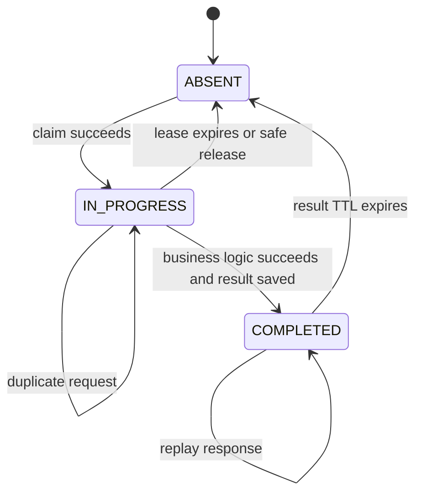
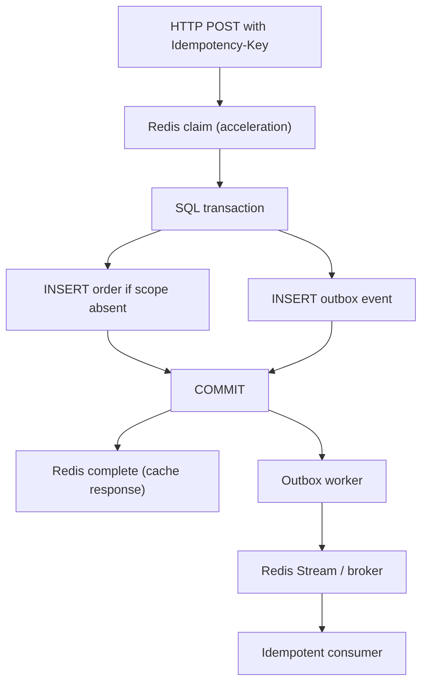

# Preventing Duplicate Processing Using Idempotency Keys with TTL in Spring Data Redis

## 1. Practice Problem: Why Can a Request Arrive Multiple Times?

Suppose a user clicks **Place Order**. The Spring Boot application receives `POST /api/orders`, writes the order to the database, and returns `201 Created`. Immediately after the database commits, the network connection drops. The client never receives the response, so it retries the request.

```text
Client                  Spring Boot                  Database
  | POST order #1           |                          |
  |------------------------>| INSERT order             |
  |                         |------------------------->|
  |                         |<------------------- COMMIT
  |      X (lost response)  |                          |
  |                         |                          |
  | POST order #1 again     |                          |
  |------------------------>| INSERT order again?      |
  |                         |------------------------->|
```

If every incoming POST creates a new order, the user may end up with two orders, double inventory reservation, or double billing. This is not necessarily a client bug: retrying is standard behavior after timeouts, dropped connections, or HTTP 5xx responses.

Another cause is **two concurrent requests**, such as a user double-clicking a button, a gateway auto-retrying, or two workers receiving the same event. A single Spring Boot process can deduplicate in memory, but across multiple pods/instances, processes must share a coordination mechanism.

**Idempotency** is the ability to handle retries of **the same logical operation** without causing additional business side effects beyond the first execution. For resource-creating APIs, clients typically send an **`Idempotency-Key`** representing the intent to perform that operation.

Redis is used as a fast state store:

- The first request can **claim processing ownership** for the key.
- Duplicate requests arriving mid-processing receive an **in-progress** response rather than starting a second execution.
- Duplicate requests arriving after completion **receive the stored response** or a reference to the business outcome.
- **TTL** automatically cleans up keys past the retry window so data is not retained indefinitely.
- Atomic Redis commands or Lua scripts prevent multiple instances from claiming the same key simultaneously.

However, **a Redis key with a TTL does not by itself guarantee exactly-once execution for payments or external systems**. This exercise separates fast deduplication in Redis from durable business constraints in the primary data source.

### Goals After This Lesson

You will be able to:

1. Distinguish request IDs, idempotency keys, distributed locks, rate limiting, and TTLs.
2. Scope keys by user/tenant/endpoint and attach a **request fingerprint** to reject key reuse with different payloads.
3. Understand the limits of `SET key value NX EX` and upgrade to `IN_PROGRESS` / `COMPLETED` states.
4. Use Lua scripts to claim, complete, replay responses, and release only when owned.
5. Invoke scripts from `StringRedisTemplate` in Spring Data Redis.
6. Combine a **database unique constraint** to protect business effects when Redis TTLs expire or failovers occur.
7. Handle timeouts, retries, crashes, lease expiration, concurrent requests, and TTL cleanup.
8. Build integration tests and monitor idempotency metrics across multiple instances.

---

## 2. Core Concepts

### 2.1. A Logical Request Differs from an HTTP Attempt

A **logical request** is a business intent: "create an order for this cart". One intent may be sent via multiple **HTTP attempts**.

```text
Business intent: Create Order A
  ├── Attempt 1: client timeout
  ├── Attempt 2: retry after 2 seconds
  └── Attempt 3: gateway retry

All three send the same Idempotency-Key
=> Only one Order A may be created per the agreed contract.
```

Conversely, a user intentionally placing two distinct orders must use two distinct keys; you should not deduplicate all `POST /api/orders` requests merely because the bodies match.

### 2.2. Idempotency-Key

The client generates an unpredictable key for **one business intent** and reuses that key across retries of the same intent:

```http
POST /api/orders HTTP/1.1
Content-Type: application/json
Idempotency-Key: d44fdf6b-6983-4c3b-93b4-aee58fca482a

{"sku":"BOOK-100","quantity":2}
```

The key is not a bearer token for authentication. The server must still verify identity, permissions, and account status. The key only identifies retries of the same operation.

### 2.3. TTL of an Idempotency Key

TTL lets Redis automatically discard state after a duration:

```redis
SET idem:v1:sample processing NX EX 120
```

This command creates the key only if it does not exist (`NX`) and sets a 120-second expiration (`EX`) in **one atomic command**.

However, TTL answers **"how long does Redis retain a trace?"**, not **"is the system guaranteed never to create duplicates forever?"**. Once TTL expires, an old request may appear new unless another durable guard exists.

### 2.4. An Idempotency Key Is Not a Rate Limiter

| Mechanism | Question | Example |
|---|---|---|
| Idempotency | Is this request a retry of the same operation? | One order created only once |
| Rate limiter | How many operations may this subject send in a time window? | 60 requests/minute |
| Distributed lock | Which worker currently has exclusive access to a resource? | One worker updating a report |
| Unique constraint | Can two records share the same business identifier? | One order per scope key |
| TTL | Until when is data/state retained? | Store replay response for 24 hours |

These mechanisms complement each other; they do not replace one another.

---

## 3. State Machine for an Idempotency Key

Use three primary states:



Meanings:

| State | Meaning | Behavior for Request with Same Key and Payload |
|---|---|---|
| `ABSENT` | Redis has no key or key expired | Attempt claim and start processing |
| `IN_PROGRESS` | A request claimed processing rights | Do not re-run; report in progress |
| `COMPLETED` | Result from prior request exists | Replay stored result |
| `CONFLICT` (comparison outcome) | Key exists with a different payload | Return error, do not run business logic |

`CONFLICT` is not necessarily a state stored in Redis; it is the **decision** when a key is reused with a different request fingerprint.

### 3.1. Two TTL Phases

The practical design uses:

- **Processing lease TTL:** e.g., 120 seconds while `IN_PROGRESS`. Protects against keys getting stuck forever if a worker dies.
- **Result retention TTL:** e.g., 24 hours while `COMPLETED`. Allows clients to retry and receive the response within the published window.

```text
T0          T1                 T2                        T3
|-----------|------------------|-------------------------|
claim       business succeeds                            result TTL expires
            and completes

IN_PROGRESS lease: used only during processing
COMPLETED retention: starts when complete succeeds
```

Both TTLs do not have to be equal. A 2-minute maximum processing time does not mean clients may only retry for 2 minutes.

### 3.2. HTTP Response Choices

An API contract may choose:

| Scenario | Sample HTTP | Meaning |
|---|---|---|
| First request succeeded | `201 Created` | Resource created |
| Retry after success | Replay `201` and original body | No new resource created |
| Duplicate while in progress | `409 Conflict` with `Retry-After`, or `202 Accepted` per contract | No final result yet to replay |
| Same key, different payload | `409 Conflict` | Key may not be reused for another intent |
| Missing key on required endpoint | `400 Bad Request` | Client must provide a valid key |
| Redis unavailable | `503 Service Unavailable` or designed durable fallback | Do not silently skip duplicate protection |

Choosing `202` or `409` for in-progress duplicates is an **API decision**. This exercise uses `409` with `Retry-After`; an async API with a job-status endpoint might use `202`.

---

## 4. Why "SET NX EX Then DEL" Is Insufficient for Every Use Case

Minimal version:

```redis
SET idem:v1:order:<key> 1 NX EX 60
```

If Redis returns `OK`, the request proceeds. If nil, the key already exists.

Spring Data Redis example:

```java
Boolean first = redis.opsForValue().setIfAbsent(
        redisKey,
        "1",
        Duration.ofSeconds(60)
);

if (Boolean.TRUE.equals(first)) {
    // Execute business logic.
} else {
    // Reject or wait; do not run business logic a second time.
}
```

### Pros

- `SET NX EX` is atomic.
- Easy to implement.
- TTL cleans up old keys automatically.
- Across multiple instances, only one caller wins the claim on the corresponding Redis primary.

### Limitation 1 — Cannot Replay the First Request's Result

If the client misses the `201` response and retries, Redis only says "key exists". The client does not know which order ID was created.

### Limitation 2 — Does Not Distinguish In-Progress from Completed

A key holding `"1"` does not indicate whether the request is still running or already finished.

### Limitation 3 — TTL May Expire Before Processing Finishes

```text
T0: Request A runs SET NX EX 60 -> OK, starts a 90-second operation.
T60: Key TTL expires.
T61: Request B runs SET NX EX 60 -> OK.
T62: Both A and B are performing side effects concurrently.
```

TTL does not act as a fencing token at the database or payment gateway.

### Limitation 4 — Deleting the Key Too Early Causes Duplicates

Calling `DEL` right after business logic succeeds removes the trace; a client retry sees nothing and creates a second order. For APIs requiring replay, **upon success you must retain `COMPLETED` state through the retry window**, not delete immediately.

### Limitation 5 — Redis Can Lose State on Failover

Standard Redis replication is asynchronous. A key acknowledged by the primary might not reach a replica before failover. If lost, a retried request can be claimed again.

**Conclusion:** `SET NX EX` fits **short-lived best-effort deduplication**. For APIs needing stored responses and duplicate differentiation, use a state machine; for operations where duplicates are unacceptable, add durable protection.

---

## 5. Scoping an Idempotency Key

Do not directly use:

```text
idem:<client-supplied-key>
```

because two different users could accidentally or deliberately send the same key. A request requires a **scope**:

```text
tenant + authenticated user/client + HTTP method + resource/action + client key
```

Example logical scope:

```text
tenant=t-12
subject=user-93
operation=POST /api/orders
idempotencyKey=d44fdf6b-6983-4c3b-93b4-aee58fca482a
```

You can hash the scope and construct the Redis key:

```text
idem:v1:{<scope-digest>}
```

Curly braces apply a Redis Cluster hash tag. With **one key per script** as in this exercise, the hash tag is optional; when expanding to multiple keys per scope, hash slot rules matter.

### 5.1. Do Not Use Self-Reported Identity

Do not take unverified `X-User-Id` or `X-Tenant-Id` headers as the scope. Extract identity from a verified Spring Security principal/JWT or a validated API key. For tenants, confirm the user actually belongs to that tenant.

### 5.2. Validate Client Key Format and Entropy

For example, require clients to send a UUID or sufficiently strong random string:

```text
Allowed length: 16–128 characters
Allowed characters: letters, digits, dot, underscore, hyphen
Recommendation: fresh random UUID per business intent
```

Avoid predictable timestamps or sequential IDs if other parts of the system assume keys are hard to guess. Still, **an idempotency key is not a credential**, so never rely on its entropy for authorization.

### 5.3. Do Not Log Raw Keys

An idempotency key may embed user identifiers, and request state may hold personal responses. Log controlled request trace IDs and actions/outcomes rather than raw headers or sensitive payloads.

### 5.4. Request Fingerprint

**Same key with a different request** must be rejected.

Example:

```http
Idempotency-Key: d44fdf6b-6983-4c3b-93b4-aee58fca482a

{"sku":"BOOK-100","quantity":2}
```

Later, the client sends the same key with:

```http
Idempotency-Key: d44fdf6b-6983-4c3b-93b4-aee58fca482a

{"sku":"BOOK-100","quantity":5}
```

This is no longer a retry of the same operation. The server must return `409 Conflict` rather than replaying a mismatched result or creating a new order.

A request fingerprint is typically computed from **method, endpoint, contract version, and meaningful business fields** after canonicalization:

\[
fingerprint =
SHA256(method \Vert route \Vert version \Vert canonicalBusinessPayload)
\]

You do not necessarily hash raw JSON bytes directly: two JSON documents with identical content in different field orders can be considered the same request if the API defines canonicalization that way.

---

## 6. Choosing a Redis Hash to Store State

For one key, store these fields:

```text
Redis key:
  idem:v1:{8e6c...scope-hash...}

Type: HASH

state         = IN_PROGRESS
fingerprint   = 0baf...sha256-of-canonical-request...
owner         = 0af6...uuid-worker-claim...
responseStatus
contentType
responseBody
TTL          = 120000 ms while IN_PROGRESS
```

Upon completion:

```text
state          = COMPLETED
fingerprint    = ...
owner          = ...
responseStatus = 201
contentType    = application/json
responseBody   = {"orderId":"...","status":"CREATED"}
TTL            = 86400000 ms
```

The **owner token** is a fresh UUID per **claim attempt**. It lets scripts allow only the active claiming request to record completion or release the key.

Do not use the client-supplied idempotency key as the owner token because all retries share the same key. The owner must be server-generated per execution attempt.

### Why a Hash Instead of a String?

A Hash stores state, fingerprint, owner, and result under **a single Redis key**. Lua scripts can inspect multiple fields and update them atomically. TTL still applies to the **entire key**, not individual fields.

For large responses, do not store the entire body in the Redis Hash. Store only the order ID and status code, and reconstruct the response from the database; this exercise keeps responses short for clarity.

---

## 7. Practical Project Structure

Simulated Spring Boot application layout:

```text
src/main/
├── java/com/example/idempotency/
│   ├── IdempotencyScriptConfig.java
│   ├── RedisIdempotencyStore.java
│   ├── IdempotencyKeyFactory.java
│   ├── OrdersController.java
│   └── OrderWriter.java
└── resources/
    ├── application.yml
    └── redis/
        ├── idem-claim.lua
        ├── idem-complete.lua
        └── idem-release.lua
```

The three scripts are:

- `idem-claim.lua`: atomically claims or returns in-progress, conflict, or completed decisions.
- `idem-complete.lua`: lets only the current owner record the response and switch to the result retention TTL.
- `idem-release.lua`: deletes an incomplete claim only when **proven that no side effect occurred**.

These paths represent an **application structure example**; no separate code files need to be created during this authoring task.

### 7.1. Gradle Dependencies

```kotlin
dependencies {
    implementation("org.springframework.boot:spring-boot-starter-web")
    implementation("org.springframework.boot:spring-boot-starter-data-redis")

    // Source of truth in this example uses PostgreSQL/JdbcTemplate.
    implementation("org.springframework.boot:spring-boot-starter-jdbc")
    runtimeOnly("org.postgresql:postgresql")

    testImplementation("org.springframework.boot:spring-boot-starter-test")
    testImplementation("org.testcontainers:junit-jupiter")
    testImplementation("org.testcontainers:testcontainers")
}
```

The project requires dependency management/BOM and a Java version compatible with the Spring Boot version used. Java examples below use `record` and text blocks, fitting Java 17 and above.

### 7.2. Redis Connection Configuration

```yaml
spring:
  data:
    redis:
      host: localhost
      port: 6379
      connect-timeout: 1s
      timeout: 2s
```

This illustrates local standalone Redis. Production requires authentication, TLS, Sentinel/Cluster topology or managed Redis, and appropriate timeouts and capacity.

**Note:** Driver `timeout: 2s` is not the 120-second processing lease. One is the **command response wait limit**; the other is **logical ownership duration**.

---

## 8. First Lua Script: Atomic Claim

Placed at `src/main/resources/redis/idem-claim.lua`.

Inputs:

- `KEYS[1]`: idempotency Redis key.
- `ARGV[1]`: request fingerprint.
- `ARGV[2]`: owner token of the current attempt.
- `ARGV[3]`: processing lease in milliseconds.

Output is a table whose first element is the decision:

- `ACQUIRED`.
- `IN_PROGRESS` along with remaining TTL.
- `COMPLETED` along with the stored response.
- `CONFLICT` if the fingerprint differs.

```lua
-- redis/idem-claim.lua

local key = KEYS[1]
local fingerprint = ARGV[1]
local owner = ARGV[2]
local leaseMs = tonumber(ARGV[3])

if not fingerprint or fingerprint == ''
        or not owner or owner == ''
        or not leaseMs or leaseMs <= 0 then
    return redis.error_reply('invalid idempotency claim arguments')
end

-- All checks/writes stay inside one script: no other request
-- can interleave between EXISTS and HSET/PEXPIRE.
if redis.call('EXISTS', key) == 0 then
    redis.call(
        'HSET', key,
        'state', 'IN_PROGRESS',
        'fingerprint', fingerprint,
        'owner', owner
    )

    redis.call('PEXPIRE', key, leaseMs)

    return {'ACQUIRED'}
end

local oldFingerprint =
        redis.call('HGET', key, 'fingerprint')

if oldFingerprint ~= fingerprint then
    return {'CONFLICT'}
end

local state = redis.call('HGET', key, 'state')

if state == 'COMPLETED' then
    -- Fetch result inside the script; avoids a race between
    -- checking state and an external HGET.
    return {
        'COMPLETED',
        redis.call('HGET', key, 'responseStatus') or '',
        redis.call('HGET', key, 'contentType') or '',
        redis.call('HGET', key, 'responseBody') or ''
    }
end

if state == 'IN_PROGRESS' then
    local remainingMs = redis.call('PTTL', key)
    return {'IN_PROGRESS', tostring(remainingMs)}
end

return redis.error_reply('unknown idempotency state')
```

### 8.1. Why Must This Be in One Lua Script?

Unsafe approach:

```text
Request A: EXISTS key -> false
Request B: EXISTS key -> false
Request A: HSET...
Request B: HSET...
=> Both A and B believe they own the claim.
```

Inside a Redis script, existence checks and state writes happen as one atomic server-side operation. Only one attempt acquires the initial key.

### 8.2. Why Not Extend TTL for Duplicate Requests?

The script does **not** extend the lease when returning `IN_PROGRESS`. If every retry extended the TTL, a continuously retrying client could keep the state stuck forever.

Only the owning worker, if genuinely needed, may extend its lease via a separate mechanism verifying owner and processing condition. Later sections explain why lease extension still does not provide exactly-once guarantees.

### 8.3. Why Return the Response Inside the Same Script?

If the claim script only returned `COMPLETED` and Java ran `HGETALL` afterward, the key could expire between the two commands. Returning a snapshot of the response directly inside the script removes an unnecessary race condition.

If stored responses are very large, returning them in the script consumes network and memory. In that case, store a reference to the durable database record instead of holding large payloads in Redis.

---

## 9. Second Lua Script: Owner-Only Completion

Placed at `src/main/resources/redis/idem-complete.lua`.

Inputs:

- `KEYS[1]`: Redis key.
- `ARGV[1]`: claiming owner token.
- `ARGV[2]`: HTTP status to store.
- `ARGV[3]`: safe content type, e.g., `application/json`.
- `ARGV[4]`: short response body.
- `ARGV[5]`: result retention TTL in milliseconds.

Returns `1` if saved successfully, `0` if the key is gone, owned by someone else, or in an invalid state.

```lua
-- redis/idem-complete.lua

local key = KEYS[1]
local owner = ARGV[1]
local status = ARGV[2]
local contentType = ARGV[3]
local responseBody = ARGV[4]
local retentionMs = tonumber(ARGV[5])

if not owner or owner == ''
        or not status or status == ''
        or not contentType or contentType == ''
        or not responseBody
        or not retentionMs or retentionMs <= 0 then
    return redis.error_reply('invalid idempotency completion arguments')
end

if redis.call('EXISTS', key) == 0 then
    return 0
end

if redis.call('HGET', key, 'state') ~= 'IN_PROGRESS' then
    return 0
end

if redis.call('HGET', key, 'owner') ~= owner then
    return 0
end

redis.call(
    'HSET', key,
    'state', 'COMPLETED',
    'responseStatus', status,
    'contentType', contentType,
    'responseBody', responseBody
)

redis.call('PEXPIRE', key, retentionMs)

return 1
```

### 9.1. What Does the Owner Check Protect?

Scenario:

```text
T0   A claims owner=A, TTL=120s.
T120 Key expires before A finishes.
T121 B claims owner=B.
T122 A tries to write COMPLETED with owner=A.
```

The script prevents A from overwriting B's state because the owner does not match.

However, **this only protects Redis state**. If A already sent an order-creation request to the database or payment provider, Redis's owner check cannot undo that side effect. To protect business effects, enforce unique constraints, fencing, or idempotency in the system actually executing the side effect.

### 9.2. TTL After Completion

When the script sets `COMPLETED`, it applies a **new retention TTL**. For example, the result lives for 24 hours from completion, enough for replays per the API contract.

Once the result TTL expires, Redis no longer remembers the old request. Hence, retention duration must be published and aligned with **actual retry windows** of clients and gateways. If business rules forbid duplicates after TTL expiration, a durable database guard must remain.

---

## 10. Third Lua Script: Release Only When Proven Safe

Placed at `src/main/resources/redis/idem-release.lua`.

```lua
-- redis/idem-release.lua

local key = KEYS[1]
local owner = ARGV[1]

if redis.call('EXISTS', key) == 0 then
    return 0
end

if redis.call('HGET', key, 'state') ~= 'IN_PROGRESS' then
    return 0
end

if redis.call('HGET', key, 'owner') ~= owner then
    return 0
end

return redis.call('DEL', key)
```

**Call release only with solid proof that no business effect occurred**, such as validation failing **before** sending any writes to the database or external services.

Avoid:

```java
try {
    createOrder();
} finally {
    redis.delete(idempotencyKey);
}
```

That both erases the trace after success and can let retries create another order.

### On Ambiguous Timeouts

If the database commit succeeded and Spring Boot timed out right afterward, **you cannot claim the request had no side effect**. When state is uncertain:

- Do not automatically delete the claim to let another request run immediately.
- Flag the event for reconciliation.
- If a durable store holds the idempotency scope, read the result back from there.
- Once the lease expires, a retry may reclaim, while the database layer must still block duplicates.
- Do not treat waiting for TTL expiration as an exactly-once guarantee for payments.

---

## 11. Loading Lua Scripts into Spring Data Redis

`RedisTemplate.execute(RedisScript, keys, args)` runs scripts on Redis. Declare `DefaultRedisScript` as beans so scripts are not rebuilt on every request.

**`IdempotencyScriptConfig.java`**

```java
package com.example.idempotency;

import java.util.List;

import org.springframework.context.annotation.Bean;
import org.springframework.context.annotation.Configuration;
import org.springframework.core.io.ClassPathResource;
import org.springframework.data.redis.core.script.DefaultRedisScript;
import org.springframework.data.redis.core.script.RedisScript;

@Configuration
public class IdempotencyScriptConfig {

    @Bean("claimIdempotencyScript")
    RedisScript<List> claimScript() {
        DefaultRedisScript<List> script =
                new DefaultRedisScript<>();

        script.setLocation(
                new ClassPathResource("redis/idem-claim.lua")
        );
        script.setResultType(List.class);

        return script;
    }

    @Bean("completeIdempotencyScript")
    RedisScript<Long> completeScript() {
        DefaultRedisScript<Long> script =
                new DefaultRedisScript<>();

        script.setLocation(
                new ClassPathResource("redis/idem-complete.lua")
        );
        script.setResultType(Long.class);

        return script;
    }

    @Bean("releaseIdempotencyScript")
    RedisScript<Long> releaseScript() {
        DefaultRedisScript<Long> script =
                new DefaultRedisScript<>();

        script.setLocation(
                new ClassPathResource("redis/idem-release.lua")
        );
        script.setResultType(Long.class);

        return script;
    }
}
```

`DefaultRedisScript` manages script content/checksums via Spring Data Redis, typically using an execution path appropriate for the Redis server and driver.

Use `StringRedisTemplate` so keys and args are Strings. The claim script returns an **array of values**, hence `resultType = List.class`; complete and release return integers, hence `Long.class`.

### Note on MULTI Result Serializers

Depending on the Spring Data Redis version and result serializer, elements of a Lua table may deserialize as `String` or raw `byte[]`. The adapter below converts both forms to strings to illustrate stable handling.

---

## 12. Java Adapter: RedisIdempotencyStore

Start with the decision model:

**`IdempotencyDecision.java`**

```java
package com.example.idempotency;

import java.time.Duration;

public record IdempotencyDecision(
        Kind kind,
        CachedResponse cachedResponse,
        Duration retryAfter
) {
    public enum Kind {
        ACQUIRED,
        IN_PROGRESS,
        COMPLETED,
        CONFLICT
    }

    public record CachedResponse(
            int status,
            String contentType,
            String body
    ) {
    }
}
```

Redis adapter:

**`RedisIdempotencyStore.java`**

```java
package com.example.idempotency;

import java.nio.charset.StandardCharsets;
import java.time.Duration;
import java.util.List;

import org.springframework.beans.factory.annotation.Qualifier;
import org.springframework.data.redis.core.StringRedisTemplate;
import org.springframework.data.redis.core.script.RedisScript;
import org.springframework.stereotype.Component;

@Component
public class RedisIdempotencyStore {

    private final StringRedisTemplate redis;
    private final RedisScript<List> claimScript;
    private final RedisScript<Long> completeScript;
    private final RedisScript<Long> releaseScript;

    public RedisIdempotencyStore(
            StringRedisTemplate redis,
            @Qualifier("claimIdempotencyScript")
            RedisScript<List> claimScript,
            @Qualifier("completeIdempotencyScript")
            RedisScript<Long> completeScript,
            @Qualifier("releaseIdempotencyScript")
            RedisScript<Long> releaseScript
    ) {
        this.redis = redis;
        this.claimScript = claimScript;
        this.completeScript = completeScript;
        this.releaseScript = releaseScript;
    }

    public IdempotencyDecision begin(
            String key,
            String fingerprint,
            String owner,
            Duration processingLease
    ) {
        long leaseMs = positiveMillis(processingLease);

        List<?> result = redis.execute(
                claimScript,
                List.of(key),
                fingerprint,
                owner,
                Long.toString(leaseMs)
        );

        if (result == null || result.isEmpty()) {
            throw new IllegalStateException(
                    "Invalid Redis claim response"
            );
        }

        String kind = asText(result.get(0));

        return switch (kind) {
            case "ACQUIRED" ->
                    new IdempotencyDecision(
                            IdempotencyDecision.Kind.ACQUIRED,
                            null,
                            Duration.ZERO
                    );

            case "CONFLICT" ->
                    new IdempotencyDecision(
                            IdempotencyDecision.Kind.CONFLICT,
                            null,
                            Duration.ZERO
                    );

            case "IN_PROGRESS" -> {
                if (result.size() != 2) {
                    throw new IllegalStateException(
                            "Invalid in-progress response"
                    );
                }

                long remainingMs =
                        Long.parseLong(asText(result.get(1)));

                yield new IdempotencyDecision(
                        IdempotencyDecision.Kind.IN_PROGRESS,
                        null,
                        Duration.ofMillis(
                                Math.max(0, remainingMs)
                        )
                );
            }

            case "COMPLETED" -> {
                if (result.size() != 4) {
                    throw new IllegalStateException(
                            "Invalid completed response"
                    );
                }

                var cached =
                        new IdempotencyDecision.CachedResponse(
                                Integer.parseInt(
                                        asText(result.get(1))
                                ),
                                asText(result.get(2)),
                                asText(result.get(3))
                        );

                yield new IdempotencyDecision(
                        IdempotencyDecision.Kind.COMPLETED,
                        cached,
                        Duration.ZERO
                );
            }

            default -> throw new IllegalStateException(
                    "Unknown Redis decision: " + kind
            );
        };
    }

    public boolean complete(
            String key,
            String owner,
            int status,
            String contentType,
            String responseBody,
            Duration resultRetention
    ) {
        long ttlMs = positiveMillis(resultRetention);

        if (status < 100 || status > 599) {
            throw new IllegalArgumentException(
                    "Invalid HTTP response status"
            );
        }

        Long saved = redis.execute(
                completeScript,
                List.of(key),
                owner,
                Integer.toString(status),
                contentType,
                responseBody,
                Long.toString(ttlMs)
        );

        return Long.valueOf(1L).equals(saved);
    }

    public boolean releaseIfOwnedAndSafe(
            String key,
            String owner
    ) {
        Long deleted = redis.execute(
                releaseScript,
                List.of(key),
                owner
        );

        return Long.valueOf(1L).equals(deleted);
    }

    private static long positiveMillis(Duration duration) {
        if (duration == null
                || duration.isZero()
                || duration.isNegative()) {
            throw new IllegalArgumentException(
                    "TTL must be positive"
            );
        }

        long millis = duration.toMillis();

        if (millis <= 0) {
            throw new IllegalArgumentException(
                    "TTL too small for millisecond resolution"
            );
        }

        return millis;
    }

    private static String asText(Object value) {
        if (value instanceof String s) {
            return s;
        }

        if (value instanceof byte[] bytes) {
            return new String(bytes, StandardCharsets.UTF_8);
        }

        throw new IllegalStateException(
                "Unexpected Redis response value: " +
                        (value == null
                                ? "null"
                                : value.getClass().getName())
        );
    }
}
```

### What Does the Adapter Guarantee?

- Claims and state transitions in Redis are executed atomically via Lua.
- Fingerprints detect key reuse with differing payloads.
- Only the claiming owner can complete or release.
- Completed responses receive their own TTL.
- Java avoids sending `EXISTS`/`HSET`/`PEXPIRE` as separate round-trips.

### What Does the Adapter Not Guarantee?

- That Redis will not lose keys during primary crashes/failovers.
- That a worker stops touching the DB after its lease expires.
- That an external payment provider charges only once.
- That responses after `complete` always reach the client.
- That a key is never reused after result TTL expiration.
- That every Redis/driver error maps to the right HTTP status without exception mapping.

Those belong to the **durable business layer**, API contracts, and operations.

---

## 13. Designing the Scope Digest and Fingerprint

To avoid storing raw principals and raw client keys in Redis keys, the example uses SHA-256 on scope data. For stronger protection of sensitive identifiers, consider HMAC with a server-side secret.

**`IdempotencyKeyFactory.java`**

```java
package com.example.idempotency;

import java.nio.charset.StandardCharsets;
import java.security.MessageDigest;
import java.security.NoSuchAlgorithmException;
import java.util.HexFormat;

public final class IdempotencyKeyFactory {

    private IdempotencyKeyFactory() {
    }

    public static String scopeHash(
            String authenticatedSubject,
            String clientKey
    ) {
        requireClientKey(clientKey);

        // Route/method are server-controlled constants.
        return sha256(
                "v1\nPOST\n/api/orders\n" +
                authenticatedSubject + "\n" +
                clientKey
        );
    }

    public static String redisKey(String scopeHash) {
        return "idem:v1:{" + scopeHash + "}";
    }

    public static String fingerprint(
            String sku,
            int quantity
    ) {
        if (sku == null
                || !sku.matches("[A-Z0-9-]{1,40}")
                || quantity <= 0
                || quantity > 1000) {
            throw new IllegalArgumentException(
                    "Invalid order request"
            );
        }

        // Unambiguous canonical form for a two-field DTO
        // where sku characters are strictly bounded.
        return sha256(
                "v1\nPOST\n/api/orders\n" +
                sku + "\n" +
                quantity
        );
    }

    public static void requireClientKey(String clientKey) {
        if (clientKey == null
                || !clientKey.matches(
                        "[A-Za-z0-9._-]{16,128}"
                )) {
            throw new IllegalArgumentException(
                    "Invalid Idempotency-Key"
            );
        }
    }

    private static String sha256(String input) {
        try {
            byte[] digest = MessageDigest
                    .getInstance("SHA-256")
                    .digest(
                            input.getBytes(StandardCharsets.UTF_8)
                    );

            return HexFormat.of().formatHex(digest);
        } catch (NoSuchAlgorithmException ex) {
            throw new IllegalStateException(
                    "SHA-256 unavailable",
                    ex
            );
        }
    }
}
```

### Why Are Both Scope Hash and Fingerprint Needed?

- **Scope hash:** identifies one idempotency record, bound to the user and client key.
- **Fingerprint:** verifies retries carry identical business content.

With only a scope hash and no fingerprint, a client accidentally reusing a key for a different quantity could receive the old result without realizing the new request was invalid.

### When Systems Have Multiple Tenants or Endpoints

Include a **trusted tenant identity** in the scope, not just principal name. If multiple APIs accept the same key, decide whether scoping is per-endpoint or API-wide; the sample code pins it to `POST /api/orders`.

If requests contain maps, arrays, or optional fields, define canonicalization explicitly (ordering, decimals, time zones, null/absent, casing). Do not naively concatenate strings on arbitrary payloads that could contain ambiguous delimiters.

---

## 14. Redis Alone Is Not Enough: Protecting Orders with a Unique Constraint

Now suppose request A created an order in PostgreSQL, yet Redis lost its `IN_PROGRESS`/`COMPLETED` state because:

- The processing lease expired before completion.
- Redis restarted or failed over to a replica missing the write.
- Redis ran out of memory and evicted the key.
- Result TTL expired and an old client retry arrived.
- `complete` timed out after the database committed.

Without another guard, request B could create a second order.

For this **database order-creation demo**, we store `scopeHash` on the order record itself with a **unique constraint**.

### 14.1. Illustrative PostgreSQL Schema

```sql
CREATE TABLE demo_orders (
    id UUID PRIMARY KEY,
    scope_hash VARCHAR(64) NOT NULL UNIQUE,
    request_hash VARCHAR(64) NOT NULL,
    user_ref VARCHAR(128) NOT NULL,
    sku VARCHAR(40) NOT NULL,
    quantity INTEGER NOT NULL CHECK (quantity > 0),
    status VARCHAR(32) NOT NULL,
    created_at TIMESTAMPTZ NOT NULL DEFAULT NOW()
);
```

Meaning:

- `scope_hash` is the **durable identifier for one logical request**.
- `UNIQUE(scope_hash)` ensures two transactions cannot commit two order rows with the same scope.
- `request_hash` detects same-key different-payload reuse **even after the Redis record's TTL expires**.
- The database record preserves duplicate prevention beyond Redis's response cache window.

**Retention note:** if the application deletes orders or purges `scope_hash` before all stale retries could arrive, durable protection ends too. Plan retention for business markers or a dedicated idempotency ledger accordingly.

### 14.2. Why Place the Constraint Where Side Effects Happen?

Redis claims alone do not prevent two workers who held claims at different times from both writing to the database. A unique constraint enforced by the database at the **point of resource creation** still protects the order table even when Redis loses state.

If one request creates multiple SQL rows, perform both the side effects and the idempotency marker write within **the same transaction** to avoid partial commits. When calling external systems like payment gateways, a DB unique constraint **cannot control external side effects**; pair it with provider idempotency and orchestration/outbox patterns.

---

## 15. OrderWriter: Writing or Reading Back an Existing Order

Example using Spring JDBC with PostgreSQL. `JdbcTemplate` and `@Transactional` persist the order inside a SQL transaction.

**`OrderWriter.java`**

```java
package com.example.idempotency;

import java.util.List;
import java.util.UUID;

import org.springframework.jdbc.core.JdbcTemplate;
import org.springframework.stereotype.Service;
import org.springframework.transaction.annotation.Transactional;

@Service
public class OrderWriter {

    public record CreateOrderRequest(
            String sku,
            int quantity
    ) {
    }

    public record OrderResponse(
            String orderId,
            String status
    ) {
    }

    public static final class RequestMismatchException
            extends RuntimeException {
        public RequestMismatchException() {
            super("Idempotency key already belongs to another payload");
        }
    }

    private record StoredOrder(
            UUID id,
            String requestHash,
            String status
    ) {
    }

    private final JdbcTemplate jdbc;

    public OrderWriter(JdbcTemplate jdbc) {
        this.jdbc = jdbc;
    }

    @Transactional
    public OrderResponse createOrGet(
            String subject,
            String scopeHash,
            String requestHash,
            CreateOrderRequest request
    ) {
        UUID proposedId = UUID.randomUUID();

        jdbc.update(
                """
                INSERT INTO demo_orders
                    (id, scope_hash, request_hash,
                     user_ref, sku, quantity, status)
                VALUES (?, ?, ?, ?, ?, ?, 'CREATED')
                ON CONFLICT (scope_hash) DO NOTHING
                """,
                proposedId,
                scopeHash,
                requestHash,
                subject,
                request.sku(),
                request.quantity()
        );

        List<StoredOrder> rows = jdbc.query(
                """
                SELECT id, request_hash, status
                FROM demo_orders
                WHERE scope_hash = ?
                """,
                (rs, rowNum) -> new StoredOrder(
                        rs.getObject("id", UUID.class),
                        rs.getString("request_hash"),
                        rs.getString("status")
                ),
                scopeHash
        );

        if (rows.size() != 1) {
            throw new IllegalStateException(
                    "Order idempotency row not visible"
            );
        }

        StoredOrder stored = rows.get(0);

        if (!stored.requestHash().equals(requestHash)) {
            throw new RequestMismatchException();
        }

        return new OrderResponse(
                stored.id().toString(),
                stored.status()
        );
    }
}
```

### 15.1. Two Concurrent Requests Hitting the DB

In PostgreSQL under standard `READ COMMITTED` isolation, `INSERT ... ON CONFLICT DO NOTHING` on a unique key waits for the competing transaction to commit or roll back. Then the subsequent `SELECT` statement sees the committed row.

This class demonstrates an **insert-or-read** pattern for PostgreSQL. It does not translate unchanged to every database or isolation level; under `SERIALIZABLE` or more complex workflows, design transaction retries and concurrency tests specific to your engine.

### 15.2. What Is Protected?

- At most one order row per `scope_hash`.
- Retries with the same payload retrieve the existing order ID.
- Same-key requests with different payloads are rejected via `request_hash`, even if Redis forgot the record.
- Redis accelerates deduplication, while the database blocks duplicate order records.

### 15.3. Limitations of This Example

- This demo creates **one order row**; it omits inventory reservation, payments, emails, events, and sagas.
- Charging a payment provider before transaction commit risks charging when the transaction rolls back; design that separately.
- When extending business logic, keep SQL updates inside the same transaction as the marker or use outbox/saga/idempotent consumers.
- In systems with sensitive data, define protection policies for `user_ref` and idempotency marker retention.

---

## 16. HTTP Controller: Handling Initial Requests and Retries

The controller receives `Idempotency-Key` from clients. The example uses a compact JSON API with a `Principal` already verified by the authentication layer.

**`OrdersController.java`**

```java
package com.example.idempotency;

import java.security.Principal;
import java.time.Duration;
import java.util.UUID;

import com.fasterxml.jackson.core.JsonProcessingException;
import com.fasterxml.jackson.databind.ObjectMapper;

import org.springframework.dao.DataAccessException;
import org.springframework.http.HttpHeaders;
import org.springframework.http.MediaType;
import org.springframework.http.ResponseEntity;
import org.springframework.http.HttpStatus;
import org.springframework.web.bind.annotation.*;
import org.springframework.web.server.ResponseStatusException;

@RestController
@RequestMapping("/api/orders")
public class OrdersController {

    private static final Duration PROCESSING_LEASE =
            Duration.ofMinutes(2);

    private static final Duration RESULT_RETENTION =
            Duration.ofHours(24);

    private final RedisIdempotencyStore gate;
    private final OrderWriter orders;
    private final ObjectMapper mapper;

    public OrdersController(
            RedisIdempotencyStore gate,
            OrderWriter orders,
            ObjectMapper mapper
    ) {
        this.gate = gate;
        this.orders = orders;
        this.mapper = mapper;
    }

    @PostMapping
    public ResponseEntity<String> create(
            @RequestHeader("Idempotency-Key") String clientKey,
            @RequestBody OrderWriter.CreateOrderRequest request,
            Principal principal
    ) {
        if (principal == null) {
            throw new ResponseStatusException(
                    HttpStatus.UNAUTHORIZED
            );
        }

        try {
            IdempotencyKeyFactory.requireClientKey(clientKey);

            // Deliberate validation and canonicalization
            // before claiming a Redis key.
            String fingerprint =
                    IdempotencyKeyFactory.fingerprint(
                            request.sku(),
                            request.quantity()
                    );

            String subject = principal.getName();

            String scopeHash =
                    IdempotencyKeyFactory.scopeHash(
                            subject,
                            clientKey
                    );

            String redisKey =
                    IdempotencyKeyFactory.redisKey(scopeHash);

            String owner = UUID.randomUUID().toString();

            IdempotencyDecision decision = gate.begin(
                    redisKey,
                    fingerprint,
                    owner,
                    PROCESSING_LEASE
            );

            switch (decision.kind()) {
                case CONFLICT:
                    return ResponseEntity.status(409)
                            .cacheControl(
                                    org.springframework.http.CacheControl
                                            .noStore()
                            )
                            .body(
                                "{\"error\":\"IDEMPOTENCY_KEY_REUSED\"}"
                            );

                case IN_PROGRESS: {
                    long waitMs =
                            decision.retryAfter().toMillis();

                    long retrySeconds = Math.max(
                            1,
                            (waitMs + 999) / 1000
                    );

                    return ResponseEntity.status(409)
                            .header(
                                    HttpHeaders.RETRY_AFTER,
                                    Long.toString(retrySeconds)
                            )
                            .cacheControl(
                                    org.springframework.http.CacheControl
                                            .noStore()
                            )
                            .body(
                                "{\"error\":\"REQUEST_IN_PROGRESS\"}"
                            );
                }

                case COMPLETED: {
                    var previous = decision.cachedResponse();

                    return ResponseEntity
                            .status(previous.status())
                            .contentType(
                                    MediaType.parseMediaType(
                                            previous.contentType()
                                    )
                            )
                            .header("Idempotency-Replayed", "true")
                            .cacheControl(
                                    org.springframework.http.CacheControl
                                            .noStore()
                            )
                            .body(previous.body());
                }

                case ACQUIRED:
                    // Proceed below.
                    break;
            }

            // The database unique constraint is the durable
            // safeguard when Redis loses state.
            var order = orders.createOrGet(
                    subject,
                    scopeHash,
                    fingerprint,
                    request
            );

            String body = toJson(order);

            boolean completed = gate.complete(
                    redisKey,
                    owner,
                    201,
                    MediaType.APPLICATION_JSON_VALUE,
                    body,
                    RESULT_RETENTION
            );

            if (!completed) {
                // Uncertain whether the lease still belongs to this owner.
                // Do not fabricate a Redis COMPLETED result.
                // The DB already has the idempotency marker, so retries
                // can read back the order instead of creating a new one.
                throw new ResponseStatusException(
                        HttpStatus.SERVICE_UNAVAILABLE,
                        "Idempotency completion not confirmed"
                );
            }

            return ResponseEntity.status(201)
                    .contentType(MediaType.APPLICATION_JSON)
                    .header("Idempotency-Replayed", "false")
                    .cacheControl(
                            org.springframework.http.CacheControl
                                    .noStore()
                    )
                    .body(body);

        } catch (IllegalArgumentException ex) {
            throw new ResponseStatusException(
                    HttpStatus.BAD_REQUEST,
                    "Invalid idempotency key or request"
            );
        } catch (OrderWriter.RequestMismatchException ex) {
            throw new ResponseStatusException(
                    HttpStatus.CONFLICT,
                    "Idempotency key used with different payload"
            );
        } catch (DataAccessException ex) {
            // On an order creation endpoint, fail closed when
            // Redis/DB state cannot be confirmed.
            throw new ResponseStatusException(
                    HttpStatus.SERVICE_UNAVAILABLE,
                    "Request state unavailable"
            );
        }
    }

    private String toJson(Object body) {
        try {
            return mapper.writeValueAsString(body);
        } catch (JsonProcessingException ex) {
            throw new IllegalStateException(
                    "Cannot serialize response",
                    ex
            );
        }
    }
}
```

**This is practice code illustrating the core flow**, not a production-ready payment API. Add `@ControllerAdvice` to standardize error responses and map business errors per your real contract; the example intentionally avoids packing all validation, observability, and security concerns into one controller.

### 16.1. First Request Flow

```text
Client POST key=K, body=A
  |
  v
Compute scopeHash(K, principal) and fingerprint(A)
  |
  v
Redis claim -> ACQUIRED
  |
  v
PostgreSQL createOrGet(scopeHash, fingerprint, A)
  |
  v
SQL unique constraint ensures a single order
  |
  v
Redis complete -> COMPLETED + response + 24h TTL
  |
  v
HTTP 201 + orderId
```

### 16.2. Retry After Previous Request Completed

```text
Client POST key=K, body=A again
  |
  v
Redis claim -> COMPLETED + stored response
  |
  v
Skip OrderWriter
  |
  v
HTTP 201 + original orderId
Header Idempotency-Replayed: true
```

### 16.3. Retry While Processing Is In Progress

```text
Client POST key=K, body=A again
  |
  v
Redis claim -> IN_PROGRESS
  |
  v
HTTP 409
Retry-After: N
No new order created
```

Clients should not retry immediately in a tight loop. Use `Retry-After`, backoff, and jitter within a bounded retry budget.

### 16.4. Same Key with Modified Payload

```text
POST key=K, body=A  -> ACQUIRED/COMPLETED
POST key=K, body=B  -> CONFLICT
```

If the Redis record's TTL has expired, `OrderWriter` still checks `request_hash` in the database to catch key reuse with a different payload, provided the durable idempotency record is retained.

---

## 17. Testing the API with curl

Assume the application has authentication enabled, the user holds a valid session, the database schema is created, and Redis is running. Substitute the project's actual authentication header.

### 17.1. First Request

```bash
curl -i -X POST http://localhost:8080/api/orders \
  -H 'Content-Type: application/json' \
  -H 'Idempotency-Key: d44fdf6b-6983-4c3b-93b4-aee58fca482a' \
  -d '{"sku":"BOOK-100","quantity":2}'
```

Sample output:

```http
HTTP/1.1 201 Created
Content-Type: application/json
Idempotency-Replayed: false
Cache-Control: no-store

{"orderId":"a276d131-7d67-4a04-ae3f-4a3c9aa17530","status":"CREATED"}
```

### 17.2. Resending the Same Key and Body

Run the same curl command again.

Sample output:

```http
HTTP/1.1 201 Created
Content-Type: application/json
Idempotency-Replayed: true
Cache-Control: no-store

{"orderId":"a276d131-7d67-4a04-ae3f-4a3c9aa17530","status":"CREATED"}
```

The order ID **does not change**. Once the first call finishes, this retry is served directly from Redis `COMPLETED` while the key still has TTL.

### 17.3. Reusing the Key for a Different Quantity

```bash
curl -i -X POST http://localhost:8080/api/orders \
  -H 'Content-Type: application/json' \
  -H 'Idempotency-Key: d44fdf6b-6983-4c3b-93b4-aee58fca482a' \
  -d '{"sku":"BOOK-100","quantity":5}'
```

Expected output:

```http
HTTP/1.1 409 Conflict
Cache-Control: no-store

{"error":"IDEMPOTENCY_KEY_REUSED"}
```

If the Redis record's TTL expires while the database marker remains, the request must still be blocked at the database layer.

### 17.4. Duplicate Request While Still In Progress

If request A is processing and the key is `IN_PROGRESS`:

```http
HTTP/1.1 409 Conflict
Retry-After: 37
Cache-Control: no-store

{"error":"REQUEST_IN_PROGRESS"}
```

`Retry-After` is expressed in **seconds** in the HTTP header. The value hints when the lease might expire, **not a guarantee that the request will succeed in exactly 37 seconds**.

---

## 18. Failure Points and Recovery

An order creation flow has at least these failure points:

| Failure Point | Visible in Redis | Visible in Database | Action to Take |
|---|---|---|---|
| Before claim | ABSENT | Nothing written | Client can retry |
| After claim, before DB write | IN_PROGRESS | Nothing written | Wait for lease; release only if proven no side effect |
| During DB transaction | IN_PROGRESS | Uncommitted or contending | Do not blindly rerun; DB unique guards it |
| After DB commit, before complete | IN_PROGRESS | Order exists | Retry reads back the order via unique scope |
| After complete, before HTTP response | COMPLETED | Order exists | Replay stored response |
| Redis key TTL expires after complete | ABSENT | Order still exists | DB unique prevents duplicates |
| Redis failover loses key | Possibly ABSENT | Order still exists | DB unique prevents duplicates; verify data |
| Redis holds state but DB rolls back | Possibly IN_PROGRESS | No order | Lease expires/reconcile, then safely retry |
| Request has different payload | CONFLICT | Possibly old order | 409, do not alter order |

### 18.1. The "DB Committed but Redis Not Completed" Failure

This is the most critical case:

```text
A claims Redis
A INSERTs order
DB COMMITs
A crashes before Redis complete
B retries
```

If B arrives while Redis is still `IN_PROGRESS`, B receives 409/Retry-After.

If B arrives after the lease expires, B acquires the key. `OrderWriter.createOrGet` finds the existing unique scope and returns the **original order**. B writes Redis `COMPLETED` and returns the same ID.

Thus Redis acts as a **fast deduplication and temporary response cache**, while the database serves as the **durable duplicate guard** for order creation.

### 18.2. Should Redis Be Deleted Automatically on Every Exception?

No. An exception can occur **after a side effect has already happened**. Releasing the key in every catch/finally block allows two requests to overlap and duplicate effects on components lacking unique constraints.

Release only when:

- Validation fails before issuing any write operation.
- Logic proves the business operation has not begun.
- Evidence confirms the transaction rolled back and no external side effects occurred.
- Release and retry handling are designed for competing callers.

When uncertain, leave the claim until the lease expires and let the durable store decide the outcome.

---

## 19. Leases, Heartbeats, and Limits of Owner Tokens

Suppose order processing occasionally takes 4 minutes, while the processing lease is 2 minutes. The key could expire while the owner is still running.

One approach is **owner-checked lease renewal**, e.g., in Lua:

```lua
-- redis/idem-heartbeat.lua
-- KEYS[1]: idempotency key
-- ARGV[1]: owner token
-- ARGV[2]: lease extension milliseconds

local key = KEYS[1]
local owner = ARGV[1]
local leaseMs = tonumber(ARGV[2])

if not leaseMs or leaseMs <= 0 then
    return 0
end

if redis.call('EXISTS', key) == 0 then
    return 0
end

if redis.call('HGET', key, 'state') ~= 'IN_PROGRESS' then
    return 0
end

if redis.call('HGET', key, 'owner') ~= owner then
    return 0
end

return redis.call('PEXPIRE', key, leaseMs)
```

### What Does Heartbeat Improve?

- An active worker holding the true owner token can keep its lease alive during long work.
- Duplicate requests continue seeing `IN_PROGRESS`.
- A stale worker cannot extend a key already claimed by another worker.

### What Does Heartbeat Not Solve?

Suppose worker A hits a long GC/network pause, its lease expires, and worker B claims the key and begins processing. A wakes up and **continues writing to the database or payment provider**. Redis cannot block A's business calls on its own.

That is why you need:

- Unique constraints or conditional writes at the final data store.
- A monotonically increasing **fencing token** checked by the write target if using distributed locks on fencing-capable resources.
- External provider idempotency keys when calling payment services.
- A durable business state machine or outbox/saga when orchestrating multiple side effects.

**An owner UUID only proves ownership of the current Redis record; it is not a system-wide fencing token.**

---

## 20. How Long Should TTLs Be?

TTLs should derive from the business contract, not a mechanical "24-hour best practice".

### 20.1. Processing Lease

Consider:

- Normal and p99 request processing times.
- Gateway/client HTTP timeout budgets.
- Duration of DB operations and transactions.
- Whether async jobs continue after the HTTP response.
- Whether heartbeats/lease extensions exist.
- Cost of a stuck claim blocking retries for too long.
- Risk of two workers overlapping if the lease expires prematurely.

For example, an order endpoint usually completing under 5 seconds can choose a much longer lease to absorb jitter. Conversely, a task taking 30 minutes should not use a 2-minute lease without proper coordination.

### 20.2. Result Retention

Consider:

- How long clients/gateways may retry?
- How long mobile apps may stay offline before resending?
- Endpoint SLAs and network failure support policies?
- Whether responses contain PII or secrets?
- Whether Redis memory can hold the retained key volume?
- How long durable database markers persist?

Example:

```text
processingLease = 2 minutes
resultRetention = 24 hours
durable DB marker = lifetime of the order
```

This policy may fit an order-creation API; do not blindly copy it to every endpoint.

### 20.3. Key Cardinality Estimation Formula

Suppose a system handles 100 logical requests/s, each creating one completed Redis record retained for 24 hours. At steady state, the approximate count of `COMPLETED` keys is:

\[
100 \times 60 \times 60 \times 24
= 8{,}640{,}000\ \text{keys}
\]

This is only the record count; it excludes hash fields, key names, allocator overhead, response bodies, replicas/AOF, and other caches.

If each record stores a large response, memory costs can soar. Consider:

- Storing only status and resource ID.
- Reconstructing responses from the database on retry.
- Capping response sizes saved in Redis.
- Reducing retention if the retry contract allows.
- Grouping policies by API class.
- Monitoring key counts and memory by namespace.

---

## 21. HTTP 5xx, Validation, and Error States

An important design question: **should error responses be saved in the idempotency record?**

There is no single answer. Distinguish:

### 21.1. Validation Failure Before Any Side Effect

For example, a body with `quantity = -1` fails before business writes begin.

You can return `400` without claiming the key, as in the demo controller. Clients can fix the payload and retry with the same key if the contract permits. Alternatively, APIs may cache deterministic validation results if full replay is desired. Document the choice.

### 21.2. Business Rejection Proven Free of Side Effects

For example, the product is discontinued and no order was created.

You may store a fixed error response or release the claim once proven safe. Releasing the claim lets a subsequent retry re-evaluate rules if product availability changes.

### 21.3. Timeout After Issuing a Write

It is impossible to know whether the side effect happened. **Never save "500 = business failed" and allow retries to create fresh orders.** Reconcile with the authoritative business source.

### 21.4. Success When Finalizing Redis Fails

The database already holds the order while Redis may lack `COMPLETED`. Return a temporary error instructing the client to retry later; after reclaiming, the unique constraint ensures no extra order is created.

In real systems, consider exposing a lookup path by idempotency key against the durable store so callers do not have to wait for lease expiration.

### 21.5. Do Not Arbitrarily Cache Responses

Responses may contain:

- Session cookies.
- Authentication tokens.
- Personal data.
- Payment details.
- Time-sensitive headers.
- Oversized payloads.

Do not indiscriminately persist entire `ResponseEntity` objects, raw headers, or `Set-Cookie` headers into Redis. For idempotency, **resource ID and business status** are usually sufficient to reconstruct safe responses.

---

## 22. Payment Idempotency: Limits of Redis

For payments, the critical side effect occurs at the **payment provider**, not solely in PostgreSQL.

Dangerous scenario:

```text
A claims Redis
A calls payment provider
Provider charges the card
A times out before receiving the response
Redis lease expires
B reclaims
B calls provider again
```

A unique constraint on the orders table does not necessarily stop the provider from charging twice if provider calls happen outside/before DB constraints.

### Better Design

1. Create a durable **payment intent ID** with a unique constraint per logical request.
2. Call the provider with a matching **provider idempotency key** where supported.
3. Persist payment intent state and provider transaction IDs durably.
4. On timeout, **query/reconcile** status with the provider rather than assuming no charge occurred.
5. Use outbox/saga orchestration for downstream steps and safe retries.
6. Keep Redis strictly as a fast dedup layer, short-lived lock, or TTL status cache.
7. Guard every side-effect path, including duplicate callbacks/webhooks.

**Conclusion:** systems achieve **at-least-once delivery + idempotent processing** via durable markers, rather than expecting Redis locks to deliver distributed exactly-once guarantees.

---

## 23. When Should You Use a Transactional Outbox?

Suppose creating an order must also publish `OrderCreated` to a Redis Stream:

```text
SQL INSERT order succeeds
Redis XADD OrderCreated fails
=> Order exists, but consumers never receive the event
```

Conversely:

```text
Redis XADD succeeds
SQL transaction rolls back
=> Event claims an order exists, though DB has none
```

Because SQL and Redis do not automatically form an atomic distributed transaction, use a **transactional outbox**:



- The order and event-emission intent commit in the same SQL transaction.
- The outbox worker can retry publishing events.
- Events may be published twice if the worker times out, so consumers must be idempotent.
- Redis idempotency records have TTLs and can be lost; unique constraints and outbox tables form the durable layer.

Do not assume Spring `@Transactional` commits Redis and SQL together. Standard SQL transaction managers do not enroll Redis commands into the same atomic transaction.

---

## 24. Redis Cluster, Replication, and Failover

### 24.1. One Key per Script

The example scripts touch only `KEYS[1]`. This works smoothly on Redis Cluster because each command/script hits a single hash slot.

If you later add a separate registry, counter, or response key, observe the **same-hash-slot constraint for multi-key scripts** in Redis Cluster and declare all keys in `KEYS`.

### 24.2. Replication Is Normally Asynchronous

A `COMPLETED` key acknowledged by the primary may not reach a replica before the primary fails. After replica promotion, clients may no longer see the key.

This **does not break the DB unique constraint**, though it causes a replay cache miss and re-runs the create-or-get path. For payment providers, rely on provider/ledger idempotency.

### 24.3. WAIT Does Not Mean Durable Exactly-Once

Redis `WAIT` pauses until replicas acknowledge replication progress per connection semantics. However:

- It does not turn Redis into a consensus database.
- It does not guarantee data was fsynced to disk on every replica.
- It does not replace source-of-truth unique constraints.
- It does not eliminate timeouts between Redis and HTTP clients or databases/providers.

### 24.4. Memory Eviction Is Dangerous for Idempotency

If Redis uses a `maxmemory-policy` that evicts idempotency keys before their TTL, the duplicate protection window shrinks below design targets.

When duplicate protection matters:

- Never rely on Redis dedup records as the sole guard.
- Isolate workloads/instances appropriately and monitor memory/evictions.
- Consider `noeviction`/capacity policies per workload, while understanding the impact when Redis rejects writes on OOM.
- Keep durable markers in the database.

---

## 25. Keyspace Security and Access Control

Although an idempotency key is not a login token, it still relates to user operations. Never store raw client keys, bearer tokens, emails, or card numbers inside Redis keys.

Recommended:

```text
idem:v1:{scope-hash}
```

When inputs involve guessable personal data, use **HMAC SHA-256** with a server-side secret instead of plain SHA-256. Store HMAC keys in a secret manager with rotation and versioning plans.

### Access Controls

- Restrict Redis ACLs to required namespaces and commands.
- Use TLS when appropriate for topology.
- Deny `FLUSHALL`, `CONFIG SET`, and `MONITOR` for application credentials.
- Never log `responseBody` containing sensitive data.
- Never put client keys into Micrometer/Prometheus labels.
- Cap header sizes, request bodies, and responses stored in Redis.
- Never expose raw script errors or Redis keys to clients.

### Abuse Protection

A client could deliberately send **a fresh key on every request** to bypass deduplication and force Redis to allocate excessive state. Combine:

- Authentication and authorization.
- Rate limiting per subject/API key.
- Logical request quotas.
- Quota/memory monitoring.
- Business-field validation.
- TTLs and result size limits.

Idempotency is not a spam-prevention mechanism against requests using fresh keys.

---

## 26. Parameters to Agree On Before Deployment

Illustrative policy table:

| Parameter | Sample Value | Impact |
|---|---|---|
| Idempotency scope | user + `POST /api/orders` + client key | Prevents collisions across users/endpoints |
| Client key format | Random UUID | Low risk of accidental collision |
| Request fingerprint | SHA-256 of canonical DTO | Detects same key with different payload |
| Processing lease | 120 seconds | Prevents permanently stuck claims |
| Completed retention | 24 hours | Enables replay after timeouts/retries |
| Response stored in Redis | status + order ID JSON | Reduces memory cost and data exposure |
| In-progress duplicate | 409 + Retry-After | Client does not restart side effects |
| Key with mismatched payload | 409 | Disallows key reuse |
| Redis outage | 503 or guarded DB fallback | Avoids bypassing dedup recklessly |
| DB unique scope | Mandatory for demo orders | Prevents duplicates after Redis key loss |
| HTTP retries | Bounded exponential backoff + jitter | Avoids retry storms |
| Post-TTL retries | May reclaim; DB still blocks duplicates | Requires durable marker retention |
| External payments | Provider idempotency + reconciliation | Do not rely solely on Redis |

Values above are illustrative. Multi-hour async endpoints or high-throughput services require tailored lease/retention/response designs.

---

## 27. Unit Testing: API Decision Logic

Unit tests with Mockito should verify business branching without a real Redis:

1. `ACQUIRED` → calls `OrderWriter.createOrGet` exactly once.
2. `COMPLETED` → returns stored response without calling business service.
3. `IN_PROGRESS` → returns 409/202 per contract without calling business service.
4. `CONFLICT` → returns 409 without writing to DB.
5. `complete` returns false → does not claim completion; reports temporary unavailability.
6. Redis timeout → does not unconditionally bypass idempotency.
7. Invalid client key or malformed body → rejected before claiming.
8. Identical canonical bodies yield identical fingerprints.
9. Scopes for two distinct users yield distinct IDs.
10. Raw client keys are never logged.

Unit tests do not prove Lua scripts execute atomically. To verify races across 20 callers, test against real Redis.

---

## 28. Integration Testing with Real Redis and Testcontainers

Run Redis in Testcontainers so tests do not depend on a pre-running server on developer machines. Spring Boot test setup:

```java
@Testcontainers
@SpringBootTest
class IdempotencyRedisIT {

    private static final int REDIS_PORT = 6379;

    @Container
    static final GenericContainer<?> REDIS =
            new GenericContainer<>(
                    DockerImageName.parse("redis:7.4-alpine")
            ).withExposedPorts(REDIS_PORT);

    @DynamicPropertySource
    static void redisProperties(DynamicPropertyRegistry registry) {
        registry.add(
                "spring.data.redis.host",
                REDIS::getHost
        );

        registry.add(
                "spring.data.redis.port",
                () -> REDIS.getMappedPort(REDIS_PORT)
        );
    }

    @Autowired
    RedisIdempotencyStore store;

    // Tests generate distinct keys and clean up in @AfterEach.
}
```

Example requires matching imports:

```java
import org.junit.jupiter.api.Test;
import org.springframework.beans.factory.annotation.Autowired;
import org.springframework.boot.test.context.SpringBootTest;
import org.springframework.test.context.DynamicPropertyRegistry;
import org.springframework.test.context.DynamicPropertySource;
import org.testcontainers.containers.GenericContainer;
import org.testcontainers.junit.jupiter.Container;
import org.testcontainers.junit.jupiter.Testcontainers;
import org.testcontainers.utility.DockerImageName;
```

When combining static containers with Spring context caching, manage container and `ApplicationContext` lifecycles consistently. Never let a cached context reuse a stopped container.

### 28.1. Testing Claim and Complete

```java
@Test
void firstClaimWinsAndLaterCallReplays() {
    String key = "it:idem:" + UUID.randomUUID();
    String fingerprint = "fp-a";
    String ownerA = UUID.randomUUID().toString();
    String ownerB = UUID.randomUUID().toString();

    try {
        var first = store.begin(
                key,
                fingerprint,
                ownerA,
                Duration.ofSeconds(30)
        );
        assertThat(first.kind())
                .isEqualTo(IdempotencyDecision.Kind.ACQUIRED);

        var duplicate = store.begin(
                key,
                fingerprint,
                ownerB,
                Duration.ofSeconds(30)
        );
        assertThat(duplicate.kind())
                .isEqualTo(
                        IdempotencyDecision.Kind.IN_PROGRESS
                );

        assertThat(store.complete(
                key,
                ownerA,
                201,
                "application/json",
                "{\"orderId\":\"order-1\"}",
                Duration.ofMinutes(10)
        )).isTrue();

        var replay = store.begin(
                key,
                fingerprint,
                UUID.randomUUID().toString(),
                Duration.ofSeconds(30)
        );

        assertThat(replay.kind())
                .isEqualTo(
                        IdempotencyDecision.Kind.COMPLETED
                );

        assertThat(replay.cachedResponse().body())
                .contains("order-1");
    } finally {
        // Delete only the key owned by this test.
        redis.delete(key);
    }
}
```

In this test class, also inject `StringRedisTemplate redis` along with appropriate JUnit/AssertJ/`Duration`/`UUID` imports.

### 28.2. Testing Fingerprint Mismatch

```java
@Test
void sameKeyDifferentPayloadIsConflict() {
    String key = "it:idem:" + UUID.randomUUID();

    try {
        var first = store.begin(
                key, "fp-original", "owner-a",
                Duration.ofSeconds(10)
        );

        var second = store.begin(
                key, "fp-changed", "owner-b",
                Duration.ofSeconds(10)
        );

        assertThat(first.kind())
                .isEqualTo(
                        IdempotencyDecision.Kind.ACQUIRED
                );

        assertThat(second.kind())
                .isEqualTo(
                        IdempotencyDecision.Kind.CONFLICT
                );
    } finally {
        redis.delete(key);
    }
}
```

### 28.3. Testing Another Owner Cannot Complete

```java
@Test
void onlyCurrentOwnerCanFinalize() {
    String key = "it:idem:" + UUID.randomUUID();

    try {
        store.begin(
                key, "fp-a", "owner-a",
                Duration.ofSeconds(20)
        );

        boolean wrongOwner = store.complete(
                key,
                "owner-b",
                201,
                "application/json",
                "{\"ok\":true}",
                Duration.ofHours(1)
        );

        assertThat(wrongOwner).isFalse();

        boolean actualOwner = store.complete(
                key,
                "owner-a",
                201,
                "application/json",
                "{\"ok\":true}",
                Duration.ofHours(1)
        );

        assertThat(actualOwner).isTrue();
    } finally {
        redis.delete(key);
    }
}
```

---

## 29. Concurrency Test: Multiple Callers Competing for One Key

An essential integration test sends **multiple concurrent real requests to Redis** while ensuring only one attempt receives `ACQUIRED`.

Conceptual example using `CountDownLatch`:

```java
@Test
void onlyOneConcurrentCallerAcquires() throws Exception {
    String key = "it:idem:" + UUID.randomUUID();

    int workers = 12;
    ExecutorService pool = Executors.newFixedThreadPool(workers);

    CountDownLatch start = new CountDownLatch(1);
    List<Future<IdempotencyDecision.Kind>> futures =
            new ArrayList<>();

    try {
        for (int i = 0; i < workers; i++) {
            futures.add(pool.submit(() -> {
                start.await();

                return store.begin(
                        key,
                        "same-fingerprint",
                        UUID.randomUUID().toString(),
                        Duration.ofSeconds(30)
                ).kind();
            }));
        }

        start.countDown();

        int acquired = 0;
        int inProgress = 0;

        for (var future : futures) {
            var kind = future.get(10, TimeUnit.SECONDS);

            if (kind == IdempotencyDecision.Kind.ACQUIRED) {
                acquired++;
            }

            if (kind == IdempotencyDecision.Kind.IN_PROGRESS) {
                inProgress++;
            }
        }

        assertThat(acquired).isEqualTo(1);
        assertThat(inProgress).isEqualTo(workers - 1);
    } finally {
        pool.shutdownNow();
        redis.delete(key);
    }
}
```

Key imports:

```java
import java.time.Duration;
import java.util.ArrayList;
import java.util.List;
import java.util.UUID;
import java.util.concurrent.CountDownLatch;
import java.util.concurrent.ExecutorService;
import java.util.concurrent.Executors;
import java.util.concurrent.Future;
import java.util.concurrent.TimeUnit;
```

This test proves **atomic Redis script claiming under the tested scenario**, not system-wide exactly-once execution across Redis failovers, network partitions, or external payment provider side effects.

### Also Include Database Integration Tests

To prove the durable layer, run PostgreSQL integration tests:

1. Two callers use the same `scope_hash`.
2. Both call `OrderWriter.createOrGet`.
3. The database contains only **one** order row for that scope.
4. Both callers receive the **same order ID**.
5. Same scope with a different `request_hash` is rejected.
6. After deleting the Redis idempotency key, calling again still creates no new row.
7. If the process crashes after SQL commit before Redis complete, retrying still reads back the original order.

Redis integration tests and database integration tests **verify two different protection layers**; both are required for this design.

---

## 30. Testing TTL: Verifying Expiration Without Hardcoded Sleeps

Both TTL phases must be tested:

### 30.1. Processing Lease Has a TTL

After `begin(... Duration.ofSeconds(30))`, against real Redis:

```java
Long pttl = redis.getExpire(
        key,
        TimeUnit.MILLISECONDS
);

assertThat(pttl)
        .isNotNull()
        .isGreaterThan(0L)
        .isLessThanOrEqualTo(30_000L);
```

### 30.2. Complete Switches to Result TTL

After `complete(... Duration.ofMinutes(10))`:

```java
Long resultTtl = redis.getExpire(
        key,
        TimeUnit.MILLISECONDS
);

assertThat(resultTtl)
        .isNotNull()
        .isGreaterThan(0L)
        .isLessThanOrEqualTo(600_000L);
```

### 30.3. Expired Keys Can Be Reclaimed

Use a short processing lease, bounded polling, and verify reclaiming. With Awaitility:

```java
org.awaitility.Awaitility.await()
        .atMost(Duration.ofSeconds(5))
        .untilAsserted(() ->
                assertThat(redis.hasKey(key)).isFalse()
        );
```

Running this snippet requires the Awaitility test dependency. Do not use `Thread.sleep(1000)` expecting millisecond precision, since scheduling, CI load, and network timing affect observed expiration.

### 30.4. PTTL = -1 Is a Bug

For any active stateful idempotency key, if `PTTL` returns `-1`, the key has no expiration. That is a bug that can leak keys indefinitely or block retries forever.

Monitoring and integration tests should verify every `IN_PROGRESS`/`COMPLETED` key created through the adapter carries a positive TTL.

---

## 31. Testing Failure and Disconnection Scenarios

Scenarios to rehearse in isolated test Redis/DB environments:

| Scenario | Expected Behavior |
|---|---|
| Redis disconnects before claim | API performs no side effect without a safe fallback |
| Redis times out during claim | Do not assume claimed or unclaimed; handle ambiguous state |
| Worker crashes while IN_PROGRESS | Lease expires; retry reconciles via DB |
| DB commit succeeds, complete fails to run | Retry creates no new order |
| Complete succeeds, response lost | Retry receives stored response |
| Redis failover loses key | DB unique still preserves one order |
| Processing lease expires while worker still runs | Owner check stops Redis overwrite; DB stops duplicate |
| Request with same key, different fingerprint | 409 from Redis or DB |
| Complete with wrong owner | Must not write COMPLETED |
| Release with wrong owner | Must not delete someone else's claim |
| Redis memory pressure/eviction | Does not duplicate business effects |
| Client retries after result TTL | DB still returns original order if marker is retained |

Never run fault injection against production. Use Testcontainers, test databases, and controlled scenarios.

---

## 32. Monitoring and Logging for Idempotency

Recommended metrics:

| Metric | Meaning |
|---|---|
| `idempotency_claim_total{outcome}` | Count of ACQUIRED/IN_PROGRESS/COMPLETED/CONFLICT claims |
| `idempotency_complete_total{result}` | Count of completion successes/failures |
| `idempotency_redis_error_total{operation}` | Redis errors during claim/complete/release |
| `idempotency_replay_total` | Responses served from stored results |
| `idempotency_db_conflict_total` | Database detections of existing scopes |
| `idempotency_processing_duration` | Time between claim and complete |
| `idempotency_in_progress_age` | Age of long-running in-progress claims |
| `idempotency_reconcile_total` | Cases requiring fallback reads from business store |
| Redis memory/key count | Cost of retaining TTL-bound state |
| HTTP 409/503 rates | Client impact; do not lump all 409s together as system errors |

Never attach `Idempotency-Key`, `scopeHash`, order IDs, user IDs, or raw request bodies to metric labels; these are high-cardinality and potentially sensitive.

### Logging a Claim

Safe log example:

```text
component=idempotency
operation=claim
endpoint=POST /api/orders
outcome=IN_PROGRESS
traceId=opaque-trace-id
durationMs=3
```

For specific requests, use trace IDs to correlate across components. Mask/redact client keys and sensitive payloads.

### Necessary Alerts

- Unusual spike in prolonged `IN_PROGRESS` claims.
- Frequent lost-key/false-return completions.
- Spike in Redis errors after deployment.
- Deserialization errors on replayed responses.
- Database unique conflicts exceeding baseline (possible retry storm).
- Rapid Redis memory growth due to long retention or large responses.
- Requests waiting on leases longer than SLO.

A high replay rate is **not always a bug**: clients may legitimately retry over unstable networks. Correlate with HTTP timeouts, gateway retry policies, and business state.

---

## 33. Avoiding Common Design Mistakes

| Mistake | Consequence | Fix |
|---|---|---|
| `GET` then `SET` to check key | Two requests both see absent key | `SET NX EX` or atomic Lua claim |
| `SET NX` without TTL | Key stuck forever after crash | Set TTL in the same command |
| Same key shared across users | One user can block another | Scope by trusted identity/tenant |
| Using raw body as key | Data leaks, long and hard to canonicalize | Random key + scope hash |
| Replaying for same key with different body | Returns wrong result, hides client bug | Request fingerprint + 409 |
| Calling `DEL` right after success | Retries trigger duplicate effects | Retain COMPLETED with retention TTL |
| TTL shorter than actual processing | Multiple workers can overlap | Adequate lease + DB uniqueness/fencing |
| Treating owner UUID as DB fencing token | Stale worker can still write DB | Constraints/conditional writes at final store |
| Unconditionally releasing claim on timeout | Side effects may already have happened | Reconcile state; release only when proven safe |
| Redis COMPLETED stores secrets in response | Leaks tokens/PII in Redis/backups | Store minimal response, protect data |
| Relying solely on Redis for payment dedup | Failover/TTL allows re-charging provider | Provider idempotency and payment ledger |
| Retrying every HTTP 409 continuously | Retry storm | Retry-After, backoff, jitter |
| Reusing same key for two intentional orders | Second order treated as duplicate | Client generates fresh key per intent |
| Creating a new order immediately when Redis loses state | Duplicates business effects | DB unique scope, create-or-get |
| Testing only "Redis returns OK" | Misses semantics under concurrent load | Integration tests for claim/complete/TTL |
| 24h TTL while clients retry after 7 days | Redis forgot the first attempt | Adequate DB marker retention |
| Letting pods store giant responses | Rapid Redis memory growth | Cap response size, store references |
| Putting idempotency key in metric labels | High cardinality and leaks | Labels for operation/outcome/policy |
| Using Redis Pub/Sub to guarantee payment completion | Subscribers can miss events | Durable outbox/queue and idempotent consumers |
| Assuming `@Transactional` commits Redis and DB together | No automatic distributed transaction | DB transaction markers and reconciliation |

---

## 34. When Is a Redis Idempotency Gate Unnecessary?

Not every endpoint needs the same complexity.

### 34.1. Pure Read GETs

A side-effect-free GET is already idempotent under HTTP semantics. You do not need a Redis key per GET just to prevent retries. Caching and rate limiting are separate concerns.

### 34.2. Fixed-ID Updates with Conditional Writes

For example, `PUT /resources/{id}` overwriting the same representation may already be idempotent by design. To prevent lost updates, use ETags/`If-Match` or version constraints rather than recording every HTTP attempt.

### 34.3. Cases the Database Solves Directly

If the workflow is simple and a database unique constraint on the request scope suffices, Redis only speeds things up rather than being mandatory. Adding Redis introduces more failure modes; adopt it for concrete reasons like blocking in-flight duplicates and fast response replay.

### 34.4. Tasks Without Significant Side Effects

Cheap, naturally idempotent computations can safely rerun. Even then, if computation is expensive, deduplication helps shed load.

**Design rule:** choose protection matching the impact of duplicates, rather than adding Redis idempotency to every endpoint simply because you can.

---

## 35. Pre-Production Checklist

1. Does the client generate a fresh key for **each business intent**?
2. Does the API specify which endpoints require `Idempotency-Key`?
3. Is scope derived from a trusted **authenticated identity** and tenant?
4. Does a fingerprint block reusing the same key with different payloads?
5. Do keys and stored states exclude raw tokens and PII?
6. Is claiming atomic, with a TTL set at creation time?
7. Do states distinguish `IN_PROGRESS` from `COMPLETED`?
8. Is a fresh owner token generated per attempt?
9. Do complete/release scripts verify the owner token?
10. Does result retention cover client and gateway retry windows?
11. Is stored Redis response size capped?
12. Are HTTP behaviors clear for in-progress, completed, conflict, and Redis error states?
13. Are Redis timeouts prevented from being misread as "operation did not run"?
14. Are unique constraints or idempotent writes enforced at the side-effect source?
15. For external payments, are provider idempotency and reconciliation in place?
16. If a crash happens after DB commit before Redis complete, does retrying return the same result?
17. If a lease expires while an old worker is still running, do the DB/provider prevent duplicates?
18. If Redis fails over or evicts keys, do business effects still happen at most once per policy?
19. Are concurrency and TTL tested against real Redis?
20. Are concurrent DB inserts and request fingerprint mismatches tested?
21. Are claim outcomes, completion errors, latency, and memory monitored?
22. Do TTL/retention policies align with security and backup policies?
23. Is there a key/contract versioning plan for algorithm changes?
24. Are there runbooks for stuck claims, Redis outages, and reconciliation?

---

## 36. Extension Exercises

### Exercise 1 — Blocking Duplicates on Double Click

Build a welcome-email API accepting `Idempotency-Key`. Two concurrent requests must create only one email-send record. If the email provider lacks idempotency, use an outbox and idempotent worker or a send ledger to reduce duplicate send risk.

### Exercise 2 — Modifying the Fingerprint

Send the same key while changing `quantity` from 2 to 3. Verify the API returns 409 and the database leaves the original order untouched. Then delete the test Redis key and verify the database constraint still blocks reusing the key with a different payload.

### Exercise 3 — Crashing Between Two Steps

Simulate a crash right after the database commits and before `idem-complete.lua`. Once the lease expires, retrying with the same key must return the same order ID; the row count for `scope_hash` must remain 1.

### Exercise 4 — Overly Short TTL

Set a 100 ms processing lease while simulated business logic sleeps 1 second in a test environment. Have two callers send the same key and observe both passing the Redis claim at different times. Prove the database unique constraint still preserves a single order row.

### Exercise 5 — Large Responses

Assume a 100 KiB JSON response. Recalculate the memory needed for 100 req/s with 24-hour retention. Design storing only the order ID in Redis to cut memory usage and data-exposure risk.

### Exercise 6 — Retrying After Redis Failover

In an isolated test Redis replication setup, trigger a failover after a request commits to the DB. Observe when Redis lacks the completed record and demonstrate DB create-or-get still prevents duplicates.

### Exercise 7 — Multiple Tenants

Two tenants submit the same key and identical body. Verify scope hashes differ, and Tenant A's requests never view or replay Tenant B's responses. Confirm Spring Security principal/tenant values come from authenticated sources.

### Exercise 8 — Payment Provider

Design a payment intent with a unique business key, a provider idempotency key, and a reconciliation flow on provider timeouts. Draw a diagram showing where Redis sits and which component actually prevents double-charging.

---

## 37. Final Takeaways

The practical mechanism can be summarized in three layers:

```text
Layer 1 — Client/API contract
  Idempotency-Key per logical request
  Request fingerprint to block payload mismatches
  HTTP 201 replay / 409 in-progress / 409 conflict

Layer 2 — High-speed Redis
  Atomic claim via Lua / SET NX EX
  IN_PROGRESS with processing lease TTL
  COMPLETED with response retention TTL
  Owner token guarding completion/release of wrong claims

Layer 3 — Durable business source
  Unique constraint / transactional idempotency marker
  Create-or-get existing outcome when Redis loses state
  Provider idempotency, outbox, and reconciliation for external side effects
```

**TTLs clean up state; Lua prevents concurrent instances from claiming simultaneously; the database/provider must guard non-repeatable business effects.**

With Spring Data Redis, use `StringRedisTemplate.execute(RedisScript, ...)` to implement an atomic state machine and cache replay responses. Never equate "only one request claimed Redis" with "the entire distributed system executed side effects exactly once".

When well designed, clients can retry safely over unreliable networks, the application creates no duplicate orders, and Redis avoids retaining per-request state indefinitely.

### References

- [Spring Data Redis — Redis Scripting](https://docs.spring.io/spring-data/redis/reference/redis/scripting.html)
- [Spring Data Redis — RedisTemplate](https://docs.spring.io/spring-data/redis/reference/redis/template.html)
- [Spring Data Redis — ValueOperations API](https://docs.spring.io/spring-data/redis/reference/api/java/org/springframework/data/redis/core/ValueOperations.html)
- [Redis — SET](https://redis.io/docs/latest/commands/set/)
- [Redis — PEXPIRE](https://redis.io/docs/latest/commands/pexpire/)
- [Redis — PTTL](https://redis.io/docs/latest/commands/pttl/)
- [Redis — HSET](https://redis.io/docs/latest/commands/hset/)
- [Redis — EVAL](https://redis.io/docs/latest/commands/eval/)
- [Redis — Scripting with Lua](https://redis.io/docs/latest/develop/programmability/eval-intro/)
- [Redis — Replication](https://redis.io/docs/latest/operate/oss_and_stack/management/replication/)
- [Spring Framework — Transaction Management](https://docs.spring.io/spring-framework/reference/data-access/transaction.html)
- [HTTP Semantics — RFC 9110](https://www.rfc-editor.org/rfc/rfc9110.html)
