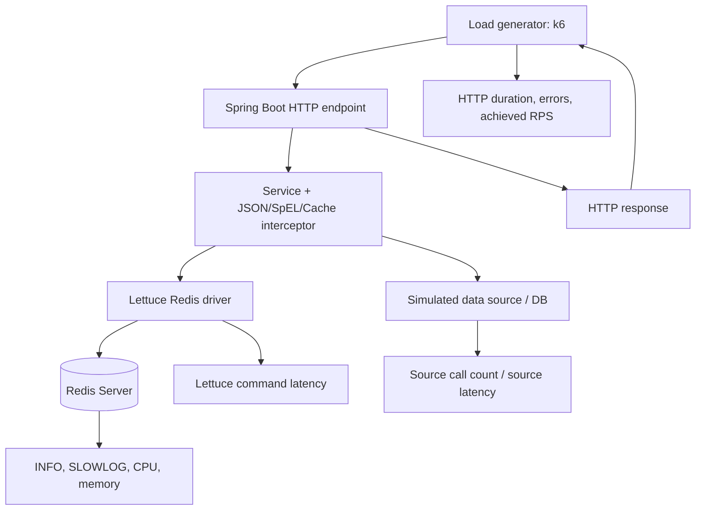
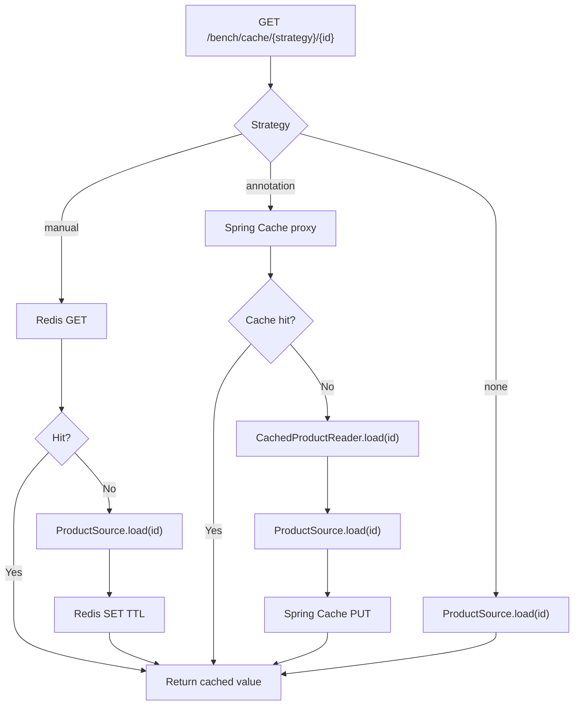
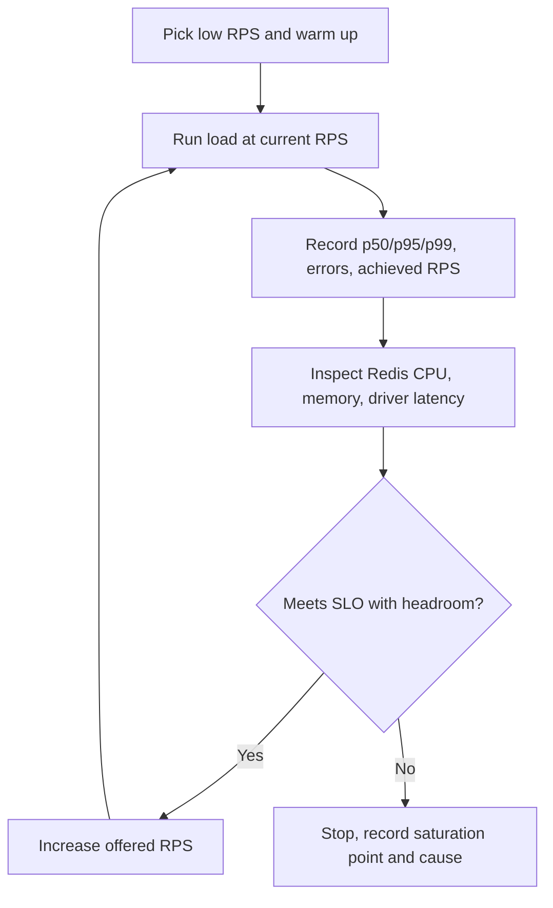
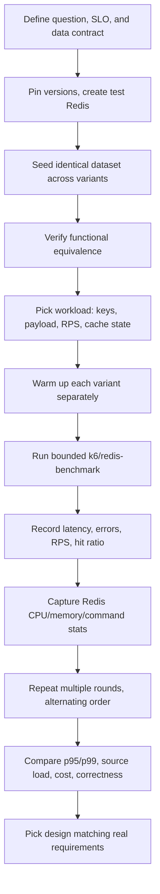

# Load Testing and Comparing Data Structures or Caching Strategies

In **Spring Data Redis**, choosing between a Redis String, Hash, Set, Sorted Set, or another structure is not merely deciding "can it store the data?". Each choice differs in **command count**, **network bytes**, **Redis memory**, **serialization/deserialization cost**, **partial update capability**, and **scaling limits**. Similarly, choosing **no cache**, **manual cache-aside**, or **Spring Cache `@Cacheable`** impacts end-to-end performance, cache hit ratio, behavior on TTL expiration, and load on the source of truth.

To choose a solution for production, never rely on "Redis is super fast" or a single `redis-benchmark` run with tiny keys. You need **a repeatable experiment**, controlled workloads, consistent measurements, and clear interpretation of throughput, p95/p99, errors, hit ratio, memory, and operational effort.

This exercise has two main experiments:

1. **Data structures:** store the same product as a **Redis String holding JSON** and a **Redis Hash holding fields**, then compare reading the full record, reading one field, and updating one field.
2. **Caching strategies:** compare **reading directly from the data source**, **cache-aside via `StringRedisTemplate`**, and **Spring Cache `@Cacheable` backed by `RedisCacheManager`** on the same business operation.

Sample numbers in this lesson illustrate **reporting format only**; they are **not actual measured figures** from any real Redis cluster or project.

## 1. Learning Objectives

After completing this lesson, you should be able to:

- Design fair workloads when comparing Redis structures or caching mechanisms.
- Distinguish **raw Redis command benchmarks** from **HTTP + Spring Boot + Redis + data source benchmarks**.
- Read **throughput**, **p50/p95/p99 latency**, error rate, and offered vs achieved load.
- Explain why the same Redis command yields different results as payload, concurrency, key distribution, and cache hit ratio change.
- Practice Spring Data Redis with `opsForValue()`, `opsForHash()`, and `@Cacheable`.
- Use `redis-benchmark` for command-level metrics and **k6** to generate controlled HTTP load.
- Inspect Spring Boot Actuator/Micrometer, Lettuce, and Redis `INFO`/`SLOWLOG`.
- Verify data correctness before interpreting performance.
- Make decisions based on **query needs, latency, memory, consistency, and operational cost**, not a single RPS number.

## 2. Start from a Hypothesis, Not from Tools

A good experiment starts with a **question** and a **falsifiable hypothesis**.

| Experiment | Question | Hypothesis to Test |
| --- | --- | --- |
| A1 — read full product | Does JSON String or Hash give lower latency when all fields are always needed? | Depends on JSON size, field count, serializer, and network |
| A2 — read price only | `HGET` vs `GET` full JSON and parse? | Hash may reduce bytes and deserialization cost when only one field is needed |
| A3 — update price | `HSET` one field vs `GET`/edit JSON/`SET`? | Hash may avoid read-modify-write, though concurrency/TTL must be evaluated |
| B1 — cache 0% hit | Does cache-aside speed up requests when every request misses? | Cache may be slower due to the extra Redis round-trip |
| B2 — cache 90% hit | Does cache reduce p95 and source load? | Possible if source cost exceeds Redis plus serialization |
| B3 — concurrent misses | Does cache stop N requests from hitting the source together? | Not by default; cache stampede can occur |
| B4 — TTL/eviction | How do hit ratio and latency change when keys expire or evict? | Miss bursts can create p99 spikes |

**Measure equivalent operations.** If one approach reads only `price` and the other reads the full object, they do not produce the same output payload. That experiment still demonstrates **the benefit of on-demand projection**, yet cannot be generalized into "Hash is always faster than String".

## 3. Measurement Layers to Distinguish



| Measurement | What Is In Scope? | What It Does Not Prove Alone |
| --- | --- | --- |
| `redis-benchmark` | Redis commands from load client to server and reply | Does not measure HTTP, Spring AOP, Java serialization, or cache hit/miss |
| k6 HTTP load test | Entire HTTP request/response path from generator | Cannot separate Redis vs DB without instrumentation |
| Service Micrometer Timer | Measures the instrumented code section | Does not cover costs outside that section |
| Lettuce command Timer | Driver-observed command latency | Not solely Redis Server CPU time |
| Redis `SLOWLOG` | Server-side command execution time above threshold | Excludes network and JVM deserialization |
| Redis `INFO memory` | Server memory at a point in time | Cannot map directly to bytes per object without subtracting baseline |

Never add timings across layers as though they were independent: **HTTP latency already includes Redis driver latency** along that path. Sub-layer metrics decompose total latency rather than adding onto it.

## 4. Defining Metrics and Units Before Running

### 4.1. Throughput, RPS, and Achieved Load

Throughput can be expressed as:

```text
completed_requests_per_second =
    requests completed in window / measurement seconds
```

In command-level benchmarks:

```text
Redis commands/second
```

is not the same as:

```text
HTTP requests/second
```

One HTTP request may issue **multiple Redis commands**, while a Redis pipeline can transmit multiple commands in a single network round-trip.

With k6 `constant-arrival-rate`, distinguish:

- **Offered load:** rate the generator intends to issue.
- **Achieved load:** requests actually started/completed during the window.
- **Dropped iterations:** iterations scheduled to start when the generator lacked VUs or resources.

If targeting 1,000 RPS while the generator only achieves 700 RPS with many `dropped_iterations`, never report "Redis achieved 1,000 RPS".

### 4.2. Percentiles vs Averages

| Metric | Meaning |
| --- | --- |
| p50 | 50% of samples completed at or below this time |
| p95 | 95% of samples completed at or below this time |
| p99 | 99% of samples completed at or below this time |
| Mean | Arithmetic average, skewed by heavy tails |
| Max | Highest single sample in the run; highly sensitive to outliers |

For example, if most requests are fast while 1% take 1 second, the mean may still look fine while **p99 is terrible**. For APIs with latency SLOs, p95/p99 usually matter far more than the mean.

A percentile is only meaningful with sufficient samples and steady load; p99 over 30 requests lacks the statistical weight of p99 over hundreds of thousands of requests under representative traffic.

### 4.3. Error Rate

```text
error_rate = failed_requests / attempted_requests
```

Define failures explicitly: HTTP 5xx, timeouts, wrong results, reset connections, or responses violating the contract. Do not count only HTTP 500 while ignoring timeouts where a gateway closes connections.

### 4.4. Cache Hit Ratio

```text
hit_ratio = cache_hits / (cache_hits + cache_misses)
```

Hit ratio must be measured on the **cache lookup path**, not by treating `Redis GET count` as hits: `GET` can return `null`, belong to another operation, or come from retries. Counting data-source calls is a helpful secondary signal, yet insufficient alone to derive exact hit ratios in the presence of self-invocation, concurrent misses, and multi-tier caches.

### 4.5. Memory Footprint

Inspect:

```redis
INFO memory
DBSIZE
MEMORY USAGE bench:product:string:1
MEMORY USAGE bench:product:hash:1
```

`MEMORY USAGE` returns an estimate of key memory inside Redis. It excludes Java heap overhead, network buffers, external indexes, and auxiliary metadata keys in the application.

A stronger overall comparison measures the **delta in `used_memory` after loading a large dataset** against a clean baseline, with identical key counts and controlled Redis persistence/fragmentation and workloads.

## 5. Rules for Trustworthy Results

Before each measurement:

1. **Pin versions:** Redis, Spring Boot, Spring Data Redis, Lettuce, Java, k6, and OS/container.
2. **Keep the environment identical:** CPU, RAM, network path, TLS, deployment topology, and Redis configuration.
3. **Keep the dataset identical:** key count, object size, field lengths, and key distribution.
4. **Keep the workload identical:** request mix, arrival rate, concurrency, hot-key distribution, and cache hit/cold ratio.
5. **Separate warm-up from measurement:** JVM JIT, TCP connections, connection pools, and cache prewarming.
6. **Avoid background noise:** backups, AOF rewrites, snapshots, bulk imports, or concurrent benchmarks against the same Redis unless explicitly under test.
7. **Prevent the load generator from becoming the bottleneck:** watch k6 CPU/RAM, dropped iterations, and network.
8. **Repeat runs:** run each configuration multiple rounds and alternate order to reduce CPU thermal, JIT, or memory-growth bias.
9. **Record errors and correctness:** a fast benchmark returning missing or stale data is not a win.
10. **Report limitations too:** numbers apply solely to the documented test conditions.

A run can be structured as:

```text
30–60 seconds warm-up
120–300 seconds measurement
30 seconds controlled cooldown/cleanup
Repeat 5 times per variant, alternating A/B order
```

These durations are **starting suggestions**, not universal standards. Long-running workloads, slow warm-ups, or GC/AOF-rewrite cycles may require longer windows.

## 6. Preparing an Isolated Test Redis

Never run write-load benchmarks or cleanup commands against production Redis. Use a dedicated Redis container:

```sh
docker run --rm -d \
  --name redis-bench-lesson \
  -p 6380:6379 \
  redis:7.4-alpine
```

**Note:** `redis:7.4-alpine` is an example pinned version for repeatable comparisons. In real projects, choose an image/version matching infrastructure policy and record the image digest; never use `latest` for reproducible benchmarks.

Verify:

```sh
redis-cli -h 127.0.0.1 -p 6380 PING
redis-cli -h 127.0.0.1 -p 6380 INFO server
redis-cli -h 127.0.0.1 -p 6380 INFO memory
redis-cli -h 127.0.0.1 -p 6380 CONFIG GET maxmemory
redis-cli -h 127.0.0.1 -p 6380 CONFIG GET maxmemory-policy
```

In production, Redis needs auth/TLS/network isolation per policy; these commands assume **local test-only Redis**.

### 6.1. Avoid Confusing Local Benchmarks with Production

Docker on a laptop may throttle CPU, RAM, or run over virtualized networking. Results are valid for **relative comparison within the same setup**, not guaranteed throughput numbers for production infrastructure. For major deployment decisions, benchmark on representative environments and networks.

Never run Redis and k6 sharing one CPU-constrained host and blame Redis for slowness when the load generator is starving Redis of CPU.

### 6.2. Recording Run Metadata

Record at minimum:

```text
date_utc:
git_commit:
java_version:
spring_boot_version:
spring_data_redis_version:
lettuce_version:
redis_version:
redis_topology: standalone / sentinel / cluster
machine_cpu_ram:
redis_maxmemory_policy:
app_replicas:
load_generator_machine:
dataset_keys:
payload_bytes:
key_distribution:
request_rate:
run_duration:
warmup_duration:
result_path:
```

Without recording these parameters, a run appearing 20% faster three months later might just reflect newer hardware or smaller payloads rather than data architecture.

## 7. Preparing the Sample Spring Boot App

Add dependencies to a Spring Boot 3.x, Java 17+ project with Spring Boot dependency management:

```groovy
dependencies {
    implementation 'org.springframework.boot:spring-boot-starter-web'
    implementation 'org.springframework.boot:spring-boot-starter-data-redis'
    implementation 'org.springframework.boot:spring-boot-starter-cache'
    implementation 'org.springframework.boot:spring-boot-starter-actuator'
    runtimeOnly 'io.micrometer:micrometer-registry-prometheus'

    testImplementation 'org.springframework.boot:spring-boot-starter-test'
    testImplementation 'org.testcontainers:junit-jupiter'
}
```

No need to switch build tools if the project already uses Gradle or Maven; what matters is keeping **identical dependency versions** across variants.

Sample configuration:

```yaml
spring:
  application:
    name: redis-benchmark-lesson
  data:
    redis:
      host: 127.0.0.1
      port: 6380
      connect-timeout: 2s
      timeout: 3s

server:
  port: 8080

management:
  endpoints:
    web:
      exposure:
        include: "health,metrics,prometheus"
  metrics:
    tags:
      application: ${spring.application.name}
```

Actuator and benchmark endpoints must **only be exposed in controlled test environments**, never open to the Internet. Production can use a separate management port, auth, and network policies.

Main application:

```java
package com.example.redisbench;

import org.springframework.boot.SpringApplication;
import org.springframework.boot.autoconfigure.SpringBootApplication;
import org.springframework.cache.annotation.EnableCaching;

@SpringBootApplication
@EnableCaching
public class BenchmarkApplication {

    public static void main(String[] args) {
        SpringApplication.run(BenchmarkApplication.class, args);
    }
}
```

`@EnableCaching` lets Spring create **cache interceptors/proxies** for beans with caching annotations. It does not route `this.cachedMethod()` self-calls within the same bean through the proxy.

## 8. Experiment A: JSON String vs Redis Hash

Choose a model:

```java
package com.example.redisbench;

public record ProductView(
        String id,
        String title,
        long priceCents,
        String category) {
}
```

**JSON String**:

```text
Key:   bench:product:string:101
Type:  string
Value: {"id":"101","title":"Keyboard","priceCents":259900,"category":"IT"}
```

**Redis Hash**:

```text
Key:  bench:product:hash:101
Type: hash
Fields:
    id         -> 101
    title      -> Keyboard
    priceCents -> 259900
    category   -> IT
```

Both represent the **exact same information**. Yet read/write operations differ:

| Operation | JSON String | Hash |
| --- | --- | --- |
| Save full object | `SET key json EX ttl` | `HSET key field value ...` then set TTL |
| Read full object | `GET key` + deserialize JSON | `HGETALL key` + map fields |
| Read price only | `GET key` + parse JSON | `HGET key priceCents` |
| Update price only | Usually read, parse, modify, serialize, `SET` | `HSET key priceCents value` |
| Single-key TTL | `SET ... EX` sets TTL in one command | Hash TTL applies to the whole key; set separately or via script |
| Object version detection | Field/version inside JSON | Field/version inside Hash |

**Note:** Redis Strings do not have to use JSON—they can hold MessagePack, Protobuf, or binary formats. Redis Hashes can also use binary serializers. This benchmark compares **the two chosen representations**, not every String vs every Hash in general.

### 8.1. Inspecting Directly via Redis CLI

```redis
SET bench:product:string:101 '{"id":"101","title":"Keyboard","priceCents":259900,"category":"IT"}' EX 1800
HSET bench:product:hash:101 id 101 title Keyboard priceCents 259900 category IT
EXPIRE bench:product:hash:101 1800

TYPE bench:product:string:101
TYPE bench:product:hash:101

GET bench:product:string:101
HGETALL bench:product:hash:101
HGET bench:product:hash:101 priceCents

MEMORY USAGE bench:product:string:101
MEMORY USAGE bench:product:hash:101
```

`MEMORY USAGE` can show Hashes consuming less or more memory than Strings depending on field count, field name lengths, Redis encoding, and configuration. There is no fixed rule that Hashes are always smaller than JSON.

### 8.2. Spring Data Redis: A Comparison Service

```java
package com.example.redisbench;

import com.fasterxml.jackson.core.JsonProcessingException;
import com.fasterxml.jackson.databind.ObjectMapper;
import java.time.Duration;
import java.util.Map;
import org.springframework.data.redis.core.StringRedisTemplate;
import org.springframework.stereotype.Service;

@Service
public class ProductShapeStore {

    private static final Duration TTL = Duration.ofMinutes(30);
    private static final String STRING_PREFIX = "bench:product:string:";
    private static final String HASH_PREFIX = "bench:product:hash:";

    private final StringRedisTemplate redis;
    private final ObjectMapper mapper;

    public ProductShapeStore(
            StringRedisTemplate redis, ObjectMapper mapper) {
        this.redis = redis;
        this.mapper = mapper;
    }

    public void saveString(ProductView product) {
        try {
            redis.opsForValue().set(
                    STRING_PREFIX + product.id(),
                    mapper.writeValueAsString(product),
                    TTL);
        } catch (JsonProcessingException ex) {
            throw new IllegalStateException("Cannot encode product JSON", ex);
        }
    }

    public void saveHash(ProductView product) {
        String key = HASH_PREFIX + product.id();
        Map<String, String> fields = Map.of(
                "id", product.id(),
                "title", product.title(),
                "priceCents", Long.toString(product.priceCents()),
                "category", product.category());

        redis.opsForHash().putAll(key, fields);
        redis.expire(key, TTL);
    }

    public ProductView readString(String id) {
        String json = redis.opsForValue().get(STRING_PREFIX + id);
        if (json == null) {
            return null;
        }

        try {
            return mapper.readValue(json, ProductView.class);
        } catch (JsonProcessingException ex) {
            throw new IllegalStateException("Cannot decode product JSON", ex);
        }
    }

    public ProductView readHash(String id) {
        Map<Object, Object> values =
                redis.opsForHash().entries(HASH_PREFIX + id);
        if (values.isEmpty()) {
            return null;
        }

        return new ProductView(
                (String) values.get("id"),
                (String) values.get("title"),
                Long.parseLong((String) values.get("priceCents")),
                (String) values.get("category"));
    }

    public Long readPriceFromHash(String id) {
        Object value = redis.opsForHash()
                .get(HASH_PREFIX + id, "priceCents");
        return value == null ? null
                : Long.parseLong((String) value);
    }

    public Long readPriceFromJson(String id) {
        ProductView product = readString(id);
        return product == null ? null : product.priceCents();
    }
}
```

In the example, `ObjectMapper` is auto-configured by Spring Boot from Jackson. Hash fields and values use `StringRedisTemplate`, so they are encoded as strings. `Map.of(...)` forbids `null`; the benchmark dataset must populate valid fields.

**Important regarding TTL and atomicity:** `saveString` uses a single `SET` with TTL, whereas `saveHash` writes the Hash and calls `EXPIRE` in two separate commands. If the app crashes in between, the Hash lacks a TTL. This is an **actual implementation difference**, not an inherent flaw preventing Hashes from ever setting TTL atomically: a Lua script can combine `HSET` and `EXPIRE` atomically on the same key. When evaluating write latency, disclose that this Hash implementation sends **two commands**.

### 8.3. Reading Full Records vs Reading Projections Are Two Different Workloads

In case A1, call:

```java
ProductView a = store.readString("101");
ProductView b = store.readHash("101");
```

Outputs must match across `id`, `title`, `priceCents`, and `category`. Latency includes the Redis command plus converting bytes into `ProductView`.

In case A2, call:

```java
Long a = store.readPriceFromJson("101");
Long b = store.readPriceFromHash("101");
```

**Same output** (the price), different paths: String reads and parses the entire JSON record, while Hash reads just one field. If Hash wins, the accurate conclusion is **for single-field read workloads, the Hash/`HGET` model fits better**, not that every Hash query outperforms every String query.

### 8.4. Single-Field Updates and Race Conditions

With Redis Hash:

```java
redis.opsForHash().put(
        "bench:product:hash:101", "priceCents", "299900");
```

Redis `HSET` updates the field directly. With a JSON String, a typical implementation does:

```text
GET JSON
deserialize
replace price
serialize
SET JSON
```

The String path risks **lost updates** if two writers read the same JSON and overwrite each other. Adding versioning/CAS (`WATCH`, Lua) adds cost and complexity while improving correctness. Never compare "single-command Hash `HSET`" against "unprotected String `GET`/`SET`" while ignoring **correctness under concurrency**.

Hashes still require concurrency rules when updating multiple fields bound by business invariants. An atomic single-field `HSET` does not make an entire multi-field/multi-key service operation transactional.

## 9. Controlled Data Seeding

To make both variants process the **exact same dataset**, pre-populate a known number of products:

```java
package com.example.redisbench;

import org.springframework.boot.ApplicationRunner;
import org.springframework.context.annotation.Bean;
import org.springframework.context.annotation.Configuration;

@Configuration
public class BenchmarkSeedConfiguration {

    @Bean
    ApplicationRunner seedBenchmarkProducts(ProductShapeStore store) {
        return args -> {
            for (int i = 0; i < 1000; i++) {
                ProductView p = new ProductView(
                        Integer.toString(i),
                        "Product-" + i,
                        10000L + i,
                        "category-" + (i % 10));
                store.saveString(p);
                store.saveHash(p);
            }
        };
    }
}
```

This is **seeding for a dedicated benchmark environment**; never copy it into production apps to write 2,000 keys on every startup. Seeding takes time due to multiple round-trips; **wait for seeding to finish before starting warm-up or measurements**.

For larger dataset experiments, raise `1000` to your target key count and document title/value lengths, ID lengths, and field counts. Scaling key counts while keeping payloads unrealistically tiny yields very different results from real multi-attribute product JSON.

With a 30-minute TTL as in the example, ensure warm-up and measurement complete before keys expire. If TTL itself is the variable under test, run a **separate** experiment group rather than letting keys expire mid-run during an unrelated A/B comparison.

## 10. REST Endpoints for HTTP Load Measurement

Create a controller strictly for test environments:

```java
package com.example.redisbench;

import org.springframework.http.ResponseEntity;
import org.springframework.web.bind.annotation.GetMapping;
import org.springframework.web.bind.annotation.PathVariable;
import org.springframework.web.bind.annotation.RequestMapping;
import org.springframework.web.bind.annotation.RestController;

@RestController
@RequestMapping("/bench/shape")
public class ShapeBenchmarkController {

    private final ProductShapeStore store;

    public ShapeBenchmarkController(ProductShapeStore store) {
        this.store = store;
    }

    @GetMapping("/string/{id}")
    public ResponseEntity<ProductView> readString(@PathVariable String id) {
        ProductView value = store.readString(id);
        return value == null
                ? ResponseEntity.notFound().build()
                : ResponseEntity.ok(value);
    }

    @GetMapping("/hash/{id}")
    public ResponseEntity<ProductView> readHash(@PathVariable String id) {
        ProductView value = store.readHash(id);
        return value == null
                ? ResponseEntity.notFound().build()
                : ResponseEntity.ok(value);
    }

    @GetMapping("/string-price/{id}")
    public ResponseEntity<Long> priceFromString(
            @PathVariable String id) {
        Long value = store.readPriceFromJson(id);
        return value == null
                ? ResponseEntity.notFound().build()
                : ResponseEntity.ok(value);
    }

    @GetMapping("/hash-price/{id}")
    public ResponseEntity<Long> priceFromHash(
            @PathVariable String id) {
        Long value = store.readPriceFromHash(id);
        return value == null
                ? ResponseEntity.notFound().build()
                : ResponseEntity.ok(value);
    }
}
```

**Test A1:** `/bench/shape/string/{id}` vs `/bench/shape/hash/{id}`. Both return the same JSON DTO.

**Test A2:** `/bench/shape/string-price/{id}` vs `/bench/shape/hash-price/{id}`. Both return only the numeric `priceCents`.

Avoid testing a String endpoint returning 60 bytes against a Hash endpoint returning 5 KB and drawing conclusions from HTTP p99 while ignoring payload differences. Matching outputs keeps HTTP serialization cost nearly identical, isolating differences along the Redis path.

**Limitation:** these endpoints perform no ID validation, rate limiting, or access control. Include them solely in an **isolated benchmark profile/environment**; never expose them in production.

## 11. Pure Redis Benchmarking with redis-benchmark

`redis-benchmark` ships with Redis and fits **command-level** measurements. Example:

```sh
redis-benchmark \
  -h 127.0.0.1 -p 6380 \
  -t get,set \
  -n 100000 \
  -c 50 \
  -d 512 \
  -P 1
```

Common flags:

| Flag | Meaning |
| --- | --- |
| `-h`, `-p` | Redis host and port |
| `-t get,set` | Selects the default command benchmark suite |
| `-n 100000` | Number of benchmark requests per selected workload rule |
| `-c 50` | Number of concurrent client connections |
| `-d 512` | Benchmark value size in bytes |
| `-P 1` | Pipeline depth 1, avoiding accidental pipelining |

To measure the effect of pipelining:

```sh
redis-benchmark \
  -h 127.0.0.1 -p 6380 \
  -t get,set -n 100000 -c 50 -d 512 -P 16
```

**Never compare `-P 16` against `-P 1` and claim Redis executed individual commands proportionally faster.** Pipelining changes round-trip counts and in-flight command batching, making it a different workload variable.

### 11.1. redis-benchmark Is Insufficient for Spring Data Redis

`redis-benchmark` results exclude:

- Spring MVC/Tomcat/Netty and the HTTP network stack.
- `@Cacheable` AOP interceptors/SpEL.
- Jackson JSON serialization/deserialization.
- Source query logic on cache misses.
- Application connection pool configuration.
- JVM JIT/GC and application thread pools.
- HTTP status and response body handling.

Therefore, use `redis-benchmark` to understand **baseline Redis command throughput and pipelining/concurrency behavior**, then use HTTP load testing to evaluate **the real application path**.

### 11.2. Do Not Use Semantically Different Workloads Just Because Command Names Match

A 512-byte `GET` in `redis-benchmark` does not represent fetching a 100 KB cache entry and deserializing complex JSON. When comparing, match key sizes, value sizes, key counts, and read/write ratios.

For Hashes, Sets, and ZSets, use tailored workloads or invoke commands via a driver/script against pre-seeded datasets. Never run only `SET`/`GET` and claim you measured `HGETALL` or `ZSCAN`.

## 12. Generating HTTP Load with k6

**k6** lets you define arrival rates, durations, VUs, status checks, and export latency percentiles. Below is a shared `bench.js` script example; this is a **sample file for learners to create in their own benchmark environment**, not a file written during STEP 4.

```javascript
import http from 'k6/http';
import { check } from 'k6';
import exec from 'k6/execution';

const baseUrl = __ENV.BASE_URL || 'http://127.0.0.1:8080';
const pathPrefix = __ENV.PATH_PREFIX || '/bench/shape/string';
const pool = Number(__ENV.KEY_POOL || 1000);
const rate = Number(__ENV.RATE || 100);
const duration = __ENV.DURATION || '2m';

export const options = {
  scenarios: {
    steady: {
      executor: 'constant-arrival-rate',
      rate: rate,
      timeUnit: '1s',
      duration: duration,
      preAllocatedVUs: Number(__ENV.VUS || 50),
      maxVUs: Number(__ENV.MAX_VUS || 200),
      gracefulStop: '10s',
    },
  },
  thresholds: {
    http_req_failed: ['rate<0.01'],
    http_req_duration: ['p(95)<250'],
  },
};

function chooseId(iteration) {
  // Uniform distribution over a fixed ID set.
  return String(iteration % pool);
}

export default function () {
  const id = chooseId(exec.scenario.iterationInTest);
  const response = http.get(`${baseUrl}${pathPrefix}/${id}`, {
    tags: { workload: 'redis-benchmark-lesson' },
    timeout: '5s',
  });

  check(response, {
    'status is 200': (r) => r.status === 200,
    'response non-empty': (r) => r.body !== null && r.body.length > 0,
  });
}
```

The `p(95)<250` ms and `<1%` error thresholds are examples for k6 pass/fail marking. Replace them with actual product SLOs.

If `KEY_POOL` is invalid or zero, ID selection breaks; in production-grade test scripts, validate environment variables before running.

### 12.1. Run Commands

```sh
# Measure JSON String, full object read
k6 run -e RATE=200 -e KEY_POOL=1000 \
  -e PATH_PREFIX=/bench/shape/string bench.js

# Measure Redis Hash, full object read
k6 run -e RATE=200 -e KEY_POOL=1000 \
  -e PATH_PREFIX=/bench/shape/hash bench.js

# Measure reading price from JSON
k6 run -e RATE=200 -e KEY_POOL=1000 \
  -e PATH_PREFIX=/bench/shape/string-price bench.js

# Measure reading price via HGET
k6 run -e RATE=200 -e KEY_POOL=1000 \
  -e PATH_PREFIX=/bench/shape/hash-price bench.js
```

Using the same key pool and arrival rate minimizes variance. For higher confidence, run **multiple rounds alternating order**: A/B/B/A or controlled randomization instead of always running String first and Hash second.

### 12.2. Why Choose constant-arrival-rate?

**Closed-loop VU** benchmarks wait for each request to finish before sending the next. When the server slows down, the generator throttles itself, distorting latency and throughput measurements.

`constant-arrival-rate` approximates an **open-loop offered load**: if the server slows down, k6 allocates more VUs to hold the target arrival rate. Always check `dropped_iterations`, allocated VUs, and generator CPU.

Never raise VUs indefinitely trying to force RPS on an overloaded server; stop at safe bounds and record the **throughput/latency saturation point**.

## 13. Key Distribution: Uniform vs Hot Keys

A uniform workload over 1,000 keys rarely matches real traffic. In many products, a small subset of items receives most reads.

Example models:

```text
Uniform:
  1,000 keys have roughly equal probability

Hot-key:
  80% of requests hit 20% of keys
  20% of requests hit the remaining 80% of keys
```

Differences that emerge:

- Read-heavy hot keys can **raise cache hit ratio** if the cache is large enough.
- Write-heavy hot keys can **increase contention** or overload one Redis Cluster slot/node.
- Uniform distribution over a massive keyspace can trigger **more cache misses** under memory limits.
- Tiny, always-warm datasets make benchmarks overestimate caching effectiveness.

To generate a hot-key workload, construct a fixed/seeded request trace so all variants execute **the exact same request sequence**, rather than calling `Math.random()` independently in each run and comparing tiny differences.

### 13.1. Workload Dimensions to Record

| Dimension | Candidate Values |
| --- | --- |
| Key pool | 100, 1,000, 100,000 |
| Payload | 128 B, 1 KB, 10 KB, 100 KB |
| Read/write mix | 100/0, 95/5, 80/20 |
| Arrival rate | 100, 500, 1,000 RPS and stepping up |
| Key distribution | Uniform, hot-key |
| TTL | 30 s, 5 min, 30 min |
| Cache state | Cold, warm, steady |
| Target cache hit ratio | 0%, 50%, 90%, 99% |
| Replicas | 1 vs multiple application instances |
| Topology | Standalone vs Cluster/Sentinel if used in production |

You do not need to run **every combination** in the matrix, as cases explode combinatorially. Pick a baseline, vary **one or two deliberate variables** at a time, and expand where factors show major impact.

## 14. Experiment B: No Cache, Cache-Aside, and @Cacheable

Suppose a business operation reads product names from a data source with non-trivial latency. Three designs:



Measure the **same response type and IDs** across all three strategies, and isolate cache namespaces so one variant never warms another variant's cache.

### 14.1. Why Need a Data Source That Counts Calls?

If two endpoints both return `"Product-101"`, you cannot tell whether the cache actually hit. A data source with a `Counter` proves caching reduced source loads:

```text
10,000 HTTP requests
Source.load called 10,000 times -> no-cache
Source.load called 1,050 times  -> high cache hits, initial misses
```

This is an illustrative signal; under concurrency, multiple requests can miss simultaneously and call the source together. Instrument cache-layer hit/miss metrics if exact ratios are needed.

## 15. Simulated Data Source Service

In a learning benchmark, you can simulate a data source taking ~15 ms. This is **not a real database benchmark**; it isolates the effect of avoiding source calls.

```java
package com.example.redisbench;

import java.util.concurrent.TimeUnit;
import java.util.concurrent.atomic.AtomicLong;
import org.springframework.stereotype.Component;

@Component
public class FakeProductSource {

    private final AtomicLong loads = new AtomicLong();

    public String load(String id) {
        loads.incrementAndGet();

        try {
            TimeUnit.MILLISECONDS.sleep(15);
        } catch (InterruptedException ex) {
            Thread.currentThread().interrupt();
            throw new IllegalStateException(
                    "Source operation interrupted", ex);
        }

        return "Product-" + id + "|v1";
    }

    public long loadCount() {
        return loads.get();
    }
}
```

**Limitation of `sleep`:** it ties up a request thread while sleeping, and does not accurately model connection pools, SQL query plans, network retries, or real database CPU load. Useful for preliminary comparisons, **unsuitable for production sizing conclusions**. For real decisions, run an extra round against a real database/source or a service modeling realistic latency distributions.

Never reset the counter mid-flight; capture before/after snapshots during an isolated run without unrelated traffic.

## 16. Manual Cache-Aside with StringRedisTemplate

```java
package com.example.redisbench;

import java.time.Duration;
import org.springframework.data.redis.core.StringRedisTemplate;
import org.springframework.stereotype.Service;

@Service
public class ManualProductCache {

    private static final String PREFIX = "bench:cache:manual:";
    private static final Duration TTL = Duration.ofMinutes(5);

    private final StringRedisTemplate redis;
    private final FakeProductSource source;

    public ManualProductCache(
            StringRedisTemplate redis, FakeProductSource source) {
        this.redis = redis;
        this.source = source;
    }

    public String load(String id) {
        String key = PREFIX + id;
        String cached = redis.opsForValue().get(key);
        if (cached != null) {
            return cached;
        }

        String loaded = source.load(id);
        redis.opsForValue().set(key, loaded, TTL);
        return loaded;
    }
}
```

This is **cache-aside**:

1. Read cache.
2. If hit, return result.
3. If miss, load from source.
4. Write cache with TTL.
5. Return result.

**Understand the limits:** multiple threads/processes missing the same key concurrently will all call `source.load(id)` and `SET`. If source data changes, an older slow read may overwrite a newer read in cache. Never treat this example as stampede protection or complete consistency.

## 17. Spring Cache @Cacheable via a Real Bean Proxy

```java
package com.example.redisbench;

import org.springframework.cache.annotation.Cacheable;
import org.springframework.stereotype.Service;

@Service
public class AnnotatedProductCache {

    private final FakeProductSource source;

    public AnnotatedProductCache(FakeProductSource source) {
        this.source = source;
    }

    @Cacheable(cacheNames = "benchProducts", key = "#p0")
    public String load(String id) {
        return source.load(id);
    }
}
```

`@Cacheable` works properly only when called through the **Spring-managed proxy**. If another method inside `AnnotatedProductCache` calls `this.load(id)`, caching is bypassed in proxy mode. For benchmarks, the controller must inject the `AnnotatedProductCache` bean from the `ApplicationContext`, never `new AnnotatedProductCache(...)`.

### 17.1. RedisCacheManager with TTL and Serializer

```java
package com.example.redisbench;

import java.time.Duration;
import org.springframework.context.annotation.Bean;
import org.springframework.context.annotation.Configuration;
import org.springframework.data.redis.cache.RedisCacheConfiguration;
import org.springframework.data.redis.cache.RedisCacheManager;
import org.springframework.data.redis.connection.RedisConnectionFactory;
import org.springframework.data.redis.serializer.RedisSerializationContext;
import org.springframework.data.redis.serializer.StringRedisSerializer;

@Configuration
public class BenchmarkCacheConfiguration {

    @Bean
    public RedisCacheManager cacheManager(
            RedisConnectionFactory connectionFactory) {

        RedisCacheConfiguration options =
                RedisCacheConfiguration.defaultCacheConfig()
                        .entryTtl(Duration.ofMinutes(5))
                        .computePrefixWith(
                                cache -> "bench:cache:annotation:"
                                        + cache + "::")
                        .serializeValuesWith(
                                RedisSerializationContext
                                        .SerializationPair.fromSerializer(
                                                new StringRedisSerializer()))
                        .disableCachingNullValues();

        return RedisCacheManager.builder(connectionFactory)
                .cacheDefaults(options)
                .build();
    }
}
```

This explicitly selects **`RedisCacheManager`** to avoid accidentally benchmarking an in-JVM `ConcurrentMapCacheManager`. It keeps the 5-minute TTL matching the manual cache and uses a String serializer for `String` values.

However, the physical keys differ:

```text
Manual:
  bench:cache:manual:101

Spring Cache:
  bench:cache:annotation:benchProducts::101
```

Key-length differences are part of the implementation. If you need **identical key lengths** or byte-level footprint comparisons, align key naming conventions. Here, Goal B is **comparing caching strategies at the application level**, so realistic framework/key-conversion overhead stays in the measurement.

Do not define another `CacheManager` bean and leave Spring to pick arbitrarily. Verify the active `CacheManager` bean is actually `RedisCacheManager`.

## 18. Controller Comparing Three Strategies

```java
package com.example.redisbench;

import org.springframework.web.bind.annotation.GetMapping;
import org.springframework.web.bind.annotation.PathVariable;
import org.springframework.web.bind.annotation.RequestMapping;
import org.springframework.web.bind.annotation.RestController;

@RestController
@RequestMapping("/bench/cache")
public class CacheBenchmarkController {

    private final FakeProductSource source;
    private final ManualProductCache manual;
    private final AnnotatedProductCache annotated;

    public CacheBenchmarkController(
            FakeProductSource source,
            ManualProductCache manual,
            AnnotatedProductCache annotated) {
        this.source = source;
        this.manual = manual;
        this.annotated = annotated;
    }

    @GetMapping("/none/{id}")
    public String noCache(@PathVariable String id) {
        return source.load(id);
    }

    @GetMapping("/manual/{id}")
    public String manual(@PathVariable String id) {
        return manual.load(id);
    }

    @GetMapping("/annotation/{id}")
    public String annotation(@PathVariable String id) {
        return annotated.load(id);
    }
}
```

For the same `id`, all three endpoints return identical strings:

```text
Product-101|v1
```

The difference is the **value-retrieval path**. When k6 calls `/bench/cache/annotation/{id}`, it passes through the injected Spring Cache proxy bean.

Manual test:

```sh
curl -s http://localhost:8080/bench/cache/none/101
curl -s http://localhost:8080/bench/cache/manual/101
curl -s http://localhost:8080/bench/cache/annotation/101
```

Never enable these endpoints in environments with real data; benchmark handlers can generate heavy load and huge key volumes without production controls.

## 19. Running the Cache Experiment

To drive traffic at identical arrival rates and key pools, reuse `bench.js` above:

```sh
# No cache:
k6 run -e RATE=200 -e KEY_POOL=1000 \
  -e PATH_PREFIX=/bench/cache/none bench.js

# Manual cache-aside:
k6 run -e RATE=200 -e KEY_POOL=1000 \
  -e PATH_PREFIX=/bench/cache/manual bench.js

# Spring Cache @Cacheable:
k6 run -e RATE=200 -e KEY_POOL=1000 \
  -e PATH_PREFIX=/bench/cache/annotation bench.js
```

Before comparing, choose the **cache state**:

### 19.1. Cold Cache

No key has an entry before the run. Initial requests miss.

To create a fair cold run:

- Delete only keys belonging to the **isolated benchmark namespace**, never `FLUSHALL` on a shared Redis.
- Or choose a **fresh cache prefix/version per run** so prior data never leaks in.
- Record reset timestamps and initial key counts.
- Ensure no warm-up requests from another variant touch the same namespace.

**Never run a warm-up and then claim the result is a cold-cache test.**

### 19.2. Warm Cache

Pre-populate every key in the workload so most requests hit. For example, call each ID once on the cache endpoint:

```sh
# Illustrative Bash in an isolated benchmark environment:
for i in $(seq 0 999); do
  curl -sf "http://127.0.0.1:8080/bench/cache/manual/$i" \
    > /dev/null
done
```

For Spring Cache annotations, swap `/manual/` for `/annotation/`. `seq` and redirection assume a POSIX shell, not PowerShell.

Exclude prewarm time from the main measurement when testing **steady-state hit latency**. If testing a cold-start SLO, **include** warm-up time and source load.

### 19.3. Mixed Hit/Miss

Make the key pool larger than the pre-seeded cache, or use a hot/cold access distribution. Measure the **actual** hit ratio from instrumented cache lookups instead of assuming "key pool 1,000 guarantees 90% hits".

Causes that shift actual ratios:

- TTL expires mid-run.
- Redis evicts keys due to `maxmemory`.
- Concurrent misses on the same key.
- Differing cache key expressions across requests.
- Keys invalidated by another writer.
- Forgot to reset state from the prior run.

### 19.4. Fair Evaluation When No-Cache Is Always Slow

If `FakeProductSource` sleeps 15 ms while warm cache takes a couple of ms, caching clearly wins. Yet that mostly proves **skipping a slow source helps**.

To measure the **pure overhead of Spring Cache**, test a very fast data source—even without sleep—and observe Redis/network/AOP costs. When the source responds in under 1 ms, remote Redis caching may **offer no latency benefit**, even while reducing database load under high concurrency.

## 20. Execution Order and Preventing Interference

Do not run:

```text
Run 1: String
Run 2: Hash
```

and jump to conclusions when String always ran on a cold JVM and Hash always ran after JIT warm-up.

A balanced design:

```text
Warm up both paths independently.
Round 1: String -> Hash
Round 2: Hash -> String
Round 3: String -> Hash
Round 4: Hash -> String
Round 5: randomized order
```

Record every run's results, the *median* across rounds, and variance. Never cherry-pick the **fastest run** of A against the **slowest run** of B.

### 20.1. Should Both Variants Be Load-Tested Simultaneously?

Running String and Hash against **the same Redis instance** at the same time causes them to contend for CPU, network, and memory; the run is no longer an isolated benchmark.

Concurrent tests can evaluate **realistic mixed workloads**, provided you label them as mixed workloads and hold read/write ratios constant. In basic A/B experiments, run each variant separately with steady background conditions.

## 21. Stepped Load Increases: Finding the Saturation Point

A practical pattern steps load upward:

```text
100 RPS -> 250 RPS -> 500 RPS -> 1000 RPS -> 1500 RPS
```

Hold each step long enough for stable p95/p99 measurements. Stop when:

- Error rate exceeds SLO.
- p99 exceeds latency budget.
- Redis or app CPU exceeds safe thresholds.
- k6 shows rising `dropped_iterations`.
- Redis memory/eviction spikes unrepresentatively.
- Backlog or tail latency keeps climbing despite steady rate.



Never optimize solely for "peak throughput" while ignoring p99. A service can inflate throughput by queuing requests deeply while users endure unacceptable latency.

## 22. Observing Spring Boot and Lettuce Under Load

With Actuator/Micrometer:

```sh
curl -s http://localhost:8080/actuator/health
curl -s http://localhost:8080/actuator/metrics
curl -s http://localhost:8080/actuator/prometheus
```

Helpful meters:

- `http.server.requests` where supported by the app/version.
- `jvm.memory.used`, JVM GC, thread pools, and server connections.
- `lettuce.command.firstresponse` and `lettuce.command.completion` if Lettuce Micrometer recording is configured.
- Cache metrics when provider-supported and instrumented.
- Application-specific Counters/Timers for the data source and cache lookups.

**Do not assume** every Spring Boot version/driver automatically exports `lettuce.command.*` or Redis cache hit ratios. Inspect `/actuator/metrics` and how `LettuceConnectionFactory` is wired.

### 22.1. PromQL for Mean Command Latency

When Prometheus has Lettuce Timer series:

```promql
sum(rate(lettuce_command_completion_seconds_sum{command="GET"}[5m]))
/
sum(rate(lettuce_command_completion_seconds_count{command="GET"}[5m]))
```

This returns the **mean completion latency** over 5 minutes, typically in seconds. Never call it p95.

### 22.2. PromQL for p95 When Histograms Are Enabled

Only when histograms are configured and `_bucket` series exist:

```promql
histogram_quantile(
  0.95,
  sum by (le, command) (
    rate(lettuce_command_completion_seconds_bucket{command="GET"}[5m])
  )
)
```

If `_bucket` is absent, check distribution configuration; never conclude Redis p95 is 0 just because the query returns empty.

**Never compute cluster-wide p95 by averaging per-instance p95 values.** Percentiles do not aggregate by averaging like counters.

### 22.3. Instrument Counters/Timers for Real Data Sources

When replacing `FakeProductSource` with real PostgreSQL or HTTP services, instrument:

```text
source_load_total{source="catalog"}
source_load_duration{operation="findProduct"}
source_errors_total{source="catalog"}
```

Keep `source` and `operation` low cardinality. Never add `productId`, `userId`, Redis keys, or request IDs as metric tags.

## 23. Observing the Redis Server

On the **test** Redis being benchmarked:

```redis
INFO cpu
INFO memory
INFO stats
INFO commandstats
INFO clients
SLOWLOG GET 20
LATENCY LATEST
```

Signals:

| Signal | Meaning During Comparison |
| --- | --- |
| Redis CPU | Are server-side commands/serializers saturating CPU? |
| `used_memory` | Memory growth from dataset or cache entries |
| `evicted_keys` | Did the benchmark hit the memory cap? |
| `expired_keys` | Did TTLs expire keys mid-measurement? |
| `cmdstat_get/hget/hgetall` | Does command mix match the intended workload? |
| `SLOWLOG` | Are O(N) commands or expensive ops burning server CPU? |
| `connected_clients` | Any connection leaks or abnormal client counts? |
| Network input/output | Are large payloads saturating bandwidth? |

### 23.1. Redis Slow Log Does Not Measure End-to-End

`SLOWLOG` records command execution time **on the Redis Server**, excluding network RTT, driver queuing, connection-pool checkout time, and JVM deserialization.

If:

```text
k6 HTTP p99:                  180 ms
Lettuce command p99:           25 ms
Redis SLOWLOG:             nearly empty
```

that alone does not clear Redis of every bottleneck. Investigate source latency, thread pools, GC, networking, multiple Redis commands per request, and response serialization.

## 24. Measuring Data Size and Memory Cost

For String vs Hash, after synchronized seeding:

```redis
MEMORY USAGE bench:product:string:101
MEMORY USAGE bench:product:hash:101
```

Additional inspection:

```redis
TYPE bench:product:string:101
TYPE bench:product:hash:101
OBJECT ENCODING bench:product:string:101
OBJECT ENCODING bench:product:hash:101
```

`OBJECT ENCODING` reveals Redis's **internal representation**, distinct from `TYPE`. A small Hash uses a compact memory-saving encoding, then switches encodings once field counts or lengths cross configured thresholds.

**Avoid measuring one representative key and multiplying linearly without verification.** Per-key overhead, key names, allocator behavior, rehashing, and encodings shift as datasets scale. Good memory tests measure 1,000, 100,000, and 1,000,000 keys within environment limits, subtract baseline, and report total footprint.

### 24.1. Never Compare Data with Different Schemas

A Redis Hash split into 1,000 fields can be larger than a tightly packed JSON String. Conversely, a Hash with a few small fields can be very efficient. If the String holds a multi-field JSON object while the Hash stores only `price`, the datasets are not equivalent.

Keep **the exact same field count and logical values** in full-object benchmarks; for projection tests, state explicitly that the task only returns a subset of attributes.

## 25. Cache TTL, Memory, and Eviction Are Part of the Strategy

Spring Data Redis caches can configure entry TTL:

```java
RedisCacheConfiguration.defaultCacheConfig()
        .entryTtl(Duration.ofMinutes(5));
```

Manual cache-aside:

```java
redis.opsForValue().set(key, loaded, Duration.ofMinutes(5));
```

Longer-lived cache entries often raise hit ratios, yet allow stale data to linger longer unless invalidated. Short TTLs shrink staleness windows while raising cache misses and source load.

| TTL | Potential Benefit | Cost |
| --- | --- | --- |
| 30 seconds | Short staleness window | High source reload frequency |
| 5 minutes | Cuts source load under repeat reads | Data can stay stale up to TTL unless evicted |
| 1 hour | High hit ratio for stable data | Needs invalidation policy if data changes |

Values above are starting points; choose based on **freshness requirements**, never sacrificing correctness just to improve p99.

### 25.1. Eviction Due to Memory Pressure

`maxmemory-policy` governs how Redis behaves upon exceeding `maxmemory`. With `allkeys-lru` or similar policies, entries can be evicted **before their TTL expires**.

During benchmarks, watch:

```redis
INFO memory
INFO stats
```

If hit ratios drop while `evicted_keys` surges, the bottleneck is likely **cache capacity/key distribution**, not slow Spring Cache code.

Never alter production Redis `maxmemory`/eviction policies just to run practice benchmarks. Use an isolated test Redis, document the active policy in results, and re-verify against production-like configs when needed.

### 25.2. Cache Miss Storms After Synchronized Expiration

If all keys are seeded at once with the same TTL, they expire almost simultaneously:

```text
T0: prewarm 100,000 keys
T0 + 5 minutes: massive wave of keys hit TTL
T0 + 5 minutes: cache misses surge
T0 + 5 minutes: data source overloaded
```

Mitigations:

- Controlled TTL jitter when consistency allows.
- Scheduled prewarming of critical keys.
- Stale-while-revalidate in caches with explicit contracts.
- Per-key single-flight/locking when the data source is very expensive.
- Source rate limiting/backpressure and bounded concurrent reloads.

Warm-cache benchmarks miss this failure mode completely; run a **dedicated TTL-expiry experiment**.

## 26. Cache Stampede and Concurrency on Same-Key Misses

Multiple clients:

```text
Client A -> GET key -> null -> SELECT database
Client B -> GET key -> null -> SELECT database
Client C -> GET key -> null -> SELECT database
```

All three load from the source and write `SET`. In plain cache-aside, this is not a Redis bug; it is the natural behavior of **uncoordinated cache-miss loading**.

`@Cacheable(sync = true)` asks the cache provider to synchronize computation for the same key:

```java
@Cacheable(
        cacheNames = "benchProducts",
        key = "#p0",
        sync = true)
public String load(String id) {
    return source.load(id);
}
```

**Do not assume** `sync=true` with `RedisCacheManager` provides an **exactly-once distributed mutex across all JVMs/processes**. Synchronization scope and behavior depend on provider/writer/version; verify across **multiple application instances** if that guarantee matters.

Useful experiment:

1. Delete **one dedicated benchmark cache key**.
2. Send 50 near-simultaneous requests for that ID.
3. Measure how many times `FakeProductSource.load` actually executes.
4. Compare `manual`, `annotation`, and `sync=true`.
5. Repeat with **two app replicas** sharing one Redis.
6. Record tail latency and source impact, not just HTTP success counts.

If stampede protection adds Redis commands or locks, include that overhead in comparisons.

## 27. Correctness Must Accompany Performance

A "faster" cache returning **stale values** may be unacceptable.

Example product price update:

```text
T0: source = 259900, cache = 259900
T1: source updated = 299900
T2: cache not yet evicted => request returns 259900
```

Approaches depend on business rules:

- **TTL-only:** tolerates stale data for a bounded window.
- **Write-through/update cache:** updates source then cache with proper sequencing.
- **Invalidate on write:** evicts cache after source update commits.
- **Versioned values:** validates versions or keys by version.
- **Transaction/outbox:** delivers invalidations reliably across systems.

In benchmark logs, record:

```text
freshness_requirement:
  cache may be stale up to 5 minutes

correctness_checks:
  no missing responses
  no wrong tenant data
  price field matches contract
```

Never optimize latency solely on immutable datasets if real traffic has a significant read/write mix.

### 27.1. Prevent Cross-Tenant Data Leaks

A cache key using only `productId` causes **cache collisions** if product IDs overlap across tenants:

```text
tenant-1 / product-101
tenant-2 / product-101
```

In production, keys must embed tenant identity per your access contract. The benchmark uses plain `id` keys for a single-tenant lab; never copy that rule into multi-tenant services.

## 28. Variables That Strongly Skew Results

### 28.1. Serializers

Compare:

```text
StringRedisTemplate + UTF-8 strings
RedisTemplate<String, Object> + JSON
RedisTemplate<String, Object> + JDK serialization
RedisCacheManager + configured value serializer
```

These setups produce **different byte payloads** and deserialization costs. If comparing Redis structures, keep serializers uniform or explicitly isolate serializer as the tested variable. If comparing **real application strategies**, keep the exact configuration you intend to deploy.

### 28.2. Redis Commands per Logical Operation

String full read: typically `GET`.

Hash full read: typically `HGETALL`.

Hash full write + TTL: potentially `HSET` + `EXPIRE`.

Cache-aside miss: `GET` + source load + `SET`.

Spring Cache miss: cache lookup + source load + cache put, plus interceptor/key-conversion overhead.

**Never analyze latency by command name alone.** Count commands and network round-trips per **logical operation**; a path with many tiny commands can lose to one larger command due to RTT even when every individual command is fast.

### 28.3. Pipelining

Pipelining reduces sequential waits for replies, without letting Redis skip the underlying command work.

```text
GET k1 -> wait
GET k2 -> wait
GET k3 -> wait

vs:

GET k1
GET k2
GET k3
read replies
```

When comparing pipelined vs non-pipelined designs, run a **separate experiment**. Overly large pipelines bloat client/server buffers, and pipelines are **not transactions**.

### 28.4. Connections and Topology

Co-located standalone Redis differs from Redis Cluster over a network:

- Network RTT may dominate performance.
- TLS adds overhead.
- Redis Cluster adds hash-slot routing, `MOVED`/`ASK`, and multiple primaries.
- Hot keys or shared hash tags concentrate load onto a single slot.
- Read replicas can serve stale data; never treat a faster read path as consistency-equivalent.
- During failover, retries and reconnects impact p99 and error rates.

Basic experiments should hold topology constant. If production uses Cluster, run follow-up tests **on a Cluster with matching slot/key distributions** rather than relying on standalone results alone.

## 29. Is Redis Hash Always Better Than JSON String?

No. It depends on the **access pattern**.

### When JSON String Fits Well

- Usually **reading and writing the whole object**.
- Shares a consistent DTO/JSON schema with the API.
- Can adopt compact binary serializers or compression.
- Wants simple single-key TTL in one atomic `SET`.
- Stable field set without frequent single-field updates.

### When Redis Hash Fits Well

- Frequently **reading/updating a subset of fields**.
- Wants `HINCRBY` or field-level operations matching domain semantics.
- Avoids reading and deserializing full objects just for one attribute.
- Many small fields fitting Redis's compact Hash encodings.

### When Neither Fits Well

- Requires joins or complex filtering/sorting across millions of records.
- Requires multi-index querying across an entire Cluster.
- Requires strong transactions spanning multiple aggregates or stores.
- A Hash/JSON object can grow unboundedly in size.
- Requires dynamic-schema search engine queries.

In those cases, design dedicated indexes, read models, or specialized datastores rather than just swapping `GET` for `HGETALL`.

## 30. Comparing Set and Sorted Set for Unique/Membership Cases

Experiment A focused on String/Hash, yet **the same benchmarking method** applies to other structures provided **query semantics remain equivalent**.

For example, storing user IDs in a group:

```redis
SADD bench:members:set u-101 u-102 u-103
ZADD bench:members:zset 100 u-101 200 u-102 300 u-103
```

| Question | Set | Sorted Set |
| --- | --- | --- |
| Is user a member? | `SISMEMBER` | `ZSCORE` checks presence |
| Member count | `SCARD` | `ZCARD` |
| Ordered by score? | No | Yes |
| Fetch top N | Not directly by score | `ZRANGE`/reverse range |
| Unordered cursor scan | `SSCAN` | `ZSCAN` |
| Memory per member | Depends on encoding and values | Usually adds score/ordering index overhead |

Never benchmark `SCARD` against `ZRANGE key 0 -1` and claim Set is faster: the two commands return **completely different results**. Compare apples to apples: membership vs membership, cardinality vs cardinality, or measure the incremental cost of maintaining order.

### 30.1. Cardinality Does Not Require Full Scans

To count members, use `SCARD` or `ZCARD` instead of `SMEMBERS`/`ZRANGE 0 -1` and counting in Java. On large collections, full-return commands strain both network and JVM heap.

### 30.2. Measure Update/Range Operations Too

If the workload regularly needs top 20, Sorted Set provides a native command:

```redis
ZRANGE bench:members:zset 0 19 REV WITHSCORES
```

Sets have no score concept; simulating top 20 via `SMEMBERS` + Java sorting is **comparing two architectures solving the same requirement**, and must include the cost of maintaining scores/sorting outside the Set.

## 31. Traps When Benchmarking Spring Cache @Cacheable

### 31.1. Bypassing the AOP Proxy

```java
AnnotatedProductCache cache = new AnnotatedProductCache(source);
cache.load("101");
```

This invokes a plain Java object rather than Spring's proxy bean. The annotation never runs. The benchmark accidentally measures **no-cache** and falsely concludes `@Cacheable` is useless.

Inject `AnnotatedProductCache` from the Spring context into controllers/other beans, and verify source load counts drop during warm-hit tests.

### 31.2. CacheManager Replaced by In-Memory RAM Cache

If the Spring context falls back to `ConcurrentMapCacheManager` instead of `RedisCacheManager`, blistering speeds reflect an **in-memory map**, not Redis. Inspect the active `CacheManager` bean and check Redis keys after calls.

### 31.3. Differing TTLs, Serializers, or Prefixes

Two caches with different TTLs yield different hit ratios. Different serializers produce different footprints and network traffic. Experiment B must keep these parameters **equivalent or explicitly studied as variables**.

### 31.4. Running Without Warming the Cache

Measuring 100 requests over 1,000 distinct IDs on a cold cache yields nearly 100% misses, misleading readers into thinking caching adds zero value even for workloads with heavy repeat reads in production.

### 31.5. Every Request Uses the Same Single ID

That artificially inflates hit ratios without representing millions of products, while creating an artificial hot key. Test warm hits using a realistic key pool.

### 31.6. Counting Target Calls While Ignoring Redis Errors

`@Cacheable` can fail on cache reads/writes due to connection errors, `WRONGTYPE`, or serializers. Track HTTP errors and Redis command errors. A "blazingly fast" benchmark returning errors or empty results is invalid.

## 32. Workloads Where Data Mutates Mid-Benchmark

Read-only benchmarks are useful, yet insufficient for write-heavy systems.

Setup:

```text
80% GET product
15% UPDATE price
5% INVALIDATE cache
```

Questions:

- Do writes degrade read p99?
- Does cache invalidation lag under concurrent writers?
- Are stale reads acceptable under the contract?
- Does Redis memory grow due to key versioning?
- Are there field-update races in JSON String read-modify-write?
- Does cache eviction trigger miss bursts to the source?

For JSON Strings, updating `price` requires reading, editing, and rewriting—include CAS commands and retries. For Hashes, a single-field `HSET` is simpler, though it cannot replace full business-invariant validation.

## 33. Measure Source Cost/Load, Not Only HTTP Latency

A cache can slash source load dramatically even when HTTP p95 improves only slightly, especially if other steps dominate the request path.

Include in reports:

```text
HTTP completed RPS
HTTP p50/p95/p99
Redis GET/SET command rate
Redis CPU/memory
Source load calls/sec
Source p95 latency
Cache hit/miss ratio
Error rate
```

Across 1,000 HTTP requests:

```text
No-cache:
  1,000 source reads

Cache-aside (assuming 90% hit):
  roughly 100 cache misses + source reads
```

That difference protects downstream databases and upstream HTTP services, though you **cannot assume exactly 100 source reads** due to concurrent misses, prewarming, errors, and expirations. Measure directly using source counters and timers.

## 34. Reporting Results: Templates Without Fabricating Data

A results table should capture full experiment context:

| Run | Approach | Offered RPS | Achieved RPS | p50 (ms) | p95 (ms) | p99 (ms) | Error % | Hit % |
| --- | --- | ---: | ---: | ---: | ---: | ---: | ---: | ---: |
| Example 1 | No cache | 200 | 198 | 19 | 31 | 53 | 0.0 | — |
| Example 2 | Cache-aside warm | 200 | 200 | 3 | 7 | 11 | 0.0 | 95 |
| Example 3 | `@Cacheable` warm | 200 | 200 | 4 | 8 | 13 | 0.0 | 95 |

**All numbers in this table are hypothetical placeholders illustrating report formatting, not actual measurements.** Replace them with figures collected from k6, Micrometer, and Redis in each run.

For Table A (data structures), separate:

| Operation | JSON String | Hash | What to Compare |
| --- | --- | --- | --- |
| Read full object | `GET` + Jackson decode | `HGETALL` + map | p95/p99, bytes, CPU/JVM |
| Read price | `GET` + decode | `HGET` | latency, network bytes |
| Update price | Read-modify-write + CAS if needed | `HSET` + checks | correctness, commands, write latency |
| Memory per dataset | Total used memory post-seed | Total used memory post-seed | Byte delta/key and key count |

### 34.1. Never Conclude from the Single "Fastest" Run

Suppose two options yield:

```text
A: p95 = 5.1, 5.3, 5.4, 5.2, 5.5 ms
B: p95 = 4.9, 6.0, 5.0, 6.1, 5.1 ms
```

Picking 4.9 ms for B and 5.5 ms for A to claim "B is 11% faster" is cherry-picking. Report medians, variance, and test conditions, and use proper statistical methods before making statistical claims.

### 34.2. Questions to Answer at Wrap-Up

- How large is the difference compared to **run-to-run variance**?
- Do p95/p99 meet the **latency SLO**?
- Does throughput hold steady as offered load rises?
- Did error rates, timeouts, or dropped iterations rise?
- Did the faster option consume **more RAM** or higher source load?
- Are results still accurate under writes, TTLs, evictions, and multiple instances?
- How much harder are debugging, schema migrations, and operations?

A 2% difference inside 5% variance is not solid grounds for choosing an architecture based on that number alone.

## 35. Reproducible Experiment Log Template

```yaml
benchmark_name: "redis-product-shape"
date_utc: "YYYY-MM-DD"
versions:
  java: "17"
  spring_boot: "3.x"
  redis: "7.4"
topology:
  redis: "standalone test container"
  app_replicas: 1
dataset:
  keys_per_variant: 1000
  fields_per_product: 4
  key_distribution: "uniform"
  ttl_minutes: 30
workload:
  type: "HTTP GET"
  offered_rps: 200
  duration_seconds: 120
  warmup_seconds: 30
  k6_vus: 50
measurements:
  http_p50_ms: null
  http_p95_ms: null
  http_p99_ms: null
  achieved_rps: null
  errors_percent: null
  redis_used_memory_delta_bytes: null
  redis_cpu_percent: null
notes:
  - "Null values must be replaced with actual measured results."
  - "Do not treat this table as pre-measured benchmark results."
```

For cache benchmarks, append:

```yaml
cache:
  strategy: "none | manual | annotation"
  state: "cold | warm | mixed"
  ttl_seconds: 300
  hit_ratio_measured: null
  source_calls: null
  source_latency_p95_ms: null
```

Store results and graphs cleanly alongside run metadata and k6 summaries so others can reproduce the experiment on the exact same commit and environment.

## 36. How Does Redis Cluster Change Conclusions?

Redis Cluster partitions keys across **16,384 hash slots**. Under various access patterns:

- Single-key `GET`, `HGET`, and `HSET` are routed by cluster-aware drivers to the slot-owning primary.
- A hot key lives on **one slot**; commands for that single key do not spread across primaries.
- Putting the same hash tag on all products forces the entire dataset into one slot, defeating horizontal scaling.
- Multi-key commands like `MGET`, `SINTER`, or multi-key Lua scripts must respect same-slot rules per command/Cluster.
- Driver-routed pipelining across nodes behaves differently from single-connection pipelining.
- During resharding/failover, `MOVED`/`ASK`, retries, and stale reads affect p99.

If production uses Cluster, standalone benchmarks serve purely as a **learning baseline**, not full validation of routing and topology.

Recommended extra tests:

```text
1 primary   -> same workload
3 primaries -> uniform key distribution
3 primaries -> hot key concentrated in one slot
3 primaries -> replica failover mid-load-test
```

These are **scenarios to design**, never instructions to force failovers in production. Run failure injection strictly in dedicated environments with controlled blast radius and data-correctness checks.

## 37. Measuring Bulk Deletes, Keyspace Scans, and Large Collections

Some patterns benchmark neatly on tiny datasets yet cause outages in production:

```java
redis.keys("bench:*");
redis.opsForHash().entries(veryLargeHash);
redis.opsForSet().members(veryLargeSet);
redis.opsForZSet().range(veryLargeZSet, 0, -1);
```

`KEYS` blocks scanning the whole keyspace; full-return commands spike CPU, network, and JVM heap. When real workloads must traverse many elements:

- Use cursor-based `SCAN`, `HSCAN`, `SSCAN`, `ZSCAN` in batches.
- Remember `COUNT` is a **hint**, not a hard limit.
- Cursors can return duplicates and do not provide point-in-time snapshots.
- On Cluster, scan scope depends on nodes and APIs.
- Use cardinality commands (`SCARD`, `HLEN`, `ZCARD`, `LLEN`, `XLEN`) when only counts are needed.
- When deleting huge keys, consider `UNLINK` and monitor memory reclamation.

Never benchmark a "load everything and filter in Java" design on 100 items and deploy it to 100 million items.

## 38. Common Load-Testing Pitfalls

### 38.1. Running Only Once

One run may catch a GC pause, CPU scheduling hiccup, network jitter, or Redis background task. Repeat multiple times and measure variance.

### 38.2. Skipping JVM Warm-Up

Initial runs suffer from class loading and JIT compilation. Always measuring A first and B second biases results.

### 38.3. Measuring Caching Without Verifying the Proxy

Instantiating a `@Cacheable` service with `new` or calling `this.cachedMethod()` bypasses the proxy; the benchmark actually measures uncached execution and misjudges `@Cacheable`.

### 38.4. Comparing Redis Cache Against an In-Memory CacheManager

Huge differences stem from remote network I/O vs local RAM, not `@Cacheable` vs manual caching.

### 38.5. Comparing Keys of Vastly Different Sizes

A 100-byte JSON entry vs a 20 KB Hash is not the same dataset. Verify logical fields and serialized payload sizes.

### 38.6. Mismatched Cache Hit Ratios

Comparing a 99% hit run against a 50% hit run is not a fair overhead comparison. Keep distributions and cache state identical, or explicitly treat hit ratio as the variable under study.

### 38.7. Looking Only at Averages

A clean mean can mask awful p99 latency. Report p50/p95/p99, error rates, and throughput together.

### 38.8. Saturated Load Generator

k6 fails to sustain the target arrival rate due to insufficient VUs or CPU, making measured throughput look low. Check `dropped_iterations`, generator CPU, and whether offered rate was met.

### 38.9. Redis and k6 Fighting for the Same CPU

Running both on a laptop often benchmarks host CPU contention rather than Redis. Separate generator and server, or explicitly document host hardware and resource limits.

### 38.10. Raising VUs Without Tracking Actual RPS

VUs control concurrency, not fixed throughput. Use arrival-rate scenarios to control offered RPS.

### 38.11. Ignoring Source Load and Consistency

Low cache p95 is unacceptable if the source collapses on TTL expiry or stale data breaks business rules.

### 38.12. Treating One Redis Command as Full Application Latency

`redis-benchmark GET` excludes Spring MVC, cache interceptors, and Jackson. Measure end-to-end separately.

### 38.13. Changing Multiple Variables at Once

Switching String to Hash, changing serializers, raising pipeline depth, and moving to Cluster in one run makes it impossible to tell which change caused the difference.

### 38.14. Leftover Cache from a Previous Run

One variant runs accidentally warm while the other runs cold. Isolate key namespaces and enforce explicit reset steps.

### 38.15. Claiming Peak Throughput Without an SLO

A server hitting 10,000 RPS at p99 = 5 seconds fails a 200 ms API SLO. Report "sustainable RPS while p99 meets target".

### 38.16. Broad Data Deletion to Reset State

`FLUSHALL` or `KEYS *` on shared Redis instances is dangerous. Use isolated test Redis instances or clean only owned namespaces.

### 38.17. Skipping Error and Response Validation

If an endpoint returns 404 or 500 faster than 200, the benchmark reports "improved" latency while failing functionally. Check statuses and basic response semantics.

### 38.18. Relying on a Single Memory Usage Reading Without Baseline

`used_memory` includes Redis/process and allocator overhead. Measure deltas on a sufficiently large dataset and document memory/encoding settings.

## 39. End-to-End Practice Workflow



Recommended steps:

**Step 1:** Write separate hypotheses for data structures and caching; avoid lumping every decision into one test.

**Step 2:** Spin up an isolated test Redis, record versions and config, and set CPU/RAM limits if appropriate.

**Step 3:** Seed Strings and Hashes with identical data; confirm both produce identical `ProductView` objects.

**Step 4:** Run full-object read, `price`-only read, and `price` update tests by group.

**Step 5:** Configure Spring Cache `RedisCacheManager` and manual cache with matching TTLs and serializers.

**Step 6:** Measure no-cache, cache-aside, and `@Cacheable` in cold, warm, and mixed states; record source load counts.

**Step 7:** Step offered RPS upward and note where latency or error rates breach the SLO.

**Step 8:** Collect Actuator, Lettuce, and Redis server metrics over the exact same window as k6.

**Step 9:** Repeat multiple rounds alternating order, then inspect medians and variance.

**Step 10:** Document conclusions covering **workload**, **correctness**, **performance**, **memory**, **implementation complexity**, and **limitations**.

## 40. Making Architecture Decisions

| Primary Need | Best Starting Choice | What Must Be Verified |
| --- | --- | --- |
| Read small whole objects, rare per-field updates | JSON String | Value size, serializer, TTL, update concurrency |
| Frequently read/update a single field | Redis Hash | `HGET`/`HSET`, encoding, field count, TTL |
| Pure membership checks | Redis Set | `SISMEMBER`, cardinality, memory |
| Ranking/top N needed | Redis Sorted Set | Score updates, range queries, memory |
| Cheap source and low repeat traffic | Maybe no cache at all | Cache-miss overhead, correctness |
| Slow source and heavy repeat reads | Cache-aside or Spring Cache | Hit ratio, invalidation, TTL, stampedes |
| Want annotations and minimal boilerplate | `@Cacheable` + `RedisCacheManager` | AOP proxy, key generation, serializer, config |
| Need highly custom cache read/write control | Manual `RedisTemplate` | Correctness, races, metrics, error handling |
| Massive datasets or complex cross-shard queries | Dedicated index/read model/datastore | Scaling, query semantics, consistency |

No single data structure or caching strategy wins every workload. If `HGET` beats JSON `GET` in a projection test, that proves superiority for **the tested access pattern**. If `@Cacheable` and manual caching show nearly identical p95, choose `@Cacheable` for simplicity or manual caching when custom semantics are needed—weighing development, observability, and operational costs.

## 41. Summary

**Load testing and comparing data structures or caching strategies** is an exercise in **experimental methodology**, not chasing the highest number from `redis-benchmark`.

For Redis String/Hash/Set/Sorted Set comparisons, ensure tests execute **equivalent business requirements** on identical datasets while accounting for network, serializers, memory, TTLs, and extra commands. For cache-aside or Spring Cache, measure **cold/warm/mixed hit ratios**, source load, write consistency, and concurrent cache-miss behavior.

Use `redis-benchmark` for **raw Redis commands**, k6 for **end-to-end HTTP**, Spring Boot Actuator/Micrometer and Lettuce for **client/driver instrumentation**, and Redis `INFO`/`SLOWLOG` for **server-side telemetry**. Report **offered vs achieved RPS, p50/p95/p99, errors, hit ratio, memory, and source calls**, repeat runs, and clearly state the test environment.

A high-quality engineering decision never stops at "Hash is 10% faster" or "cache raised RPS". It states clearly: **faster under which workload, whether data stays correct, how much memory it uses, whether p99 meets SLOs, and how the system behaves when TTLs expire, Redis fails over, or traffic spikes**.

### References

- [Redis — Data Types](https://redis.io/docs/latest/develop/data-types/): String, Hash, Set, Sorted Set, Stream, and access patterns.
- [Redis — Benchmarking](https://redis.io/docs/latest/operate/oss_and_stack/management/optimization/benchmarks/): factors to control when measuring throughput and latency.
- [Redis — redis-benchmark](https://redis.io/docs/latest/operate/oss_and_stack/management/optimization/benchmarks/): command-level benchmarking tool.
- [Redis — MEMORY USAGE](https://redis.io/docs/latest/commands/memory-usage/): estimating a single key's memory usage.
- [Redis — INFO](https://redis.io/docs/latest/commands/info/) and [SLOWLOG](https://redis.io/docs/latest/commands/slowlog/): inspecting server stats and command execution.
- [Redis — SCAN](https://redis.io/docs/latest/commands/scan/): cursor iteration and limits compared to full-return commands.
- [Spring Data Redis — RedisTemplate](https://docs.spring.io/spring-data/redis/reference/redis/template.html): `opsForValue`, `opsForHash`, serializers, and operations.
- [Spring Data Redis — Redis Cache](https://docs.spring.io/spring-data/redis/reference/redis/redis-cache.html): `RedisCacheManager`, TTLs, writers, and cache configuration.
- [Spring Framework — Cache Abstraction](https://docs.spring.io/spring-framework/reference/integration/cache.html): `@Cacheable`, AOP proxies, and cache semantics.
- [Spring Boot — Actuator Metrics](https://docs.spring.io/spring-boot/reference/actuator/metrics.html): Micrometer, HTTP metrics, Prometheus, and instrumentation.
- [Lettuce — Observability](https://redis.github.io/lettuce/advanced-usage/observability/): driver command latency, Micrometer, and tracing.
- [Grafana k6 — Executors](https://grafana.com/docs/k6/latest/using-k6/scenarios/executors/): constant-arrival-rate, VUs, and load generation.
- [Grafana k6 — Metrics](https://grafana.com/docs/k6/latest/using-k6/metrics/reference/): HTTP duration, failed requests, checks, and dropped iterations.
