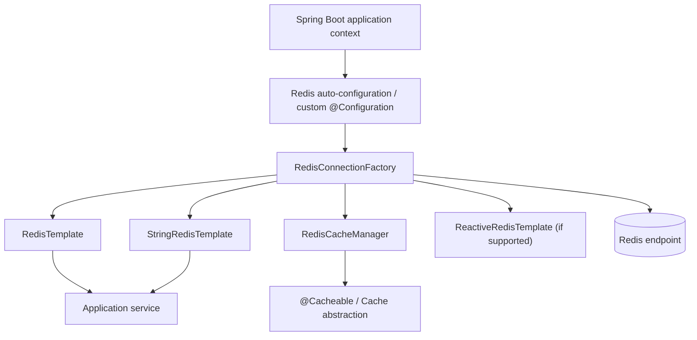
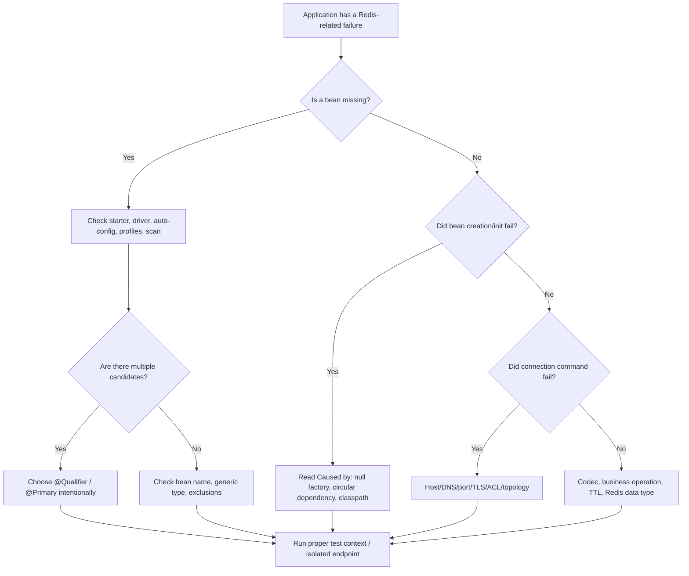

# Application Fails to Create ConnectionFactory or Template in Spring Data Redis

## 1. Understanding the situation: missing bean or unable to connect to Redis?

When Spring Boot starts up, a Redis-related error may appear as:

```text
UnsatisfiedDependencyException
BeanCreationException
NoSuchBeanDefinitionException
NoUniqueBeanDefinitionException
RedisConnectionFailureException
RedisSystemException
```

These exception names look similar in a long stack trace, but they can occur at **different stages**:

1. **No matching bean definition:** Spring cannot find a `RedisConnectionFactory`, `RedisTemplate`, or `StringRedisTemplate` to inject.
2. **Bean definition exists, but initialization fails:** Spring creates the bean and then fails due to configuration, dependencies, or a circular dependency.
3. **Bean initializes, but Redis is unreachable:** the connection factory exists, but a `PING`/`GET`/`SET` command fails due to network, TLS, authentication, or the Redis server.
4. **Bean actually exists, but the wrong type is injected:** `RedisTemplate<String, Product>` is required, while the context only has a different generic template; or there are multiple factories/templates so Spring does not know which one to choose.
5. **Bean appears in one environment but is missing in another:** profiles, test slices, component scanning, or auto-configuration conditions change.

This lesson guides diagnosis in the order **failure stage → root cause → fix at the right layer**, instead of adding beans indiscriminately whenever a Redis error appears.

### A typical error

```text
APPLICATION FAILED TO START

Parameter 0 of constructor in
com.example.catalog.ProductCacheService
required a bean of type
'org.springframework.data.redis.core.StringRedisTemplate'
that could not be found.
```

In this case, the message says Spring cannot find the bean to inject. The first thing you should not do is increase the Redis timeout, because there is no evidence yet that the application has sent any command to Redis.

Conversely:

```text
org.springframework.data.redis.RedisConnectionFailureException:
Unable to connect to Redis
Caused by: java.net.ConnectException: Connection refused
```

can occur when the application already has a `RedisTemplate`/connection factory and some code actually calls Redis, typically in a startup hook or on the first request.

**Principle:** find the deepest meaningful exception in the `Caused by` chain, see which bean/method is being created or called, and only then decide whether to fix dependencies, the bean graph, profiles, or the network.

## 2. Basic bean graph of Spring Data Redis

Main components:

- `RedisConnectionFactory`: abstraction for creating connections to Redis; common implementations are `LettuceConnectionFactory` or `JedisConnectionFactory`.
- `RedisTemplate<K,V>`: synchronous API for operating on key/value, Hash, List, Set, Sorted Set, etc.
- `StringRedisTemplate`: specialized template for String-typed Redis keys and values.
- `ReactiveRedisConnectionFactory`: connection abstraction for reactive Redis.
- `ReactiveRedisTemplate<K,V>` and `ReactiveStringRedisTemplate`: corresponding reactive APIs.
- `RedisCacheManager`: manages Spring Cache on Redis, requiring a Redis connection and serializer/TTL configuration.
- Redis Repository infrastructure: uses mapping, key-value operations, and components enabled by configuration.

Typical relationships:



If `RedisConnectionFactory` is missing, many dependent beans above it may not be created. If only a `RedisTemplate<String, ProductSnapshot>` is missing, the connection factory may still be completely normal.

Therefore, you need to know **which bean is actually missing** rather than treating every error mentioning Redis as having the same cause.

## 3. Quick symptom lookup table

| Symptom | First suspected layer | Priority check |
| --- | --- | --- |
| `RedisConnectionFactory` not found | Dependency, auto-configuration, custom bean | Starter/driver, condition report, package/configuration |
| `StringRedisTemplate` not found | Auto template bean, connection factory | Is there a suitable factory; does a custom bean replace the default |
| `RedisTemplate<String, Product>` not found | Generic type/qualifier | Is the template declared with the exact generic types |
| Two `RedisConnectionFactory` beans exist | Bean ambiguity | `@Primary`, `@Qualifier`, create templates specifying the factory |
| `BeanCreationException` | Constructor/init method/config | Read the deepest `Caused by`, check for circular dependencies |
| `NoClassDefFoundError` or `ClassNotFoundException` | Classpath/dependencies | Driver and dependency versions |
| `NoSuchMethodError` | Library version mismatch | Dependency tree, BOM, overrides |
| `Connection refused` | Host/port/server/network | Endpoint, container network, Redis listening |
| `UnknownHostException` | DNS/service name | Configured host, DNS in container/Kubernetes |
| `WRONGPASS`/`NOAUTH`/`NOPERM` | Authentication/ACL | Username, password, ACL commands and key patterns |
| SSL handshake/certificate error | TLS/trust | TLS port, certificate chain, hostname, mTLS |
| `READONLY` after failover | Topology/routing | Writing to a replica, Sentinel/Cluster config |
| `CROSSSLOT` | Redis Cluster operation | Multi-key in same hash slot, Lua KEYS |
| Tests pass locally, fail in CI | Test context/profile/endpoint | `@ActiveProfiles`, Testcontainers, dynamic properties |
| Cache works but `@Autowired RedisTemplate` fails | Template bean matching | Generic type, name, qualifier, context |
| Bean exists but `GET` fails | Runtime Redis connection | Do not confuse bean creation with server availability |

This table is a starting point; the same symptom can have multiple causes. The next step is always to read the stack trace and the condition report of the failing runtime.

## 4. Reading the stack trace in the right order

A Spring Boot stack trace usually has multiple layers of exceptions:

```text
Error creating bean with name 'productController'
  Unsatisfied dependency through constructor parameter 0
    Error creating bean with name 'productService'
      Unsatisfied dependency through constructor parameter 1
        No qualifying bean of type
        'RedisTemplate<java.lang.String, ProductSnapshot>'
        available
```

The cause closest to the code that needs fixing is **missing the right template type**, not `ProductController`.

Another example:

```text
Error creating bean with name 'redisTemplate'
  Invocation of init method failed
    IllegalArgumentException:
      RedisConnectionFactory is required
```

Here the template may be defined, but it has not been attached to a connection factory.

One more example:

```text
Error creating bean with name 'redisConnectionFactory'
  Caused by: IllegalStateException:
    Invalid Redis sentinel configuration
```

The factory configuration layer is the point of investigation.

### Practical reading approach

1. Identify the name of the **first bean reported as failing**.
2. Follow the `Caused by` chain to the deepest meaningful error.
3. Note the **class/constructor/`@Bean` method** causing the failure.
4. Check whether this is a **missing bean definition**, a **bean instantiation failure**, or a **Redis command runtime failure**.
5. Check active profiles and condition evaluation.
6. Fix one identified cause, then re-run the exact failing case.

Do not hide the root error with:

```java
try {
    // create RedisTemplate...
} catch (Exception ignored) {
    return null;
}
```

A bean method returning null or swallowing exceptions can cause harder-to-understand dependency errors later.

## 5. Minimum dependencies for Spring Boot to configure Redis

For a Spring Boot application using Spring Data Redis, the dependency is typically:

```xml
<dependency>
    <groupId>org.springframework.boot</groupId>
    <artifactId>spring-boot-starter-data-redis</artifactId>
</dependency>
```

Or Gradle:

```gradle
implementation("org.springframework.boot:spring-boot-starter-data-redis")
```

The starter typically brings Spring Data Redis and an appropriate Redis client onto the classpath according to Spring Boot's dependency management, typically Lettuce.

If the application only declares a Spring Data Redis module and manually excludes the driver, you must verify the complete client dependencies.

### Why not add a random driver version to fix the error?

Spring Boot dependency management usually already defines compatible versions for:

- Spring Framework.
- Spring Data Redis.
- Lettuce or Jedis.
- Micrometer/Netty and related libraries.

Manually adding `lettuce-core` with an arbitrary version can produce:

```text
NoSuchMethodError
NoClassDefFoundError
LinkageError
ClassCastException
```

These errors cannot be solved by changing the Redis host or increasing timeouts.

**Recommendation:** prefer Spring Boot's BOM/dependency management; only override versions with good reason and compatibility checks. Do not mix a Spring Data Redis version from a different release train with the Spring Boot version in use without evaluation.

### Do not exclude auto-configuration unintentionally

If the application has configuration such as:

```java
@SpringBootApplication(
    exclude = RedisAutoConfiguration.class
)
```

or the property `spring.autoconfigure.exclude` contains Redis auto-configuration, the default Redis beans may not be created.

If the exclusion is intentional because the application uses a custom factory/template, ensure that the custom-created beans actually satisfy injection.

## 6. Redis auto-configuration requires matching conditions

Spring Boot auto-configures Redis **conditionally**; simply having an `application.yml` file with `spring.data.redis.host` does not guarantee every bean will appear.

Relevant conditions may include:

- The classpath contains Spring Data Redis, the client driver, and the classes required by auto-configuration.
- No custom bean causes auto-configuration to back off.
- There is a suitable `RedisConnectionFactory` to create templates.
- Auto-configuration is not excluded.
- The application type and relevant auto-configuration parts are enabled in the test context.
- Conditions on bean name/type/generic type in the current Spring Boot version.

For example, when an application defines a `RedisConnectionFactory` itself, Spring Boot may **not create an additional default factory**. If the custom factory is wrong, the error will appear even if `spring.data.redis.host` properties are correct.

Do not assume `@ConditionalOnMissingBean` is a fallback mechanism when a custom bean fails. The condition decides whether to register another bean; it does not rescue a custom bean that fails to initialize.

## 7. Viewing the Condition Evaluation Report

Spring Boot has a tool to help understand why auto-configuration was applied or skipped.

Running locally/in tests:

```bash
java -jar catalog-service.jar --debug
```

Or in an appropriate test environment, enable debug for condition evaluation using Spring Boot's mechanism.

The report usually has sections:

```text
Positive matches:
  ...

Negative matches:
  RedisAutoConfiguration ...
  RedisReactiveAutoConfiguration ...
  ...
```

Exact names and condition reasons vary by version. Read the reasons:

- Which class is missing?
- Which existing bean caused auto-configuration to back off?
- Are there multiple connection factories without a single candidate?
- Was the default template replaced by a bean with the same name/type?
- Was auto-configuration excluded?

If Actuator exposes the `/actuator/conditions` endpoint, you can inspect the condition report **in a protected environment**. Do not expose this endpoint publicly in production because it can leak internal application information.

### Debug the right questions

Instead of asking "Does Spring Boot have Redis?", check:

```text
Is there a RedisConnectionFactory bean yet?
Is there a StringRedisTemplate bean yet?
Is there a RedisTemplate bean named redisTemplate yet?
Is there a matching RedisTemplate<String, Product> bean yet?
Which factory is injected into the template?
Which auto-config is backing off, and because of which bean?
```

The answers narrow down the cause faster than trying to change a bunch of YAML properties.

## 8. Configuring Redis host/port by Spring Boot version

A common example on Spring Boot 3.x:

```yaml
spring:
  data:
    redis:
      host: localhost
      port: 6379
      connect-timeout: 2s
      timeout: 3s
```

In some older Spring Boot versions, the common Redis properties namespace is `spring.redis.*` instead of `spring.data.redis.*`. Do not assume one YAML snippet is valid for every Spring Boot version.

**Check the exact version running**, not just a version declared in another file that might be overridden by dependency management.

If property names are wrong, the application may use default values the author did not expect. For example, an app running in a container tries to connect to `localhost:6379` because the real host configuration was not bound.

Check:

- Active profile.
- Property names for your version.
- Property source precedence order.
- Environment variables overriding settings.
- Whether the `RedisConnectionFactory` bean is created by Boot or by custom code.
- Whether the Redis topology is standalone, Sentinel, or Cluster.

## 9. Missing bean error: `NoSuchBeanDefinitionException`

Example:

```text
No qualifying bean of type
'org.springframework.data.redis.connection.RedisConnectionFactory'
available
```

Check in order:

1. Is the `spring-boot-starter-data-redis` dependency present?
2. Is a suitable Redis driver on the runtime classpath?
3. Is `RedisAutoConfiguration` excluded?
4. Is the custom `@Configuration` within component scan?
5. Is there a `@Profile` or `@ConditionalOnProperty` preventing the bean from being created?
6. Does the test load the right configuration/context?
7. Is there a version conflict or class loading error?
8. What does the condition report say?

Example of a service:

```java
@Service
public class RedisHealthService {

    private final RedisConnectionFactory factory;

    public RedisHealthService(RedisConnectionFactory factory) {
        this.factory = factory;
    }
}
```

If the context has no factory, constructor injection fails immediately. If the factory exists but the Redis host is not open yet, injection may succeed and the error only occurs when the connection is actually used.

### Do not fix by calling `new LettuceConnectionFactory()` in every service

Creating factories scattered outside the Spring context can:

- Ignore the application's connection properties/TLS/ACL.
- Lack Spring lifecycle management.
- Create unnecessary resources/connections.
- Cause configuration differences between services and the cache manager.
- Make changing topology difficult when using Cluster/Sentinel.

Let Spring manage the factory bean, using auto-configuration or a centralized, clearly owned custom bean.

## 10. Manually configuring `LettuceConnectionFactory` properly

If you need to create a factory yourself (for example, the application needs a separate Redis endpoint), you can use:

```java
package com.example.redis;

import org.springframework.context.annotation.Bean;
import org.springframework.context.annotation.Configuration;
import org.springframework.data.redis.connection.RedisPassword;
import org.springframework.data.redis.connection.RedisStandaloneConfiguration;
import org.springframework.data.redis.connection.lettuce.LettuceConnectionFactory;

@Configuration
public class StandaloneRedisConfig {

    @Bean
    public LettuceConnectionFactory redisConnectionFactory() {
        RedisStandaloneConfiguration server =
                new RedisStandaloneConfiguration("127.0.0.1", 6379);

        // If test Redis has ACL:
        // server.setUsername("app");
        // server.setPassword(RedisPassword.of("example-only"));

        server.setDatabase(0);
        return new LettuceConnectionFactory(server);
    }
}
```

As a Spring-managed bean, `LettuceConnectionFactory` follows the proper lifecycle according to the Spring contract. It is not necessary to call `afterPropertiesSet()` manually in the `@Bean` method because the container invokes initialization callbacks.

**Warning:** this is a standalone/local configuration. Do not copy the illustrative endpoint or password directly to production. For TLS, Sentinel, or Cluster, configure the corresponding factory/client configuration.

If a custom factory is created, auto-configuration may back off and **no longer apply the default Redis properties** to that factory. In that case, changing `application-prod.yml` will have no effect if the custom factory hardcodes host/port.

### When should auto-config be preferred?

If you only need host, port, password, timeout, and topology supported via properties by the current Spring Boot version, auto-config is usually simpler and easier to operate. Only create a custom factory when there is a real reason: multiple Redis backends, special client options, custom network/TLS integration, or explicit lifecycle control.

## 11. `RedisTemplate` must be wired with the right connection factory

A manually created template bean:

```java
@Bean
public RedisTemplate<String, String> customRedisTemplate(
        RedisConnectionFactory connectionFactory) {

    RedisTemplate<String, String> template =
            new RedisTemplate<>();

    template.setConnectionFactory(connectionFactory);

    StringRedisSerializer stringSerializer =
            new StringRedisSerializer();

    template.setKeySerializer(stringSerializer);
    template.setValueSerializer(stringSerializer);
    template.setHashKeySerializer(stringSerializer);
    template.setHashValueSerializer(stringSerializer);

    return template;
}
```

Key imports:

```java
import org.springframework.context.annotation.Bean;
import org.springframework.data.redis.connection.RedisConnectionFactory;
import org.springframework.data.redis.core.RedisTemplate;
import org.springframework.data.redis.serializer.StringRedisSerializer;
```

If `RedisTemplate` is declared via `@Bean` and the container manages its lifecycle, Spring executes the appropriate initialization callbacks.

### A common mistake pattern

```java
@Bean
RedisTemplate<String, String> brokenTemplate() {
    RedisTemplate<String, String> template =
            new RedisTemplate<>();
    // Missing setConnectionFactory(...)
    return template;
}
```

When the bean is initialized or used, an error related to a null connection factory may occur.

### Do not mix RedisTemplate and StringRedisTemplate arbitrarily

`StringRedisTemplate` is designed for String keys and String values:

```java
@Bean
StringRedisTemplate namedStringTemplate(
        RedisConnectionFactory factory) {
    return new StringRedisTemplate(factory);
}
```

If the application already has the corresponding auto-configured bean, there is no need to create a duplicate. Creating two `StringRedisTemplate` beans of the same type can lead to ambiguous injection.

Additionally, key and value serializers must be compatible with stored data. A string template reading a key stored with a JDK key serializer may not find the expected key even though the Redis server is working.

## 12. Generic injection: RedisTemplate exists, yet Spring still says it is missing

Look at a service example:

```java
@Service
public class ProductCacheService {

    private final RedisTemplate<String, ProductSnapshot> redis;

    public ProductCacheService(
            RedisTemplate<String, ProductSnapshot> redis) {
        this.redis = redis;
    }
}
```

If the application context only has a bean:

```java
RedisTemplate<Object, Object>
```

then **do not assume** it automatically satisfies injection for `RedisTemplate<String, ProductSnapshot>`. Spring considers the type/generic type of the injection point and bean definition; generic mismatch can be the direct cause.

### The right fix: typed bean, typed serializer

```java
@Configuration
public class ProductRedisConfig {

    @Bean("productRedisTemplate")
    RedisTemplate<String, ProductSnapshot> productRedisTemplate(
            RedisConnectionFactory factory) {

        RedisTemplate<String, ProductSnapshot> template =
                new RedisTemplate<>();

        template.setConnectionFactory(factory);
        template.setKeySerializer(
                new StringRedisSerializer());

        template.setValueSerializer(
                new Jackson2JsonRedisSerializer<>(
                        ProductSnapshot.class));

        return template;
    }
}
```

`ProductSnapshot`/serializer types must be declared/imported in the project. If the DTO contains `Instant` or polymorphism, an ObjectMapper compatible with the active Jackson configuration is needed; the example focuses on the typed bean aspect.

Inject explicitly:

```java
@Service
public class ProductCacheService {

    private final RedisTemplate<String, ProductSnapshot> redis;

    public ProductCacheService(
            @Qualifier("productRedisTemplate")
            RedisTemplate<String, ProductSnapshot> redis) {
        this.redis = redis;
    }
}
```

**Do not force-cast** `RedisTemplate<Object,Object>` to `RedisTemplate<String,ProductSnapshot>` to hide a generic mismatch. Casting does not change the serializer and can lead to runtime decode errors.

### Bean names also matter

Spring Boot provides common beans such as `redisTemplate` and `stringRedisTemplate`. A custom bean you define with a colliding name can cause auto-config not to create the corresponding default bean. This error often surprises teams when a project renames a bean or adds `@Bean("redisTemplate")`.

To diagnose, check **type, name, qualifier, and candidate count**, not just whether any `RedisTemplate` exists.

## 13. Two `RedisConnectionFactory` beans exist: `NoUniqueBeanDefinitionException`

An application may use one Redis for caching and another Redis for sessions/queues:

```text
catalogRedisConnectionFactory
sessionRedisConnectionFactory
```

If a template declares:

```java
@Bean
StringRedisTemplate redisTemplate(RedisConnectionFactory factory) {
    return new StringRedisTemplate(factory);
}
```

Spring may not know which factory to inject, leading to:

```text
No qualifying bean of type RedisConnectionFactory available:
expected single matching bean but found 2
```

### Specify with `@Qualifier`

```java
@Configuration
public class MultipleRedisConfiguration {

    @Bean("catalogStringRedisTemplate")
    StringRedisTemplate catalogStringRedisTemplate(
            @Qualifier("catalogRedisConnectionFactory")
            RedisConnectionFactory factory) {

        return new StringRedisTemplate(factory);
    }

    @Bean("sessionStringRedisTemplate")
    StringRedisTemplate sessionStringRedisTemplate(
            @Qualifier("sessionRedisConnectionFactory")
            RedisConnectionFactory factory) {

        return new StringRedisTemplate(factory);
    }
}
```

Inject at the service:

```java
public CatalogService(
        @Qualifier("catalogStringRedisTemplate")
        StringRedisTemplate redis) {
    this.redis = redis;
}
```

If a default is needed for many other dependencies, you can mark one factory `@Primary`. However, **do not use `@Primary` indiscriminately to obscure business boundaries** between session Redis and cache Redis: a template connecting to the wrong backend can write data to an unintended system.

### Auto-configuration may change when multiple factories exist

Some default Spring Boot templates are only created when there is a single suitable `RedisConnectionFactory` candidate. With two factories and no primary, the condition may not be satisfied, so neither the default `redisTemplate` nor `StringRedisTemplate` appears even though **both factories exist**.

This is why you should check the condition report when adding a second factory to a project.

## 14. `@Primary` vs `@Qualifier`

| Mechanism | When to use | Risk if overused |
| --- | --- | --- |
| `@Primary` | Pick a default bean when multiple candidates exist | Services use the wrong backend if a qualifier is forgotten |
| `@Qualifier` | Explicitly specify the needed bean at the injection point | Renaming the bean without updating injection sites |
| Custom bean name | Identify a bean for a specific dependency | May collide with auto-configured bean names |
| Generic type | Distinguish templates by K/V types | Type does not reflect actual endpoint/serializer |
| `@Profile` | Create beans only in the matching profile | Bean missing in test/prod if profile is wrong |
| `@ConditionalOnProperty` | Enable bean by feature flag/config | Missing property or different value makes bean disappear |

A clear design for multiple Redis backends typically has **business-named connection factories and templates**, such as `catalogRedisTemplate` and `sessionRedisTemplate`, rather than a global factory with unclear ownership.

## 15. `@Configuration` bean not component-scanned

By default, Spring Boot component-scans from the package containing the `@SpringBootApplication` class and its subpackages.

Example:

```text
com.example.catalog.CatalogApplication
com.example.catalog.config.RedisConfig     -> usually scanned
com.other.redis.RedisConfig                -> not scanned by default
```

If the custom `RedisConfig` is outside the scan scope, `@Bean` methods in that class will not be registered.

Ways to fix:

- Move the config into an appropriate subpackage.
- Explicitly import the configuration with `@Import(RedisConfig.class)`.
- Configure component scanning according to the application's package architecture.
- If using multi-module, ensure the module containing the config is on the runtime classpath.

**Do not widen `@ComponentScan("com")` excessively** just to find one bean; that can pull in unintended configs, create duplicate beans, or alter the test context.

### Distinguishing classpath from component scan

A class being in a JAR does not mean Spring will create beans from it. It must be registered via component scanning, import, auto-configuration, or corresponding configuration.

## 16. `@Profile` and conditional annotations make beans disappear

A custom config:

```java
@Configuration
@Profile("dev")
public class LocalRedisConfiguration {

    @Bean
    RedisConnectionFactory redisConnectionFactory() {
        return new LettuceConnectionFactory("localhost", 6379);
    }
}
```

The bean only exists when the active profile is `dev`. If tests only enable `test` and auto-configuration is excluded or lacks a driver, the factory will be missing.

Another condition:

```java
@Bean
@ConditionalOnProperty(
        prefix = "app.redis",
        name = "enabled",
        havingValue = "true")
RedisTemplate<String, String> customTemplate(
        RedisConnectionFactory factory) {
    // ...
}
```

If `app.redis.enabled` does not exist or is not equal to `true`, the method is not created under that condition.

Check:

1. Actual active profiles.
2. `ConditionalOnProperty` name/value and `matchIfMissing`.
3. Environment overrides.
4. Whether the config class is loaded.
5. Condition report.

Do not work around with `@Autowired(required = false)` if Redis is a required dependency of the service: it turns a clear startup failure into a `NullPointerException` or uncontrolled behavior later.

## 17. Circular dependencies cause bean creation to fail

An error:

```text
BeanCurrentlyInCreationException:
Requested bean is currently in creation
```

can occur when:

```text
RedisConfig -> ProductService
ProductService -> RedisTemplate
RedisTemplate -> RedisConfig
```

Example anti-pattern: a `@Configuration` needs a business service injected in its constructor, while the service injects a template created by that very configuration.

How to handle:

- Redis infrastructure config should depend only on connection properties and framework types.
- Business services depend on templates, **not the other way around**.
- Extract serializers/mappings into standalone beans if needed.
- Do not call a business service to seed data while that service's own template is being created.
- If seeding is needed, use a startup runner after the context is created, scoped by environment and without running destructive commands.

Do not enable circular references just to hide a circular dependency design. Dependency cycles usually reflect config/logic boundaries that need separation.

## 18. Errors from bean methods calling each other or improper lifecycle management

Patterns to avoid:

```java
@Bean
RedisTemplate<String, String> redisTemplate() {
    RedisTemplate<String, String> t = new RedisTemplate<>();
    t.setConnectionFactory(redisConnectionFactory());
    return t;
}
```

In standard `@Configuration` proxy mode, a bean method call may be intercepted by Spring to obtain the existing bean. But if the configuration class is changed to `proxyBeanMethods = false` or the bean method is invoked manually, the call above can **create an extra factory instance** unintentionally.

Prefer dependency injection via method parameter:

```java
@Bean
RedisTemplate<String, String> redisTemplate(
        RedisConnectionFactory factory) {
    RedisTemplate<String, String> t = new RedisTemplate<>();
    t.setConnectionFactory(factory);
    return t;
}
```

This is clearer, easier to test, and does not rely on inter-bean method calls.

### Do not instantiate managed beans with `new` inside services

```java
// Not recommended if you want to use the configured bean:
RedisTemplate<String, String> redis =
        new RedisTemplate<>();
```

This object lacks a connection factory and proper serializers/lifecycle. Inject the bean from the Spring context.

## 19. `StringRedisTemplate` bean exists, yet constructor still reports an error

Some situations:

- Multiple `StringRedisTemplate` beans exist without `@Primary`/`@Qualifier`.
- The template has a different name from the requested qualifier.
- A custom template is declared with a generic type different from the injection point.
- A test uses a sliced context and does not import the config.
- `@MockBean`/mock beans or test overrides replaced the real bean within the test scope.
- A bean resides in a child/parent application context rather than the context where the service is being injected.
- A custom `BeanFactoryPostProcessor` or auto-config exclusion modified bean definitions.

When diagnosing, inspect the actual bean list in the current context, rather than just finding the word `StringRedisTemplate` in the code.

### Listing beans in a diagnostic environment

You can use a debug snippet **only in local/test**:

```java
@Bean
@Profile("dev")
ApplicationRunner redisBeanInventory(
        ApplicationContext context) {

    return args -> {
        Map<String, RedisConnectionFactory> factories =
                context.getBeansOfType(
                        RedisConnectionFactory.class);

        Map<String, RedisTemplate> templates =
                context.getBeansOfType(RedisTemplate.class);

        factories.keySet().forEach(name ->
                System.out.println("Redis factory bean: " + name));

        templates.keySet().forEach(name ->
                System.out.println("Redis template bean: " + name));
    };
}
```

Add imports for the relevant Spring/Java types. This snippet only prints **bean names**, not passwords/connection URLs or key values.

Note that `getBeansOfType(...)` may cause some beans to be initialized depending on context; only use when actively debugging, and never turn it into a public endpoint or mandatory startup diagnostic in production.

## 20. Distinguishing bean creation failure from runtime connection failure

Spring Data Redis can create `LettuceConnectionFactory` successfully even when the Redis server is not ready yet; the actual connection may be opened when a command is executed, depending on client/lifecycle configuration.

Example:

```java
@Autowired
StringRedisTemplate redis;
```

Successful injection does not prove Redis is reachable.

Conversely, if the application has startup code:

```java
@PostConstruct
void warmup() {
    redis.opsForValue().get("warmup:key");
}
```

Redis being unavailable can cause the bean containing `@PostConstruct` to fail initialization. The stack trace may appear as a `BeanCreationException` on the warmup bean, while the real cause is a **Redis command failure** inside the startup hook.

Distinguish between:

| State | What is known |
| --- | --- |
| Factory bean exists | Spring knows how to create Redis connections |
| Template bean exists | Redis operations have an API to call |
| `PING` succeeds | The endpoint responded at check time |
| `GET/SET` succeeds | Command, serializer, ACL, and routing for that operation work |
| App startup succeeds | Bean graph was created; does not prove all Redis commands work |
| Health UP | A current check succeeded; does not prove failover/persistence |

Do not use a successful `PING` to conclude a Redis user has `SET`/`EVAL`/`XREADGROUP` permissions or that Redis Cluster multi-key operations always work.

## 21. Safe, bounded connectivity checks

Once you have confirmed the bean exists, in an authorized environment you can check:

```bash
redis-cli -h 127.0.0.1 -p 6379 PING
```

With appropriate TLS and CA (illustrative example, adjust to your infrastructure):

```bash
redis-cli --tls --cacert /path/to/ca.pem \
  -h redis.example.internal -p 6380 PING
```

Authenticate using your environment's secure mechanism; do not put passwords in command-line history or tool output. In some managed Redis environments, only authorized clients/networks can connect.

### Common error types

| Error | Typical meaning |
| --- | --- |
| Connection refused | Host is reachable, but no service is listening on the port, or connection was rejected |
| Connection timed out | Network/filter/firewall or Redis did not respond within budget |
| UnknownHostException | DNS/service name could not be resolved |
| SSLHandshakeException | TLS protocol, certificate chain, hostname, or mTLS |
| NOAUTH/WRONGPASS | Unauthenticated or incorrect credentials |
| NOPERM | ACL user lacks command/key/channel permission |
| READONLY | Write command hit a replica or a node changed role |
| MOVED/ASK | Slot routing in Redis Cluster; requires a cluster-aware client |
| CROSSSLOT | Keys in a multi-key command do not share the same hash slot |
| WRONGTYPE | Key's data type does not match the command |

Do not "fix" a TLS error by disabling certificate verification or "fix" ACLs by granting `+@all` to every application.

## 22. Localhost in Docker/Kubernetes is a very common error source

A YAML file:

```yaml
spring:
  data:
    redis:
      host: localhost
      port: 6379
```

may work when the Java application runs **directly on a laptop** and a Redis container maps its port to the host.

But when the app and Redis are in two containers in the same Docker Compose:

```text
App container
  127.0.0.1 -> app container, NOT the Redis container

Redis container
  service hostname -> redis
```

In Compose:

```yaml
spring:
  data:
    redis:
      host: redis
      port: 6379
```

In Kubernetes, use the appropriate DNS/service endpoint; do not default to localhost. Managed Redis may also require private networking, DNS, and TLS.

**When you see `Connection refused: localhost:6379` in a container, check the runtime profile/host first; do not create another `RedisTemplate` bean.**

## 23. Profiles and config precedence make the factory connect to the wrong endpoint

Suppose a project has:

```text
application.yml
application-dev.yml
application-test.yml
application-prod.yml
```

Production must explicitly activate its profile:

```bash
java -jar app.jar --spring.profiles.active=prod
```

However, an environment variable may override the file:

```text
SPRING_DATA_REDIS_HOST=127.0.0.1
```

In that case the bean is still created, but it connects to an unintended address.

Another case: a custom `LettuceConnectionFactory` uses a hardcoded host, so any `spring.data.redis.host` property has no effect on that factory.

How to investigate:

1. Determine which profile is active.
2. Check the condition report to see who created the factory.
3. Check higher-precedence property sources.
4. Verify the configured endpoint without printing secrets.
5. Confirm whether custom config classes read properties.
6. Ensure tests do not fall back to production/shared Redis when a container is missing.

Do not just edit a YAML file and assume it is fixed if a custom `@Bean` completely ignores that YAML.

## 24. Authentication and Redis ACL errors

A production configuration may look like:

```yaml
spring:
  data:
    redis:
      host: ${REDIS_HOST}
      port: ${REDIS_PORT:6379}
      username: ${REDIS_USERNAME}
      password: ${REDIS_PASSWORD}
```

These placeholders are Spring property placeholders; values must be supplied by the runtime/secret manager. Do not put real passwords in the repository or learning examples.

With Redis ACL, username and password must match the provisioned Redis user. Wrong credentials can cause errors at the connection/authentication stage, not necessarily a missing bean.

A client that has successfully AUTHed but lacks permission for `GET`, `SET`, `PSUBSCRIBE`, or `EVAL` may encounter `NOPERM` when running a command.

### Checking permissions by operation

| Use case | Commands/permissions to check |
| --- | --- |
| String cache | `GET`/`SET`/`DEL`, TTL commands if used |
| Redis Hash | `HGET`/`HSET`/`HGETALL` |
| Spring Cache eviction | `DEL` or corresponding cleanup strategy |
| Lua | `EVAL`/`EVALSHA` and the commands inside the script |
| Redis Pub/Sub | `SUBSCRIBE`/`PSUBSCRIBE`, channel patterns |
| Redis Streams | `XADD`/`XREADGROUP`/`XACK` and consumer commands |
| Diagnostics | `PING`, `INFO` depending on permissions |

Do not try to fix `NoSuchBeanDefinitionException` by changing ACLs: at the missing-bean stage, Redis has probably not even been contacted.

## 25. TLS handshake fails when the bean is used

Production example:

```yaml
spring:
  data:
    redis:
      ssl:
        enabled: true
      host: ${REDIS_HOST}
      port: ${REDIS_PORT:6380}
```

Failures can be caused by:

- Connecting with TLS to a plaintext port.
- Connecting with plaintext to a TLS port.
- The CA certificate is not trusted by the JVM.
- The hostname does not match the certificate.
- The Redis server requires mutual TLS.
- Cluster topology returns an endpoint whose certificate is invalid for the client.
- A proxy/load balancer uses unexpected TLS termination.

Fix the TLS configuration according to your infrastructure and driver version. Do not disable hostname verification to "make tests pass" and then ship that config to production.

Some Spring Boot/Redis client versions support SSL bundles or custom client configs; verify against your version rather than assuming every TLS property is present.

## 26. Sentinel and Cluster are not standalone with multiple hosts

### Sentinel

Redis Sentinel helps clients discover the current primary of a master group. Illustrative configuration:

```yaml
spring:
  data:
    redis:
      sentinel:
        master: catalog-primary
        nodes:
          - sentinel-1.internal:26379
          - sentinel-2.internal:26379
          - sentinel-3.internal:26379
```

A wrong master name, Sentinel endpoint, or Sentinel credentials/TLS can cause the connection factory or runtime connection to fail.

### Cluster

Redis Cluster has multiple primaries dividing hash slots:

```yaml
spring:
  data:
    redis:
      cluster:
        nodes:
          - redis-node-a.internal:6379
          - redis-node-b.internal:6379
          - redis-node-c.internal:6379
        max-redirects: 5
```

If you use `RedisStandaloneConfiguration` pointing to one Cluster node and expect the client to handle all slots automatically, the application may hit redirects or commands may not work properly. A cluster-aware factory/driver is required.

In Cluster:

- Multi-key commands must obey hash-slot rules.
- Database numbers other than 0 are not used like standalone.
- `SCAN` is fundamentally node-scoped.
- Keyspace notifications belong to the node emitting the event.
- Topology refresh needs to suit failover/resharding.

**A `CROSSSLOT` error is not due to a missing template.** It proves a command execution path to Redis exists, but the operation violates Cluster constraints.

## 27. Reactive errors: require ReactiveRedisConnectionFactory and matching template

Example:

```java
@Service
public class ReactiveProductCache {

    private final ReactiveStringRedisTemplate redis;

    public ReactiveProductCache(
            ReactiveStringRedisTemplate redis) {
        this.redis = redis;
    }

    public Mono<String> find(String sku) {
        return redis.opsForValue().get(
                "catalog:status:" + sku);
    }
}
```

If the context only has an imperative `RedisTemplate` or `StringRedisTemplate`, it does not automatically become a `ReactiveStringRedisTemplate`. Reactive templates require a matching Redis reactive connection factory and driver support.

Lettuce normally supports reactive in Spring Data Redis; do not assume a Jedis configuration has the same reactive API.

Check steps:

1. Are the right Spring Data Redis starter and reactive-capable driver present?
2. Is there a `ReactiveRedisConnectionFactory` bean?
3. Is there an appropriate `ReactiveRedisTemplate`/`ReactiveStringRedisTemplate`?
4. Was reactive auto-config excluded or did it back off?
5. Is there a custom connection factory that only supports imperative?
6. Does the test context import reactive Redis auto-config?

Do not fix by calling `.block()` on an imperative template or forcing a generic cast. Choose the right API and configuration.

## 28. Combining Spring Cache and RedisTemplate

An application may use:

```java
@Cacheable(cacheNames = "productCache", key = "#sku")
public ProductSnapshot findProduct(String sku) {
    return repository.load(sku);
}
```

A missing `RedisCacheManager` bean error is different from a `RedisTemplate` error. The cache abstraction depends on the corresponding `CacheManager`; an application can have a working `StringRedisTemplate` while lacking `RedisCacheManager` as expected because:

- Caching is not enabled/configured appropriately.
- Cache auto-config selected another provider.
- A custom `CacheManager` replaced it.
- The Redis connection factory is not a single candidate.
- A profile/condition prevented registering a custom `RedisCacheManager`.

Check:

```text
What is the actual CacheManager bean?
Was RedisCacheManager created or not?
Which redisConnectionFactory bean is used?
How are cache names and serializers configured?
```

Do not use the existence of `StringRedisTemplate` as proof that all `@Cacheable` methods use Redis.

### A custom CacheManager can replace auto-configuration

If the application declares:

```java
@Bean
CacheManager cacheManager() {
    return new ConcurrentMapCacheManager();
}
```

then `@Cacheable` may use an in-memory cache instead of Redis due to how `CacheManager` is chosen. That is a bean/configuration issue, not a Redis host error.

## 29. Redis Repository fails due to infrastructure configuration

If the application uses a repository:

```java
@RedisHash("profiles")
public class Profile {
    @Id
    private String id;
    private String displayName;
}
```

and:

```java
public interface ProfileRepository
        extends CrudRepository<Profile, String> {
}
```

the repository infrastructure components need to be enabled/scanned properly. A custom configuration with a wrong bean name or missing `RedisKeyValue` operations can cause repository context initialization to fail.

Distinguish between:

- Repository bean not found because the interface was not scanned/enabled.
- Repository bean created, but missing `RedisKeyValue`/connection dependencies.
- Entity mapping fails due to annotations/constructors/serialization.
- Runtime command fails during save/find.

If enabling `@EnableRedisRepositories` manually, check base packages and corresponding factory/operations references, especially in projects with multiple Redis backends. Do not enable the annotation on an overly broad package where a repository of another type gets picked up by mistake.

## 30. Test context: `@SpringBootTest` vs test slices

A service runs fine in the app, yet a unit test reports:

```text
No qualifying bean of type 'StringRedisTemplate'
```

possibly because the test **does not load the full application context**.

For example, a controller slice:

```java
@WebMvcTest(ProductController.class)
class ProductControllerTest {
    // Only builds the MVC slice needed for testing.
}
```

It does not automatically ensure the application's Redis beans will be created. If the controller/service needs Redis, you can mock the service at the appropriate boundary rather than starting Redis in a pure controller test.

An integration test:

```java
@SpringBootTest
@ActiveProfiles("test")
class ProductRedisIntegrationTest {
    // Uses an isolated test Redis.
}
```

will load a broader context, yet still requires proper connection properties and a test Redis server.

### Do not "fix" unit tests by hardcoding production Redis

If a test needs to verify service logic without caring about the network, use mocks/template stubs as appropriate for the scope. If it needs to test real codecs, TTL, Lua, transactions, Streams, or Pub/Sub, use Redis Testcontainers.

The goal is testing at the right boundary independently from production, not forcing every test to spin up the full application context.

## 31. Testcontainers example for diagnosing beans in a test environment

A minimal integration test:

```java
package com.example.redis;

import static org.assertj.core.api.Assertions.assertThat;

import org.junit.jupiter.api.Test;
import org.springframework.beans.factory.annotation.Autowired;
import org.springframework.boot.test.context.SpringBootTest;
import org.springframework.data.redis.connection.RedisConnectionFactory;
import org.springframework.data.redis.core.StringRedisTemplate;
import org.springframework.test.context.ActiveProfiles;
import org.springframework.test.context.DynamicPropertyRegistry;
import org.springframework.test.context.DynamicPropertySource;
import org.testcontainers.containers.GenericContainer;
import org.testcontainers.junit.jupiter.Container;
import org.testcontainers.junit.jupiter.Testcontainers;
import org.testcontainers.utility.DockerImageName;

@Testcontainers
@SpringBootTest
@ActiveProfiles("test")
class RedisBeanIntegrationTest {

    @Container
    static final GenericContainer<?> REDIS =
            new GenericContainer<>(
                    DockerImageName.parse("redis:7.4-alpine"))
                    .withExposedPorts(6379);

    @DynamicPropertySource
    static void redisSettings(DynamicPropertyRegistry registry) {
        registry.add("spring.data.redis.host", REDIS::getHost);
        registry.add("spring.data.redis.port",
                () -> REDIS.getMappedPort(6379));
    }

    @Autowired
    RedisConnectionFactory factory;

    @Autowired
    StringRedisTemplate template;

    @Test
    void createsBeansAndCanRoundTrip() {
        assertThat(factory).isNotNull();
        assertThat(template).isNotNull();

        String key = "it:redis:bean:" + java.util.UUID.randomUUID();

        template.opsForValue().set(key, "ACTIVE");

        assertThat(template.opsForValue().get(key))
                .isEqualTo("ACTIVE");
    }
}
```

The test tells you two things:

1. The Spring context has the injected beans.
2. String `SET/GET` commands work with the test Redis endpoint.

It does not mean production TLS, ACLs, Cluster, Sentinel failover, or typed JSON serializers have been verified.

If the test fails immediately at context startup, return to the condition report and stack trace; if the beans exist but `SET/GET` fails, investigate connectivity/runtime commands.

### Do not fall back to local Redis when Docker is unavailable

Testcontainers uses a dynamic mapped port. If the CI environment lacks a suitable Docker runtime, tests should fail clearly or be categorized/skipped by policy; do not fall back to `localhost:6379` and accidentally connect to another Redis.

## 32. Dependency version mismatch: errors not belonging to the Redis server

Symptoms:

```text
java.lang.NoSuchMethodError
java.lang.NoClassDefFoundError
java.lang.ClassNotFoundException
java.lang.IncompatibleClassChangeError
```

For example, a library was compiled against a new Lettuce method, but the runtime classpath has an older Lettuce. Spring cannot create the factory even if the Redis server is completely healthy.

Check:

- Running Boot version.
- Spring Data Redis version.
- Lettuce/Jedis version.
- Transitive dependencies pulled from other modules.
- Overrides in `dependencyManagement`/Gradle constraints.
- Shaded JAR or fat JAR packaging the wrong version.
- Java runtime version and binary compatibility.
- Netty dependency conflicts if any.

Do not "fix" this by changing the Redis password or increasing timeouts. Align the dependency graph.

**Scope note for STEP 4:** this lesson describes the analysis methodology; running build/test dependency trees on a specific project should be done in the appropriate engineering workflow, not necessarily for every bean error.

## 33. Circular dependencies and lazy initialization hide symptoms

A bean may be initialized late depending on Spring configuration or application startup. When using lazy injection:

```java
@Lazy
@Autowired
RedisTemplate<String, String> redis;
```

the application may start up, but the bean error appears when the service is called. This does not fix the missing bean/config cause; it only delays detection.

In particular, do not enable global lazy initialization to avoid a `BeanCreationException` without understanding the root cause. Production could start receiving traffic and only hit the error on the first request, making the incident harder to handle.

If Redis is a required dependency, verify bean configuration and readiness at the appropriate level, rather than waiting for the first user request to discover a bean definition error.

If Redis is an optional cache, you can design an explicit fallback; however, the fallback should live at the business boundary, not by returning a null `RedisTemplate` and letting every service handle it implicitly.

## 34. Checking the actual bean type and constructor signature

A constructor:

```java
public PriceService(RedisTemplate<String, BigDecimal> redis) {
    this.redis = redis;
}
```

must have a bean matching in type/generics. Similarly:

```java
public PriceService(
        @Qualifier("priceRedisTemplate")
        RedisTemplate<String, BigDecimal> redis) {
    this.redis = redis;
}
```

if the `@Bean` is named `productRedisTemplate`, the qualifier does not match.

Some projects inject a different interface:

```java
RedisOperations<String, BigDecimal>
```

`RedisTemplate` implements `RedisOperations`, yet matching on generics and qualifiers still has to align. Avoid trying to create all sorts of generic `RedisOperations` indiscriminately and expecting the exact serializer.

When multiple generic templates exist, explicit naming/qualifiers help prevent unpredictable changes when a new bean is added.

## 35. A complete configuration for standalone Redis with a typed template

Practical configuration example:

```java
package com.example.catalog;

import org.springframework.context.annotation.Bean;
import org.springframework.context.annotation.Configuration;
import org.springframework.data.redis.connection.RedisConnectionFactory;
import org.springframework.data.redis.core.RedisTemplate;
import org.springframework.data.redis.serializer.StringRedisSerializer;
import org.springframework.data.redis.serializer.Jackson2JsonRedisSerializer;

@Configuration
public class CatalogRedisTemplateConfig {

    @Bean("catalogProductTemplate")
    public RedisTemplate<String, ProductSnapshot> productTemplate(
            RedisConnectionFactory factory) {

        RedisTemplate<String, ProductSnapshot> template =
                new RedisTemplate<>();

        template.setConnectionFactory(factory);
        template.setKeySerializer(
                new StringRedisSerializer());

        template.setValueSerializer(
                new Jackson2JsonRedisSerializer<>(
                        ProductSnapshot.class));

        template.setHashKeySerializer(
                new StringRedisSerializer());

        return template;
    }
}
```

Service:

```java
@Service
public class CatalogProductStore {

    private final RedisTemplate<String, ProductSnapshot> redis;

    public CatalogProductStore(
            @Qualifier("catalogProductTemplate")
            RedisTemplate<String, ProductSnapshot> redis) {
        this.redis = redis;
    }

    public void put(ProductSnapshot snapshot) {
        redis.opsForValue().set(
                "catalog:product:" + snapshot.sku(),
                snapshot,
                Duration.ofMinutes(10));
    }

    public ProductSnapshot find(String sku) {
        return redis.opsForValue().get(
                "catalog:product:" + sku);
    }
}
```

DTO illustration:

```java
public record ProductSnapshot(
        String sku,
        String title,
        long priceCents) {
}
```

The pattern focuses on:

- Spring-managed beans.
- Factory injected into the template.
- Key/value serializers matching the types.
- Clear bean name with qualifier.
- Service does not `new` the factory/template itself.

Imports for `@Service`, `@Qualifier`, and `Duration` must be added per project. TLS/ACL/topology configuration is handled in the automatic or custom connection factory according to the environment.

This is an example for a String key and typed JSON value; do not use the same serializer for a Redis counter where you want `INCR` directly, or apply this DTO codec to caches holding multiple Java types.

## 36. Avoid confusing serializer errors with bean creation errors

Suppose the template bean is created successfully, yet when calling `get(...)`:

```text
SerializationException
Could not read JSON
Cannot deserialize value
```

That is usually a **codec or data-in-Redis error**, not a missing `RedisConnectionFactory`.

Causes:

- Old values stored with JDK serialization while the new version reads JSON.
- Two services using the same key with different serializers.
- JSON schema changed class/field names.
- Jackson lacks the Java Time module for `Instant`/`LocalDateTime`.
- One service writes raw String while another reads a DTO.
- Incompatible Redis Hash field/value serializers.
- Invalid/unsafe generic polymorphic type metadata.

If the error occurs when the serializer bean is created (e.g., a custom `ObjectMapper` bean fails), that is a bean creation failure. But if it only fails when reading a specific key, inspect the payload format and migration.

Do not change the factory or Redis host just because deserialization failed after Redis already returned bytes successfully.

## 37. Diagnosing in multi-module applications

A multi-module project might have:

```text
catalog-api
catalog-service
redis-adapter
shared-config
```

Common pitfalls:

1. Module `redis-adapter` is not declared as a runtime dependency of the app.
2. Class `RedisConfig` is outside component scan.
3. One module excludes Redis auto-config for unit tests, and the exclusion leaks into the app.
4. Two factory beans exist across two modules, causing ambiguity.
5. Bean `RedisTemplate<String, Product>` is declared in a different package-specific module and the qualifier does not match.
6. One module contains a different Lettuce/Jedis dependency version.
7. Shared config hardcodes host, overriding the app's profile.

Better design:

- Only one place owns Redis infrastructure wiring per endpoint.
- Export service/repository abstractions from outer modules; limit sprawling `RedisTemplate` dependencies.
- If there are multiple Redis backends, name beans by role.
- Avoid duplicated `@Configuration` imported twice.
- Clearly separate compile/test/runtime dependencies.

Having a `RedisTemplateConfig` class in a module on the classpath does not automatically guarantee Spring loaded that class as configuration.

## 38. When Spring Boot and Spring Data Redis versions change

API names, property names, and auto-config conditions can change across major/minor versions. When upgrading Spring Boot, check:

- Redis properties namespace path.
- Starter/driver dependency management.
- Packages and classes of Lettuce/Jedis connection factories.
- Constructors/serialization APIs.
- Reactive auto-configuration.
- Cache configuration defaults.
- Testcontainers integration annotations.
- Spring Boot native/AOT compatibility if building native images.
- Custom bean names/tags that previously relied on auto-config internals.

Avoid copying a snippet from another version and concluding the Redis server is missing. If you see `NoSuchMethodError` in Spring Data Redis/Lettuce classes, check dependency alignment first.

### Should every dependency version be pinned?

When using the Boot parent/BOM, many dependencies are already managed. Only pin/override intentionally, document the reason, and check transitive dependencies rather than setting individual versions in every module.

## 39. Step-by-step diagnostic workflow when the application fails to start

Follow this sequence to avoid jumping to the wrong layer:

### Step 1 — Collect the full error

Capture the startup stack trace and find the deepest `Caused by`.

Classify into one of these groups:

```text
A. Missing bean (NoSuchBeanDefinition)
B. Ambiguous bean (NoUniqueBeanDefinition)
C. Bean construction/init failure
D. Class loading/linkage failure
E. Redis network/auth/TLS failure in startup hook
F. Serializer/runtime command failure
```

### Step 2 — Read the injection point

Which bean is missing? `RedisConnectionFactory`, `StringRedisTemplate`, `RedisTemplate<String, DTO>`, or `ReactiveRedisTemplate`?

Record the **generic type**, **qualifier**, and **bean name**.

### Step 3 — Check dependencies and auto-config

Verify the starter/driver on the runtime classpath, exclusions, and version alignment. Inspect the condition report instead of guessing from existing config files.

### Step 4 — Check package scanning/profiles

Is `@Configuration` being loaded? Are `@Profile`/`@ConditionalOnProperty` filtering out the bean?

### Step 5 — Check the number of factories/templates

If there are two `RedisConnectionFactory` beans, choose an explicit qualifier or primary by design. If a custom template shares a default bean name, check which auto bean it replaced.

### Step 6 — Check template wiring

Was the custom template given a factory? Do the serializers match the key/value types? Is the bean method Spring-managed?

### Step 7 — Only after the bean graph is valid, check the Redis endpoint

Host/port, container DNS, TLS, ACLs, Sentinel/Cluster. Test a small command in an appropriate environment.

### Step 8 — Separate command errors from config errors

A successful `PING` is not enough; test the actual business command/serializer against a test or staging Redis.

### Step 9 — Check the test/CI environment

Does the test slice load Redis config? Does Testcontainers provide a mapped port? Is there a risk of falling back to another Redis?

### Step 10 — Record the root cause and verification

A useful summary:

```text
Root cause:
  ProductService injected RedisTemplate<String, ProductSnapshot>
  but context only contained RedisTemplate<Object, Object>.

Fix:
  Define typed productRedisTemplate and qualifier.

Verification:
  Spring context starts in test profile.
  Typed SET/GET round-trip succeeds against isolated Redis.
```

The lesson is isolating the source of the error, rather than changing dependencies, TLS, profiles, and serializers all at once so you never know which change worked.

## 40. Diagnostic decision flowchart



Verification must include both context injection and an appropriate command; a factory bean is different from an actually working Redis connection.

## 41. Common misconceptions

**"The Redis server isn't running, so Spring can't create `RedisTemplate`."**  
Not necessarily. Factories/templates can be created before an actual connection is opened. Check the stack trace to see which stage failed.

**"Adding `spring.data.redis.host` automatically creates all beans even without the starter."**  
No. Auto-configuration requires the right classes/driver/conditions.

**"Having a `RedisTemplate<Object,Object>` lets you inject any `RedisTemplate<String,T>`."**  
Do not assume this; generics and qualifiers matter in bean matching.

**"Two connection factories will be auto-selected by template name."**  
Not by default. Explicit wiring or a single suitable primary candidate is required.

**"If the bean exists, Redis is definitely reachable."**  
No. The bean graph and network/authentication are two separate layers.

**"Redis `PING` succeeding proves the cache serializer works properly."**  
No. `PING` does not parse JSON, nor does it check key/value bytes or ACLs for all commands.

**"`@Profile("dev")` config still loads in the test profile."**  
No, unless that profile is also active or conditions are designed differently.

**"`@WebMvcTest` must automatically create `RedisTemplate` like the full app."**  
No. Slice tests have a different auto-config and bean scope than the full context.

**"Creating `new RedisTemplate<>()` in a service is the same as injecting a managed template."**  
No. A manually instantiated object lacks configured wiring/lifecycle/serializers.

**"`BeanCreationException` is always a class constructor error."**  
No. It can wrap an error from a Redis command in a startup hook or a deeper dependency error.

**"Changing ACLs solves `NoSuchBeanDefinitionException`."**  
No. ACLs only apply when the client communicates with Redis; a missing bean is a Spring context issue.

**"Using Redis Cluster is just like standalone, only changing the host."**  
No. Cluster requires cluster client mode, hash-slot semantics, and topology handling.

**"`ReactiveStringRedisTemplate` automatically appears because `StringRedisTemplate` exists."**  
No. Reactive connections/templates have separate conditions and driver support.

**"If I create a custom `ConnectionFactory`, all Spring Boot Redis properties still apply automatically."**  
Not necessarily. A custom factory can replace auto-config and manage connection settings itself.

**"Disabling SSL verification fixes production errors quickly."**  
Do not do this. It removes endpoint authentication, creating a security risk.

**"Tests using CI localhost Redis are fine if they pass."**  
No. That can mask misconfiguration, suffer interference from other jobs, or accidentally use a non-test Redis.

## 42. Operator troubleshooting checklist

1. Did the error occur when Spring created the context or when calling a Redis command?
2. What is the root exception after following the `Caused by` chain?
3. Which bean is missing or failed to initialize?
4. What type/generic/qualifier does the injection point require?
5. Does the runtime classpath have the Redis starter and driver at the right versions?
6. Is there a `NoSuchMethodError`/class loading mismatch?
7. Is Redis auto-configuration excluded?
8. What reason does the Condition Evaluation Report give?
9. Is custom `@Configuration` scanned/imported?
10. Are `@Profile` or conditional properties filtering out the bean?
11. Are there multiple `RedisConnectionFactory` or `RedisTemplate` beans of the same type?
12. Do `@Primary`/`@Qualifier` reflect the right business backend?
13. Is the custom template attached to the right connection factory?
14. Do the key/value serializers match the DTO type and Redis data format?
15. Is there a circular dependency between Redis config and services?
16. Are the active profile and property precedence correct?
17. Does the factory use host/port from config files or hardcoded values?
18. In Docker/Kubernetes, is `localhost` pointing to the container itself by mistake?
19. Are production DNS/port/TLS/ACL valid?
20. Does Sentinel/Cluster mode match the actual topology?
21. Are there other errors like `READONLY`/`CROSSSLOT`/`WRONGTYPE`?
22. Does a reactive service have a `ReactiveRedisConnectionFactory`?
23. Is a test slice trying to inject a Redis bean not included in its context?
24. Does Testcontainers provide dynamic host/port and resource isolation?
25. Is there a risk of test/dev hitting production Redis due to fallback?
26. Has a properly typed `SET/GET`/serializer test run against an **isolated test** Redis?
27. Were passwords and sensitive raw Redis keys/values kept out of debug logs?
28. Was the fix documented with its root cause instead of just changing timeouts?

## 43. Self-check questions

1. What is the dependency relationship between `RedisConnectionFactory` and `RedisTemplate`?
2. Why does the existence of a `RedisTemplate` not prove the Redis server is reachable?
3. What is the difference between `NoSuchBeanDefinitionException` and `NoUniqueBeanDefinitionException`?
4. When injecting `RedisTemplate<String, Product>` fails even though a generic template exists, what should you check?
5. What is the role of `@Qualifier` versus `@Primary` in an application with two Redis backends?
6. Why can a custom factory bean cause Boot auto-config to back off?
7. How do you use condition evaluation to see which condition prevented a bean from being created?
8. Why does placing `@Configuration` outside component scan cause beans to be missing?
9. Is `@Profile("dev")` config applied if the runtime only activates `test`?
10. What does a `RedisTemplate` created with `new` lack compared to a managed bean?
11. Why can a `@PostConstruct` calling Redis produce a `BeanCreationException` even though `RedisTemplate` exists?
12. What does `Connection refused localhost:6379` inside Docker suggest checking?
13. When Redis requires TLS, why can a plaintext connection fail?
14. How do `NOAUTH` and `NOPERM` differ?
15. How do Redis Sentinel and Cluster differ in connection configuration?
16. Is a `CROSSSLOT` error evidence of a missing connection factory?
17. Why does reactive Redis need a separate factory/template?
18. Does `@WebMvcTest` automatically create all Redis infrastructure from the full app?
19. What risks of shared test Redis does Testcontainers solve?
20. Why should production Redis credentials not be hardcoded in YAML?
21. At what stage does a deserialization error on an old key differ from a bean creation error?
22. When upgrading Boot/Spring Data Redis, why does `NoSuchMethodError` suggest a dependency mismatch?
23. Can a successful `PING` confirm that Redis Repository mapping works properly?
24. If two templates have the same type, what mechanism should a service use to inject one?
25. Why should you not run `FLUSHALL` to "reset" Redis while debugging a bean error?
26. When a Redis bean is unnecessary for a controller unit test, what is the appropriate solution?
27. If a custom factory hardcodes `localhost`, does changing `spring.data.redis.host` have any effect?
28. What information should a good root cause report include?

**Remember:** When Spring Data Redis fails to create a `ConnectionFactory` or `Template`, start with the **root exception and bean graph**: classpath, auto-configuration conditions, profiles, package scanning, type/generics, bean name, and `@Qualifier`. Only once the beans exist should you investigate Redis connectivity, TLS, ACLs, network, and topology. Do not confuse `BeanCreation`/`NoSuchBean` errors with Redis timeouts or serializers. Isolate the cause, fix at the right layer, and verify with a Spring context and an isolated test Redis.

## References

- [Spring Boot — Spring Data Redis](https://docs.spring.io/spring-boot/reference/data/nosql.html): Redis starter, clients, and auto-configuration.
- [Spring Boot — Auto-configuration](https://docs.spring.io/spring-boot/reference/using/auto-configuration.html): conditions, exclusions, and debug reports.
- [Spring Boot — Externalized Configuration](https://docs.spring.io/spring-boot/reference/features/external-config.html): property sources and precedence order.
- [Spring Boot — Profiles](https://docs.spring.io/spring-boot/reference/features/profiles.html): environment-specific bean configuration.
- [Spring Data Redis — Redis Connection](https://docs.spring.io/spring-data/redis/reference/redis/redis-connections.html): connection factories and Redis clients.
- [Spring Data Redis — RedisTemplate](https://docs.spring.io/spring-data/redis/reference/redis/template.html): template lifecycle, serializers, and operations.
- [Spring Data Redis — Reactive Redis](https://docs.spring.io/spring-data/redis/reference/redis/reactive.html): reactive connection factories and reactive templates.
- [Spring Data Redis — Redis Cluster](https://docs.spring.io/spring-data/redis/reference/redis/cluster.html): topology and hash-slot constraints.
- [Spring Data Redis — Redis Repositories](https://docs.spring.io/spring-data/redis/reference/redis/redis-repositories.html): repository infrastructure.
- [Spring Boot — Testcontainers](https://docs.spring.io/spring-boot/reference/testing/testcontainers.html): using a Redis container for integration tests.
- [Spring Framework — Dependency Injection](https://docs.spring.io/spring-framework/reference/core/beans/dependencies/factory-collaborators.html): resolution of bean dependencies.
- [Redis — Security](https://redis.io/docs/latest/operate/oss_and_stack/management/security/): authentication, ACLs, network, and TLS.
