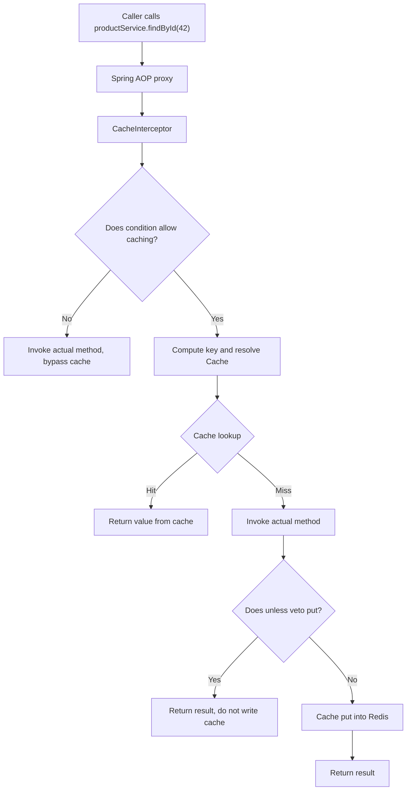
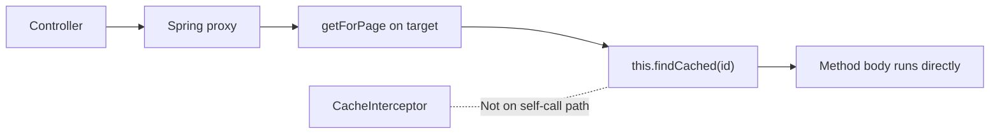
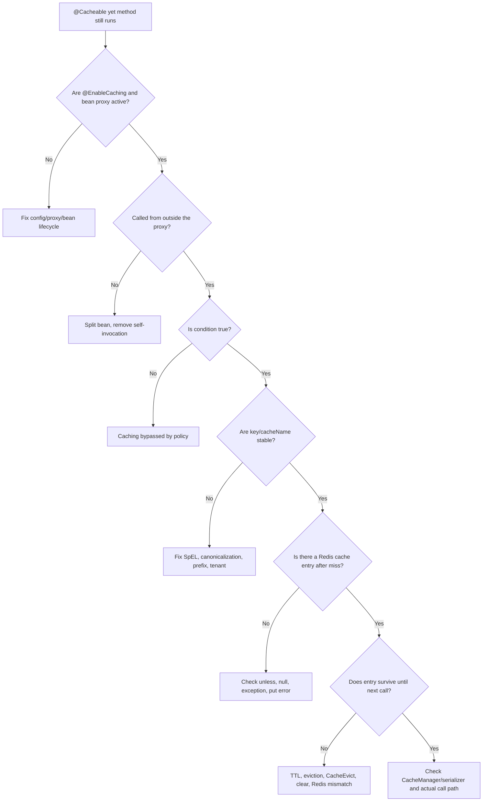

# Cache Not Taking Effect Due to Proxy, Key, or Condition Issues in Spring Data Redis

A common issue when using `@Cacheable` with Spring Boot and Spring Data Redis is: **the method is annotated for caching, yet every invocation still queries the database, calls an external API, or executes an expensive computation**. Sometimes Redis has no key at all; sometimes the key exists yet the application does not use it; sometimes one endpoint caches properly while another endpoint calling the same method caches incorrectly.

For example:

```java
@Cacheable(cacheNames = "products", key = "#id")
public Product findById(String id) {
    return database.findById(id).orElseThrow();
}
```

You expect the first call to execute `database.findById`, and the second call with the same ID to return from Redis. In practice, however:

- The call does not pass through the **Spring AOP proxy**, so `@Cacheable` is never executed.
- `@EnableCaching` is not enabled or the method does not belong to a Spring-managed bean.
- Keys are generated differently across requests: parameter names are not resolved, parameter order changed, tenant/locale was omitted, or serializer/prefix behaves unexpectedly.
- `condition` always evaluates to false, causing Spring to skip both cache lookup and cache put.
- `unless` evaluates to true, so the result is computed but **never placed into the cache**.
- The method returns `null`, `Optional.empty()`, or throws an exception; caching/serializer rules differ from assumptions.
- The cache name, `CacheManager`, or Redis environment is wrong: the app uses an in-memory cache, a different Redis database, or the cache TTL has already expired.
- A write path repeatedly calls `@CacheEvict`, deleting the entry right after it was stored.

This lesson provides **the execution model, reproduction steps, fixes, diagnostic tools, and tests** for the three primary root-cause categories: **proxy**, **key**, and **condition**. `CacheManager`, TTL, invalidation, and transaction issues are also covered because they frequently produce identical symptoms.

> Key takeaway: **`@Cacheable` belongs to the Spring Cache abstraction**, and Redis is one of several backends a `CacheManager` can use. Adding the Spring Data Redis dependency or calling `RedisTemplate` successfully **does not prove** that `@Cacheable` calls are using Redis.

## 1. Accurate model of a cache hit

A Spring-cached method invoked through a proxy follows this flow:



This is a simplified view of the common `@Cacheable` flow: exact ordering and behavior depend on annotations/options/cache implementation. To diagnose, distinguish **whether the method body ran**, **whether a cache lookup occurred**, and **whether a cache put occurred**.

### 1.1. Returning the same data does not prove a cache hit

Two calls:

```java
Product a = service.findById("42");
Product b = service.findById("42");
```

can return identical content even if the database was queried twice. You must measure **how many times the actual method executed**, downstream SQL/HTTP calls, cache metrics, or Redis operations.

A useful observation:

```text
Call #1: cache miss -> database load -> cache put
Call #2: cache hit  -> no database call
```

If the database is still called, determine whether caching was not applied, missed due to a different key, disappeared, or was skipped by a condition.

### 1.2. A cache hit does not necessarily produce a GET command you immediately recognize

With Spring Cache, providers vary; if a local cache is used, there is no Redis GET. Redis Cache executes the corresponding Redis command, but the physical key has its own prefix/serializer. Do not conclude "not caching" simply because you checked the wrong key in Redis CLI.

## 2. Setting up a Spring Boot example with Redis Cache

Maven dependencies:

```xml
<dependency>
    <groupId>org.springframework.boot</groupId>
    <artifactId>spring-boot-starter-cache</artifactId>
</dependency>
<dependency>
    <groupId>org.springframework.boot</groupId>
    <artifactId>spring-boot-starter-data-redis</artifactId>
</dependency>
```

Gradle:

```gradle
implementation("org.springframework.boot:spring-boot-starter-cache")
implementation("org.springframework.boot:spring-boot-starter-data-redis")
```

In Spring Boot 3.x, an illustrative development configuration:

```yaml
spring:
  cache:
    type: redis
    redis:
      time-to-live: 10m
      cache-null-values: false
      use-key-prefix: true
  data:
    redis:
      host: localhost
      port: 6379
      timeout: 2s
```

If production uses ACLs or TLS, supply username/password from a secret manager, TLS trust material, and appropriate settings. Never embed real passwords in YAML committed to Git.

**Version note:** the example follows Spring Boot 3.x style; Spring Boot 2.x uses a different Redis property namespace. Boot cache properties only take effect through auto-configuration; they are not necessarily applied if you declare a custom `CacheManager` yourself.

### 2.1. Enabling caching

```java
import org.springframework.boot.SpringApplication;
import org.springframework.boot.autoconfigure.SpringBootApplication;
import org.springframework.cache.annotation.EnableCaching;

@SpringBootApplication
@EnableCaching
public class CatalogApplication {
    public static void main(String[] args) {
        SpringApplication.run(CatalogApplication.class, args);
    }
}
```

`@EnableCaching` activates the infrastructure that processes caching annotations. Having `@Cacheable` in source code without the supporting infrastructure leaves the method behaving like an ordinary Java method.

### 2.2. A basic cached method

```java
package com.example.catalog;

import org.springframework.cache.annotation.Cacheable;
import org.springframework.stereotype.Service;

@Service
public class ProductQueryService {

    private final ProductRepository repository;

    public ProductQueryService(ProductRepository repository) {
        this.repository = repository;
    }

    @Cacheable(cacheNames = "product-by-id", key = "#p0")
    public ProductDto findById(String productId) {
        return repository.findDtoById(productId)
                .orElseThrow(ProductNotFoundException::new);
    }
}
```

`ProductRepository`, `ProductDto`, and `ProductNotFoundException` represent domain classes. Using `#p0` instead of `#productId` keeps the example independent of compile-time parameter name metadata.

### 2.3. What to observe

With the same ID:

```text
Call 1: repository.findDtoById("42") is invoked
Call 2: repository.findDtoById("42") is not invoked
```

Only then inspect Redis for the corresponding `product-by-id` entry. Do not start by guessing key names from the annotation.

## 3. Cause Group A: the call does not pass through a Spring proxy

Under Spring Cache's standard **proxy mode**, `@Cacheable` is applied via Spring AOP advice. The target method itself does not know it is cached. Advice runs when a caller invokes the **Spring-managed proxy object**.

```text
Controller
   |
   v
Spring proxy(ProductQueryService)
   |
   +-- CacheInterceptor
   |
   v
ProductQueryService target method
```

If you invoke the target directly, the interceptor may not run.

### 3.1. Self-invocation: the most common mistake

```java
@Service
public class ProductService {

    public ProductDto getForPage(String id) {
        return findCached(id);
    }

    @Cacheable(cacheNames = "products", key = "#p0")
    public ProductDto findCached(String id) {
        return loadExpensiveProduct(id);
    }

    private ProductDto loadExpensiveProduct(String id) {
        // Load from DB or call remote service.
        return ...;
    }
}
```

Inside `getForPage`, calling `findCached(id)` is actually:

```java
this.findCached(id);
```

It executes **inside the target object itself**, bypassing the proxy.

Diagram:



Result: calling `getForPage("42")` multiple times can execute `loadExpensiveProduct` multiple times even though `findCached` is annotated with `@Cacheable`.

### 3.2. Only external calls pass through advice

If a controller injects the bean:

```java
@RestController
public class ProductController {

    private final ProductService products;

    public ProductController(ProductService products) {
        this.products = products;
    }

    @GetMapping("/products/{id}")
    public ProductDto get(@PathVariable String id) {
        return products.findCached(id);
    }
}
```

Calling `products.findCached(id)` normally passes through the proxy and caches. This explains why **one API path caches properly while another API path caches poorly** when one calls the method directly and the other routes through another method in the same class.

### 3.3. Preferred fix: extract the cached method into a separate bean

```java
@Service
public class CachedProductReader {

    private final ProductRepository repository;

    public CachedProductReader(ProductRepository repository) {
        this.repository = repository;
    }

    @Cacheable(cacheNames = "products", key = "#p0")
    public ProductDto findById(String id) {
        return repository.findDtoById(id)
                .orElseThrow(ProductNotFoundException::new);
    }
}
```

Another orchestrating service:

```java
@Service
public class ProductPageService {

    private final CachedProductReader cachedReader;

    public ProductPageService(CachedProductReader cachedReader) {
        this.cachedReader = cachedReader;
    }

    public ProductDto getForPage(String id) {
        return cachedReader.findById(id);
    }
}
```

Call path:

```text
Controller -> ProductPageService
           -> CachedProductReader proxy
           -> CacheInterceptor
           -> target on cache miss
```

This is easy to read, easy to test, and avoids self-referencing proxies.

### 3.4. Should you self-inject your own bean?

Some projects use self-injection or `AopContext.currentProxy()` to force calls through the proxy. These increase coupling to AOP, risk circular dependencies, and require expose-proxy configuration; they are not the default fix.

**Prefer splitting responsibilities across beans.** Only use a self-proxy workaround when the team thoroughly understands lifecycle/configuration and has tests proving advice actually runs.

## 4. Private, final, static methods and visibility

In proxy mode, the safest rule of thumb is to place cache annotations on **public methods interceptable by a proxy** on a Spring-managed bean.

Error-prone example:

```java
@Service
public class ProductService {

    @Cacheable("products")
    private ProductDto load(String id) {
        return ...;
    }
}
```

A `private` method is not intercepted by standard proxy advice. Calling it from another method in the class does not turn it into a cached method.

### 4.1. Final method

```java
@Cacheable("products")
public final ProductDto load(String id) {
    return ...;
}
```

With a **class-based/CGLIB proxy**, `final` methods cannot be overridden to add advice. If code relies on that proxy style, the cache annotation will not behave as expected.

**Nuance:** with an interface/JDK proxy, the proxy intercepts calls through the interface before forwarding to the target; `final` behavior should be evaluated based on the actual proxy mechanism rather than assuming every `final` method behaves identically across all proxy types.

### 4.2. Final class

A `final class` cannot be subclassed by a class-based proxy. When using Spring AOP class proxies, remove `final` or choose an interface/proxy design that fits.

### 4.3. Kotlin

Kotlin classes/methods are `final` by default. Spring Kotlin projects typically use the `kotlin-spring`/all-open plugin so classes with Spring stereotypes are opened for proxying when needed.

If cache annotations fail to run on a Kotlin service, verify the build plugin and the bean's proxy mechanism. Do not tweak Redis TTL when the root cause is an un-intercepted AOP method.

### 4.4. Static methods and constructors

Static calls are not invoked on a Spring instance proxy. Constructors and object initialization are also not places to expect cache advice to run. Put cached logic on instance methods of beans, called after the context and proxy are ready.

## 5. Beans must be managed by Spring

Wrong:

```java
ProductQueryService service =
        new ProductQueryService(repository);

service.findById("42");
```

An object created with `new` is not a Spring-managed proxy bean; cache annotations on the class do not create interception automatically.

Right:

```java
@RestController
public class CatalogController {

    private final ProductQueryService products;

    public CatalogController(ProductQueryService products) {
        this.products = products;
    }

    @GetMapping("/products/{id}")
    public ProductDto get(@PathVariable String id) {
        return products.findById(id);
    }
}
```

Dependency injection receives the bean from the Spring container, giving it the chance to be wrapped with proxy/cache advice.

### 5.1. Missing component scanning

If the `@Service` package falls outside component scan scope, the service may not become a bean. When the app still runs due to manual instantiation code, cache annotations on that object have no effect.

Check:

- Package of `@SpringBootApplication` relative to `@Service`.
- Whether custom `@ComponentScan` misses the package.
- Whether multiple beans of the same type lead to injecting the wrong one.
- Whether beans created via `@Bean` receive advice.

### 5.2. Calling inside @PostConstruct

```java
@PostConstruct
public void warmup() {
    findById("42");
}
```

This is a self-call during initialization; do not assume `@Cacheable` is applied. If warm-up is needed, use another bean that calls the **cached service proxy** after the context finishes initializing, e.g., via `ApplicationReadyEvent` in an appropriate coordinator bean.

### 5.3. Bean scopes and proxies

Singletons, request-scoped beans, scoped proxies, or factory beans can create complex proxy chains. For hard-to-trace issues, inspect the **actual injected bean** and call path rather than inferring from class names in source code.

## 6. JDK dynamic proxy vs class-based proxy

Spring AOP typically uses:

| Type | How it works | What to watch out for |
|---|---|---|
| JDK dynamic proxy | Proxy implements interfaces | Callers typically interact via the interface; invoked methods must belong to the proxied interface |
| Class-based proxy (CGLIB) | Creates a subclass of the class | Cannot override final/private methods |

Proxy selection depends on Spring Boot/AOP configuration and involved beans. Do not assume every application uses the same proxy type.

Interface example:

```java
public interface ProductReader {
    ProductDto load(String id);
}
```

Implementation:

```java
@Service
public class ProductReaderImpl implements ProductReader {

    @Override
    @Cacheable(cacheNames = "products", key = "#p0")
    public ProductDto load(String id) {
        return ...;
    }
}
```

When using interface proxies, the controller injects `ProductReader` and calls `load` via the interface for a clean path.

### 6.1. Placing the annotation on the implementation or the interface?

Spring proxy mode can read caching metadata from multiple locations depending on the mechanism, but for clarity and to reduce reliance on annotation detection differences across JDK proxy/class proxy/AspectJ, prefer placing `@Cacheable` on the **concrete implementation method** and testing via the real proxy.

Especially when switching to AspectJ weaving, annotations declared solely on an interface may not be recognized as they are on a concrete class. Do not just toggle `proxyTargetClass` and claim the issue is permanently fixed.

### 6.2. Checking whether a bean is an AOP proxy

In a diagnostic test:

```java
import org.springframework.aop.support.AopUtils;

@Autowired
ProductReader productReader;

@Test
void beanIsProxied() {
    assertThat(AopUtils.isAopProxy(productReader))
            .isTrue();
}
```

This **only proves the bean is an AOP proxy**; it does not prove that cache advice specifically wraps the target method. A bean can also be proxied because of `@Transactional` or another interceptor.

The decisive test remains: **call twice with the same key—how many times does the method body execute?**

## 7. Does AspectJ mode fix self-invocation?

`@EnableCaching` defaults to proxy-based advice. Spring also supports AspectJ mode when weaving and required dependencies are configured.

Conceptual difference:

```text
Proxy mode:
    only calls through the proxy are intercepted

AspectJ weaving mode:
    bytecode is woven with the aspect;
    can intercept corresponding self-invocations
```

AspectJ can solve many self-invocation issues, but introduces build/runtime weaving, classloader, and deployment observability requirements. **Do not switch to AspectJ just to fix one method** if splitting beans is sufficient.

If you choose AspectJ, verify:

- Appropriate aspect dependencies.
- Compile-time or load-time weaving.
- Annotations are recognized on the concrete class/method.
- Test and production runners actually have weaving active.
- Interaction with other advice on the method.

## 8. Cause Group B: cache key changes or is generated incorrectly

Suppose the proxy works, `condition` allows caching, and Redis is connected properly. If requests still miss every time, inspect the **key**.

Spring Cache needs a key to locate an entry:

```text
cacheName + generatedKey
       |
       v
Redis physical key (prefix + serialization)
```

Two requests for "the same product" at the business level can produce **two different keys** due to inputs or key conversion.

### 8.1. Default key generation

When neither `key` nor `keyGenerator` is specified:

```java
@Cacheable("products")
public ProductDto findById(String id) { ... }
```

Spring Cache defaults to `SimpleKeyGenerator` with these general rules:

| Number of parameters | Default logical key |
|---|---|
| No parameters | `SimpleKey.EMPTY` |
| One parameter | That parameter object itself |
| Multiple parameters | `SimpleKey` containing the parameters |

Therefore:

```java
@Cacheable("products")
public ProductDto findById(String id, Locale locale) { ... }
```

does not produce the same key as a method accepting only `id`. And calling with the same ID but a different `locale` generates a different logical key.

### 8.2. Default keys can change when signatures change

Before:

```java
ProductDto findById(String id)
```

After refactoring:

```java
ProductDto findById(String id, boolean includeDetails)
```

The logical key changes from a String to a composite `SimpleKey`. If two versions of the application access Redis simultaneously, key schemas and cache hit rates can diverge.

Treat key generation as part of the **cache schema**, not a harmless implementation detail.

## 9. SpEL keys: #id, #p0, and parameter names

Example:

```java
@Cacheable(cacheNames = "products", key = "#id")
public ProductDto findById(String id) { ... }
```

`#id` only resolves when Spring has the corresponding parameter name metadata. If the build does not preserve parameter names or classes were compiled differently, the expression may fail to resolve as expected.

Typically, Spring may report:

```text
Null key returned for cache operation
```

One possible cause is SpEL referencing an unavailable parameter name. **Do not automatically blame parameter names for every null key error**; some expressions genuinely evaluate to null.

### 9.1. Positional safe alternatives

```java
@Cacheable(cacheNames = "products", key = "#p0")
public ProductDto findById(String id) {
    ...
}
```

Or:

```java
@Cacheable(cacheNames = "products", key = "#a0")
public ProductDto findById(String id) {
    ...
}
```

Or:

```java
@Cacheable(
        cacheNames = "products",
        key = "#root.args[0]")
public ProductDto findById(String id) {
    ...
}
```

These do not rely on the Java parameter name `id` being retained in bytecode. The trade-off is that changing parameter order requires updating the key expression accordingly.

### 9.2. Retaining parameter names in Java builds

When using `#id` for readability, the build must retain parameter name metadata, e.g., compiler flag:

```text
-parameters
```

With modern Spring Boot plugins/build tools, this flag may be configured automatically, but verify the **actual running artifact**, especially in multi-module projects or with bytecode transformations.

### 9.3. Comparing #p0 with #root.methodName

```java
@Cacheable(
        cacheNames = "products",
        key = "#root.methodName + ':' + #p0")
```

This expression includes the method name in the key. It helps if multiple methods share one cache region, though renaming the method changes the key. It is usually easier to operate when **each data category has its own cache name**.

## 10. Key collisions between methods

Suppose:

```java
@Cacheable(cacheNames = "catalog", key = "#p0")
public ProductDto findProduct(String id) {
    ...
}

@Cacheable(cacheNames = "catalog", key = "#p0")
public CategoryDto findCategory(String id) {
    ...
}
```

If both are called with `id = "42"`, they produce the exact same key inside the same cache name.

Consequences:

- The method looking up Category may receive Product data.
- The serializer/deserializer may throw type errors.
- The key exists, yet the value is wrong.
- Investigation shows "cache hit occurred", yet application behavior is bizarre.

### 10.1. Fix using separate cache regions

```java
@Cacheable(cacheNames = "product-by-id", key = "#p0")
public ProductDto findProduct(String id) { ... }

@Cacheable(cacheNames = "category-by-id", key = "#p0")
public CategoryDto findCategory(String id) { ... }
```

This is the clearest approach when two data types have different lifecycles and TTLs.

### 10.2. Or use stable prefixes

```java
@Cacheable(cacheNames = "catalog", key = "'product:' + #p0")
public ProductDto findProduct(String id) { ... }

@Cacheable(cacheNames = "catalog", key = "'category:' + #p0")
public CategoryDto findCategory(String id) { ... }
```

However, sharing one cache region makes it harder to separate TTL, invalidation, and serializer policies per data type.

## 11. Omitting tenant, locale, or authorization scope from keys

Dangerous example:

```java
@Cacheable(cacheNames = "dashboard", key = "#p0")
public DashboardDto load(
        String dashboardId,
        String tenantId) {
    ...
}
```

The key contains only the dashboard ID. If tenants share logical dashboard IDs, one tenant can receive another tenant's content.

### 11.1. Bind all inputs that affect the output

```java
@Cacheable(
        cacheNames = "dashboard",
        key = "#p1 + ':' + #p0")
public DashboardDto load(
        String dashboardId,
        String tenantId) {
    ...
}
```

In this example, `#p1` is `tenantId` and `#p0` is `dashboardId`. If locale or permission scope changes the output, bind those into the key as well, or design caching at a data layer free of per-permission customization.

### 11.2. Avoid ambiguous string concatenation

```text
tenantId = "ab"
id       = "c"
=> "abc"

tenantId = "a"
id       = "bc"
=> "abc"
```

This is a collision. Use delimiters with escaping/canonicalization, structured key objects, or a stable key generator.

If `:` is used in keys, define escaping or encoding rules in case components also contain `:`. For multi-tenant caches, **tenant boundary correctness** matters far more than saving a few bytes in key names.

### 11.3. Do not cache authorized data based solely on user input

Even when the key includes `tenantId`, the method must still enforce **the caller's current permissions** before returning sensitive data. If the proxy returns a cache hit before the method body runs, authorization placed **only inside the method body** can be bypassed on cache hits depending on advice/security design.

For sensitive data, separate mandatory authorization checks from cache lookup or ensure access control runs independently on every request.

## 12. Mutable objects as cache keys

Example:

```java
@Cacheable(cacheNames = "search-results")
public SearchResult search(SearchFilter filter) {
    ...
}
```

If `SearchFilter` uses default object identity for `equals/hashCode`, two objects with identical content will still produce different logical keys.

If the filter is mutable and its `hashCode` changes, lookup behavior becomes even more unpredictable.

### 12.1. Normalize inputs into a stable key

Example:

```java
public record SearchKey(
        String keyword,
        int page,
        int size,
        String sort) {
}
```

Canonical values:

```java
SearchKey key = new SearchKey(
        keyword.trim().toLowerCase(Locale.ROOT),
        page,
        size,
        sort);
```

Best practice is for the cached method to take scalar/immutable values and use an explicit key generator:

```java
@Cacheable(
        cacheNames = "search-results-v2",
        key = "#p0 + ':' + #p1 + ':' + #p2")
public SearchResult search(
        String normalizedKeyword,
        int page,
        String sort) {
    ...
}
```

If inputs can contain delimiters or special characters, apply proper encoding/canonicalization rather than trusting naive string concatenation for every domain.

### 12.2. Arrays and collections

An array or collection with the same elements in different orders can produce different keys depending on the key generator and data structure. If order genuinely does not affect the result, canonicalize before caching (e.g., sort a list of IDs when valid).

Conversely, if order affects the result, do **not** sort just to increase hit rate, as that creates logical collisions.

## 13. Redis physical key vs Spring logical key

In typical Spring Data Redis Cache configurations, the actual key usually looks like:

```text
<cacheName>::<convertedKey>
```

For example:

```java
@Cacheable(cacheNames = "product-by-id", key = "#p0")
public ProductDto findById(String id) { ... }
```

A physical key may be:

```text
product-by-id::42
```

However, this is **not an immutable format**. `RedisCacheConfiguration` can:

- Disable the prefix.
- Generate the prefix via a custom function.
- Use a versioned cache name.
- Apply a different conversion/key serializer.
- Target a different Redis connection/database/cluster.

### 13.1. Why does redis-cli GET products:42 return nil?

Because Spring may have written:

```text
product-by-id::42
```

rather than:

```text
products:42
```

Verify the exact `cacheNames`, key generator, prefix, and Redis DB/Cluster before concluding "cache is not writing".

### 13.2. Verify using bounded SCAN

On test Redis or an authorized environment:

```bash
redis-cli --scan --pattern 'product-by-id*'
```

Or:

```redis
SCAN 0 MATCH product-by-id* COUNT 100
```

Never run `KEYS *` on a large production Redis just to debug one cache entry. `SCAN` still has cost and does not produce an atomic snapshot; take bounded samples.

### 13.3. Spring Cache serializers differ from StringRedisTemplate

`StringRedisTemplate` uses String serializers, whereas Spring `RedisCacheManager` has its own key/value serialization configuration. Do not assume:

```java
redis.opsForValue().get("product-by-id::42")
```

can always read a cached `ProductDto` as a JSON string. The cached value may be serialized in another format, such as Java serialization or a JSON serializer depending on configuration.

For debugging:

- Use `CacheManager.getCache(cacheName).get(key, Type.class)` to inspect via the same abstraction when appropriate.
- With Redis CLI, primarily inspect existence and TTL of the physical key.
- Never deserialize untrusted data using careless Java serializer configurations.

## 14. Null keys and broken SpEL

Some expressions:

```java
key = "#id"
key = "#p0.id"
key = "#p1.tenantId"
```

can evaluate to `null` when:

- Parameter name `id` does not resolve.
- `#p0` is null.
- `#p0.id` is null.
- Parameter index became wrong after refactoring.
- An object is uninitialized or a property does not exist.

Spring Cache does not accept null cache keys for standard operations; it can throw an exception instead of silently missing.

### 14.1. Diagnosing properly

1. Inspect the current `key` expression.
2. Check the method signature in the actual compiled binary.
3. Check whether `#p0`/`#a0` matches.
4. Check for null inputs and property resolution.
5. Check the stack trace at an appropriate log level.
6. Never "fix" it with a constant key that makes every request share one entry.

### 14.2. Never fix with key="'fixed'"

```java
@Cacheable(cacheNames = "products", key = "'fixed'")
public ProductDto findById(String id) {
    ...
}
```

Every ID will share the exact same cache key; this is a **severe cache collision**, not a SpEL fix.

## 15. Cause Group C: condition and unless

Spring Cache allows controlling when caching occurs.

Example:

```java
@Cacheable(
        cacheNames = "products",
        key = "#p0",
        condition = "#p1",
        unless = "#result == null")
public ProductDto load(String id, boolean allowCache) {
    return repository.findDtoById(id).orElse(null);
}
```

Here:

- `condition` is evaluated from inputs **before cache lookup**. When false, Spring bypasses the caching mechanism for that operation.
- `unless` is evaluated after the method executes on a cache miss, to decide whether **not to store the result**.

### 15.1. Comparison table

| Attribute | Evaluation timing | When expression is true |
|---|---|---|
| `condition` | Before cache lookup/method execution | Allows the operation's caching path |
| `unless` | After method computes a result | **Vetoes cache put**, result is not stored |

With `condition`, true **does not guarantee a hit**; it can still miss because the key does not exist yet. With `unless`, true does not mean the method failed; the method can still return a normal result without caching it.

### 15.2. Four-call example

Suppose:

```java
load("42", false);
load("42", false);
load("42", true);
load("42", true);
```

If the method returns non-null data and Redis is healthy:

| Call | allowCache | What happens? |
|---|---|---|
| 1 | false | Bypass cache, query DB |
| 2 | false | Still bypass, query DB |
| 3 | true | Cache lookup; on miss, query DB then put |
| 4 | true | Hit if entry has not expired/been evicted |

If `allowCache=false` is passed, do not hunt for TTL/Redis bugs because Spring **intentionally skipped the cache**.

## 16. SpEL condition mistakes that miss intent

Example:

```java
@Cacheable(
        cacheNames = "products",
        key = "#p0",
        condition = "#p1 == true")
public ProductDto load(String id, boolean cacheEnabled) {
    ...
}
```

If the caller layer always passes `false` due to a mapping/configuration bug, caching will never execute.

Another example:

```java
@Cacheable(
        cacheNames = "search",
        key = "#p0",
        condition = "#p0.length() < 3")
public SearchResult search(String query) {
    ...
}
```

If queries are mostly three characters or longer, the cache is always bypassed. The syntax is not broken; the **policy** may be wrong.

### 16.1. When condition depends on security context

Conditions can rely on authorization/session details via beans or parameters. Remember `condition` controls **enabling/disabling caching**, not authorization.

If a user is unauthorized to view data, the method or another security interceptor must still enforce proper checks even on a cache hit. Do not put all permission checks **only inside the method body** if a cache hit can bypass the body.

### 16.2. Condition does not have #result

Conceptually wrong example:

```java
@Cacheable(
        cacheNames = "products",
        condition = "#result != null")
```

At the time `condition` is evaluated, the method result does not exist yet. Result-based rules must go in `unless`:

```java
@Cacheable(
        cacheNames = "products",
        unless = "#result == null")
```

## 17. Unless is not a pre-invocation condition

Suppose:

```java
@Cacheable(
        cacheNames = "products",
        key = "#p0",
        unless = "#result == null")
public ProductDto find(String id) {
    return repository.findDtoById(id).orElse(null);
}
```

If the ID does not exist:

```text
Call 1 -> DB returns null -> unless true -> not stored
Call 2 -> DB returns null -> unless true -> not stored
Call 3 -> DB returns null -> unless true -> not stored
```

This is **expected behavior per the annotation**. It may look like "cache is not working", when in fact the policy against caching nulls is active.

### 17.1. Negative caching is a business decision

Caching "not found" briefly can sometimes reduce load:

```text
product:unknown -> NOT_FOUND with short TTL
```

However, consider:

- A product created right after caching "not found" may temporarily be invisible.
- Cached absence must never be used to bypass authorization.
- Limit TTL and key cardinality to avoid cache pollution.
- Spring Cache has its own null-caching policy and serializer behavior.

Do not simply delete `unless` while ignoring `cache-null-values`, TTL, and data validity.

### 17.2. Optional and #result

Spring Cache supports certain return wrappers like `Optional` with unwrapping behavior in the cache abstraction. In supporting Spring versions, `#result` inside `unless` for `Optional<T>` is evaluated against the unwrapped business value, not necessarily the `Optional` wrapper itself.

Therefore:

```java
@Cacheable(
        cacheNames = "products",
        unless = "#result == null")
public Optional<ProductDto> find(String id) {
    ...
}
```

can decline to cache when `Optional.empty()` is returned. **Verify behavior against the Spring Framework version in use**, especially for async/reactive types and custom wrappers.

## 18. Condition is true yet cache still does not write due to exceptions

`@Cacheable` does not turn a method exception into a valid cacheable value.

Example:

```java
@Cacheable(cacheNames = "products", key = "#p0")
public ProductDto findRequired(String id) {
    return repository.findDtoById(id)
            .orElseThrow(ProductNotFoundException::new);
}
```

When the method throws `ProductNotFoundException`:

```text
Call 1: cache miss -> method throws
Call 2: cache miss -> method throws
```

Every call hits the DB, yet this is not proof that the proxy failed. To cache "not found", design a **negative cache value** or a separate service with explicit policy, rather than just adding `unless`.

## 19. @Cacheable(sync = true) does not fix every cache miss

Some applications use:

```java
@Cacheable(
        cacheNames = "products",
        key = "#p0",
        sync = true)
public ProductDto load(String id) {
    return repository.findDtoById(id).orElseThrow();
}
```

`sync = true` asks the cache provider to synchronize loading the same key under contention; outcome and support depend on the provider.

This can help prevent multiple threads from computing the same key on a cache miss, **but it is not a promise of distributed single-flight across all JVMs/pods**. Evaluate the specific `RedisCache` and framework version.

### 19.1. Constraints to keep in mind

With `@Cacheable(sync = true)`, Spring Cache imposes important API restrictions, such as:

- Cannot combine with `unless` on the same operation.
- Only one cache name may be declared.
- Cannot mix incompatible cache operations on the same method.

Do not add `sync = true` as a "trick" to fix `condition=false`, wrong keys, self-invocation, or the wrong `CacheManager`. It does not address any of those causes.

## 20. @CachePut and @CacheEvict can make caching look nonexistent

`@Cacheable` uses a cached value if present; `@CachePut` **always invokes the method** and then updates the cache with the result.

Example:

```java
@CachePut(cacheNames = "products", key = "#p0.id")
public ProductDto update(ProductDto product) {
    return repository.save(product);
}
```

If someone uses `@CachePut` expecting the method not to run on the second call, that is a misunderstanding of the annotation.

### 20.1. Comparison

| Annotation | Core behavior |
|---|---|
| `@Cacheable` | May skip the method on a cache hit |
| `@CachePut` | Method always executes; result is placed into cache per policy |
| `@CacheEvict` | Deletes entry/cache region per condition |
| `@Caching` | Combines multiple cache operations declaratively |

### 20.2. Continuous eviction

Suppose an endpoint calls:

```java
@CacheEvict(cacheNames = "products", key = "#p0")
public void touch(String id) {
    ...
}
```

repeatedly between read requests. The key `products::42` can be populated and immediately deleted over and over, making `@Cacheable` miss almost every time.

Diagnosis must inspect **all code writing/deleting the same cacheName and key schema**, not just the read method.

### 20.3. beforeInvocation

By default, `@CacheEvict` typically evicts only after the method completes successfully:

```java
@CacheEvict(cacheNames = "products", key = "#p0")
public void deleteProduct(String id) {
    repository.deleteById(id);
}
```

With:

```java
@CacheEvict(
        cacheNames = "products",
        key = "#p0",
        beforeInvocation = true)
```

the entry is evicted before the method runs; even if the method subsequently fails, eviction already occurred. Choose the mode based on business semantics, not `beforeInvocation=true` just to "see Redis DEL sooner".

## 21. Transactions and cache invalidation

A method may combine both:

```java
@Transactional
@CacheEvict(cacheNames = "products", key = "#p0")
public ProductDto updatePrice(String id, Money price) {
    ...
}
```

However, **a database transaction and a Redis cache operation do not automatically belong to a single shared ACID transaction**. Advice/callback ordering and commit timing can affect consistency.

A scenario:

```text
T1: DB update starts inside transaction
T2: Cache entry is evicted
T3: Another reader misses and loads old DB state
T4: Another reader writes old state back to cache
T5: DB commits new state
```

This can leave stale cache even though `@CacheEvict` ran. In certain configurations, cache operations execute post-commit, but **do not guess solely from annotation ordering in source code**.

### 21.1. Designing after-commit invalidation

One pattern publishes a domain event inside the transaction and handles invalidation after commit:

```java
public record ProductChanged(String productId) {}
```

```java
@Service
public class ProductCommandService {

    private final ProductRepository repository;
    private final ApplicationEventPublisher events;

    public ProductCommandService(
            ProductRepository repository,
            ApplicationEventPublisher events) {
        this.repository = repository;
        this.events = events;
    }

    @Transactional
    public void changePrice(String id, Money newPrice) {
        repository.updatePrice(id, newPrice);
        events.publishEvent(new ProductChanged(id));
    }
}
```

A listener bean:

```java
@Component
public class ProductCacheInvalidationListener {

    @TransactionalEventListener(
            phase = TransactionPhase.AFTER_COMMIT)
    @CacheEvict(
            cacheNames = "products",
            key = "#p0.productId()")
    public void onProductChanged(ProductChanged event) {
        // CacheEvict advice deletes cache entry when event handler is invoked.
    }
}
```

This is a **best-effort after-commit invalidation** pattern within the same application. If the process crashes after DB commit before the listener hits Redis, invalidation may be missed. For high-reliability requirements, consider **transactional outbox, durable event delivery, versioned cache keys**, or reconciliation.

### 21.2. Do not assume @CacheEvict runs if self-invoked

`@CacheEvict` and `@CachePut` also rely on proxy-mode cache advice. If an annotated method is called via `this.method()` inside the same bean, it can be bypassed just like `@Cacheable`.

## 22. Different CacheManager or not RedisCacheManager

A common situation: a project has a working Redis connection, yet `@Cacheable` is using:

```text
ConcurrentMapCacheManager
```

or another cache manager. In that case:

- Endpoints may still cache in RAM.
- Redis CLI shows no keys.
- Each pod has its own cache, causing uneven hit/miss behavior behind load balancers.
- Restarting the application wipes the cache regardless of Redis TTL.

### 22.1. Cache abstraction requires a CacheManager

`@EnableCaching` provides the AOP infrastructure, while `CacheManager` determines the backend and configures cache regions.

Common backends include:

```text
RedisCacheManager
CaffeineCacheManager
ConcurrentMapCacheManager
Custom CacheManager
```

Adding the Redis dependency does not automatically remove another `@Bean CacheManager` declared in code.

### 22.2. Checking the bean type

Example in an integration test:

```java
@Autowired
CacheManager cacheManager;

@Test
void cachingUsesRedisManager() {
    assertThat(cacheManager)
            .isInstanceOf(RedisCacheManager.class);
}
```

Required imports:

```java
import org.springframework.cache.CacheManager;
import org.springframework.data.redis.cache.RedisCacheManager;
```

This test is only meaningful if the application intends to use **one specific RedisCacheManager** for the annotation in question.

### 22.3. Multiple cache managers

If the application uses both Caffeine and Redis:

```java
@Cacheable(
        cacheNames = "products",
        cacheManager = "redisCacheManager",
        key = "#p0")
public ProductDto findById(String id) {
    ...
}
```

The name `redisCacheManager` must match an actual bean. If a custom `cacheResolver` is configured, inspect how it selects caches. Do not assume `spring.cache.type=redis` always overrides custom beans/overrides.

### 22.4. CachingConfigurer

A class implementing `CachingConfigurer` can select the default `CacheManager` or `CacheResolver` for the caching infrastructure. If a project declares multiple managers alongside a custom `CachingConfigurer`, diagnosis must check the **actual configuration**, not just YAML.

## 23. RedisCacheManager and TTL: cache works but entries expire too quickly

One reason a method runs every time is that **the cache entry already expired before the next call**.

Example:

```yaml
spring:
  cache:
    type: redis
    redis:
      time-to-live: 1s
```

If requests arrive 2 seconds apart:

```text
Call #1 -> miss, put with 1s TTL
2 seconds later
Call #2 -> key expired, miss, method runs again
```

Here caching is active, but **the TTL does not match the access pattern**.

### 23.1. Checking physical TTL

Once the physical key is identified as `products::42`:

```redis
TTL products::42
PTTL products::42
EXISTS products::42
```

TTL outcomes:

| Value | Meaning |
|---|---|
| Non-negative number | Remaining time (seconds/ms) |
| `-1` | Key exists with no expiration |
| `-2` | Key does not exist or has expired |

`TTL = -2` does not prove a proxy bug; the key may never have been created, already expired, been evicted/deleted, or you may be inspecting the wrong Redis database.

### 23.2. TTL when constructing RedisCacheManager manually

Explicit manager bean example:

```java
@Bean
RedisCacheManager redisCacheManager(
        RedisConnectionFactory connectionFactory) {

    RedisCacheConfiguration defaults =
            RedisCacheConfiguration.defaultCacheConfig()
                    .entryTtl(Duration.ofMinutes(10))
                    .disableCachingNullValues();

    return RedisCacheManager.builder(connectionFactory)
            .cacheDefaults(defaults)
            .build();
}
```

Do not both configure `spring.cache.redis.time-to-live` and manually create a manager while assuming they automatically merge. When building a manager manually, verify exactly where TTL comes from.

### 23.3. Having no TTL does not mean a proxy bug

In many Redis Cache configurations, TTL can default to unlimited unless explicitly set. In that case `TTL key` returns `-1` while caching still works normally.

Distinguish:

- **No TTL:** entries can live until evicted/deleted.
- **TTL too short:** entries miss rapidly.
- **No key:** may be proxy/condition/unless or a different storage backend.

## 24. Checking the Redis instance, database, and environment

An application may use:

```yaml
spring:
  data:
    redis:
      host: redis-prod.internal
      database: 1
```

While you open `redis-cli` against local Redis database 0.

Concluding "Spring is not writing cache" from a local CLI while the app connects to production is wrong—and can also pose a security risk if you scan the wrong environment.

### 24.1. Questions to confirm

- Which host/port/cluster is Spring connecting to?
- Is Redis Sentinel/Cluster redirecting to another node?
- Which logical database is used? Redis Cluster uses database 0 per the Cluster model.
- Does the cache prefix contain environment/namespace/version?
- Does the app have multiple `RedisConnectionFactory` or `CacheManager` beans?
- Does Redis CLI have the same permissions/route/TLS as the app?
- Is there another proxy/local cache at a different layer?

Do not print passwords or raw tokens to logs just to discover the Redis endpoint. Logging allowed endpoint/namespace identifiers and the connection factory type is sufficient for initial diagnosis.

## 25. Same ID but written differently in keys

Examples:

```text
"42"
"042"
" 42 "
"42 "
"product-42"
```

The application might treat those as the same business entity, whereas Redis treats them as distinct keys.

Similarly:

```text
en-US
en_US
EN-us
```

If keys include locale or user codes, enforce consistent canonicalization.

### 25.1. Canonicalize before calling the cached method

Example:

```java
public ProductDto getProduct(String rawId) {
    String normalized = rawId.trim();
    return cachedReader.findById(normalized);
}
```

Normalizing in the caller layer ensures keys are generated from uniform inputs. However, normalization rules **must be valid for the domain**: for many IDs, whitespace or case can be meaningful distinguishing information.

### 25.2. Do not canonicalize two genuinely distinct values together

If the system treats `"ab"` and `"AB"` as two different customer IDs, calling `toLowerCase()` before caching creates collisions and returns the wrong customer. Never prioritize hit rate over data correctness.

## 26. Versioned cache keys

A DTO/schema changes:

```text
Old: ProductDto v1
New: ProductDto v2
```

If both versions share:

```text
products::42
```

the new app may read old data or hit serializer mismatches. One strategy:

```java
@Cacheable(
        cacheNames = "product-by-id-v2",
        key = "#p0")
```

Separating cache names/versions lowers risk during rolling deployments. Include a policy for cleaning up v1 keys afterward.

### 26.1. When do key versions cause intentional misses?

Right after a schema upgrade, initial misses can be **cache migration by design**. Do not treat a short-term spike in miss rate as an AOP bug if subsequent requests hit cleanly in the v2 namespace.

## 27. Spring Cache annotations and special return values

### 27.1. Null

Depending on cache provider/config:

- Null may be cached via a special placeholder.
- Null may be disallowed, causing a cache put error.
- `unless="#result == null"` may actively block storage.

Do not treat repeated invocations for a method returning null as proof that `@Cacheable` failed to run when policy explicitly forbids caching nulls.

### 27.2. Optional

Spring Cache supports unwrapping `Optional` in appropriate versions. Test returning `Optional.empty()` and observe actual cache policy; do not assume custom wrapper types are unwrapped like `Optional`.

### 27.3. Empty collections

```java
@Cacheable(
        cacheNames = "product-search",
        unless = "#result.isEmpty()")
public List<ProductDto> search(String keyword) {
    ...
}
```

An empty list will not be cached under this annotation, causing queries with no results to always hit the DB.

This may be an intentional policy to avoid storing arbitrary misses, or it may be the cause of elevated DB load from popular queries that return empty results.

### 27.4. Lazy collections and streams

Do not casually cache stateful/lifecycle-bound objects like Java `Stream` or lazy database cursors and expect the Redis serializer to persist full contents. Cached values should be DTOs/materialized immutable representations with clear serialization contracts.

### 27.5. Async/reactive return types

Modern Spring Framework versions support caching `CompletableFuture` and reactive return values under specific semantics. However, asynchronous retrieval support also depends on the cache provider/version.

When an application uses Reactor:

- Check the Spring Framework and Spring Data Redis versions.
- Verify whether the cache stores the completed value or a wrapper.
- Do not assume annotating every large `Flux` stream is an appropriate caching pattern.
- Verify concurrency/cancellation/error semantics.

If the application needs explicit caching under the Redis Reactive API, consider a service using `ReactiveRedisTemplate` with explicit TTL and serialization rather than guessing annotation behavior.

## 28. @Cacheable does not automatically cache exceptions

When a method throws an exception, normal cache put does not occur. Example:

```java
@Cacheable(cacheNames = "rates", key = "#p0")
public RateDto loadRate(String symbol) {
    return remoteApi.fetch(symbol); // May throw timeout.
}
```

If the remote API keeps timing out:

```text
Call 1 -> miss -> timeout -> no put
Call 2 -> miss -> timeout -> no put
Call 3 -> miss -> timeout -> no put
```

A cache does not replace circuit breakers, retry policies, or fallbacks for failing dependencies. Diagnosis must distinguish "method body ran because caching didn't apply" from "method ran but produced no valid value to store".

## 29. Cache ErrorHandler: Redis fails yet the method still runs

A system can configure `CacheErrorHandler` to **ignore cache GET errors** and fall through to the underlying method. When Redis fails:

```text
Cache lookup -> exception
ErrorHandler -> swallow GET error
Method body -> queries DB
Cache put -> may continue failing
```

A developer sees the method running every time and assumes `@Cacheable` is disabled, when the true cause is **an unavailable Redis cache backend with fallback via the error handler**.

### 29.1. Ensure error handlers are intentional

`CacheErrorHandler` belongs to the Spring Cache abstraction; it does not govern arbitrary `RedisTemplate` operations. Avoid configuring a global "ignore all errors" handler if a cache region holds security state or critical invalidations.

For DB-backed caches, ignoring GET/PUT failures can be reasonable **if DB fallback is rate-bounded**. For `@CacheEvict` failures, ignoring errors can leave stale cache behind after DB updates.

### 29.2. Crucial metrics

Record:

```text
cache_operation_outcome{
  cache="products",
  operation="get",
  outcome="error"
}
```

Do not attach raw cache keys or PII to metric labels.

## 30. 10-step diagnostic procedure

When someone reports **"@Cacheable has no effect"**, follow this sequence:

### Step 1 — Define the measurement

Ask specifically:

```text
Does the method body run every time?
Does the repository/HTTP downstream run every time?
Do Redis GET/SET commands occur?
Does the Redis key appear?
Is there a difference when calling from a Controller vs internally?
```

Do not rely merely on "the endpoint still responds slowly".

### Step 2 — Verify @EnableCaching

Check:

- Does the application context enable caching?
- Does the bean have `@Service`/`@Component` or an appropriate `@Bean`?
- Is proxy/cache configuration disabled by an active profile?

### Step 3 — Trace the call path

If:

```java
this.findCached(id);
```

or calling a private method from the same class, fix the proxy boundary first.

### Step 4 — Check method interceptability

Verify:

- Public/non-final per proxy type.
- Final class/Kotlin all-open.
- Interface-based method invocation.
- Whether the method is called on the real proxy bean or an object instantiated with `new`.

### Step 5 — Inspect CacheManager

Check the bean type and `cacheManager`/`cacheResolver` attributes. Confirm Redis is used rather than a local map or another manager.

### Step 6 — Inspect cacheNames

Does `cacheNames = "products"` match other places that read or evict it? Are there typos or v1/v2 namespaces?

### Step 7 — Inspect the key

Check SpEL, `#p0`, `-parameters` metadata, tenant/locale, input normalization, serializer, and prefix.

### Step 8 — Inspect condition/unless

Compare against actual request inputs:

```text
condition false => bypass
unless true => no put after method
```

Check for nulls, empty results, and exceptions.

### Step 9 — Inspect expiration/invalidation

Check TTL, eviction, cache clears, `@CacheEvict`, and paths updating the same key. Verify the right Redis instance/database.

### Step 10 — Reproduce with an integration test

Invoke **through the Spring bean proxy**, pass the same ID twice, count method invocations, and confirm the Redis cache entry via the proper API. Then test different IDs, false conditions, and TTLs.

## 31. Decision tree: from symptom to root cause



This tree is for rapid triage, not an algorithm guaranteed to find a single exclusive cause. An application can suffer from self-invocation **and** an overly short TTL at the same time.

## 32. Enabling appropriate diagnostic logging

In dev/test environments:

```yaml
logging:
  level:
    org.springframework.cache: TRACE
    org.springframework.cache.interceptor: TRACE
    org.springframework.data.redis.cache: DEBUG
```

Exact log levels and output depend on framework version. Overly verbose Redis/Lettuce protocol logging risks exposing keys/values/passwords or generating massive load.

### 32.1. Signals to look for

If the proxy/cache interceptor is working, you may observe logs related to:

```text
Computed cache key
Cache lookup / hit / miss
Cache condition bypass
Cache put / evict
Cache operation error
```

Not every Spring version logs those exact strings. Treat them as **categories of signals to look for**, not mandatory literal lines.

### 32.2. Do not leave TRACE enabled permanently

In production:

- Logs may contain Redis keys embedding user IDs or tokens.
- High traffic produces huge log volumes.
- Request inputs and SpEL evaluations can inadvertently leak PII.

Prefer low-cardinality metrics and time-bounded logging in controlled environments. Never log full serialized cache values.

## 33. Observing via CacheManager

Example reading via the Spring Cache abstraction:

```java
@Autowired
CacheManager cacheManager;

public void inspect(String productId) {
    Cache cache = cacheManager.getCache("product-by-id");

    if (cache == null) {
        throw new IllegalStateException("Cache region not found");
    }

    Cache.ValueWrapper result = cache.get(productId);

    // Use presence/absence result in debug environment.
    // Do not log value if it contains sensitive data.
    boolean present = result != null;
}
```

With key expression `#p0` and a String ID, you can pass `productId` as above; if a custom converter/keyGenerator is used, you must supply **the exact same logical key**.

### 33.1. Cache.get can return null for many reasons

- Entry does not exist.
- TTL expired.
- Cache resides in another backend.
- You checked the wrong cacheName/key.
- Conditional caching never put the entry.
- Entry was evicted/deleted.

To pinpoint the cause, combine method invocation counts, Redis key/TTL inspection, logs, and configuration.

### 33.2. Redis Cache statistics

Spring Data Redis can provide certain cache statistics when enabled per the corresponding API/version. For instance, a `RedisCacheManager` builder may support:

```java
RedisCacheManager.builder(connectionFactory)
        .cacheDefaults(cacheConfig)
        .enableStatistics()
        .build();
```

Note: these statistics can be a **local view per application instance**, not a cluster-wide Redis hit/miss counter. Some metrics also depend on Boot Actuator/Micrometer integration. Do not conclude "no cache metrics" means caching is disabled; statistics may simply not be enabled.

## 34. Minimal test: proving the real method runs only once

You can create a service with a counter to observe the proxy without depending on a DB.

```java
package com.example.cache;

import java.util.concurrent.atomic.AtomicInteger;
import org.springframework.cache.annotation.Cacheable;
import org.springframework.stereotype.Service;

@Service
public class DemoCachedLookup {

    private final AtomicInteger executions =
            new AtomicInteger();

    @Cacheable(cacheNames = "demo-products", key = "#p0")
    public String load(String id) {
        int current = executions.incrementAndGet();
        return "product-" + id + "-load-" + current;
    }

    public int executionCount() {
        return executions.get();
    }
}
```

A test:

```java
@Autowired
DemoCachedLookup service;

@Test
void sameKeyUsesCachedValue() {
    String id = "product-" + UUID.randomUUID();
    int before = service.executionCount();

    String first = service.load(id);
    String second = service.load(id);

    assertThat(second).isEqualTo(first);
    assertThat(service.executionCount())
            .isEqualTo(before + 1);
}
```

The test must inject `service` from a Spring context with `@EnableCaching` and a Redis `CacheManager`. If you instantiate the service with `new`, it does not test the proxy.

### 34.1. Why use a random ID?

If test Redis already holds `demo-products::product-42` from a previous run, the first call **already hits** and the counter does not increment, making the test misleading. Random IDs reduce collisions across test runs.

Even so, tests should still use disposable Redis instances or explicit cleanup; random IDs do not replace proper data isolation.

### 34.2. Testing a different ID

```java
String a = service.load("a-" + UUID.randomUUID());
String b = service.load("b-" + UUID.randomUUID());
```

Two different IDs should not share a cache entry. If they return the same object unexpectedly or the counter fails to increment for the new ID, the key may be hardcoded or colliding.

## 35. Integration testing against real Redis with Testcontainers

Common test dependencies:

```xml
<dependency>
    <groupId>org.springframework.boot</groupId>
    <artifactId>spring-boot-starter-test</artifactId>
    <scope>test</scope>
</dependency>
<dependency>
    <groupId>org.testcontainers</groupId>
    <artifactId>junit-jupiter</artifactId>
    <scope>test</scope>
</dependency>
```

Example test with a dedicated Redis container:

```java
package com.example.cache;

import static org.assertj.core.api.Assertions.assertThat;

import java.util.UUID;

import org.junit.jupiter.api.Test;
import org.springframework.beans.factory.annotation.Autowired;
import org.springframework.boot.test.context.SpringBootTest;
import org.springframework.test.context.DynamicPropertyRegistry;
import org.springframework.test.context.DynamicPropertySource;
import org.testcontainers.containers.GenericContainer;
import org.testcontainers.junit.jupiter.Container;
import org.testcontainers.junit.jupiter.Testcontainers;
import org.testcontainers.utility.DockerImageName;

@Testcontainers
@SpringBootTest(properties = {
        "spring.cache.type=redis",
        "spring.cache.redis.time-to-live=10m"
})
class DemoCachedLookupIT {

    @Container
    static final GenericContainer<?> REDIS =
            new GenericContainer<>(
                    DockerImageName.parse("redis:7.2-alpine"))
                    .withExposedPorts(6379);

    @DynamicPropertySource
    static void redisProperties(DynamicPropertyRegistry registry) {
        registry.add(
                "spring.data.redis.host", REDIS::getHost);
        registry.add(
                "spring.data.redis.port",
                () -> REDIS.getMappedPort(6379));
    }

    @Autowired
    DemoCachedLookup cachedLookup;

    @Test
    void repeatedInvocationUsesRedisCache() {
        String key = "id-" + UUID.randomUUID();
        int before = cachedLookup.executionCount();

        String first = cachedLookup.load(key);
        String second = cachedLookup.load(key);

        assertThat(first).isEqualTo(second);
        assertThat(cachedLookup.executionCount())
                .isEqualTo(before + 1);
    }
}
```

Requirements for this test to be meaningful:

- Test application has `@EnableCaching`.
- `DemoCachedLookup` is scanned as a Spring bean.
- Configuration actually selects `RedisCacheManager`.
- No other `CacheManager` overrides it.
- Container runtime can run Redis.

This snippet illustrates an integration test class; when applying it, match your project's test configuration and Spring Boot/Testcontainers versions.

### 35.1. How does real Redis differ from ConcurrentMapCacheManager?

Testing with a local map can prove AOP/keys/conditions work in Spring Cache, **but it does not prove** Redis connectivity, serialization, TTL, or prefixes are right.

To diagnose Spring Data Redis, include at least one integration test exercising real Redis or equivalent test infrastructure.

### 35.2. You don't need to inspect full serialized values to prove caching

Verifying that the method body runs only once and the manager is `RedisCacheManager` is usually sufficient for the basic contract. To verify specific keys/prefixes/TTLs, add Redis assertions tailored to your chosen serializer configuration.

## 36. Testing condition=false

Service:

```java
@Service
public class ConditionalLookup {

    private final AtomicInteger executions =
            new AtomicInteger();

    @Cacheable(
            cacheNames = "conditional-demo",
            key = "#p0",
            condition = "#p1",
            unless = "#result == null")
    public String load(String id, boolean allowCache) {
        executions.incrementAndGet();
        return "value-" + id;
    }

    public int executions() {
        return executions.get();
    }
}
```

Test:

```java
@Autowired
ConditionalLookup conditional;

@Test
void conditionFalseRunsMethodEveryTime() {
    String key = "id-" + UUID.randomUUID();
    int before = conditional.executions();

    conditional.load(key, false);
    conditional.load(key, false);

    assertThat(conditional.executions())
            .isEqualTo(before + 2);
}
```

This is the **expected** outcome, not a bug. If tested with `true`, the second call hits and the execution count increments only once.

### 36.1. Tests must cover both branches

A solid test suite verifies:

```text
allowCache=false -> method runs twice
allowCache=true  -> method runs once for the same key
```

Testing only the true branch makes it easy to miss production callers always passing false.

## 37. Testing unless rejecting storage

Another service:

```java
@Service
public class NullableLookup {

    private final AtomicInteger executions =
            new AtomicInteger();

    @Cacheable(
            cacheNames = "nullable-demo",
            key = "#p0",
            unless = "#result == null")
    public String find(String id) {
        executions.incrementAndGet();
        return id.startsWith("missing-")
                ? null
                : "value-" + id;
    }

    public int executions() {
        return executions.get();
    }
}
```

Test:

```java
@Test
void unlessPreventsCachingNull() {
    String id = "missing-" + UUID.randomUUID();
    int before = nullable.executions();

    assertThat(nullable.find(id)).isNull();
    assertThat(nullable.find(id)).isNull();

    assertThat(nullable.executions())
            .isEqualTo(before + 2);
}
```

Next test an ID not starting with `missing-`: the first call returns the value and caches it, the second call hits, and the execution count increments by one.

### 37.1. Testing empty lists

If the annotation has:

```java
unless = "#result.isEmpty()"
```

test separately:

- Empty list: method runs repeatedly.
- Non-empty list: cache hit on the second call.

Do not test only null if the system actually returns empty collections.

## 38. Testing self-invocation

Create a bean:

```java
@Service
public class SelfInvocationDemo {

    private final AtomicInteger executions =
            new AtomicInteger();

    public String outer(String id) {
        return cachedInner(id);
    }

    @Cacheable(cacheNames = "self-call-demo", key = "#p0")
    public String cachedInner(String id) {
        executions.incrementAndGet();
        return "value-" + id;
    }

    public int executions() {
        return executions.get();
    }
}
```

Illustrative test:

```java
@Autowired
SelfInvocationDemo demo;

@Test
void selfCallBypassesProxyCache() {
    String id = "id-" + UUID.randomUUID();
    int before = demo.executions();

    demo.outer(id);
    demo.outer(id);

    assertThat(demo.executions())
            .isEqualTo(before + 2);
}
```

In standard proxy mode, the test demonstrates that internal target calls bypass advice. Calling `demo.cachedInner(id)` directly from the test passes through the proxy and behaves differently.

**Fix by moving the cached method to a separate bean**, rather than changing Redis keys or TTLs to mask the problem.

## 39. Testing key collisions and tenant isolation

Correct cache tests do not just check hits. They must **never return another entity's data**.

Suppose:

```java
@Cacheable(
        cacheNames = "tenant-products",
        key = "#p0")
public ProductDto load(String productId, String tenantId) {
    ...
}
```

Tests must verify:

```text
load("42", "tenant-A") -> Product A
load("42", "tenant-B") -> Product B
```

If both return Product A, that is a cache isolation vulnerability, usually caused by omitting tenant from the key. Fix:

```java
@Cacheable(
        cacheNames = "tenant-products",
        key = "#p1 + ':' + #p0")
```

After fixing, tests should check all of:

- Each tenant receives its own data.
- Repeated calls with the same tenant/ID hit the cache.
- Different IDs do not collide.
- Key formatting safely handles inputs containing delimiters.

### 39.1. A wrong cache hit is more dangerous than no caching

Broken caching hurts performance; a wrong cache hit can cause **data leaks or incorrect business outcomes**. In multi-tenant systems, never optimize hit rate over proper data partitioning and authorization.

## 40. @Cacheable can be wiped immediately by @CacheEvict on another path

Example flow:

```text
Request A: find("42") -> cache miss -> put
Request B: touch("42") -> evict
Request C: find("42") -> cache miss
Request D: touch("42") -> evict
Request E: find("42") -> cache miss
```

From the repository's perspective, every read hits the DB. Yet the cache was actually **populated and invalidated continuously**.

### 40.1. Find all operations on the same cache region

In the application codebase, search for:

```text
@Cacheable(cacheNames="products")
@CachePut(cacheNames="products")
@CacheEvict(cacheNames="products")
@Caching(...)
cacheManager.getCache("products").clear()
matching RedisTemplate DELETE/UNLINK for the physical key
```

If direct Redis deletion bypasses Spring Cache naming/serialization, it may delete the wrong key or fail to delete the intended entry. Base conclusions on the actual physical Redis key.

### 40.2. Eviction via allEntries

```java
@CacheEvict(cacheNames = "products", allEntries = true)
public void refreshCatalog() {
    ...
}
```

If called frequently, the entire cache region can be cleared repeatedly. In Spring Cache, `allEntries=true` clears the whole region rather than a single key; do not casually combine it with a key expression as if it only evicted the current record.

## 41. Differences between RedisTemplate and @Cacheable

Example:

```java
redis.opsForValue().set("product:42", json);
```

does not imply:

```java
@Cacheable(cacheNames = "products", key = "#p0")
public ProductDto find(String id) { ... }
```

will see that entry.

Reasons:

- The physical key may be `products::42`.
- Value serializers may differ.
- TTLs differ.
- Redis connection factories/databases may differ.
- A cache manager may not even be Redis.

To share data between `RedisTemplate` and `RedisCacheManager`, explicitly design **a shared key schema, serializer, TTL, version, and consistency model**. Do not assume they share the same format merely because they target the same Redis server.

## 42. Debugging goal: find the first "skipped step"

Instead of changing five settings at once, check from the outside in:

```text
1. Does the controller/service call a Spring-injected bean?
2. Does the bean have cache advice?
3. Is condition true?
4. Is the cache region resolved?
5. Is the key computed accurately?
6. Cache hit/miss?
7. Did the method return an appropriate result?
8. Does unless veto?
9. Did cache put succeed?
10. Does the entry survive until the next request?
```

Once you spot the first step diverging from expectations, fix that exact layer. For example:

| Failing step | What to fix? | What NOT to change first? |
|---|---|---|
| Self-invocation | Split bean/proxy boundary | Redis TTL |
| `condition=false` | Expression/input policy | Cluster topology |
| `#id` null | Parameter metadata/`#p0` | Value serializer |
| Local CacheManager | Bean selection | Redis memory |
| `unless=true` | Result caching policy | Redis connection |
| Key TTL expired | TTL/rebuild policy | CGLIB |
| Continuous eviction | Invalidation path | Switching to a constant key |

## 43. Analyzing real-world scenarios

### 43.1. "Caches when called from Controller, does not cache from a scheduled job"

Suppose the controller calls `productService.findById` externally, while the scheduled job lives inside `ProductService` itself and calls `this.findById`.

**Most likely cause:** self-invocation. Move job orchestration to another bean or extract a separate cached reader bean.

### 43.2. "Caches locally, does not cache in CI"

Check:

- Profile/config `spring.cache.type`.
- `@EnableCaching` in the test context.
- Whether `CacheManager` is replaced by `ConcurrentMapCacheManager` in tests.
- Parameter metadata (compiler `-parameters`).
- Redis container/host/port.
- Cache entry TTL and test isolation.

Do **not** change DB queries before verifying the tests use the same cache provider.

### 43.3. "Key exists in Redis yet every request hits the DB"

Possibilities:

- The key belongs to a different cache region.
- `CacheManager` uses a different backend.
- Key expression varies per request.
- `condition` bypasses caching.
- The Redis key was written by other code while Spring Cache looks up a different physical key.
- Value serialization/lookup fails and the error handler swallows GET errors.

Diagnose using exact cacheName/key, bean type, and logs, not merely `EXISTS` on a guessed key.

### 43.4. "Cache hits for five seconds then disappears"

Check the actual TTL:

```redis
PTTL product-by-id::42
```

and `spring.cache.redis.time-to-live` or `RedisCacheConfiguration`. If the configured policy TTL is 5 seconds, running the method again afterward is expected.

### 43.5. "Same ID shows different results per user, data leaks across users"

This is not just a performance bug—it can be an **isolation/security bug**. Check tenant, role, locale, feature flags, and any parameters affecting the output; never store personalized views under a cache key containing only a public ID.

### 43.6. "@CachePut works but @Cacheable still misses"

Check:

- Are cache names identical?
- Do `@CachePut` and `@Cacheable` key expressions produce the exact same format?
- Is the return value serialized with the same type?
- Did TTL/eviction happen between requests?
- Are annotations on different proxy paths?

For example, `@CachePut(key="#p0.id")` and `@Cacheable(key="#p0")` can both yield a String ID if inputs align, but if update takes a DTO and cached read takes an ID with different normalization, they can write two different keys.

### 43.7. "@CacheEvict fails to delete the key"

Check self-invocation, `beforeInvocation`, method exceptions, different cache manager, different cache name/key, serializer/prefix, or code calling clear on a different region.

### 43.8. "Changed Redis host but caching behavior didn't change"

Possible reasons:

- The app is using a local cache.
- The connection factory is customized and does not bind the new property.
- Pods have not rolled out with the new config.
- Multiple `RedisConnectionFactory`/`CacheManager` beans exist.
- Tests are calling a different proxy/bean than expected.

Do not draw conclusions from Redis CLI discrepancies alone.

## 44. Common mistakes to avoid

### Mistake 1 — Calling @Cacheable via this.method()

Self-invocation bypasses proxy mode. Split beans or restructure the call path.

### Mistake 2 — Placing @Cacheable on a private method

Private methods are not advised by standard proxies.

### Mistake 3 — Using final methods with class-based proxies

They cannot be overridden, so expected interception does not occur.

### Mistake 4 — Instantiating a service with new

It is not a Spring-managed proxy bean; the annotation remains inert class metadata.

### Mistake 5 — Forgetting @EnableCaching

Annotations compile fine, yet the cache interceptor is never activated.

### Mistake 6 — Looking at RedisTemplate and assuming @Cacheable uses the same key

The two APIs have separate serializers/prefixes/managers.

### Mistake 7 — Using #id when parameter names don't resolve

SpEL can evaluate to null; use `#p0` or configure compiler metadata.

### Mistake 8 — Using a constant key to "fix" null key errors

Every input shares one entry, causing collisions and returning wrong data.

### Mistake 9 — Omitting tenant/locale/user scope

Cache hits can return wrong data or leak data across tenants.

### Mistake 10 — Using mutable objects/identity as cache keys

Two equivalent requests can produce different keys, or mutable keys make behavior unpredictable.

### Mistake 11 — Missing condition=false

Spring deliberately bypasses caching; Redis is not broken.

### Mistake 12 — Missing unless=true

The method runs, yet Spring declines to store the result; empty queries may miss every time.

### Mistake 13 — Treating method exceptions as cacheable results

Throwing exceptions normally does not create cache entries.

### Mistake 14 — Using @CachePut while expecting the method not to run

`@CachePut` always executes the method, unlike `@Cacheable`.

### Mistake 15 — Evicting too broadly or too frequently

`allEntries=true` or constant invalidation drives cache hit rates near zero.

### Mistake 16 — Declaring a custom CacheManager and expecting Boot properties to override it

Custom beans can replace auto-configuration; TTL/serializers are not applied automatically.

### Mistake 17 — Failing to check which Redis DB/Cluster is connected

CLI inspecting the wrong server/DB leads to false diagnoses.

### Mistake 18 — Only checking AopUtils.isAopProxy

A bean might be proxied for transactions rather than caching; test actual method invocations.

### Mistake 19 — Increasing TTL to fix self-invocation

Increasing TTL does nothing when `CacheInterceptor` never runs.

### Mistake 20 — Setting sync=true to fix bad conditions or keys

`sync` addresses certain concurrent load cases when supported by the provider, not bypasses or key mismatches.

### Mistake 21 — Swallowing cache GET errors without bounding DB fallback

A Redis outage can cascade into DB overload; add metrics and bulkheads.

### Mistake 22 — Treating @Transactional and @CacheEvict as one atomic transaction

Database commits and Redis invalidations are not automatically atomic.

### Mistake 23 — Testing only with mocked repositories/caches

Mocks do not verify actual Redis key serializers or TTLs.

### Mistake 24 — Running KEYS * in production

It can stall Redis; use scoped, budgeted `SCAN`.

### Mistake 25 — Logging entire cache keys/results to debug

This can expose PII, tokens, or internal data and generate huge log volumes.

## 45. Diagnostic checklist

Before reporting "Spring Redis Cache does not work", document:

| Item | Verification question |
|---|---|
| Annotation | Is `@EnableCaching` enabled in the running context? |
| Spring bean | Is the method on a Spring-managed bean? |
| Proxy boundary | Does the call go through the proxy rather than a self-call? |
| Method | Is it public/non-final or compatible with the proxy type? |
| Bean lifecycle | Are you avoiding expecting caching in constructors/`@PostConstruct`? |
| CacheManager | Is the actual bean `RedisCacheManager` or another manager? |
| Cache name | Is the region correct without typos/version mismatches? |
| SpEL key | Does it resolve inputs properly with parameter metadata available? |
| Key isolation | Does it include all needed tenant/locale/security scopes? |
| Physical key | Are prefix, serializer, and Redis DB/Cluster accurate? |
| Condition | Does it evaluate to true for actual request inputs? |
| Unless | Does it veto the cache put? |
| Return value | Null/empty/exception? |
| TTL | Did the entry expire before the second call? |
| Invalidation | Are there other `@CacheEvict`/clear/delete calls? |
| Error handler | Is it swallowing Redis errors and falling back? |
| Test | Calling twice with the same ID via proxy runs the body once? |

This is an **engineering checklist for operating/diagnosing applications**, not a documentation QA step.

## 46. Practice exercises

### Exercise 1 — Fix self-invocation

Given:

```java
@Service
class OrderService {
    public OrderView getView(String id) {
        return findCached(id);
    }

    @Cacheable("orders")
    public OrderView findCached(String id) {
        return loadFromDatabase(id);
    }
}
```

Explain why calling `getView` repeatedly can still load from the DB. Extract `findCached` into a separate reader bean and describe the proxy call path.

### Exercise 2 — Check parameter names

Write a `findById(String id)` method with `key="#id"` and another version using `key="#p0"`. Discuss the effect of the `-parameters` compiler flag.

### Exercise 3 — Key collision

Two methods share `cacheNames="catalog"` and `key="#p0"` while returning two different DTO types. Redesign the cache names and write a test proving no collision occurs.

### Exercise 4 — Multi-tenant cache

A dashboard shares the same ID across two tenants. Write a `@Cacheable` key including `tenantId` and `dashboardId`, and explain how to enforce authorization even on cache hits.

### Exercise 5 — Condition false

```java
@Cacheable(
    cacheNames = "products",
    condition = "#p1")
ProductDto load(String id, boolean allowCache);
```

Write two tests: `allowCache=false` executes the method twice, `true` hits the cache on the second call.

### Exercise 6 — Unless with null

Write a service `find(String id)` returning null for missing IDs and `unless="#result == null"`. Count method executions when calling twice with the same missing ID.

### Exercise 7 — Unless with empty lists

Use `unless="#result.isEmpty()"`. Test one query returning an empty list and another returning a non-empty list.

### Exercise 8 — @CachePut vs @Cacheable

Create an update method with `@CachePut` and a read method with `@Cacheable`. Align cache name/key format; prove put always runs while read can hit.

### Exercise 9 — Self-called @CacheEvict

A service updates the DB and calls `this.clearCache(id)` annotated with `@CacheEvict`. Explain why the cache may not be evicted. Fix using a bean boundary and consider after-commit invalidation.

### Exercise 10 — TTL too short

Set a 1-second TTL. Call the same key immediately and after 2 seconds. Measure body execution count and Redis PTTL, explaining why the later call misses.

### Exercise 11 — Distinguish CacheManagers

Boot the app with `RedisCacheManager`, then a test profile using `ConcurrentMapCacheManager`. Identify differences in Redis keys, cache hits, and cache lifecycle.

### Exercise 12 — Testcontainers

Use a Redis container to test real `@Cacheable` behavior. Verify two calls with the same ID through the Spring proxy invoke the method body only once.

### Exercise 13 — Error handler fallback

Simulate a Redis cache GET timeout. For DB-backed cached data, design a fallback with bulkheads and metrics; explain why the same policy must not be applied to OTP/authorization checks.

### Exercise 14 — Analyze production signals

Given logs:

```text
Redis has key product-by-id::42
Method findById executed 100 times
CacheManager = ConcurrentMapCacheManager
```

Identify the top hypothesis and next checks. Explain why a Redis key existing does not prove Spring Cache is using it.

### Exercise 15 — Present diagnostic findings

Write a concise report:

```text
Symptom:
Expected:
Actual:
Cache manager:
Proxy call path:
Cache name / logical key:
Redis physical key / TTL:
Condition / unless:
Root cause:
Fix:
Validation:
```

Do not include raw tokens or sensitive data.

## 47. Quick reference table

| Question | Answer |
|---|---|
| Through what mechanism does `@Cacheable` work by default? | Spring Cache advice on an AOP proxy |
| Does `this.cachedMethod()` pass through the proxy? | No, in standard proxy mode |
| Preferred fix for self-invocation? | Extract the cached method into a separate Spring bean |
| Are private methods cached by standard proxies? | No |
| Why do final methods cause trouble? | Class-based proxies cannot override final methods |
| Why does instantiating a service with `new` disable caching? | The object is not a Spring-managed proxy |
| What missing config causes annotations to be ignored? | Possibly missing `@EnableCaching` |
| What does `#p0` mean? | First parameter by position |
| What risk does `#id` carry? | Requires corresponding parameter name metadata |
| What does Spring use when no key is specified? | Default `SimpleKeyGenerator` |
| Risk when two methods share cacheName and key? | Collisions or returning wrong types/data |
| What must a multi-tenant key include? | Components affecting output, including appropriate tenant/scope |
| Is the Redis key always `cacheName::key`? | No; prefixes/serializers can be customized |
| What does `condition=false` do? | Bypasses the caching operation |
| What does `unless=true` do? | Prevents storing the result after the method runs |
| Can `#result` be used in pre-invocation `condition`? | No; the result does not exist yet |
| Does throwing an exception create a cache entry? | Normally no |
| Does `@CachePut` skip the body on a hit? | No; it always invokes the method |
| What does `@CacheEvict(allEntries=true)` do? | Evicts the entire cache region |
| Does `TTL=-2` prove a proxy bug? | No; it only means the key does not exist/expired |
| Does `RedisTemplate` GET on the right key always read a `RedisCache` value? | No; serialization may differ |
| Does `sync=true` guarantee single-flight across all pods? | Not by default; depends on provider |
| Is checking `AopUtils.isAopProxy` enough? | Not yet; verify cache advice actually runs |
| What risk does enabling TRACE carry? | May expose keys/values and generate huge log volumes |
| Most important test? | Two calls with the same key via proxy run the method body only once |

**Conclusion:** when `@Cacheable` appears to "have no effect", the cause typically lies in the **proxy call path**, **cache key/cache region**, or **`condition`/`unless` policies**, rather than a broken Redis server. First prove the bean is genuinely Spring-managed, the call passes through cache advice, and the method is interceptable. Next reconcile the logical key with the physical Redis key, including prefix, serializer, tenant/locale, and the active `CacheManager`.

Finally, inspect why an entry might **fail to be written** (`unless`, null, exception, cache error) or **disappear before the next read** (TTL, eviction, `@CacheEvict`, clear, schema/version). An integration test calling through the proxy and counting method invocations, paired with controlled observation of Redis keys/TTLs, is usually enough to separate root causes that look identical through HTTP responses.

### References

- [Spring Framework — Cache Abstraction](https://docs.spring.io/spring-framework/reference/integration/cache.html)
- [Spring Framework — Declarative Annotation-based Caching](https://docs.spring.io/spring-framework/reference/integration/cache/annotations.html)
- [Spring Framework — Cache Annotations: Key Generation](https://docs.spring.io/spring-framework/reference/integration/cache/annotations.html#cache-annotations-cacheable-key)
- [Spring Framework — AOP Proxying Mechanisms](https://docs.spring.io/spring-framework/reference/core/aop/proxying.html)
- [Spring Framework — Understanding AOP Proxies](https://docs.spring.io/spring-framework/reference/core/aop/proxying.html#_understanding_aop_proxies)
- [Spring Framework — Cacheable API](https://docs.spring.io/spring-framework/docs/current/javadoc-api/org/springframework/cache/annotation/Cacheable.html)
- [Spring Framework — CacheErrorHandler API](https://docs.spring.io/spring-framework/docs/current/javadoc-api/org/springframework/cache/interceptor/CacheErrorHandler.html)
- [Spring Data Redis — Redis Cache](https://docs.spring.io/spring-data/redis/reference/redis/redis-cache.html)
- [Spring Data Redis — RedisCacheManager API](https://docs.spring.io/spring-data/redis/reference/api/java/org/springframework/data/redis/cache/RedisCacheManager.html)
- [Spring Data Redis — RedisCacheConfiguration API](https://docs.spring.io/spring-data/redis/reference/api/java/org/springframework/data/redis/cache/RedisCacheConfiguration.html)
- [Spring Boot — Caching](https://docs.spring.io/spring-boot/reference/io/caching.html)
- [Spring Boot — Redis](https://docs.spring.io/spring-boot/reference/data/nosql.html#data.nosql.redis)
- [Redis — TTL](https://redis.io/docs/latest/commands/ttl/)
- [Redis — SCAN](https://redis.io/docs/latest/commands/scan/)
- [Testcontainers for Java — JUnit 5](https://java.testcontainers.org/test_framework_integration/junit_5/)
