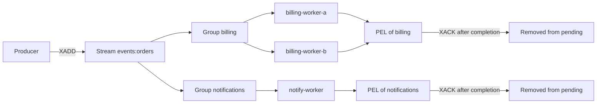
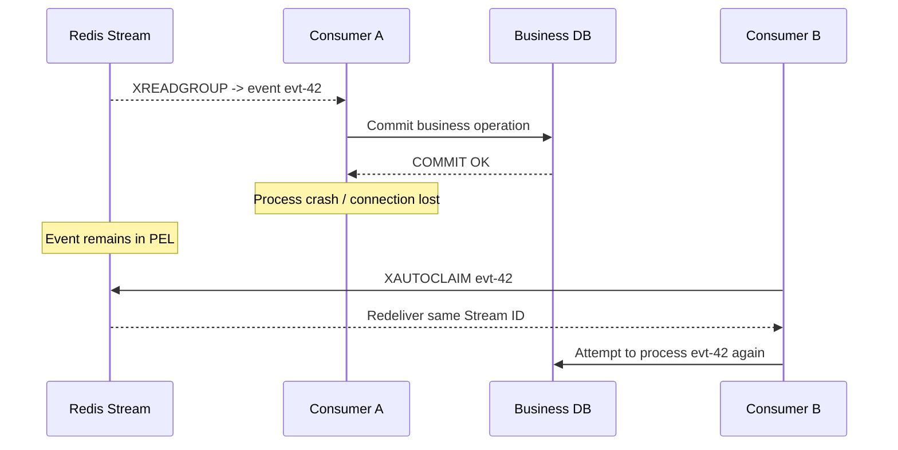
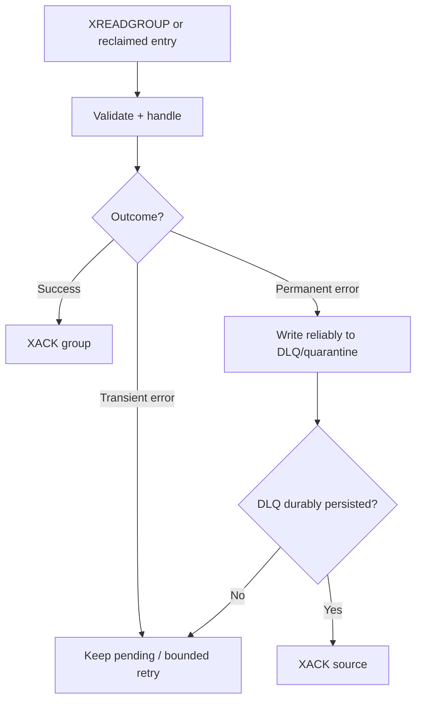
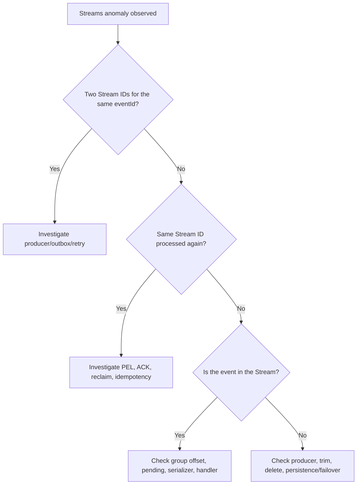

# Diagnosing Duplicate Records, Growing Pending Entries, or Missing Data in Redis Streams with Spring Data Redis

## 1. Situation: Redis Is Up, Yet Business Outcomes Are Wrong

Redis Streams are commonly used in Spring Data Redis to pass events or work items from producers to consumer groups. A system can look healthy from a connectivity standpoint while exhibiting symptoms like these:

- An order is processed twice even though the producer intended to emit a single event.
- Some events appear multiple times in the Stream.
- The Pending Entries List (PEL) keeps growing while workers are still alive and never catch up.
- New consumers read new events but do not re-read older pending events.
- The group appears caught up, yet the business reports missing orders or missing notifications.
- Scaling up workers does not help; some events even get reassigned and processed multiple times.
- The Stream has a TTL or trim policy, and unprocessed events vanish.

The three symptom groups—**duplicate records, growing pending, missing data**—can be interconnected without sharing the same root cause. Fixing them properly requires distinguishing:

1. **Duplicate on write:** a single business event was appended multiple times by the producer via `XADD`.
2. **Redelivery on read:** a single Stream ID entry was delivered multiple times because it had not been `XACK`ed.
3. **Duplicate side effect:** an operation in a target system executed multiple times even though the Stream entry exists only once.
4. **Undelivered:** the event sits ahead of the consumer group's read position.
5. **Delivered but stuck:** the event sits in the PEL and the worker has not finished it.
6. **Lost payload or skipped offset:** the event is no longer available to the current consumption flow.

> **Not every bug can be fixed by clearing the PEL, adding more consumers, or switching the offset to `$`.** Those actions may make dashboards look cleaner while silently dropping unprocessed events.

This lesson provides a diagnostic model, Redis CLI commands, Spring Data Redis examples, ACK/idempotency management patterns, retention pitfalls, and an operational runbook.

## 2. Redis Stream, Consumer Group, and PEL: The Mental Model

A Redis Stream is a log ordered by **Stream ID**. Producers use `XADD` to append entries. Consumer groups use `XREADGROUP` to distribute work among consumers.



Within a consumer group, new entries are typically distributed across consumers rather than every consumer receiving every event. However, **each group maintains its own progress and PEL**.

The same Stream entry can be delivered to both group `billing` and group `notifications`. This is **not a duplicate-write bug**: two independent groups intentionally process the same event for different purposes.

### 2.1. Common States of an Entry Relative to a Group

```text
Entry added via XADD
    |
    | Not yet delivered to group
    v
[Undelivered backlog]
    |
    | XREADGROUP ... >
    v
[Delivered, recorded in PEL]
    |
    +-- handler not finished --> stays pending
    |
    +-- consumer crashed --> stays pending
    |
    +-- claimed by another consumer --> stays pending, owner changes
    |
    +-- processed successfully and XACK --> removed from PEL
```

`XACK` **does not delete the entry from the Stream**; it only acknowledges the entry within the scope of that group. Seeing an entry still present in `XRANGE` after acknowledgment is normal.

### 2.2. Two Key Counters That Are Not the Same

| Metric | Observation source | What does it mean? |
|---|---|---|
| Group lag | `XINFO GROUPS`, `lag` field when available | Number of entries not yet delivered to the group |
| Pending count | `XINFO GROUPS` or `XPENDING` | Number of entries delivered to the group but not yet ACKed |
| Stream length | `XLEN` or `XINFO STREAM` | Number of entries currently remaining in the Stream, including ACKed entries |
| Consumer pending | `XINFO CONSUMERS` | Pending entries owned by a specific logical consumer |
| Pending idle time | Detailed `XPENDING` | Time elapsed since the last delivery/activity per Redis semantics |
| Delivery count | Detailed `XPENDING` | Number of deliveries/claims tracked in Redis metadata |

`lag = 0` does not mean every entry has finished processing: the group may have delivered everything while the PEL is still huge. Likewise, `pending = 0` does not mean the group has read all new events.

## 3. First Diagnostic Step: Where Did the Duplication Happen?

Suppose a business flow has `eventId=evt-42` and Stream entry ID `1763000000000-0`.

### 3.1. Duplicate Records in the Stream

```text
Stream ID             eventId
1763000000000-0       evt-42
1763000000010-0       evt-42
```

These are **two distinct Stream entries** representing one business event. The producer likely called `XADD` twice due to a retry after a timeout or upstream duplicate emission.

### 3.2. Redelivering the Same Entry

```text
Stream ID             eventId    delivery attempt
1763000000000-0       evt-42     worker-a attempt 1
1763000000000-0       evt-42     worker-b attempt 2
```

This is **one Stream entry** delivered again because it remained pending or was reclaimed. Redis Streams consumer groups support at-least-once recovery when ACK is handled properly; redelivery is expected behavior.

### 3.3. Duplicate Side Effect Despite a Single Stream Write

```text
Redis XADD evt-42: 1 entry

worker-a calls downstream: charge/order/update -> succeeded
worker-a crashes before XACK

worker-b re-reads pending evt-42
worker-b calls downstream again -> duplicate side effect
```

Here, the fix is not hunting for a duplicate `XADD`. The system needs **business-level idempotency**, ensuring the same event ID never causes critical updates to execute twice.

### 3.4. Comparison Matrix

| Clue | Where to check | Direction to fix |
|---|---|---|
| Multiple Stream IDs for the same `eventId` | `XRANGE`/event store/producer logs | Producer idempotency/outbox |
| One Stream ID appears in multiple processing runs | `XPENDING`, owner/idle/delivery count | ACK/recovery/idempotent handler |
| Each group processes the same event once | `XINFO GROUPS`, group names | Likely intentional design |
| One entry processed concurrently by two consumers after claim | Recovery threshold and handler duration | Tune claim threshold, fencing/idempotency |
| Only downstream doubled; event log has no duplicate | Transaction/ACK gap | Deduplicate at the side-effect boundary |
| UI shows duplicate rows while DB has only one | Projection/refresh/cache | Check keys and consumer logic; do not assume Stream duplication |

Never infer the root cause solely from row counts on a screen. Always identify **Stream ID, business event ID, group name, consumer name, and side-effect state**.

## 4. Safe Read-Only Redis Inspection Commands

When starting an investigation, favor **read-only commands** against the exact Stream and group:

```redis
TYPE events:orders
XLEN events:orders
XINFO STREAM events:orders
XINFO GROUPS events:orders
XINFO CONSUMERS events:orders billing
XPENDING events:orders billing
XPENDING events:orders billing - + 20
XREVRANGE events:orders + - COUNT 10
```

Goals:

- Confirm the Stream key has type `stream`.
- Inspect remaining entry count, first/last IDs, and retention.
- Inspect the group's last-delivered ID and lag when Redis computes it.
- Inspect total pending and per-consumer pending counts.
- Sample recent entries to check business event IDs.

`XREVRANGE` queries in descending Stream ID order; it is **not a command that returns the most recently succeeded events**.

### 4.1. Detailed XPENDING

```redis
XPENDING events:orders billing IDLE 60000 - + 20
```

Finds up to 20 pending entries that have been idle for at least 60 seconds. Depending on Redis version, each entry typically returns:

```text
stream-id
consumer-owner
idle-milliseconds
delivery-count
```

Do not interpret a high delivery count as proof that downstream succeeded multiple times. It only reflects delivery/reclaim history in Redis metadata; business success must be verified separately.

### 4.2. Access Permission Notes

A monitoring user only needs read-only metadata permissions. Do not grant `FLUSHALL`, `XGROUP DESTROY`, `XGROUP SETID`, `XACK`, or `XAUTOCLAIM` to a dashboard that is not meant to mutate state.

When investigating sensitive data, avoid printing full payloads into logs or tickets. Use Stream IDs, sanitized business event IDs, and metadata counters.

## 5. Self-Contained Runnable Dataset

Use an isolated namespace in a test environment:

```redis
DEL demo:streams:diag:orders
XGROUP CREATE demo:streams:diag:orders billing 0-0 MKSTREAM

XADD demo:streams:diag:orders * eventId evt-A orderId o-101 type CREATED
XADD demo:streams:diag:orders * eventId evt-B orderId o-102 type PAID
XADD demo:streams:diag:orders * eventId evt-C orderId o-103 type CREATED

XLEN demo:streams:diag:orders
XINFO GROUPS demo:streams:diag:orders
```

Redis auto-generates Stream IDs in the form `milliseconds-sequence`. When calling ACK, use the **actual returned ID**, not `evt-A` as the Stream ID.

### 5.1. Consumer Receives Two Events

```redis
XREADGROUP GROUP billing worker-a COUNT 2 STREAMS demo:streams:diag:orders >
```

Then:

```redis
XPENDING demo:streams:diag:orders billing
XINFO GROUPS demo:streams:diag:orders
```

With no other concurrent operations, the group has been delivered two entries so pending increases to 2; one new entry remains undelivered.

### 5.2. ACK Only One Event

```redis
XACK demo:streams:diag:orders billing <STREAM_ID_OF_EVT_A>
XPENDING demo:streams:diag:orders billing
```

One entry remains pending, while `XLEN` can still be 3. That is the expected behavior.

### 5.3. Reading the Consumer's Own Pending Entries

```redis
XREADGROUP GROUP billing worker-a COUNT 10 STREAMS demo:streams:diag:orders 0
```

Using ID `0` (or `0-0`) with a group re-reads **pending entries belonging to logical consumer `worker-a`** in history mode. This does not read new entries beyond the group cursor.

### 5.4. Another Consumer Reads Only New Entries with >

```redis
XREADGROUP GROUP billing worker-b COUNT 10 STREAMS demo:streams:diag:orders >
```

`worker-b` does not automatically inherit `worker-a`'s old pending entries just because `worker-a` stopped. It receives undelivered new entries, while old pending entries require a recovery flow.

Do not run `XACK` or `XGROUP SETID` against a production Stream just to reproduce behavior, as those commands mutate live state.

## 6. Cause of Duplicate Writes: Producer Retrying XADD After Timeout

A producer writes:

```redis
XADD events:orders * eventId evt-42 orderId o-42 type CREATED
```

If Redis executes the command but the response is lost due to a connection reset:

```text
Producer -> Redis: XADD ... *
Redis created Stream ID A
Redis -> Producer: reply lost

Producer hits timeout and retries XADD ... *
Redis creates Stream ID B
```

Result: **two entries with two different Stream IDs**, both carrying `eventId=evt-42`.

`XADD *` generates a new ID each time. It does not know that two calls carry the same business event ID.

### 6.1. Preventing Duplicate Writes at the Producer

Several strategies exist:

- **Transactional outbox** in the database: persist business state and outbox event in a single database transaction; a relay may resend, so consumers must still be idempotent.
- **Idempotency key** at the producer/integration boundary: record whether `eventId` was already sent in a way that can verify outcome.
- **Conditional write inside Redis:** a Lua script/Redis Function that marks the ID and executes `XADD` atomically in a single server-side execution when keys share the appropriate slot.
- **Accept at-least-once delivery** and deduplicate on the consumer side by business event ID.

Do not treat assigning a fixed Stream ID as a general solution: Stream IDs must satisfy Redis's monotonically increasing rules and multi-producer constraints. An arbitrary business ID cannot simply be used as a Stream ID.

### 6.2. Criteria for Identifying Producer Duplicates

Cross-check:

1. `eventId` and business action code.
2. How many Stream IDs contain the same `eventId`.
3. Producer send attempts and retry reasons.
4. Send timestamps and Redis connection errors.
5. Whether the outbox/DB recorded one event or two separate business creations.
6. Whether the consumer has idempotency to avoid executing side effects twice.

If an event was genuinely emitted twice by an upstream business action, fixing only the consumer may just mask a bug at the source.

## 7. Cause of Duplicate Processing: Handler Finished Without ACKing

Typical pattern:



This is an inherent risk of choosing to **ACK after the side effect is durable**. If you ACK before processing, you risk losing work instead:

```text
XREADGROUP -> XACK -> call database
                     \
                      process crash -> event ACKed, DB not updated
```

Thus, no single placement of `XACK` by itself provides exactly-once semantics across Redis and a separate database.

### 7.1. Solution: Idempotent Business Processing

Attach an immutable ID such as `evt-42` to each event; in the target database, updating business state and recording the processed event must occur in **the same transaction**.

Example PostgreSQL schema:

```sql
CREATE TABLE processed_stream_events (
    consumer_group VARCHAR(100) NOT NULL,
    event_id VARCHAR(200) NOT NULL,
    processed_at TIMESTAMPTZ NOT NULL DEFAULT now(),
    PRIMARY KEY (consumer_group, event_id)
);
```

Inside the business transaction:

```sql
BEGIN;

INSERT INTO processed_stream_events (consumer_group, event_id)
VALUES ('billing', 'evt-42')
ON CONFLICT DO NOTHING;

-- Execute business UPDATE/INSERT only when the INSERT above
-- actually created a new row (row count = 1).
-- If row count = 0, the event was already processed earlier.

COMMIT;
```

The SQL illustrates the principle; production code must check the affected row count and place the protected updates inside the same transaction. Never commit the "already processed" marker first and run the business update in a separate transaction afterward.

Once the transaction commits successfully, the consumer can `XACK`. If the ACK is lost or encounters a network error and the event is redelivered, **the database already holds the marker** and the handler avoids repeating the side effect.

### 7.2. Deduplicate by Stream ID Only or Business Event ID?

- **Stream ID** uniquely identifies one entry in a Stream and serves ACK, pending, and claim operations.
- **Business event ID** identifies one business action when a producer might emit two different Stream entries for the same action.
- One event may need processing by multiple groups. The deduplication table must distinguish consumer group/processing purpose when each group has its own side effect.
- For events coming from multiple Stream sources, you may also need source/tenant in the deduplication namespace.

If you deduplicate only by Stream ID, two `XADD *` calls for the same event ID still produce two Stream IDs and both can trigger side effects. If you deduplicate only by event ID while mixing distinct business actions in the same namespace, you can mistakenly block valid events.

## 8. What Does a Successful ACK Mean?

`XACK stream group id...` returns **the number of pending references removed** from the group's PEL.

Example:

```redis
XACK events:orders billing 1763000000000-0
```

Possible results:

- `1`: exactly one pending entry was acknowledged.
- `0`: that ID had no matching pending reference in the group at call time, was already ACKed, changed state, or had the wrong group/ID.

`XACK` does not confirm that an external API executed exactly once; Redis only updates **consumer group metadata**.

### 8.1. Common ACK Mistakes

| Mistake | Consequence |
|---|---|
| Forgetting to call `XACK` | PEL grows even though the handler succeeded |
| ACKing when a method returns without waiting for an async callback | Premature ACK, risk of losing processing |
| ACKing in `finally` regardless of exceptions | Loses ability to retry failed jobs |
| Using the wrong group name | Fails to ACK pending entry in the right group |
| Using the wrong Stream ID | Pending count does not decrease |
| Using business `eventId` instead of Stream ID | ACK returns 0 or fails with invalid command error |
| ACKing when only enqueued to a local task, before downstream commit | Redis considers it done while business work is incomplete |
| Network error on ACK, code assumes success | PEL state becomes uncertain |
| Using consumer group auto-ack without understanding its semantics | Loss of control over ACK timing |

Never "fix" pending backlogs by ACKing all IDs whose business status is unknown. That can permanently drop unfinished work from recovery.

## 9. XINFO GROUPS: Lag and Pending Are Different

```redis
XINFO GROUPS events:orders
```

Common fields:

| Field | Meaning |
|---|---|
| `name` | Group |
| `consumers` | Number of consumers with metadata |
| `pending` | Total pending entries in the group |
| `last-delivered-id` | Last position delivered by the group |
| `entries-read` | Logical counter supporting lag calculation (in supported versions) |
| `lag` | Number of undelivered entries when Redis can compute it |

Redis 7.0 added `entries-read`/`lag` using a logical counter mechanism. Older Redis versions may omit them.

### 9.1. High Lag, Low Pending

Possible reasons:

- Consumers are not polling or are disconnected.
- The group was created at an offset with a large backlog of history to read.
- Workers read too slowly due to thread starvation or blocked commands.
- Consumers are reading a different group/key than the producer.
- Producer throughput exceeds delivery rate.

Check reads from `>`, consumer health, polling logs, network/ACL, ingress, and group name.

### 9.2. Low Lag, High Pending

Possible reasons:

- Consumers read very fast, but handlers are slow.
- Workers fetch large batches and fail to ACK.
- Workers crashed.
- Recovery flow does not process old pending entries.
- Handlers repeatedly throw exceptions while consumers keep reading more events.
- ACKs are sent to the wrong Stream/group/ID.

In this state, increasing the polling rate can **make the PEL grow even larger**. Fix the handler, ACK flow, idempotency, and bounded concurrency instead.

### 9.3. Lag Can Be Null/Unknown

When a group starts at an arbitrary offset or the Stream is deleted/trimmed in a range that prevents Redis from inferring exact logical lag, `lag` can be `null`.

Never do:

```text
lag = null -> convert to 0
```

in an exporter/dashboard. Null means **unknown**, not caught up. Combine with `last-delivered-id`, pending, ingress/ACK rates, and retained Stream boundaries.

### 9.4. XLEN Is Not Backlog

`XLEN` counts entries **currently retained** in the Stream. It does not care whether a group has ACKed them.

```text
XLEN = 100,000
billing lag = 0
billing pending = 0
```

This can simply be a Stream that retains full history while the group is completely caught up. The formula `lag = XLEN - pending` is wrong.

## 10. Pending Grows Because Consumers Only Read New Entries

When a consumer group reads with:

```redis
XREADGROUP GROUP billing worker-a STREAMS events:orders >
```

the `>` symbol means reading entries **never yet delivered to the group**. It is not a command to "read all existing pending entries".

A worker can restart and keep calling `>` forever; the events it received before crashing remain pending and will never show up in those new reads.

### 10.1. Reading a Consumer's Own Pending History

```redis
XREADGROUP GROUP billing worker-a COUNT 20 STREAMS events:orders 0
```

In history mode, ID `0` (or `0-0`) reads pending entries **owned by that consumer name** starting from that ID.

Key points:

- History mode does not advance the shared consumer group cursor.
- It does not automatically read pending entries belonging to other consumers.
- With an ID other than `>`, options such as `BLOCK`/`NOACK` do not behave identically to reading new entries; verify against your Redis version's semantics.
- If startup logic generates a brand-new consumer name every time, reading history for the new name will not see the old name's PEL.

### 10.2. Reclaiming Pending Entries from Dead Consumers

To let another worker take over pending entries, use `XCLAIM` or `XAUTOCLAIM` according to your Redis version and operational contract—do not just scale up consumer count.

```redis
XAUTOCLAIM events:orders billing worker-b 60000 0-0 COUNT 50
```

This example reclaims only pending entries idle for at least 60,000 ms. Track the returned cursor and continue from that cursor to scan eligible entries.

**Do not reclaim too aggressively**: `worker-a` might still be legitimately running a long job, causing two workers to execute the same side effect concurrently.

## 11. XPENDING and XINFO CONSUMERS: Finding Stuck Consumers

Use:

```redis
XPENDING events:orders billing
XPENDING events:orders billing - + 20
XPENDING events:orders billing IDLE 60000 - + 20
XINFO CONSUMERS events:orders billing
```

### 11.1. Reading Pending Entry Fields

A detailed pending entry typically includes:

- Stream ID.
- Consumer owner.
- Idle time (ms).
- Delivery count.

Hypothetical example:

```text
ID                    owner       idle(ms)   deliveries
1763000000000-0       worker-a    420000     1
1763000000100-0       worker-b    1500       3
1763000000200-0       worker-c    70000      8
```

Interpretation:

- The first entry has been idle for 7 minutes; `worker-a` may have died or be running a legitimate long job.
- The second entry has been delivered multiple times with recent idle time; inspect the claiming mechanism.
- The third entry has been delivered many times and still fails; it may be a poison message.

These fields are **not enough** to conclude whether a handler already committed a side effect. Cross-reference the business DB/logs using the event ID.

### 11.2. Consumer Idle/Inactive

`XINFO CONSUMERS` displays per-consumer metadata. In Redis 7.2+, `idle` and `inactive` have distinct meanings: elapsed time since an attempted interaction versus a successful interaction under that version's semantics. Do not apply newer-version semantics to older servers.

High consumer idle time does not automatically mean the consumer is dead: there may simply be no new work or it may be busy on a long task. Combine with heartbeats, handler durations, last ACK, process readiness, and restart counts.

### 11.3. Do Not Delete Consumers to "Clean" Metrics

`XGROUP DELCONSUMER` mutates group metadata. If the consumer still owns pending entries, deleting its metadata before transferring or resolving them can lose track of work.

Sample the PEL, identify previous owners, and run controlled recovery first. Only clean up consumer metadata once pending status and your Redis version's behavior are completely clear.

## 12. Recovery with XAUTOCLAIM: Right Threshold, Right Cursor

`XAUTOCLAIM` finds sufficiently idle pending entries and transfers ownership to a new consumer. It returns a cursor and claimed entries; Redis 7.0+ can also report deleted IDs whose metadata references it cleaned up during the scan.

Example:

```redis
XAUTOCLAIM events:orders billing recovery-worker 120000 0-0 COUNT 100
```

Meaning:

| Component | Interpretation |
|---|---|
| `events:orders` | Stream key |
| `billing` | Consumer group |
| `recovery-worker` | Consumer taking ownership |
| `120000` | Min idle 120 seconds |
| `0-0` | Starting cursor |
| `COUNT 100` | Limit work/results per call |

### 12.1. Cursor and Scan Loops

Do not invoke it once and assume the entire PEL was processed. The command can return a next cursor; recovery logic should use that cursor and iterate as documented for your Redis version.

When the returned cursor is `0-0`, one scan pass has covered the current range—it **does not mean all pending entries are resolved**: entries below min-idle or held by active workers may remain.

### 12.2. Setting a Realistic min-idle-time

If handler p99 normally takes 90 seconds, reclaiming after 10 seconds can trigger concurrent processing. Factor in:

- Handler duration p95/p99.
- Heartbeats/leases for very long jobs.
- Downstream call timeouts.
- Worker shutdown/drain policies.
- Database-level idempotency.
- Retry budgets and DLQ.

Setting min-idle too high delays recovery of genuinely dead work beyond SLA; setting it too low increases duplicate side effects.

### 12.3. XCLAIM vs. XAUTOCLAIM

- `XCLAIM` fits when you already have a specific list of pending IDs to transfer.
- `XAUTOCLAIM` scans the PEL by min-idle and cursor, making it convenient for recovery loops.
- Neither **automatically deduplicates side effects**.
- Neither can restore payloads already trimmed/deleted from the Stream.

In Java applications, invoke these via Spring Data Redis APIs supported by your version or through the Redis connection/driver. Check the actual signature of `StreamOperations.autoClaim` in your running Spring Data Redis version rather than copying snippets from another version.

## 13. Poison Messages: One Entry Failing Forever

Corrupt or incompatible messages can make a handler fail repeatedly:

- Payload missing a required field.
- Incompatible JSON schema.
- Reference to a deleted entity.
- Violated business invariant.
- Legacy data format no longer supported by new code.
- Downstream permanently rejects the request for a non-retryable business reason.

If a worker repeatedly receives the entry, throws an exception, and never ACKs, the event stays in the PEL. Recovery reclaims it, retries it, and loops indefinitely.

### 13.1. Error Classification

| Error category | Examples | How to handle |
|---|---|---|
| Transient | Database timeout, HTTP 503 | Retry with backoff/limit |
| Non-retryable as-is | Invalid schema, missing required field | Quarantine/DLQ and investigate |
| Uncertain outcome | HTTP timeout after payment request | Verify via idempotency/transaction |
| Authorization | Expired token, wrong ACL | Fix configuration; do not spam infinite retries |
| Missing dependency data | Event arrived before entity | Bounded wait/buffer, or ordered processing |
| System overload | Thread pool/DB connections exhausted | Backpressure, concurrency limits |

Do not use delivery count as an exact measure of "failed processing N times". Some deliveries may result from restarts or recoveries rather than fresh handler failures.

### 13.2. DLQ/Quarantine and ACK

Common flow:



**Never ACK the source message before the DLQ write is reliably persisted** if the event must be preserved. If the DLQ lives in separate infrastructure, a gap remains between the two systems; use an idempotent DLQ producer or a suitable transaction/outbox.

A DLQ entry should retain:

- Original Stream ID, event ID, and source.
- Error category and attempt/retry metadata.
- Schema version and correlation ID.
- Payload or reference according to security policy.
- Quarantine timestamp.
- A safe replay procedure.

Do not copy all PII/tokens into a DLQ and retain them long-term without a clear business requirement.

## 14. Missing Data from Creating a Group with $ Instead of 0-0

When creating a group:

```redis
XGROUP CREATE events:orders billing $
```

the `$` symbol initializes the group at the **current end of the Stream**. When reading with `>`, the group only receives new entries written after the group was created.

Example:

```text
Stream already contains:
  event A
  event B
  event C

Create group with $
Then append:
  event D

Consumer XREADGROUP ... >
=> Receives D, does not automatically receive A/B/C.
```

This is an **offset choice**, not Redis losing data. If the goal is to process all existing retained entries, create the group from:

```redis
XGROUP CREATE events:orders billing 0-0
```

or a specific checkpoint Stream ID restored per runbook.

### 14.1. Never Casually Alter a Production Group's Offset

`XGROUP SETID` changes the group's last-delivered ID, altering which entries are treated as new on subsequent reads. Resetting to the beginning can replay a flood of events; jumping near the end can skip undelivered events.

Before changing it:

1. Check whether pending entries currently exist.
2. Snapshot group metadata and Stream IDs.
3. Determine which business events are genuinely unprocessed.
4. Ensure handlers are idempotent.
5. Execute under an approved maintenance/recovery plan.
6. Monitor backlog and target-system outcomes.

Never use `XGROUP DESTROY` followed by recreating with `$` as a trick to clear pending entries: that discards group state and can cause older events to be skipped.

## 15. Missing Data from Using ReadOffset.latest() in the Wrong Context

Spring Data Redis provides `ReadOffset` to describe read positions. Distinguish standalone reads from consumer group reads.

| Context | Typical offset meaning | Result |
|---|---|---|
| `XREAD` without group, from explicit ID | Read entries after a checkpoint ID | Supports checkpoint replay |
| `XREAD` using latest/`$` | Wait for new entries after command start | Easy to miss entries arriving between polls |
| `XREADGROUP` with `>` | New entries not yet delivered to group | Fits primary polling loop |
| `XREADGROUP` with `0`/historical ID | Pending entries of the same consumer | Recovers that consumer name's pending work |
| Taking another consumer's pending | `XCLAIM`/`XAUTOCLAIM` | Transfers ownership per policy |

For a Spring Data Redis polling group, the typical form is:

```java
StreamOffset.create(
        "events:orders",
        ReadOffset.lastConsumed()
);
```

When used in a group read, `lastConsumed()` represents reading entries **not yet delivered to the group** (Redis ID `>`).

### 15.1. Using $ in a Standalone Poll Loop Can Drop Events

Suppose a non-group consumer calls `XREAD STREAMS key $` on each poll iteration. Each call takes "current latest" as the offset, so events arriving between two poll iterations already exist before the next command starts and get skipped.

To avoid missing events, a standalone reader must track the **last seen Stream ID** and read from that ID, rather than resetting to latest on every loop iteration.

With consumer groups, rely on group semantics and dedicated pending recovery instead of mixing up `ReadOffset.latest()` and `ReadOffset.lastConsumed()`.

## 16. Missing Data Due to Trim, Delete, or TTL

Redis Streams can have payloads removed even when consumers have not processed those events yet:

```redis
XTRIM events:orders MAXLEN ~ 100000
```

or from a producer:

```redis
XADD events:orders MAXLEN ~ 100000 * eventId evt-new ...
```

When producers outpace consumers, older entries at the head of the log can be trimmed before the group reads them. Similarly:

- `XDEL` deletes a specific entry.
- `DEL`/`UNLINK` deletes the entire Stream key.
- `EXPIRE` on the key expires the entire Stream.
- A cleanup job targets the wrong namespace.
- Restoring from an old snapshot misses entries written after the backup point.
- Backup/failover RPO does not cover recent writes.

### 16.1. XACK Does Not Delete Payloads

In traditional Redis Streams, `XACK` only removes the pending reference within a group; `XLEN` does not automatically shrink. Therefore, do not treat `XACK` as a retention mechanism.

Conversely, `XTRIM`/`XDEL` remove payloads from the Stream. Different Redis versions have different semantics around keeping or deleting pending references associated with removed payloads.

Redis 8.2+ adds options such as `KEEPREF`, `DELREF`, and `ACKED` on supported commands along with commands coordinating ack and deletion. Verify the exact engine/version and command policy you are running.

### 16.2. Ghost Pending: PEL Still Holds the ID While Payload Is Gone

Example:

```text
Group billing has pending ID 1763000000000-0
Cleanup job XTRIM removes payload for that ID
XPENDING may still report the reference, depending on policy/version
Recovery re-reads ID -> no payload remains to process
```

In Redis 7.0+, `XAUTOCLAIM` can clean up PEL references pointing to non-existent entries and report the affected IDs in its reply. This is **metadata cleanup**, not recovery of the lost event.

Once the payload is gone, business recovery requires:

- A source event log/outbox with enough data to replay.
- An external archive outside Redis.
- State reconciliation against the database.
- Compensation/data-loss notification procedures per SLA.

No Redis command can reconstruct a deleted event when no external source remains.

### 16.3. Inspecting Retention

```redis
XINFO STREAM events:orders
XRANGE events:orders - + COUNT 3
XREVRANGE events:orders + - COUNT 3
XLEN events:orders
TTL events:orders
```

Check:

- Earliest remaining entry ID.
- Latest entry ID.
- Group last-delivered ID.
- Pending min/max IDs.
- Maxlen/minid trim policy.
- Key TTL (if any).
- Producer rate and worst-case consumer lag duration.

Do not subtract two Stream IDs arithmetically to calculate exact lost event counts: IDs consist of a timestamp and a sequence number, not a contiguous integer sequence.

## 17. Missing Data Due to Wrong Stream Key, Group, or Serializer

Sometimes data was never deleted; the consumer is simply reading from the wrong place.

Example:

```text
Producer writes:
  events:orders:v2

Consumer reads:
  events:orders:v1
```

Or:

```text
Producer uses Redis database 0
Consumer connects to database 1
```

Or:

```text
Producer uses StringRedisTemplate
Consumer uses RedisTemplate with a different key serializer
```

Even though Java logs `events:orders` as plain text in both places, the actual key bytes can differ if a serializer adds formatting or prefixes. In Redis Cluster only database 0 is used; on standalone Redis, different database indexes create separate keyspaces.

### 17.1. Connectivity Checklist

- Are the Redis endpoint and network namespace correct?
- Spring Boot 3.x uses `spring.data.redis.*`, whereas Boot 2.x typically uses `spring.redis.*`.
- Does a custom `RedisConnectionFactory` override auto-configuration?
- Is Sentinel/Cluster configuration pointing to a different primary/shard?
- Does the group name match between provisioning and consumer logic?
- Did a Stream key prefix/version change after a deploy?
- Do secrets/ACLs restrict a consumer to a different namespace?
- Do multiple applications share the same consumer name, obscuring ownership?

Never see Redis respond `PONG` and assume all events live at the expected key on that endpoint.

## 18. Pending Grows Because Handlers Fail and Swallow Errors

Code like:

```java
try {
    processEvent(record);
} catch (Exception ex) {
    log.warn("Processing failed");
}
```

leaves events pending when not ACKed on error. That can be **intentional** for retries, but only if a recovery mechanism exists. If after catching the worker keeps polling `>`, old pending entries are never retried.

Even more dangerous is:

```java
try {
    processEvent(record);
} catch (Exception ex) {
    log.warn("Processing failed");
} finally {
    redis.opsForStream().acknowledge(
            stream, group, record.getId()
    );
}
```

This code ACKs even when the handler fails, removing the event from the PEL even though the business action never succeeded.

### 18.1. The Right Principle

```text
Read event
  |
  v
Validate / process
  |
  +-- Durable success -> ACK
  |
  +-- Transient error -> keep pending, controlled retry
  |
  +-- Permanent error -> reliable DLQ/quarantine, then ACK
```

Never call ACK just "to bring pending down" without knowing the true processing status of the event.

## 19. Spring Data Redis: Proper Consumer Group Polling

Applications can use `StringRedisTemplate.opsForStream()`.

Example of a worker reading **new entries**, invoking a handler, and ACKing only after the handler returns successfully:

```java
package com.example.orders.stream;

import java.time.Duration;
import java.util.Map;

import org.slf4j.Logger;
import org.slf4j.LoggerFactory;
import org.springframework.beans.factory.annotation.Value;
import org.springframework.data.redis.connection.stream.Consumer;
import org.springframework.data.redis.connection.stream.ReadOffset;
import org.springframework.data.redis.connection.stream.StreamOffset;
import org.springframework.data.redis.core.StreamReadOptions;
import org.springframework.data.redis.core.StringRedisTemplate;
import org.springframework.stereotype.Service;

@Service
public class OrderStreamPoller {

    private static final Logger log =
            LoggerFactory.getLogger(OrderStreamPoller.class);

    private static final String STREAM = "events:orders";
    private static final String GROUP = "billing";

    private final StringRedisTemplate redis;
    private final OrderEventHandler handler;
    private final String consumerName;

    public OrderStreamPoller(
            StringRedisTemplate redis,
            OrderEventHandler handler,
            @Value("${app.stream.consumer-name}") String consumerName) {

        this.redis = redis;
        this.handler = handler;
        this.consumerName = consumerName;
    }

    public void pollOnce() {
        var records = redis.opsForStream().read(
                Consumer.from(GROUP, consumerName),
                StreamReadOptions.empty()
                        .count(20)
                        .block(Duration.ofSeconds(2)),
                StreamOffset.create(
                        STREAM, ReadOffset.lastConsumed())
        );

        if (records == null || records.isEmpty()) {
            return;
        }

        for (var record : records) {
            String streamId = record.getId().getValue();

            try {
                // Handler must be idempotent by business eventId
                // and commit side effects before returning.
                handler.handle(streamId, record.getValue());

                Long acked = redis.opsForStream().acknowledge(
                        STREAM, GROUP, record.getId()
                );

                if (acked == null || acked != 1L) {
                    log.warn(
                            "Stream ACK unexpected result stream={} group={}",
                            STREAM, GROUP
                    );
                }
            } catch (RuntimeException ex) {
                // Do not ACK on failure or uncertain outcome.
                // Log event category/stream ID safely per policy.
                log.warn(
                        "Stream event processing failed stream={} group={} type={}",
                        STREAM,
                        GROUP,
                        ex.getClass().getSimpleName()
                );
            }
        }
    }

    public interface OrderEventHandler {
        void handle(String streamId, Map<Object, Object> fields);
    }
}
```

**This is an illustrative skeleton**, omitting scheduler, retry/claim, DLQ, idempotency implementation, transactions, and consumer lifecycle. Across different Spring Data Redis versions/serializers, the actual generic `Map` type may require an adapter. Production code should match the interface produced by your `StreamOperations` and event schema.

### 19.1. Design Choices in the Example

- `Consumer.from(GROUP, consumerName)`: group and logical consumer name.
- `ReadOffset.lastConsumed()`: within a group, reads undelivered entries, corresponding to `>`.
- `count(20)`: bounds batch size rather than reading unboundedly in one poll.
- `block(Duration.ofSeconds(2))`: bounded wait for new events.
- ACK only after the handler completes.
- Do not ACK on exception.
- Do not log raw event payloads by default.
- Do not treat `acknowledge() == null` as a successful ACK.

### 19.2. Delivery Protocol Does Not Guarantee Downstream Success

Even after the handler returns normally, the ACK itself can fail due to a network error. To tolerate this:

1. Handlers must be idempotent.
2. Have a flow to process older pending entries.
3. Track handler success and ACK success with separate metrics.
4. Do not delete messages merely because no exception appeared in the Redis client.

Additionally, `record.getValue()` may require schema validation. An unparseable legacy event should be classified as a poison message rather than silently treated as valid business input.

### 19.3. Consumer Names Should Be Stable Across an Instance Lifecycle

If every poll generates:

```java
String consumerName = UUID.randomUUID().toString();
```

Redis accumulates many logical consumers and scatters pending ownership. New workers cannot read old pending entries via history mode.

A common approach is deriving the name from the pod/process identity assigned at startup and keeping it stable for the life of that instance. Once a pod disappears, a recovery worker claims the old name's pending entries.

Do not let two active processes share the same consumer name if you need per-instance ownership tracking and clean metadata.

## 20. StreamMessageListenerContainer: Watch ACK Modes and Offsets

Spring Data Redis provides `StreamMessageListenerContainer` to poll and dispatch entries to listeners. Different versions offer APIs for manual ACK or auto-ack modes.

Illustrative structural example:

```java
var request = StreamMessageListenerContainer
        .StreamReadRequest.builder(
                StreamOffset.create(
                        "events:orders",
                        ReadOffset.lastConsumed())
        )
        .consumer(Consumer.from("billing", "worker-a"))
        .build();

// Register the listener and ACK manually once processing truly completes
// using the exact API of your Spring Data Redis version.
```

This is a **directional pattern**, not a complete container configuration. Check your version's builder/overloads, container startup/shutdown wiring, and whether the listener receives `MapRecord` or `ObjectRecord`.

### 20.1. receive and receiveAutoAck

When using APIs such as `receive(...)` or `receiveAutoAck(...)`, understand the container's exact contract:

- Manual mode lets the handler decide when to ACK.
- Auto-ack mode lets the container manage acknowledgment per its semantics.
- Auto-ack may be inappropriate when handler side effects are not yet durable or must be retried on listener failure.
- Asynchronous callbacks require careful tracking of when "handler completion" actually occurs.

Never switch to auto-ack merely to shrink the PEL and declare the bug fixed. If a message is acknowledged before business work finishes, it can be **dropped** if the process crashes.

### 20.2. Reading with latest Can Drop Events

In some receiver/container APIs, `ReadOffset.latest()` starts from the current tail of the Stream. If a polling loop uses latest in a way that overlooks entries produced between two poll cycles, gaps can appear.

When using a consumer group, prefer group-oriented `lastConsumed()` for new entries and design pending recovery separately.

### 20.3. Containers Still Need Lifecycle Monitoring and Error Handlers

Some failures occur not in the handler, but in the polling/connection layer:

- Redis unavailable.
- Auth/ACL rejects `XREADGROUP`.
- Group not yet created: `NOGROUP`.
- Consumer/Stream key missing.
- Deserialization failure.
- Container thread blocked or stopped.
- Listener exceptions not reported or counted properly.

Instrument container startup, active subscription state, polling failures, last successful message, and ACK rate. Do not treat a successful Spring context startup as proof that the consumer is reading events.

## 21. NOGROUP, WRONGTYPE, NOAUTH, and Timeouts

Infrastructure errors can cause "missing data" symptoms simply because the consumer receives nothing.

| Error/symptom | Likely cause | Fix |
|---|---|---|
| `NOGROUP` | Group not created or wrong Stream/key | Check `XINFO GROUPS` and provisioning |
| `WRONGTYPE` | Key is String/Hash instead of Stream | Check `TYPE`, prefix collisions |
| `NOAUTH` | Client not authenticated | Check Redis user/password and connection factory |
| `NOPERM` | ACL denies command or key | Check permissions for `XREADGROUP`/`XACK` |
| `MOVED` or redirect errors | Wrong Cluster routing/driver config | Use appropriate connection mode |
| Connection timeout | Network issue, node down, pool exhausted | Check host/port, Redis latency, retry budget |
| Deserialize error | Serializer/schema changed | Validate payload and versioned events |
| `BUSYGROUP` when creating group | Group already exists | Make provisioning idempotent; do not destroy/recreate |
| Read continuously returns empty | Wrong group/key/offset, no new Stream events | Check `XINFO STREAM/GROUPS`, producer metrics |
| ACK returns 0 | ID/group not pending at call time | Inspect metadata and concurrency |

Never handle `BUSYGROUP` by destroying and recreating the group. A "create group if not exists" bootstrap step must handle races cleanly and preserve existing group state.

## 22. Provisioning Groups Properly Without Letting Workers Fight Over Offsets

A fresh environment can be provisioned with:

```redis
XGROUP CREATE events:orders billing 0-0 MKSTREAM
```

If only events arriving after deployment should be processed:

```redis
XGROUP CREATE events:orders billing $ MKSTREAM
```

Choose the starting point based on business requirements, not guesswork.

### 22.1. Why Not Call XGROUP CREATE on Every Poll?

If every worker attempts to create the group on every loop iteration:

- It generates unnecessary commands.
- It continuously hits `BUSYGROUP`.
- Code may dangerously try to destroy the group to "fix" the error.
- Initialization timing and starting offset become hard to control.

Provision via migration/IaC, or via a startup initializer that treats `BUSYGROUP` as "group already exists" without changing the offset. Group names and Stream keys should be managed consistently across deployments.

### 22.2. When Renaming a Group

If a v2 deployment changes:

```text
billing -> billing-v2
```

Redis treats that as **a brand-new group**. Depending on whether it starts at `0-0` or `$`, it may:

- Re-read all retained history → duplicate side effects if not idempotent.
- Skip older entries → looks like data loss.
- Run concurrently alongside the old group → both groups process events under two workflows.

Do not rename a group just to reset pending entries without a migration plan.

## 23. How Redis Streams Differ from Pub/Sub in Recoverability

Redis Pub/Sub delivers messages only to online subscribers and keeps no backlog for replay. Redis Streams store log entries and consumer group metadata, yet **replayability still depends on retention and surviving data**.

| Property | Pub/Sub | Streams consumer group |
|---|---|---|
| Stores messages to read later | No | Yes, while entries are not deleted/trimmed |
| Offline consumer catches up automatically | No | Possible, if offsets/PEL are handled properly |
| Pending/ACK | No | Yes |
| Groups and multiple consumers | Not in the Streams sense | Yes |
| At-least-once via recovery | Not built-in | Buildable with ACK/claim |
| Exactly-once business side effects | No | Not guaranteed automatically |
| Data can be lost due to retention | Does not retain backlog | Yes |
| Producer retries can create duplicates | Per workflow | Can create multiple Stream IDs |

A team migrating from Pub/Sub to Streams while keeping a "receive and forget" handler—without managing ACK and PEL—merely trades missing-while-offline bugs for stuck pending entries or duplicate processing.

## 24. Stream IDs vs. Event IDs: Avoid Mixing Them Up in Logs

An event should contain at least:

```json
{
  "eventId": "evt-42",
  "type": "ORDER_PAID",
  "orderId": "order-42",
  "schemaVersion": 2
}
```

On `XADD`, Redis returns a Stream ID:

```text
1763000000000-0
```

Different kinds of IDs:

| ID | Who generates it? | What is it for? |
|---|---|---|
| Stream ID | Redis, or producer per Redis ID rules | Offset, ACK, pending, claim, XRANGE |
| Business eventId | Business source/event producer | Deduplication, audit, linking side effects |
| Consumer name | Application/instance | Pending ownership within a group |
| Correlation/trace ID | Tracing infrastructure | Cross-service request tracing |

When logging, do not collapse all four into one generic `id=...` field. Use explicit field names:

```json
{
  "stream": "events:orders",
  "group": "billing",
  "streamId": "1763000000000-0",
  "eventType": "ORDER_PAID",
  "status": "ACK_TIMEOUT",
  "traceId": "opaque-trace-reference"
}
```

If business event IDs or Stream IDs are classified as sensitive by policy, apply appropriate masking and access controls. Never log raw tokens, addresses, card numbers, or entire Stream payloads solely for debugging.

## 25. Is Redis-Based Idempotency Enough?

You can use Redis to mark an `eventId` before performing a side effect, but you must check transaction boundaries.

Broken example:

```text
SADD processed:billing evt-42
    |
    x Process crash
    |
    v
Database update never ran

Retry:
  SISMEMBER evt-42 = 1 -> skipped
```

Even though `SADD` is atomic, combining `SADD` with an update to another database is **not** atomic across the two systems. The result is a lost side effect.

### 25.1. When Redis Holds the Entire Side Effect

If business logic only modifies Redis keys within the **same hash slot/server** and Lua/Functions are permitted, you can record the `eventId` and update state in a single server-side execution. This closes some gaps between separate Redis commands.

Even then:

- A runtime script error after partial writes does not automatically roll back earlier writes.
- Redis persistence/replication/failover still affect durability.
- Memory and TTL of the deduplication set must be managed.
- A TTL shorter than the redelivery window allows an event to be reprocessed.
- Lost command replies still leave an uncertain outcome on the client.

### 25.2. When the Side Effect Lives in a Transactional Database

Prefer storing the deduplication marker in the **same database transaction as the business update** when the system and isolation level allow it. ACK Redis only after commit.

This is a practical pattern that survives consumer crashes between commit and ACK. It does not turn the whole pipeline into exactly-once delivery, but it achieves **effectively-once business effects** under the idempotency contract.

### 25.3. When the Side Effect Calls an External API

For payments/emails/HTTP callbacks:

- Use an idempotency key honored by downstream when available.
- Persist operation state and reconcile state after timeouts.
- Do not blindly retry when unsure whether the previous request executed.
- Maintain a DLQ and manual review path for unclassifiable outcomes.
- ACK only once state satisfies the appropriate durability contract.

An email already sent cannot be "rolled back" simply by withholding a Redis ACK.

## 26. Missing Data from ACKing Before Processing Finishes

Dangerous code pattern:

```java
// Already ACKed...
redis.opsForStream().acknowledge(
        STREAM, GROUP, record.getId());

// ...then write to DB
orderRepository.markPaid(orderId);
```

If the service dies right after the ACK, Redis considers the entry no longer pending; the event remains in the log if untrimmed, but the group will not automatically redeliver it via `>`.

Some systems also use `receiveAutoAck` without carefully verifying when business side effects are considered complete.

### 26.1. Principles for Choosing ACK Timing

- A handler returns success **only after required side effects have committed**.
- If side effects succeed and ACK fails, redelivery is safe thanks to idempotency.
- If the handler fails, keep pending or move to an appropriate retry/DLQ path.
- If skipping an event per business rules, log the decision and reason before ACKing.
- If the group needs events retained for audit, ACK does not replace retention/archival.

This is the fundamental tradeoff: **ACKing before causes lost processing; ACKing after can cause reprocessing**, which is why idempotency is essential.

## 27. Missing Data Because the Producer Failed to Write XADD

Not every missing record in a Stream ever existed there in the first place.

Example:

```text
Database COMMIT order PAID
    |
    x Service crash
    |
    v
XADD events:orders never executed
```

If a producer publishes events after committing to the DB as two independent operations, there is a window where events are lost.

### 27.1. Transactional Outbox

A common pattern:

```text
DB transaction:
  UPDATE orders SET state='PAID'...
  INSERT INTO outbox_events(eventId, aggregateId, type, payload)

COMMIT

Outbox relay:
  SELECT unpublished events
  XADD into Redis Stream
  mark publish progress
```

The relay may retry and **publish duplicates**, which is why consumers must be idempotent. In exchange, events are not lost simply because a process crashes between the database commit and `XADD`, provided the outbox row is written in the right transaction.

### 27.2. A Successful XADD Does Not Guarantee Zero Data Loss

If Redis is the sole event store, evaluate:

- AOF/RDB persistence mode and write behavior.
- Asynchronous Redis replication.
- Failover, which can drop writes acknowledged by the primary before reaching the replica.
- Backup/restore and RPO.
- Retention via `MAXLEN`/`MINID` or TTL.

Do not assume "`XADD` returned a Stream ID" means the event will survive every failure. Redis Streams provide a log and consumer groups, not an automatic durable commit log with RPO=0.

## 28. Monitoring: Measure More Than Just the PEL

A minimal dashboard needs signals from the producer, Redis group, and consumer business logic.

| Metric/observation | Meaning | Alert condition |
|---|---|---|
| `XADD` success rate | Producer writes entries successfully | Unusual drop |
| Business events created | Source events in authoritative system | Divergence from XADD |
| `XINFO GROUPS lag` | Undelivered to group, when known | Sustained growth |
| `XPENDING total` | Delivered but un-ACKed | Sustained growth |
| Oldest pending idle | How long an entry has been stuck | Exceeds SLA |
| Delivery/reclaim count | Unusual redeliveries | Sudden spike |
| Handler success rate | Business side effects completed | Stops or drops |
| ACK success rate | Group acknowledgments completing | Falling behind |
| Handler failure rate | Exceptions by category | Sudden spike |
| DLQ/quarantine count | Messages failing normal processing | Increasing |
| Event end-to-end age | Time from producer creation to completion | Exceeds SLA |
| Oldest retained Stream ID | How far back replay is still possible | Low headroom |
| Redis connection errors | Infrastructure | Elevated timeouts/auth errors |
| Monitoring freshness | Are metrics still updating? | Stale probes |

### 28.1. Lag + Pending Are Insufficient When Events Are Already Lost

A group can show `lag=0, pending=0` and still be missing events because:

- The producer never called XADD.
- The group was created with `$` after older events already existed.
- Entries were trimmed before the group read them.
- Handlers ACKed early despite failed side effects.
- The group was destroyed and recreated.
- Data was restored from an older snapshot.

Therefore, critical data requires **end-to-end reconciliation**: comparing event IDs or business state between source and sink rather than relying solely on Redis group metadata.

### 28.2. Observing Unknown

If Redis does not report lag (null) or the exporter fails to read metadata, never coerce the metric to 0.

Distinguish clearly:

```text
lag 0       -> Caught up per Redis calculation
lag 1000    -> 1000 undelivered entries remaining
lag unknown -> Cannot be calculated or data unavailable
```

A dashboard reporting 0 while Redis is down is dangerous.

### 28.3. Tag Cardinality

Never attach `eventId`, `orderId`, `streamId`, or raw payloads as metric labels. Use `stream`, `group`, normalized event type, outcome, and error category.

Trace individual events using structured logs/traces with proper access controls instead of turning every event into its own time series.

## 29. Symptom-Driven Diagnostic Matrix

| Symptom | Possible cause | Diagnostic question |
|---|---|---|
| Two entries have the same business eventId | Producer retried `XADD *` | Are there two distinct Stream IDs? |
| Same Stream ID processed twice | PEL redelivery/reclaim | What do `XPENDING` delivery count and logs show? |
| DB updated twice | Non-idempotent handler | Is there a unique event marker/transaction? |
| PEL grows even though DB works | Missing/incorrect ACK | What does `XACK` return; right group/ID? |
| Lag 0, high pending | Delivery outpaces processing | What are handler latency and ACK rate? |
| High lag, low pending | Worker not polling or low throughput | Are `XREADGROUP >` calls succeeding? |
| Worker restarts and pending does not shrink | Only reading `>` | Is own-name pending read or reclaim running? |
| Changing consumer name strands old pending | Owner metadata belongs to prior name | Does `XINFO CONSUMERS` show the old consumer? |
| Multiple workers process one event | Aggressive reclaim or different groups | What are min-idle and active handlers? |
| Poison message loops forever | Unbounded retries | What are error type and DLQ policy? |
| Events before deployment date not read | Group created from `$` | Which group init offset was used? |
| Events skipped between standalone polls | Using latest/`$` each poll | Is last seen ID persisted? |
| Events exist in Stream but app misses them | Wrong Stream key/group/Redis DB | Check endpoint/serializer/prefix? |
| Events vanish from Stream | XTRIM/XDEL/TTL/DEL | What are first entry and retention? |
| XPENDING still lists ID but XRANGE finds no payload | Trim kept pending reference | Check version and trim policy? |
| Producer logged success, follower lacks event after failover | Async replication | Check RPO and replica offset? |
| DB committed but Stream lacks event | Missing transactional outbox | Crash between commit and XADD? |
| No business update yet PEL=0 | Premature ACK or group reset | Check handler/ACK order and audit logs? |
| Consumer gets `NOGROUP` | Group not provisioned | Check `XINFO GROUPS` on the exact key? |
| All events reprocessed after deploy | Group recreated from `0-0` | Is there a migration plan/idempotency? |

The matrix helps choose an investigation path; it does not replace inspecting live data and the incident timeline.

## 30. Incident Runbook: 10 Non-Destructive Steps

### Step 1: Assess Business Impact

- Which event types are missing or duplicated?
- Is there financial impact, duplicate emails, inventory discrepancies, or wrong order states?
- Should producers/consumers be paused to prevent further corruption?
- Which time window and tenants are affected?

### Step 2: Preserve Evidence

Capture in a controlled manner:

- Stream key, group name, consumer name.
- Representative Stream IDs and business event IDs.
- Outputs of `XINFO STREAM`, `XINFO GROUPS`, `XINFO CONSUMERS`.
- `XPENDING` summary and a sample of IDs.
- Redis/Spring Data Redis versions and deployment timestamps.
- Producer/consumer logs with sensitive data masked.

Do not run `XACK`, `XTRIM`, `XGROUP SETID`, or `XGROUP DESTROY` before understanding the state.

### Step 3: Classify as Duplicate, Pending, or Missing

Follow this flow:



### Step 4: Measure Backlog

- How large is lag, or is it unknown?
- What is the pending count?
- What is the oldest pending idle time?
- What is ingress rate versus ACK rate?
- Are pending entries owned by dead consumers?

### Step 5: Identify Handler Root Causes

- Exception categories?
- Downstream DB/API timeouts?
- Event schema compatibility?
- Poison messages?
- Worker heartbeats without business successes?
- Full thread pools or connection pools?

### Step 6: Evaluate Retention

- What is the current `first-entry` ID?
- Do last-delivered/pending IDs fall before or after the earliest retained ID?
- Is the trim policy shorter than typical outage durations?
- Can payloads still be replayed from an archive/outbox?

### Step 7: Execute Controlled Recovery

- For pending entries with payloads intact: reclaim after an appropriate min-idle and process idempotently.
- For undelivered events: fix polling/group semantics and let workers catch up.
- For producer duplicates: deduplicate by business event ID and fix retry/outbox logic.
- For lost payloads: replay from durable sources or reconcile.
- For permanent errors: route reliably to DLQ/quarantine; do not blindly ACK.

### Step 8: Prevent Contention When Scaling Workers

- Bound concurrency and batch sizes.
- Do not reclaim jobs an old worker may still be running unless idempotency is in place.
- Use consistent consumer naming.
- Watch downstream load to avoid triggering a retry storm.

### Step 9: Verify Business Outcomes

Do not stop at `pending = 0` or `lag = 0`. Compare:

- Business events created at the source.
- Unique event IDs in the Stream/archive.
- Event IDs applied downstream.
- DLQ and lost event counts.
- Critical order/account states.

### Step 10: Prevent Recurrence

Update:

- Producer idempotency/outbox.
- Consumer ACK policy.
- PEL recovery.
- Event schema versioning.
- Retention capacity.
- Monitoring and alerts on event age.
- Chaos/integration tests.
- Runbooks tailored to your Redis/server version.

## 31. Testing These Failure Modes in an Isolated Environment

An integration test suite against real Redis (Testcontainers) should include:

| Test | How to set up | Expected outcome |
|---|---|---|
| Normal receive + ACK | XADD, XREADGROUP, XACK | Pending returns to 0, business succeeds once |
| Crash before ACK | Handler commits then skips ACK | Redelivery occurs without duplicate side effects |
| Dead old worker | Create pending under consumer A, claim with B | B processes safely |
| Reading `>` skips old pending | Populate PEL then poll `>` | Old entries are not automatically re-emitted |
| Create group `$` | Stream has entries before group creation | Older entries are not read in that mode |
| Create group `0-0` | Stream has entries before group creation | Retained history can be read |
| Producer retry | Send same business eventId twice | Side effect is idempotent |
| Poison message | Invalid payload | Bounded retry/DLQ, no infinite loop |
| Premature trim | Small XADD MAXLEN, slow consumer | Detects missing payload, does not report processed |
| Timeout after business commit | Simulate ack failure | Redelivery does not repeat DB update |
| Two consumer groups | Two groups on same Stream | Each group handles its own responsibilities |
| Serializer mismatch | Read with different key serializer | Detects why Stream appears invisible |
| Lag unknown | Offset/trim produces unknown on supported versions | Metrics do not turn null into 0 |

### 31.1. Tests Should Use Isolated Namespaces

```text
it:streams:<test-run-id>:orders
```

Do not run `FLUSHALL` on a shared Redis instance in CI. Each test should delete only its own keys and groups. Failover or aggressive trim tests should use dedicated containers since they mutate state heavily.

### 31.2. Unit Tests vs. Integration Tests

Mocking `StreamOperations` tests handler branches, but does not prove:

- Redis manages pending/ACK properly with your code.
- Offsets `>` and `0` behave as expected.
- `XAUTOCLAIM` returns cursors/entries per version.
- Retention removes payloads.
- Connection factory and serializers match.
- Redelivery after connection errors.

These require a real Redis server in tests. However, standalone Testcontainers do not automatically represent Sentinel/Cluster failover; HA scenarios need dedicated topology tests.

## 32. Ordering Issues and Late-Arriving Events

Streams assign IDs in **log append order**, which does not automatically guarantee **business chronological order** when producers emit from multiple places or relays experience delays.

Example:

```text
Order status event v2: PAID
Order status event v3: SHIPPED

Relay delivers v3 to Redis before v2 due to retry/network.
Consumer processes SHIPPED then PAID.
Final state is wrong if status is blindly overwritten.
```

Even without duplicates or stuck pending entries, data can look "lost" because an older event overwrote a newer update.

Solutions:

- Include aggregate ID and monotonic version in events.
- Have handlers apply conditional updates based on version.
- Process sequentially per aggregate when required and feasible.
- Enforce a valid state machine that rejects backward transitions.
- Buffer/retry when an earlier version has not arrived yet.
- Reconcile state when late events arrive.

`XREADGROUP` distributes across multiple consumers, so it does not automatically run handlers in global business order. If per-orderId ordering is an invariant, design appropriate partitioning, locking, or serial execution.

## 33. Retries and Backpressure: Do Not Turn Pending into a Mountain of Work

A worker might do:

```text
XREADGROUP COUNT 1000
-> Redis records 1000 pending
-> Worker has only 10 processing threads
-> DB is slow
-> Worker keeps reading another 1000
-> Pending explodes rapidly
```

You need:

1. **Bounded in-flight messages** matched to processing capacity.
2. Reasonable `COUNT` rather than unbounded reads.
3. Pause polling when the executor queue is full.
4. Timeouts, retry budgets, and exponential backoff for transient errors.
5. Per-tenant/per-key concurrency limits where needed.
6. Downstream circuit breakers/bulkheads.
7. Monitor last ACK and pending age, not just receive rate.

A rough back-of-the-envelope estimate:

```text
Input:          500 events/s
Successful ACK: 400 events/s

Outstanding grows by ~100 events/s
After 10 minutes it can grow by ~60,000 events
unless trimmed/deleted or affected by other factors.
```

This reflects unfinished work across the whole group (undelivered + pending), **not an exact formula for the `lag` field alone**.

If Redis retention only holds 5 minutes while consumers need 20 minutes to catch up, adding workers after an outage may be too late to save entries that were already trimmed.

## 34. Dangerous Commands During Incident Response

| Command/tactic | Why it is dangerous |
|---|---|
| `XGROUP DESTROY` | Destroys group metadata and PEL |
| `XGROUP SETID ... $` | Can skip undelivered entries |
| `XACK` all pending IDs | Can mark unfinished work as complete |
| Aggressive `XTRIM` | Deletes unprocessed payloads |
| `XDEL` on unverified IDs | Deletes payloads |
| `DEL`/`UNLINK` Stream | Deletes the entire live log |
| `XGROUP DELCONSUMER` with pending | Alters ownership metadata and can lose track of work |
| Arbitrarily renaming the group | A new group may replay everything or skip |
| Turning on auto-ack to shrink pending | Can hide handler failures |
| Scaling consumers unboundedly | Overloads downstream and increases reclaim duplicates |
| Blindly retrying `XADD *` | Can create multiple Stream IDs for one event |
| Retrying non-idempotent side effects | Can send duplicate emails, double-charge, or double-write DB |
| Long-running `MONITOR` in production | Adds overhead and risks exposing command arguments |
| Replacing null lag with 0 | Hides unknown backlog status |

If unsure about a command's impact on data, test it in an isolated environment and prepare a runbook with rollback/backup plans before running in production.

## 35. Common Misconceptions

**"Streams guarantee exactly-once out of the box."** No. Redis Streams provide entry storage, groups, pending tracking, and ACK; exactly-once business side effects require appropriate idempotency/transactions.

**"Seeing a Stream ID read twice means the producer wrote a duplicate."** No. It may be redelivery/reclaim of the exact same entry.

**"XADD * automatically prevents duplicate eventIds."** No. Business `eventId` is an application field that Redis does not deduplicate on.

**"Pending = 0 means no events were lost."** No. Events may never have been emitted, may have been trimmed, skipped via offset, or ACKed prematurely.

**"Lag = 0 means all side effects are complete."** No. A huge PEL or premature ACKs may still exist.

**"XREADGROUP > automatically picks up pending entries from dead workers."** No. It reads undelivered entries; pending recovery requires its own flow.

**"Changing the consumer name on restart rescues old pending entries."** No. Previous pending owners do not automatically transfer to a new name.

**"XACK deletes the entry from the Stream."** Not under normal semantics; it removes the group's pending metadata.

**"Redis keeps entries forever after XACK."** No. Retention, `XDEL`, TTL, and admin operations can remove payloads.

**"XTRIM reducing lag means the consumer caught up."** Not necessarily. Entries may have been deleted before processing, and lag may become unknown.

**"ACKing in finally is safe."** No. It acknowledges failed events too.

**"Just retrying many times prevents data loss."** No. Unbounded retries cause storms, and non-idempotent retries cause duplicate side effects.

**"XAUTOCLAIM ensures only one worker processes the event."** Ownership metadata changes, but the previous worker may still be executing its side effect. Use idempotency/fencing as needed.

**"Redis Cluster/Sentinel eliminates the risk of losing XADD."** No. Standard Redis replication is asynchronous, so failover still has a write-loss window.

**"Putting it in a DLQ means it's handled."** Not yet. A DLQ merely preserves data and error context for separate handling; you need reliable DLQ writes, replay, and alerts.

## 36. Operational Checklist for a Consumer Group

| Question | Passing sign |
|---|---|
| Does the producer emit a stable business eventId? | Retries can be distinguished from new events |
| Is there an outbox/durable source if events cannot be lost? | Replayable if Redis loses data |
| Does Stream retention meet backlog/replay SLAs? | Unprocessed events are not trimmed prematurely |
| Is the group starting ID approved? | History is not accidentally skipped with `$` |
| Do workers use the right offset? | Group reads `>`/`lastConsumed` |
| Is pending recovery implemented? | Dead owners' pending entries are claimed safely |
| Is ACK sent only after durable side effects? | No ACK before commit |
| Is the handler idempotent? | Redeliveries cause no duplicate side effects |
| Are retryable vs. permanent errors separated? | No infinite poison loops |
| Is there a reliable DLQ/quarantine? | Failed events remain investigable/replayable |
| Are version/ordering checks enforced per aggregate? | Late events cannot overwrite newer state |
| Are in-flight work and concurrency bounded? | No PEL explosion |
| Does the dashboard show lag + pending + age? | Both undelivered and stuck work are visible |
| Is null lag reported as unknown? | Incidents are not masked as 0 |
| Is source-to-sink reconciliation in place? | Genuinely lost events are detected |
| Are post-commit, pre-ACK crashes tested? | Duplicates are handled safely |
| Are trim and offsets tested across deploys? | Entries are not silently skipped |
| Is there a security policy for payloads/logs? | No PII leaks during debugging |

This checklist is an **operational tool for learners**, not a documentation content QA step.

## 37. Conclusion

When Redis Streams suffer from **duplicate records, growing pending entries, or missing data**, the first step is not scaling up workers, but classifying the behavior accurately:

- **Two Stream IDs for one business event ID:** investigate producer/outbox/retry `XADD`.
- **One Stream ID redelivered:** inspect PEL, ACK, consumer owner, `XCLAIM`/`XAUTOCLAIM`, and handler idempotency.
- **Low lag, high pending:** workers are receiving events, but processing or ACKs are not keeping up.
- **High lag, low pending:** consumers are not receiving or not reading new entries fast enough.
- **Events no longer in the Stream:** inspect producer, group creation offset, `ReadOffset`, serializers, retention/trim/delete, and failover data loss.
- **Both PEL and lag are 0, yet business data is missing:** check premature ACKs, events never `XADD`ed, and source-to-sink reconciliation.

In Spring Data Redis, consumer groups typically read new events using `ReadOffset.lastConsumed()`, call `XACK` only after durable side effects succeed, and maintain a separate **pending recovery** flow. For critical events, designing **transactional outbox, business event IDs, idempotent handlers, version checks, and reconciliation** is what truly prevents lost or duplicated outcomes.

**The Redis PEL tracks un-ACKed deliveries, not the ultimate business truth.** A safely operated Streams architecture always verifies both Redis state and the state applied at the destination.

## References

- [Redis — Streams data type](https://redis.io/docs/latest/develop/data-types/streams/)
- [Redis — XADD](https://redis.io/docs/latest/commands/xadd/)
- [Redis — XREADGROUP](https://redis.io/docs/latest/commands/xreadgroup/)
- [Redis — XACK](https://redis.io/docs/latest/commands/xack/)
- [Redis — XPENDING](https://redis.io/docs/latest/commands/xpending/)
- [Redis — XINFO GROUPS](https://redis.io/docs/latest/commands/xinfo-groups/)
- [Redis — XINFO CONSUMERS](https://redis.io/docs/latest/commands/xinfo-consumers/)
- [Redis — XINFO STREAM](https://redis.io/docs/latest/commands/xinfo-stream/)
- [Redis — XCLAIM](https://redis.io/docs/latest/commands/xclaim/)
- [Redis — XAUTOCLAIM](https://redis.io/docs/latest/commands/xautoclaim/)
- [Redis — XTRIM](https://redis.io/docs/latest/commands/xtrim/)
- [Redis — XGROUP CREATE](https://redis.io/docs/latest/commands/xgroup-create/)
- [Redis — Replication](https://redis.io/docs/latest/operate/oss_and_stack/management/replication/)
- [Spring Data Redis — Redis Streams](https://docs.spring.io/spring-data/redis/reference/redis/redis-streams.html)
- [Spring Data Redis — StreamOperations API](https://docs.spring.io/spring-data/redis/docs/current/api/org/springframework/data/redis/core/StreamOperations.html)