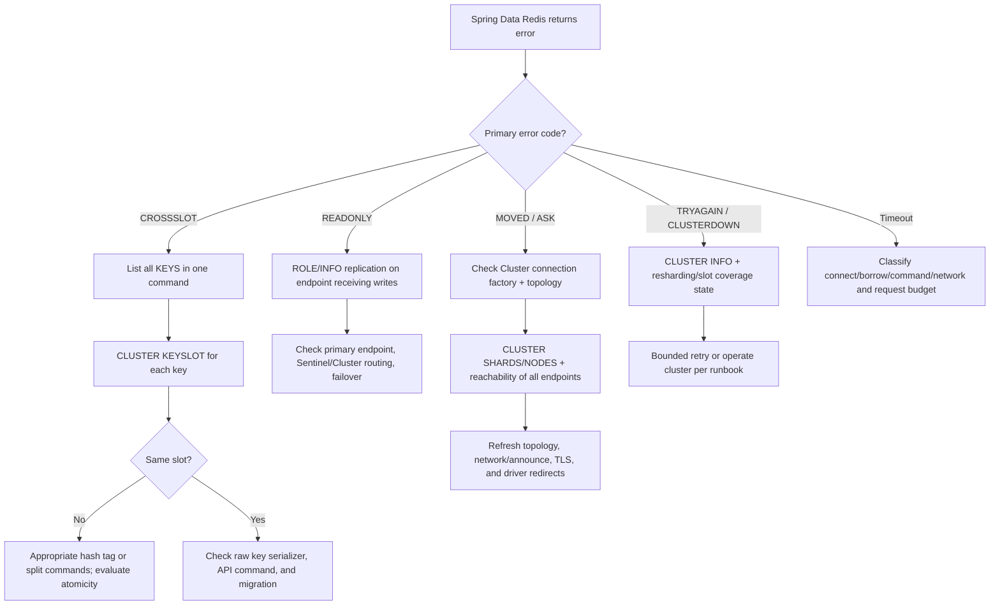

# CROSSSLOT, READONLY, and Cluster Redirection Errors in Spring Data Redis

## 1. Why Does a Spring Data Redis Application Work on Standalone Redis but Fail on Cluster?

An application may work normally against standalone Redis, yet after deploying Redis Cluster it begins encountering messages such as:

```text
CROSSSLOT Keys in request don't hash to the same slot

READONLY You can't write against a read only replica.

MOVED 12182 10.42.1.8:6379

ASK 12182 10.42.1.9:6379
```

These messages are generally not the same kind of error:

- **CROSSSLOT** is a **key design issue for a multi-key operation**, because Redis Cluster distributes keys by hash slot.
- **READONLY** is typically an issue of **routing write operations to a replica**, node role, or failover state.
- **MOVED** and **ASK** are **redirection** messages: the receiving node indicates that a slot needs to be accessed on another node, either permanently or temporarily during data migration.
- An application using a cluster-aware client can handle most redirections automatically; an application pointing `RedisTemplate` at a single node using standalone configuration generally cannot.

To diagnose accurately, you need to identify **which command**, **which keys**, **which node address**, **the node's role**, and **the topology the client currently knows** at the time the error occurs.

### Lesson Objectives

After this lesson, you will be able to:

1. Explain the 16,384 hash slots and how Redis computes a slot from a key name.
2. Recognize CROSSSLOT in MGET/MSET, multi-key DEL, Lua scripts, Redis transactions, and Spring Data Redis APIs.
3. Use hash tags intentionally to place keys requiring atomic operations in the same slot.
4. Distinguish the READONLY error from the READONLY command used for replica-reading connections.
5. Understand MOVED, ASK, ASKING, topology refresh, and Lettuce/Jedis behavior.
6. Configure Spring Boot properly for Redis Cluster mode rather than mistaking it for a standalone Redis endpoint.
7. Use safe diagnostic commands such as CLUSTER KEYSLOT, CLUSTER INFO, CLUSTER NODES, CLUSTER SHARDS, and ROLE.
8. Identify Docker/Kubernetes networking issues, advertised node addresses, TLS, and stale topology after failover.
9. Design appropriate retry, monitoring, and testing strategies without introducing duplicate side effects.

---

## 2. How Does Redis Cluster Partition Data?

Redis Cluster does not store every key on a single primary. The cluster divides the **keyspace** into **16,384 hash slots**, from 0 to 16383. Each primary is responsible for one or more slot ranges; replicas of that primary can take over during failover.

Example of a three-primary cluster:

```text
                         Redis Cluster
                   16,384 hash slots
                     0 ... 16383

   Primary A             Primary B              Primary C
   Slots 0–5460          Slots 5461–10922        Slots 10923–16383
        |                       |                       |
     Replica A               Replica B               Replica C

Spring Boot + Lettuce Cluster client:
  - Computes the slot for each key.
  - Finds the primary owning the slot.
  - Sends the command to the corresponding node.
  - Tracks redirections/failover/resharding to update routing.
```

Slot ranges are illustrative only; during resharding, slots can move to a different primary.

### 2.1. Computing the Hash Slot

For a regular key name, Redis Cluster computes:

\[
\text{slot} = CRC16(\text{key}) \bmod 16384
\]

Here CRC16 is the variant used by Redis Cluster; not every arbitrary CRC16 algorithm yields the same result.

Example:

```redis
CLUSTER KEYSLOT user:100:profile
CLUSTER KEYSLOT user:101:profile
```

Two keys may belong to two different slots, and therefore reside on two different primaries.

### 2.2. Redis Cluster Routes by Key, Not by "Database"

In Redis Cluster, keys share a single logical database (typically DB 0); you do not use `SELECT 1` as a way to partition data like standalone Redis.

One key in slot 1000 may reside on primary A, while another key in slot 12000 resides on primary C. Sharing the prefix `user:` does not place them in the same slot.

### 2.3. Why Are There Multi-Key Restrictions?

Many Redis commands require all keys to be processed as a single unit of work on the node responsible for that slot. When two keys reside in two different slots, no single node owns both.

Redis Cluster **does not automatically execute a distributed transaction** simply because an application sends a command containing multiple keys. This is the root cause of CROSSSLOT.

---

## 3. Quick Diagnostic Table

| Message | Primary Meaning | First Check Step |
|---|---|---|
| `CROSSSLOT Keys in request don't hash to the same slot` | A multi-key operation contains keys in different slots | List all keys and run `CLUSTER KEYSLOT` |
| `READONLY You can't write against a read only replica` | A write was sent to a node in replica/read-only role | Run `ROLE` or `INFO replication` on the exact endpoint |
| `MOVED <slot> <host>:<port>` | Slot belongs to another node; client must update routing | Check Cluster client configuration and current topology |
| `ASK <slot> <host>:<port>` | Key/slot is migrating; temporary redirect required | Check resharding and ASK/ASKING support |
| `TRYAGAIN ...` | Temporary condition during slot transition or multi-key handling | Check cluster migration; bounded retry |
| `CLUSTERDOWN ...` | Cluster cannot serve part/all of the keyspace in its current state | `CLUSTER INFO`, slot coverage, quorum, and node health |
| `NOAUTH` / `NOPERM` | Unauthenticated or lacking ACL permissions | Check credentials and ACLs for the right namespace |
| Connection timeout / connection refused | Unable to connect to the target endpoint | Check DNS, routing, ports, TLS, and network policy |

**Do not try to fix everything by increasing timeouts or retries.** For example, CROSSSLOT caused by key design will not resolve itself after 10 retries.

---

## 4. CROSSSLOT Error: Two Related-Looking Keys in Different Slots

Suppose an application stores:

```text
cart:user-42:items
cart:user-42:coupon
```

A developer wants to read both in a single MGET command:

```redis
MGET cart:user-42:items cart:user-42:coupon
```

In Redis Cluster, if the two keys have different slots, the server may return:

```text
(error) CROSSSLOT Keys in request don't hash to the same slot
```

Sharing the `cart:user-42:` prefix has no slot-grouping effect if Redis hashes the entire key using CRC16.

### 4.1. Checking with CLUSTER KEYSLOT

```redis
CLUSTER KEYSLOT cart:user-42:items
CLUSTER KEYSLOT cart:user-42:coupon
```

If the results differ, a Redis command requiring keys in the same slot cannot process them as an atomic operation in Redis Cluster.

Do not guess slots from key names. **Running CLUSTER KEYSLOT on all involved keys** is the definitive verification.

### 4.2. CROSSSLOT Can Occur Even When Keys Do Not Exist Yet

CROSSSLOT is evaluated from key names and hash slots, without requiring the keys to contain data. Two empty/uncreated keys can still map to different slots.

Therefore, deleting keys and re-running `MGET` does not fix the cause.

### 4.3. CROSSSLOT Does Not Automatically Mean Redis Cluster Is Broken

The cluster may still report:

```redis
CLUSTER INFO
```

with `cluster_state:ok`, yet multi-key requests still fail with CROSSSLOT. That is an intentional design constraint of Redis Cluster, not a sign of a down node.

---

## 5. Operations That Commonly Trigger CROSSSLOT

Multi-key commands or scripts/transactions accessing multiple keys can be subject to the same-slot restriction.

| Operation | Risky Example | Remediation |
|---|---|---|
| `MGET` | Reading multiple strings across different users | Group keys in the same slot or read independently |
| `MSET` | Writing multiple keys in different slots | Use keys with the same hash tag or split commands |
| `DEL key1 key2` | Deleting multiple keys in different slots | Delete each key individually if atomicity is not needed |
| `RENAME` | Renaming a key to a different slot | Design names in the same slot or avoid cross-slot rename |
| `SUNION` / `SINTER` | Combining sets in different slots | Redesign data model with a shared tag |
| `ZINTER` / `ZUNION` | Computing across multiple sorted sets | Place related keys in the same slot |
| Multi-`KEYS` Lua `EVAL` | Script reading/writing keys in different slots | Shared hash tag; pass all KEYS explicitly |
| Multi-key `MULTI/EXEC` | Transaction spanning multiple slots | Restrict transaction to one slot or move logic to DB |
| Some multi-stream `XREAD` forms | Stream keys in multiple slots | Use same slot for multi-stream reads or separate readers |
| Cross-slot `COPY` | Source/destination keys in different slots | Check command/version constraints and layout |

Some **client libraries** may automatically split aggregate operations such as multi-get into multiple commands across the corresponding nodes. In that case, the high-level API may not raise CROSSSLOT immediately, **but atomicity, snapshot consistency, and execution ordering differ from a single multi-key Redis command**. You must verify the behavior of your Spring Data Redis/driver version rather than assuming.

### 5.1. Multi-Key Deletion Is Not Inherently Atomic

Example:

```java
redis.delete(
        List.of(
                "cart:user-42:items",
                "cart:user-42:coupon"
        )
);
```

Depending on the template, connection factory, and driver, the API may issue a multi-key DEL or split the commands. When the goal is to **delete each independent key**, you can explicitly do:

```java
redis.delete("cart:user-42:items");
redis.delete("cart:user-42:coupon");
```

This avoids requiring a multi-key command to target the same slot, **but it is not atomic**. If two keys must be deleted together to preserve a business invariant, design the keys into the same slot or move the invariant to an appropriate store.

### 5.2. Pipelining Does Not Replace Transactions

Pipelining can reduce round trips when sending multiple commands. However, pipelining commands across multiple slots/nodes does not turn them into an atomic transaction.

```text
Pipeline:
  SET key-A
  SET key-B
  SET key-C

Does NOT mean:
  all three SETs commit together or roll back together.
```

If business logic requires all-or-nothing across multiple shards, standalone Redis Cluster is not a substitute for distributed transactions.

---

## 6. Redis Hash Tags: Intentionally Placing Related Keys in the Same Slot

Redis Cluster has a **hash tag** mechanism: if a key name contains a valid pair of curly braces with non-empty content inside, Redis uses only the substring inside those braces to compute the slot rather than the whole key name.

Example:

```text
cart:{user-42}:items
cart:{user-42}:coupon
cart:{user-42}:version
```

All three have hash tag `user-42`, so they share the same slot:

\[
CRC16(\text{"user-42"}) \bmod 16384
\]

Verify:

```redis
CLUSTER KEYSLOT cart:{user-42}:items
CLUSTER KEYSLOT cart:{user-42}:coupon
CLUSTER KEYSLOT cart:{user-42}:version
```

The slot results must match.

Now an MGET works as expected:

```redis
MGET cart:{user-42}:items cart:{user-42}:coupon
```

### 6.1. Cases Without a Valid Hash Tag

The following key names should not be expected to have the intended hash tag:

```text
cart:user-42:items       -- No {...}
cart:{}:items            -- Empty content between {}
cart:{user-42:items      -- Missing }
cart:user-42}:items      -- Missing {
```

For keys with multiple braces, Redis applies the rule of the **first valid brace pair**. To avoid confusion, generate keys through a single dedicated helper rather than accepting arbitrary user input.

### 6.2. Same Hash Tag Does Not Mean Same Key

```text
cart:{user-42}:items
cart:{user-42}:coupon
```

These are **two distinct Redis keys**, placed in the same slot. They can still have separate types, TTLs, and values.

### 6.3. Do Not Assign One Hash Tag to All Users

Dangerous example:

```text
cart:{all-users}:user-1
cart:{all-users}:user-2
cart:{all-users}:user-3
```

Every key is forced into the exact same slot. Under heavy workload, that slot creates a **hotspot** on one primary, defeating sharding.

Use a hash tag **only for the set of keys that truly need atomic coordination**, such as a single user/cart or business aggregate, never a global tag.

### 6.4. Tenant and User Scope

If two tenants share identical user IDs:

```text
tenant-A user-42
tenant-B user-42
```

do not design keys using only `{user-42}` and treat it as a security boundary. Hash slots are not ACLs; key namespaces must include the authenticated tenant identity, e.g.:

```text
cart:{tenant-A:user-42}:items
cart:{tenant-B:user-42}:items
```

Two different tags usually map to different slots, though slot collisions between distinct tags are theoretically possible. **Data isolation** depends on the full key, access permissions, and application code—not solely on the slot.

---

## 7. Safe Key Design in Spring Data Redis

A key builder class ensures all services follow the same hash tag convention instead of concatenating strings differently in each place.

**`RedisCartKeys.java`**

```java
package com.example.cluster;

import java.nio.charset.StandardCharsets;
import java.security.MessageDigest;
import java.security.NoSuchAlgorithmException;
import java.util.HexFormat;

public final class RedisCartKeys {

    private RedisCartKeys() {
    }

    public record CartKeys(
            String items,
            String coupon,
            String version
    ) {
    }

    public static CartKeys forCart(
            String trustedTenantId,
            String cartId
    ) {
        String tag = stableTag(trustedTenantId, cartId);

        return new CartKeys(
                "cart:v1:{" + tag + "}:items",
                "cart:v1:{" + tag + "}:coupon",
                "cart:v1:{" + tag + "}:version"
        );
    }

    private static String stableTag(
            String tenantId,
            String cartId
    ) {
        if (tenantId == null || tenantId.isBlank()
                || cartId == null || cartId.isBlank()) {
            throw new IllegalArgumentException(
                    "Missing cart identity"
            );
        }

        // Length-prefixed format to reduce ambiguity
        // when concatenating multiple identifier parts.
        String input = tenantId.length() + ":" + tenantId
                + "|" + cartId.length() + ":" + cartId;

        try {
            byte[] digest = MessageDigest
                    .getInstance("SHA-256")
                    .digest(
                            input.getBytes(StandardCharsets.UTF_8)
                    );

            // Fixed tag, containing no { } or untrusted input.
            return "cart-" +
                    HexFormat.of()
                            .formatHex(digest)
                            .substring(0, 24);
        } catch (NoSuchAlgorithmException ex) {
            throw new IllegalStateException(
                    "SHA-256 unavailable",
                    ex
            );
        }
    }
}
```

Here, keys belonging to one cart share the **same tag**. SHA-256 is only used to produce a stable identifier string free of special characters; **it does not grant authorization or replace security encryption**.

### 7.1. Using StringRedisTemplate

```java
@Service
public class CartReader {

    private final StringRedisTemplate redis;

    public CartReader(StringRedisTemplate redis) {
        this.redis = redis;
    }

    public List<String> readItemsAndCoupon(
            String tenantId,
            String cartId
    ) {
        var keys = RedisCartKeys.forCart(tenantId, cartId);

        return redis.opsForValue().multiGet(
                List.of(
                        keys.items(),
                        keys.coupon()
                )
        );
    }
}
```

This example fits when both `items` and `coupon` are Redis strings with the same serializer. If using a Redis Hash for items, you must use the corresponding commands; hash tags only determine the slot, **they do not change the Redis data type**.

### 7.2. Watch Key Serialization

`StringRedisTemplate` uses string keys; a `RedisTemplate<Object,Object>` configured with a different key serializer may produce different key bytes.

Cluster computes the slot on the **serialized key bytes**. Therefore:

- Standardize key serializers across components that share keys.
- Do not rely solely on Java `toString()` to infer the raw Redis key.
- For keys that must operate in the same slot, verify against the **actual key name received by Redis**.
- A serializer migration can alter both the key schema and slot distribution.

---

## 8. Multi-Key Lua Scripts Must Share the Same Slot

Lua executes multiple Redis commands as an atomic operation on a single node, yet **it does not bypass slot restrictions** in Redis Cluster.

Example updating both coupon and version for the same cart:

```lua
-- redis/cart-update-coupon.lua
-- KEYS[1] = cart:{tag}:coupon
-- KEYS[2] = cart:{tag}:version
-- ARGV[1] = coupon code
-- ARGV[2] = TTL seconds

local ttl = tonumber(ARGV[2])
if not ttl or ttl <= 0 then
    return redis.error_reply("invalid TTL")
end

redis.call('SET', KEYS[1], ARGV[1], 'EX', ttl)
return redis.call('INCR', KEYS[2])
```

Invoking via Redis CLI:

```redis
EVAL "redis.call('SET',KEYS[1],ARGV[1],'EX',ARGV[2]); return redis.call('INCR',KEYS[2])" 2 cart:{user-42}:coupon cart:{user-42}:version SAVE20 300
```

Two `KEYS` with the same hash tag belong to one slot. If `version` were changed to `cart:{user-99}:version`, the multi-key script would no longer share a slot and could be rejected by Redis Cluster.

### 8.1. Spring Data Redis with RedisScript

```java
package com.example.cluster;

import java.util.List;

import org.springframework.core.io.ClassPathResource;
import org.springframework.data.redis.core.StringRedisTemplate;
import org.springframework.data.redis.core.script.DefaultRedisScript;

public final class CartCouponUpdater {

    private final StringRedisTemplate redis;
    private final DefaultRedisScript<Long> script;

    public CartCouponUpdater(StringRedisTemplate redis) {
        this.redis = redis;

        script = new DefaultRedisScript<>();
        script.setLocation(
                new ClassPathResource(
                        "redis/cart-update-coupon.lua"
                )
        );
        script.setResultType(Long.class);
    }

    public Long setCoupon(
            String tenantId,
            String cartId,
            String coupon
    ) {
        var keys = RedisCartKeys.forCart(tenantId, cartId);

        return redis.execute(
                script,
                List.of(
                        keys.coupon(),
                        keys.version()
                ),
                coupon,
                "300"
        );
    }
}
```

In a real application, register `RedisScript` as a singleton bean rather than recreating it repeatedly. The example structure simply highlights **two KEYS in the same slot**.

### 8.2. Scripts Must Not "Hide" Keys Outside KEYS

Redis scripting requires passing **all accessed key names** through the `KEYS` list per the scripting contract. Do not construct arbitrary key names inside Lua from input and expect the driver to guess the right slot.

If a script accesses keys across different slots, redesign the data model or move coordination to a platform with appropriate transaction support.

### 8.3. Atomic Lua Does Not Mean SQL Rollback

A Redis script executes atomically with respect to the Redis commands within its scope, but that does not mean the Redis script and a SQL transaction or external API commit atomically together.

When updating a coupon while creating an order in a database, you still need consistency rules, retry/idempotency, and reconciliation according to business requirements.

---

## 9. Diagnosing CROSSSLOT from the Application

Do not simply look at a generic exception such as:

```text
RedisSystemException
RedisCommandExecutionException
CROSSSLOT Keys in request don't hash to the same slot
```

and assume Redis Cluster has a dead node. You need to:

1. Identify the Spring Data Redis method: `multiGet`, `delete(Collection)`, `execute(RedisScript)`, `executePipelined`, transaction, or Stream multi-read.
2. List **all actual keys** passed into a single command or script.
3. Identify the key serializer.
4. On test/production Redis Cluster where inspection is permitted, run `CLUSTER KEYSLOT` for each key.
5. If slots differ, decide whether an **atomic multi-key operation** is truly needed.
6. If needed, change the key schema to share a hash tag and plan a migration strategy.
7. If not needed, split the commands and explicitly document the loss of atomicity.
8. Run integration tests against a real Redis Cluster to verify.

### 9.1. Do Not Just Add a Hash Tag to One Key's Name

If existing data already uses:

```text
cart:user-42:items
cart:user-42:coupon
```

and new code reads:

```text
cart:{user-42}:items
cart:{user-42}:coupon
```

these are **completely different Redis keys**. Changing code alone does not migrate old data. You need a plan:

- Conditional dual-read/migration.
- Writing a new versioned namespace.
- Preserving TTLs and ownership.
- Avoiding loss of active cart data.
- Avoiding parallel writes to two schemas without reconciliation rules.
- Testing version rollback.

### 9.2. Distinguishing CROSSSLOT and WRONGTYPE

Two keys in the same slot can still have the wrong data type:

```redis
SET cart:{user-42}:items "value"
HGET cart:{user-42}:items some-field
```

Running HGET on a string returns `WRONGTYPE`, not CROSSSLOT.

Hash tags solve **slot placement**, not serializers, data types, business validity, or ACLs.

---

## 10. READONLY Error: The Application Is Writing to a Replica

A common response:

```text
READONLY You can't write against a read only replica.
```

This message appears when a client sends a write operation to a node that **does not hold a writable primary role** in Redis.

Example:

```text
Before failover:
  Node A (primary)  <- Spring write
  Node B (replica)

After failover:
  Node A (replica or demoted)
  Node B (primary)

Client still sends SET to Node A
  -> READONLY
```

### 10.1. Check the Role of the Exact Endpoint Receiving Commands

```redis
ROLE
```

Redis may return roles using historical technical terms `master` / `slave` in the output. In this guide, we refer to them as primary / replica.

Or:

```redis
INFO replication
```

Common fields:

```text
role:master
connected_slaves:...
```

or:

```text
role:slave
master_host:...
master_port:...
master_link_status:up
```

Field names depend on the Redis version, but the goal is to verify whether the serving node **is currently a primary or a replica**, not merely whether the process is running.

### 10.2. Successful PING Can Still Return READONLY

Replicas normally answer:

```redis
PING
GET some-key
```

while rejecting `SET`. Therefore, a health check using only `PING` may report "Redis UP" while every write operation fails.

When an application must write, verify proper primary routing and client write capability according to your architecture. Do not run write probes on real data; use a dedicated probe key if environment policy allows.

### 10.3. READONLY Is Also the Name of a Redis Command

Do not confuse the two meanings:

- **Error `READONLY ...`**: the server rejects a write operation because the node is read-only.
- **Command `READONLY` in Redis Cluster**: allows a cluster-aware connection to perform certain **reads** on a replica according to routing rules.

The `READWRITE` command disables read-only client mode under Cluster semantics, but **does not turn a replica into a primary**. Never send `READWRITE` or arbitrarily toggle client settings to "fix" a node that is actually a replica.

---

## 11. Common Causes of READONLY

### 11.1. Spring Boot Configured as Standalone Pointing at a Replica

For example, the application has:

```yaml
spring:
  data:
    redis:
      host: redis-node-1.internal
      port: 6379
```

This configures a single endpoint; it does not automatically become a Redis Cluster client just because the hostname contains the word "cluster".

If `redis-node-1.internal` is currently a replica, a `SET` write can return READONLY.

**Resolution:** configure connectivity to match the actual topology (Cluster/Sentinel/managed primary endpoint), rather than merely increasing retries.

### 11.2. DNS or a Load Balancer Routing Writes to Replicas Too

A Kubernetes Service or load balancer pointing to **all Redis Pods**, including replicas, can send write connections to a replica.

Errors may appear intermittently: requests hitting the primary succeed, while requests hitting a replica fail.

Check:

- Which endpoint the application actually uses.
- Whether the Service selector targets both primary and replicas.
- Whether failover updates a role-aware endpoint.
- Whether a Redis-role-unaware TCP load balancer is suitable for writes.

### 11.3. Failover Occurred While Client Retains Stale Topology

Redis Cluster/Sentinel may change the primary, while the client continues using old connections/topology.

Ensure:

- The client uses **cluster-aware/Sentinel-aware configuration**.
- Topology refresh and driver reconnect are enabled/verified.
- Logs show role changes, MOVED/ASK, and write errors.
- Every Redis node after failover has a reachable endpoint.
- Old primary addresses are not hard-coded in services.

### 11.4. Client Read-From-Replica Misused Outside Intended Scope

Lettuce provides read routing modes such as `ReadFrom.REPLICA_PREFERRED`. It serves **reads** from replicas when appropriate, while the application relies on **writes still going to the primary** per cluster-aware client semantics.

If custom code manually acquires a connection to a replica and sends writes, or misuses a read-dedicated connection, READONLY can still occur.

### 11.5. Replica Syncing or Incomplete Promotion

During a role transition, clients may observe a node mid-transition or not yet ready for writes. Diagnose against the failover timeline rather than assuming "whichever node used to be primary is always primary".

---

## 12. READONLY After Failover: Safe Investigation Procedure

Suppose application logs show:

```text
Redis command SET failed:
READONLY You can't write against a read only replica.
```

Follow these steps:

**Step 1 — Identify the endpoint actually receiving the write.** Check host/port and connection factory/driver configuration. With Cluster, identify which node the command was routed to.

**Step 2 — Check the role.**

```redis
ROLE
INFO replication
```

**Step 3 — Check cluster state if using Redis Cluster.**

```redis
CLUSTER INFO
CLUSTER NODES
```

**Step 4 — Check client-side topology.** Is the client using a cluster nodes list or a standalone host/port? Are reconnect/topology refresh enabled? Is any node address unreachable?

**Step 5 — Verify service/DNS endpoints.** If using a proxy or managed Redis, distinguish the primary/write endpoint from the reader endpoint per the provider's contract.

**Step 6 — Recover in the right direction.** Fix routing/topology or connection configuration; if cluster failover has not finished, follow the operational runbook.

**Step 7 — Verify.** Test a write to a safe test key if permitted, then monitor READONLY rates and business error rates returning to baseline.

### What Should You Avoid Doing?

- Do not arbitrarily run `REPLICAOF NO ONE` on a replica to force it to become primary.
- Do not run `CLUSTER FAILOVER` or `CLUSTER RESET` in production just to "clear errors" without an approved procedure.
- Do not send `READWRITE` assuming a replica can accept writes.
- Do not make all requests read-only when business logic requires real writes.
- Do not infinitely retry writes against a node that is a replica.

Improperly altering replication roles increases the risk of split-brain, data loss, and replication divergence.

---

## 13. MOVED Redirection in Redis Cluster

A message:

```text
MOVED 12182 10.42.1.8:6379
```

means:

- The command accessed a key belonging to slot `12182`.
- The receiving node reports that the slot is currently served at `10.42.1.8:6379`.
- A cluster-aware client should follow the redirection and update its routing knowledge.

`MOVED` is the mechanism Redis Cluster uses to inform clients of the current slot owner.

### 13.1. MOVED Does Not Mean the Command Never Succeeded

In many cases, MOVED is returned before the command executes on the wrong node, and a cluster-aware client resends it to the right node. However, at the API level, when combined with timeouts, retries, failovers, and multiple commands, a single redirect message cannot be used to deduce certainty about **the entire logical operation** or side effects of other already-sent commands.

For non-idempotent operations, design conditional retries and idempotency.

### 13.2. Why Does MOVED Appear?

- Client initially sent a key to a **node that does not own the slot**.
- The slot just moved to a new primary due to resharding.
- Failover changed the node owning the slot.
- Client-side topology cache is stale.
- Client is configured for standalone Redis instead of Redis Cluster.
- Client only knows the seed node and cannot discover/reach the actual nodes.

### 13.3. What Should a Redis Cluster Client Do?

Typically:

1. Compute the slot from the key name.
2. Select a node from known topology.
3. If the node returns `MOVED`, send the command to the returned endpoint.
4. Refresh slot owner information per the driver's mechanism.
5. Enforce a redirect/hop limit if topology is unstable.

Cluster-aware clients like Lettuce Cluster and Jedis Cluster include built-in redirect handling. **Applications usually do not need to parse MOVED strings manually**, provided the correct connection factory and node network configuration are used.

---

## 14. ASK Redirection: Temporary During Resharding

A message:

```text
ASK 12182 10.42.1.9:6379
```

appears during slot/key migration, when the old node still plays a role in the migration state and instructs the client to redirect **the current command** to the destination node.

Differences from MOVED:

| Criterion | MOVED | ASK |
|---|---|---|
| Meaning | Slot now belongs to another node | Temporary redirect during migration |
| Should slot owner mapping change immediately? | Usually updates topology | Do not treat a single ASK as the final mapping |
| Handling | Send command to returned endpoint, refresh topology appropriately | Send `ASKING` then the command on the same connection to destination node |
| When commonly seen | Wrong routing, failover, completed slot move | Slot/key actively migrating |
| Resolves shortly? | Depends on new topology | Usually tied to migration window |

### 14.1. Why Is ASKING Required?

When the destination node is in **importing slot** state, it may not yet advertise itself as the final slot owner. The `ASKING` command signals that the client is following an ASK redirection and should be allowed to execute the next command under migration rules.

Conceptual flow:

```text
Client                Node A                 Node B
  | GET key ------------>|                      |
  |<------ ASK slot Node B                      |
  |                                              |
  | ASKING ------------------------------------>|
  | GET key ----------------------------------->|
  |<----------------------------------- response|
```

**ASKING and the command must travel over the exact same connection/session per Redis semantics.** You must not send `ASKING` on one random RedisTemplate pooled connection and `GET` on another connection.

Cluster-aware drivers handle this automatically within their supported scope. For normal application code, the right approach is using a cluster client rather than reimplementing ASK/ASKING manually.

### 14.2. Do Not Update Topology Based on a Single ASK

During resharding, official ownership may not have fully transferred yet. If an application treats ASK as a permanent MOVED, it may keep routing commands to the wrong place if migration changes.

---

## 15. Example of a Migrating Slot

```text
Initially:
  Slot 12182 belongs to Primary A
  Key product:{sku-42}:stock is on A

Migration starts:
  A is marked migrating slot 12182
  B is marked importing slot 12182

During migration:
  Some commands for migrated keys may be ASK-redirected to B.
  Some keys/commands remain on A depending on migration state.

After completion:
  Slot 12182 officially belongs to B.
  Stale clients may receive MOVED to B.
```

If a resharding job runs for a long time and the app logs many ASK/TRYAGAIN errors, check migration progress and node load. Do not just "raise max redirects to 1000" to mask a stuck migration.

### 15.1. TRYAGAIN During Resharding

Some multi-key operations executed while a slot is transitioning state may receive:

```text
TRYAGAIN Multiple keys request during rehashing of slot
```

This error is **different from CROSSSLOT**:

- CROSSSLOT: keys **inherently** belong to different slots; a key design or command limitation error.
- TRYAGAIN: keys may share the same slot, yet migration state temporarily prevents the operation from executing as expected.

For TRYAGAIN, bounded retries with backoff may be appropriate after evaluating the command. For CROSSSLOT due to key layout, retrying is usually futile.

---

## 16. Configuring Spring Boot Properly for Redis Cluster Mode

When using Redis Cluster, provide **cluster nodes** rather than just a single `host/port` like standalone Redis.

Spring Boot 3.x example:

```yaml
spring:
  data:
    redis:
      cluster:
        nodes:
          - redis-0.redis.svc.cluster.local:6379
          - redis-1.redis.svc.cluster.local:6379
          - redis-2.redis.svc.cluster.local:6379
        max-redirects: 5

      connect-timeout: 2s
      timeout: 3s

      lettuce:
        cluster:
          refresh:
            adaptive: true
            period: 30s
```

Addresses and values are **examples only**, not a universal configuration for every Kubernetes or managed Redis setup. Properties may vary by Spring Boot version; consult your project version's metadata/reference.

### 16.1. cluster.nodes Are Seed Nodes

The initial cluster nodes list helps the client establish connections and discover topology. **You do not strictly have to list every node for a cluster client to work**, but you need reliable seed endpoints capable of connecting and discovering the full topology.

When a Cluster has multiple primaries/replicas, the driver must connect to **the actual nodes owning slots**, not only the first seed node.

### 16.2. max-redirects

Limiting redirects prevents the client from getting stuck in an excessively long chain of MOVED/ASK responses. If the limit is exceeded:

- Check cluster health/topology.
- Check node advertised addresses.
- Check client routing configuration and refresh settings.
- Check for ongoing topology changes.
- Only raise the limit if there is a clear operational reason.

Raising the limit does not solve CROSSSLOT or READONLY caused by pointing at a replica.

### 16.3. Topology Refresh

Adaptive refresh lets the driver refresh topology upon detecting relevant signals such as MOVED/ASK, reconnects, or persistent reconnect states per Lettuce's mechanism.

Periodic refresh adds scheduled updates in case topology changes do not produce obvious triggers. Verify your version and choose an appropriate interval; refreshing too frequently increases traffic to Redis and wastes resources.

### 16.4. Do Not Configure a Cluster Using a Single host/port

Incorrect if a real Cluster sits behind multiple nodes:

```yaml
spring:
  data:
    redis:
      host: redis-cluster-entry
      port: 6379
```

This configuration may create a standalone connection factory (depending on overall config) and will not perform slot routing like a Redis Cluster client. If `redis-cluster-entry` points to only one node, keys on other slots will return MOVED.

For proxies that **genuinely support Redis Cluster routing**, connection details may differ by provider. Distinguish a smart cluster proxy from a plain TCP-distributing DNS/load balancer.

---

## 17. Configuring Lettuce Cluster Topology Refresh in Java

When finer control is needed and Spring Boot uses Lettuce, you can configure cluster-aware client options. Example:

```java
package com.example.cluster.config;

import java.time.Duration;

import io.lettuce.core.cluster.ClusterClientOptions;
import io.lettuce.core.cluster.ClusterTopologyRefreshOptions;

import org.springframework.boot.autoconfigure.data.redis
        .LettuceClientConfigurationBuilderCustomizer;
import org.springframework.context.annotation.Bean;
import org.springframework.context.annotation.Configuration;

@Configuration
public class RedisClusterClientConfiguration {

    @Bean
    LettuceClientConfigurationBuilderCustomizer clusterRefresh() {
        return builder -> {
            ClusterTopologyRefreshOptions refresh =
                    ClusterTopologyRefreshOptions.builder()
                            .enableAllAdaptiveRefreshTriggers()
                            .enablePeriodicRefresh(
                                    Duration.ofSeconds(30)
                            )
                            .build();

            ClusterClientOptions options =
                    ClusterClientOptions.builder()
                            .topologyRefreshOptions(refresh)
                            .build();

            builder.clientOptions(options);
        };
    }
}
```

**Note:** this example illustrates familiar Lettuce and Spring Boot APIs; exact imports, builder customizers, and interaction with Boot properties must be checked against your specific version. If another `LettuceClientConfigurationBuilderCustomizer` exists, ensure a later customizer does not accidentally overwrite `clientOptions` and drop earlier timeout/security settings.

### 17.1. Do Not Create a New Connection Factory per Request

Cluster clients maintain a topology cache and connection resources meant to be reused. Creating `RedisClusterClient` or `LettuceConnectionFactory` on every HTTP request:

- Increases connection churn.
- Increases discovery/topology latency.
- Increases leak risk.
- Complicates centralized monitoring and shutdown.

Let Spring manage the connection factory and its application-scoped lifecycle.

### 17.2. Adaptive and Periodic Refresh Do Not Fix Key Layout

If Redis reports CROSSSLOT because two keys are in different slots, refreshing topology repeatedly will not help. Topology refresh only updates **which node owns which slot**, not which slot a key hashes to.

---

## 18. Configuring Spring Data Redis with RedisClusterConfiguration

Besides YAML auto-configuration, Spring Data Redis can create a `LettuceConnectionFactory` with `RedisClusterConfiguration`:

```java
package com.example.cluster.config;

import java.util.List;

import org.springframework.context.annotation.Bean;
import org.springframework.context.annotation.Configuration;
import org.springframework.data.redis.connection.RedisClusterConfiguration;
import org.springframework.data.redis.connection.lettuce.LettuceConnectionFactory;

@Configuration
public class ExplicitClusterConnectionConfig {

    @Bean
    LettuceConnectionFactory redisConnectionFactory() {
        RedisClusterConfiguration cluster =
                new RedisClusterConfiguration(
                        List.of(
                                "redis-0.redis.svc.cluster.local:6379",
                                "redis-1.redis.svc.cluster.local:6379",
                                "redis-2.redis.svc.cluster.local:6379"
                        )
                );

        cluster.setMaxRedirects(5);

        return new LettuceConnectionFactory(cluster);
    }
}
```

This example only illustrates a **cluster-aware factory**; it omits TLS, username/password, read preference, topology refresh options, or production customizers.

Do not declare a manual factory bean and simultaneously expect Spring Boot auto-configuration to keep applying all `spring.data.redis.*` properties as if no custom bean existed. If creating the factory manually, manage all components you configure yourself.

### Cluster vs Sentinel

- **Redis Sentinel:** monitors and coordinates failover for one primary with replicas; does not partition 16,384 hash slots like Redis Cluster.
- **Redis Cluster:** partitions data by slot and supports failover within the Cluster topology.

These two configurations are **not interchangeable**. If production uses Sentinel, do not switch the application to `spring.data.redis.cluster.nodes` just because READONLY appeared; check `spring.data.redis.sentinel.*` and how the client discovers the primary.

---

## 19. READONLY and Lettuce Read Preference

Lettuce supports choosing where reads go, such as `ReadFrom.REPLICA_PREFERRED`. This is useful when:

- Workloads are read-heavy.
- Eventual consistency is acceptable.
- You want to offload read traffic from the primary.

However, understand the data risk:

```text
Client writes SET user:42:status ACTIVE on primary.
Replica has not yet received the update.
Client reads from replica -> still sees the old value.
```

**Replica reads can be stale**, even when no READONLY error occurs.

### 19.1. Enable Replica Reads Only When Business Logic Allows

Better suited for:

- Caches or reports not requiring strong read-after-write consistency.
- Data that does not govern immediate permissions/payment states.

Be cautious with:

- Checking revoked tokens.
- Reading payment status immediately after a write.
- Idempotency records deciding whether to repeat a side effect.
- Lock/leader state.

### 19.2. A Lettuce API Example

```java
import io.lettuce.core.ReadFrom;
import org.springframework.data.redis.connection.lettuce
        .LettuceClientConfiguration;

LettuceClientConfiguration config =
        LettuceClientConfiguration.builder()
                .readFrom(ReadFrom.REPLICA_PREFERRED)
                .build();
```

This snippet only illustrates read preference; real usage requires pairing it with proper Redis Cluster/Sentinel configuration and connection factory setup. Do not assume all commands route safely if the application uses custom low-level connections.

### 19.3. A READONLY Error Is Not "Normal Because Replica Read Is Enabled"

A properly designed Redis Cluster client can read from replicas while still routing writes to the primary. **A WRITE returning READONLY** indicates incorrect routing/role or a connection unsuitable for writes—not an expected side effect of enabling `ReadFrom.REPLICA_PREFERRED`.

---

## 20. An Often-Overlooked Cause of MOVED: Unreachable Advertised Node Addresses

In Redis Cluster, the seed node returns a topology containing addresses of other nodes. The client must connect to those addresses.

Container setup example:

```text
Developer machine host:
  localhost:7000 -> container A:6379
  localhost:7001 -> container B:6379
  localhost:7002 -> container C:6379

Redis Cluster topology advertises:
  172.18.0.2:6379
  172.18.0.3:6379
  172.18.0.4:6379
```

If Spring Boot runs **outside the Docker network**, the client can reach `localhost:7000` but cannot reach the `172.18.0.x:6379` addresses advertised in CLUSTER metadata.

Result:

1. Seed connection succeeds.
2. Client learns the slot belongs to node B.
3. Client attempts to connect to `172.18.0.3:6379`.
4. Connection times out / is refused.
5. App may report MOVED loops, topology refresh failures, or connection timeouts.

### 20.1. Identifying Signs

- `redis-cli -c` running **inside the Docker network** works, while the application running on the host fails.
- `CLUSTER NODES`/`CLUSTER SHARDS` advertises IPs reachable only inside another network.
- Seed node is reachable, but slot-owning nodes are unreachable.
- Errors occur only when accessing keys in certain slots/nodes.

### 20.2. Remediation

- Ensure every address Redis advertises is **resolvable and reachable from where Spring Boot runs**.
- Configure Redis Cluster announced endpoints according to your actual network topology.
- In Kubernetes, use proper DNS/Services and ensure your Redis chart/operator announces valid endpoints.
- When using Docker for integration tests, build the cluster with addresses/ports reachable by application containers on the same network.
- If Spring runs on the host, use a setup with proper announced addresses and port forwarding, not just publishing the seed port.

**Do not fix this by hard-coding all requests to the seed node.** That merely defers redirection and fails whenever keys live on other slots.

---

## 21. Redis Cluster on Kubernetes: Points to Check

Kubernetes offers several Service types:

- Headless Service provides DNS for individual pods/nodes.
- ClusterIP Service routes traffic to a set of endpoints.
- LoadBalancer/Ingress or gateways/proxies have different characteristics.

If a Redis Cluster requires clients to connect directly to each node, a **Service load-balancing TCP across all Redis Pods** is not necessarily the right endpoint for Cluster routing.

### Network Checklist

1. From the Spring Boot pod, can DNS resolve **every advertised Redis node**?
2. Can TCP/TLS connections reach every Redis data port?
3. Does Redis announce addresses/hostnames valid for client routing?
4. Do nodes use different ports between service/host and container?
5. Can cluster nodes reach each other on required Redis cluster-bus ports?
6. For TLS, do certificates match the hostnames actually used?
7. Does any NetworkPolicy block traffic from the app to certain shards/replicas?
8. If a new node joins after resharding, can clients route to it?
9. During failover, how do service discovery and topology refresh update?
10. Is there a special proxy hiding topology from clients? If so, follow that proxy's contract.

### Warning About Static Pod IPs

Pod IPs can change on rollout/restart. Do not bake ephemeral IPs into long-lived app configurations when Redis topology is built around stable DNS/services.

Still, a Cluster client must accept the actual endpoints announced by Redis and refresh them when they change.

---

## 22. TLS and Authentication in Cluster

Configuring Redis Cluster nodes is not enough if the client fails to connect to one or more nodes due to TLS or ACLs.

### 22.1. Symptoms

- Seed connection succeeds, but redirected node returns a TLS handshake failure.
- Some nodes use different TLS ports not matching topology metadata.
- Authentication errors happen only on one node due to mismatched credentials.
- `MOVED` returns an endpoint whose hostname does not match the TLS certificate.
- Connection timeouts occur only after the client receives a topology redirect.

### 22.2. Handling Principles

- Use consistent TLS/credentials across the Redis Cluster or managed service configuration.
- Ensure every endpoint advertised by Redis matches the client's DNS/certificate expectations.
- Verify Redis ACLs for all commands used by the application, including topology commands if required by your environment.
- Do not disable TLS certificate validation to "resolve MOVED" without understanding the risks.
- Do not pass passwords directly in CLI command arguments visible in shell history or process lists.

For example, when `redis-cli` requires authentication, use your environment's secure secret mechanism, such as managed environment variables or proper CLI config; never copy real credentials into bug reports.

---

## 23. Essential Redis Cluster Diagnostic Commands

The commands below are primarily **read-only status checks**; appropriate ACL permissions are still required.

### 23.1. CLUSTER INFO

```redis
CLUSTER INFO
```

Example fields:

```text
cluster_state:ok
cluster_slots_assigned:16384
cluster_slots_ok:16384
cluster_slots_pfail:0
cluster_slots_fail:0
cluster_known_nodes:6
cluster_size:3
```

Explanation:

- `cluster_state:ok`: the cluster is in serving state as assessed by that node.
- `cluster_slots_assigned`: number of assigned slots.
- `cluster_slots_ok`: number of slots reported healthy.
- `cluster_slots_pfail/fail`: slots associated with nodes in suspected/failed states.
- `cluster_known_nodes`: number of nodes known to the reporting node.
- `cluster_size`: number of serving primary groups/partitions per reporting definition.

An `ok` state **does not prove** that the client can reach every advertised endpoint or that multi-key commands have a valid key layout.

### 23.2. CLUSTER NODES

```redis
CLUSTER NODES
```

Output typically includes:

- Node ID.
- Host/IP, port, and other metadata.
- Role `master`/`slave` (historical protocol names).
- Flags such as `myself`, `fail`, `handshake`.
- Link/connectivity status.
- Owned slot ranges.
- Migrating/importing slot markers, if any.

You need to identify **which node holds the failing key's slot**, **whether that node is currently primary or replica**, and **whether its address is reachable from the client**.

### 23.3. CLUSTER SHARDS or CLUSTER SLOTS

```redis
CLUSTER SHARDS
```

Redis 7.0 and later provide `CLUSTER SHARDS` to inspect shard/slot/node info in a format designed for client discovery. For older clients or Redis versions, you can use:

```redis
CLUSTER SLOTS
```

`CLUSTER SLOTS` is legacy/deprecated in recent Redis documentation, yet still commonly used by older drivers. Check against your actual version.

### 23.4. CLUSTER KEYSLOT

```redis
CLUSTER KEYSLOT cart:{user-42}:items
CLUSTER KEYSLOT cart:{user-42}:coupon
```

Used to confirm two keys share the same slot, without requiring the keys to contain data.

### 23.5. ROLE and INFO replication

```redis
ROLE
INFO replication
```

Used when encountering READONLY or suspecting the application is sending writes to a replica.

### 23.6. CLIENT LIST

```redis
CLIENT LIST
```

Helps inspect which clients are connected to a node and their connection state. Output may include IPs, client names, and internal metadata; protect the output and avoid posting it in public logs.

---

## 24. redis-cli: How Do With and Without -c Differ?

`redis-cli` has the `-c` flag to enable Redis Cluster redirect-following mode.

Example:

```bash
redis-cli -h redis-0.redis.svc.cluster.local -p 6379 \
  CLUSTER INFO
```

Reading a key via CLI without cluster mode enabled:

```bash
redis-cli -h redis-0.redis.svc.cluster.local -p 6379 \
  GET cart:{user-42}:coupon
```

If the key belongs to another node, you can observe `MOVED` directly.

Enabling cluster mode:

```bash
redis-cli -c -h redis-0.redis.svc.cluster.local -p 6379 \
  GET cart:{user-42}:coupon
```

`redis-cli -c` follows cluster redirections automatically. This is useful for verifying slot routing, but **does not fix CROSSSLOT on a multi-key command with keys in different slots**.

### 24.1. -c Does Not Guarantee Every Topology Is Reachable

If Redis returns node addresses only reachable inside Kubernetes or Docker, `redis-cli -c` running outside that network can still time out on the redirect step.

### 24.2. -c Does Not Make a Replica Writable

If you deliberately connect directly to a replica and send a write outside proper routing, enabling `-c` alone does not fix a misconfigured role or broken endpoint setup. Inspect ROLE and the command's actual path.

### 24.3. Do Not Run Destructive Commands for Testing on Production

Commands like `CLUSTER RESET`, `CLUSTER FAILOVER`, `CLUSTER SETSLOT`, `FLUSHALL`, `SHUTDOWN`, or altering replication roles can disrupt service and cause data loss. Production troubleshooting here only requires read-only status commands.

---

## 25. Analyzing Spring Data Redis Application Logs

A real log may begin with a Spring exception:

```text
org.springframework.data.redis.RedisSystemException:
Error in execution

Caused by: io.lettuce.core.RedisCommandExecutionException:
CROSSSLOT Keys in request don't hash to the same slot
```

Or:

```text
RedisCommandExecutionException:
READONLY You can't write against a read only replica
```

Or:

```text
RedisConnectionException:
Unable to connect to 10.42.1.8:6379
```

Exact exception names depend on Spring Data Redis version, driver, and execution path. Do not write handlers tied to a single package/class name without checking your exact version.

### Which Diagnostic Details Should Be Captured?

- Timestamp and correlation/trace ID.
- Operation name: GET, SET, MGET, DEL, EVAL, XREADGROUP...
- Key count and namespace type, **without logging raw secrets/keys**.
- Error category: CROSSSLOT, READONLY, MOVED, ASK, TIMEOUT...
- Involved Redis node/endpoint (with access-controlled logs).
- Spring Boot/driver version.
- Recent topology changes near the time of failure.
- Whether the request issued a write or a read.
- Whether client cluster topology refresh failed.

### What Should You Avoid Doing?

- Printing full command arguments to inspect keys: can expose sessions/tokens/PII.
- Putting raw Redis keys or user IDs into metric labels: causes high cardinality and leaks information.
- Disabling retry limits and letting the program loop forever.
- Automatically running `FLUSHDB` when CROSSSLOT occurs.

---

## 26. Retry Characteristics Differ Across Errors

A retry policy must depend on the error type and **whether the command has side effects**.

| Error | Is Retry Usually Helpful? | Condition |
|---|---|---|
| CROSSSLOT from keys in different slots | No | Must fix key layout/command |
| READONLY from pointing to replica | Only after routing/topology is fixed | Never retry endlessly against the same replica |
| MOVED | Yes, via cluster-aware driver | Update routing, limit redirects |
| ASK | Yes, via ASKING + command on right connection | Temporary during migration only |
| TRYAGAIN during migration | Possibly | Short retry with backoff and cap |
| CLUSTERDOWN | Possibly after cluster recovers | Fail fast/budget, check cluster health |
| Connect timeout | Possibly | Command may not have reached server yet |
| Command timeout after write | Risk of duplicates | Idempotency/reconciliation before retrying |

### 26.1. Be Careful with INCR, XADD, LPUSH, and Charges

If a command was executed by Redis but the response was lost, retrying can:

- Increment an `INCR` counter twice.
- Create two records with new IDs via `XADD`.
- Push duplicate elements via `LPUSH`.
- Write state twice in a Lua script lacking guards.
- Re-invoke an external payment service.

**You cannot conclude "timeout means the command did not run".** Design idempotency keys, expected versions, unique constraints, or state reconciliation depending on business impact.

### 26.2. Redis Redirects and Write Retries

MOVED/ASK are part of the Redis Cluster protocol, so cluster-aware drivers usually handle them already. Do not wrap every `RedisTemplate` call in an unbounded retry loop because:

- It can duplicate side effects if the real error is not merely a redirect.
- It can amplify load while the cluster is failing over.
- It can mask a MOVED loop caused by broken advertised nodes.
- It can push HTTP requests past their timeout budget.

If extra retries are needed at the service layer, enforce an attempt cap, backoff/jitter, error classification, and a **time budget**.

---

## 27. Diagnostic Decision Tree



This tree guides **the next investigation step**; it does not replace checking Redis version, topology, or cloud provider specifics.

---

## 28. Practical Scenario A: CROSSSLOT When Fetching a Cart

### Context

```java
List<String> values = redis.opsForValue().multiGet(
        List.of(
                "cart:tenant-1:user-42:items",
                "cart:tenant-1:user-42:coupon"
        )
);
```

On standalone, the command works. On Cluster, the two keys may reside in different slots.

### Diagnosis

```redis
CLUSTER KEYSLOT cart:tenant-1:user-42:items
CLUSTER KEYSLOT cart:tenant-1:user-42:coupon
```

If they differ, the cause is clear.

### Fix

```text
cart:{tenant-1:user-42}:items
cart:{tenant-1:user-42}:coupon
```

At the same time, plan data migration from the old keys. If simply reading independent data, you can issue two GET commands, accepting they do not form an atomic snapshot.

### Lesson

This is not a connection error. Do not tweak pools or timeouts to solve CROSSSLOT.

---

## 29. Practical Scenario B: READONLY After Failover

### Context

```text
09:00 Node A is primary, Node B is replica.
09:01 A loses network connectivity.
09:02 Cluster promotes B.
09:03 Spring app still holds write connection to A.
09:03 SET -> READONLY.
```

### Diagnosis

- Check `ROLE` on A and B.
- Check `CLUSTER NODES` to identify the new primary.
- Verify whether the app uses Redis Cluster configuration or standalone host A.
- Correlate Lettuce topology refresh/reconnect logs with the failover timestamp.
- Verify all node endpoints are reachable from the application.

### Fix

Use proper cluster-aware/Sentinel-aware routing, refresh topology/endpoints, and ensure the driver can reach the current primary. If node A was hard-coded, fix the configuration instead of restarting the application on every failover.

### Lesson

A's `PING` may still succeed, yet A is a replica. An "UP" health check does not prove the write path is healthy.

---

## 30. Practical Scenario C: MOVED Because the Client Uses the Wrong Connection Factory

### Context

A Redis Cluster has three primaries. The application declares:

```yaml
spring:
  data:
    redis:
      host: redis-0
      port: 6379
```

All `GET`/`SET` commands go to redis-0.

### Symptoms

- Some keys in slots owned by redis-0 work.
- Keys in slots on redis-1/redis-2 return MOVED.
- Restarting the app changes nothing because the config is still standalone.

### Diagnosis

```redis
CLUSTER KEYSLOT product:SKU-1
CLUSTER NODES
```

Compare the slot owner with the endpoint to which the app sends commands.

### Fix

Switch to `spring.data.redis.cluster.nodes` or an appropriate cluster-aware factory/managed proxy. Ensure advertised endpoints are valid, not only that the seed node is reachable.

### Lesson

Having "redis-cluster" in a DNS name does not automatically make `RedisTemplate` a cluster-aware client.

---

## 31. Practical Scenario D: Repeated MOVED Due to Docker NAT

### Context

The Spring Boot app runs outside Docker, using `localhost:7000` as seed. Redis Cluster advertises another node as `172.18.0.3:6379`, reachable only inside the Docker bridge network.

### Symptoms

- `redis-cli` inside Docker works.
- App outside Docker times out on redirect.
- Logs show MOVED or connection failures to `172.18.x.x` addresses.
- Some keys still work because their slots happen to live on the seed node.

### Investigation Steps

1. Fetch topology from `CLUSTER NODES`/`CLUSTER SHARDS`.
2. Inspect the node endpoints advertised by Redis.
3. From the app's runtime environment, test DNS and network reachability.
4. Confirm advertised ports are not unroutable internal ports.

### Fix

Create a Redis Cluster test topology with addresses/ports reachable by the client, or run Spring Boot on the same network. Avoid hacks that force every key through the seed.

---

## 32. Practical Scenario E: ASK During Resharding

### Context

Operations shifts slots from primary A to primary B for load balancing. During migration, the app sees ASK and occasionally TRYAGAIN.

### Diagnosis

- `CLUSTER INFO` to inspect cluster state.
- `CLUSTER NODES` to inspect migrating/importing slot markers.
- Check the resharding execution window.
- Check Lettuce/Jedis version and ASK handling capabilities.
- Check whether multi-key commands hit TRYAGAIN while keys are moving.

### Fix

Let the cluster-aware client handle ASK/ASKING per protocol; use bounded retries for appropriate transient errors. If resharding is stuck, resolve it at the operational layer per runbook.

### Lesson

ASK does not mean the entire slot mapping has moved permanently; never update routing as MOVED just because a single ASK appeared.

---

## 33. Practical Scenario F: Lua Script Works on Standalone but Fails with CROSSSLOT on Cluster

### Context

The application uses a rate limiter that both increments a counter and updates a ZSET:

```text
rate:user-42:counter
rate:user-42:events
```

The Lua script calls `INCR` and `ZADD` on both keys.

### Symptoms

`EVAL` returns CROSSSLOT or a multi-key cluster error.

### Fix

Design:

```text
rate:{user-42}:counter
rate:{user-42}:events
```

Pass both keys via the `KEYS` list of `RedisTemplate.execute(RedisScript, keys, args)`, and verify with `CLUSTER KEYSLOT`.

If multiple users must be updated in one script, do not force all users into one giant hash tag: a different design may be required to preserve scalability.

### Lesson

Lua is atomic within a single node; it does not cross Redis Cluster slot boundaries.

---

## 34. Practical Scenario G: CacheManager Clear and Redis Cluster

### Context

A Spring Cache application uses `RedisCacheManager` with keys distributed across Cluster. Clearing the cache or `@CacheEvict(allEntries = true)` starts failing or taking abnormally long.

### Possible Causes

- Cache writer cleans up keys using a batch strategy incompatible with the topology/driver.
- Key patterns scan across multiple nodes.
- A multi-key DEL hits slot restrictions.
- Cache prefix is too broad or covers too many keys.
- Redis nodes experience heavy load during scan/clear.
- Some cluster nodes are unreachable.

### What to Do

1. Identify the actual `RedisCacheWriter` and batch strategy.
2. Check Spring Data Redis/driver version and Cluster SCAN support.
3. Review cache prefixes; avoid patterns that wipe the entire database.
4. Evaluate deleting keys individually/grouped by slot or using cache versioning strategies.
5. Set volume thresholds and monitor latency, key counts, and errors.
6. Test beforehand on a Cluster close to production, not just standalone.

**Do not "fix" this with `FLUSHALL`**, as it wipes data across the entire instance/cluster depending on capability/deployment and can affect many other workloads.

---

## 35. Test Against a Real Redis Cluster, Not Just Standalone Redis

A unit test with Mockito cannot catch a real CROSSSLOT. An integration test with a single standalone Redis container does not exercise Cluster slot routing either.

### 35.1. Separating Test Levels

| Test | Real Redis Cluster Needed? |
|---|---|
| Key builder and hash tags | Not strictly; unit tests verify format |
| Basic StringRedisTemplate GET/SET | Standalone usually suffices for single-key semantics |
| Same-slot multi-key Lua script | Should have a Cluster integration test |
| MGET/MSET or multi-key transactions | Should have a Cluster integration test |
| MOVED/ASK routing | Requires Cluster topology and slot-move scenarios |
| READONLY after failover | Requires role-change test on Cluster/Sentinel as applicable |
| Connecting via advertised DNS/TLS | Requires production-like network environment |
| Reconnect/topology refresh | Requires controlled fault/failover testing |

### 35.2. Generating Keys with Hash Tags in Tests

A simple check:

```java
@Test
void keysOfSameCartShareHashTag() {
    var keys = RedisCartKeys.forCart(
            "tenant-A",
            "cart-42"
    );

    String expectedTag = keys.items().substring(
            keys.items().indexOf('{') + 1,
            keys.items().indexOf('}')
    );

    assertThat(keys.coupon())
            .contains("{" + expectedTag + "}");

    assertThat(keys.version())
            .contains("{" + expectedTag + "}");
}
```

This is a **unit test of key naming rules**, not a server slot calculation test. A separate Cluster integration test is needed to observe `CLUSTER KEYSLOT` and execute multi-key commands.

### 35.3. Cluster Integration Test

Using a dedicated test Redis Cluster environment:

1. Write two keys sharing the same hash tag to the Cluster.
2. Confirm the same slot with `CLUSTER KEYSLOT`.
3. Execute MGET or a two-key Lua script and verify the result.
4. Create two keys with hash tags in different slots (verified beforehand).
5. Execute a multi-key Redis command directly with those two cross-slot keys in the test; confirm Redis rejects it.
6. Verify the Spring Data Redis adapter does not unintentionally alter serializers/slots.
7. Delete **only keys owned by the test**, avoiding `FLUSHALL` on shared Redis.

You do not need to trigger failover/resharding for every unit logic test. Topology/resilience tests should have a dedicated environment and an approved runbook.

### 35.4. Distinguishing Errors to Assert

- CROSSSLOT: fails due to multi-key layout; independent of dead nodes.
- MOVED/ASK: may not surface to the API if the client redirects transparently.
- READONLY: check exact role and connection type.
- Timeout: classify network, pool, command, or redirect loop.

Do not require integration tests to "always see MOVED" when using a cluster-aware driver, because **the whole point of the client is handling redirections transparently**.

---

## 36. Monitoring Redis Cluster and Routing Errors

A useful dashboard should include:

### Server Signals

- `cluster_state`, assigned/ok/fail slots.
- Primary/replica role per node.
- Slot migration/resharding events.
- Node reachability and replication status.
- Connected clients and rejected connections.
- CPU, memory, network, and command latency.
- Redis error replies, broken down by CROSSSLOT/READONLY/TRYAGAIN if supported by your exporter.

### Client Signals

- Command errors by category: CROSSSLOT, READONLY, TIMEOUT...
- MOVED/ASK redirects (if exposed by the driver).
- Topology refresh successes/failures.
- Reconnect events and connect latency.
- Command p95/p99 by operation type.
- Redis node address where connection failures occur.
- Pool usage/borrow timeouts when pooling is enabled.
- Retry attempts and request time budget exceeded.

### Business Signals

- HTTP 5xx, 409, 503 by endpoint.
- Lagging jobs/consumers.
- Cache fallback rate.
- Redis-based lock/idempotency failures.
- Effects that committed while the client timed out.
- Recovery duration after failover or resharding.

### Avoiding High-Cardinality Metrics

Never attach **raw Redis keys**, principals, tenant IDs, session IDs, or order IDs to metric labels. Use a small label set such as:

```text
operation=EVAL
error_kind=CROSSSLOT
component=cart
redis_role=primary
```

When investigating a specific request, use trace/correlation IDs according to security policy rather than pushing full keys into Prometheus.

---

## 37. Runbook When CROSSSLOT Spikes After Deployment

**Symptom:** the application recently changed how cache entries or Lua scripts are stored, and logs show CROSSSLOT.

### Procedure

1. Identify the commit/deployment introducing the error and the corresponding operation.
2. From the code path, list all keys used by a single command/script.
3. Compare key serializers before and after the change.
4. Run `CLUSTER KEYSLOT` on representative keys.
5. If slots differ, decide whether true atomicity is needed.
6. If needed, design hash tags around the business aggregate.
7. Plan migration if data already exists under old keys.
8. Add Cluster integration tests for multi-key commands and Lua.
9. Evaluate hot-slot impact when choosing the tag.
10. Verify CROSSSLOT errors drop to 0 and business behavior is correct.

### Do Not

- Do not raise timeouts, refresh topology, or restart Redis as the primary fix.
- Do not use a single global hash tag "just to guarantee the same slot".
- Do not drop atomicity constraints without evaluating business invariants.
- Do not wipe production data merely to recreate keys under new names.

---

## 38. Runbook When READONLY Spikes After Failover

**Symptom:** Spring Boot write commands fail with READONLY, while Redis still accepts GET/PING.

### Procedure

1. Identify the node/endpoint receiving writes.
2. Read `ROLE` and `INFO replication`.
3. If Cluster, read `CLUSTER NODES` and failover status.
4. If Sentinel, check endpoint/primary discovery via Sentinel.
5. Check whether the app uses standalone host/port or a cluster/sentinel-aware client.
6. Check whether a load balancer routes writes to replicas.
7. Inspect topology refresh/reconnect behavior and network errors.
8. Identify the current primary and align routing with the architecture.
9. Run a write probe in a test namespace if allowed.
10. Monitor READONLY errors and HTTP errors returning to baseline.

### Do Not

- Do not manually promote a replica just to make writes succeed without a runbook.
- Do not call `READWRITE` thinking the node has become primary.
- Do not wipe the Redis keyspace.
- Do not infinitely retry writes against a node that is currently a replica.

---

## 39. Runbook When MOVED/ASK Loops or Exceeds the Redirect Limit

**Symptom:** the application uses `RedisClusterClient` yet still hits redirect loops, command timeouts, or cannot reach certain shards.

### Procedure

1. Confirm a Cluster client was actually initialized.
2. Read `CLUSTER INFO`, `CLUSTER NODES`, and `CLUSTER SHARDS`.
3. Identify the slot and new endpoint returned in MOVED/ASK.
4. From the exact Spring Boot runtime environment, test DNS/TCP/TLS to that endpoint.
5. Check Redis advertised addresses and port mappings.
6. Inspect topology refresh settings and Lettuce/Jedis versions.
7. Check for ongoing resharding, failover, or node replacement.
8. Review redirect limits, command timeouts, and retry counts.
9. If the cluster is migrating, monitor ASK/TRYAGAIN and slot states.
10. Verify recovery with commands spanning multiple slots and inspect p95/p99.

### If Only Certain Keys Fail

It is highly likely that **the node owning those slots** is unreachable. This differs from a failure across the entire Redis endpoint or a global ACL issue.

### If CLI -c Works but the Spring App Fails

Compare the **network environment**, **Redis driver**, **TLS settings**, **topology source**, **client configuration**, and key serialization. Never conclude Redis is healthy from a CLI running on a different network than the app.

---

## 40. Misconceptions to Avoid

| Misconception | Accurate Explanation |
|---|---|
| "Redis Cluster is just standalone Redis with multiple nodes" | Cluster enforces hash slots, routing, and multi-key restrictions |
| "Same prefix means same slot" | Only valid hash tags intentionally force keys into the same slot |
| "CROSSSLOT is a network error" | It is usually a multi-key design or command issue |
| "Redis Cluster does not support any multi-key commands" | Many multi-key commands work when keys share a slot; check command/version |
| "Using Lua bypasses CROSSSLOT" | Lua is still bound by Cluster slot limits |
| "Splitting MGET into GETs preserves atomicity" | Separate GETs can observe state at different points in time |
| "Pipelining means transaction" | Pipelining does not provide all-or-nothing execution |
| "Hash-tagging every key as {global} is fine" | Creates hotspots and unbalances shards |
| "READONLY is a missing ACL permission" | Usually a write sent to a replica; ACL errors report NOPERM |
| "READWRITE turns a replica into a primary" | No; it is a connection read-preference mode |
| "PING OK means writes must be OK" | Replicas can still reply to PING/GET |
| "MOVED and ASK are identical" | MOVED reflects slot ownership routing; ASK is a temporary redirect needing ASKING |
| "ASK means slot migration is finished" | Not necessarily; never update permanent mappings from ASK alone |
| "Connecting to the seed node is enough to use Cluster" | The client must reach the nodes owning the other slots |
| "redis-cli -c will fix CROSSSLOT" | -c follows redirects; it does not change a key's slot |
| "Increasing max redirects always fixes redirect loops" | Does not fix broken advertised addresses or stuck topology |
| "Setting spring.data.redis.host to the cluster name is enough" | Requires cluster-aware config or a contract-compliant proxy |
| "Topology refresh changes a key's hash slot" | Refresh only updates slot ownership, not the slot formula |
| "READONLY after failover always requires restarting Redis" | Usually requires fixing routing/reconnect/topology |
| "Retrying every write on timeout is safe" | The write may have executed; idempotency is required |
| "Running Cluster integration tests against a standalone container is enough" | Standalone does not test slot routing or MOVED/ASK |
| "One node reporting CLUSTER INFO ok means the app can reach every node" | Healthy nodes do not prove application network reachability |
| "An empty SLOWLOG means no Cluster errors occurred" | Routing/connection failures can occur before a command executes |

---

## 41. Pre-Deployment Checklist for Redis Cluster with Spring Data Redis

### Key and Operation Design

1. Have you listed all APIs using MGET, MSET, multi-key DEL, Lua, or Redis transactions?
2. Do keys requiring atomicity share hash tags scoped to the business aggregate?
3. Have you verified slots using the serialized key names?
4. Have you avoided a shared global hash tag that creates hotspots?
5. Is there a migration plan for existing keys under the old schema?
6. Have you tested CROSSSLOT and multi-key behavior on Redis Cluster?

### Client Configuration

7. Does Spring Boot actually use `RedisClusterConfiguration`/`spring.data.redis.cluster.nodes` when backed by Redis Cluster?
8. Are seed endpoints reachable from the application?
9. Do your Lettuce/Jedis versions support the current Cluster topology?
10. Are topology refresh and redirect limits configured appropriately?
11. Have you avoided creating a new client/connection factory per request?
12. If reading from replicas, does business logic tolerate stale reads?

### Network and Infrastructure

13. Do all announced Redis endpoints have valid DNS/routing/TLS from the application?
14. Are Docker/Kubernetes port mappings compatible with Cluster topology?
15. Can Cluster nodes communicate internally?
16. Are primary and replica endpoints/roles clearly separated?
17. Have failover/resharding been tested in the corresponding deployment topology?
18. Is there a safe runbook when cluster state is not ok?

### Retries, Security, and Operations

19. Are CROSSSLOT errors classified as design bugs to fix rather than retried endlessly?
20. Are MOVED/ASK handled by the client per protocol?
21. Do write command timeouts have an idempotency policy?
22. Do metrics track errors by kind, topology refreshes, connection failures, and HTTP impact?
23. Do logs/traces avoid raw keys, tokens, and payloads?
24. Have Cluster/Sentinel failovers been rehearsed in non-user-facing environments?
25. Are operational commands restricted so RESET/FAILOVER/FLUSH cannot run accidentally on production?

---

## 42. Summary Table for Choosing Solutions

| Issue | Preferred Solution | Not a Solution |
|---|---|---|
| Multi-key MGET across different slots | Hash tag for groups needing atomicity, or split GETs if non-atomic reads are acceptable | Increasing timeouts |
| Two-KEYS Lua script across different slots | Place KEYS in the same slot or redesign logic | Adding EVAL retries |
| Multi-key DEL across different slots | Delete each key individually or group into slots appropriately | FLUSHALL |
| READONLY on write | Verify primary routing, role, and failover | READWRITE on replica |
| MOVED from standalone client | Configure Cluster client/connection factory | Hard-coding seed node |
| MOVED to unreachable IP | Fix advertised endpoints and network routing | Raising max redirects infinitely |
| ASK during resharding | Let Cluster driver handle temporary ASKING | Treating ASK as permanent slot mapping |
| Brief TRYAGAIN during migration | Bounded backoff/retry and monitor migration | Running script in infinite loop |
| CLUSTERDOWN | Investigate cluster state/slot coverage/failover | Increasing command timeout infinitely |
| Stale replica read | Use primary when read-after-write is needed or adjust consistency model | Merely increasing TTL |
| Timeout after write | Idempotency/reconciliation at side-effect source | Unconditionally retrying writes |

---

## 43. Conclusion

When a Spring Data Redis application works with Redis Cluster, you must understand **hash slots**, **node roles**, and **redirection rules** before troubleshooting errors.

**CROSSSLOT** usually indicates a multi-key operation is accessing keys that do not share the same slot. The sustainable fix is reviewing key design, applying hash tags to groups that genuinely require coordination, or splitting commands when atomicity is unnecessary.

**READONLY** usually indicates the application is sending writes to a replica or routing topology has not updated after failover. Verify `ROLE` and connection paths rather than trying to use `READWRITE` to turn a replica into a primary.

**MOVED** indicates a slot should be sent to its new owning node; **ASK** is a temporary redirection during migration requiring proper `ASKING` semantics. Cluster-aware Lettuce/Jedis clients handle most of this automatically, provided topology refresh and network reachability to all endpoints advertised by Redis Cluster are in place.

For quick diagnosis:

```text
CROSSSLOT
    -> Check KEYS and CLUSTER KEYSLOT
    -> Hash tag/split commands/evaluate atomicity

READONLY
    -> ROLE / INFO replication
    -> Primary endpoint, failover, Sentinel/Cluster routing

MOVED / ASK
    -> CLUSTER NODES / CLUSTER SHARDS
    -> Cluster-aware client, topology refresh, network/TLS/announce

TRYAGAIN / CLUSTERDOWN
    -> CLUSTER INFO
    -> Migration/slot coverage/node health
```

Most importantly, **never mistake protocol/routing errors for business errors, and never use infinite retries to mask the root cause**. When an operation has side effects, idempotency protection and consistency must be designed at the application level rather than left to Cluster redirects.

### References

- [Redis Cluster specification](https://redis.io/docs/latest/operate/oss_and_stack/reference/cluster-spec/)
- [Redis Cluster tutorial](https://redis.io/docs/latest/operate/oss_and_stack/management/scaling/)
- [Redis — CLUSTER KEYSLOT](https://redis.io/docs/latest/commands/cluster-keyslot/)
- [Redis — CLUSTER INFO](https://redis.io/docs/latest/commands/cluster-info/)
- [Redis — CLUSTER NODES](https://redis.io/docs/latest/commands/cluster-nodes/)
- [Redis — CLUSTER SHARDS](https://redis.io/docs/latest/commands/cluster-shards/)
- [Redis — CLUSTER SLOTS](https://redis.io/docs/latest/commands/cluster-slots/)
- [Redis — READONLY](https://redis.io/docs/latest/commands/readonly/)
- [Redis — READWRITE](https://redis.io/docs/latest/commands/readwrite/)
- [Redis — ASKING](https://redis.io/docs/latest/commands/asking/)
- [Redis — ROLE](https://redis.io/docs/latest/commands/role/)
- [Redis — EVAL](https://redis.io/docs/latest/commands/eval/)
- [Spring Data Redis — Redis Cluster](https://docs.spring.io/spring-data/redis/reference/redis/cluster.html)
- [Spring Data Redis — RedisTemplate](https://docs.spring.io/spring-data/redis/reference/redis/template.html)
- [Spring Boot — Data Redis auto-configuration](https://docs.spring.io/spring-boot/reference/data/nosql.html#data.nosql.redis)
- [Lettuce — Redis Cluster](https://redis.github.io/lettuce/ha-sharding/)
