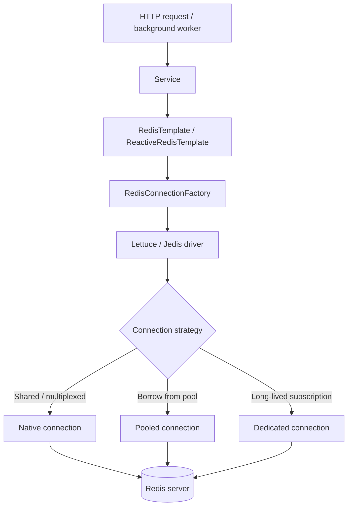
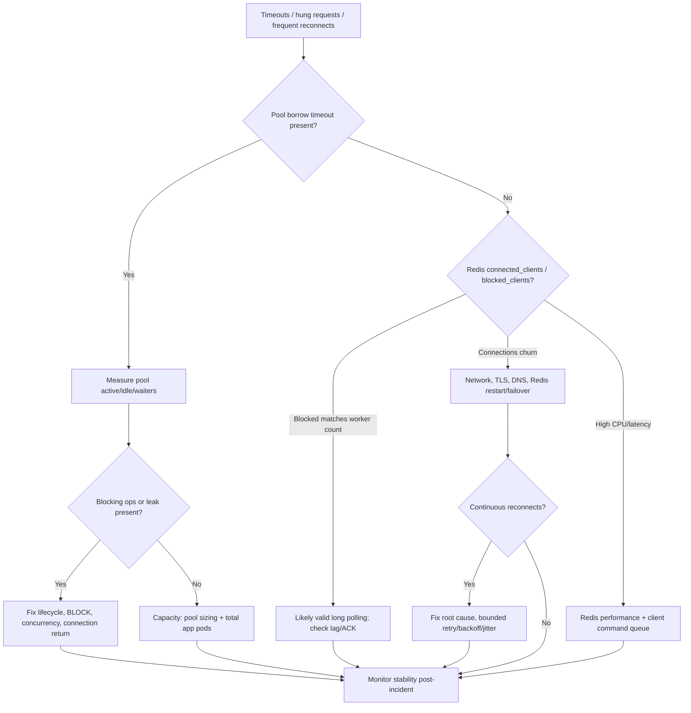

# Pool Exhaustion, Long-Running Blocking Commands, or Continuous Reconnects in Spring Data Redis

## 1. Three Symptoms Easily Mistaken for a Single Redis Error

In a Spring Boot application using Spring Data Redis, operators may observe hung requests, rising timeouts, sudden spikes in connections to Redis, or logs repeatedly reporting lost and restored connections. Three common root cause groups are:

1. **Connection pool exhaustion:** tasks attempt to borrow a connection, but no connections are available or they have to wait too long.
2. **Long-running blocking commands:** a connection is waiting for data from Redis according to the exact semantics of `BLPOP`, `BRPOP`, `XREAD`, or `XREADGROUP BLOCK`, preventing it from being reused yet.
3. **Continuous reconnects:** TCP/TLS/Redis connections are closed, fail upon creation, or are disrupted by failover, topology, or network issues; the client tries to reconnect and can trigger timeouts, pool waits, and retry storms.

They can be related to one another:

```text
Consumer using XREADGROUP BLOCK 0
       |
       v
Many connections held for a long time
       |
       v
Pool for blocking gets exhausted
       |
       v
Borrow wait / timeouts increase
       |
       v
Application retries all at once
       |
       v
Redis/Network/Client CPU under load
       |
       v
Connection resets / reconnects increase
```

However, the order can also be reversed: a Redis node failover causes many connections to drop simultaneously, the client needs to recreate them, and the pool temporarily cannot issue connections to callers.

**Important warning:** Not every Spring Data Redis application uses a pool for every `GET`/`SET`. With Lettuce, a native connection can be shared/multiplexed for normal operations. Reflexively increasing `max-active` may not resolve the actual bottleneck.

This lesson builds a categorized diagnostic workflow that distinguishes physical connections from connection wrappers/connection pools, identifies blocking commands, evaluates reconnect storms, and proposes fixes that can be verified in a safe environment.

## 2. Understand the Connection Model Before Optimizing

Common components:

- `RedisConnectionFactory`: Spring Data Redis abstraction for providing connections.
- `LettuceConnectionFactory`: implementation using Lettuce, typically selected by Spring Boot via the starter.
- `JedisConnectionFactory`: implementation using Jedis in configurations that choose Jedis.
- `RedisTemplate`/`StringRedisTemplate`: synchronous operations API.
- `ReactiveRedisTemplate`/`ReactiveStringRedisTemplate`: reactive operations API.
- `RedisMessageListenerContainer`: container managing Pub/Sub connections that typically have a long lifecycle.
- Redis Streams reader/receiver: may use blocking reads, keeping the connection held while waiting.

A call path:



The same application may use multiple connection paths depending on the operation. You cannot conclude "the pool is exhausted" solely from the number of active HTTP requests or a single Redis timeout log.

### Four Resource Types to Distinguish

| Resource | Meaning | Symptom When Scarce |
| --- | --- | --- |
| Thread/executor | Where blocking code or callbacks run | Thread pool congested, requests not processed |
| Redis client connection | TCP/TLS socket or driver connection to the server | Connect/reconnect errors, command queue wait |
| Connection pool | Where pooled connections are borrowed/returned | Borrow wait, pool exhausted, timeout waiting for resource |
| Redis server client slot | Connections accepted by Redis per `maxclients` | "max number of clients reached", connect failures |

Increasing the pool size does not create infinite Redis server capacity. On the contrary, it can cause the server to hit `maxclients` or increase CPU/bandwidth usage.

## 3. Lettuce: Shared Native Connection Differs from Pooling

Lettuce is a popular client for Spring Data Redis. Lettuce supports handling multiple commands asynchronously over a managed connection, so **a single native connection can serve multiple Redis requests**.

In common configurations of `LettuceConnectionFactory`, `shareNativeConnection` is enabled by default for operations that do not require a dedicated connection. Operations such as blocking commands and transactions may use a dedicated connection, depending on configuration and call path.

Example:

```java
@Autowired
private StringRedisTemplate redis;

public String findStatus(String id) {
    return redis.opsForValue().get("status:" + id);
}
```

A thousand `GET` calls do not necessarily mean there are a thousand Redis sockets or a thousand pooled connections.

### Why Does Increasing the Pool Not Help Some Workloads?

If most `GET`/`SET` commands use a shared native connection:

- Pool settings may not govern that operation path the way you assume.
- The bottleneck may be event-loop CPU, client-side queue, network throughput, or Redis server latency.
- A command timeout may occur because the connection is reconnecting or due to output queue buildup, not because `getResource()` is waiting on a pool.

With Lettuce, the pool becomes more important on paths that require dedicated connections, non-shared connection configurations, or libraries/code paths that explicitly use pooling.

### Should You Disable `shareNativeConnection`?

You should not change:

```java
factory.setShareNativeConnection(false);
```

just so "every command gets its own connection to be fast." Doing so alters the connection allocation model and can increase physical connection counts as well as pressure on the pool and server. Only do this when design requirements and metrics demonstrate that a shared connection does not meet a specific need.

Such a change requires measuring throughput, latency, connection count, CPU, and concurrency before and after, while also checking transactions, Pub/Sub, and blocking operations.

## 4. Jedis and Pooling: Identify Which Driver Is Actually Running

A project may use Lettuce or Jedis. The libraries, connection models, and corresponding properties are not completely identical.

Before modifying configuration:

1. Determine whether the runtime has `LettuceConnectionFactory` or `JedisConnectionFactory`.
2. Inspect starter/client dependencies and custom factory beans.
3. Verify whether pooling implementation is actually enabled.
4. Distinguish "open Redis connections" from the pool's "active/idle/borrowed objects".
5. Check whether multiple connection factories exist for cache, session, or Streams.

Do not apply a tuning guide written for Jedis pools verbatim to a Lettuce shared-connection application.

### Pooling Is Not a Redis Server Feature

Pools are managed on the Java client side. Redis only sees TCP client connections; Redis does not know whether they were borrowed from an Apache Commons Pool, created individually by a driver, or held long-term by a listener.

Therefore, **two simultaneous perspectives** are needed:

- Java side: pool metrics, thread dumps, driver logs.
- Redis side: `INFO clients`, `CLIENT LIST`, `blocked_clients`, memory/network/CPU.

## 5. Signs of Genuine Connection Pool Exhaustion

Common manifestations:

- Logs such as `Could not get a resource from the pool` or `Timeout waiting for idle object`.
- Borrow wait spikes sharply even though Redis command execution time is small.
- Active connections in the pool are close to `maxTotal/max-active`.
- Idle connections are 0 while many threads are waiting.
- Request latency increases before Redis even receives the command.
- Blocked operations or transactions hold connections for too long.
- After several hours of operation, the pool does not recover even when traffic drops.

However, specific exception messages depend on the client/version and the Spring exception translation layer. Do not match a single exception text and jump to a conclusion.

### Pool Exhaustion Can Stem from Two Kinds of Problems

**Pool sized too small for legitimate concurrency:**

```text
8 max connections
16 workers frequently using dedicated connections
Each operation holds 1 connection for 500 ms
=> at most 8 workers can run concurrently; 8 workers wait
```

**Connections held abnormally or not returned:**

```text
Some workers borrow connections manually
Exception occurs without closing
Active count gradually increases over hours
Traffic drops yet pool still has no idle connections
```

Increasing the pool can temporarily mask both issues, but it does not cure a resource leak.

## 6. Configuring a Lettuce Pool in Spring Boot

Spring Boot 3.x example with supported pooling and the required dependency:

```yaml
spring:
  data:
    redis:
      connect-timeout: 2s
      timeout: 3s
      lettuce:
        pool:
          max-active: 16
          max-idle: 8
          min-idle: 2
          max-wait: 1s
```

Meaning:

- `max-active`: maximum active connections/objects managed by the pool per client configuration semantics.
- `max-idle`: limit on idle resources retained.
- `min-idle`: target number of idle resources maintained according to pool policy, not an absolute guarantee at all times.
- `max-wait`: time limit for **borrowing a connection from the pool**.
- `spring.data.redis.timeout`: relates to Redis command timeout; **distinct** from pool borrow wait time.
- `connect-timeout`: time to wait for establishing a connection to the endpoint.

Some configurations require `commons-pool2` to be present:

```xml
<dependency>
    <groupId>org.apache.commons</groupId>
    <artifactId>commons-pool2</artifactId>
</dependency>
```

Projects must verify exact dependency management and configuration for their Spring Boot/driver version; **a YAML snippet alone does not prove a pool is in use**.

### Do Not Increase `max-active` Without Limits

For example, 50 application pods, each allowed to open 40 pooled connections:

```text
50 pods × 40 connections = 2,000 expected max connections
```

That does not yet include shared command connections, Pub/Sub, health checks, admin/monitoring connections, or other backends.

Redis `maxclients`, file descriptor limits, proxies/load balancers, and memory also constrain connection capacity. Tuning must account for the **total number of instances**, not just one JVM.

## 7. Separate Pool Wait, Command Timeout, and Connect Timeout

These three timers answer three different questions.

```text
Request starts
   |
   |--- Wait to borrow connection (pool max-wait)
   |
   |--- TCP/TLS/AUTH connect if needed (connect timeout)
   |
   |--- Send command, wait for Redis response (command timeout)
   |
   |--- Deserialize result and return HTTP response
```

Each step can time out independently; total request duration can exceed a single configured timeout.

| Timer | Bounded By | When Exceeded |
| --- | --- | --- |
| Pool borrow wait | Pool/client config | Failed to obtain pooled resource |
| TCP connect | Network client | Connection cannot be established |
| TLS handshake/auth | TLS/client config and related timeouts | Handshake or AUTH failure |
| Redis command | Driver command timeout | Command did not complete within deadline |
| Blocking wait at Redis | `BLOCK`/`BLPOP` parameter | Redis returns nil/empty after wait duration, or continues if infinite |
| HTTP request deadline | Web/server/gateway | Caller may cancel request before Redis command finishes |

**Do not set these deadlines independently without considering one another.** If the HTTP deadline is 500 ms but the pool wait is 5 seconds, the request may already fail at the edge while Java still keeps a task waiting for a connection.

A sound design defines a **total time budget for the logical operation**, then allocates portions to connection acquisition, command execution, and retries.

## 8. How Do Blocking Redis Commands Work?

Redis provides commands that actively wait for data when a source is empty. For example:

- `BLPOP`/`BRPOP`: wait for an element in a List.
- `BLMOVE`/`BRPOPLPUSH`: wait for an element to move, depending on Redis version.
- `XREAD BLOCK ...`: wait for a new record in a Stream.
- `XREADGROUP ... BLOCK ...`: wait for a record in a consumer group.
- Newer blocking List/Stream variants depending on Redis version.

CLI example:

```redis
BLPOP jobs:pending 30
```

If `jobs:pending` has no elements yet, Redis can hold the command waiting for up to roughly 30 seconds according to the command's timeout semantics.

```redis
XREAD BLOCK 5000 STREAMS events:orders $
```

Here `BLOCK 5000` expresses a 5,000-millisecond limit for the Stream read.

```redis
XREADGROUP GROUP order-workers consumer-A BLOCK 5000 STREAMS events:orders >
```

The consumer group must already exist and has its own semantics for pending entries, ACK, and consumer ownership.

### `BLOCK 0` Usually Means Infinite Wait

For the relevant Redis blocking commands, a timeout argument of 0 can mean **blocking indefinitely** until data arrives or the connection/command is interrupted.

Example:

```redis
BLPOP jobs:pending 0
XREADGROUP GROUP order-workers consumer-A BLOCK 0 STREAMS events:orders >
```

This can be reasonable for a long-running worker managing a dedicated connection and a clear shutdown lifecycle, but it is very dangerous if run inside an HTTP request or if it accidentally borrows a connection from a pool serving short operations.

### A Blocking Connection Is Not a Deadlocked Thread

Redis may be doing exactly what it was asked to do: holding the command in a waiting state. A Java thread or future may be waiting for a response simply because there is no message, rather than the Redis server being hung.

You must distinguish **legitimate waiting** from **resource starvation** caused by placing blocking operations in the wrong place.

## 9. What Does `blocked_clients` on Redis Mean?

Observe:

```bash
redis-cli INFO clients
```

A portion of the output may contain:

```text
connected_clients:120
blocked_clients:36
maxclients:10000
```

These numbers are examples only.

- `connected_clients`: number of client connections at the time of observation according to Redis.
- `blocked_clients`: number of clients currently blocked in blocking operations as tracked by Redis.
- `maxclients`: server connection limit per configuration/resource limits.

If the application intentionally has 36 consumers using `XREADGROUP BLOCK`, `blocked_clients=36` may be completely normal. Do not conclude the server is unhealthy just because this number is greater than 0.

However, if there are 36 blocked clients when only 4 consumers are expected, investigate:

- Did old workers fail to close their connections?
- Is each request creating a new blocking consumer?
- Are schedulers running duplicates across multiple instances?
- Did consumers fail to stop after a deploy?
- Is the pool for blocking connections completely occupied?
- Is the BLOCK duration infinite when workers need deadline-bounded polling?

**Compare the number of blocked clients against the expected consumer/listener count from the application topology.**

## 10. Use `CLIENT LIST` to See Which Connections Are Waiting

When Redis ACLs permit, in a controlled environment:

```bash
redis-cli CLIENT LIST
```

Each client has metadata that may include:

```text
id=123 addr=10.0.0.5:45678 age=200 idle=30 flags=b cmd=xreadgroup
id=124 addr=10.0.0.6:45679 age=120 idle=10 flags=N cmd=get
```

These lines are illustrative. Actual fields/flags vary by Redis version and client state.

Useful fields:

- `id`: client connection ID.
- `addr`: source address/port of the connection.
- `age`: how long the connection has existed.
- `idle`: duration of client inactivity per Redis semantics.
- `flags`: client state, where blocking-related flags can be informative.
- `cmd`: recent/current command associated with the client.

A client showing `cmd=xreadgroup` and a blocking flag suggests a long-poll stream consumer, not a stuck GET request.

### Limitations When Viewing from the Server

- A Lettuce shared connection can serve many logical commands; one line in `CLIENT LIST` does not map 1-to-1 to an HTTP request.
- Not seeing `cmd=get` does not prove the client never sent GET; the server list is a snapshot.
- Connection IDs can change after a reconnect.
- `addr` under NAT/Kubernetes may be a node/proxy IP rather than a pod directly.
- Redis Cluster has multiple nodes; one node does not hold the full client list of another node.

Do not store or publish raw `CLIENT LIST` output to unauthorized people, as it may contain addresses, client names, and sensitive operational information.

## 11. Why `SLOWLOG` Often Cannot Explain Long Blocking Commands

Redis `SLOWLOG` typically records **command execution time on the server**, excluding full request time spent waiting on the network/client or the intentional wait interval of a blocking operation in the way users measure end-to-end latency.

Example:

```text
Application sees BLPOP take 20 seconds
Redis executes and returns immediately once an item arrives
=> SLOWLOG may not show "20 seconds of CPU processing"
```

SLOWLOG is an important tool for commands that consume CPU/server execution time, but it should not be used alone to diagnose:

- Pool borrowing wait.
- Network latency.
- TLS handshake.
- Blocking wait due to an empty queue/Stream.
- Redis client retry/backoff.
- Java-side serialization/deserialization.
- Java thread waiting/GC pauses.

Combine:

```bash
redis-cli INFO clients
redis-cli CLIENT LIST
redis-cli SLOWLOG GET 20
redis-cli LATENCY LATEST
```

Diagnostic commands require appropriate ACLs; use them in authorized environments and do not alter Redis server configuration ad hoc just to run them.

## 12. Redis List Blocking Read in Spring Data Redis

Spring Data Redis provides list operation overloads with a timeout:

```java
import java.time.Duration;
import org.springframework.data.redis.core.StringRedisTemplate;

public final class JobQueueReader {

    private final StringRedisTemplate redis;

    public JobQueueReader(StringRedisTemplate redis) {
        this.redis = redis;
    }

    public String takeOne() {
        return redis.opsForList()
                .leftPop("jobs:pending", Duration.ofSeconds(2));
    }
}
```

This is an example of an operation that can invoke the corresponding Redis blocking pop. When it times out with no element, the result can be null per the synchronous API contract.

Key points to remember:

- The timeout in the list pop overload is **not** the pool borrow time.
- The command holds the server-side command/connection while waiting.
- Driver command timeout must be compatible with the blocking duration; versions/drivers have different timeout handling mechanisms, so actual behavior must be verified.
- If called within an HTTP request, consider the HTTP deadline and cancellation behavior when the client disconnects.
- If there are multiple consumers, calculate the required number of dedicated connections.

### Do Not Call `leftPop(key, Duration.ZERO)` Without Knowing Its Semantics

In many Redis blocking commands, a zero timeout is interpreted as an infinite wait. A `Duration.ZERO` in the client API may be mapped according to that driver/command semantics.

For controlled polling, use a positive finite timeout and read the documentation for your exact overload/driver version.

## 13. Redis Streams Blocking Read: Configure `BLOCK` Explicitly

Consumer group example:

```java
import java.time.Duration;
import java.util.List;

import org.springframework.data.redis.connection.stream.Consumer;
import org.springframework.data.redis.connection.stream.ReadOffset;
import org.springframework.data.redis.connection.stream.StreamReadOptions;
import org.springframework.data.redis.connection.stream.StreamOffset;
import org.springframework.data.redis.core.StringRedisTemplate;

public class OrderStreamPoller {

    private final StringRedisTemplate redis;
    private final String consumerName;

    public OrderStreamPoller(
            StringRedisTemplate redis,
            String consumerName) {
        this.redis = redis;
        this.consumerName = consumerName;
    }

    public void pollOnce() {
        var options = StreamReadOptions.empty()
                .count(10)
                .block(Duration.ofSeconds(2));

        var records = redis.opsForStream().read(
                Consumer.from("order-workers", consumerName),
                options,
                StreamOffset.create(
                        "orders:events",
                        ReadOffset.lastConsumed()));

        if (records == null || records.isEmpty()) {
            return;
        }

        for (var record : records) {
            // Process message with idempotency and a clear error policy.
            // ACK per business contract after successful processing.
        }
    }
}
```

**Prerequisite:** The Stream and consumer group `order-workers` have already been created. This snippet is a polling skeleton and does not include pending entry handling or `XACK`.

With `StreamReadOptions.block(Duration.ofSeconds(2))`, the worker gets an opportunity to return to the loop and check the shutdown flag periodically. Do not hold an HTTP request waiting on an infinite `BLOCK 0` just to "wait for an event."

### How Does a Blocking Read Affect Connections?

While Redis is waiting for Stream records, the connection executing the blocking command cannot be arbitrarily reused as a normal command channel for multiple independent operations. Spring Data Redis/Lettuce typically uses a dedicated connection for blocking operations under appropriate configuration.

If an executor spawns 100 consumers calling `BLOCK` simultaneously while the dedicated connection pool only holds 16 resources, many workers may wait to borrow from the pool before actually reading the stream.

The solution is not necessarily raising the pool to 100; you can design a **reasonable number of consumers**, optimize batch size, limit concurrency, and separate worker services from the HTTP API.

## 14. Redis Streams Receiver and Reactive Subscriptions

In reactive Redis, a subscription has an explicit lifecycle. A stream receiver can use a connection and polling/long-polling depending on configuration.

Points to distinguish:

- The Reactive API does not make Redis blocking waits free of server/client resource consumption.
- `Flux` can handle application-side backpressure, but Redis Pub/Sub does not buffer messages for offline subscribers.
- When every HTTP request creates a new stream receiver/subscription, connection or subscription counts can grow unboundedly.
- When canceling a subscriber, ensure the lifecycle releases resources according to the API/version in use.
- Do not call a blocking synchronous template on the Reactor event-loop if latency can be prolonged.
- Isolate long-lived reactive receivers into components that manage lifecycle and concurrency.

### Anti-pattern Example

```java
@GetMapping("/jobs/next")
public Mono<String> next() {
    // DO NOT make a blocking request on the event-loop.
    String value = redisTemplate.opsForList()
            .leftPop("jobs:pending", Duration.ZERO);

    return Mono.justOrEmpty(value);
}
```

This is a blocking call executed **before returning the Mono**, which can occupy the request-handling thread indefinitely.

If the API genuinely needs streaming, design an async/streaming endpoint with proper lifecycle/cancellation, or separate the job-consuming worker from the HTTP request. Using `boundedElastic()` can avoid blocking the event-loop, but you still need to manage threads, pools, and connection counts; it **does not solve** an infinitely waiting Redis command.

## 15. Pub/Sub Holding Long-Lived Connections Is Normal Design

`RedisMessageListenerContainer` manages subscriptions to Redis:

```java
@Bean
RedisMessageListenerContainer listenerContainer(
        RedisConnectionFactory factory,
        MessageListener listener) {

    RedisMessageListenerContainer container =
            new RedisMessageListenerContainer();

    container.setConnectionFactory(factory);
    container.addMessageListener(
            listener,
            new ChannelTopic("orders.created"));

    return container;
}
```

Imports for Spring Data Redis listener types must be present in the project. When managed as a bean, Spring manages the container's lifecycle according to the supported configuration.

Unlike a single `GET`, a subscription typically spans the lifetime of the application. A long-lived connection dedicated to Pub/Sub is **not a connection leak**.

However, if code creates a new `RedisMessageListenerContainer` per request without stopping/destroying it:

```text
Request 1 -> new listener container -> 1 subscription connection
Request 2 -> new listener container -> 1 more connection
...
Request 500 -> hundreds of subscription connections exist
```

that is a **lifecycle/resource leak**.

Create listeners/receivers as application-level components with clear ownership, register topics in a controlled manner, and clean up on shutdown.

## 16. Pool Exhaustion Because the Application Borrows Connections and Forgets to Close Them

When working directly with `RedisConnectionFactory`, code must return resources according to contract.

Example:

```java
public String ping(RedisConnectionFactory factory) {
    RedisConnection connection = factory.getConnection();

    try {
        return connection.ping();
    } finally {
        connection.close();
    }
}
```

In a pooled configuration, `close()` on the appropriate connection wrapper usually returns the resource to the pool rather than immediately closing the physical TCP socket.

Leak pattern:

```java
public String brokenPing(RedisConnectionFactory factory) {
    RedisConnection connection = factory.getConnection();

    // If ping() throws an exception, connection is not closed.
    return connection.ping();
}
```

After multiple failures, the number of active borrowed resources can climb without being returned.

### Prefer Templates Unless You Need Low-Level APIs

`RedisTemplate` handles connection management for ordinary operations per the Spring Data Redis abstraction. Do not manually acquire and hold `RedisConnection` when a service only needs `GET` or `SET`.

If low-level connections are genuinely required:

- Define clear ownership.
- Close in `finally` or try-with-resources if the corresponding API supports it.
- Do not share the same manual dedicated connection in violation of its thread-safety contract.
- Do not hold a connection across long non-Redis work such as HTTP calls or SQL transactions.
- Do not store a connection in a singleton cache or static variable without lifecycle management.

## 17. Transactions and Pipelines Can Hold Connections Longer Than Expected

Several cases:

- `MULTI`/`EXEC` transactions.
- `WATCH` + optimistic locking.
- RedisTemplate transaction support.
- Long-running pipeline callbacks.
- Blocking reads.
- Manual `RedisConnection` usage.

If a transaction opens a connection and performs slow logic before `EXEC` or rollback/cleanup, the resource remains held.

Scope anti-pattern:

```text
Borrow Redis connection
  |
  +-- WATCH key
  |
  +-- HTTP call to external system (3 seconds)
  |
  +-- SQL query (2 seconds)
  |
  +-- MULTI/EXEC
  |
  +-- Close connection
```

When many requests do this concurrently, the pool is occupied most of the time by **non-Redis** steps.

Narrow the critical section: prepare external data beforehand, then execute a short Redis operation with concurrency control/transaction. Note that `WATCH` and transaction commands must use the proper Spring Data Redis connection/semantics; you cannot arbitrarily split commands across two connections and expect the transaction to apply.

**Redis `MULTI`/`EXEC` does not automatically roll back every command like a SQL transaction.** Design appropriate error handling, idempotency, and recovery.

## 18. Thread Dumps Reveal What Threads Are Waiting For

When the application hangs while Redis metrics remain unclear, a thread dump can provide clues:

```text
Thread A:
  WAITING / TIMED_WAITING at pool borrow
  => suspect lack of pooled resources

Thread B:
  WAITING on Future/command completion
  => suspect Redis response, blocking operation, or command timeout

Thread C:
  BLOCKED on synchronized lock caused by application code
  => suspect contention unrelated to Redis pool

Thread D:
  Netty event-loop running heavy CPU work
  => suspect event-loop starvation / callback code too slow
```

Do not look only at the `WAITING` state: a Java thread may be waiting on a Redis blocking command by design. Correlate stack traces with worker names, operations, pool metrics, and error timestamps.

### Thread Dumps Differ from Redis `blocked_clients`

- A thread dump describes the state of Java threads.
- `blocked_clients` describes clients held by the Redis server in blocking operations.
- A Java async caller may not hold a blocked thread while the Redis server is holding a connection.
- A Java thread may be blocked waiting for the connection pool while the Redis server has zero blocked clients.

That is why you should gather both perspectives before adjusting parameters.

## 19. Continuous Reconnects: Definition and Symptoms

A **reconnect storm** occurs when clients repeatedly lose connections or fail to establish stable ones, and multiple instances try to reconnect at the same time.

Signs:

- Repeated logs like "reconnect", "disconnected", "channel inactive", "connection reset", or "connection refused".
- Sharp increase in connections created/closed.
- Fluctuating Redis `connected_clients`.
- Rising command timeouts and error rates, even when Redis server CPU is not particularly high.
- Repeated TLS handshake/auth failures.
- After failover, clients keep trying to reach the old node or an unreachable endpoint.
- Certain app pods suffer more errors than others.

Reconnecting is not necessarily a driver bug. It can be a reasonable response to network instability, Redis restarts, failovers, or resource limits.

### Do Not Infer an Incident from a Single Reconnect Log

A single reconnect during a rolling Redis deployment can be normal. It becomes concerning when frequency is high, prolonged, causes request failures, or drives up resource consumption.

Measure:

```text
reconnect attempts / second
connection failures / second
command timeouts / second
active Redis connections
Redis blocked_clients
pool borrow wait p95/p99
HTTP request latency/error rate
```

Many of these metrics require client-side instrumentation; Spring Data Redis does not emit all of them by default.

## 20. Common Causes of Reconnects

| Category | Specific Cause | How to Check |
| --- | --- | --- |
| Redis server | Restart, crash, OOM, maxclients, failover | Redis/server logs, INFO, orchestrator events |
| Network | Packet loss, NAT/LB idle timeout, firewall reset | Network events, endpoint path, packet/connection metrics |
| DNS | Host IP change, stale resolution, broken service discovery | DNS lookup from app pod, TTL/resolution |
| TLS | Certificate mismatch, CA rotation, misconfigured mTLS | Handshake exception, trust store, server cert |
| ACL/Auth | WRONGPASS/NOAUTH or token rotation | Client/server auth logs, secret version |
| Cluster/Sentinel | Primary change, stale topology, node advertises unreachable address | Cluster/Sentinel state, driver topology logs |
| Client resources | Netty event-loop congestion, heap/GC pressure, thread exhaustion | JVM CPU/GC/thread dumps |
| Proxy/mesh | Sidecar restart, idle connection timeout, max connections | Proxy logs/metrics and policy |
| Deployment | Pod restarts, rolling config/secret changes | Deployment timeline and pod events |
| Retry policies | Retry storm increasing load and causing connection churn | Retry attempts, backoff, concurrency |

Start with the **timeline**: did reconnects spike right after a deploy, secret rotation, failover, or a traffic burst? Timeline correlation often eliminates many hypotheses.

## 21. Redis Server Hitting `maxclients` Differs from Pool Exhaustion

For example, Redis returns an error related to the client connection limit:

```text
ERR max number of clients reached
```

This means the **Redis server** has run out of client slots or hit its corresponding resource limit.

Possible causes:

- Too many app pods/connection pools.
- Every request creates a Redis client/factory/container without closing it.
- Long-lived Pub/Sub/Streams connections multiplying.
- Reconnect errors creating many connections simultaneously.
- Monitoring, health probes, and admin tools opening unexpected connections.

Do not fix this by increasing `max-active` in Java; that can make the failure worse.

Inspect:

```bash
redis-cli INFO clients
redis-cli CONFIG GET maxclients
```

`CONFIG GET` depends on Redis ACLs and operational policy. If a managed service forbids running it, inspect metrics/config from the corresponding management console.

### Is Increasing `maxclients` Enough?

Not necessarily. Redis needs file descriptors and memory/buffers for client connections. Raising the limit while the application is leaking connections only postpones the incident.

Prioritize:

1. Identify who is opening connections.
2. Compare connection count against app instance count and pool/subscription design.
3. Eliminate connection leaks; never create clients per request.
4. Only raise limits in a controlled manner after capacity planning.

## 22. Network Idle Timeout and Keepalive

Some proxies, load balancers, or NAT gateways close TCP connections after an idle period. The Redis client may retain the connection assuming it is still alive, only discovering the reset when sending the next command.

Pattern:

```text
10:00 Connect to Redis succeeds
10:05 No traffic
10:10 Proxy closes idle TCP connection
10:12 App sends GET
10:12 Connection reset / reconnect
10:12 Retry/Fallback
```

For shared connections or long-lived subscribers, inspect:

- Idle timeout of proxies/LBs/service meshes.
- TCP keepalive settings.
- Driver/client keepalive/heartbeat options for your version.
- Redis server `timeout` setting (if configured).
- Connection validation when borrowing from a pool.
- Service mesh or NAT connection tracking.

**Do not set extremely short heartbeats** across thousands of connections to "prevent disconnects" without accounting for network/CPU cost. Nor should you disable all timeouts indefinitely, as broken connections may linger for a very long time.

A sound policy is grounded in the actual network path and how the client detects/refreshes connections.

## 23. Redis Sentinel/Cluster Failover and Reconnects

Redis Sentinel:

- An old primary may lose connectivity or change role.
- A replica is promoted to the new primary.
- A Sentinel-aware client needs to discover the new primary and reconnect.
- Writes to the old node may encounter `READONLY` or connection errors.

Redis Cluster:

- Slot ownership may change during failover/resharding.
- Clients receive `MOVED`/`ASK` or need a topology refresh.
- Some node endpoints advertised by Redis may be unreachable from Kubernetes/NAT if cluster announce configuration is incorrect.
- `ReadFrom` replica settings can affect consistency.

### Do Not Confuse Normal Redirects with a Reconnect Storm

`MOVED`/`ASK` are part of Redis Cluster routing; cluster-aware drivers handle redirects according to appropriate semantics. However, continuous repeated redirects, timeouts, and failing topology refreshes can indicate misconfigured endpoints/topology.

Read client driver logs at an appropriate level, inspect cluster health, and correlate with failover timestamps. Avoid enabling overly broad DEBUG logging in production as it can add load or expose sensitive details.

### Retries After Reconnect Can Duplicate Side Effects

If a client sends `INCR`, Redis executes it, and the response is lost, a retry can increment it a second time. The same applies to `LPUSH`, `XADD *`, and `PUBLISH`.

Therefore, reconnect policy and application retry policy are **two separate things**. Do not wrap every Redis method in unbounded retries. Each operation needs idempotency analysis and a clear deadline.

## 24. TLS/ACL Errors Can Look Like a Reconnect Loop

If the TCP connection opens but the TLS handshake or AUTH fails, the client may repeatedly attempt to reconnect according to driver policy.

Distinguish:

```text
TCP connect failure:
  Connection refused / connect timed out

TLS handshake failure:
  SSLHandshakeException / certificate / hostname errors

Redis authentication failure:
  WRONGPASS / NOAUTH

ACL command failure:
  NOPERM when executing command
```

**Fix the right layer**:

- TCP: host/port/firewall/routing.
- TLS: trust store, certificate, protocol, port, hostname.
- AUTH: username/password or secret rotation.
- ACL: permissions for the exact commands/keys/channels.
- Redis topology: Sentinel/Cluster endpoints.

A `NOPERM` on `XREADGROUP` does not necessarily prevent factory creation. Many clients connect successfully, while the application command fails.

Do not "fix" TLS errors by disabling hostname verification, or auth errors by logging passwords to the console.

## 25. Event-Loop Starvation and Callback/Blocking Code

With Lettuce and Netty, certain I/O and callbacks run on client executors/event-loops. If application code places heavy CPU or blocking work on an inappropriate thread, the consequences can include:

- Redis responses arrive but are not processed in time.
- Command completion is delayed.
- Timeouts rise even while the Redis server is fast.
- Heartbeat/connection operations are delayed.
- Operators misinterpret this as network instability.

WebFlux anti-pattern example:

```java
@GetMapping("/status/{id}")
public Mono<String> get(@PathVariable String id) {
    // A synchronous template can block the event-loop.
    String value = stringRedisTemplate.opsForValue()
            .get("status:" + id);

    return Mono.justOrEmpty(value);
}
```

For WebFlux request handlers, prefer the reactive API:

```java
@GetMapping("/status/{id}")
public Mono<String> get(@PathVariable String id) {
    return reactiveStringRedisTemplate.opsForValue()
            .get("status:" + id);
}
```

If a library must block, isolate it onto an appropriate scheduler/executor and **limit concurrency**. Moving work from the event-loop to a thread pool does not eliminate connection requirements or Redis server limits.

### Do Not Blame Every Timeout on the Redis Server

When Redis `SLOWLOG` shows no slow commands yet application p99 rises, check CPU, GC, event-loop lag, and pending client-side commands before increasing Redis timeouts.

## 26. Retry Storm: From a Small Error to a Major Outage

A request that times out and retries three times can cause Redis to receive three or more additional commands, depending on the calling layer.

If the gateway, service, and driver all retry:

```text
Gateway: 3 attempts
  Service: 3 attempts/request
    Redis operation: 3 attempts/service call

Theoretical maximum: 3 × 3 × 3 = 27 Redis attempts
```

This is an illustrative example; actual behavior depends on retry mechanisms and may be cut short by deadlines.

When Redis is already slow, a retry storm:

- Increases active/queued operations.
- Occupies the pool longer.
- Increases Redis CPU and network load.
- Increases command timeouts.
- Triggers additional reconnects when clients/proxies overload.
- Pushes load onto downstream services when cache fallbacks fire simultaneously.

Mitigations:

1. Enforce a clear **overall request deadline**.
2. Cap retry attempts and concurrency.
3. Use exponential backoff and jitter.
4. Retry only permitted transient errors.
5. Verify idempotency of the Redis operation.
6. Use circuit breakers/bulkheads where appropriate.
7. Maintain metrics distinguishing first attempts from retry attempts.
8. When Redis cache is unavailable, ensure fallback paths have capacity planning to avoid overwhelming the database.

## 27. Do Not Use the Pool as an Unbounded Queue

If `max-wait` is very long and incoming request volume is high:

```text
500 HTTP requests
  |
  v
16 pooled Redis connections
  |
  +-- 16 active operations
  |
  +-- 484 requests waiting to borrow a resource
```

Consequences:

- Thread memory/queue buildup increases.
- HTTP deadlines expire while workers may still be waiting.
- Once pool resources free up, work that is no longer useful still gets executed.
- Caller retries inflate the queue further.

A stable design requires:

- Bounding pending requests/operations.
- Pool wait timeouts shorter than the appropriate overall deadline.
- Never spawning unbounded background jobs.
- Reserving separate capacity for blocking consumers if needed.
- Circuit breakers/fallbacks so callers do not queue indefinitely.

**Limiting concurrency before borrowing** is usually easier to control than letting every request crowd into the pool wait queue.

## 28. Measuring Pool Metrics: Which Numbers Are Reliable?

If pooling is configured and instrumented, key metrics include:

| Metric | Meaning |
| --- | --- |
| Active/borrowed | Resources currently in use |
| Idle | Resources currently idle |
| Max total/active | Configured limit |
| Waiters | Number of tasks waiting for a resource |
| Borrow wait time p95/p99 | Time taken to borrow a connection |
| Borrow timeout count | Failed to acquire a resource within deadline |
| Created/destroyed objects | Churn of connections/pool resources |
| Validation failures | Resources found invalid during borrow/return |
| Pool exhaustion events | Frequency of resource shortage |
| Command latency | Cost after the resource is acquired |

Exact metric names depend on the pool implementation, Micrometer instrumentation, and client version; **Spring Boot Actuator does not automatically emit all of these by default**.

In a system that does not use pooled connections for routine GET/SET calls, pool active counts may stay low even while Redis command latency is high. In that case, inspect the client command queue, event-loop, RTT, and Redis server instead of assuming the metrics are broken.

### Illustrative Guidance Metrics

```text
redis_pool_active{factory="stream"} = 16
redis_pool_idle{factory="stream"} = 0
redis_pool_waiters{factory="stream"} = 12

redis_command_latency_seconds{operation="GET"}
redis_command_timeout_total{operation="XREADGROUP"}
redis_reconnect_attempts_total{client="catalog"}
```

The names above **are instrumentation suggestions**, not default metrics from Spring Data Redis.

Never attach raw Redis keys, user IDs, or trace IDs as metric labels; keep labels low-cardinality using client/factory role, operation group, and bounded result values.

## 29. Redis Server Metrics for Cross-Verification

Diagnostic commands:

```bash
redis-cli INFO clients
redis-cli INFO stats
redis-cli INFO memory
redis-cli INFO cpu
redis-cli INFO replication
redis-cli CLIENT LIST
redis-cli SLOWLOG GET 20
redis-cli LATENCY LATEST
```

For Redis Cluster, collect data across all relevant nodes, not just a single node.

| Redis Signal | Careful Interpretation |
| --- | --- |
| `connected_clients` rising | Could be scale-out, leak, reconnects, or subscriptions |
| `blocked_clients` rising | Could be legitimate blocking consumers or too many blocking ops |
| `rejected_connections` rising | May have hit maxclients/limits |
| `total_connections_received` rising rapidly | High connection churn; compare against traffic/topology |
| `instantaneous_ops_per_sec` rising | Request load may be rising, including retries |
| `used_memory`/evictions rising | Redis memory pressure may degrade performance |
| `SLOWLOG` has many slow commands | Server execution time warrants investigation |
| CPU/latency monitor spikes | Server experienced abnormal activity windows |
| Replication/failover events | May explain reconnects/read-only errors |

Do not infer that the Redis server is overloaded just because `connected_clients` is high; compare CPU, ops/s, network, maxclients, and workload.

## 30. Safe Client Logging During Diagnosis

With Spring Data Redis and Lettuce, you can temporarily raise log levels for selected packages in local/staging:

```yaml
logging:
  level:
    org.springframework.data.redis: DEBUG
    io.lettuce.core: INFO
```

These levels are examples. You do not necessarily want DEBUG enabled across all of Lettuce/Netty in production because it can generate heavy log volume, consume CPU, and expose endpoint details or command arguments depending on instrumentation.

Useful log fields should include:

```text
timestamp
service / instance / pod
traceId or correlation ID
redis factory role
operation type
attempt number
elapsed time / timeout type
result/error category
connection endpoint or topology role per policy
```

Avoid logging:

- Passwords or connection URLs containing credentials.
- Redis values containing PII/secrets.
- Raw session tokens inside keys.
- Full Lua scripts/`ARGV` with sensitive data.
- Millions of Redis keys as metric labels.

When raising logging levels, set an expiration time and turn-off criteria; do not leave full DEBUG enabled indefinitely after an incident.

## 31. Distinguish Timeout Types Using a Timeline

Suppose a request takes 2.5 seconds and then fails. It could be:

**Case A: pool wait**

```text
t=0ms    Request starts
t=0ms    Attempt to borrow connection
t=2000ms Borrow timeout
t=2005ms HTTP 503
Redis server never sees this command
```

**Case B: legitimate Redis blocking read**

```text
t=0ms    Borrow dedicated connection
t=5ms    XREADGROUP BLOCK 2000 sent to Redis
t=2005ms Redis returns empty because there are no records
t=2010ms Poller continues cycle
```

**Case C: reconnect**

```text
t=0ms    Command queued
t=100ms  TCP reset
t=500ms  Client reconnect attempt
t=1200ms TLS handshake failed
t=2500ms Command timeout
```

The three timelines lead to different actions:

- A: investigate pool ownership, active resources, sizing, and leaks.
- B: confirm this is a consumer operating by design, optimize poll duration/concurrency.
- C: investigate network/TLS/topology/driver resources and retry policies.

Do not blindly increase `spring.data.redis.timeout` simply because all three took around 2 seconds.

## 32. Design Polling Workers That Do Not Hold Resources Indefinitely

A Redis Streams consumer worker can perform finite polling and shut down cleanly.

Control skeleton:

```java
public final class OrderConsumerWorker implements Runnable {

    private final OrderStreamPoller poller;
    private final AtomicBoolean running = new AtomicBoolean(true);

    public OrderConsumerWorker(OrderStreamPoller poller) {
        this.poller = poller;
    }

    public void stop() {
        running.set(false);
    }

    @Override
    public void run() {
        while (running.get()) {
            try {
                poller.pollOnce(); // Finite BLOCK inside.
            } catch (RuntimeException ex) {
                // Record metric/log, classify error, and apply bounded backoff.
                // Do not busy-loop continuously on the same failing connection.
            }
        }
    }
}
```

This is an architectural skeleton; add the appropriate imports, lifecycle/executor setup, and error policy. Do not catch exceptions and silently ignore them forever: if Redis is persistently failing, a loop without backoff can cause a reconnect storm.

**A finite BLOCK duration** allows the worker to periodically inspect `running` for shutdown. Also account for the driver command timeout and executor lifecycle so shutdown does not wait longer than the application's allowed termination window.

When using Spring lifecycle management, manage start/stop properly via a component/`SmartLifecycle` or runner rather than spawning an unmanaged thread per message.

## 33. Choose Consumer Count and BLOCK Duration Using Data

Suppose:

```text
8 stream partitions/streams to read
4 application instances
Each instance expected to run 2 blocking consumers
=> 8 consumers total
```

If each consumer holds one dedicated connection, that is an **intentional** part of the system's capacity.

However, if each instance spawns 20 consumers because a retry/error handler repeats registration:

```text
4 instances × 20 consumers = 80 connections
```

connections increase 10-fold without guaranteed throughput gains, because sharing the same group or contending for resources may leave many consumers simply waiting.

Determine:

- How many streams and consumer groups are actually needed.
- Optimal consumer count for throughput and processing CPU.
- Batch size per read.
- Processing latency per record.
- Pending entry count and reclaim strategy.
- `BLOCK` duration.
- Memory/network budget.
- Application replica count and autoscaling behavior.
- Graceful shutdown during scale-down.

### A Too-Short `BLOCK` Can Cause Continuous Polling Loops

If polling every 1 ms on an empty stream, the application can generate excessive Redis commands and network round-trips.

### A Too-Long `BLOCK` Can Slow Shutdown

If polling with a `BLOCK` of several minutes or infinite duration, the worker may fail to stop within the termination grace period when a pod is replaced.

There is no single "right number for every system." Choose based on message delivery latency, command overhead, and shutdown budget.

## 34. When Wrapping a Blocking Command with an External Timeout

One might assume:

```text
Redis XREADGROUP BLOCK 0
HTTP timeout 1s
=> after 1s everything is released
```

However, a timeout on the HTTP/caller side does not guarantee that the Redis connection is immediately canceled and returned to the pool. Verify:

- Is cancellation propagated down to the driver?
- Is a command still pending on the connection?
- Is the connection wrapper closed/returned?
- Is the blocking operation terminated cleanly on server/client?
- Does reactive cancellation actually release the subscription?

Therefore, configure a **finite server-side `BLOCK` duration** compatible with the driver and app deadline, and test cancellation/resource cleanup in an isolated environment.

Avoid inadvertently setting a command timeout shorter than the blocking wait; it can cause unnecessary timeouts and reconnects. At the same time, an excessively long command timeout can mask network failures or hung operations.

## 35. Lab Diagnostic Test for Pool Exhaustion

Do not intentionally exhaust a production pool. Use a dedicated Redis instance, small connection counts, and bounded tests.

Scenario:

1. Start a test Redis instance (e.g., Testcontainers).
2. Configure a test factory/pool with small capacity **if that operation path actually uses pooling**.
3. Start enough blocking consumers to occupy all dedicated connections.
4. Dispatch one more task that needs a connection from the same pool.
5. Observe bounded borrow wait/timeout.
6. Stop/cancel consumers cleanly.
7. Verify active resources drop and the remaining task can proceed.
8. Clean up executors, connection factories, and containers after the test.

A test that merely sets `spring.data.redis.lettuce.pool.max-active=1` and runs two `GET` calls may **not trigger pool exhaustion as expected** if Lettuce is sharing a native connection. Check the connection strategy first.

### "No Connection Leak" Test

Loop operations through multiple error/exception cycles in a test environment and track:

```text
Before: active pooled resources = 0
During: active increases with number of workers
After all operations complete: active returns to expected level
```

If active counts do not drop after the workload finishes, inspect manual connection usage, transaction/pipeline lifecycles, or lingering listeners.

## 36. Testing Reconnects in an Isolated Environment

A fault-injection integration test can:

1. Start test Redis and the test Spring app.
2. Verify normal `GET`/`SET`.
3. Sever the test Redis connection or restart test Redis via the lab environment.
4. Observe client errors/reconnect attempts.
5. Restore test Redis.
6. Wait for the application to reconnect within the deadline.
7. Verify read-only commands work again.
8. Check that no connection leaks or retry storms remain.
9. Verify behavior of blocking consumers/PubSub after reconnect.
10. Clean up all resources.

Use network fault-injection proxies or Testcontainers isolation when simulating failures after a command has been sent.

**Do not test by killing a production Redis primary** or changing real server ACLs/timeouts during live traffic. Failover tests should follow runbooks in staging/lab.

### Test the Point of Indeterminacy Properly

A command like `INCR` may have been executed by Redis while the response was lost. After reconnect, a blind retry can increment twice. Recovery tests should therefore verify business-operation idempotency, not just "the client reconnected and the API returned 200."

## 37. Minimum Dashboard to Distinguish Causes

An operational dashboard should place side by side:

| Group | Metrics | How to Use |
| --- | --- | --- |
| Application | HTTP p95/p99 latency, error rate | See how users are affected |
| Redis command client | Command RTT, timeout, pending/queued | Isolate client-side delay |
| Pool | Active, idle, waiters, borrow wait | Prove or rule out pool exhaustion |
| JVM | CPU, GC pause, thread count, event-loop lag | Detect process starvation |
| Network | TCP resets, connect errors, TLS handshake | Investigate reconnects |
| Redis clients | `connected_clients`, `blocked_clients`, `rejected_connections` | Observe connections and blocking on server |
| Redis performance | CPU, memory, evictions, SLOWLOG, latency | Check Redis server pressure |
| Topology | Failover events, replication status, node roles | Correlate reconnects with role changes |
| Consumer | Consumer count, pending entries, processed/s | Assess whether blocking workers are healthy |
| Retry | Attempts, backoff, fallback rate | Detect retry storms |

Include `service`, `environment`, and `connectionFactory role` as low-cardinality metric labels with bounded value sets. Never use individual Redis keys as labels.

## 38. Runbook: Pool Exhausted While Redis CPU Is Low

Scenario:

```text
HTTP p99 increases
Pool waiters > 0
Pool active == max-active
Redis CPU low
blocked_clients high, close to number of consumer threads
```

Investigation steps:

1. How many consumers/listeners are designed to run?
2. Does the count of blocking operations match the expected consumer count?
3. Are any requests spawning blocking reads on their own?
4. Are manual connection resources left unclosed after exceptions?
5. Is `BLOCK 0` holding connections indefinitely?
6. Are transactions/pipelines holding resources across HTTP/SQL calls?
7. Is a pool shared between the HTTP cache path and background consumers?
8. Are borrow wait + HTTP deadlines causing requests to queue pointlessly?

Remediation steps:

- Reduce/limit the number of blocking consumers.
- Move long-running consumers into a service/executor with its own lifecycle.
- Use finite `BLOCK` durations where appropriate.
- Return connections properly.
- Isolate connection resources per workload where justified.
- Only then adjust pool capacity backed by metrics.

Do not scale up Redis CPU/memory before confirming the Redis server is actually overloaded.

## 39. Runbook: Frequent Reconnects Without Pool Exhaustion

Scenario:

```text
Pool active normal
Borrow wait near 0
Redis connections created/destroyed increasing
Dense Lettuce reconnect logs
HTTP GET occasionally times out
```

Investigation steps:

1. Do Redis server logs show restarts/failovers?
2. Does the network path have proxy/NAT idle timeouts or resets?
3. Were TLS certificates/secrets recently rotated?
4. Was Redis `maxclients` reached?
5. Are Cluster/Sentinel endpoints and client topology correct?
6. Does DNS resolve to an endpoint unreachable from the pod?
7. Is the JVM suffering GC pauses or event-loop starvation?
8. Are too many clients retrying/reconnecting simultaneously?
9. Is the client creating/closing connection factories per request?

Depending on the root cause, adjust timeouts/keepalive or topology configuration; do not treat pool settings as a universal cure for reconnects.

## 40. Runbook: High `blocked_clients` While Requests Remain Healthy

Scenario:

```text
blocked_clients = 40
40 consumer workers deployed
HTTP latency normal
Pool waiters = 0
Streams processing throughput stable
```

This may be the expected steady state. There is no need to "unblock" all clients just to drive the metric to 0.

Confirm:

- Consumer count matches deployment.
- `BLOCK` has an appropriate deadline/lifecycle.
- Consumers process records and ACK per policy.
- Pending entries/lag are not growing uncontrollably.
- Connection count and Redis `maxclients` still have headroom.
- Shutdown/scale-down releases connections.

Intervene only when there is evidence resources are being held outside design expectations or consumers are making no progress.

## 41. Should You Use `CLIENT UNBLOCK` or `CLIENT KILL`?

Redis provides administrative commands such as:

```redis
CLIENT UNBLOCK <client-id> TIMEOUT
CLIENT KILL ID <client-id>
```

These are **intervention tools**, not default fixes for pool exhaustion. They can cause workers to receive timeouts/errors, drop a subscription, or force clients to reconnect. Targeting the wrong client ID can disrupt active business processing.

Use them only when:

- The exact client and owner have been identified.
- Appropriate runbook/approval is in place.
- Consequences for queue/Stream processing and retries are understood.
- A plan exists to verify state/ACK/idempotency after intervention.
- Scope is restricted to authorized environments/resources.

In many cases, fixing lifecycle management or reducing consumer counts in the application is safer than intervening directly on the server.

## 42. Redis Streams Pending vs. Blocked Reads: Do Not Confuse Them

With consumer groups:

- `XREADGROUP ... >` typically reads new entries for the group.
- A delivered but unacknowledged record can reside in the **pending entries list (PEL)**.
- A consumer using `BLOCK` to wait for new messages may continue waiting even while the PEL still holds many unprocessed records.
- When a worker crashes, a reclaim/claim mechanism is needed for pending entries per contract, rather than simply adding more consumers or connections.

Example:

```text
Stream has 1,000 pending entries
Consumer calls XREADGROUP ... STREAMS stream >
=> may still wait for new records
```

If the goal is to process pending entries, use a mechanism such as reading pending entries by the appropriate ID or `XAUTOCLAIM`/`XCLAIM` depending on Redis version and consumer group strategy.

**Pool exhaustion and consumer lag are two distinct metrics.** A group with high pending counts is not necessarily short on connections; handlers may be failing, skipping ACKs, or lacking a reclaim mechanism.

## 43. Pub/Sub and Redis Streams Do Not Share the Same Semantics

Pub/Sub subscriptions hold long-lived connections, but unlike Streams consumer groups, they do not maintain pending entries that Redis can replay. Redis Pub/Sub can drop messages during a reconnect window.

If an application tries to "fix" lost Pub/Sub messages by creating multiple subscriptions or retrying publishes:

- Connections can multiply.
- Duplicate messages can be emitted.
- Replay is still not guaranteed when subscribers are offline.
- Reconnect storms can worsen.

If business logic requires durable processing, choose Redis Streams or an appropriate broker, managing ACK/reclaim and idempotency. That is an **architectural decision**, not a pool parameter.

## 44. When to Separate Pools/Connection Factories by Workload

An application uses Redis for:

```text
A. HTTP cache GET/SET (low latency)
B. Long-running Redis Streams consumers
C. Pub/Sub notification listeners
```

If sharing limited resources allows blocking consumers to consume capacity needed by the HTTP path, consider:

- Using a dedicated factory/connection strategy for blocking workers.
- Separating worker deployments from HTTP-serving deployments.
- Using role-based templates and explicit qualifiers.
- Setting separate consumer concurrency limits.
- Measuring headroom on the Redis server before opening additional connections.

Example bean structure:

```text
cacheRedisTemplate
  -> cacheRedisConnectionFactory
  -> Redis endpoint

streamRedisTemplate
  -> streamRedisConnectionFactory
  -> Redis endpoint or appropriate endpoint/cluster
```

When two factories exist, use `@Qualifier`/`@Primary` intentionally. Prevent a template from automatically picking the wrong Redis backend due to multiple beans.

Separating factories does not require separating Redis servers, though remember that total connections and ACL permissions still aggregate on the same backend if sharing an endpoint.

## 45. Creating Multiple Redis Clients Manually Is a Form of Connection Leak

Anti-pattern:

```java
public String getStatus(String id) {
    LettuceConnectionFactory factory =
            new LettuceConnectionFactory("redis", 6379);

    // Creates a factory per request, without managing lifecycle.
    // ...
    return "unknown";
}
```

Each factory/client may allocate connections, event-loop resources, or associated threads, and the code lacks a Spring lifecycle to clean them up.

Instead, inject the singleton bean auto-configured by Spring Boot:

```java
@Service
public class StatusService {

    private final StringRedisTemplate redis;

    public StatusService(StringRedisTemplate redis) {
        this.redis = redis;
    }

    public String find(String id) {
        return redis.opsForValue().get("status:" + id);
    }
}
```

Never create a Redis client inside each message handler, HTTP request, or scheduled tick unless there is an explicit reason along with strict lifecycle and quota management.

## 46. Production Scenario: Scale-Out Causes Sudden Connection Spikes

Example:

```text
Before deploy:
  10 app pods
  12 connections/pod on average
  ~120 app connections

After autoscaling:
  60 app pods
  12 connections/pod on average
  ~720 app connections
```

These illustrative numbers exclude Pub/Sub, Streams, health checks, and admin clients. If the Redis server was only provisioned for a few hundred connections, autoscaling can lead to:

- Hitting `maxclients`.
- Many simultaneous TLS handshakes.
- Connection spikes during rolling restarts.
- Increased Redis/proxy socket buffer memory.
- Redis auth/reconnect errors triggering further scaling.

Coordinate application autoscaling with Redis capacity:

- Cap `maxReplicas` where appropriate.
- Calculate max connections per pod.
- Maintain headroom for failovers/rolling deploys.
- Avoid all pods starting simultaneously without jitter/backoff.
- Optimize client connection reuse.
- Separate worker replicas from HTTP replicas if consumers do not need to scale with HTTP RPS.

## 47. Distinguish "Redis Unresponsive" from a Validly Waiting Command

A Redis Streams worker may wait 2 seconds and receive an empty result. That is not a Redis timeout error. A Redis command timeout generally means the caller did not receive completion within the configured budget.

Example:

```text
BLOCK 2 seconds, no records
=> Redis returns empty after waiting
=> worker handles as no work available

Command timeout 1 second during BLOCK 2 seconds
=> client may time out before Redis returns
=> logs show error, retry may trigger additional operations
```

In practice, drivers may handle blocking command timeouts via special mechanisms depending on version; **do not assume from the sketch above that every command times out at the exact calculated mark**. Test with your actual Redis/Spring Data/driver versions.

Design principle: timeouts must be consistent across Redis `BLOCK`, the driver, executor shutdown, and HTTP/workflow deadlines.

## 48. Security During Diagnostics

A pool/reconnect investigation may require data from:

- JVM thread dumps and heap metrics.
- Redis `CLIENT LIST`.
- Redis connection URLs.
- Driver debug logs.
- Kubernetes events.
- Connection pool metrics.
- Traces/HTTP request IDs.

This data can contain internal hostnames, Redis users, Redis keys, session IDs, or personal information.

Make sure to:

1. Run admin commands only with granted authorization.
2. Never pass passwords in shell commands where they persist in command history.
3. Redact credentials and payloads before sharing logs.
4. Never leave `MONITOR` running continuously in production to inspect all commands; it creates overhead and exposes data.
5. Never use `KEYS *` or `FLUSHALL` to diagnose pool issues.
6. Never trigger failovers or sever networks in production merely to reproduce an issue.
7. Time-box debug logging and restrict access to telemetry.

## 49. Quick Triage Decision Flow



Every branch must cross-check the impact on request/consumer business behavior. Never solve an isolated metric by raising every timeout and pool limit.

## 50. Checklist Before Changing Configuration

1. Is the runtime driver Lettuce or Jedis?
2. Which factory/template bean actually serves the failing call path?
3. With Lettuce, does that path use a shared native connection or a dedicated pooled connection?
4. Is pooling enabled and is the required dependency present?
5. Are active/idle/waiters/borrow wait metrics available?
6. How does command timeout differ from pool `max-wait`?
7. Are `BLPOP`/`BRPOP`/`XREADGROUP BLOCK` commands running?
8. Is the `BLOCK` duration finite or 0?
9. How many consumers/listeners are expected per app instance?
10. Does an HTTP request create a new consumer/subscription?
11. Is manual connection usage missing `close()` on exception paths?
12. Do transactions/pipelines hold connections across slow I/O?
13. Does `blocked_clients` on Redis match the designed worker count?
14. Does `CLIENT LIST` reveal blocking commands or connection churn?
15. Has Redis reached `maxclients` or file descriptor limits?
16. Are there signs of server CPU/network/memory overload?
17. Do reconnect spikes coincide with Redis restarts/failovers?
18. Have TLS/ACL/secret rotations changed recently?
19. Is the Redis Cluster/Sentinel client using the right topology mode?
20. Do load balancers/NAT/proxies enforce an idle timeout?
21. Is JVM GC or the event-loop experiencing starvation?
22. Are retries nested across driver/service/gateway?
23. Are retried commands idempotent?
24. Are HTTP/workflow deadlines consistent with `BLOCK`/driver timeouts?
25. Will raising pool size push cluster-wide connections past Redis capacity?
26. Have graceful shutdown and blocking read cancellation been tested?
27. Is there a configuration rollback plan and monitoring telemetry?
28. Are administrative actions authorized by a runbook and properly isolated?

## 51. Safe Exercises in a Test Redis Environment

### Exercise A — Observe a Blocking Client

Using an isolated Redis instance:

```redis
BLPOP demo:jobs:empty 5
```

In another terminal:

```bash
redis-cli INFO clients
redis-cli CLIENT LIST
```

Observe `blocked_clients` while the command waits. Once the command expires or an element arrives, the blocked client count should drop.

### Exercise B — Release a Blocking Read with a Message

Terminal A:

```redis
BLPOP demo:jobs:ready 10
```

Terminal B:

```redis
RPUSH demo:jobs:ready job-42
```

`BLPOP` finishes as soon as Redis has an element. This is normal behavior, not a reconnect.

### Exercise C — Compare Timeouts

In a Spring test:

- Configure a 2-second Redis blocking read.
- Observe the time taken to receive an empty result.
- Try a compatible command timeout.
- Compare against an overly low command timeout configuration, recording errors according to your client version.
- Do not conclude from a single measurement; inspect exception classes and connection lifecycles.

### Exercise D — Calculate Total Capacity

Assume 20 pods, 16 pooled connections/pod, and 2 long-lived listeners/pod.

```text
Pooled max: 20 × 16 = 320
Long-lived listeners: 20 × 2 = 40
Total reference level: ~360 + shared/monitoring/admin connections
```

Determine `maxclients` headroom and network limits, without treating the calculation as an exact socket count when clients reuse connections or pools create connections lazily.

### Exercise E — Verify Reconnect Behavior on Test Redis Restart

Use an **isolated** Testcontainers or local Redis instance, never production:

1. Connect and `GET`/`SET` a test key.
2. Start a consumer with a finite blocking read.
3. Restart test Redis.
4. Observe driver logs, reconnect attempts, and errors.
5. When Redis returns, verify the worker can resume or restart cleanly according to lifecycle.
6. Check active resources to confirm no duplicate subscriptions/workers appear after reconnect.

## 52. Self-Check Questions

1. At which layer does a pool borrow timeout differ from a Redis command timeout?
2. Why does high concurrent `GET` traffic on Lettuce not necessarily mean you should increase the pool?
3. How does `shareNativeConnection` affect the connection usage model?
4. Why can blocking Redis commands hold dedicated connections for a long time?
5. What does `BLOCK 0` generally mean for Redis Streams and Lists?
6. When is a high `blocked_clients` count still a normal state?
7. Why might `SLOWLOG` fail to reflect the full 20 seconds `BLPOP` waited for an item?
8. How does `CLIENT LIST` help distinguish which commands clients are waiting on?
9. If pool active hits max while Redis CPU is low, what should you inspect first?
10. If Redis returns "max number of clients reached", does raising `max-active` help?
11. Why can a manually borrowed `RedisConnection` that is not closed cause a leak?
12. What happens when a transaction/pipeline holds a connection across a long HTTP call?
13. What risk arises when a `@GetMapping` calls `leftPop(..., Duration.ZERO)`?
14. Why do Reactor/non-blocking APIs not eliminate the Redis server having to hold blocking reads?
15. When a consumer group has many pending entries, does `XREADGROUP ... >` automatically reprocess them?
16. How does Redis Pub/Sub differ from Redis Streams when a subscriber disconnects?
17. Why does an HTTP caller timeout not guarantee the Redis connection has been returned to the pool?
18. How can a Redis Sentinel failover cause reconnects and `READONLY` errors?
19. Can misconfigured Redis Cluster topology cause clients to reconnect continuously?
20. Which TLS/ACL errors can look like network instability?
21. How can a proxy idle timeout cause "the first GET after an idle period fails"?
22. Why can timeouts caused by JVM event-loop/GC occur even when Redis CPU is low?
23. How do multi-layer retry storms impact connection pools and the Redis server?
24. When should you separate connection factories or deployments for blocking consumers?
25. Why must raising pool size account for total app pods and Redis `maxclients`?
26. Which test helps distinguish a resource leak from legitimate lack of capacity?
27. Why should finite `BLOCK` durations be used to support graceful shutdown?
28. When should you examine Redis client metrics alongside JVM thread dumps?
29. Why should you avoid mass `CLIENT KILL`/`UNBLOCK` commands to "free up the pool"?
30. Which signals prove that a configuration change actually fixed the root cause?

**Key takeaway:** In Spring Data Redis, "pool exhaustion", "long-waiting blocking commands", and "continuous reconnects" are three related but **non-identical** phenomena. First identify the driver and connection strategy, then measure pool borrow wait, long-lived commands, Redis `connected_clients`/`blocked_clients`, and network/topology events. With Lettuce, normal commands can share a native connection; do not assume increasing the pool fixes every timeout. Manage the lifecycle of `RedisConnection`, Streams consumers, and Pub/Sub subscriptions; set appropriate `BLOCK`, timeout, and retry policies; and only increase capacity after ruling out leaks, improper concurrency, and reconnect root causes. Any test that injects connection faults or intervenes on clients must be executed in an isolated environment.

## References

- [Spring Data Redis — Redis Connections](https://docs.spring.io/spring-data/redis/reference/redis/redis-connections.html): connection factories, Lettuce, and Jedis.
- [Spring Data Redis — RedisTemplate](https://docs.spring.io/spring-data/redis/reference/redis/template.html): connection lifecycle and operations.
- [Spring Data Redis — Redis Streams](https://docs.spring.io/spring-data/redis/reference/redis/streams.html): Stream reads, consumers, and reactive receivers.
- [Spring Data Redis — Pub/Sub](https://docs.spring.io/spring-data/redis/reference/redis/pubsub.html): subscription listener lifecycle.
- [Spring Boot — Redis](https://docs.spring.io/spring-boot/reference/data/nosql.html): Spring Boot Redis auto-configuration and connection properties.
- [Lettuce — Reference Guide](https://redis.github.io/lettuce/): client connection, pooling, and reconnect behavior.
- [Apache Commons Pool — GenericObjectPool](https://commons.apache.org/proper/commons-pool/apidocs/org/apache/commons/pool2/impl/GenericObjectPool.html): active/idle/borrow semantics.
- [Redis — BLPOP](https://redis.io/docs/latest/commands/blpop/): blocking list pop.
- [Redis — XREADGROUP](https://redis.io/docs/latest/commands/xreadgroup/): consumer group blocking reads.
- [Redis — INFO](https://redis.io/docs/latest/commands/info/): clients, memory, stats, and replication.
- [Redis — CLIENT LIST](https://redis.io/docs/latest/commands/client-list/): observing client connections.
- [Redis — CLIENT UNBLOCK](https://redis.io/docs/latest/commands/client-unblock/): controlled intervention on blocking clients.
- [Redis — SLOWLOG](https://redis.io/docs/latest/commands/slowlog/): command execution diagnostics.
- [Redis — Latency Monitoring](https://redis.io/docs/latest/operate/oss_and_stack/management/optimization/latency-monitor/): server-side latency events.
