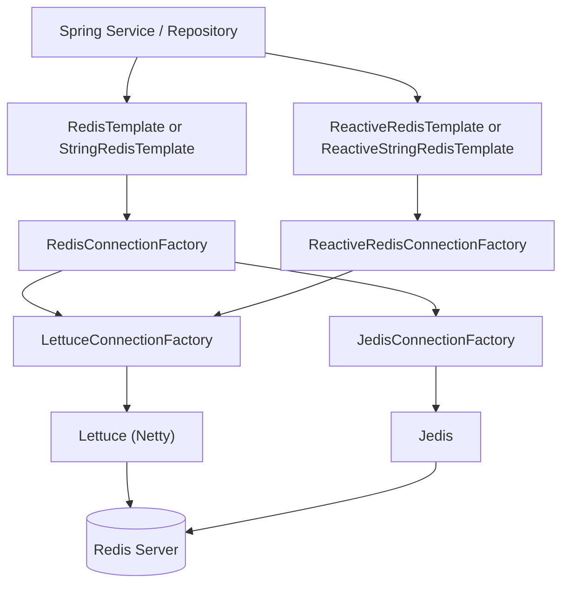

# Distinguishing Between Lettuce and Jedis

## 1. Where do Lettuce and Jedis fit in Spring Data Redis?

When a Spring Boot application calls `StringRedisTemplate.opsForValue().get(key)`, that call does not communicate with Redis directly using networking code written by Spring itself. **Spring Data Redis** provides the API layer and data conversion; underneath, a **Redis client/driver** is responsible for establishing connections, sending commands according to the Redis protocol, and receiving responses.

Two popular Java clients are:

- **Lettuce**: a client built on **Netty**, supporting synchronous, asynchronous, and reactive models. It focuses on non-blocking I/O at the driver layer and sharing regular connections across multiple threads within appropriate safety boundaries.
- **Jedis**: a long-established Java client, notable for its direct Redis command API, easy-to-follow synchronous invocation model, and use of dedicated connections or a connection pool for concurrent multi-threaded calls. Specific Jedis capabilities and APIs vary across versions.

In an application using Spring Data Redis, the dependency layers can be visualized as follows:



The diagram highlights an important point: **`RedisTemplate` is a Spring Data Redis API; Lettuce/Jedis is the underlying driver**. Switching drivers may not require modifying business services if those services operate through `RedisTemplate`. Conversely, application code that directly uses `io.lettuce.core` or `redis.clients.jedis` APIs will be tightly coupled to that library.

`RedisConnectionFactory` is the integration point for the synchronous Spring Data Redis layer. In Spring Data Redis, `LettuceConnectionFactory` can also provide reactive connections; `JedisConnectionFactory` is used for synchronous communication.

> Version note: the configuration examples below follow **Spring Boot 3.x / Spring Data Redis 3.x** conventions. When using Spring Boot 2.x, much older driver versions, or newer versions, verify the documentation and dependency management for the exact version before copying configurations.

## 2. Quick comparison of Lettuce and Jedis

| Criterion | Lettuce | Jedis |
|---|---|---|
| Core I/O mechanism | Based on Netty, asynchronous network communication | Traditional API based on synchronous socket I/O; newer versions may extend the API |
| Common invocation styles | Sync, async, and reactive | Synchronous, direct usage style, easy to follow sequentially |
| Reactive integration in Spring Data Redis | Yes, supports `ReactiveRedisConnectionFactory` | Not the driver used for Spring Data Redis reactive APIs |
| Connection sharing | A regular Lettuce `StatefulRedisConnection` can be used concurrently by multiple threads | A regular `Jedis` connection is not shared across multiple threads; uses a pool or pool-managing abstraction |
| Connection pool | Not required for every regular command; useful for certain workloads/configurations | Typically a key mechanism when multiple threads run synchronous commands |
| Spring integration | `LettuceConnectionFactory` | `JedisConnectionFactory` |
| Default Spring Boot starter choice | Typically Lettuce | Must add/select Jedis when switching drivers |
| Redis Cluster / Sentinel / TLS | Supported, depending on version and configuration | Supported, depending on version and configuration |
| Pipeline, transaction | Yes, via client API and/or Spring Data Redis | Yes, via client API and/or Spring Data Redis |
| Performance | Advantages in asynchronous I/O and managing many concurrent requests in many workloads | Can perform very well with synchronous calls and a properly configured pool |
| When to consider | WebFlux, reactive, high concurrency requirements, wanting Boot defaults | Imperative applications, teams familiar with Jedis, systems with operational experience running Jedis |

**There is no rule that "Lettuce is always faster than Jedis" or "Jedis is always simpler so you must choose Jedis."** Results depend on invocation style, connection count, concurrent requests, value size, network latency, serialization, TLS, client configuration, Redis server, and benchmarks under realistic load.

## 3. Technical nature: Lettuce's asynchronous I/O

### 3.1. Netty and the command processing model

Lettuce uses **Netty** to operate TCP connections and handle I/O with an event loop. An application can send multiple commands concurrently over a regular `StatefulRedisConnection`; the client matches received responses back to their corresponding commands.

```text
Thread A -- GET user:1 -----\
Thread B -- GET user:2 ------> Lettuce connection --> Redis
Thread C -- INCR views -----/         |
                                       +--> Redis responses
                                             |
                                completes matching results
```

The benefit is reducing the need to open a separate socket per thread in suitable scenarios, while also providing async/reactive APIs so the calling thread does not have to wait in a blocking manner for a response.

However, **"Lettuce uses non-blocking I/O" does not mean every application method is non-blocking**. For example:

```java
String value = stringRedisTemplate.opsForValue().get("user:1");
```

With the synchronous `StringRedisTemplate`, **the calling Java thread still waits for the result**. The driver uses Netty at the connection layer, but the application API is synchronous. To build an end-to-end reactive processing pipeline, use `ReactiveStringRedisTemplate`/`ReactiveRedisTemplate`, whose methods return `Mono` or `Flux`.

### 3.2. Thread safety and important exceptions

A regular Lettuce `StatefulRedisConnection` is designed for concurrent use at the driver layer. However:

- **Spring Data Redis's `RedisConnection` wrapper is not guaranteed to be thread-safe**. You should inject and share the Spring-managed **connection factory/template**, rather than holding onto a `RedisConnection` object and handing it out across multiple threads.
- Operations that mutate connection state, such as `MULTI/EXEC` transactions, or blocking commands may need a dedicated connection so they do not unexpectedly interfere with other operations.
- Spring Data Redis's `LettuceConnectionFactory` defaults to a mechanism for sharing a native connection for regular operations and using another connection when needed for blocking/transactions depending on configuration and version.
- If using the Lettuce client directly, you must understand the thread-safety scope and lifecycle of the specific connection type; do not extrapolate from one shareable connection that every Lettuce object can be shared unconditionally.

Lettuce has its own synchronization mechanism for sending/receiving commands and managing connections; application code must still handle business race conditions—for example, a `GET` followed by a `SET` does not become atomic simply because you use Lettuce.

### 3.3. Pooling in Lettuce

When multiple threads call regular Redis commands concurrently, Lettuce can often **reuse a single native connection** instead of allocating a new socket for each call. Therefore, you should not enable a pool solely because HTTP request volume is high.

A pool is still useful in scenarios requiring dedicated connections, blocking commands, transactions, or when measurements show that connection sharing is a bottleneck suited to pooling. A pool increases total connections, consumes resources, can cause waiting to borrow a connection, and requires monitoring; increasing `max-active` does not automatically guarantee higher throughput.

## 4. Technical nature: Jedis's synchronous I/O and connection pool

### 4.1. Regular Jedis connections are not shared across threads

In the traditional model, a `Jedis` object represents a connection using a socket. Multiple threads operating concurrently through **the same regular `Jedis` connection instance** can corrupt read/write state and responses. The appropriate usage is to obtain a dedicated connection for each unit of work or use a pool API designed to manage connection allocation.

```text
Thread A --> borrow connection 1 --\
Thread B --> borrow connection 2 ---> Redis server
Thread C --> borrow connection 3 --/
                   |
             return to pool
```

In code using Jedis directly, a pool can look like:

```java
// Conceptual example using the direct Jedis API; no need to create
// JedisPool manually if the application already uses Spring's JedisConnectionFactory.
try (Jedis jedis = jedisPool.getResource()) {
    String value = jedis.get("product:42");
    System.out.println(value);
} // close the resource to return the connection to the pool
```

Modern Jedis versions provide additional abstractions such as `JedisPooled`; check the specific pool management API for your version. **Do not equate `JedisPool` or `JedisPooled` (a mechanism that manages sharing across multiple connections) with letting multiple threads use a single raw `Jedis` connection simultaneously.**

When working through Spring Data Redis, most applications simply inject `StringRedisTemplate` and let `JedisConnectionFactory` manage connections. Do not call `new Jedis(...)` per controller/request and forget to close resources.

### 4.2. Application threads wait for responses

With the traditional synchronous Jedis API:

```java
String value = jedis.get("product:42");
```

The calling thread waits for I/O to return before continuing. This model fits Spring MVC/imperative applications when the thread pool and timeouts are sized appropriately. The downside is that when Redis slows down, threads can be held up, eventually exhausting request threads or pool connections.

If an application requires an end-to-end reactive pipeline, taking a synchronous Jedis call and wrapping it in `Mono.fromCallable(...)` does not magically turn Jedis I/O into non-blocking I/O. You can offload it to a dedicated thread pool, but that still consumes threads and requires resource management; it does not replace the reactive connection path supported by Spring Data Redis via Lettuce.

### 4.3. A pool does not solve every bottleneck

The appropriate number of connections must be measured. For instance, if there are 200 concurrent requests but the Jedis pool only allows 8 active connections, the remaining requests may have to wait on the pool. Raising the pool to 200 can reduce wait time in some situations, but it can also push too many commands to Redis, increase connections, RAM, and CPU usage, or cause server-side timeouts.

You need to examine simultaneously:

- Active/idle connection counts, connection borrow wait time, and number of requests timing out while waiting.
- Redis command execution time and network time (p95/p99 percentiles).
- Application worker thread count, Redis wait time, and Redis server connection limits.
- Behavior during Redis failover, network loss, and when the pool must recreate connections.

## 5. Which client does Spring Boot use and where do you change it?

For a Spring Boot 3.x application using `spring-boot-starter-data-redis`, **Lettuce is typically the default choice**. Spring Boot manages dependency versions compatible with Spring Data Redis when dependency management/BOM is used properly.

### 5.1. Configuring Lettuce

Gradle Groovy dependency (for a Spring Boot application with plugins/dependency management configured):

```groovy
dependencies {
    implementation 'org.springframework.boot:spring-boot-starter-data-redis'
}
```

`application.yml`:

```yaml
spring:
  data:
    redis:
      client-type: lettuce
      host: localhost
      port: 6379
      connect-timeout: 2s
      timeout: 2s
```

`client-type: lettuce` makes the choice explicit, though it can usually be omitted since it is the starter's default. For sensitive data, configure credentials via environment secret sources and TLS as required; do not place real passwords in example files.

Spring Boot has a dedicated configuration namespace for Lettuce, such as `spring.data.redis.lettuce.pool.*` when pooling is used. Only enable/configure pooling when needed and ensure required dependencies are present, typically including `commons-pool2`. By default, pooling is not necessarily needed for ordinary short commands.

### 5.2. Switching to Jedis

If using Gradle with the Redis starter, you can exclude Lettuce and add Jedis:

```groovy
dependencies {
    implementation('org.springframework.boot:spring-boot-starter-data-redis') {
        exclude group: 'io.lettuce', module: 'lettuce-core'
    }
    implementation 'redis.clients:jedis'
}
```

`application.yml`:

```yaml
spring:
  data:
    redis:
      client-type: jedis
      host: localhost
      port: 6379
      connect-timeout: 2s
      timeout: 2s
      jedis:
        pool:
          max-active: 16
          max-idle: 8
          min-idle: 1
          max-wait: 1s
```

Jedis pooling requires the corresponding pooling library on the classpath (typically Apache Commons Pool 2, depending on the version/starter combination) to activate via Spring Boot's configuration mechanism. Ensure the actual dependency is managed by a compatible BOM rather than forcing an arbitrary Jedis version.

If both Lettuce and Jedis are on the classpath, `spring.data.redis.client-type` helps Spring Boot determine the desired client. When an application declares its own `RedisConnectionFactory` bean, Boot's auto-configuration may back off in favor of the custom bean; in that case, inspect the actual running bean to know which driver is truly in use.

### 5.3. Business services can remain unchanged

Both configurations above can use the same service code:

```java
import java.time.Duration;
import org.springframework.data.redis.core.StringRedisTemplate;
import org.springframework.stereotype.Service;

@Service
public class ProcessStateStore {
    private final StringRedisTemplate redis;

    public ProcessStateStore(StringRedisTemplate redis) {
        this.redis = redis;
    }

    public void markRunning(String processId) {
        redis.opsForValue().set(
                "process:state:v1:" + processId,
                "RUNNING",
                Duration.ofMinutes(10));
    }

    public String currentState(String processId) {
        return redis.opsForValue().get(
                "process:state:v1:" + processId);
    }
}
```

The service depends only on `StringRedisTemplate`, importing neither `Jedis` nor `StatefulRedisConnection`. The underlying driver is chosen in configuration. This keeps business code relatively independent of the client.

Switching drivers does **not** automatically change keys, TTLs, serializers, Redis data, or business behavior. When both use `StringRedisTemplate` with compatible serialization configurations, both drivers can access the same keys. However, you still need to verify connection to the right DB/cluster, authentication, TLS, serializer, and command support for the client version.

## 6. Reactive Redis is a key distinguishing criterion

A Spring WebFlux application usually wants Redis I/O not to block event-loop threads. Spring Data Redis supports reactive connections via **Lettuce** and reactive APIs such as `ReactiveStringRedisTemplate`.

Simple service example:

```java
import java.time.Duration;
import org.springframework.data.redis.core.ReactiveStringRedisTemplate;
import org.springframework.stereotype.Service;
import reactor.core.publisher.Mono;

@Service
public class ReactiveProcessStateStore {
    private final ReactiveStringRedisTemplate redis;

    public ReactiveProcessStateStore(
            ReactiveStringRedisTemplate redis) {
        this.redis = redis;
    }

    public Mono<Boolean> markRunning(String id) {
        return redis.opsForValue().set(
                "process:state:v1:" + id,
                "RUNNING",
                Duration.ofMinutes(10));
    }

    public Mono<Boolean> isRunning(String id) {
        return redis.opsForValue()
                .get("process:state:v1:" + id)
                .map("RUNNING"::equals)
                .defaultIfEmpty(false);
    }
}
```

Here `Mono` represents a future result; composing operations with reactive operators keeps the application from blocking on Redis on the event loop. **Do not call `block()` inside a WebFlux reactive processing flow**, as doing so breaks the non-blocking goal of that model.

Jedis can be used from an application running WebFlux for isolated synchronous work, but **`JedisConnectionFactory` does not fulfill Spring Data Redis's `ReactiveRedisConnectionFactory` path**. When the requirement explicitly calls for `ReactiveRedisTemplate`, choose Lettuce.

On the other hand, running a Spring MVC application does not require using Jedis: Lettuce provides a complete synchronous API and is supported by default in Spring Boot.

## 7. Connections, sharing, and resource lifecycle

### 7.1. Distinguishing template, factory, and native connection

| Component | Role | Recommended usage |
|---|---|---|
| `RedisTemplate` / `StringRedisTemplate` | API for handling operations and serialization | Spring-managed shared bean; finish configuration before use |
| `RedisConnectionFactory` | Creates/provides Spring Data Redis connections | Spring-managed bean |
| `RedisConnection` | Connection wrapper per Spring Data Redis contract | Do not store and share arbitrarily across multiple threads |
| Lettuce `StatefulRedisConnection` | Native connection managed by Lettuce | Typically supports multiple threads for regular operations; watch out for transactions/blocking |
| Regular Jedis connection | Native Jedis connection | Do not share concurrently across threads; borrow/return via pool or factory |
| Pool | Manages connection count and wait time | Size based on measured load, bounded and observable |

A common mistake is thinking each request must create a new `RedisTemplate` or `RedisConnectionFactory`. In reality, templates/factories are usually singleton beans, while the driver/factory mechanism manages the underlying connections.

### 7.2. Blocking commands, transactions, and pipelining

Redis supports blocking commands that wait for data, `MULTI/EXEC` transactions, and pipelining. Both Lettuce and Jedis provide ways to use these mechanisms, but **you must consider connection state**:

- **Blocking** commands like `BLPOP` can hold a connection while waiting for data; do not let them improperly interfere with short requests using the same connection.
- **Transactions** maintain multi-command state until `EXEC` on the corresponding connection; connection management becomes critical.
- **Pipelining** reduces network round-trips when sending multiple commands, but **does not automatically turn them into an atomic transaction**.
- With **Redis Cluster**, multi-key commands and transactions may be constrained by hash slots; switching drivers does not remove that limitation.

In Spring Data Redis, prefer using the transaction/pipeline APIs provided by templates/factories rather than ad-hoc mixing of native Jedis/Lettuce connection controls inside services.

### 7.3. Timeouts and lost connections

A request to Redis goes through stages: acquiring a connection, establishing a network connection (if needed), sending a command, waiting for execution, and reading the response. A timeout can occur at any stage; distinguish between:

- **Connect timeout**: maximum time to establish a connection.
- **Command/read timeout**: time waiting for a command response, as configured in the client and Spring.
- **Pool borrow timeout**: time waiting to borrow a free connection from the pool.
- **Application request timeout**: overall request budget at the Spring/HTTP layer.

Timeouts that are too long can exhaust worker threads or queues; timeouts that are too short cause false failures during slow network conditions or Redis failover. Measure timeouts under realistic network latency, real data, peak load, and primary failover.

**A timeout does not always indicate whether the Redis command executed.** For example, after sending `INCR`, the connection may drop before the response arrives. If the client or application retries unconditionally, the counter can be incremented twice. For non-idempotent operations, you need explicit retry/idempotency design; drivers do not automatically provide "exactly once" business guarantees.

## 8. Redis Standalone, Sentinel, Cluster, and TLS

Both Lettuce and Jedis can operate across multiple Redis deployment topologies, but actual feature support must be verified against your **Spring Data Redis version, driver version, and Redis server**.

### Standalone

The application connects to a single Redis endpoint. Suitable for local development, testing, or environments with a single infrastructure-managed entry point. Both drivers support this model.

### Redis Sentinel

Sentinel monitors and performs primary discovery/failover according to the Sentinel cluster configuration. The client needs the Sentinel configuration, master name, and appropriate authentication. Both Lettuce and Jedis support Sentinel, though topology discovery, reconnection, and request handling during failover can differ by client/version. Do not treat Sentinel as a guarantee against lost writes or failed requests during failover.

### Redis Cluster

Redis Cluster partitions keys by hash slots and can respond with redirects such as `MOVED` or `ASK` when topology changes. The client must support routing and topology updates. Both Lettuce and Jedis have Redis Cluster support; topology refresh, reconnect, and connection count configurations must be evaluated for your specific deployment.

Multi-key operations must follow Redis Cluster rules regardless of which driver connects. If related keys need to be placed in the same slot, you can use hash tags such as `order:{42}:status` and `order:{42}:items`, while weighing load balance to avoid concentrating too many hot keys in a single slot.

### TLS and authentication

Do not store passwords in source code or logs. Use environment secret configuration, TLS as required, and restrict Redis user/ACL permissions. Both drivers can be configured securely, but verify certificate support, hostname verification, URL schemes, and version-specific TLS options.

Commonly used Spring Boot properties example:

```yaml
spring:
  data:
    redis:
      ssl:
        enabled: true
```

Enabling TLS must be paired with matching endpoints, certificates, and server configuration; do not simply add the YAML lines and assume it is secure. For managed Redis, prioritize official connection parameters from the provider.

## 9. Performance evaluation: measure the right problem before switching drivers

Three questions are often conflated:

1. **How long does each command take?** For example, `GET` of a 200-byte value.
2. **How many concurrent requests can the application handle?** Depends on the threading model, connection pool, and Redis server capacity.
3. **How many resources are consumed?** CPU, heap, direct memory, socket count, thread count, GC pressure, and Redis CPU.

Lettuce's asynchronous I/O foundation is advantageous when high concurrency of operations is needed. Jedis can achieve strong performance for synchronous workloads with a properly sized pool. However, localhost micro-benchmarks do not necessarily reflect environments with TLS, network latency, persistence, replication, and mixed commands.

### Realistic benchmark scenario

Suppose a Spring MVC application caches product information:

| Variable to control | Example setup |
|---|---|
| Workload | 80% GET, 15% SET with TTL, 5% INCR |
| Value size | 0.5 KB; 4 KB; 32 KB |
| Concurrency | 10, 50, 200 in-flight requests |
| Redis server | Same Redis version, same CPU/RAM, same configuration |
| Network | Same latency and link; also test TLS if used in production |
| Serialization | Same JSON/string format and payload data |
| Lettuce | Explicitly note whether connection sharing and pooling are enabled |
| Jedis | Explicitly note `max-active`, `max-wait`, and connection wait metrics |
| Metrics | Throughput, p50/p95/p99, timeouts, CPU/heap/sockets, pool wait |

When testing, keep conditions fair. A slow Jedis result caused by an undersized pool only proves **pool configuration is the bottleneck**; a slow Lettuce result caused by blocking the event loop proves **improper usage**. Do not generalize driver characteristics from an unfavorable configuration.

The decision-worthy result is: given your target load and known resource budget, which client achieves more stable p95/p99 SLAs and is easier to operate.

## 10. Choosing a client by application context

| Context | Recommendation | Why |
|---|---|---|
| Creating a new Spring Boot MVC service | Start with default Lettuce | Minimal configuration, well integrated with the starter, and supports sync APIs |
| Spring WebFlux and `ReactiveRedisTemplate` | Choose Lettuce | Provides reactive integration path in Spring Data Redis |
| Existing MVC system running Jedis stably | Continue using Jedis | No need to switch just because the default differs; measure and assess upgrade risks |
| Team needs direct sync Redis APIs and standardized on Jedis | Jedis is a reasonable choice | Familiarity and pool management mechanisms may fit well |
| Very high concurrent Redis operations, avoiding threads waiting on I/O | Prioritize evaluating Lettuce async/reactive | Asynchronous design can reduce thread pressure when the whole app is structured accordingly |
| Heavy use of blocking commands or dedicated transactions | Evaluate how both manage dedicated connections | Connection/transaction requirements matter more than driver name |
| Application experiences high Redis latency | Measure the root cause first | The bottleneck may be network, Redis commands, serializer, pool, or hot keys—not the driver |
| Need Sentinel/Cluster/TLS | Both are candidates | Choose based on support level and failover behavior in your deployed versions |

An effective opening question is **"Which programming model does the application use?"** If it is reactive with Spring Data Redis, Lettuce has a decisive API advantage. If it is imperative, both can work; priority shifts to operability, dependencies, load test results, and team expertise.

## 11. Common misconceptions

### "Lettuce supports non-blocking, so using RedisTemplate won't block"

False. `RedisTemplate` is a synchronous API. If you want a reactive processing flow, you must use the appropriate reactive APIs and avoid introducing blocking calls onto the event loop.

### "Jedis is not thread-safe so it can't be used across multiple requests"

Lacks context. A **raw Jedis connection** should not be used concurrently across threads. However, an application can use a **properly managed pool** to serve many concurrent requests. `JedisConnectionFactory` exists to integrate that connection management into Spring.

### "Lettuce is thread-safe so any RedisConnection can be shared"

False. Shareability of a **regular native `StatefulRedisConnection`** does not mean every Spring wrapper or transaction/connection state can be shared safely. Do not manually share `RedisConnection` across threads; let templates/factories handle the lifecycle.

### "Just increasing the connection pool makes Redis faster"

Not always true. Too small a pool causes waiting, but too large a pool can increase resource usage and server load. Measure pool wait, Redis latency, and throughput before tuning.

### "Switching drivers will fix stale or inconsistent cache data"

Drivers do not automatically solve TTLs, cache invalidation, race conditions, durability, or consistency between Redis and PostgreSQL. Those issues belong to data and business design.

### "A successful Redis connection means failover is verified"

An initial connection only verifies a single condition. You need to test timeouts, network loss, replica promotion, in-flight commands, and client restarts to assess real availability.

## 12. Implementation checklist when using Spring Data Redis

1. **Identify the application model**: imperative or reactive; direct Redis API or via `RedisTemplate`.
2. **Choose the driver via dependency/config**: check the starter defaults and avoid custom versions that conflict with the Spring Boot BOM.
3. **Delegate connection management to Spring**: inject templates/factories; do not create native connections per request without a genuine need.
4. **Choose connection configuration matching the workload**: Lettuce can use a shared native connection for regular commands; Jedis needs appropriate connection/pool management under multi-threaded load.
5. **Configure timeouts, security, and topology**: host, ACL, TLS, Sentinel/Cluster; bound pools and reconnects if the system requires it.
6. **Define clear key naming and serializers**: any driver must read/write the same format during migration.
7. **Measure p95/p99 and errors**: monitor latency, timeouts, connection counts, pool wait, Redis load, and post-failover errors.
8. **Test disruptions and retries**: check whether write operations can execute even when the client reports a timeout; ensure idempotency when needed.
9. **Keep business code driver-independent**: use Spring Data Redis APIs and dedicated adapters; only use native APIs when a feature genuinely requires it.

### A complete decision example

A Spring Boot MVC API service needs to store temporary authentication state for 5 minutes and increment a login counter. The team has not used Redis before. An appropriate starting point is **Lettuce + `StringRedisTemplate`** with clear TTLs, timeouts, and key namespaces; do not enable pooling arbitrarily. If, after measuring real workload, requirements or operations make Jedis advantageous, swap the dependency and `client-type` and retest all related behavior. Authentication logic can keep calling `opsForValue()`.

Conversely, a WebFlux service with a reactive Redis call flow needs **Lettuce + `ReactiveStringRedisTemplate`**, while keeping other I/O components in the pipeline non-blocking. Simply switching to Jedis and calling synchronous APIs from the event loop would alter the load characteristics of the entire service.

**Conclusion on choosing:** Both Lettuce and Jedis are valid Redis clients, with clear differences in connection model and API. **Lettuce** excels in Netty-based I/O, regular connection sharing, sync/async/reactive support, and is the pragmatic default for new Spring Boot applications. **Jedis** suits synchronous call styles and pool-based connection management, especially in systems already standardized on Jedis. Whichever client you pick, proper design of TTLs, serializers, thread safety, timeouts, retries, and Redis failover behavior is what determines application reliability.
