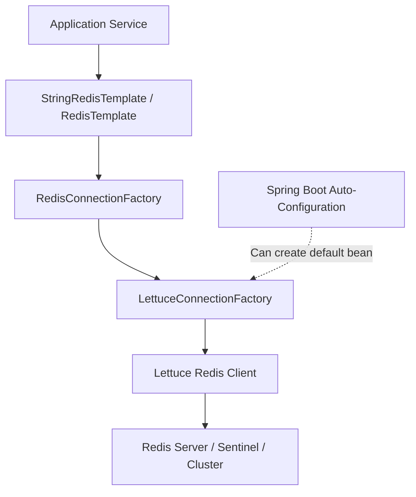

# Configuring `LettuceConnectionFactory` in Spring Data Redis

`LettuceConnectionFactory` is the component that creates and manages Redis connections through **Lettuce**, a Redis client for Java. In a Spring Data Redis application, it bridges infrastructure Redis configuration and APIs such as `RedisTemplate`, `StringRedisTemplate`, or `ReactiveRedisTemplate`. Configuring the factory properly ensures the application selects the right server, authentication, timeouts, TLS, and connection-usage strategy.

This lesson distinguishes two approaches: **letting Spring Boot auto-configure the factory** via application properties, and **manually defining a `LettuceConnectionFactory` bean** when fine-grained control is needed. The Java examples follow Spring Boot 3.x / Spring Data Redis 3.x conventions; property names and certain APIs should be checked against your project's actual versions.

## 1. Where does `LettuceConnectionFactory` sit?

Picture the path of a Redis read operation:



The components have distinct responsibilities:

| Component | Role |
| --- | --- |
| `RedisConnectionFactory` | Spring Data Redis interface providing connections for Redis access APIs. |
| `LettuceConnectionFactory` | Implementation using Lettuce, supporting multiple Redis deployment modes. |
| `LettuceClientConfiguration` | Client-side configuration such as command timeout, SSL/TLS, client options, and pooling when using the corresponding builder. |
| `RedisStandaloneConfiguration` | Connection info for a single Redis server: host, port, database, and credentials. |
| `RedisSentinelConfiguration` | Redis Sentinel info: master name, Sentinel list, and authentication credentials. |
| `RedisClusterConfiguration` | Initial node list for connecting to Redis Cluster and redirect settings. |
| `RedisTemplate` / `StringRedisTemplate` | APIs for executing Redis commands using the provided `RedisConnectionFactory`. |

`LettuceConnectionFactory` implements the Redis connection contracts needed for both synchronous and reactive Spring Data Redis APIs. However, **the factory only describes and manages connections**; it does not start a Redis server, guarantee Redis is available, or determine serialization formats for all data types.

## 2. Preparing dependencies and Redis server

With Spring Boot, the basic dependency in Gradle Groovy DSL:

```groovy
dependencies {
    implementation 'org.springframework.boot:spring-boot-starter-data-redis'
}
```

Gradle Kotlin DSL:

```kotlin
dependencies {
    implementation("org.springframework.boot:spring-boot-starter-data-redis")
}
```

Maven:

```xml
<dependency>
    <groupId>org.springframework.boot</groupId>
    <artifactId>spring-boot-starter-data-redis</artifactId>
</dependency>
```

This starter typically brings `spring-data-redis` and `lettuce-core` onto the classpath. In a Spring Boot application, let the Spring Boot BOM/parent manage dependency versions; avoid pinning a separate Lettuce version without a clear reason.

To practice locally, you can run a test Redis server:

```bash
docker run --name redis-local -p 6379:6379 -d redis:7
docker exec redis-local redis-cli PING
```

The expected output of the second command is `PONG` when the container is running and Redis accepts connections. This is only a local practice setup; network port exposure and authentication must be configured according to your actual deployment infrastructure.

## 3. Preferred approach in Spring Boot: auto-configuration via properties

For most Spring Boot applications, **you do not need to declare `@Bean LettuceConnectionFactory` manually**. When the Redis starter is present, the client type matches, and no custom `RedisConnectionFactory` bean exists, Spring Boot can create a `LettuceConnectionFactory` from properties.

Example `src/main/resources/application.yml`:

```yaml
spring:
  data:
    redis:
      client-type: lettuce
      host: localhost
      port: 6379
      database: 0
      connect-timeout: 2s
      timeout: 3s
```

The properties:

- `client-type: lettuce` explicitly selects Lettuce; when Lettuce is already the default client, it is usually optional.
- `host` and `port` identify the single Redis server.
- `database` selects the logical database in standalone mode, usually `0`.
- `connect-timeout` bounds network connection establishment time.
- `timeout` bounds waiting time for operations as configured by Spring Boot/Lettuce; this is not a guarantee that the entire HTTP request completes within that duration.

Equivalent configuration in `application.properties`:

```properties
spring.data.redis.client-type=lettuce
spring.data.redis.host=localhost
spring.data.redis.port=6379
spring.data.redis.database=0
spring.data.redis.connect-timeout=2s
spring.data.redis.timeout=3s
```

In Spring Boot 3.x, the prefix is `spring.data.redis`. Some Spring Boot 2.x projects use `spring.redis`; do not mix property names without verifying the version.

### Using it immediately after configuration

Spring Boot normally provides `StringRedisTemplate` when auto-configuration conditions are satisfied:

```java
import java.time.Duration;
import org.springframework.data.redis.core.StringRedisTemplate;
import org.springframework.stereotype.Service;

@Service
public class VisitCounterService {
    private final StringRedisTemplate redis;

    public VisitCounterService(StringRedisTemplate redis) {
        this.redis = redis;
    }

    public Long increment(String pageId) {
        String key = "page:visits:" + pageId;
        Long count = redis.opsForValue().increment(key);
        redis.expire(key, Duration.ofDays(7));
        return count;
    }
}
```

This example shows that the service only interacts with the template; Spring injects the factory into the template when creating beans. Incrementing the counter and setting a TTL in two separate commands is not atomic; if the TTL must be set only once or multiple commands must execute together, design the Redis operation appropriately instead of assuming two Java calls form a transaction.

## 4. When do you need to create `LettuceConnectionFactory` manually?

You may create the factory manually if the application needs to:

1. Define specialized Redis configurations that auto-configured properties cannot express accurately.
2. Create **multiple Redis connections** for distinct purposes.
3. Customize `LettuceClientConfiguration`, connection usage, or infrastructure policies as required.
4. Use plain Spring Framework without Spring Boot's auto-configuration.

When you declare a `RedisConnectionFactory` bean yourself, Spring Boot generally stops creating the default factory due to `@ConditionalOnMissingBean`. Therefore, you must actively configure host, port, timeouts, TLS, authentication, and other essential settings; **do not assume every `spring.data.redis.*` property will automatically apply to a bean you constructed yourself**.

### 4.1. Minimal factory for standalone Redis

```java
import org.springframework.context.annotation.Bean;
import org.springframework.context.annotation.Configuration;
import org.springframework.data.redis.connection.RedisStandaloneConfiguration;
import org.springframework.data.redis.connection.lettuce.LettuceConnectionFactory;

@Configuration
public class RedisConfiguration {
    @Bean
    public LettuceConnectionFactory redisConnectionFactory() {
        RedisStandaloneConfiguration server =
                new RedisStandaloneConfiguration("localhost", 6379);
        server.setDatabase(0);

        return new LettuceConnectionFactory(server);
    }
}
```

Steps:

1. `RedisStandaloneConfiguration` describes **which Redis server** to connect to.
2. `new LettuceConnectionFactory(server)` creates a factory using the server details and default Lettuce client configuration.
3. Spring manages the bean lifecycle, including initialization and closing resources when the application context stops.
4. Templates consume the factory via the `RedisConnectionFactory` interface.

In this example, the host is hardcoded solely for readability. In production, host/port/password should come from environment-specific configuration.

### 4.2. Creating `StringRedisTemplate` from a factory

```java
import org.springframework.context.annotation.Bean;
import org.springframework.context.annotation.Configuration;
import org.springframework.data.redis.connection.RedisConnectionFactory;
import org.springframework.data.redis.core.StringRedisTemplate;

@Configuration
public class RedisTemplateConfiguration {
    @Bean
    public StringRedisTemplate customStringRedisTemplate(
            RedisConnectionFactory connectionFactory) {
        return new StringRedisTemplate(connectionFactory);
    }
}
```

In a standard Spring Boot application, auto-configuration can also create `StringRedisTemplate`, so **you do not need to declare another one if the default bean meets your needs**. If creating a second template, use explicit bean names and `@Qualifier` when multiple beans of the same type exist.

## 5. Separating server configuration and client configuration

An important point is that **the Redis address** and **how Lettuce behaves** belong to two configuration layers:

```text
RedisStandaloneConfiguration
  ├── host / port
  ├── database
  ├── username / password
  └── Redis server details

LettuceClientConfiguration
  ├── commandTimeout
  ├── shutdownTimeout
  ├── useSsl
  ├── clientName / clientOptions
  └── pooling options or other client settings
```

Example of a factory with both:

```java
import java.time.Duration;
import org.springframework.context.annotation.Bean;
import org.springframework.context.annotation.Configuration;
import org.springframework.data.redis.connection.RedisStandaloneConfiguration;
import org.springframework.data.redis.connection.lettuce.LettuceClientConfiguration;
import org.springframework.data.redis.connection.lettuce.LettuceConnectionFactory;

@Configuration
public class TunedRedisConfiguration {
    @Bean
    public LettuceConnectionFactory redisConnectionFactory() {
        RedisStandaloneConfiguration server =
                new RedisStandaloneConfiguration("redis.internal", 6379);
        server.setDatabase(0);

        LettuceClientConfiguration client =
                LettuceClientConfiguration.builder()
                        .commandTimeout(Duration.ofSeconds(3))
                        .shutdownTimeout(Duration.ofMillis(200))
                        .clientName("catalog-service")
                        .build();

        return new LettuceConnectionFactory(server, client);
    }
}
```

Explanation:

| Setting | Meaning | Notes |
| --- | --- | --- |
| `commandTimeout` | Wait threshold for a Redis operation executed via Lettuce | Too short can cause false errors under load spikes; too long can stall requests |
| `shutdownTimeout` | Time to wait when closing client resources | Affects shutdown behavior; does not replace command timeout |
| `clientName` | Sets connection name for Redis-side observability | Helps distinguish connection sources, not an authentication identity |
| `database` | Selects the logical database in standalone mode | Cannot be chosen arbitrarily in Redis Cluster |

Do not copy timeout values blindly across all systems. Distinguish TCP connection time, authentication/SSL handshake, command waiting time, and HTTP or business-layer timeouts.

### Detailed connect timeout configuration

If you need to control connect timeout directly in Lettuce, you can use `ClientOptions` and `SocketOptions`:

```java
import java.time.Duration;
import io.lettuce.core.ClientOptions;
import io.lettuce.core.SocketOptions;
import org.springframework.data.redis.connection.lettuce.LettuceClientConfiguration;

SocketOptions socketOptions = SocketOptions.builder()
        .connectTimeout(Duration.ofSeconds(2))
        .build();

ClientOptions clientOptions = ClientOptions.builder()
        .socketOptions(socketOptions)
        .autoReconnect(true)
        .build();

LettuceClientConfiguration client = LettuceClientConfiguration.builder()
        .clientOptions(clientOptions)
        .commandTimeout(Duration.ofSeconds(3))
        .build();
```

This is a client configuration snippet usable inside a factory method, not a complete Java class. `autoReconnect` helps reconnect after failures, but **does not turn in-flight commands into exactly-once transactions**. For writes and timeouts, the application must account for the possibility that Redis already processed the command even if the client never received the reply.

## 6. Configuring authentication and TLS

A Redis server in deployed environments may require username/password and TLS connections. For simple cases, prefer declaring them via Spring Boot configuration:

```yaml
spring:
  data:
    redis:
      host: redis.example.internal
      port: 6380
      username: appuser
      password: ${REDIS_PASSWORD}
      ssl:
        enabled: true
      connect-timeout: 2s
      timeout: 3s
```

`REDIS_PASSWORD` represents an environment variable or secret configuration source supplied by the runtime environment. Never commit real passwords to a repository.

When creating a factory manually, credentials can be passed via `RedisStandaloneConfiguration`:

```java
import org.springframework.beans.factory.annotation.Value;
import org.springframework.context.annotation.Bean;
import org.springframework.context.annotation.Configuration;
import org.springframework.data.redis.connection.RedisPassword;
import org.springframework.data.redis.connection.RedisStandaloneConfiguration;
import org.springframework.data.redis.connection.lettuce.LettuceClientConfiguration;
import org.springframework.data.redis.connection.lettuce.LettuceConnectionFactory;

@Configuration
public class SecureRedisConfiguration {
    @Bean
    public LettuceConnectionFactory redisConnectionFactory(
            @Value("${app.redis.host}") String host,
            @Value("${app.redis.port:6380}") int port,
            @Value("${app.redis.username}") String username,
            @Value("${app.redis.password}") String password) {

        RedisStandaloneConfiguration server =
                new RedisStandaloneConfiguration(host, port);
        server.setUsername(username);
        server.setPassword(RedisPassword.of(password));

        LettuceClientConfiguration client =
                LettuceClientConfiguration.builder()
                        .useSsl()
                        .build();

        return new LettuceConnectionFactory(server, client);
    }
}
```

In this example, `app.redis.*` is an **application-defined property group**, not Spring Boot's auto-configuration Redis properties. Ensure all corresponding variables are provided at runtime.

Security notes:

- SSL/TLS is only secure when server certificates are verified and the trust store/CA is properly configured for the environment.
- Do not disable certificate verification as a "quick fix" for TLS errors in production.
- Do not log passwords or Redis URIs containing credentials.
- In Redis Cluster/Sentinel, credentials for Redis data nodes and for Sentinel may need to be configured separately.
- If secrets rotate, design when connections are recreated rather than assuming an already-created bean will re-read updated values automatically.

## 7. Configuring Redis Sentinel

Redis Sentinel monitors the master and supports master discovery/failover. The application connects to Sentinels to discover the current Redis master rather than hardcoding a single master address.

Manual configuration example:

```java
import org.springframework.context.annotation.Bean;
import org.springframework.context.annotation.Configuration;
import org.springframework.data.redis.connection.RedisSentinelConfiguration;
import org.springframework.data.redis.connection.lettuce.LettuceConnectionFactory;

@Configuration
public class SentinelRedisConfiguration {
    @Bean
    public LettuceConnectionFactory redisConnectionFactory() {
        RedisSentinelConfiguration sentinel =
                new RedisSentinelConfiguration()
                        .master("mymaster")
                        .sentinel("sentinel-1.internal", 26379)
                        .sentinel("sentinel-2.internal", 26379)
                        .sentinel("sentinel-3.internal", 26379);

        return new LettuceConnectionFactory(sentinel);
    }
}
```

Here:

- `mymaster` is the **master name monitored by Sentinel**, not a Redis hostname.
- The `sentinel-*.internal:26379` addresses are Sentinel endpoints, not standalone Redis data nodes.
- Sentinel helps the client find the master after failover; the application must still account for brief errors or disruptions during transition.
- If Redis or Sentinel requires authentication, add the corresponding username/password, and do not copy one password for both when the infrastructure does not share credentials.

In Spring Boot, Sentinel can be configured via YAML if the system only needs the settings Boot provides:

```yaml
spring:
  data:
    redis:
      sentinel:
        master: mymaster
        nodes: sentinel-1.internal:26379,sentinel-2.internal:26379,sentinel-3.internal:26379
```

Choose one clear declaration approach. If a factory bean is defined manually, Sentinel properties in YAML will not automatically modify that bean.

## 8. Configuring Redis Cluster

Redis Cluster partitions data by hash slots across multiple master nodes; the connection factory configuration must match the cluster topology.

Java configuration example:

```java
import java.util.List;
import org.springframework.context.annotation.Bean;
import org.springframework.context.annotation.Configuration;
import org.springframework.data.redis.connection.RedisClusterConfiguration;
import org.springframework.data.redis.connection.lettuce.LettuceConnectionFactory;

@Configuration
public class ClusterRedisConfiguration {
    @Bean
    public LettuceConnectionFactory redisConnectionFactory() {
        RedisClusterConfiguration cluster =
                new RedisClusterConfiguration(List.of(
                        "redis-node-1.internal:6379",
                        "redis-node-2.internal:6379",
                        "redis-node-3.internal:6379"
                ));

        cluster.setMaxRedirects(3);
        return new LettuceConnectionFactory(cluster);
    }
}
```

Spring Boot YAML example:

```yaml
spring:
  data:
    redis:
      cluster:
        nodes:
          - redis-node-1.internal:6379
          - redis-node-2.internal:6379
          - redis-node-3.internal:6379
        max-redirects: 3
```

Cluster considerations:

1. The node list serves as **initial bootstrap points for topology discovery**. You do not necessarily have to list every node, but addresses advertised by the cluster must be reachable from the application environment.
2. Redis Cluster uses logical database `0`; you cannot arbitrarily select database `1` or `2` as in standalone.
3. Many multi-key commands require keys to be in the same hash slot. You can use hash tags, such as `cart:{user42}:items` and `cart:{user42}:total`, to co-locate keys designed to be processed together.
4. `maxRedirects` only bounds redirect handling in applicable cases; it does not replace client topology refresh or retry configuration.
5. Redis Cluster does not automatically make cluster-wide operations atomic; you must examine each command's contract and how Spring Data Redis routes it.

When an application needs proactive topology refresh, custom reconnect, or specific read preferences, you can configure `ClusterClientOptions` / related Lettuce options via `LettuceClientConfiguration`, and pass both cluster configuration and client configuration to the constructor. Only enable such strategies when you understand cluster architecture and the risk of reading stale replicas.

## 9. Lettuce shared connection and pooling

This is the most frequently misunderstood aspect of configuring the factory. With Lettuce, **many regular Redis operations can share a single native connection**. By default, `LettuceConnectionFactory` can manage a shared connection for non-blocking/non-transactional operations. Operations requiring dedicated connections are handled differently. This does not mean every Redis operation uses only one TCP connection in all situations.

### 9.1. `shareNativeConnection`

```java
RedisStandaloneConfiguration server =
        new RedisStandaloneConfiguration("localhost", 6379);

LettuceConnectionFactory factory = new LettuceConnectionFactory(server);
factory.setShareNativeConnection(true);
```

This snippet illustrates the property; in a Spring container, return the factory from a `@Bean` so its lifecycle is managed. `true` is usually the default. When set to `false`, the factory will not share a native connection as above, and operations will obtain connections per the corresponding strategy; this can increase connection creation/acquisition overhead if not designed well.

**Do not disable connection sharing by default to solve throughput problems.** Lettuce has efficient connection and multiplexing mechanics; slowness can stem from Redis commands, networking, payloads, client locks, blocking commands, or an undersized pool.

### 9.2. When is a connection pool needed?

Pooling is helpful when multiple dedicated connections are required, especially in flows whose semantics disallow connection sharing. With Spring Boot using Lettuce, `commons-pool2` is typically an optional dependency to enable pooling via configuration:

```groovy
dependencies {
    implementation 'org.springframework.boot:spring-boot-starter-data-redis'
    implementation 'org.apache.commons:commons-pool2'
}
```

Spring Boot YAML:

```yaml
spring:
  data:
    redis:
      lettuce:
        pool:
          enabled: true
          max-active: 8
          max-idle: 8
          min-idle: 0
          max-wait: 2s
```

`max-active` caps how many connections the pool can lend out concurrently; `max-wait` governs how long callers wait for a connection when the pool is exhausted. Distinguish this from Redis command timeout. Increasing the pool too much can add pressure on the Redis server and network rather than making the app faster.

### 9.3. Manually creating a factory with `LettucePoolingClientConfiguration`

Example when manual configuration is needed:

```java
import java.time.Duration;
import io.lettuce.core.api.StatefulConnection;
import org.apache.commons.pool2.impl.GenericObjectPoolConfig;
import org.springframework.context.annotation.Bean;
import org.springframework.context.annotation.Configuration;
import org.springframework.data.redis.connection.RedisStandaloneConfiguration;
import org.springframework.data.redis.connection.lettuce.LettuceClientConfiguration;
import org.springframework.data.redis.connection.lettuce.LettuceConnectionFactory;
import org.springframework.data.redis.connection.lettuce.LettucePoolingClientConfiguration;

@Configuration
public class PooledRedisConfiguration {
    @Bean
    public LettuceConnectionFactory redisConnectionFactory() {
        GenericObjectPoolConfig<StatefulConnection<?, ?>> pool =
                new GenericObjectPoolConfig<>();
        pool.setMaxTotal(8);
        pool.setMaxIdle(8);
        pool.setMinIdle(0);
        pool.setMaxWait(Duration.ofSeconds(2));

        LettuceClientConfiguration client =
                LettucePoolingClientConfiguration.builder()
                        .poolConfig(pool)
                        .commandTimeout(Duration.ofSeconds(3))
                        .build();

        RedisStandaloneConfiguration server =
                new RedisStandaloneConfiguration("localhost", 6379);

        return new LettuceConnectionFactory(server, client);
    }
}
```

The Java types in this example use Lettuce and Apache Commons Pool 2. In projects using multiple factory configurations, do not create multiple factories just to "separate pools" unless there is a clear need for different Redis servers, authentication, or isolation.

**Keep in mind:** a pool manages borrowing/returning connections; it does not shorten Redis command complexity. If commands like `HGETALL` on a massive hash keep the server busy, a larger connection count usually will not solve the root problem.

## 10. Bean lifecycle and resources

`LettuceConnectionFactory` is a lifecycle-aware bean. When managed by Spring, initialization, startup, and closing of associated resources integrate with the application context. When instantiating the factory with `new` **outside** a Spring context, the developer must invoke the appropriate lifecycle steps manually, or the factory may remain uninitialized or leak resources.

Behaviors to understand:

| Behavior | Meaning |
| --- | --- |
| Bean initialization | Spring injects dependencies and configurations into the factory and executes framework lifecycle callbacks. |
| Acquiring a connection | `getConnection()` provides a `RedisConnection` object for synchronous APIs. |
| Shared native connection | The factory can keep a reusable native connection, depending on configuration and operation type. |
| Dedicated connections | Blocking/transactional operations or special configurations may require dedicated connections. |
| Stopping application context | The factory closes resources and clients according to the bean lifecycle. |

When using templates, applications usually **do not need to call `getConnection()` directly**:

```java
String result = stringRedisTemplate.opsForValue().get("app:status");
```

The template manages acquiring and releasing connections per Spring Data Redis conventions. If an API requires raw connection access, use template callbacks when appropriate to avoid holding connections beyond their expected scope:

```java
String pong = stringRedisTemplate.execute(connection -> connection.ping());
```

A `PING` call verifies sending a command over a connection at that moment, but does not fully reflect load capacity, replication health, or future failover behavior.

### Avoid creating a factory per request

Incorrect usage pattern:

```java
// Do not create a new factory inside each Controller/Service request.
LettuceConnectionFactory factory =
        new LettuceConnectionFactory("localhost", 6379);
```

Recreating factories per request spawns unnecessary client/connection resources and makes lifecycle management difficult. Usually, let Spring manage an appropriate factory as a **singleton bean**, and inject templates into services.

## 11. Multiple Redis servers or multiple connections in the same application

When an application genuinely needs two independent Redis instances (for example, one Redis for caching and one Redis for tokens), declare beans with explicit names:

```java
import org.springframework.beans.factory.annotation.Qualifier;
import org.springframework.context.annotation.Bean;
import org.springframework.context.annotation.Configuration;
import org.springframework.data.redis.connection.RedisConnectionFactory;
import org.springframework.data.redis.connection.RedisStandaloneConfiguration;
import org.springframework.data.redis.connection.lettuce.LettuceConnectionFactory;
import org.springframework.data.redis.core.StringRedisTemplate;

@Configuration
public class MultiRedisConfiguration {
    @Bean("cacheConnectionFactory")
    public LettuceConnectionFactory cacheConnectionFactory() {
        return new LettuceConnectionFactory(
                new RedisStandaloneConfiguration("cache-redis.internal", 6379));
    }

    @Bean("tokenConnectionFactory")
    public LettuceConnectionFactory tokenConnectionFactory() {
        return new LettuceConnectionFactory(
                new RedisStandaloneConfiguration("token-redis.internal", 6379));
    }

    @Bean("cacheRedisTemplate")
    public StringRedisTemplate cacheRedisTemplate(
            @Qualifier("cacheConnectionFactory") RedisConnectionFactory factory) {
        return new StringRedisTemplate(factory);
    }

    @Bean("tokenRedisTemplate")
    public StringRedisTemplate tokenRedisTemplate(
            @Qualifier("tokenConnectionFactory") RedisConnectionFactory factory) {
        return new StringRedisTemplate(factory);
    }
}
```

Service selects the right template:

```java
import org.springframework.beans.factory.annotation.Qualifier;
import org.springframework.data.redis.core.StringRedisTemplate;
import org.springframework.stereotype.Service;

@Service
public class TokenStorage {
    private final StringRedisTemplate tokenRedis;

    public TokenStorage(
            @Qualifier("tokenRedisTemplate") StringRedisTemplate tokenRedis) {
        this.tokenRedis = tokenRedis;
    }

    public String getToken(String id) {
        return tokenRedis.opsForValue().get("token:" + id);
    }
}
```

When multiple factories of the same type exist:

- `@Qualifier` selects the intended target bean, preventing accidental injection of the wrong Redis server.
- If the application or another library expects a default connection factory, you may need `@Primary` or explicit wiring of which bean is used.
- Auto-configurations depending on `RedisConnectionFactory` and default templates may back off or encounter ambiguity depending on setup; clarify which bean serves Spring Cache, repositories, and other injection points.
- Hardcoded host examples illustrate bean relationships; real deployments should pull from environment configuration with proper authentication and TLS.

## 12. Using the factory for reactive Redis

Lettuce provides the foundation for Spring Data Redis reactive APIs. When a project uses reactive processing, you can use `ReactiveStringRedisTemplate` with a factory implementing `ReactiveRedisConnectionFactory`.

Example:

```java
import org.springframework.data.redis.connection.ReactiveRedisConnectionFactory;
import org.springframework.data.redis.core.ReactiveStringRedisTemplate;
import org.springframework.stereotype.Service;
import reactor.core.publisher.Mono;

@Service
public class ReactiveFlagService {
    private final ReactiveStringRedisTemplate redis;

    public ReactiveFlagService(ReactiveStringRedisTemplate redis) {
        this.redis = redis;
    }

    public Mono<Boolean> enable(String id) {
        return redis.opsForValue().set("feature:flag:" + id, "true");
    }

    public Mono<String> read(String id) {
        return redis.opsForValue().get("feature:flag:" + id);
    }
}
```

With Spring Boot, pick the reactive Redis starter or configure the corresponding dependencies and let Boot create the reactive template when conditions match. In plain Spring Framework, you can declare it manually:

```java
@Bean
ReactiveStringRedisTemplate reactiveStringRedisTemplate(
        ReactiveRedisConnectionFactory factory) {
    return new ReactiveStringRedisTemplate(factory);
}
```

This last snippet belongs inside a `@Configuration` class with appropriate imports. Do not call `block()` inside a reactive event loop just to force a Redis call to be synchronous. Distinguish Lettuce's reactive capability from whether the entire application must use WebFlux; those two decisions are related but not identical.

## 13. Determining reasonable timeouts

Applications accessing Redis often involve multiple timeout layers:

```text
HTTP request timeout
    |
    +--> Waiting to borrow a connection (if pooled)
    |       -> pool max-wait
    |
    +--> Establishing TCP/TLS connection
    |       -> connect-timeout
    |
    +--> Sending and waiting for Redis command result
            -> command timeout
```

These three parameters mean different things. For example, setting `commandTimeout=3s` does not guarantee an entire request takes at most 3 seconds, because the request might wait on the pool or execute multiple sequential commands. Likewise, setting a high timeout does not eliminate long blocking commands or failures from an overloaded Redis server.

A design approach:

1. Define target response times for the service, especially p95/p99.
2. Distinguish Redis used as a skippable cache on failure from Redis storing mandatory business state.
3. Set connect timeout/command timeout aligned with deadlines; avoid unbounded retries when the server is slow.
4. Monitor connection count, pool wait time, slow commands, payload sizes, and timeout rates.
5. For timed-out write commands, consider idempotency on retry because the client cannot always know for sure whether Redis processed the command.

## 14. Verifying the factory works properly

After the application starts and Redis server is ready, you can verify a simple command via a template:

```java
import java.time.Duration;
import org.springframework.data.redis.core.StringRedisTemplate;
import org.springframework.stereotype.Component;

@Component
public class RedisSmokeCheck {
    private final StringRedisTemplate redis;

    public RedisSmokeCheck(StringRedisTemplate redis) {
        this.redis = redis;
    }

    public boolean canWriteAndRead() {
        String key = "demo:redis:smoke-check";
        redis.opsForValue().set(key, "ok", Duration.ofSeconds(30));
        return "ok".equals(redis.opsForValue().get(key));
    }
}
```

In environments where multiple applications share Redis, use dedicated namespaces and identifiers for test keys to avoid collisions. Do not run this test write unconditionally in high-frequency health checks; connection verification must consider infrastructure load and existing monitoring mechanisms.

If Spring Boot Actuator and appropriate health contributors are enabled, the application can expose Redis health information; monitor readiness according to operational needs, but do not treat a single successful `PING` as proof that the whole cluster, failover, or all business operations are healthy.

### How to isolate failures when errors occur

| Symptom | Likely areas to investigate | Remediation |
| --- | --- | --- |
| Missing `RedisConnectionFactory` bean | Missing starter/client, auto-configuration excluded, or context missing config | Check actual classpath, auto-configuration conditions, and declared beans |
| Multiple `RedisConnectionFactory` beans, unclear which is injected | Two or more factories without `@Qualifier` / `@Primary` | Add explicit bean names and qualifiers |
| `Connection refused` | Redis not listening at the host/port accessed by the app | Check Docker network, hostname, firewall, port, and Redis server |
| `NOAUTH` or `WRONGPASS` | Wrong password, ACL username, or auth config | Check secrets, ACL users, and Redis configuration |
| SSL handshake failure | Mismatched TLS, CA, hostname, certificate, or port | Verify TLS enabled on server, certificate chain, and trust store |
| Redis command timeout | Network interruption, slow command, overloaded Redis, or too-low threshold | Cross-check metrics, slowlog, payloads, deadlines, and load |
| System slows down after enabling pool | Inappropriate pool bounds or pooling unnecessary | Measure pool wait time, connection count, and operation types |
| Persistent Cluster `MOVED` / `ASK` errors | Incorrect Redis Cluster topology/endpoints or stale client view | Check seed nodes, advertised addresses, NAT, and cluster client config |
| Sentinel cannot find master | Wrong master name, wrong Sentinel port, unreachable nodes, or auth failure | Check Sentinel config and failover state |

### Runtime observability

For production systems:

- Monitor Redis latency, slowlog, and client/server metrics rather than looking only at Java exceptions.
- Inspect `commandTimeout`, pool, retry count, and connection count settings.
- Distinguish bean-creation errors at startup from connection errors occurring on the first command.
- Inside containers/Kubernetes, verify DNS and internal routing; `localhost` always refers to the application process's own network namespace, not another Redis container.
- When using ACL-restricted accounts, confirm required business commands are permitted by the ACL; a successful `PING` does not guarantee all commands are allowed.

## 15. Common design mistakes

### Mistake 1: declaring a manual factory while expecting Boot to apply all properties

```java
@Bean
LettuceConnectionFactory redisConnectionFactory() {
    return new LettuceConnectionFactory("localhost", 6379);
}
```

Even if YAML specifies `spring.data.redis.host=redis-prod`, this factory still holds the hardcoded `localhost` assigned by the developer. If you want Boot to manage the host, remove the manual bean and use auto-configuration; if you create it manually, pass environment configuration into the bean.

### Mistake 2: using one Redis connection across all environments without separating credentials

Hardcoding development host, port, and password in a shared bean can cause staging/production environments to connect to the wrong Redis. Separate configs by profile or environment variables and control secrets.

### Mistake 3: treating connection count as the only answer for performance

If Redis is slow because of full-keyspace scans, long-running scripts, or oversized payloads, tuning `LettuceConnectionFactory`/pools will not address the root cause. Look at command complexity, data strategy, and per-request work limits.

### Mistake 4: configuring Cluster like standalone

Cluster requires seed nodes/topology and enforces hash slot rules. Merely replacing `host` with a single node's name in a standalone config will not deliver the full Cluster behavior the application expects.

### Mistake 5: mixing up connection configuration and serialization

`LettuceConnectionFactory` determines **how to connect to Redis**; `RedisTemplate` and serializers determine **how Java keys/values are converted to bytes**. Changing the factory will not fix "unreadable" data caused by incompatible serializers. When string keys/values are needed, `StringRedisTemplate` is an easy-to-follow choice.

## 16. Practice exercises

**Exercise 1 — Auto-configuration:** create a Spring Boot application with the Redis starter, configure host/port in `application.yml`, inject `StringRedisTemplate`, and write a key with a 60-second TTL. Do not create a factory manually. Explain where the factory bean comes from.

**Exercise 2 — Manual factory:** define a `RedisStandaloneConfiguration` for a test Redis instance and a `LettuceClientConfiguration` with a 2-second command timeout. Create a `LettuceConnectionFactory` bean and a `StringRedisTemplate` using that bean.

**Exercise 3 — Explaining timeouts:** Redis responds slowly; the service has a 1-second connect timeout and a 3-second command timeout. Explain when each timeout applies and why an HTTP request can take longer than 3 seconds.

**Exercise 4 — Two Redis instances:** design two factories for `cache` and `token` with clear bean names; inject two templates via `@Qualifier`. Explain what can happen if the desired bean is not specified.

**Exercise 5 — Sentinel/Cluster:** state the difference between `RedisSentinelConfiguration` and `RedisClusterConfiguration`. Present one scenario where Sentinel supports failover and one scenario where Redis Cluster requires keys to be in the same hash slot.

**Exercise 6 — Pool and performance:** after increasing the pool from 8 to 64 connections, p99 remains high. List the metrics and Redis command types you should inspect before making further client configuration changes.

## Summary

`LettuceConnectionFactory` connects Spring Data Redis to Lettuce and plays a central role in Redis access configuration. With Spring Boot, prefer **the Redis starter + `spring.data.redis.*`** so the framework creates the default bean. Only create the factory manually when clear requirements exist for topology, timeouts, client options, TLS, pooling, or multiple Redis servers. When designing, always separate server configuration, Lettuce client configuration, Spring bean lifecycle management, and template data serialization; then verify with real Redis operations and observe both application and server sides.
