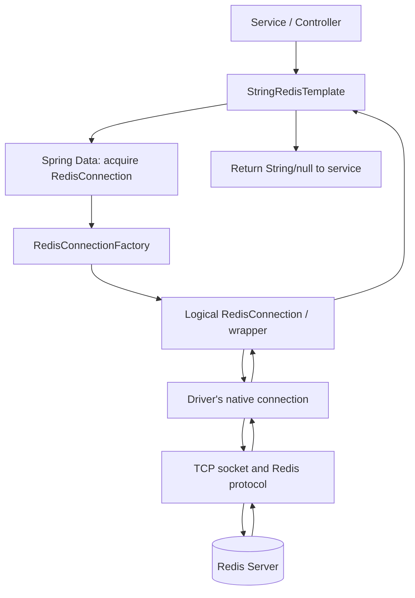

# Distinguishing Spring Logical Connections from Driver Physical Connections

In Spring Data Redis, the phrase "the application opens a Redis connection" can mean several things. A method may borrow a `RedisConnection` object to execute a command, yet **that object does not necessarily correspond to a new TCP socket**. At a lower layer, the Redis driver (typically Lettuce or Jedis) manages one or more actual network connections to communicate with the Redis Server.

This distinction is critical when analyzing performance, configuring connection pools, handling transactions, running blocking commands, investigating client counts on Redis Server, and deciding which objects may be shared across threads.

This lesson is framed within Spring Data Redis, focusing on **how Spring manages a connection at the API layer** and **how the driver manages network resources at the transport layer**.

## 1. Two different "connection" layers

### 1.1. Spring's logical connection: `RedisConnection`

`RedisConnection` is an abstraction under `org.springframework.data.redis.connection`. It exposes Redis command execution capabilities to Spring Data components such as `RedisTemplate`, repositories, and callbacks.

Characteristics:

- Obtained via `RedisConnectionFactory`, e.g. `connectionFactory.getConnection()`.
- An object on the Java application side whose lifecycle is managed by Spring Data or the calling code.
- May simply be a **wrapper/adapter** pointing to a connection maintained by the driver.
- Creating a new `RedisConnection` is not sufficient to conclude that Redis Server sees a new TCP client.
- Do not arbitrarily share a `RedisConnection` instance across threads; Spring Data Redis does not guarantee thread safety for this type of connection object.

When using `RedisTemplate`, developers generally do not hold `RedisConnection` directly: the template acquires a connection, runs the command, and releases the resource according to Spring Data connection management.

### 1.2. Driver's physical connection: native connection and socket

Drivers like Lettuce or Jedis provide their own client/connection objects. Behind a native connection lies the communication resource to Redis Server, usually a **TCP socket** (potentially wrapped in TLS).

Characteristics:

- Created, reused, health-checked, and closed by the Redis driver per configuration.
- Incurs connection setup, handshake, and authentication costs; some setups also negotiate TLS.
- Can be **shared**, **borrowed from a pool**, or **dedicated** for a specific category of operations.
- In Redis Cluster, a logical client may communicate with multiple nodes, so a native connection cannot always be viewed as a single socket for the entire cluster.
- Redis Server counts open network connections as client connections; this count does not equal the number of `RedisConnection` objects Spring previously created.

### 1.3. Three things often lumped together as "a connection"

| Term | Which layer does it live in? | Accurate understanding |
|---|---|---|
| `RedisConnection` | Spring Data Redis | API contract/wrapper for issuing Redis commands |
| Native connection, e.g. Lettuce's `StatefulRedisConnection` or a Jedis connection | Driver | Object used by the driver to manage connection sessions and execute commands |
| TCP socket / client on Redis Server | OS and Redis Server | Actual network channel visible in connection monitoring |

**There is no mandatory 1:1 rule** among these three layers. The ratio depends on the driver, connection-sharing settings, connection pooling, command types, and Redis deployment topology.

## 2. The path of a `RedisTemplate` command

Suppose a service calls:

```java
String value = stringRedisTemplate.opsForValue().get("profile:42");
```

Conceptually, the execution flow is:



Key steps:

1. `StringRedisTemplate` selects the appropriate operation and serializer, then requests a connection from `RedisConnectionFactory`.
2. The factory returns a `RedisConnection` object matching the client configuration.
3. The `GET` command passes to the driver. The driver decides which native connection/socket to use.
4. Redis Server sends data back over the active network connection.
5. Spring Data deserializes the result and releases the **logical connection** according to the template's management rules.

In Spring Data, utilities like `RedisConnectionUtils` participate in acquiring and releasing connections; in transaction synchronization contexts, they can also bind a connection to the current execution thread.

**"Release connection" at the Spring layer does not automatically mean "close the TCP socket."** A physical connection can remain open to serve subsequent operations or be returned to a pool for reuse.

### Timeline example

Suppose an application uses Lettuce with default shared native connection mode for regular commands:

```text
Time           Spring Layer                   Lettuce Layer         Redis Server
──────────     ───────────────────────        ─────────────────     ────────────
t1             Create RedisConnection A ─────┐
t2             A executes GET                ├──── Native N1 ─────── TCP socket S1
t3             Release A ────────────────────┘          │                  │
t4             Create RedisConnection B ─────┐          │                  │
t5             B executes SET                ├──────────┘                  │
t6             Release B ────────────────────┘          │                  │
                                                      N1 can remain open
```

Here, A and B are **two separate logical connection lifecycles** that can share native connection N1 and socket S1. This diagram illustrates one common Lettuce configuration, not a claim that every driver and every operation always uses exactly one socket.

## 3. Is `RedisConnectionFactory` a connection pool?

No. `RedisConnectionFactory` is an **abstract entry point** for obtaining connections in Spring Data Redis. It does not dictate that every `getConnection()` call will:

- Open a new socket.
- Borrow a socket from a pool.
- Return the exact same native connection.

Those behaviors depend on the factory implementation and driver configuration.

Two common implementations:

| Factory | Driver | Practical meaning |
|---|---|---|
| `LettuceConnectionFactory` | Lettuce | Can share a native connection for regular commands; can use dedicated or pooled connections when needed |
| `JedisConnectionFactory` | Jedis | Typically manages Jedis connections via resources or a pool; does not share native connections the way Lettuce does |

Spring Boot with the Spring Data Redis starter typically defaults to Lettuce when Lettuce is present and not overridden by other client configuration. However, code only depends on `RedisConnectionFactory`, so an application can switch drivers without rewriting all services/repositories.

### Factory and connection properties are not identical

The `LettuceConnectionFactory` bean is designed to be safely shared across the application and acts as the provider of connection objects. That **does not make each `RedisConnection` returned by the factory thread-safe**. Likewise, `RedisTemplate` itself can be shared across threads once configured, but you must not store a `RedisConnection` in a singleton field and use it across multiple requests.

## 4. Lettuce: why can multiple `RedisConnection` instances use one socket?

### 4.1. Lettuce native connections can be shared

Lettuce is built on Netty's asynchronous I/O model. Lettuce native connection objects like `StatefulRedisConnection` are designed for concurrent command dispatch from multiple threads in supported scenarios.

Redis is a request/response protocol; Lettuce can send multiple commands over an open connection and correlate returned replies. Consequently, an application does not need to open a socket per `GET` or `SET` command.

However, "can share a socket" **does not mean commands execute truly in parallel on a single Redis instance**. Redis still receives, processes commands, and sends replies according to server mechanics; a shared connection is also subject to bandwidth, latency, timeout, and command queue constraints.

### 4.2. `shareNativeConnection = true`

On `LettuceConnectionFactory`, the `shareNativeConnection` property defaults to `true`. In a standard configuration:

- Multiple Spring `LettuceConnection` instances are created for separate usages.
- Ordinary, non-blocking, non-transactional operations can use **a single shared native connection**.
- Operations requiring a dedicated connection, such as blocking commands or transactions, use another connection via the connection provider.

This is why when an application executes thousands of Redis operations, `CLIENT LIST` on Redis Server **does not necessarily show thousands of TCP connections**.

Diagram:

```text
Request A ── RedisConnection A ──┐
                                 │
Request B ── RedisConnection B ──┼── Shared native Lettuce connection ── TCP S1
                                 │
Request C ── RedisConnection C ──┘

Blocking operation ── RedisConnection D ── Dedicated native connection ── TCP S2
Transaction        ── RedisConnection E ── Dedicated native connection ── TCP S3
```

In this diagram, socket counts are illustrative and also depend on timing, configuration, Redis topology, and pooling. Never divide or equate total requests directly to native connection count.

### 4.3. What does `shareNativeConnection = false` mean?

You can instruct the factory not to share a native connection:

```java
import org.springframework.context.annotation.Bean;
import org.springframework.context.annotation.Configuration;
import org.springframework.data.redis.connection.RedisStandaloneConfiguration;
import org.springframework.data.redis.connection.lettuce.LettuceConnectionFactory;

@Configuration
public class RedisConnectionConfig {

    @Bean
    public LettuceConnectionFactory redisConnectionFactory() {
        RedisStandaloneConfiguration server =
            new RedisStandaloneConfiguration("localhost", 6379);

        LettuceConnectionFactory factory = new LettuceConnectionFactory(server);
        factory.setShareNativeConnection(false);
        return factory;
    }
}
```

With this configuration, Spring calls connect to Redis via dedicated native connections supplied by the provider; if the provider has a pool, they can be **borrowed and returned to the pool** rather than opening/closing sockets each time.

**Inference warning:** Setting `shareNativeConnection(false)` does not automatically guarantee pooling is active. Without an appropriate pool configured, frequent opening/closing of connections can increase TCP setup cost and overhead. When manually declaring a factory bean, avoid overlapping with auto-configuration and configure client settings to match your environment.

## 5. Connection pooling is a different management layer from Spring's abstraction

A connection pool holds a set of reusable physical connections:

```text
Spring requests to borrow a connection
          │
          ▼
┌───────────────────┐
│  Connection pool  │
│  native N1        │ ── TCP S1 ── Redis
│  native N2        │ ── TCP S2 ── Redis
│  native N3        │ ── TCP S3 ── Redis
└───────────────────┘
          ▲
          │
Spring releases connection
→ native connection is returned to pool (if borrowed from pool and still valid)
```

Separate four concepts:

| Concept | Explanation |
|---|---|
| Acquire / borrow | Obtain a connection from a provider or pool for use |
| Release / return | Relinquish usage rights, allowing the connection to be reused |
| Close native connection | Close driver resources, usually closing the underlying socket |
| Close Spring `RedisConnection` | End the Spring wrapper's lifecycle; native-layer outcome depends on the factory and connection source |

**Pooling is not the default answer for every Lettuce application.** With a shareable native connection, many normal commands already perform efficiently over a small number of sockets. Pooling helps for operations needing dedicated connections or when architecture demands resource isolation, but enlarging a pool does not automatically improve throughput.

### Pool configuration example with Spring Boot

When an application uses Lettuce and includes the appropriate pooling dependency (typically `commons-pool2`), you can configure:

```groovy
dependencies {
    implementation 'org.springframework.boot:spring-boot-starter-data-redis'
    implementation 'org.apache.commons:commons-pool2'
}
```

```yaml
spring:
  data:
    redis:
      host: localhost
      port: 6379
      lettuce:
        pool:
          enabled: true
          max-active: 8
          max-idle: 8
          min-idle: 0
          max-wait: 2s
```

Where:

- `max-active` is the number of connections the pool allows to be borrowed concurrently per pool configuration.
- `max-idle` is how many idle connections the pool may retain; `min-idle` is the target minimum idle connections depending on implementation.
- `max-wait` bounds waiting to borrow a connection from an exhausted pool, **distinct from a Redis command timeout**.

Enabling pooling does not mean every `GET` via `RedisTemplate` automatically pulls a dedicated socket from the pool. **While Lettuce still shares a native connection, ordinary operations may continue using the shared connection**; the pool primarily serves paths needing dedicated connections. Total sockets seen by Redis Server can exceed a single pool's `max-active` limit due to shared connections, other clients, monitoring connections, or multiple nodes.

Do not set `max-active` equal to expected HTTP request counts. Base sizing on Redis command types, true concurrency of operations requiring dedicated connections, latency, and server resource limits.

## 6. Why do blocking commands and transactions need special attention?

Not every Redis command fits a shared connection meant for regular operations.

### 6.1. Blocking commands

For example, Redis supports `BLPOP` / `BRPOP` to wait for items to appear in a list. Using a shared socket that also serves other commands could stall processing on that connection longer than expected.

Therefore, with `LettuceConnectionFactory` in shared native connection mode, blocking operations typically execute on **dedicated connections**.

An illustrative Spring Data Redis call:

```java
import java.time.Duration;
import org.springframework.data.redis.core.StringRedisTemplate;
import org.springframework.stereotype.Service;

@Service
public class QueueConsumer {
    private final StringRedisTemplate redis;

    public QueueConsumer(StringRedisTemplate redis) {
        this.redis = redis;
    }

    public String waitForJob() {
        return redis.opsForList()
            .leftPop("jobs:pending", Duration.ofSeconds(5));
    }
}
```

If no item exists, the operation can wait up to the timeout. When many consumers block simultaneously, native connections used for that group of operations can grow with concurrent waiters, even while other `GET`/`SET` commands still share a single native connection.

### 6.2. Redis transactions

`MULTI`, `EXEC`, and `DISCARD` establish transaction state on **a specific Redis connection**. If commands of a transaction are scattered across sockets belonging to different sessions, transactional semantics break.

Spring Data provides ways to keep the same connection context within a session, such as through `SessionCallback`:

```java
import java.util.List;
import org.springframework.data.redis.core.RedisOperations;
import org.springframework.data.redis.core.SessionCallback;
import org.springframework.data.redis.core.StringRedisTemplate;

public class CounterWriter {
    private final StringRedisTemplate redis;

    public CounterWriter(StringRedisTemplate redis) {
        this.redis = redis;
    }

    public List<Object> writeBatch() {
        return redis.execute(new SessionCallback<List<Object>>() {
            @Override
            @SuppressWarnings({"rawtypes", "unchecked"})
            public List<Object> execute(RedisOperations operations) {
                operations.multi();
                operations.opsForValue().set("metric:stage", "done");
                operations.opsForValue().increment("metric:count");
                return operations.exec();
            }
        });
    }
}
```

In this example, `SessionCallback` bounds a group of operations sharing an appropriate connection context; Spring Data coordinates the connection for the transaction. Redis transactions themselves only guarantee `MULTI/EXEC` semantics and **have no automatic rollback like relational databases** once a command has run.

Nor should you assume that merely placing `@Transactional` on a service automatically turns all Redis commands into a Redis transaction. Integrating Spring transaction synchronization with Redis requires corresponding configuration (for example `RedisTemplate.setEnableTransactionSupport(true)` when using that integration style) and clear understanding of read/write command semantics.

### 6.3. Pipelining and Pub/Sub

- **Pipelining:** Multiple commands are sent without waiting for individual round-trip replies; results are collected afterward. The command batch needs a consistent session/connection context during pipelining. That mechanism does not turn the batch into a transaction.
- **Pub/Sub:** A subscription outlives a normal `GET` command. The driver may manage a dedicated connection or specialized resources for subscribing, depending on API and configuration.

These examples show that **operation type** drives native connection needs, not merely API call count.

## 7. Lettuce vs. Jedis: same Spring API, different connection strategies

Spring Data Redis supports multiple drivers, but native connection characteristics differ.

| Aspect | Lettuce | Jedis |
|---|---|---|
| I/O foundation | Supports asynchronous I/O, built on Netty | Traditional synchronous API; newer versions add additional capabilities |
| Sharing native connection across threads | Provides connection APIs designed as thread-safe for regular command dispatch | Never share a regular Jedis instance across multiple threads |
| Usage in Spring | `LettuceConnectionFactory` can share a native connection | `JedisConnectionFactory` manages connection resources per Jedis's model, usually tied to a pool |
| Pool need | Helpful depending on command paths and configuration, not default for all commands | Pooling is usually essential to share connection resources across worker flows |
| Spring Data business code | Still calls `RedisTemplate`, repositories, `RedisConnectionFactory` | Also calls the corresponding Spring Data APIs |

**Practical rule:** When reading logs or docs saying "Spring opens a connection per command call," ask **are they talking about the Spring `RedisConnection` object or the driver's physical socket?** A statement can be true at the logical layer yet false if interpreted as a new TCP connection for every command.

## 8. Java example: manually managing connection lifecycle properly

`StringRedisTemplate` should be the default choice because it manages the Spring connection lifecycle per operation. When low-level APIs are genuinely needed, obtain a connection from the factory:

```java
import java.nio.charset.StandardCharsets;
import org.springframework.data.redis.connection.RedisConnection;
import org.springframework.data.redis.connection.RedisConnectionFactory;
import org.springframework.stereotype.Service;

@Service
public class RawRedisReader {
    private final RedisConnectionFactory connectionFactory;

    public RawRedisReader(RedisConnectionFactory connectionFactory) {
        this.connectionFactory = connectionFactory;
    }

    public String read(String key) {
        RedisConnection connection = connectionFactory.getConnection();
        try {
            byte[] rawKey = key.getBytes(StandardCharsets.UTF_8);
            byte[] rawValue = connection.stringCommands().get(rawKey);
            return rawValue == null
                ? null
                : new String(rawValue, StandardCharsets.UTF_8);
        } finally {
            connection.close();
        }
    }
}
```

Here:

1. `getConnection()` acquires a connection object at the **Spring Data layer**.
2. `stringCommands().get(...)` forwards the command via the adapter and driver.
3. `close()` ends the lifecycle of the **borrowed connection object**. On a factory sharing a native connection, this does not necessarily close the shared socket. With a pool, releasing may return the connection to the pool.

This snippet demonstrates basic lifecycle handling for manual connection management; applications using Spring transaction synchronization, callbacks, or connection binding should prefer template/callback APIs to avoid prematurely closing a Spring-managed connection.

Never keep a `connection` in a singleton field:

```java
// Avoid designs like this:
// @Service
// class BadRedisService {
//     private final RedisConnection sharedConnection;
//     BadRedisService(RedisConnectionFactory factory) {
//         this.sharedConnection = factory.getConnection();
//     }
// }
```

This design makes the connection lifecycle hard to control, risks errors under concurrent requests, and prevents timely resource release.

## 9. Practical observation: count sockets, not Java calls

### 9.1. Inspecting from Redis Server

In a test environment's Redis CLI:

```redis
INFO clients
CLIENT LIST
```

`connected_clients` in `INFO clients` is the number of client connections recorded by Redis Server at the moment of inspection. `CLIENT LIST` shows details per client, such as network address, client name (if set), state, and session attributes.

A hands-on check:

1. Start a Spring Boot application using `StringRedisTemplate` and Lettuce in normal configuration.
2. Hit an API performing 1, 10, then 1,000 sequential `GET`/`SET` operations.
3. Check `INFO clients` / `CLIENT LIST` before and after each batch.
4. Do not expect `connected_clients` to rise by 1,000 merely because the app ran 1,000 commands.
5. Run concurrent blocking consumers and observe additional connections; exact behavior depends on the active driver and pool.

**Measurement note:** Your `redis-cli` session itself counts as a client. Monitoring agents, health checks, Pub/Sub, Redis Insight, and other processes all open their own clients; observed counts may not belong solely to the test app. Connections can also open and close quickly, so a snapshot does not reflect connection churn over an interval.

### 9.2. Measuring from the application side

Useful observability angles:

- Track Redis command duration and timeout errors; do not attribute latency solely to connection counts.
- When pooling is used, monitor active, idle, pending/waiting counts, and borrow timeouts if supported by your implementation and metrics system.
- Inspect driver metrics/logs (Lettuce or Jedis) alongside Redis Server client counts.
- Under Redis Cluster, check each appropriate node because one application client can hold connections to multiple nodes.
- If frequently instantiating new `RedisConnectionFactory` instances or manual Redis clients outside Spring bean lifecycle, check factory/client shutdown to prevent unmanaged network connections.

**Do not use** `System.identityHashCode(factory.getConnection())` to measure socket count. That only identifies the **Java wrapper object**, not the underlying native connection or TCP socket.

## 10. Misconceptions that lead to misconfiguration

### "Every `RedisTemplate.opsForValue().get()` opens a new TCP connection"

Not necessarily. The call may use a fresh logical `RedisConnection` or a session-managed one while Lettuce reuses a shared native connection. Only the driver and specific configuration determine socket usage.

### "With Lettuce you never need a pool"

Not true in all cases. Blocking commands, transactions, and paths requiring dedicated connections can benefit from pooled connection management. It also depends on isolation requirements, concurrency, and client configuration.

### "Once pooling is enabled, every Redis command borrows a socket from the pool"

Not necessarily with `LettuceConnectionFactory` when `shareNativeConnection=true`. Ordinary operations can still go through the shared native connection while the pool supplies connections for other operations.

### "`RedisConnection` is thread-safe because `RedisTemplate` is thread-safe"

These two objects have different contracts. `RedisTemplate` can be used concurrently once configured; individual Spring Data `RedisConnection` instances must not be shared across threads. Conversely, a Lettuce native connection can be designed for concurrent use, so you cannot infer wrapper thread safety backward from the driver either.

### "Pool `max-active=8` means Redis Server will have at most 8 clients"

A pool limit does not cap every connection in the system. There can still be shared native connections, health-check connections, subscribers, external clients, or multiple pools/nodes.

### "Closing `RedisConnection` closes the TCP socket"

`close()` ends the Spring object's lifecycle. Depending on context, the native connection may stay shared, return to a pool, or actually close. Never assume socket behavior purely from the method name `close()`.

### "One HTTP request must correspond to one fixed Redis connection"

No such rule exists. One request may call Redis many times; templates manage connections per operation or per session/transaction context. Many requests can share a safe Lettuce native connection.

### "Increasing the pool definitely makes Redis faster"

If the bottleneck is Redis Server, data modeling, network latency, slow commands, or command volume, increasing the pool may not help and can increase resource consumption. Measure before enlarging.

## 11. Scenarios requiring connection-layer reasoning

| Phenomenon | Angle to inspect |
|---|---|
| 500 requests/s yet Redis Server sees only a few TCP clients | Physical connections may be reused; this is not automatically an error |
| Redis shows many clients when running concurrent `BLPOP` | Blocking commands typically need a dedicated native connection per waiting session |
| Logs report "pool exhausted" | Pool cannot supply enough connections to borrowers; check borrowers, hold duration, and pool settings |
| `RedisTemplate` works across threads while holding `RedisConnection` fails | Difference in thread-safety contract between template and logical connection |
| `CLIENT LIST` has more sockets than `max-active` | Connections outside that pool, multiple nodes, or multiple connection sources |
| Switching Lettuce to Jedis changes TCP client count | Both drivers have different native connection and pooling mechanics |
| A transaction behaves unexpectedly | Check transaction support config and how the connection context is preserved, not just socket count |
| Redis timeouts despite free connections in pool | Likely server/network/command latency rather than connection shortage |

## 12. Choosing configuration by application needs

**Case A — Standard caching and CRUD operations:** Use Spring-managed `StringRedisTemplate` / `RedisTemplate` beans or Redis Repositories, keeping `LettuceConnectionFactory` with normal native connection sharing unless special constraints exist. Monitor latency and actual connection counts.

**Case B — Many consumers running blocking commands:** Account for concurrent waiters, use appropriate dedicated connection/pool allocation, and check Redis client limits. Do not size based solely on `GET` traffic.

**Case C — Heavy Redis transactions:** Use Spring Data's session/transaction support mechanisms, clearly scope connection lifecycles, and track dedicated native connection counts. Never mix independent transactional command groups onto the same connection object without safeguards.

**Case D — Rising pool wait times:** Separate **connection borrow waits** from **slow Redis commands**. Only enlarge the pool after confirming connection shortage is the bottleneck; also inspect long connection holds, blocking commands, and Redis Server resources.

**Case E — Redis Cluster or multi-endpoint topologies:** Do not assume one factory maps to a single socket. The driver can open connections to multiple nodes, and each Redis Server node only sees clients connected to that node.

## 13. Self-check questions

**Question 1.** A service calls `redisTemplate.opsForValue().get()` 100 times. Can we conclude Redis Server received 100 TCP connections?

**Answer:** No. Spring Data may create or acquire a logical connection per use, while the driver can reuse one or a few native connections/sockets.

**Question 2.** `RedisConnectionFactory.getConnection()` returns a new object. What does this prove?

**Answer:** It only indicates the caller received a `RedisConnection` object at the Spring layer. It is insufficient to conclude there is a new native connection or a new TCP socket.

**Question 3.** With Lettuce `shareNativeConnection=true`, why can Redis still see extra sockets when running blocking commands?

**Answer:** Operations needing dedicated connections such as blocking commands or Redis transactions can be assigned other native connections while ordinary commands continue using the shared connection.

**Question 4.** A `RedisTemplate` Spring bean can be used across threads. Can we store a single `RedisConnection` instance in a singleton service and use it the same way?

**Answer:** No. `RedisConnection` is a wrapper/abstraction with its own lifecycle and thread-safety limits. Let templates manage connections, or acquire and release connections strictly within a single usage scope.

**Question 5.** Enabling Lettuce pooling with `max-active: 8` caps all Redis sockets at 8—true or false?

**Answer:** False. That number applies to that specific pool and excludes connections from other clients, shared connections, subscriptions, or other nodes.

**Question 6.** Why must `MULTI` and `EXEC` stay on the same connection?

**Answer:** Transaction state belongs to a single connection session with Redis Server. Switching native connection context mid-stream breaks intended transaction execution.

### Takeaways

- **Spring `RedisConnection` is a logical connection** serving framework APIs and operation lifecycles.
- **Driver native connections and TCP sockets are physical connection resources** for communicating with Redis Server.
- **Lettuce can share a native connection** for regular commands, so Java object count does not equal socket count.
- **Pooling, blocking commands, Redis transactions, and Redis topology** all affect how many physical connections are used.
- Identify which layer you are measuring—**Java objects, pool borrows, native connections, or TCP clients**—before drawing conclusions about performance or connection leaks.
