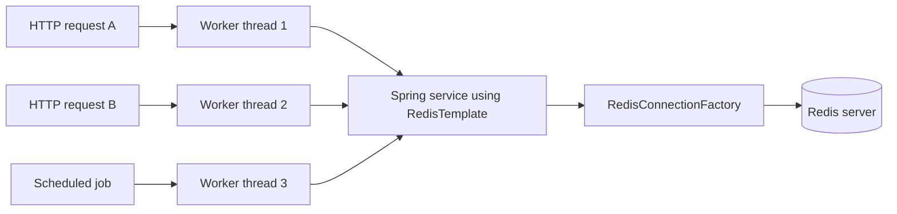
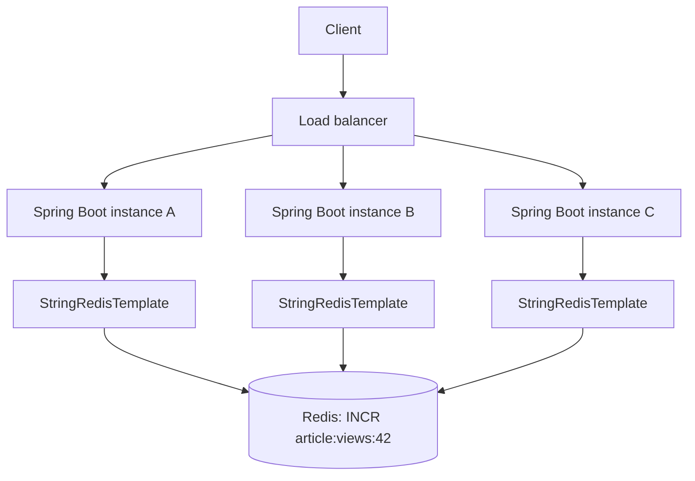

# Rules for Using `RedisConnection` Across Multiple Threads

When a Spring Boot application handles many HTTP requests, runs `@Async` tasks, uses an `ExecutorService`, or has multiple consumers accessing Redis concurrently, a common question is: **can we grab one `RedisConnection` and share it across all threads to save connections?**

**Fundamental rule: Never share a Spring Data Redis `RedisConnection` object across multiple threads.** Connection objects supplied by `RedisConnectionFactory` are meant for the scope of a single operation or properly managed session. At the application layer, share **`RedisConnectionFactory` and a fully configured `RedisTemplate`/`StringRedisTemplate`**, letting each call acquire and release connections through Spring Data Redis mechanics.

This rule still holds when using **Lettuce**, even though Lettuce's own native connection supports concurrent access. The native driver connection and Spring's `RedisConnection` abstraction are **two objects at different layers** with different usage contracts.

This lesson explains the connection layers, safe usage in multi-threaded environments, practical Java examples, transaction/pipeline scenarios, and common misconceptions around atomicity.

## 1. Context: Spring Boot has multiple threads accessing Redis concurrently

In a Spring MVC application, many requests may be processed concurrently on worker threads. An application can also run schedulers, executors, listeners, and background jobs.



For example, three threads all want to increment the view count of product `42`:

```text
Thread A → INCR views:product:42
Thread B → INCR views:product:42
Thread C → INCR views:product:42
```

Redis executes each `INCR` command as an atomic operation on that key. However, this **does not mean** every Java connection-management pattern is thread-safe. Two concerns must be separated:

1. **Thread safety of the client/connection object in the JVM:** can the same instance be used from multiple threads?
2. **Data correctness in Redis:** does the command or sequence of commands prevent lost updates, race conditions, and duplicate processing?

It is entirely possible to use a thread-safe Redis access API while still creating business race conditions by choosing a non-atomic sequence of commands.

## 2. Distinguishing four layers often called "connection"

| Layer | Example | Usage in Spring |
|---|---|---|
| **Factory** | `RedisConnectionFactory`, `LettuceConnectionFactory` | Bean configuring and supplying connections, typically shared application-wide |
| **Template** | `RedisTemplate<K, V>`, `StringRedisTemplate` | Redis operation API, typically singleton and used by multiple threads once configured |
| **Spring connection** | `RedisConnection` acquired from factory/callback | Working object with a scoped lifecycle; **never pass to another thread or store for sharing** |
| **Native driver connection** | Lettuce `StatefulRedisConnection` or a Jedis connection | Follows driver-specific contract; not identical to `RedisConnection` |

Visualizing the call path:

```text
Thread A ──┐
           ├─> singleton StringRedisTemplate ─> RedisConnectionFactory
Thread B ──┘                                    │
                                               ├─> RedisConnection for operation A
                                               └─> RedisConnection for operation B
                                                            │
                                             Driver native client / socket
                                                            │
                                                        Redis server
```

Two calls may receive **two separate `RedisConnection` wrappers** yet share the same underlying native network connection, depending on the driver and factory configuration. Therefore, never assume "every `getConnection()` call definitely opens a new TCP socket."

### 2.1. `RedisConnectionFactory`

The factory is responsible for creating and granting access to connections. Spring Boot typically auto-configures the factory when the Redis starter and matching connection properties are present. For many Spring Boot applications, **Lettuce** is the default driver.

By design, the factory is normally a shared bean:

```java
@Service
public class RedisBackedService {
    private final RedisConnectionFactory factory;

    public RedisBackedService(RedisConnectionFactory factory) {
        this.factory = factory;
    }
}
```

Keeping a reference to **the factory** inside a singleton service is normal. The factory manages configuration and connection lifecycle; never create and destroy an entire factory per HTTP request.

### 2.2. `RedisTemplate` and `StringRedisTemplate`

`RedisTemplate` is designed to be shared across threads **after configuration is complete**. The template handles connection/callback management, serialization, exception translation, and various Spring integrations.

```java
@Service
public class CounterService {
    private final StringRedisTemplate redis;

    public CounterService(StringRedisTemplate redis) {
        this.redis = redis;
    }

    public Long increment(String name) {
        return redis.opsForValue().increment("counter:" + name);
    }
}
```

Multiple requests can call `increment()` on the same singleton `CounterService` and the same `StringRedisTemplate`. Each call executes work via Spring Data Redis mechanics; the service **never stores a `RedisConnection` in a field**.

Template thread safety applies after initialization/configuration. Do not mutate the serializer, connection factory, or configuration properties of the same template while threads are actively using it.

### 2.3. Spring Data Redis's `RedisConnection`

`RedisConnection` is the abstraction for low-level Redis commands. A connection wrapper may carry state such as:

- A `MULTI`/`EXEC` transaction or `WATCH` operations.
- An open pipeline.
- Internal connection/session state and related resources.
- Rules for closing, releasing, or synchronizing with the current thread.

Because of these factors, **never pass a `RedisConnection` across multiple worker threads**, even when individual commands look independent. Nor should you store a connection as a singleton bean field to reuse across requests.

### 2.4. Lettuce's native connection is not `RedisConnection`

Lettuce provides native connections such as `StatefulRedisConnection`, designed for concurrent use across threads in driver-supported scenarios. `LettuceConnectionFactory` can default to sharing one native connection for **non-blocking, non-transactional** operations while supplying separate connection paths for operations needing isolation.

That **does not translate the native connection's thread safety into a thread-safe contract for the `LettuceConnection`/`RedisConnection` wrapper**. When programming against Spring Data Redis, respect the Spring abstraction and let the factory/template manage connections.

With Jedis, a regular `Jedis` connection object must not be shared across threads. When multiple concurrent clients are needed, pooling/factory mechanisms must allocate appropriate resources per operation. Never mechanically apply Lettuce assumptions to Jedis or vice versa.

## 3. Safe usage rules

| Component / scenario | Share across threads? | Proper practice |
|---|---|---|
| `RedisConnectionFactory` bean | **Yes**, per Spring lifecycle/configuration | Inject into services that need it |
| Configured `RedisTemplate` | **Yes** | Inject singleton, call methods on each thread |
| Configured `StringRedisTemplate` | **Yes** | Use for string data and counters |
| `RedisConnection` from `getConnection()` | **No** | Acquire, use, close within the same unit of work |
| `RedisConnection` passed to `RedisCallback` | **No** | Use synchronously only inside the callback |
| `RedisConnection` used for transaction/pipeline | **No** | Keep all logic within the same session/callback |
| Lettuce native `StatefulRedisConnection` | Per Lettuce contract | Use directly only when native API is genuinely needed and limits are understood |
| `Jedis` connection instance | **No** | Use pool/factory per Jedis design |

A quick mnemonic:

```text
Sharing Redis management beans → usually right
Sharing RedisConnection        → wrong usage scope
Sharing the same Redis data    → normal, but must choose right commands/logic
```

## 4. Correct example: multiple threads calling one `StringRedisTemplate`

Suppose an application has a bean tracking article view counts.

```java
package example.redis;

import org.springframework.data.redis.core.StringRedisTemplate;
import org.springframework.stereotype.Service;

@Service
public class ArticleViewService {

    private final StringRedisTemplate redis;

    public ArticleViewService(StringRedisTemplate redis) {
        this.redis = redis;
    }

    public Long registerView(long articleId) {
        String key = "article:views:" + articleId;
        return redis.opsForValue().increment(key);
    }

    public String currentViews(long articleId) {
        return redis.opsForValue().get("article:views:" + articleId);
    }
}
```

A controller, scheduled job, or another service simply injects `ArticleViewService` and calls:

```java
Long newCount = articleViewService.registerView(42L);
```

When multiple threads call concurrently:

```text
Thread 1 ─┐
Thread 2 ─┤
Thread 3 ─┼─> ArticleViewService.registerView(42)
Thread 4 ─┘             │
                        └─> StringRedisTemplate.opsForValue().increment(...)
                                      │
                                Redis INCR
```

When not inside a pipeline/transaction that alters result delivery, `INCR` returns the key's new value. Redis handles integer increment on the server, avoiding the race of a Java read–add–write approach.

### 4.1. Simulating concurrent calls

The following snippet shows tasks **sharing the service/template**, not sharing `RedisConnection`:

```java
import java.util.ArrayList;
import java.util.List;
import java.util.concurrent.ExecutorService;
import java.util.concurrent.Executors;
import java.util.concurrent.Future;

public void simulateConcurrentViews(ArticleViewService service)
        throws Exception {

    ExecutorService executor = Executors.newFixedThreadPool(8);

    try {
        List<Future<Long>> futures = new ArrayList<>();

        for (int i = 0; i < 100; i++) {
            futures.add(executor.submit(() -> service.registerView(42L)));
        }

        for (Future<Long> future : futures) {
            future.get();
        }
    } finally {
        executor.shutdown();
    }
}
```

Futures let the caller observe whether tasks succeeded or threw exceptions. The counter increments by 100 **if all 100 operations execute successfully and no external actor modifies or deletes the key**.

In real applications, executors should be managed with proper lifecycles, bounded task queues, and shutdown hooks; never create a new executor per request.

The key point is that threads share **thread-safe beans**, while acquiring and releasing connections remain hidden inside Spring Data Redis.

## 5. Incorrect example: storing `RedisConnection` in a singleton field

The following code is an anti-pattern:

```java
// WRONG: illustrates a bug, do not apply.
@Service
public class UnsafeCounterService {

    private final RedisConnection connection;

    public UnsafeCounterService(RedisConnectionFactory factory) {
        this.connection = factory.getConnection();
    }

    public Long increment(byte[] key) {
        return connection.stringCommands().incr(key);
    }
}
```

Because `UnsafeCounterService` is a singleton, multiple requests share `this.connection`:

```text
Thread A ─┐
Thread B ─┼──> same RedisConnection instance
Thread C ─┘
```

Risks include:

- Transaction or pipeline state from one operation leaks into another.
- One thread closes the connection while another thread is still using it.
- Resources are held indefinitely, violating expected lifecycles.
- Bugs that appear only under high load and are hard to reproduce in single-threaded tests.

Do not fix this by adding `synchronized` to every method while still holding the connection long-term. Java synchronization does not solve lifecycle, timeout, thread-bound transaction, or driver resource allocation requirements.

The proper alternative is to inject `StringRedisTemplate` or `RedisConnectionFactory`, acquiring connections strictly within each task's scope when low-level APIs are required.

## 6. Using `RedisConnection` directly when genuinely needed

Templates are the default choice for most operations. When low-level commands are necessary, acquire a connection from the factory, use it immediately, and **release it in `finally`**.

```java
package example.redis;

import java.nio.charset.StandardCharsets;

import org.springframework.data.redis.connection.RedisConnection;
import org.springframework.data.redis.connection.RedisConnectionFactory;
import org.springframework.stereotype.Service;

@Service
public class LowLevelCounterService {

    private final RedisConnectionFactory connectionFactory;

    public LowLevelCounterService(RedisConnectionFactory connectionFactory) {
        this.connectionFactory = connectionFactory;
    }

    public Long increment(String key) {
        RedisConnection connection = connectionFactory.getConnection();

        try {
            byte[] rawKey = key.getBytes(StandardCharsets.UTF_8);
            return connection.stringCommands().incr(rawKey);
        } finally {
            connection.close();
        }
    }
}
```

Here:

1. `connectionFactory` is injected and shared.
2. Each `increment` call gets a `RedisConnection` wrapper solely for the scope of that operation.
3. The connection is never stored in a field, cache, work queue, or passed to another thread.
4. `finally` ensures the connection is closed/released even if the Redis command fails.

**Note on "closing a connection":** closing a factory-provided wrapper does not necessarily close a physical TCP socket. For factories/clients reusing native connections, releasing the wrapper may simply return resource usage rights to the underlying management layer.

Do not call `connectionFactory.getConnection()` in a loop thousands of times if `RedisTemplate`/batch APIs express the work better. Conversely, never keep a shared `RedisConnection` against the API contract just out of fear of connection acquisition cost.

### 6.1. Never use a connection after closing it

Wrong pattern:

```java
// WRONG: using the object after its lifespan has ended.
RedisConnection connection = factory.getConnection();

try {
    connection.stringCommands().incr(key);
} finally {
    connection.close();
}

connection.stringCommands().incr(key); // Invalid.
```

A closed or pool-returned connection may be reused elsewhere, reject commands, or carry state no longer belonging to the current call. Never rely on behavior that happens to appear to work in a single run.

### 6.2. Never pass a connection to `CompletableFuture`/executors

Wrong pattern:

```java
// WRONG: connection acquired on thread A but executed on thread B.
RedisConnection connection = factory.getConnection();

CompletableFuture.runAsync(() -> {
    connection.stringCommands().incr(key);
});

connection.close(); // May execute before thread B's task runs.
```

This code both shares a connection across a thread boundary and creates a race with `close()`. Even if `close()` is moved inside the future callback, passing a Spring `RedisConnection` object to another thread violates recommended usage contracts.

Right pattern: pass **input data**, letting the task call a template/service:

```java
CompletableFuture<Long> future = CompletableFuture.supplyAsync(
        () -> articleViewService.registerView(42L),
        executor
);
```

Each task uses only the injected service; no connection is captured in the closure. `executor` is an application-managed and initialized executor.

## 7. Safer usage: `RedisTemplate.execute(RedisCallback)`

When low-level `RedisConnection` operations are needed, let `RedisTemplate` manage connection lifecycle via a callback:

```java
package example.redis;

import java.nio.charset.StandardCharsets;

import org.springframework.data.redis.core.RedisCallback;
import org.springframework.data.redis.core.StringRedisTemplate;
import org.springframework.stereotype.Service;

@Service
public class CallbackCounterService {

    private final StringRedisTemplate redis;

    public CallbackCounterService(StringRedisTemplate redis) {
        this.redis = redis;
    }

    public Long increment(String key) {
        byte[] rawKey = key.getBytes(StandardCharsets.UTF_8);

        return redis.execute(
                (RedisCallback<Long>) connection ->
                        connection.stringCommands().incr(rawKey)
        );
    }
}
```

Inside the callback:

- Use `connection` **only while the callback is executing**.
- Do not manually `close()` the connection provided to the callback by the template.
- Do not store the connection in a field or static variable.
- Do not return the connection from the callback for later use.
- Do not spawn child threads to use the connection before or after the callback finishes.

Wrong pattern even with `execute`:

```java
// WRONG: retaining a connection reference for use outside the callback.
AtomicReference<RedisConnection> holder = new AtomicReference<>();

redis.execute((RedisCallback<Object>) connection -> {
    holder.set(connection);
    return null;
});

holder.get().stringCommands().incr(key); // Do not use.
```

`RedisTemplate.execute(...)` manages lifecycle; it does not permit the callback connection to outlive the callback.

## 8. Why is Lettuce both "thread-safe" and unsafe to share `RedisConnection`?

This is a frequent point of debate when reading driver documentation.

### 8.1. Capabilities of native Lettuce connections

Lettuce is an asynchronous Netty-based Redis client. Native `StatefulRedisConnection` is designed so multiple threads can send commands concurrently in appropriate contexts. Commands can be multiplexed over one TCP connection, so 100 requests do not necessarily require 100 sockets.

However, **connection-stateful** operations—such as transactions, blocking operations, or subscription mechanisms—must follow the contract of the driver and abstraction being used. Never take the general claim "Lettuce is thread-safe" as license to let multiple threads drive the same transaction simultaneously.

### 8.2. How `LettuceConnectionFactory` can share a native connection

In standard configuration, `LettuceConnectionFactory` has `shareNativeConnection` (usually defaulting to `true`). When enabled, non-blocking/non-transactional operations can share a native Lettuce connection beneath Spring wrappers. Blocking/transactional cases normally receive appropriate separate connection handling from the factory.

```text
Thread A ─> RedisTemplate ─> RedisConnection wrapper A ─┐
                                                       ├─> native Lettuce connection
Thread B ─> RedisTemplate ─> RedisConnection wrapper B ─┘
```

The goal is **reusing network connectivity at the driver layer** while preserving clean scoping for Spring wrappers.

If adjusting native connection sharing or pooling, base changes on workload type, usage patterns, Spring Data Redis version, and measured metrics. Never enable multiple pools or disable native connection sharing purely because there are many Java threads.

### 8.3. What about Jedis?

Jedis uses a different connection and pooling model from Lettuce. Never hold onto a Jedis connection and call it from multiple threads. When Jedis is configured via Spring Data Redis, let `JedisConnectionFactory` and pooling allocate connections per task.

**Driver-agnostic stability rule:** service code should depend on `RedisTemplate` or `RedisConnectionFactory`, avoiding assumptions about whether the underlying driver uses one socket, multiple sockets, or a specific pool.

## 9. Transactions, pipelining, and `WATCH`: state bound to a single session

Redis operations are not always independent. Certain command sequences require **the same valid connection/session context**.

### 9.1. `MULTI`/`EXEC` transactions

A Redis transaction queues commands after `MULTI` and executes them on `EXEC`. Transaction scope is tied to Redis connection/session state.

Intended flow:

```text
Same session:
  MULTI
  SET order:42 "processing"
  INCR counter:orders
  EXEC
```

If each command is sent over an unrelated `RedisConnection`, commands may not belong to the transaction as intended. Conversely, sharing a connection across threads lets commands from another thread interleave into the transaction state.

With Spring Data Redis, use proper session-management APIs such as **`SessionCallback`** on `RedisTemplate` to group operations needing a shared context:

```java
List<Object> result = redisTemplate.execute(
        new SessionCallback<List<Object>>() {
            @Override
            public <K, V> List<Object> execute(RedisOperations<K, V> operations) {
                operations.multi();

                // Redis commands using the same SessionCallback.
                // You can perform opsForValue/opsForHash... operations here.

                return operations.exec();
            }
        }
);
```

This snippet illustrates **session scope**; specific business operations must be added inside the callback with matching types. Never spawn `CompletableFuture` tasks inside the callback to "fan out" transaction commands across threads.

In Redis, `MULTI`/`EXEC` guarantees commands are queued and executed sequentially as a transaction, yet **does not provide relational-style rollback for all command or business errors**. Understand Redis transaction semantics before using them for critical data.

### 9.2. `WATCH` and optimistic concurrency

`WATCH` monitors keys so `EXEC` can abort if watched keys are modified before the transaction executes. The `WATCH` → read/evaluate → `MULTI` → write → `EXEC` sequence must maintain the same valid session.

Never use a shared `RedisConnection` where thread A calls `WATCH key:x` while thread B executes other commands on the same connection. Connection-bound state can cause unexpected outcomes. When compare-and-set is needed, consider Lua scripts or properly managed transaction APIs matching atomicity requirements.

### 9.3. Pipelining

Pipelining sends multiple commands without waiting for individual responses in the usual way, reducing round-trips in some workloads. Pipelining **does not automatically turn the command batch into an atomic transaction**.

Example using Spring Data Redis:

```java
import java.nio.charset.StandardCharsets;
import java.util.List;

import org.springframework.data.redis.core.RedisCallback;
import org.springframework.data.redis.core.StringRedisTemplate;

public List<Object> incrementBatch(StringRedisTemplate redis) {
    byte[] keyA = "counter:a".getBytes(StandardCharsets.UTF_8);
    byte[] keyB = "counter:b".getBytes(StandardCharsets.UTF_8);

    return redis.executePipelined((RedisCallback<Object>) connection -> {
        connection.stringCommands().incr(keyA);
        connection.stringCommands().incr(keyB);
        return null;
    });
}
```

`executePipelined` manages pipeline/callback scope and returns command results after processing. This API's callback normally must return `null`; pipeline results are returned via the outer list.

Never share the callback `connection` across multiple threads for concurrent commands. If the problem requires parallel units of work, parallelize **at the level of tasks calling the template**, not by sharing the callback connection.

## 10. Thread-bound connections and `@Async` boundaries

Some Spring synchronization/transaction mechanisms use **thread-local context**. For example, when `RedisTemplate` transaction support is enabled and integrated with Spring transaction synchronization, a connection may be bound to the thread running the transaction.

This leads to the rule:

> Never assume the current thread's transaction or connection context automatically propagates to tasks dispatched to `@Async`, `CompletableFuture`, schedulers, or another executor.

Example scenario:

```text
HTTP Thread A:
  starts transaction / holds thread-local context
  saves data
  submits @Async task to thread B
  commits/finishes

Thread B:
  has its own thread context
  calls RedisTemplate
```

Thread B does not automatically join Thread A's Redis transaction. If coordination between database commit and Redis update is needed, explicitly define ordering, post-commit events, idempotency, and retry handling. Never try to "carry" a `RedisConnection` from A to B to bridge both scopes.

Also distinguish:

- Spring's `@Transactional` controls transactions for resources managed by the corresponding transaction manager.
- Redis does not automatically become part of a database transaction simply by appearing inside a `@Transactional` method.
- A Redis transaction via `MULTI`/`EXEC` does not mean an ACID transaction spanning both Redis and a database.

The right pattern is selecting a consistency mechanism suited to the business domain rather than assuming multi-threaded connections solve distributed transactions.

## 11. Thread-safe APIs do not imply atomic business logic

Suppose two requests concurrently increment simulated inventory on a Redis key using this sequence:

```java
// WRONG if concurrent increments must not lose updates.
String value = redis.opsForValue().get("stock:42");
long updated = Long.parseLong(value == null ? "0" : value) + 1;
redis.opsForValue().set("stock:42", Long.toString(updated));
```

Race scenario:

```text
Thread A: GET stock:42 -> 10
Thread B: GET stock:42 -> 10
Thread A: SET stock:42 11
Thread B: SET stock:42 11
```

The result is 11 instead of 12, even though `StringRedisTemplate` was used in a completely thread-safe manner.

If the goal is solely an **atomic counter increment**:

```java
Long current = redis.opsForValue().increment("stock:42");
```

Redis `INCR` performs the increment in a single command. For conditional operations like "decrement inventory only if sufficient quantity exists," you may need Lua scripts, proper transactions, or invariant enforcement in the source-of-truth database.

### 11.1. `synchronized` does not solve distributed concurrency

`synchronized` in Java coordinates only threads contending on the same monitor **within a single JVM**. A system with three Spring Boot instances behind a load balancer can still update the same Redis key concurrently.

```text
Spring Boot A (JVM A) ─┐
Spring Boot B (JVM B) ─┼─> Redis
Spring Boot C (JVM C) ─┘
```

Therefore, for updates requiring atomicity across multiple instances, prefer Redis atomic commands or properly designed update protocols. Do not use local locks as a substitute for distributed consistency guarantees.

### 11.2. Timeouts and retries can execute a command twice

A dangerous example:

1. Client sends `INCR counter:orders`.
2. Redis executes the command successfully.
3. Network drops before the client receives the response.
4. Client experiences a timeout and resends `INCR`.
5. The counter increments **twice** for the same business request.

`INCR` is atomic **per command**, but not idempotent on retry. On timeout, the client cannot always know whether the server processed it.

For business requirements demanding "each request counted once," design idempotency keys, uniqueness checks, transactions/scripts, or durable recording mechanisms as needed. Never unconditionally auto-retry state-mutating commands.

## 12. Blocking operations and long-lived connections

Not all Redis commands behave alike. Commands waiting for data (blocking list/stream operations), transactions, or subscriptions can hold connections/contexts for extended periods.

For these situations:

- Never let multiple threads share one `RedisConnection` wrapper.
- Never occupy a connection in blocking state and issue other commands into the same scope when not designed for it.
- Use appropriate tools/frameworks to manage consumers and lifecycles.
- Monitor connection counts, timeouts, waiting tasks, and resource consumption.

For Pub/Sub in Spring, `RedisMessageListenerContainer` is a standard abstraction for managing subscriptions/listeners and associated resources. It is far preferable to manually holding a low-level connection in a singleton and driving it from multiple worker threads.

For Redis Streams, pick appropriate container/consumer APIs, ack/retry policies, and duplicate handling. Connection thread safety alone does not establish message delivery semantics.

## 13. Reactive Redis and multi-threading rules

In Spring WebFlux or Reactor pipelines, work may hop schedulers and execute across different threads. Never build an entire reactive pipeline around "holding a blocking `RedisConnection` in a thread-local."

Spring Data Redis provides reactive APIs like `ReactiveRedisTemplate` and `ReactiveStringRedisTemplate` to work with Redis via reactive streams.

Example:

```java
package example.redis;

import org.springframework.data.redis.core.ReactiveStringRedisTemplate;
import org.springframework.stereotype.Service;
import reactor.core.publisher.Mono;

@Service
public class ReactiveViewService {

    private final ReactiveStringRedisTemplate redis;

    public ReactiveViewService(ReactiveStringRedisTemplate redis) {
        this.redis = redis;
    }

    public Mono<Long> registerView(long articleId) {
        return redis.opsForValue()
                .increment("article:views:" + articleId);
    }
}
```

Each subscription triggers work per reactive semantics; there is no need to pass an ordinary `RedisConnection` across pipeline stages.

Notes:

- Never invoke blocking `RedisTemplate` APIs directly on an event-loop thread if the call can block the thread.
- Use `ReactiveRedisTemplate` when maintaining an asynchronous/reactive flow.
- Transaction context, subscription counts, retries, and cancellation in reactive flows must be designed per Reactor semantics; **do not infer them** simply from Lettuce's multi-threaded native connection support.
- Avoid arbitrarily holding low-level connection resources across a `Flux`/`Mono` when the framework already provides appropriate callbacks/session lifecycles.

## 14. Spring Boot configuration for practice

A typical Spring Boot project has the dependency:

```groovy
dependencies {
    implementation 'org.springframework.boot:spring-boot-starter-data-redis'
}
```

To try `ReactiveStringRedisTemplate`, ensure the appropriate reactive Spring Data Redis components and application runtime are present; adding WebFlux is not strictly required just to use Redis normally.

Example local Redis on default port, `application.yml`:

```yaml
spring:
  data:
    redis:
      host: ${REDIS_HOST:127.0.0.1}
      port: ${REDIS_PORT:6379}
      timeout: 2s
```

In typical Spring Boot 3.x setups, the Redis starter defaults to Lettuce unless another driver is chosen. Service classes simply inject the template:

```java
@Service
public class RedisBusinessService {
    private final StringRedisTemplate redis;

    public RedisBusinessService(StringRedisTemplate redis) {
        this.redis = redis;
    }

    public boolean markSeen(String eventId) {
        Boolean wasNew = redis.opsForValue()
                .setIfAbsent("seen:" + eventId, "1");
        return Boolean.TRUE.equals(wasNew);
    }
}
```

This snippet merely illustrates a `SET ... NX` command via the template API. Since the key has no TTL, it persists until deleted/evicted; real applications must decide retention. Moreover, this "seen" check alone is **insufficient** to guarantee exactly-once business processing across network failures and other system transactions. When TTL is needed at creation time, use the overload accepting a `Duration` per your API version.

### 14.1. Do not reconfigure a template while it is in use

Appropriate configuration pattern at startup:

```java
@Configuration
public class RedisConfig {

    @Bean
    RedisTemplate<String, String> textRedisTemplate(
            RedisConnectionFactory factory) {

        RedisTemplate<String, String> template = new RedisTemplate<>();
        template.setConnectionFactory(factory);
        template.setKeySerializer(new StringRedisSerializer());
        template.setValueSerializer(new StringRedisSerializer());
        template.afterPropertiesSet();
        return template;
    }
}
```

Required imports: `org.springframework.context.annotation.Bean`, `Configuration`, `org.springframework.data.redis.connection.RedisConnectionFactory`, `org.springframework.data.redis.core.RedisTemplate`, and `org.springframework.data.redis.serializer.StringRedisSerializer`.

The template is created and configured once before being shared. Never swap serializers per request; two threads interpreting data under different serializers can misread keys/values or corrupt logical data.

When both keys and values are Strings, `StringRedisTemplate` is already provided, so you usually do not need to declare the bean above manually. The example simply illustrates the **configure first, share afterward** boundary.

## 15. Connections, pooling, and performance under high load

Never interpret "do not share `RedisConnection`" as "open a new TCP connection for every command." The factory and driver handle resource reuse.

When an application has many threads:

- With Lettuce, a native connection can handle many concurrent commands; one shared socket is not automatically a bottleneck, and more sockets do not guarantee faster execution.
- With Jedis/pooling, pool size and concurrent requests affect connection wait times.
- With blocking commands, transactions, Pub/Sub, or Streams, connection usage and concurrency needs differ from regular `GET`/`SET` commands.
- Under heavy load, bottlenecks can stem from networking, large payloads, heavy Redis commands, server CPU, serialization, or retries; never blame Java thread count alone.

A sound diagnostic sequence:

1. Identify which Redis operations are slow or failing: command, key pattern, and frequency.
2. Monitor timeouts, connection counts, wait queues, memory, and Redis-side latency.
3. Verify whether Spring templates are used or manual connections are being held.
4. If pooled, inspect pool metrics and actual connection counts; with Lettuce, separate native connection sharing from wrapper lifecycle.
5. Optimize connection configuration only after finding evidence of a bottleneck, and retest under a representative workload.

### 15.1. Signs often suggesting connection misuse

| Symptom | Potential area to investigate |
|---|---|
| Random "connection closed" errors | Connection closed while another thread was still using it, or used after callback |
| Commands unexpectedly return `null` | Command ran inside pipeline/transaction; results must be read via corresponding API |
| Transaction contains unexpected commands | Multiple threads sharing a stateful session/connection |
| App runs out of connections or tasks wait long | Connections not released, misconfigured pool, or blocking workload |
| Timeouts spike under concurrent requests | Overloaded server/network, slow commands, queue/pool, serialization |
| Counter ends up lower than expected | Java code used `GET` → compute → `SET` instead of an atomic command |
| Counter ends up higher than expected after network errors | Retried a non-idempotent operation like `INCR` |
| `@Async` does not see transaction context | Transaction/thread-bound context does not propagate across threads |

This table suggests questions to investigate, **not definitive diagnoses**. Rely on logs, stack traces, configurations, and measurements to conclude.

## 16. Practical rules for designing multi-threaded code

### Rule 1: Inject templates/factories instead of holding connections

Prefer:

```java
private final StringRedisTemplate redis;
```

or when low-level APIs are needed:

```java
private final RedisConnectionFactory factory;
```

Avoid:

```java
private final RedisConnection connection; // Wrong if the bean is shared.
```

### Rule 2: Connection scope must have a clear end

If acquired directly via `factory.getConnection()`, use it within the method and `close()` in `finally`. If using a template callback, let the template manage it; never close the callback connection or leak its reference outside.

### Rule 3: Never cross thread boundaries with a connection object

Pass **business parameters** into tasks, such as `articleId`, `eventId`, or immutable DTOs. Let the task invoke a Spring service holding a template. Never pass connections through executors, `@Async`, `CompletableFuture`, or reactive callbacks.

### Rule 4: Transactions and pipelines belong to proper sessions

Use `SessionCallback`, `executePipelined`, or Spring Data Redis transaction APIs. Do not assume separate `opsForValue()` calls share a transaction unless transaction scope is explicitly controlled.

### Rule 5: Distinguish thread safety from atomicity and idempotency

- **Thread safety:** a Java object has a contract supporting concurrent usage.
- **Atomicity:** a data update cannot be interleaved according to Redis semantics.
- **Idempotency:** re-executing the same request produces no unintended extra business side effects.

These are three distinct properties. An application may need all three depending on business requirements.

### Rule 6: Design failure paths before enabling retries

Timeouts do not prove a command was not executed by Redis. Read-only commands, safely retryable commands, and mutating increments/writes need different handling strategies.

### Rule 7: Let Spring manage bean lifecycles

Never close a shared singleton `RedisConnectionFactory` or native client after each request. When the application shuts down, Spring runs lifecycle cleanup on managed beans according to configuration.

## 17. Integrated scenario: view counter across multiple instances

Suppose three Spring Boot instances serve `POST /articles/42/view`:



Design:

1. Each instance creates its factory/template within its own Spring container.
2. Each request calls `ArticleViewService.registerView(42)`.
3. Redis receives `INCR` commands for the same key and updates each one atomically.
4. No `RedisConnection` is shared by passing a Java object across threads or instances.
5. If an HTTP client resends a request after a timeout, the API still needs business rules against duplicate counting; `INCR` itself cannot distinguish a new request from a retry.

Thus, **sharing a `StringRedisTemplate` within each app is normal**, sharing `RedisConnection` across threads is wrong, and **Redis `INCR` solves increment races**—not end-to-end idempotency.

## 18. Frequently asked questions

**Does every thread need its own permanent `RedisConnection` for the thread's entire lifetime?**

No. The required scope is **per operation or valid work session**, not creating a "resident connection" per pool thread. Threads get reused across requests with varying transactions/contexts. Using templates avoids manually managing thread–connection relationships.

**Is a singleton `RedisTemplate` safe when hundreds of requests call it concurrently?**

Yes, per the template's contract **once configured**, though request volume may exceed Redis server, pool, or network capacity. Thread-safe does not mean unlimited throughput/latency.

**If Lettuce is thread-safe, why is Spring's `LettuceConnection` not thread-safe?**

Because Lettuce's native connection and Spring's `RedisConnection` wrapper have different lifecycles, state, and usage contracts. A factory can share the underlying native connection without permitting multiple threads to share the wrapper on top.

**Can `synchronized` in a service replace Redis transactions?**

Not across multi-instance systems; `synchronized` coordinates only within the same JVM/monitor. Nor does it automatically make multiple Redis commands atomic or create a transaction spanning Redis and a database.

**Should a connection pool always be enabled just because the app is multi-threaded?**

There is no universal rule. Base the decision on driver, blocking/transactional workloads, concurrent demand, and measured data. Pooling helps in certain setups, but also adds wait bounds and operational overhead.

**Can we grab a connection inside `RedisCallback` and use it after the callback?**

No. The connection is scoped to the callback; the template manages its release. To run work later, pass the input data and call the template from that task.

**Does Spring `@Async` automatically carry over the caller's Redis transaction?**

Do not assume so. Thread-bound transaction synchronization does not automatically propagate across executors; design transaction boundaries and error handling explicitly.

## Conclusion

In **Spring Data Redis**, the objects meant to be shared across multiple threads are **`RedisConnectionFactory` and configured `RedisTemplate`/`StringRedisTemplate`**, whereas **`RedisConnection` must be used within a managed operation/session scope and never passed across threads**. Lettuce's native connection supporting concurrent access does not change that rule at the Spring layer.

When writing concurrent code, verify three independent layers: **correct connection lifecycle**, **correct data-updating commands or transactions**, and **business-appropriate retry/idempotency**. Getting all three right is what keeps a Spring Boot application accessing Redis reliably under multi-request, multi-instance load.
