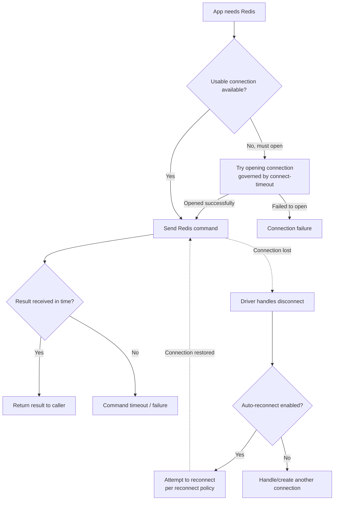
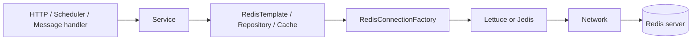
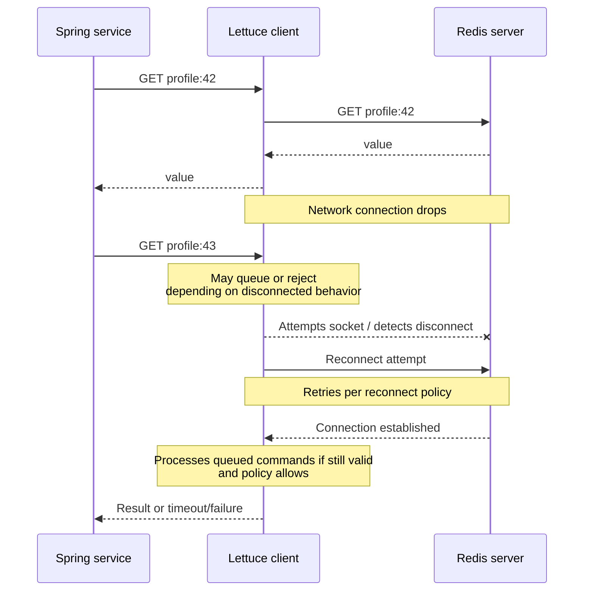
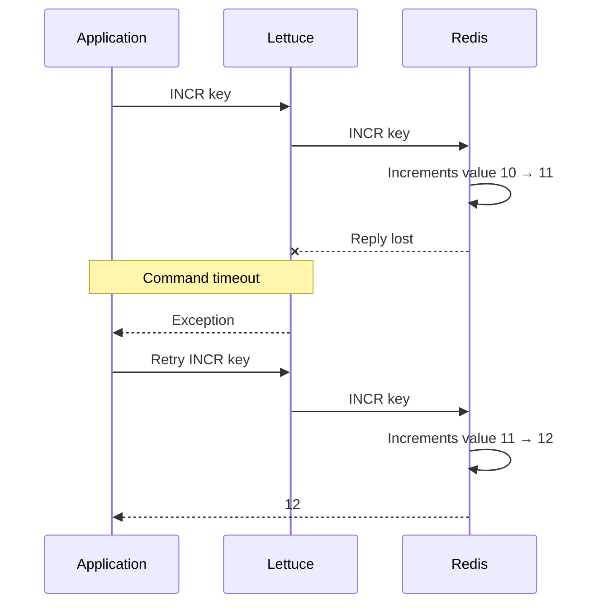

# Relationship Between Connection Timeout, Command Timeout, and Reconnect in Spring Data Redis

In a Spring Data Redis application, a single Redis connectivity error can raise three distinct questions: **how long do we wait to open a connection?**, **how long do we wait for a Redis command to return a result?**, and **once an established connection drops, how does the driver attempt to reconnect?** These three mechanisms are closely related yet have **separate scopes and timers**. Lumping them together as a single "Redis timeout" easily leads to misconfiguration and flawed reasoning about latency, retries, or data correctness.

This lesson focuses on Spring Data Redis with the **Lettuce** driver, typically chosen by Spring Boot 3.x when using `spring-boot-starter-data-redis`. Parts relating to Jedis are explicitly distinguished because the two drivers do not share identical connection-management behavior. Timing examples below illustrate the flow; exact outcomes depend on driver version, network conditions, command types, and application configuration.

## 1. Three mechanisms, three different questions

| Mechanism | Question it answers | When it applies | Common configuration |
|---|---|---|---|
| **Connection timeout** | How long is a single attempt to establish a connection to Redis allowed to wait? | When opening a new socket/connection | `spring.data.redis.connect-timeout` |
| **Command timeout** | How long is a Redis operation allowed to wait for a result? | When the app sends/executes `GET`, `SET`, `INCR`… | `spring.data.redis.timeout` |
| **Reconnect** | After an active connection drops, will the driver try reconnecting, when, and how are waiting commands handled? | After an existing connection drops or while the driver manages connection recovery | Driver options, reconnect delay/backoff, and queue policy |

One way to visualize it:



**Connection timeout does not replace command timeout.** A connection may open quickly while a Redis command still stalls due to a busy server, slow network, or lost reply.

**Command timeout does not stop the driver from reconnecting.** A business call may time out while the driver continues trying to restore the connection for subsequent requests.

**Reconnect is not a promise to automatically rerun business logic exactly once.** The driver may restore the network connection, yet an operation that timed out may already have been processed by Redis without the application receiving the reply.

## 2. Where the timers sit along a request's path



A real request can be governed by **multiple time limits**:

1. **External request deadline**: e.g., an HTTP gateway, client, or message consumer waits at most 800 ms.
2. **Pool connection borrow wait**, if the access path uses a pool.
3. **Connection timeout** when the driver has to establish a new connection.
4. **Command timeout** for the Redis command currently executing or awaiting a reply.
5. **Reconnect/backoff schedule** after a connection drops, potentially spanning multiple attempts.
6. **Business-layer timeout/retry**, e.g., circuit breaker, resilience library, or an HTTP client calling the service.

Do not mechanically sum these numbers and treat the sum as the total request bound. Timers can **overlap**, start at different moments, or belong to different operations. Especially when connections are reused, an ordinary Redis call skips opening a new socket altogether.

For instance: an HTTP request has an 800 ms deadline and Redis command timeout is 3 seconds. The HTTP call may already expire before the Redis command times out. If server-side processing continues, the Redis operation may finish after the user has abandoned the request. Timeout design must start from the **entire business flow's deadline**, not just Redis.

## 3. Connection timeout: limit for opening a connection

`spring.data.redis.connect-timeout` describes the connection timeout at the Redis client layer when opening a connection. In standard Spring Boot 3.x config:

```yaml
spring:
  data:
    redis:
      host: redis.internal
      port: 6379
      connect-timeout: 2s
```

The value `2s` is a duration. It bounds how long opening a connection waits when Redis cannot accept connections, such as when the target stops responding at the TCP layer. However, **not every connection failure takes exactly 2 seconds**:

- If the host/port refuses immediately, the driver can report `Connection refused` much faster.
- If the network drops packets, connection establishment may wait close to the timeout threshold.
- DNS lookup, TLS handshake, Sentinel/Cluster topology discovery, pool borrowing, upper-layer retries, and other resource initialization can all contribute to total observed latency; how much is bounded by connect timeout depends on the driver and version.
- If the driver uses an existing connection, an operation may never touch connect timeout at all.

### 3.1. Initial connection and reconnection

Two events may both require creating a transport connection:

**Initial connection:** the application just started or calls Redis for the first time; the client has no active connection yet.

**Reconnect:** the application previously had a connection, then Redis restarted, the network broke, or the socket closed; the driver attempts to establish a new transport connection.

Connect timeout can apply to **each connection attempt** in both situations. However, it **does not dictate the number of reconnect attempts or the interval between attempts**. Those belong to the reconnect policy.

### 3.2. Connection timeout is not an overall startup timeout

Spring Boot may construct `RedisConnectionFactory` successfully without executing an actual Redis round trip. Connection errors sometimes surface only on the first command or first health check. Hence "application started" does not guarantee "Redis server reachable."

If the application strictly requires Redis availability before serving traffic, use appropriate readiness/health mechanisms and define clear behavior when Redis is unavailable rather than relying on bean creation alone.

## 4. Command timeout: limit for waiting on a Redis result

`spring.data.redis.timeout` is the standard property defining how long to wait for a Redis command in Spring Boot/Lettuce setups.

```yaml
spring:
  data:
    redis:
      host: redis.internal
      port: 6379
      connect-timeout: 2s
      timeout: 3s
```

When code calls:

```java
String value = stringRedisTemplate.opsForValue().get("profile:42");
```

the application expects the `GET` result or an error. If the command does not finish within the driver/API's timeout threshold, the application may receive a command timeout exception.

The cause of a timeout is not necessarily that the server "never ran the command." It could be:

- The command packet never reached Redis due to network disruption.
- The command sat in a client queue while the connection was temporarily disconnected.
- The command reached Redis, but the server was busy, its event loop was stalled, or the command was expensive.
- Redis executed the command, but the reply was lost or arrived too late.
- The connection dropped while the command was awaiting a response.

**A command timeout is a statement about observing a result within the client's deadline; it is not always proof the server did not execute the command.** This distinction is crucial for write commands.

### 4.1. Example with a read command

```java
import org.springframework.data.redis.core.StringRedisTemplate;
import org.springframework.stereotype.Service;

@Service
public class ProfileNameReader {
    private final StringRedisTemplate redis;

    public ProfileNameReader(StringRedisTemplate redis) {
        this.redis = redis;
    }

    public String getCachedName(String profileId) {
        return redis.opsForValue().get("profile:" + profileId + ":name");
    }
}
```

If `GET` times out, the service cannot conclude the key does not exist. "Does not exist" is represented by returning `null` when `GET` **succeeds** and Redis replies nil; a timeout is a different connectivity/execution failure state.

The application may decide to fall back to the primary source when cache fails, but fallback is a **business policy**, not an automatic side effect of configuring command timeout.

### 4.2. Example with a write command

```java
Long result = stringRedisTemplate.opsForValue()
    .increment("metrics:article:42:views");
```

Suppose Redis executes `INCR` successfully, but the reply fails to reach the client before timeout. The caller receives an error even though the counter **already incremented once**. If the service retries the same `INCR`, the counter may increment a second time.

Therefore, **never blindly retry every write command on timeout**. Analyze whether the operation is idempotent, carries a deduplicating operation ID, or has a result verification mechanism.

## 5. Reconnect: restoring the connection channel after failure

In Lettuce, `autoReconnect` is enabled by default in standard client configurations. When an established connection drops, Lettuce can automatically try reconnecting. Attempts are typically scheduled according to the client resources' reconnect delay/backoff.

Reconnect answers: **how do we obtain a new usable connection after the old connection stops working?** It is not identical to:

- Retrying a service call.
- Retrying a Redis operation that already reported a timeout.
- Guaranteeing every pending command will finish on time.
- Rolling back an already-processed Redis command.
- Guaranteeing exactly-once execution over a flaky connection.

### 5.1. Phases of a disconnect



Some commands may be queued while Lettuce is disconnected, depending on `ClientOptions.DisconnectedBehavior` and configuration/request state. Others may be rejected immediately. Whether a caller reaching command timeout automatically purges a queued command from every queue also depends on cancellation behavior and client version. **Never design business logic assuming every command automatically re-runs once after reconnect.**

### 5.2. Reconnect delay differs from connect timeout

Suppose the driver uses an increasing reconnect delay between attempts while Redis is unavailable:

```text
Before: connection active
    |
    v
Connection drops
    |
    +-- wait delay A --> connect attempt #1
    |                       |
    |                       +-- may fail within connect-timeout
    |
    +-- wait delay B --> connect attempt #2
    |                       |
    |                       +-- may fail
    |
    +-- wait delay C --> connect attempt #3 --> succeeds
                                                |
                                                v
                                         connection restored
```

**Reconnect delay** is the interval between reconnection attempts. **Connect timeout** limits a single attempt to open a connection per driver semantics. **Command timeout** applies to commands issued by the application.

If reconnecting takes 10 seconds while command timeout is only 2 seconds, the current request may fail after the command timeout expires, while the driver keeps reconnecting so later requests have a chance to succeed.

## 6. Timeline: why timeouts still happen even if reconnect eventually succeeds

Suppose configuration is:

```yaml
spring:
  data:
    redis:
      connect-timeout: 1s
      timeout: 2s
```

Hypothetical scenario: connection drops at `t = 0`, a request sends a command at `t = 0.1s`, and Redis recovers only at `t = 4s`.

```text
Time (seconds)         0        1        2        3        4        5
                       |--------|--------|--------|--------|--------|
Connection             X network lost        reconnect attempts   ✓ restored
GET at t=0.1             |--------------------|
                         request waits     command timeout
Redis recovers                                                 ^
                                                             t≈4s
```

The outcome may be:

- The driver keeps attempting reconnects during the outage.
- The `GET` caller receives an error/timeout **before** Redis recovers.
- Once connectivity returns around `t≈4s`, **new** requests succeed.
- Whether the already-timed-out command runs late, gets canceled, or failed earlier depends on specific queue/cancellation configuration; it cannot be deduced from the two timeout properties alone.

This is why "enabling reconnect" does not mean requests will wait until Redis recovers. Reconnect's purpose is **restoring connection usability**, while caller deadlines must still be respected by design.

### The opposite case: a very long command timeout

If `timeout: 30s` and Redis recovers after 4 seconds, some queued commands may be processed after reconnect and callers receive results. The trade-offs are:

- Threads/coroutines/requests may block for a long time if using synchronous APIs.
- Many concurrently queued commands can build up backlog and memory pressure.
- HTTP latency may exceed user experience requirements.
- Late writes may conflict with business decisions that already fell back to another branch.

Thus **increasing command timeout is not automatically a good fix** for Redis outages; weigh latency targets, queue policy, and command semantics.

## 7. Baseline configuration with `application.yml`

A Spring Boot 3.x example using Lettuce with standalone Redis:

```groovy
dependencies {
    implementation 'org.springframework.boot:spring-boot-starter-data-redis'
}
```

```yaml
spring:
  data:
    redis:
      host: ${REDIS_HOST:localhost}
      port: ${REDIS_PORT:6379}
      client-type: lettuce
      connect-timeout: 2s
      timeout: 3s
```

Explanation:

- `host` and `port` point to the Redis endpoint as seen from **the application's environment**.
- `client-type: lettuce` selects Lettuce when the matching dependency is available.
- `connect-timeout: 2s` applies to connection setup per driver behavior.
- `timeout: 3s` sets the Redis operation wait timeout per the client model.

**There is no universal Spring Boot property named `spring.data.redis.reconnect-timeout` that governs total reconnect duration.** Reconnect cadence, auto-reconnect, and pending-command behavior belong to Lettuce options. If a project needs to change them, customize the driver via the appropriate configuration hook or `ClientResources` for your version.

To avoid name confusion: `spring.data.redis.timeout` configures **Redis operations**, not "key lifetime." Key TTL is specified on `SET ... EX`, the `expire` API, `@RedisHash(timeToLive=...)`, or `spring.cache.redis.time-to-live` depending on the layer used.

## 8. Customizing Lettuce's disconnected behavior

Lettuce has `ClientOptions` controlling part of its behavior when disconnected. One key decision is **whether to accept commands into a queue while disconnected or reject them immediately**.

Spring Boot 3.x example using a customizer to illustrate a *fail-fast* policy for commands sent while disconnected:

```java
import io.lettuce.core.ClientOptions;
import org.springframework.boot.autoconfigure.data.redis
    .LettuceClientConfigurationBuilderCustomizer;
import org.springframework.context.annotation.Bean;
import org.springframework.context.annotation.Configuration;

@Configuration
class RedisLettucePolicyConfig {

    @Bean
    LettuceClientConfigurationBuilderCustomizer failFastWhileDisconnected() {
        return builder -> builder.clientOptions(
            ClientOptions.builder()
                .autoReconnect(true)
                .disconnectedBehavior(
                    ClientOptions.DisconnectedBehavior.REJECT_COMMANDS
                )
                .build()
        );
    }
}
```

Here:

1. `autoReconnect(true)` lets the driver attempt to restore the connection after loss.
2. `REJECT_COMMANDS` rejects new commands while the connection is in disconnected state rather than queuing them under another policy.
3. The application fails sooner when the driver **has already detected** the connection dropped. When a network fault has not yet been detected, a command can still wait until command timeout.
4. `ClientOptions.builder().build()` replaces client options attached to the builder; if the app customizes other options too, merge them deliberately.

This example shows **one policy choice**, not a mandatory default for all applications. Workloads that tolerate queued commands during brief reconnects may find immediate rejection undesirable. Conversely, low-latency APIs with clear fallbacks may find fail-fast more predictable.

### 8.1. Can reconnect delay be tuned?

Yes. Lettuce schedules reconnects via client resources, including `Delay` / backoff strategies per Lettuce version. Operational setups can configure an initial delay, maximum delay, and jitter to prevent many application instances from reconnecting simultaneously after a Redis failover.

However, this is a **driver-level** customization, not a generic "reconnect timeout" across all Spring Data Redis clients. When doing this:

- Verify the actual Lettuce version from the Spring Boot BOM.
- Use the proper Spring Boot customization hook or an application-owned `LettuceConnectionFactory` configuration.
- Manage `ClientResources` lifecycle if creating replacement resources manually to avoid thread and resource leaks.
- Test interactions with Sentinel/Cluster topology refresh and extended server outages.

Do not copy low-level customization snippets merely to "enable reconnect" when Lettuce already auto-reconnects by default.

## 9. Connection pools introduce another type of wait time

Beyond connect timeout, an application can block while **borrowing a connection from a pool**. That is a separate timer: *pool max-wait*.

When using Apache Commons Pool 2 and enabling Lettuce pooling:

```groovy
dependencies {
    implementation 'org.springframework.boot:spring-boot-starter-data-redis'
    implementation 'org.apache.commons:commons-pool2'
}
```

```yaml
spring:
  data:
    redis:
      host: redis.internal
      port: 6379
      connect-timeout: 2s
      timeout: 3s
      lettuce:
        pool:
          enabled: true
          max-active: 8
          max-idle: 8
          min-idle: 0
          max-wait: 500ms
```

Distinguish:

| Situation | Primary timer involved |
|---|---|
| Pool has free connections to borrow | Likely no pool wait |
| Pool is out of available connections; caller waits for a return | `lettuce.pool.max-wait` |
| Pool needs to open a new connection to Redis | `connect-timeout` for establishment |
| Caller sends command over borrowed connection | `timeout` / command timeout |
| Connection drops and driver attempts recovery | Lettuce reconnect policy |

A pool is not always needed. Lettuce can share a native connection across regular commands; adding a pool without understanding requirements can increase connection counts and troubleshooting complexity.

**Example:** pool max-wait is `500ms`, connect timeout is `2s`, command timeout is `3s`. A request can fail right at connection borrowing after ~500 ms even when Redis is completely healthy, simply because the pool is exhausted. Raising command timeout will not directly solve that condition.

## 10. Command timeout, reconnect, and non-idempotent commands

The biggest problem is not the timeout number itself, but **uncertainty about command outcomes** during network failures.

Suppose an application sends:

```redis
INCR metrics:article:42
```

and encounters a failure:



In this example, a single user action was supposed to be recorded once, yet the counter incremented twice. Redis does not inherently know both `INCR` commands belong to the same business request.

### 10.1. Classifying retries by semantics

| Operation | If reply is lost and retried | Notes |
|---|---|---|
| `GET key` | Re-reads data | Usually safe if reading data that may change between reads is acceptable |
| `SET key value` | Re-writes same value | May be idempotent in final value; if setting a new TTL, expiration may be extended |
| `DEL key` | Deletes again | Usually idempotent in final key state, though returned deleted count may differ |
| `INCR key` | Increments again | **Not idempotent**; easily double-counts |
| `LPUSH queue value` | Prepends same item again | **Not idempotent**; can create duplicate elements |
| `SADD set member` | Adds same member | Idempotent in set membership; return value may differ |
| Multi-command script | Depends on script logic | Must analyze whether deduplication markers exist |

A safer strategy for operations with business side effects is including an **operation ID** and enforcing deduplication via Redis Lua/scripts, transactions, or appropriate state tracking by operation ID. For payments, inventory deductions, or billing, never assume a command timeout guarantees no update occurred.

### 10.2. Three layers of "retry" that may stack

1. **TCP/driver reconnect**: rebuilds the transport link.
2. **Lettuce command queue/reissue behavior**: depending on configuration and command state, may process pending commands alongside reconnection.
3. **Application retry**: application code or libraries like Spring Retry/Resilience4j re-invoking the business method.

All three layers must be designed together. Adding application retries without checking what the driver already does can turn minor network blips into duplicate side effects, queue spikes, or cascading timeouts.

## 11. Comparing Lettuce and Jedis in connection handling

Spring Data Redis supports multiple client implementations. Never copy assumptions about Lettuce reconnect verbatim onto Jedis.

| Aspect | Lettuce | Jedis |
|---|---|---|
| Typical model | Netty-based driver supporting connection sharing and async/reactive | Synchronous client using traditional socket/connection model, typically pooled |
| Lost connection | Built-in auto-reconnect on driver connections (normally enabled by default) | Usually handled by detecting broken connections, discarding/closing sockets, and creating or borrowing valid ones next time |
| Commands while disconnected | Options to queue or reject via client options | Do not assume identical queue/replay mechanics as Lettuce |
| Timing parameters | Spring Boot properties align in intent, while mapping and exceptions depend on client | Socket/read timeout and connect time manifest per Jedis |
| Reactive Redis API | Lettuce fits reactive connection support | Not a direct drop-in for Lettuce reactive APIs |

For example, configuring:

```yaml
spring:
  data:
    redis:
      client-type: jedis
      host: localhost
      port: 6379
      connect-timeout: 2s
      timeout: 3s
```

works only when a matching **Jedis dependency** is present and the application is configured for that client. Never set `client-type: jedis` expecting the default Lettuce starter to supply Jedis automatically. With Jedis, attention usually goes to pool validation/eviction of broken connections, socket read timeouts, and service-level retries.

What remains invariant across drivers is: **failures while sending commands or receiving replies can leave command outcomes uncertain**, so designing for idempotency remains essential.

## 12. How are Spring Cache and Redis Repositories affected?

`spring.data.redis.connect-timeout` and `spring.data.redis.timeout` configure the shared Redis connection path for components backed by `RedisConnectionFactory`. Therefore connection/command timeouts can surface when using:

- `StringRedisTemplate` and `RedisTemplate`.
- Redis Repositories performing `save()`, `findById()`, or index updates.
- Spring Cache with `RedisCacheManager`, such as `@Cacheable` and `@CacheEvict`.

However, **how each component handles errors varies by API and application policy**.

### 12.1. Does Cache automatically skip Redis errors and call the database?

Do not assume that by default. When the Redis cache backend fails, Spring Cache may propagate exceptions according to the active `CacheErrorHandler`. If the application wants cache failures to degrade gracefully rather than failing requests, design an appropriate cache error handling strategy and consider load limits on the backing database.

Example:

```java
@Cacheable(cacheNames = "product-detail", key = "#id")
public ProductDetail findProduct(String id) {
    return database.loadProduct(id);
}
```

If the Redis cache lookup times out before the method executes, **do not conclude the method will always run automatically as a fallback**. Check your actual cache manager, error handler, and proxy setup.

### 12.2. Repositories may execute multiple Redis operations

One `repository.save(entity)` call can correspond to multiple Redis commands updating hashes, indexes, or TTLs. If a timeout occurs partway through, retrying `save` can have different consequences than a single `SET`. Do not infer full atomicity from a CRUD method name.

## 13. Observing real failures and reading the right signals

Many issues look similar at the HTTP layer, yet require different investigations:

| Signal | What might be happening? | What to check |
|---|---|---|
| Fast `Connection refused` | Redis not listening, wrong port, or server rejecting | DNS/host/port, Redis status, firewall |
| Timeout opening connection | Endpoint unresponsive or network dropping packets | `connect-timeout`, routes, security groups, NAT |
| Command timeout while connection is open | Redis busy, slow network, command queued too long | `timeout`, slowlog, latency, CPU/event loop |
| Timeout spike after disconnect | Commands queued during reconnect or many requests waiting together | Reconnect logs, pending commands, queue policy |
| Pool connection wait error | Pool exhausted, connections held too long | `pool.max-wait`, `max-active`, concurrency |
| Repeated reconnects | Redis restarts/failover, unstable network, invalid auth/TLS | Client logs, failover events, endpoint/TLS |
| App returns timeout yet Redis holds new value | Reply lost after Redis processed it | Correlate operation IDs, keys, traces, and command semantics |

Observed exceptions depend on where the error originated. Lettuce may throw `RedisCommandTimeoutException` or connection exceptions; Spring Data Redis may translate them into `DataAccessException` subclasses like `QueryTimeoutException` or `RedisConnectionFailureException` depending on context. Always inspect the **cause chain**, not just the outermost exception line.

### 13.1. Error-handling code must separate missing data from access errors

```java
import org.springframework.dao.DataAccessException;
import org.springframework.data.redis.core.StringRedisTemplate;
import org.springframework.stereotype.Service;

@Service
public class FeatureFlagReader {
    private final StringRedisTemplate redis;

    public FeatureFlagReader(StringRedisTemplate redis) {
        this.redis = redis;
    }

    public boolean isEnabled(String feature) {
        try {
            String value = redis.opsForValue()
                .get("feature:" + feature);

            // null means Redis GET succeeded and the key does not exist.
            return "enabled".equals(value);
        } catch (DataAccessException ex) {
            // Redis error: do not silently treat it as a missing key.
            // Decide fail-closed/fallback per business requirements.
            throw new IllegalStateException(
                "Cannot verify feature flag from Redis", ex
            );
        }
    }
}
```

The example intentionally propagates the error to avoid silently toggling a feature when the state source is lost. For non-critical cache data, another app might fall back; for security keys or permission checks, falling back blindly can cause severe issues.

### 13.2. Observability sources to combine

To distinguish failures:

- **Application metrics:** Redis operation latency, timeout rate, error request count, queue/concurrency depth if available.
- **Driver logs:** reconnect attempts, connection state, command exceptions.
- **Redis metrics:** CPU, connected clients, rejected connections, memory pressure, slowlog, network I/O, failover/restart events.
- **Infrastructure:** DNS resolution, TLS certificates, network path between app instances and Redis, cross-AZ latency.
- **Application traces:** request ID or operation ID, method start/end durations, command types, and observable outcomes.

Avoid logging raw keys, values, passwords, or connection URLs with credentials; many keys embed sensitive identifiers. Use structured logging with minimized/redacted data during investigations.

## 14. Designing time budgets for three scenarios

No single set of timeouts fits all workloads. Start from **business requirements** and acceptable latency.

### Scenario A — Redis purely as a product-lookup cache

HTTP requests need fast responses, and canonical data lives in the database. One design approach:

- Command timeout short enough to detect an unresponsive cache early.
- Cache errors handled via fallback policy if the database can absorb the load.
- Load shedding/circuit breakers to prevent all requests from slamming the database during a Redis outage.
- Reconnect still restores cache usage for later requests.

Illustrative reference for a tight hypothetical budget:

```yaml
spring:
  data:
    redis:
      connect-timeout: 500ms
      timeout: 800ms
```

These values merely illustrate a tight time budget; measure network latency, Redis saturation, and real deadlines before applying them.

### Scenario B — Redis holding temporary sessions

Sessions can be mandatory for authentication or state handling. When Redis fails, **you cannot arbitrarily assume a session exists or grant access**. Design must decide explicitly:

- Reject requests or show a temporary error?
- Is multi-AZ/HA and controlled failover in place?
- Can session TTL be skewed by retries/late updates?
- Can session writes duplicate or reorder after reconnect?

Reconnect restores connectivity, yet does not guarantee session consistency across the outage window.

### Scenario C — Redis updating counters

For `INCR` or other non-idempotent mutations:

- Never treat timeout as proof the mutation did not occur.
- If strict accuracy is required, use operation IDs with deduplication or route updates through an event log capable of deduplication.
- Do not wrap the method in unbounded automatic retries.
- Track command timeout rates and replayed commands to spot double counting.

In this scenario, **accurate counts** may outweigh hiding a Redis failure behind automatic retries.

## 15. Practice reasoning along event timelines

Rather than just tweaking YAML, walk through concrete scenarios.

### Exercise 1: Redis is stopped before the application starts

Configuration:

```yaml
spring:
  data:
    redis:
      connect-timeout: 1s
      timeout: 2s
```

The application creates the connection factory bean successfully, then the first `GET` fails. What happened? **Creating the bean does not necessarily open a Redis connection eagerly.** When the command requires network I/O, the driver attempts to connect and fails. If Redis later starts, a subsequent call can succeed; distinguish initial connection, new connections, and auto-reconnect on a previously established connection.

### Exercise 2: Redis drops after already serving requests

Lettuce has auto-reconnect. While Redis is down, API `GET` calls time out. Three seconds later Redis recovers, and another API call succeeds. Which conclusion is right? **Auto-reconnect can restore the connection after failure, but does not extend the deadline of calls that already timed out.**

### Exercise 3: Pool exhausted while Redis itself responds quickly

Pool `max-active: 4`, `max-wait: 200ms`; eight requests hold connections for over 200 ms. Four requests fail to borrow a connection in time even though Redis server is not slow. Raising `spring.data.redis.timeout` from 2 to 10 seconds **does not directly fix the pool wait limit**.

### Exercise 4: `INCR` times out yet the value still incremented

This is a lost reply after Redis executed the command. If retried immediately with the same `INCR`, the value can double-increment. Appropriate action is **defining the desired at-least-once/at-most-once model and idempotency mechanism**, rather than guessing from the exception alone.

### Exercise 5: Command timeout 2 seconds, reconnect succeeds at second 5

The original API request already expired; later requests are served over the new connection. There is no basis to claim the expired request's command definitely never ran on Redis. Observe and design around actual command state.

## 16. Principles for reading any Redis configuration

| Question to ask | Wrong answer easily leads to |
|---|---|
| Is a connection newly opened or reused? | Assuming every request pays connect timeout |
| Is the current timeout connect, command, pool, or HTTP deadline? | Raising the wrong property with no latency improvement |
| Is the driver Lettuce or Jedis? | Misapplying auto-reconnect and command-queuing assumptions |
| While disconnected, are commands rejected or queued? | Large backlogs, late execution, or unexpected errors |
| Are there application retries outside the driver? | Duplicate mutations and traffic amplification |
| Is the command idempotent? | Skewed counters, duplicate writes, inconsistent state |
| What if Redis ran the command but the reply was lost? | Treating timeout as guaranteed rollback |
| How long is the business flow deadline? | Requests canceled while backend work still runs |

Core takeaway: **connect timeout bounds connection establishment attempts; command timeout bounds waiting for an operation result; reconnect is the mechanism that restores the link after disconnection.** All three can interact yet never substitute for one another. For a stable Spring Data Redis system, design these time bounds together with queue policies, retry policies, caller deadlines, and per-command idempotency.
