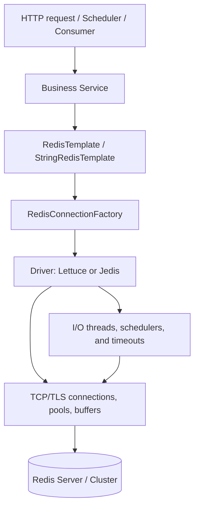
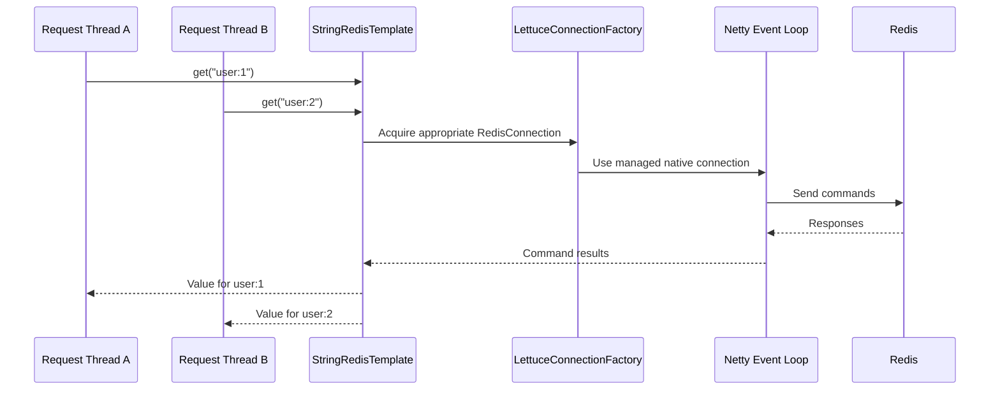
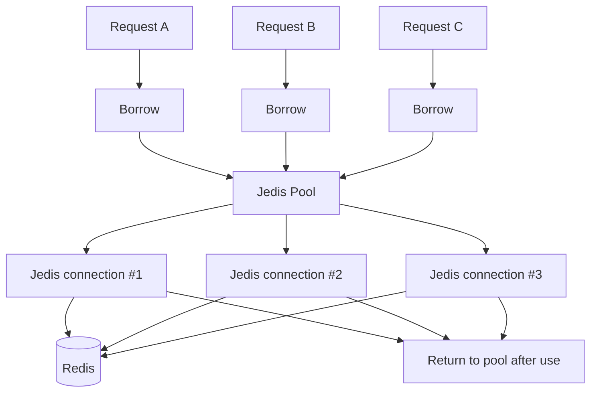
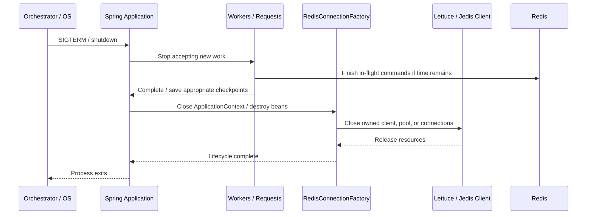

# Managing Network Resources, Processing Threads, and Driver Shutdown

In Spring Data Redis, the **Redis driver/client** is the component handling network communication between the Java application and Redis Server. Issuing a Redis command looks simple:

```java
String value = stringRedisTemplate.opsForValue().get("profile:42");
```

Behind that call lie TCP or TLS connections, sockets, buffers, I/O threads, timeout policies, and sometimes connection pools. If an application spawns too many clients, holds connections without returning them to a pool, blocks the event loop, or shuts down the driver while other requests are still using it, the consequences can include rising latency, file-descriptor exhaustion, pool depletion, service unavailability, or indeterminate request failures.

In the Spring Data Redis ecosystem, the two common drivers are **Lettuce** and **Jedis**. Their resource management strategies differ, yet the shared principle is: **clearly identify who creates each resource, who uses it, and who is responsible for closing it**.

This lesson focuses on the Redis connection infrastructure lifecycle inside a Spring application: network resources, thread organization, sharing or borrowing connections, error handling, and safe driver shutdown.

## 1. Identifying the resource layers

A `RedisTemplate` call does not equate to automatically creating a new Redis client and opening a new socket. Spring Data Redis separates responsibilities:



| Component | Primary responsibility | Lifecycle rule |
|---|---|---|
| `RedisTemplate` / `StringRedisTemplate` | Provides read/write APIs and data serialization | Typically a Spring singleton; inject and reuse |
| `RedisConnectionFactory` | Supplies connections per driver type and configuration | Spring-managed bean, initialized and destroyed on context close |
| Driver client | Manages protocol, sockets, reconnects, I/O | Owned by the connection factory or an explicit owner bean |
| Native connection | Specific communication channel to Redis, reusable or pooled | Return/close per owner contract; never share arbitrarily |
| Connection pool | Bounds, allocates, and reclaims borrowable connections | Pool lives with the app; every borrow must be returned |
| Executor / event loop | Runs I/O processing, callbacks, or app-scheduled work | Has an owner managing shutdown |
| Redis Server | Processes commands received over the network | Independent lifecycle from the application |

### "Closing a connection" can mean different things

Distinguish four actions often loosely called "closing Redis":

1. **Completing a template operation:** `get`/`set` finishes; Spring returns resources to the underlying management layer. The application does not manually close the template.
2. **Closing a connection wrapper:** when requesting `RedisConnection` directly from a factory, closing the wrapper per contract; this may return a connection to a pool rather than closing a physical socket.
3. **Closing a native client or pool:** releases connections, buffers, and threads owned by the client/pool; only the owner performs this when shutting down.
4. **Stopping Redis Server:** affects shared infrastructure, not a service-level cleanup step.

These actions differ in scope. A service removed from a Spring context must not command Redis Server to shut down, and a finishing HTTP request must never call `shutdown()` on a shared client.

## 2. Which network resources are managed by the driver?

Every Redis connection can consume an OS socket and file descriptor, send/receive buffers, TLS resources, authentication state, and protocol state for commands awaiting replies. Redis Server also reserves memory and tracking structures for connected clients.

### 2.1. TCP, TLS, and connection handshake

A new Redis connection typically goes through these logical steps:

```text
Application needs a connection
    |
    +--> Resolve hostname / choose endpoint
    |
    +--> TCP connect
    |
    +--> TLS handshake (if TLS configured)
    |
    +--> AUTH / HELLO / SELECT or protocol setup when needed
    |
    +--> Ready to send Redis commands
    |
    +--> Read responses / monitor connection health
```

Opening a new connection per request adds round-trips, CPU, TLS handshakes, and pressure on Redis Server. In multi-instance systems, total connections equal the sum across **all** instances and client types, not just one machine's pool limit.

For example: a service with 12 instances, each with a max pool of 30 connections, can open up to **360 pooled connections** from that service alone; add Pub/Sub connections, health checks, admin tools, other services, and specialized connections. This is a resource capacity problem—a larger max pool does not always make things faster.

### 2.2. Network resources vary by topology

- **Standalone Redis:** one primary Redis endpoint, possibly behind DNS, a proxy, or a load balancer.
- **Redis Sentinel:** the driver must connect to/query Sentinels to discover the current master and handle master transitions.
- **Redis Cluster:** the driver must track node topology, slot mappings, and redirects like `MOVED`/`ASK`; actual connection counts can exceed a "one client, one socket" picture.
- **TLS:** adds handshake cost, encryption, and certificate management; connections must be recycled and certificate rotation handled per deployment strategy.

Never treat standalone socket counts as hard assumptions for Cluster. When changing topology, re-evaluate timeouts, reconnects, pooling, metrics, and Redis connection limits.

### 2.3. Losing a connection does not mean the command never ran

A request can unfold as:

```text
Java -> sends INCR -> Redis executes INCR -> network drops
                                        |
                                  reply is lost
```

The driver reports a timeout or I/O error, yet Redis **may have already executed** the command. If the application immediately retries `INCR`, the counter increments twice. For business write commands, design idempotency or state verification at the appropriate layer; driver reconnection itself does not guarantee exactly-once execution.

## 3. Lettuce: shared connections and internal async I/O model

**Lettuce** is a Netty-based Redis client supporting synchronous, asynchronous, and reactive client APIs. Spring Boot with `spring-boot-starter-data-redis` typically uses Lettuce by default when configured normally.

Lettuce uses **event loop threads** to process network I/O. Multiple commands can traverse a single connection without each caller holding its own socket-reading thread. A regular native `StatefulRedisConnection` is designed for concurrent use by multiple threads for suitable operations.

This does **not** mean sharing one connection is safe for multi-step stateful interactions such as transactions or blocking commands. Also distinguish Lettuce's native connection from the `RedisConnection` wrapper provided by Spring Data Redis.

### 3.1. Why does Lettuce usually not need one connection per request?



This diagram is conceptual: execution order may interleave and each request issues its own command. Under common default settings, `LettuceConnectionFactory` can share a native connection for regular operations. A `RedisConnection` wrapper retrieved from the factory **must not automatically be treated as thread-safe**, even though the shared native connection carries its own concurrency guarantees.

Some operation types do not fit the same shared connection:

- **Blocking commands:** `BLPOP`, `BRPOP`, and certain blocking stream reads waiting for data; the connection can be tied up while waiting.
- **Redis transactions:** `MULTI`/`EXEC` carry connection-bound state; commands in a transaction must follow the same connection and order.
- **Pub/Sub:** subscription connections have their own long-lived usage pattern, unlike normal request-response traffic.
- **Specialized pipelines:** must maintain ordering and send/receive boundaries per API contract.

Spring Data Redis and Lettuce use specialized connection mechanisms for those needs. Therefore, never formulate a rule like "only one native connection for the entire app in all scenarios."

### 3.2. Netty event loop is not a business worker pool

Two kinds of threads must be distinguished:

| Thread type | Primary work | What should or shouldn't run there? |
|---|---|---|
| Thread calling synchronous `RedisTemplate` | Runs service/controller, waits for Redis result | Can block if architecture is imperative and thread counts are sized |
| Lettuce Netty event loop | Socket read/write, I/O handling, and internal client work | Avoid long tasks, blocking I/O, or heavy CPU work |
| Application scheduler or listener thread | Executes business tasks per service configuration | Needs explicit concurrency bounds and shutdown strategy |

When writing callbacks or listeners on the I/O path, avoid placing synchronous HTTP calls, heavy computations, or `Thread.sleep` directly onto the I/O thread. A slow callback can delay response processing for unrelated commands. Offload business work to an appropriate executor when required by API and architecture.

Do not arbitrarily set event loop thread count equal to HTTP request count or Redis connection count. Event loops serve I/O across many connections; adding excessive threads increases context switching and does not make Redis Server process commands faster.

### 3.3. `ClientResources` resources

When using Lettuce directly, `ClientResources` can own or reference shared resources such as event loop groups, timers, resolvers, and latency recorders. The driver can use default resources or an application-supplied `ClientResources`.

**Ownership rule:** if the application manually creates a shared `ClientResources`, the application must shut it down only after all dependent Redis clients/factories have stopped. If the framework creates it, let the framework manage it per its contract. Never shut down resources when an individual request finishes, and never share already-shutdown resources with another factory.

Sharing `ClientResources` across multiple Lettuce clients saves threads/resources, yet raises ownership discipline: a single owner closes it only after all dependent clients have closed.

## 4. Jedis: pool-borrowed connections and per-thread scope

**Jedis** historically offers a simple synchronous API backed by socket connections. A traditional `Jedis` instance is tied to a connection and **must not be used concurrently by multiple threads**. When an application serves many concurrent requests, the standard model uses a connection pool or pool-managing abstraction, where each thread borrows a connection for its required scope and returns it.



### 4.1. Distinguishing closing a Jedis connection vs. closing `JedisPool`

When a connection is borrowed from `JedisPool`, calling `jedis.close()` properly **returns the resource to the pool** per pool mechanics. It does not necessarily close the physical socket in all cases. Conversely, `pool.close()` shuts down the pool and releases all pool resources; never call it after a single command.

Pure Jedis example illustrating ownership (not meant to run alongside `StringRedisTemplate` in an auto-configured Spring service):

```java
import redis.clients.jedis.Jedis;
import redis.clients.jedis.JedisPool;
import redis.clients.jedis.JedisPoolConfig;

public final class JedisPoolExample {
    public static void main(String[] args) {
        JedisPoolConfig poolConfig = new JedisPoolConfig();
        poolConfig.setMaxTotal(16);
        poolConfig.setMaxIdle(8);
        poolConfig.setMinIdle(0);

        // The pool belongs to the application lifecycle.
        try (JedisPool pool =
                new JedisPool(poolConfig, "localhost", 6379)) {

            // Jedis belongs to a single borrow scope.
            try (Jedis jedis = pool.getResource()) {
                jedis.set("demo:greeting", "hello");
                String value = jedis.get("demo:greeting");
                System.out.println(value);
            } // close() returns the connection to the pool.
        } // close() shuts down the pool when the example ends.
    }
}
```

Limits to keep in mind:

- Never share a borrowed `Jedis` across multiple requests/threads for concurrent commands.
- Never keep a borrowed `Jedis` in a Spring singleton field for ongoing reuse.
- Return connections in `finally` or `try-with-resources` even when commands throw exceptions.
- Never hold a connection open across long business processing without issuing Redis commands.
- Pools must have bounded connection counts, borrow wait timeouts, and telemetry; an unbounded pool merely turns "pool wait" errors into "Redis or OS overload."

Newer Jedis generations add APIs like `JedisPooled`, yet connection ownership and thread-sharing rules must still follow **the exact client type being used**; never assume every Jedis-named object is safe to share.

### 4.2. When Jedis is managed by Spring Data Redis

In Spring Data Redis, services typically inject `StringRedisTemplate` backed by `JedisConnectionFactory`. Here **the framework acquires and releases connections per call**; services do not call `pool.getResource()`, do not `close()` connections used by the template, and do not shut down the factory inside a request.

If direct `RedisConnection` access from the factory is required:

```java
import org.springframework.data.redis.connection.RedisConnection;
import org.springframework.data.redis.connection.RedisConnectionFactory;

public class DirectRedisConnectionExample {
    private final RedisConnectionFactory factory;

    public DirectRedisConnectionExample(RedisConnectionFactory factory) {
        this.factory = factory;
    }

    public void runWithRawConnection() {
        try (RedisConnection connection = factory.getConnection()) {
            // Perform raw RedisConnection operations only if genuinely needed.
            // On exiting the block, the connection is released per the factory.
        }
    }
}
```

This pattern illustrates low-level cleanup; bypassing templates is discouraged when templates already provide sufficient APIs. Never store an acquired `RedisConnection` in a singleton or use it concurrently across threads. Inside template/transaction callbacks, follow Spring's abstractions to preserve proper connection boundaries.

## 5. Comparing Lettuce and Jedis on resources, threads, and shutdown

| Aspect | Lettuce | Jedis |
|---|---|---|
| Notable model | Netty I/O, supports sync/async/reactive; regular native connections can be used concurrently | Traditional synchronous API; each `Jedis` ties directly to a connection, typically borrowed per use from a pool |
| I/O threading | Netty event loops and resources | When calling sync API, caller waits for I/O on the borrowed connection |
| Object sharing | Native `StatefulRedisConnection` has thread-safety guarantees; Spring wrappers still follow contract | Never share a regular `Jedis` instance across concurrent threads |
| Pooling | Workload-dependent; not mandatory solely for concurrent requests | Usually essential for multi-threaded synchronous apps |
| Blocking commands / transactions | Usually require dedicated connections separate from regular shared connection | Occupies the borrowed connection for the wait/transaction duration |
| Resources to reclaim | Native client, connections, Netty event loops, app-owned `ClientResources` | Borrowed connections, pool, and related client resources |
| Spring integration | `LettuceConnectionFactory` | `JedisConnectionFactory` |
| Shutdown in Spring Boot | Let `ApplicationContext` destroy Spring-managed factory/resources | Let `ApplicationContext` destroy Spring-managed factory/pool |

**Do not select a driver purely by thread count or a "single GET is faster" micro-benchmark.** Consider workload type (blocking or not), topology, TLS, connection counts, reactive needs, timeouts, and operational requirements.

## 6. Spring Boot manages the driver via bean lifecycle

When using Spring Boot auto-configuration, a typical lifecycle is:


Spring Boot lets you configure connections via properties; in standard configurations you do not write `new RedisClient()` or `new JedisPool()` in each service.

Dependency example for Lettuce:

```groovy
dependencies {
    implementation 'org.springframework.boot:spring-boot-starter-data-redis'
}
```

Local config using Spring Boot 3.x namespace:

```yaml
spring:
  data:
    redis:
      client-type: lettuce
      host: localhost
      port: 6379
      connect-timeout: 2s
      timeout: 2s
      lettuce:
        shutdown-timeout: 200ms
```

Here:

- `client-type` selects the Redis client type when the classpath supports it.
- `connect-timeout` applies to connection establishment.
- `timeout` adjusts operation wait time per Boot's driver configuration.
- `shutdown-timeout` governs Lettuce shutdown; this is **not** an HTTP request timeout.

Exact properties can vary by Spring Boot version. Consult configuration metadata for your project version when adapting examples.

### 6.1. When does Lettuce need a pool?

An application mostly issuing ordinary commands with Lettuce can run well using a shared native connection without a large pool. Pooling makes sense when workloads need independent connections, involve blocking/transactions, or when command volume and usage metrics show connection sharing is a bottleneck. Never add a pool just because the app handles hundreds of concurrent requests.

Example enabling a bounded pool in Spring Boot once the pool dependency is present:

```groovy
dependencies {
    implementation 'org.springframework.boot:spring-boot-starter-data-redis'
    implementation 'org.apache.commons:commons-pool2'
}
```

```yaml
spring:
  data:
    redis:
      client-type: lettuce
      host: localhost
      port: 6379
      lettuce:
        pool:
          enabled: true
          max-active: 16
          max-idle: 8
          min-idle: 0
          max-wait: 1s
```

These are **illustrative figures**, not universally optimal settings. A pool that is too small stalls threads waiting to borrow; a pool that is too large increases sockets, memory, context switching, and can overload Redis. Measure latency, concurrent requests, connection hold time, and Redis connection counts before tuning.

Configuring a pool does not turn synchronous `RedisTemplate` calls into non-blocking calls. Client code still waits for results or waits to acquire a connection.

### 6.2. Selecting Jedis in Spring Boot

Jedis must be on the classpath, and the matching client type selected. Example with dependency versions managed by Spring Boot:

```groovy
dependencies {
    implementation 'org.springframework.boot:spring-boot-starter-data-redis'
    implementation 'redis.clients:jedis'
    implementation 'org.apache.commons:commons-pool2'
}
```

```yaml
spring:
  data:
    redis:
      client-type: jedis
      host: localhost
      port: 6379
      connect-timeout: 2s
      timeout: 2s
      jedis:
        pool:
          enabled: true
          max-active: 24
          max-idle: 12
          min-idle: 0
          max-wait: 1s
```

When Boot manages Jedis, services can still use the exact same `StringRedisTemplate` as with Lettuce:

```java
import org.springframework.data.redis.core.StringRedisTemplate;
import org.springframework.stereotype.Service;

@Service
public class VisitCounter {
    private final StringRedisTemplate redis;

    public VisitCounter(StringRedisTemplate redis) {
        this.redis = redis;
    }

    public long recordVisit(String pageId) {
        Long count = redis.opsForValue()
                .increment("counter:visits:" + pageId);
        if (count == null) {
            throw new IllegalStateException("No result received from Redis");
        }
        return count;
    }
}
```

This service does not know whether the underlying driver is Lettuce or Jedis: that is the benefit of `RedisConnectionFactory` and templates. Still, **execution characteristics, pool settings, timeout behavior, and threading** depend on the driver. Never switch drivers in production without load testing and checking compatibility of active features.

## 7. Customizing Lettuce `ClientResources` when truly needed

Auto-configuration suffices for most applications. If sharing `ClientResources` or customizing low-level driver internals is genuinely necessary, define ownership clearly with Spring beans.

Standalone development configuration example, replacing Boot's auto-configured connection factory:

```java
import java.time.Duration;
import io.lettuce.core.resource.ClientResources;
import io.lettuce.core.resource.DefaultClientResources;
import org.springframework.context.annotation.Bean;
import org.springframework.context.annotation.Configuration;
import org.springframework.data.redis.connection.RedisStandaloneConfiguration;
import org.springframework.data.redis.connection.lettuce.LettuceClientConfiguration;
import org.springframework.data.redis.connection.lettuce.LettuceConnectionFactory;

@Configuration(proxyBeanMethods = false)
public class RedisDriverConfiguration {

    @Bean(destroyMethod = "shutdown")
    ClientResources redisClientResources() {
        // Spring owns this resource bean and calls shutdown when the context closes.
        return DefaultClientResources.create();
    }

    @Bean
    LettuceConnectionFactory redisConnectionFactory(
            ClientResources redisClientResources) {

        RedisStandaloneConfiguration server =
                new RedisStandaloneConfiguration("localhost", 6379);

        LettuceClientConfiguration clientConfig =
                LettuceClientConfiguration.builder()
                        .clientResources(redisClientResources)
                        .commandTimeout(Duration.ofSeconds(2))
                        .shutdownTimeout(Duration.ofMillis(200))
                        .build();

        return new LettuceConnectionFactory(server, clientConfig);
    }
}
```

Key takeaways from the example:

1. `ClientResources` is a bean **owned** by the Spring context.
2. The factory receives that resource via dependency injection; Spring understands the dependency destruction order.
3. A Spring-managed factory has proper init/destroy lifecycles; no need to call `afterPropertiesSet()` or `destroy()` from services.
4. Lettuce resource `shutdown()` can be asynchronous; awaiting completion and shutdown deadlines must match your driver version and architecture. Spring invoking the destroy method should not be interpreted as guaranteeing every in-flight task and reply finished cleanly.
5. Hardcoding `localhost` illustrates ownership; real applications should externalize host, TLS, auth, Sentinel/Cluster, and timeouts to deployment configuration.

When defining `RedisConnectionFactory` manually, default auto-configuration may step back from creating that factory. **Never leave two competing factories with unclear ownership**, or accidentally create two independent `ClientResources` when sharing was intended. Also never manually close `ClientResources` in a service's `@PreDestroy` if other factories still share it.

## 8. Threads calling Redis: synchronous, asynchronous, and reactive

A common misconception: Lettuce using Netty event loops **does not automatically make every way of calling Lettuce non-blocking at the application layer**.

| Application API | How caller receives results | Thread types to watch |
|---|---|---|
| `StringRedisTemplate.opsForValue().get(...)` | Returns value or throws exception on completion | Calling thread usually waits for Redis |
| Lettuce async API | Returns future; caller can proceed with other work | Callback/executor and I/O event loop |
| `ReactiveStringRedisTemplate` | Returns `Mono`/`Flux`; executes on subscription | Reactive pipeline event loop/scheduler |
| Jedis sync API | Synchronous command, usually borrows connection | Calling thread waits for result or pool |

### 8.1. In Spring MVC

In the traditional request-per-thread model:

```java
@GetMapping("/visits/{pageId}")
public Map<String, Long> count(@PathVariable String pageId) {
    return Map.of("count", visitCounter.recordVisit(pageId));
}
```

If `recordVisit` calls synchronous `StringRedisTemplate`, the request thread waits for Redis to reply. This works well when latency is bounded and concurrent requests are factored into thread sizing. When Redis slows down, many request threads stall simultaneously, causing **thread starvation** at the HTTP layer. Mitigate by bounding timeouts, applying backpressure/rate limiting, reducing commands on hot paths, and monitoring thread pools.

### 8.2. In Spring WebFlux

Running on Reactor Netty's event loop, calling blocking `RedisTemplate` APIs directly can stall the event loop serving numerous connections.

Instead, in a reactive stack use `ReactiveStringRedisTemplate` with a supporting driver:

```java
import org.springframework.data.redis.core.ReactiveStringRedisTemplate;
import org.springframework.stereotype.Service;
import reactor.core.publisher.Mono;

@Service
public class ReactiveVisitStore {
    private final ReactiveStringRedisTemplate redis;

    public ReactiveVisitStore(ReactiveStringRedisTemplate redis) {
        this.redis = redis;
    }

    public Mono<Long> recordVisit(String pageId) {
        return redis.opsForValue()
                .increment("counter:visits:" + pageId);
    }
}
```

Never call `block()` on the event loop just to "get the value immediately"; doing so destroys non-blocking benefits. Nor should you call `subscribe()` ad hoc inside a service, detaching work from request lifecycle, error handling, and cancellation. Instead, **return `Mono` or `Flux` to the orchestrating layer** and let the framework manage subscriptions.

Unavoidable blocking tasks can be offloaded to an appropriate executor/scheduler, though that carries concurrency bounds and thread-switching overhead. Never treat `boundedElastic` as a cure-all for insufficient Redis or pool capacity.

### 8.3. Blocking Redis commands also consume connections

Commands like `BLPOP` or `XREAD ... BLOCK` hold a connection while awaiting data. When running multiple blocking consumers, understand what resources each consumer holds and ensure a safe stop mechanism. Sharing a small pool across both blocking consumers and normal requests can starve normal requests of connections.

A sound pattern separates blocking/long-lived paths from short request-response paths, or uses listener containers/client policies with dedicated resource management. Size consumer counts based on throughput and real Redis behavior, not merely application CPU count.

## 9. Connection pool: limits, borrow waiting, and returning connections

A pool bounds and reuses connections. It does not substitute for server capacity and does not guarantee every request gets a connection immediately.

Parameters to distinguish:

| Parameter | Meaning | If chosen poorly |
|---|---|---|
| `max-active` | Max concurrent active connections in the pool | Too small → long waits; too large → socket/server strain |
| `max-idle` | Max idle connections retained | Too high → holds unneeded resources |
| `min-idle` | Min idle connections maintained per pool policy | Too large → occupies resources during low traffic |
| `max-wait` | Max wait time to borrow a connection | Too long → stalls request threads; too short → early failures on spikes |
| Validation/eviction policy | Checks and evicts unusable connections | Poorly tuned → uses dead connections or adds overhead |

To estimate connection needs, know **how many concurrent tasks are holding connections**, not just HTTP throughput. For instance, an app handling 500 req/s where each command averages 2 ms has a very different concurrency profile from 100 req/s where each connection is held 200 ms due to blocking. Measure pool wait time, Redis execution time, and business processing time separately.

One view via Little's Law:

```text
Concurrency ≈ Throughput × Resource hold time

Example:
200 operations/second × 0.010 seconds holding connection
≈ 2 busy connections on average
```

This is only an average estimate, ignoring bursts, retries, long-tail latency, blocking commands, multi-command transactions, cluster topology, or multiple running instances. For real sizing, add controlled headroom and load-test against realistic traffic patterns.

### 9.1. Why can raising max pool make the system worse?

When Redis is already CPU- or network-saturated, adding connections does not increase command processing capacity. It can cause:

- Redis to receive more concurrent commands and build queues.
- The application to consume more file descriptors, buffers, and memory.
- More requests holding resources, worsening tail latency.
- Correlated Redis errors triggering a retry storm.

Tune based on metrics rather than "bigger is better." A pool is a resource-protection cap, not a switch that "enables parallel mode" on Redis.

## 10. Timeouts, reconnects, retries, and operation cancellation

Different deadlines have distinct meanings:

| Deadline | What is it waiting on? | How to handle |
|---|---|---|
| Connect timeout | TCP/TLS connection establishment | Check endpoint, network, DNS, TLS, and resources |
| Command timeout | Command returning a result | Check command cost, Redis load, and possible prior execution |
| Pool borrow timeout | Free connection becoming available | Tune concurrency, hold duration, pool bounds |
| Application request deadline | Entire HTTP/job completion | Budget timeouts per step; avoid waiting past budget |
| Shutdown timeout | Closing resources/work | Order shutdown cleanly and set grace periods |

**A timeout does not mean Redis rolled back the command.** For critical data, after a timeout verify state, use idempotency, or apply safe reconciliation. Retrying may make sense for an idempotent `GET`, yet is hazardous for `INCR`, `LPUSH`, `XADD`, or business mutations lacking an idempotency key.

### 10.1. Reconnect restores connectivity, not error handling

Lettuce supports reconnect in many cases; applicability depends on configuration, topology, and failure type. When a connection drops:

1. In-flight commands may succeed, fail, or have unknown outcomes.
2. The driver may try establishing a new connection.
3. The application must still handle exceptions and command timeouts.
4. A newly promoted server after failover may lack recent writes from the old node under asynchronous replication.

Never mechanically assume "the driver auto-reconnects so the previous request will succeed" or "retries mean every event is recorded once."

### 10.2. Cancellation does not mean undo

In reactive pipelines or cancelable tasks, the caller stopping its wait does not guarantee Redis Server never received the command. A canceled future or subscription makes the app discard the result, yet side effects in Redis may still occur. Enforce idempotency at business boundaries when operation outcomes must be exact.

## 11. Safe driver shutdown when stopping the application

When Spring Boot receives a shutdown signal, the app must stop accepting new work, let in-flight work finish within a bounded time, close app-level resources, and then release drivers/pools. Exact lifecycle phases are coordinated by the Spring context and bean lifecycles.



### 11.1. Whoever owns the resource closes it

| Resource | Who creates it? | Who closes it? | When? |
|---|---|---|---|
| `StringRedisTemplate` injected into services | Spring | Spring manages the bean; services do not close it | Per `ApplicationContext` |
| Auto-configured `RedisConnectionFactory` | Spring Boot | Spring container runs lifecycle cleanup | On context close |
| Lettuce client owned by factory | Factory | Factory/owner per contract | After no more operations need it |
| Manually created `ClientResources` | Bean or app code | That bean/owner | After all dependent clients have stopped |
| `Jedis` manually borrowed from `JedisPool` | Pool | Caller calls `jedis.close()` to return to pool | Each borrow scope |
| Manually created `JedisPool` | Bean or app code | Bean/owner | When stopping all tasks using the pool |
| Directly acquired `RedisConnection` | Supplied by factory | Caller returns/closes wrapper per contract | End of usage scope |
| Redis Server | Infrastructure | Redis operations | Infrastructure lifecycle, independent of services |

When one bean depends on another's resources, Spring knows the dependency graph and applies proper destruction order. When managing static singletons, manual threads, or multiple clients outside Spring, the application itself must enforce shutdown order and await completion.

### 11.2. Never close shared resources inside a request

**Wrong ownership:**

```java
@Service
class WrongLifecycleService {
    private final LettuceConnectionFactory factory;

    WrongLifecycleService(LettuceConnectionFactory factory) {
        this.factory = factory;
    }

    void handleRequest() {
        // Process a single request...
        factory.destroy(); // Wrong: factory is shared app-wide.
    }
}
```

A single request calling `factory.destroy()` breaks connectivity for all other requests. The same applies to `RedisClient.shutdown()`, `ClientResources.shutdown()`, and `JedisPool.close()` while multiple services still depend on them.

**Right ownership in Spring:** inject `StringRedisTemplate`, run Redis operations, and let Spring destroy the factory on context close. If creating custom pools or executors, declare beans with appropriate destroy methods or explicit lifecycle logic.

### 11.3. Graceful shutdown in container environments

When deployed on Kubernetes, Docker, or orchestrators, applications typically receive `SIGTERM` and have a finite grace period before forced termination. Proper design includes:

1. Removing the instance from incoming request routing per operational mechanics.
2. Stopping schedulers/consumers from starting new work.
3. Allowing in-flight requests or messages to finish within an allotted time budget.
4. For consumers, acknowledging processing only after business side effects complete; if interrupted mid-flight, replay/idempotency handles the remainder.
5. Letting Spring close connection factories, clients, pools, and executors per ownership.
6. Setting a finite deadline so shutdown never hangs forever.

Spring Boot supports graceful shutdown configuration for the web server, yet that setting alone **does not automatically manage lifecycles of custom consumers and threads**. Every application-owned worker needs a mechanism to stop taking work and terminate cleanly. Never stall shutdown indefinitely over a blocking Redis command or network outage.

### 11.4. Avoid holding resources beyond context lifecycle

These patterns commonly cause leaks:

- Creating `new RedisClient(...)` inside every method.
- Creating `new JedisPool(...)` on every API call.
- Spawning background threads looping over a client without stopping on app shutdown.
- Borrowing a `Jedis` and failing to close it when an exception occurs.
- Creating a new `ClientResources` per factory without ever closing it.
- Storing a native connection outside Spring in a static field with unmanaged lifecycle.
- Closing a pool before consumers stop, causing active consumers to fail en masse.
- Creating multiple `ApplicationContext` instances in the same JVM and forgetting to close secondary contexts.

A leak may not show up immediately: the application runs fine under low traffic, then after hours or days exhausts sockets or the pool and recovers only after a restart.

## 12. Observing network resources and threads

When latency rises or connection errors appear, inspect **both the application side and Redis**.

### 12.1. Application-side signals

| Signal | What it may indicate |
|---|---|
| Redis command latency, p95/p99 percentiles | Slow Redis/network, heavy commands, or resource contention |
| Connection creation/reconnect/error counts | Unstable endpoint, DNS/TLS issues, or failover |
| Pool active/idle/waiters and borrow time | Pool exhaustion, leaks, or workloads holding connections too long |
| HTTP worker threads waiting on Redis | Redis latency cascading into thread starvation |
| Netty event loop threads busy for long periods | Blocked callbacks/I/O or overloaded resources |
| OS open file descriptors and sockets | Too many connections/clients or resource leaks |
| Timeouts and retry counts | Unrealistic deadlines, overloaded network/Redis |
| Pending tasks/consumer backlog | Processing throughput falling behind input rate |

You can use metrics from Spring Boot Actuator/Micrometer, drivers, pools, and monitoring systems depending on what each component exposes. **Do not assume every metric appears automatically** just from adding the Redis starter; verify instrumentation and exact metric names for your version.

### 12.2. Observing Redis Server

Common operational commands:

```redis
INFO clients
INFO stats
INFO memory
INFO commandstats
CLIENT LIST
SLOWLOG GET 20
LATENCY LATEST
```

Meaning:

- `INFO clients` gives an overview of current clients, helping spot abnormal connection counts.
- `CLIENT LIST` displays connected clients; enforce appropriate operational permissions because output can reveal sensitive addresses/state.
- `INFO stats` helps monitor overall operations and errors.
- `INFO memory` helps separate memory pressure from connection pressure.
- `INFO commandstats` and `SLOWLOG` help track commands taking excessive processing time on Redis.
- `LATENCY` reveals latency events if monitoring features and thresholds are enabled.

These commands are diagnostic tools; never run them on every request. Under Redis Cluster, inspect metrics and connection counts on **each node**.

### 12.3. Distinguishing four kinds of slowness

When a `redis.opsForValue().get(...)` call takes 900 ms, break down the cause:

1. **Waiting for a pooled connection:** Redis may still be fast, yet the app had no free connection.
2. **Setup/reconnect:** spent on DNS, TCP, TLS, AUTH, or topology transitions.
3. **Command/network latency:** command was sent and is waiting on execution/reply.
4. **Application-side delay:** thread contention, heavy serialization, GC pauses, or callbacks doing heavy work.

Increasing the pool can only address certain cases of step 1 and can worsen step 3. Fixing it properly requires tracing/metrics that separate stages and measure client-to-server pressure.

## 13. Failure scenarios and how to handle them

### Scenario A: Jedis pool exhausted while Redis remains healthy

**Symptom:** requests start timing out while borrowing connections. Redis command latency is low and server CPU is not saturated, yet pool active count stays at max.

**Typical cause:** a code path borrows `JedisPool.getResource()` without calling `close()` on exceptions, or a blocking consumer holds a connection too long.

**Remediation:** locate where connections are borrowed; wrap in `try-with-resources`; separate long-running workloads from regular requests if needed; monitor connection hold times. Never merely raise `max-active` to hide a leak.

### Scenario B: Every request instantiates a Lettuce `RedisClient`

**Symptom:** socket/Netty thread counts spike abnormally, frequent TLS handshakes occur, app CPU and memory climb, and Redis connection count jumps with traffic.

**Typical cause:** business code calls `RedisClient.create()`/`connect()` per request without lifecycle cleanup; even with shutdown calls, client creation overhead remains huge.

**Remediation:** use Spring-managed `RedisConnectionFactory` and templates, or a single application-scoped client/connection with explicit ownership; avoid creating clients inside controllers.

### Scenario C: WebFlux slows down when Redis has 50–100 ms latency

**Symptom:** a few slow Redis requests stall unrelated requests sharing the same event loop.

**Typical cause:** a service invokes synchronous `StringRedisTemplate` directly on the event loop.

**Remediation:** use `ReactiveStringRedisTemplate` in the reactive pipeline, or isolate blocking calls onto an appropriate scheduler with concurrency and deadline bounds. Avoid `block()` on event loops.

### Scenario D: Large pool yet Redis latency climbs

**Symptom:** raising `max-active` yields little throughput gain, p99 worsens, Redis CPU/network rise, and errors/retries increase.

**Typical cause:** true capacity limit lies at Redis Server/commands/network; adding connections increases contention.

**Remediation:** measure command latency, eliminate expensive commands, optimize key/data shapes, evaluate pipelining per use case, shard/scale when appropriate, and cap inbound concurrency.

### Scenario E: Application shutdown triggers mid-flight Redis errors

**Symptom:** upon `SIGTERM`, schedulers are still running while the Redis client has already shut down; jobs fail or get reprocessed.

**Typical cause:** improper shutdown ordering, background workers did not stop accepting work, or grace period was too short.

**Remediation:** coordinate stopping workers before closing the client, checkpoint job state, preserve retry/idempotency, and ensure clear bean lifecycle dependencies.

### Scenario F: Failover causes duplicate side effects

**Symptom:** after Redis reconnects, an event or counter is recorded twice even though the caller "only sent one request."

**Typical cause:** timeout happened after server execution; application/driver retried a non-idempotent command.

**Remediation:** design idempotency keys, source-of-truth processing state, and verification steps before retrying. Drivers cannot provide end-to-end exactly-once guarantees for business logic.

## 14. Recommended Spring architecture pattern

In an application treating Redis as shared infrastructure, organize responsibilities like this:

```text
ApplicationContext
    |
    +-- RedisConnectionFactory (Spring-managed singleton)
    |       |
    |       +-- LettuceClient / Jedis resources (factory-managed)
    |       +-- Connection sharing / Pool / Network lifecycle
    |
    +-- StringRedisTemplate (Spring-managed singleton)
    |
    +-- RedisTemplate<K,V> for custom serializers if needed
    |
    +-- Business Service (injects template)
    |       |
    |       +-- Each request calls opsForValue/Hash/Set/...
    |       +-- Never creates client/pool per request
    |       +-- Never manually closes shared factory
    |
    +-- Scheduler / Consumer (own lifecycle if spawning workers)
            |
            +-- Stops taking new work before context frees Redis resources
```

This structure keeps application code focused on data operations while the container owns connection resources. For specialized needs like Redis Cluster, shared Netty resources, Jedis pooling, or blocking consumers, configure them at the **infrastructure layer** and monitor their impact instead of each service inventing its own mechanism.

### Rules for picking a management approach

| What are you doing? | Recommended approach |
|---|---|
| Spring Boot service calling regular GET/SET/INCR | Inject `StringRedisTemplate` or `RedisTemplate`; let Boot manage the factory |
| Need a custom serializer | Configure a dedicated template bean while reusing the connection factory |
| Need timeouts/pooling | Configure properties or customizers at the infrastructure layer; measure before and after |
| Need native connection for a special API | Establish explicit owner; obey connection/client contract and cleanup |
| Using raw Jedis outside Spring | Borrow connections via `try-with-resources`; close pool once when owner shuts down |
| Creating shared Lettuce `ClientResources` | Use an explicit bean/owner and clear shutdown ordering |
| Running WebFlux/Reactor | Prefer reactive Redis APIs; avoid blocking templates on event loops |
| Running consumers waiting on blocking commands | Bound consumer count, isolate connections properly, provide clean shutdown |
| Scaling across many instances or moving to Redis Cluster | Account for total sockets, latency, topology, timeouts, and cluster-wide concurrency |

## 15. Principles to remember

**First, manage lifecycles by scope.** An application-scoped Redis client, connection factory, or pool must outlive individual requests. Borrowed connections have shorter scopes and must be returned properly. Application-created `ClientResources` must close at the right time, after all dependent clients have stopped.

**Second, understand how each driver uses threads.** Lettuce uses Netty event loops for network I/O; synchronous APIs still make the calling thread wait for results. Traditional synchronous Jedis ties each connection to a single-thread borrow scope. Never infer from these traits that all connection objects are thread-safe.

**Third, bound resources based on evidence.** Connection counts, pool limits, I/O threads, and timeouts must reflect real workloads, topology, and measurements. Big pools do not make servers faster; multiple independent clients do not equate to higher throughput.

**Fourth, shutdown must be ordered.** Stop accepting new work, finish in-flight work within deadlines, release borrowed connections, and let the Spring container close owned factories/clients/resources. Never shut down a shared driver from an individual service or request.

**Fifth, connection errors do not tell the whole business outcome.** Timeouts, cancellations, and reconnects do not guarantee a command never ran and do not guarantee rollback. For operations with side effects, enforce idempotency, careful retries, and state checks commensurate with data criticality.

When a Spring Data Redis application has clear ownership of network, thread, and driver resources, scaling load, deploying multiple instances, and shutting down cleanly become far easier to control. That is the foundation for running Redis reliably before optimizing individual commands or business features.
