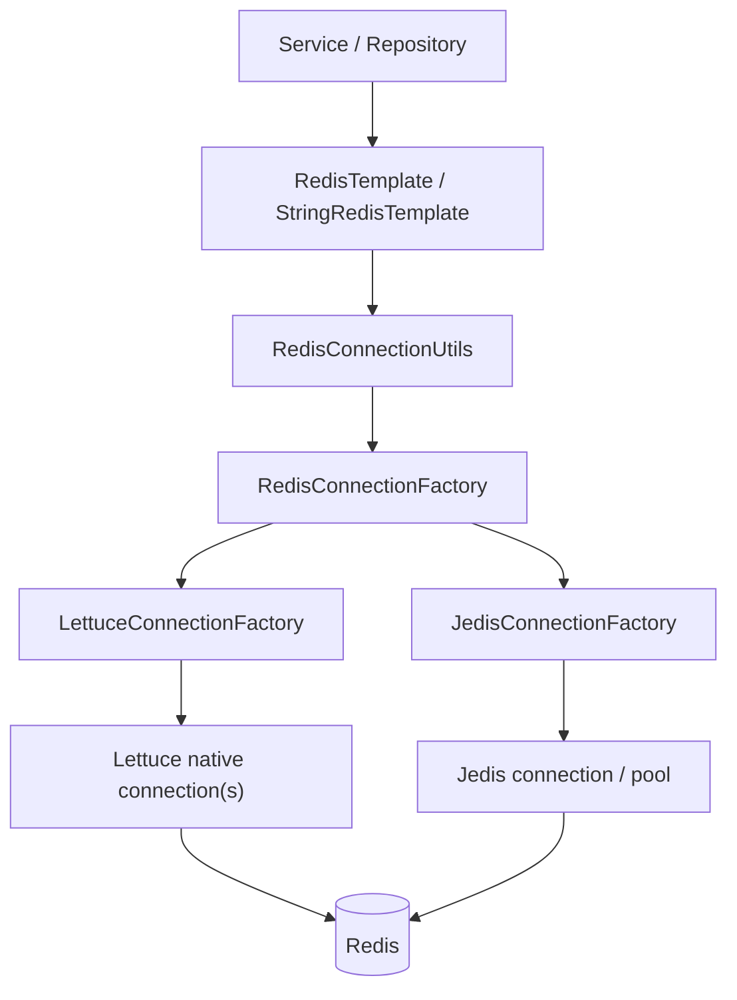
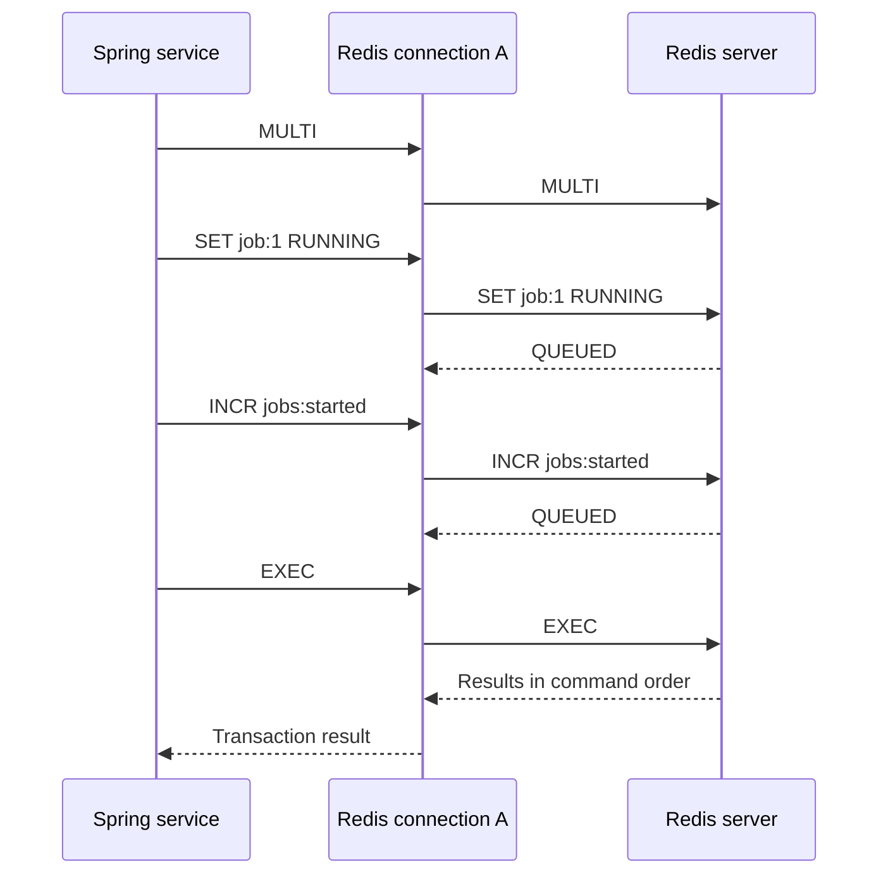
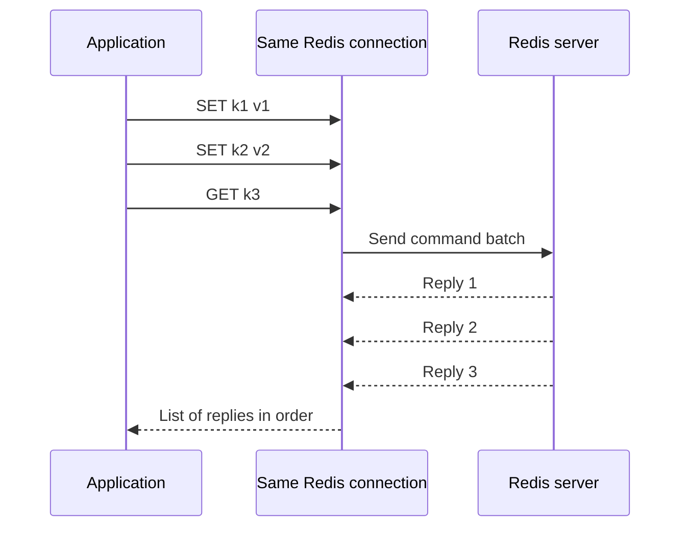

# Controlling Connection Lifecycle in Transactions and Pipelines

## 1. Why Does Connection Lifecycle Matter?

A single Redis command such as `GET` or `INCR` is usually brief: the application borrows or uses a connection, sends the command, receives the result, and can then use that connection for the next task. However, **Redis transactions** and **pipelines** carry state across **multiple commands**. If an application arbitrarily switches connections mid-way, closes the connection too early, or holds the connection after work finishes, results can be wrong, resources can stay occupied, or other requests can be affected.

In Spring Data Redis, controlling connection lifecycle means identifying:

1. **Who acquires the connection?** `RedisTemplate`, `RedisConnectionFactory`, or application code calling directly.
2. **Which commands must share the same connection?** Especially `MULTI`/`EXEC`, `WATCH`, and a pipeline batch.
3. **Who is responsible for returning/closing the connection?** The template or the code that manually acquired the connection.
4. **On failure, what state remains?** Queued commands, lost connection, ambiguous reply, or an unfinished transaction.
5. **When is a connection held too long?** Waiting on application work, external I/O, blocking commands, or oversized batches.

A Redis connection is not merely a host and port. It is a stateful communication session on both client and server, encompassing command ordering, transaction queues, pipeline mode, pending replies, and sometimes `WATCH` tracking context. These states belong to the **connection**, not automatically to a Redis key name or a service object.

## 2. Connection Management Layers in Spring Data Redis

Spring Boot applications typically work through `StringRedisTemplate` or `RedisTemplate<K,V>`. Templates rely on `RedisConnectionFactory` to obtain connections via a driver such as Lettuce or Jedis.



Concepts to distinguish:

| Component | Role | Typical Usage Scope |
|---|---|---|
| `RedisTemplate`, `StringRedisTemplate` | Provides Redis operations, serializers, callbacks, and connection management | Shared singleton bean in the application once configured |
| `RedisConnectionFactory` | Supplies Spring Data Redis `RedisConnection` objects | Shared Spring bean |
| `RedisConnection` | Spring-level connection interface carrying specific operation state | Used within a callback or the scope of code that acquired it |
| Native Lettuce connection | Connection managed by Lettuce; certain types support multithreading | May be shared by the factory for ordinary commands |
| Jedis connection | Connection managed by Jedis, normally used exclusively at one time | Typically borrowed/returned via a pool |
| Connection pool | Caps and reuses a set of connections | Serves connection borrows with bounded wait |

**Note:** `LettuceConnectionFactory` can share a native connection for ordinary commands. However, **`LettuceConnection` (Spring Data Redis's `RedisConnection` wrapper) is not considered thread-safe**. Spring Data Redis also needs appropriate connections for transactions or blocking commands. Jedis typically relies on pooling or connection management to serve multiple concurrent threads. Therefore, never assume the number of `getConnection()` calls equals the number of physical sockets.

### 2.1. Lifecycle of a Command via RedisTemplate

```text
Service calls redisTemplate.opsForValue().get(key)
        |
        v
Template acquires a suitable RedisConnection
        |
        v
Serialize key -> send GET -> receive reply -> deserialize
        |
        v
Template releases resource according to active context
        |
        v
Connection can be reused / returned to pool
```

At the application level, **do not call `close()` on a connection supplied by the template to a callback**. The template is responsible for managing resources and returning the connection after the callback completes. Conversely, if application code calls `connectionFactory.getConnection()` directly, that code must ensure proper release, typically with `try-with-resources`.

### 2.2. “Closing a Connection” Does Not Mean Closing the TCP Socket

When closing a `RedisConnection` wrapper, actual behavior depends on the factory:

- It may **return the connection to a pool** so another request can borrow it.
- It may **release the wrapper** while the factory keeps the native Lettuce connection open for reuse.
- It may actually close the native socket if it was a dedicated connection or the factory is shutting down.

Thus, seeing `close()` at the right boundary signifies ending **resource ownership**, not necessarily opening and closing a TCP connection per command. Accidentally closing a shared native connection managed by the factory can disrupt other commands.

## 3. Redis Transactions: State Lives on the Same Connection

Redis supports transactions via `MULTI` and `EXEC`. After calling `MULTI`, eligible commands are **queued on that exact connection**. `EXEC` tells Redis to execute the queued commands in order. `DISCARD` cancels queued commands without executing them.



**You cannot send `MULTI` on connection A, commands on connection B, and `EXEC` on connection C** and expect Redis to treat them as one transaction. Each connection maintains its own transaction state.

### 3.1. Redis Transactions Differ from Relational Transactions

Redis guarantees that commands inside `EXEC` are processed sequentially without commands from other clients interleaving during transaction execution. However, Redis **does not perform ACID data rollbacks like an RDBMS**: an execution error on one command inside a transaction does not automatically undo other commands that executed. If the server or network fails, actual outcomes also depend on when the disconnect happened and persistence/replication settings.

Furthermore, the return value of an operation invoked inside `MULTI` **is not yet the result of an executed command**. In Spring Data Redis, queued calls typically return `null`; actual results are returned in the list produced by `exec()`. Do not write logic inspecting the return value of `get()`, `increment()`, or `setIfAbsent()` while still inside the transaction before `EXEC`.

## 4. Using SessionCallback to Keep the Same RedisConnection

When calling via `RedisTemplate`, each individual method may borrow and release a connection independently. For a sequence of commands that must share one connection, the appropriate API is **`SessionCallback<T>`**. It ensures commands executed through the `RedisOperations` instance inside the callback share the same session connection context.

Spring Boot example using `StringRedisTemplate`:

```java
import java.util.List;
import org.springframework.dao.DataAccessException;
import org.springframework.data.redis.core.RedisOperations;
import org.springframework.data.redis.core.SessionCallback;
import org.springframework.data.redis.core.StringRedisTemplate;
import org.springframework.stereotype.Service;

@Service
public class JobStateStore {
    private final StringRedisTemplate redis;

    public JobStateStore(StringRedisTemplate redis) {
        this.redis = redis;
    }

    public List<Object> startJob(String jobId) {
        String stateKey = "jobs:state:v1:" + jobId;
        String countKey = "jobs:started:count:v1";

        return redis.execute(new SessionCallback<List<Object>>() {
            @Override
            @SuppressWarnings({"rawtypes", "unchecked"})
            public List<Object> execute(RedisOperations operations)
                    throws DataAccessException {
                operations.multi();
                try {
                    operations.opsForValue().set(stateKey, "RUNNING");
                    operations.opsForValue().increment(countKey);

                    // Actual results are received only after EXEC.
                    return operations.exec();
                } catch (RuntimeException failure) {
                    // Attempt to exit MULTI mode if EXEC did not succeed.
                    try {
                        operations.discard();
                    } catch (RuntimeException cleanupFailure) {
                        failure.addSuppressed(cleanupFailure);
                    }
                    throw failure;
                }
            }
        });
    }
}
```

In this example:

1. `StringRedisTemplate` takes responsibility for acquiring the connection, configuring serialization, and releasing it after the callback.
2. `SessionCallback` wraps `multi()`, queued commands, and `exec()`; no other connection is arbitrarily created mid-way.
3. `exec()` returns operation results in order. If the transaction is aborted or Redis returns an error, application code must handle the state and avoid assuming writes succeeded.
4. `discard()` in the error branch attempts to clean up transaction state. If the connection has dropped, cleanup may fail; never treat it as a rollback for already-executed commands.

**Do not call `redis.opsForValue()...` on the outer template variable instead of `operations.opsForValue()...` inside the callback.** The purpose of `SessionCallback` is grouping operations through the same session's `operations` object; calling another API or spawning threads breaks the shared-connection assumption.

### 4.1. Why Is a Series of Independent Template Calls Insufficient?

The following lacks any guarantee that all commands use the same connection:

```java
redis.multi(); // Not a standard API on RedisTemplate.
redis.opsForValue().set("jobs:1", "RUNNING");
redis.opsForValue().increment("jobs:counter");
redis.exec();  // RedisTemplate also lacks this direct call API.
```

In Spring Data Redis, `multi()` and `exec()` are defined on `RedisOperations`. Grouping commands via a session or proper connection management is essential. Annotating a service method with `@Transactional` also **does not automatically make Redis calls use a Redis transaction** unless template transaction support is enabled.

### 4.2. Do Not Hold a Session While Waiting on External Work

A Redis session/transaction should be **short**. Avoid:

- Opening `MULTI`, then calling an HTTP API or running a slow query on another service before `EXEC`.
- Waiting for user input, infinite retries, or sleeping inside the callback.
- Running heavy CPU processing inside the callback when no connection is needed.
- Offloading commands to `CompletableFuture`/`@Async` and returning from the callback immediately, because the connection/thread context may not carry over to another thread.

Instead, perform any preliminary checks or computations beforehand, open the session only when ready to send Redis commands, and finish with `EXEC`/`DISCARD` within the same scope.

## 5. WATCH and Optimistic Locking

`WATCH` lets you monitor keys prior to `MULTI`. If a watched key is modified between `WATCH` and `EXEC`, the transaction is aborted under Redis's optimistic locking mechanism.

```text
Connection A                        Connection B
  WATCH stock:sku-1
  GET stock:sku-1 -> "5"
                                     DECR stock:sku-1
  MULTI
  SET stock:sku-1 "4"
  EXEC -> transaction aborted because key changed
```

A flow using WATCH typically follows these steps:

1. **Same connection:** `WATCH key`.
2. Read the current value and evaluate update conditions.
3. If conditions are not met, call `UNWATCH` and finish.
4. If conditions are met, call `MULTI`, queue update commands, and call `EXEC`.
5. If `EXEC` aborts due to contention, decide on bounded retry, backoff, or returning a conflict error.

**WATCH is also bound to the connection**, so the entire sequence must stay in the same session. Never read on one connection and assume WATCH on another connection protects it. Retries must be bounded and re-read fresh data; avoid retrying decisions based on stale values.

For inventory checks, this only illustrates the concurrency mechanism. When inventory counts are official business data, choose an appropriate data store and transaction guarantees rather than assuming Redis is the source of truth.

## 6. Pipeline: Reusing One Connection for Multiple Commands to Reduce Network Round Trips

**Pipelining** sends multiple Redis commands in one communication batch without waiting for each reply before sending the next command. It is particularly helpful when sending a batch of independent commands where network round-trip latency is significant.



A pipeline **is not a transaction**. Commands may execute on Redis in order, yet other clients' commands can interleave; an error also does not roll back earlier commands. Pipelining optimizes **command transmission and reply collection**, whereas a `MULTI/EXEC` transaction controls execution semantics.

### 6.1. RedisTemplate.executePipelined()

Spring Data Redis supports `executePipelined`. Example sending multiple writes via the template's high-level API:

```java
import java.util.List;
import org.springframework.data.redis.core.RedisOperations;
import org.springframework.data.redis.core.SessionCallback;

public List<Object> markJobsQueued(
        StringRedisTemplate redis, List<String> jobIds) {

    return redis.executePipelined(new SessionCallback<Object>() {
        @Override
        @SuppressWarnings({"rawtypes", "unchecked"})
        public Object execute(RedisOperations operations) {
            for (String id : jobIds) {
                operations.opsForValue()
                        .set("jobs:state:v1:" + id, "QUEUED");
            }

            // Pipeline callback must return null.
            // Command results are returned in the outer list.
            return null;
        }
    });
}
```

Inside the callback:

- Commands are dispatched in pipeline mode over a template-managed connection context.
- Immediate return values of individual operations are normally `null` instead of actual results.
- **The callback must return `null`**; `executePipelined(...)` returns the list of replies once the pipeline completes and responses are read.
- Do not manually call `closePipeline()` or `close()` on the template-owned connection.
- Bound batch sizes. Building a pipeline with millions of commands in one callback can spike client and server memory, trigger timeouts, and push the system into an unrecoverable state.

If you need to read a result to decide the next command, pipelining does not support *command 2 runs only after seeing command 1's output*, because calls inside the callback do not return real values immediately. Split into phases with synchronization points, or use an appropriate Redis command/script if atomicity is needed.

### 6.2. Low-Level Pipelining with RedisCallback

Sometimes you need to invoke a command lacking a convenient template API. You can use `RedisCallback`, where Spring passes `RedisConnection` within the callback scope:

```java
import java.nio.charset.StandardCharsets;
import java.util.List;
import org.springframework.data.redis.core.RedisCallback;

List<Object> replies = redisTemplate.executePipelined(
        (RedisCallback<Object>) connection -> {
            byte[] key = "batch:last-id:v1"
                    .getBytes(StandardCharsets.UTF_8);
            byte[] value = "42".getBytes(StandardCharsets.UTF_8);

            connection.stringCommands().set(key, value);
            return null;
        });
```

At the low-level API, caller code handles byte arrays/serialization itself. `getBytes(UTF_8)` works only when keys/values actually follow the same encoding convention as the rest of the application; if the template uses another serializer, writing raw bytes can produce data unreadable from `opsForValue()`. Whenever possible, prefer standard Operations APIs to avoid serialization mismatches.

## 7. Controlling Resources in Pipelines and Transactions

### 7.1. Ownership Rules

| Where connection was acquired | Who releases it? | What to avoid? |
|---|---|---|
| `RedisTemplate.opsFor...` | Template/Spring Data Redis | Manually acquiring/closing native connections per command |
| `RedisTemplate.execute(RedisCallback)` | Template | Calling `connection.close()` inside the callback |
| `RedisTemplate.execute(SessionCallback)` | Template, after session finishes | Handing work off to another thread and using the old connection |
| `RedisTemplate.executePipelined(...)` | Template, after pipeline finishes | Manually closing pipeline/connection before template reads replies |
| `RedisConnectionFactory.getConnection()` called by app code | Application code | Forgetting `close()` or returning a connection with uncleaned state |
| Native connection borrowed directly from Jedis/Lettuce API | Per the specific client/pool contract | Unsafe sharing, forgetting pool return, or closing shared resources |

**Rule:** whoever owns the borrow step is responsible for releasing according to the corresponding API. Mixing template-managed cleanup with manual `close()` calls easily causes hard-to-reproduce bugs.

### 7.2. When You Truly Need to Acquire RedisConnection Manually

The following example illustrates synchronous low-level usage. Key/value bytes are constructed explicitly and `try-with-resources` ensures bounded usage:

```java
import java.nio.charset.StandardCharsets;
import java.util.List;
import org.springframework.data.redis.connection.RedisConnection;
import org.springframework.data.redis.connection.RedisConnectionFactory;

public List<Object> writeAtomically(
        RedisConnectionFactory factory, String key, String value) {

    byte[] k = key.getBytes(StandardCharsets.UTF_8);
    byte[] v = value.getBytes(StandardCharsets.UTF_8);

    try (RedisConnection connection = factory.getConnection()) {
        connection.multi();
        try {
            connection.stringCommands().set(k, v);
            return connection.exec();
        } catch (RuntimeException ex) {
            try {
                connection.discard();
            } catch (RuntimeException cleanupEx) {
                ex.addSuppressed(cleanupEx);
            }
            throw ex;
        }
    }
}
```

Here, **application code directly borrowed the connection**, so `try-with-resources` is essential. Never apply this pattern to a `RedisConnection` received *inside* `RedisTemplate.execute(callback)`; there, the template is the owner.

`getConnection()`/`close()` in the manual example may map to pool borrow/return or wrapper handling depending on the driver. Prefer `RedisTemplate` or `SessionCallback` unless low-level control is required.

### 7.3. Cleaning Up State on Failure

If a transaction opened `MULTI` without `EXEC`, attempt `DISCARD` or let the connection management layer discard the broken connection. If a pipeline is open at the low level, follow the driver's pipeline cleanup/close API and never return a half-finished connection to a pool. Do not attempt to reuse a suspected broken connection merely to save connection creation cost.

A disconnect after sending `EXEC` or pipeline commands can leave an **indeterminate outcome** on the application side: commands may have executed while replies were lost. Blindly retrying commands like `INCR` or List pushes can produce duplicate effects. Use idempotency keys, operation IDs, conditional writes, or persisted processing state according to business requirements.

## 8. Comparing Transactions and Pipelines from a Lifecycle View

| Criterion | Redis Transaction (`MULTI/EXEC`) | Redis Pipeline |
|---|---|---|
| Primary goal | Execute a group of commands sequentially without other clients interleaving during `EXEC` | Reduce wait time across multiple command send/receive round trips |
| Connection requirement | `MULTI`, queued commands, and `EXEC` on the same connection | Send multiple commands and collect replies in the same pipeline context |
| Result of command before completion | Commands inside `MULTI` return `QUEUED`/API placeholder awaiting `EXEC` | Commands inside pipeline callback typically do not return real results yet |
| Completion step | `EXEC` or `DISCARD` | Close/flush pipeline, receive reply list |
| Atomicity | Execution group is not interleaved, though no DB-style rollback exists | No atomicity guarantee |
| Concurrent contention | Can pair with `WATCH` for optimistic locking | Does not address race conditions on its own |
| Recovery after network error | May not know whether `EXEC` ran | May not know which commands ran |
| Connection-hold hazards | Prolonged transaction state, missing `EXEC`/`DISCARD` | Large reply backlog/buffers, long connection hold, oversized batches |
| Common Spring API | `execute(SessionCallback)` with `multi/exec` | `executePipelined(SessionCallback/RedisCallback)` |

Pipelines and transactions can be combined at the Redis protocol or client level in certain cases, yet **return values and reply structures become more complex**. Understand the Spring Data Redis/driver contract thoroughly before mixing both, and combine them only when it specifically solves a concrete requirement.

## 9. Does Spring @Transactional Automatically Create a Redis Transaction?

**Not by default.** Spring's `@Transactional` only creates a transaction context via the configured transaction manager. By default, `RedisTemplate` does not participate in a Spring transaction as a Redis `MULTI/EXEC` unless transaction support is explicitly enabled.

To integrate a template with active Spring transactions, Spring Data Redis offers an option:

```java
@Configuration
class RedisTransactionConfig {
    @Bean
    StringRedisTemplate transactionAwareRedisTemplate(
            RedisConnectionFactory connectionFactory) {
        StringRedisTemplate template =
                new StringRedisTemplate(connectionFactory);
        template.setEnableTransactionSupport(true);
        return template;
    }
}
```

When a Spring-managed transaction is active, a transaction-support-enabled template can **bind a Redis connection to the current thread** and queue Redis write commands until transaction completion. Reads in this context have specific semantics: read-only commands may be routed over a separate connection to read existing committed data rather than seeing queued writes. Therefore, **never assume a `get()` after a `set()` inside a transaction sees the queued value**.

### 9.1. Redis Transactions and Database Transactions Do Not Become One

Consider a service:

```java
@Transactional
public void completeOrder(String orderId) {
    orderRepository.markCompleted(orderId);   // SQL database
    redisTemplate.opsForValue().set(
            "orders:state:v1:" + orderId, "COMPLETED");
}
```

If `redisTemplate` has transaction support enabled, Spring can synchronize dispatching/committing Redis commands with the active transaction lifecycle. However, **this does not deliver an ACID distributed transaction between a SQL database and Redis**. The database can commit while Redis times out, loses its connection, or fails over at a different moment. Redis also does not provide two-phase rollback like the relational database in this example.

For orders, payments, and critical events, it is usually better to:

- Persist business data to the primary database using appropriate transactions and constraints.
- Treat Redis as a cache or recoverable derived state, or use synchronization mechanisms like a reliable outbox/event stream.
- Perform cache invalidation or projection updates post-commit, with appropriate retries/idempotency.
- Define fallback behavior when Redis is temporarily unavailable.

### 9.2. Thread-Bound Resources and Asynchronous Boundaries

Synchronous Spring methods typically rely on thread-bound transaction synchronization. When moving work across `@Async`, `CompletableFuture`, or another thread pool, **do not assume bound transactions/connections propagate automatically to the new thread**.

In reactive applications, transaction contexts and resource management use a different model (bound to the Reactor context in supporting integrations). Do not apply imperative solutions built on `ThreadLocal`, `SessionCallback`, and `@Transactional` directly to `ReactiveRedisTemplate`. Use reactive APIs, publisher composition, and the connection/session/transaction contracts of your Spring Data Redis version.

## 10. Choosing a Connection Pool for Transactions and Pipelines

### 10.1. Why Do Pools Exhaust?

Suppose a Jedis pool has a maximum of 12 connections, and 12 concurrent requests open transactions and then perform a slow HTTP call before `EXEC`. All 12 connections can be held, forcing remaining requests to wait to borrow a connection. Enlarging the pool may temporarily mask the symptom without fixing the root cause: **holding connections when Redis is not needed**.

With Lettuce, ordinary commands can reuse a native connection, yet transactions/blocking operations or dedicated-connection setups still increase connection demand. An overly large pipeline can also hold a connection for a long time and accumulate replies, putting pressure on resources.

### 10.2. Practical Principles

1. **Keep transactions/sessions short**: prepare data before opening the session; avoid non-Redis I/O in between.
2. **Choose finite pipeline batch sizes**: process in batches, collect replies, and yield resources rather than sending one giant batch.
3. **Bound concurrent tasks**: thread/request concurrency and Redis pool size must align with server capacity.
4. **Configure intentional timeouts**: connect timeout, command timeout, pool borrow timeout, and request timeout should not conflict.
5. **Do not open connections manually per call** when templates/factories already manage reuse.
6. **Separate pool wait from Redis latency**: slowness from waiting to borrow requires a different fix from slow commands or networking.
7. **Do not let post-`MULTI` errors swallow cleanup**; avoid losing the original exception if cleanup also fails.

In Spring Boot, pool configuration properties appear under `spring.data.redis.lettuce.pool.*` or `spring.data.redis.jedis.pool.*`, depending on the client and classpath dependencies. Configure them only after verifying the version, pooling behavior, and actual need. For Lettuce, sharing a native connection for ordinary commands does not mean all transactions share that connection.

## 11. Monitoring Connection Lifecycles in Production

To see whether transactions/pipelines are exhausting resources, collect metrics across **application**, **pool/driver**, and **Redis server**:

| Observation | Question to answer |
|---|---|
| Active/idle connections, max pool, borrow wait | Are requests waiting for connections? Are connections held unusually long? |
| Connections to Redis, rejected connections | Is the server hitting client limits or experiencing socket open/close churn? |
| Redis command duration p50/p95/p99 | Is slowness in Redis execution or application-side resource waiting? |
| SessionCallback/transaction duration | Are connections held during work unrelated to Redis? |
| Command count and size per pipeline | Are large batches causing buffer or memory spikes? |
| Timeouts, reconnects, socket errors, failovers | During which incidents could command outcomes be indeterminate? |
| Redis CPU, memory, network I/O, slow log | Are there expensive commands, large values, or saturated bandwidth? |
| `EXEC` aborts due to `WATCH`, retry rate | Is there high contention or excessive retry loops? |

When troubleshooting “every Redis API is slow,” separate **waiting on the pool** from **executing Redis commands**. If pool wait is high while Redis CPU is low, adding HTTP workers rarely helps. If Redis CPU is high due to `KEYS` or scanning huge collections, switching from Jedis to Lettuce will not fix the root cause either.

Do not log raw keys containing sensitive information, tokens, or payload values. Logging normalized operation/namespace names, command types, latencies, error codes, and batch sizes provides enough signal for observability.

## 12. Handling Common Failure Scenarios

### 12.1. Forgetting EXEC or DISCARD

**Symptom:** a callback opens `MULTI` and throws an exception; a transactional connection may retain unfinished state, causing subsequent operations to return unexpected replies or forcing connection eviction.

**How to handle:** keep `MULTI`, commands, and `EXEC` in the same scope; call `DISCARD` when possible if an error happens before commit, and exit the callback so the framework releases resources. If a connection is corrupted, never attempt to reuse it.

### 12.2. Closing the Connection Inside RedisCallback

**Symptom:** `executePipelined` fails when reading replies; operations after the callback report a closed connection; intermittent errors appear when pools reuse connections.

**How to handle:** let the template manage the connection it passes into the callback. Only call close yourself when your own code directly called `RedisConnectionFactory.getConnection()` or borrowed a native connection under its client contract.

### 12.3. Reading Return Values Inside a Pipeline to Condition Other Commands

**Symptom:** read values are `null` or unavailable inside the callback, causing conditional branches to behave wrongly.

**How to handle:** finish the pipeline and inspect the resulting `List<Object>`, or split into stages. For decisions requiring atomicity, choose a dedicated Redis command, script, or transaction rather than forcing a pipeline to act as a read–modify–write loop.

### 12.4. Timeout After Sending Commands Followed by Unconditional Retry

**Symptom:** counters increment twice or jobs are enqueued twice while the caller saw a timeout.

**How to handle:** track operation IDs and design idempotency. Never treat “no reply received” as proof Redis did nothing; distinguish failures before sending from failures after sending when the reply was lost.

### 12.5. Using a Transaction and Immediately Reading Queued Results

**Symptom:** code checks the value right after `increment()` inside `MULTI` and sees `null`; conditions fail unexpectedly.

**How to handle:** evaluate preconditions before `MULTI`, or use `WATCH` and `EXEC`, processing results from `exec()` after the transaction completes.

### 12.6. Passing a Connection/Thread Into Asynchronous Tasks

**Symptom:** commands running on another thread lose the intended session, corrupt transaction state, or see the connection returned to the pool before completion.

**How to handle:** execute commands inside the synchronous callback scope, or use formal reactive/async models with clear resource boundaries. Never pass a `RedisConnection` across threads assuming safety.

## 13. Three Design Scenarios

### Scenario A: Updating State and a Counter

An operation needs to set `job:state:42 = RUNNING` and increment `jobs:started` together. If deployment constraints allow both keys (e.g. same hash slot in Redis Cluster), you can use `SessionCallback` with `MULTI/EXEC`. The service must not make external HTTP calls between the two commands. If you also need conditional validation before updating, consider `WATCH` or a Lua script with appropriate semantics.

### Scenario B: Loading 5,000 Cache Entries

You need to cache 5,000 product entries, which are independent and safe to rewrite if a batch fails. Pipelining in small batches (for example, a few hundred commands after measuring and tuning) can cut many network round trips. A transaction is unnecessary just to send fast; attach a TTL to each key with appropriate commands and watch memory when collecting reply lists.

### Scenario C: Updating PostgreSQL and Invalidating Redis Cache

An application updates product prices in PostgreSQL and then needs to refresh cache. Do not rely on `@Transactional` with Redis transaction support to claim both systems commit atomically. Treat the database as the source of truth; after commit, execute invalidation, rely on finite TTLs, and use retries/an outbox if eventual consistency guarantees are required. Hold the Redis connection only for the actual cache operation.

## 14. Rules of Thumb When Writing Code

| Requirement | Choose API / Management Style | Primary Responsibility |
|---|---|---|
| Single GET/SET/INCR command | `RedisTemplate.opsFor...` | Let the template borrow and release connections |
| Multiple commands sharing a Redis transaction | `RedisTemplate.execute(SessionCallback)` + `multi/exec` | Same session; finish with `EXEC` or clean up with `DISCARD` |
| Contended read–modify–write | `WATCH` in the same session, or atomic script/command | Detect conflicts, perform bounded retries |
| Send many independent commands to cut round trips | `executePipelined(...)` | Callback returns `null`; bound batch size; read replies post-pipeline |
| Low-level byte/command operations | `RedisCallback` | Let the template manage the connection; handle serializers |
| Manually borrowing `RedisConnection` | `RedisConnectionFactory.getConnection()` | `try-with-resources` and complete cleanup |
| Redis participating in an active Spring transaction | Enable transaction support in proper context | Understand thread binding, commit synchronization, and consistency limits |
| Reactive Redis | `ReactiveRedisTemplate`/reactive connection | Manage resources per reactive contract; avoid blocking event loops |

The core principle is that **a connection should only be held for the scope of work that relies on that connection's state**. For transactions, that scope spans from `MULTI` or `WATCH` to `EXEC`/`DISCARD`. For pipelines, it spans from opening the pipeline until all replies are collected and the batch finishes. In Spring Data Redis, `SessionCallback` and `executePipelined` define these boundaries clearly. Good design preserves Redis semantics while preventing connection leaks, pool exhaustion, and uncertain outcomes during failures.
