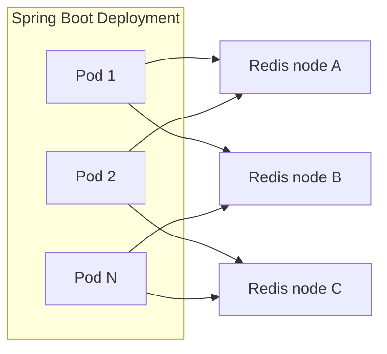
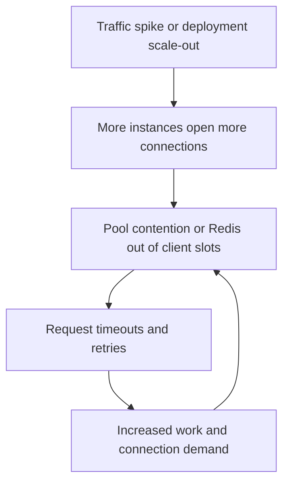

# Calculating a Redis Connection Budget by Application Replica Count

A Spring Boot application connecting to Redis may run smoothly with a single instance on a developer machine, yet when deployed as multiple replicas behind a load balancer or in Kubernetes, **every replica can open its own Redis connections**. When scaling up replicas alongside enabled connection pools, background workers, and rolling updates, total connections can become far larger than initially expected. Common symptoms include Redis hitting its client limit, applications waiting to borrow pooled connections, rising timeouts, or new deployments failing to connect.

This lesson explains how to calculate a **connection budget** for Spring Data Redis: determining how many connections each instance can actually open, counting replicas at peak load and deployment overlap, adding other components sharing Redis, reserving operational headroom, and checking against each Redis server's limit.

## 1. What Is a Connection Budget and Why Calculate It?

**One Redis connection** in this lesson refers to an established TCP connection from a client to a Redis server/node. A single connection can be reused across many commands; one HTTP request can issue multiple Redis commands; and multiple requests can share one connection depending on the Redis client and configuration. Therefore:

> **Request count ≠ Redis connection count. Thread count ≠ Redis connection count. `RedisTemplate` bean count ≠ Redis connection count.**

What must be budgeted is the **maximum concurrent physical connections that can exist on each Redis node** when all applications, jobs, other services, and infrastructure components are active.

A simple example:

- Service `order-service` runs 1 replica and shows around 12 Redis connections.
- Kubernetes scales the service to 10 replicas. If each replica opens 12 connections at peak, this service alone can use roughly **120 connections**.
- When a rolling update allows 2 extra new pods before terminating old pods, 12 pods may run concurrently, totaling **144 connections** if each maintains that count.
- One Redis server also serves other services, health checks, administrative tools, and infrastructure components; all share the connection limit.

The numbers 12, 120, and 144 here are hypothetical to illustrate multiplication. In real systems, derive connections **per replica** from client configuration and observed metrics rather than assuming every pool setting automatically equals open connections.

### Redis Connection Limit Is Not the Only Limit

Redis caps concurrent client connections, typically via `maxclients`. In practice, the effective limit also depends on the **file descriptors** permitted to the Redis process by the OS. Redis needs descriptors for internal operations beyond client sockets, so the effective cap can be lower than configured if OS limits are insufficient.

Even before hitting `maxclients`, high connection counts consume memory (client structs, input/output buffers), descriptors, tracking overhead, and network resources. Conversely, having spare client slots does not guarantee Redis has enough CPU, memory, or throughput for the workload. A connection budget is only **one dimension of system capacity**.

## 2. How Many Connections Does a Spring Data Redis App Actually Open?

This step determines the accuracy of the entire calculation.

### 2.1. Lettuce Often Reuses Connections

In Spring Boot using `spring-boot-starter-data-redis`, Lettuce is the common default client. Under standard `LettuceConnectionFactory` configuration, Spring Data Redis can use **a shared native connection** for many ordinary Redis operations. This means:

- 100 concurrent requests **do not necessarily** open 100 TCP connections.
- 10 `StringRedisTemplate` beans sharing one `RedisConnectionFactory` **do not necessarily** create 10 separate pools.
- If ordinary execution does not use a pool, setting `max-active: 20` **does not mean** the application always holds 20 open connections.

Certain operations require dedicated connections—such as blocking calls, transactions, or message subscriptions—and may use connections separate from the shared native connection. Depending on client/factory configuration, these dedicated connections may be borrowed from a pool. For Pub/Sub, listeners, and long-lived operations, inspect how the client manages connections separately.

### 2.2. A Pool Caps Concurrent Borrows Per Pool

When using Lettuce connection pooling with Apache Commons Pool 2, `max-active` normally bounds **concurrently borrowed connections from one pool**, not the maximum Redis connections across the entire application or cluster. One application can have:

- One pool for ordinary connections or operations requiring dedicated connections.
- One shared native connection **outside** the pool's borrowed count, depending on setup.
- Additional pools created by another `RedisConnectionFactory`.
- Dedicated connections for Pub/Sub, blocking commands, topology management, or internal tasks.
- Connections to multiple nodes when using Redis Cluster, Sentinel, or read/write splitting.

With Jedis, sharing and pooling differ from Lettuce. Do not copy Lettuce's “one default connection + pool” formula blindly to every Redis client.

**Rule:** distinguish **maximum configured openable connections**, **currently open connections**, and **currently busy connections**. Use configured limits for upper-bound planning and observability metrics to calibrate; never conflate the three.

### 2.3. Inventorying Connections by Usage Path

An inventory table for *each application instance* can start like this:

| Component on one instance | What to verify | Example budgeted value |
| --- | --- | ---: |
| Lettuce shared native connection | Is sharing enabled, and does it connect to the target node? | 1 |
| First pool | `max-active`, max connections concurrently borrowable | 12 |
| Second pool / connection factory | Does an independent pool actually exist? | 0 if none |
| Redis Pub/Sub listener | Are long-lived connections held? To which node? | 0 if unused |
| Redis Streams/blocking consumers | Parallel consumers and connections held per consumer | 0 if unused |
| Management/topology connections | Does the client/topology open auxiliary connections? | Measure or budget |

If an app has one Lettuce factory, one shared native connection, and **at most 12 pooled connections to the same node**, you might budget **13 connections per instance** for a capacity example. This is an **example-specific assumption**, not a claim that every app with `max-active=12` holds exactly 13 connections.

In other configurations, the pool may sit unused, connections may spread across multiple nodes, or extra dedicated connections may exist. Adjust inputs accordingly.

## 3. Budget Formula by Replica Count

For a given Redis server/node `j`, let:

- `C_j`: **effective** concurrent client connection limit of Redis node `j`.
- `R_i`: maximum replicas of application `i` able to run concurrently at the target moment.
- `c_(i,j)`: maximum connections **one replica of application `i`** can open to Redis node `j`.
- `O_j`: connections from **other applications** accessing node `j` not already counted in the sum.
- `I_j`: connections from monitoring/ops tools and other infrastructure clients.
- `H_j`: headroom for spikes, configuration changes, incidents, and emergency access.

The budget must satisfy:

\[
\boxed{\sum_i (R_i \times c_{i,j}) + O_j + I_j + H_j \leq C_j}
\]

Remaining unallocated capacity after reserving headroom:

\[
\text{FreeBudget}_j = C_j - \left[\sum_i(R_i\times c_{i,j}) + O_j + I_j + H_j\right]
\]

If `FreeBudget_j < 0`, the connection plan **exceeds** the node's limit. If positive yet tiny, the system is vulnerable during retries, failovers, temporary scaling, or new service deployments.

For a single application:

\[
R_{\mathrm{peak}} = R_{\mathrm{autoscale\ max}} + R_{\mathrm{deploy\ extra}}
\]

This is an **upper-bound estimate** when deployment settings allow new pods to overlap with old pods. Tailor the calculation to your real deployment strategy: Kubernetes RollingUpdate has `maxSurge`; blue/green can run both versions simultaneously; canary introduces extra replicas; background workers and scheduled jobs in separate deployments count as separate workloads.

Example per-instance breakdown in a hypothetical model:

\[
c_{i,j} = P_{i,j} + S_{i,j} + D_{i,j}
\]

Here `P` is the sum of independent pool caps reaching node `j`, `S` is shared connections outside pools, and `D` covers dedicated connections (Pub/Sub, blocking, management, etc.). Avoid double-counting connections already managed inside a pool/client. With Redis Cluster, every variable carries index `j` because clients connect across distinct nodes.

## 4. Complete Calculation Example: Spring Boot + Kubernetes + Single Redis Instance

Suppose a system uses **one Redis server** under these conditions:

| Component | Assumed Value |
| --- | ---: |
| Effective Redis connection limit `C` | 500 |
| Current `order-service` replicas | 8 |
| `order-service` autoscaling limit | 14 replicas |
| Rolling update `maxSurge` | 2 pods |
| Per-replica pool: `max-active` | 12 connections |
| Budgeted shared connection outside pool per replica | 1 connection |
| Other applications' connections `O` | 90 |
| Monitoring/ops connections `I` | 10 |
| Operational headroom `H` | 100 |

**Step 1: calculate per replica.**

Assuming no extra dedicated connections and each replica can open all 12 pooled connections plus 1 shared connection:

\[
c = 12+1=13
\]

**Step 2: calculate replicas at deployment peak.**

\[
R_{\mathrm{peak}}=14+2=16
\]

**Step 3: calculate connections from the application.**

\[
N_{\mathrm{order,peak}}=16\times13=208
\]

**Step 4: add other components and headroom.**

\[
N_{\mathrm{budget}}=208+90+10+100=408
\]

**Step 5: compare against the limit.**

\[
\text{FreeBudget}=500-408=92
\]

This example plan leaves **92 slots** after reserving 100 slots of operational headroom. If every app hits its budgeted ceiling, physical connections before headroom are `208 + 90 + 10 = 308`; do not misread `408` as the active connection count Redis currently holds.

### Impact of Increasing Replicas or Pool Size

| Scenario | Concurrent Replicas | Budgeted Connections / Replica | `order-service` Connections | Total incl. 90 + 10 + 100 Headroom | Remaining Below 500 |
| --- | ---: | ---: | ---: | ---: | ---: |
| Current load | 8 | 13 | 104 | 304 | 196 |
| Max autoscale + rolling surge | 16 | 13 | 208 | 408 | 92 |
| Same 16 pods, raise pool to 20 + 1 shared | 16 | 21 | 336 | 536 | **−36** |
| Autoscale to 20 + surge 2, keep pool 12 + 1 shared | 22 | 13 | 286 | 486 | 14 |

Easily missed insight: **changing a single `max-active` number per pod can increase the total budget manyfold**, because it multiplies across every concurrent replica. Raising the pool from 12 to 20 adds `16 × 8 = 128` connections to the 16-replica ceiling; a plan with 92 spare slots flips to 36 slots over budget.

### When a New Service Shares Redis

If `invoice-service` is later added with up to 6 replicas and 8 budgeted connections per replica, the new service requires:

\[
6\times8=48\text{ connections}
\]

In the 16-pod `order-service` scenario, remaining budget drops from 92 to `92-48=44`. Adding background jobs, migration tools, or a blue/green rollout can consume that remainder completely. Shared Redis instances across teams should maintain a **per-workload budget ledger** and shared headroom policy.

## 5. Finding the True Peak Replica Count

Checking only the current `replicas` count is insufficient. When budgeting, account for:

1. **Autoscaling:** What is the HPA's `maxReplicas`? Autoscaling on CPU, memory, or custom metrics can hit maximum during incidents or traffic spikes.
2. **RollingUpdate:** How many extra pods does `maxSurge` allow temporarily? If expressed as a percentage, calculate using Kubernetes rounding rules and actual deployment config.
3. **Blue/green and canary:** Do two versions run at full replica count simultaneously during traffic cutover?
4. **Background workers and schedulers:** Do separate deployments, cron jobs, or manual jobs use Redis? They can run concurrently with the main service.
5. **Multiple environments sharing Redis:** Do staging, test, preview, or other namespaces connect to the same Redis server? Separate Kubernetes namespaces do not create separate Redis client budgets.
6. **Startup and failover:** Old connections may not close instantaneously when new clients connect; reconnect storms can also create temporary spikes.

Example Kubernetes snippets:

```yaml
# Deployment (relevant fields excerpted)
spec:
  replicas: 8
  strategy:
    type: RollingUpdate
    rollingUpdate:
      maxSurge: 2
      maxUnavailable: 1
```

```yaml
# HorizontalPodAutoscaler (relevant fields excerpted)
spec:
  minReplicas: 3
  maxReplicas: 14
```

Assuming max 14 pods per HPA and up to 2 surge pods during rollout, use **16 pods** as the budget input. This accounts for peak concurrency that can legitimately occur; the count of `Ready` pods at one moment is only a point-in-time observation, not a substitute for configured ceilings.

For VMs or non-Kubernetes containers, the formula is identical: peak instances + temporary deployment instances + co-running workers connecting to Redis.

## 6. Estimating from Spring Data Redis Configuration

For Spring Boot 3.x using Lettuce and a pool where needed, an example configuration is:

```yaml
spring:
  data:
    redis:
      host: redis.internal
      port: 6379
      connect-timeout: 2s
      timeout: 2s
      lettuce:
        pool:
          enabled: true
          max-active: 12
          max-idle: 8
          min-idle: 1
          max-wait: 300ms
```

Corresponding dependencies when Lettuce pooling is needed:

```groovy
dependencies {
    implementation 'org.springframework.boot:spring-boot-starter-data-redis'
    implementation 'org.apache.commons:commons-pool2'
}
```

Numbers in the config above are **examples only**, not optimal values for all apps. In Spring Boot, verify property names and defaults against your exact version; this snippet illustrates Spring Boot 3.x.

| Property | Effect | Relationship to Budget |
| --- | --- | --- |
| `lettuce.pool.max-active` | Max connections concurrently borrowable from this pool | One component of the per-instance ceiling when the pool is actually used |
| `lettuce.pool.max-idle` | Max idle connections retained in the pool | Affects how many connections remain open when traffic drops |
| `lettuce.pool.min-idle` | Target minimum idle connections maintained while active | Can cause many replicas to hold connections even with low request rates |
| `lettuce.pool.max-wait` | Max time waiting to borrow when the pool is busy | Helps fail fast instead of stalling indefinitely; does not add Redis slots |
| `connect-timeout` | Time limit to establish connections | Useful for detecting connectivity failures; does not raise `maxclients` |
| `timeout` | Redis operation time limit per client settings | Keep distinct from pool borrow wait time |

**Note:** Pools are capped *per pool per instance*, not across the entire deployment. With three independent `LettuceConnectionFactory` beans, each factory maintains its own pool; you cannot take `max-active` of one pool as the total process cap.

If the app mostly uses Lettuce's shared native connection for ordinary commands, raising `max-active` may barely alter open connections on the main execution path. Inspect actual command paths, blocking/transactional work, and existing pools to calculate a meaningful budget.

### Relationship Among min-idle, max-idle, and max-active

A pool may start with few open connections and grow as traffic rises. `max-active` expresses the **concurrency cap for the pool**, while `min-idle`/`max-idle` govern retained idle connections. Do not treat `min-idle` as max capacity, nor assume `max-active` connections are always open at every moment.

Across many replicas, accumulated idle connections can still be substantial. For example, 50 pods each maintaining at least 2 idle connections hold ~100 connections just for idle baseline once initialized and maintained by pool rules. Beyond those sit shared connections or dedicated connections if used.

## 7. Standalone, Sentinel, and Cluster: Where to Budget?

### 7.1. Standalone Redis

When all instances target one Redis server, sum all connections opened to that server and compare against **that server's** client limit. That is the scenario in our 500-connection example.

### 7.2. Redis with Primary and Replicas

If the application only connects to the primary for reads/writes, most client connections concentrate on the primary. When configured to read from replicas or split reads, connections can open to multiple nodes. Replication connections between Redis primary and replicas also belong to infrastructure accounting when reviewing limits, even though they are not Spring Boot request connections.

Never compute `500 maxclients × 2 nodes = 1,000` and assume one primary can handle 1,000 connections. Each node has its own limit and load.

### 7.3. Redis Sentinel

Sentinel handles discovery and primary/replica health monitoring. Clients may hold connections to Sentinel **and** data connections to the currently elected Redis node. Budgets to Redis data nodes and Sentinel endpoints are separate. During failover, Redis clients may re-establish connections to the new primary; budget for reconnect spikes and rerouting, not just pre-failover steady state.

### 7.4. Redis Cluster

In Redis Cluster, each node owns a subset of hash slots. Redis clients may hold connections to multiple nodes to route commands properly, monitor topology, or read from replicas when configured. Distribution depends on key access patterns, client behavior, and read routing settings.



Calculate the **budget per node**, rather than multiplying one server's limit by node count as a shared pool. Do not assume one single pool spans the cluster uniformly without observing topology and client connection distribution. A hot key can saturate connections or load on one node while others stay lightly loaded.

For Cluster, reuse the formula:

\[
N^{\mathrm{peak}}_j = \sum_i (R_i \times c_{i,j}) + O_j + I_j
\]

and verify for **every node `j`**:

\[
N^{\mathrm{peak}}_j + H_j \leq C_j
\]

If exact distribution has not been measured yet, establish a conservative upper bound for nodes likely to receive connections from a workload, then refine using real connection counts, cluster client behavior, and failover tests.

## 8. Observing Open Connections and Ceilings

Budgeting requires both **configuration data** and **operational telemetry**. Paper calculations are trustworthy only when checked against how many connections real instances open and the effective ceiling of the running Redis instance.

### 8.1. Redis Side

Common Redis CLI commands:

```redis
CONFIG GET maxclients
INFO clients
CLIENT LIST
```

- `CONFIG GET maxclients`: views the effective client limit reported by the server. In managed Redis environments, reading or changing config may be restricted; check the provider's dashboard if needed.
- `INFO clients`: inspects statistics such as `connected_clients`, `blocked_clients`, and related fields depending on Redis version. `connected_clients` samples active connected clients.
- `CLIENT LIST`: lists current client connections and attributes, helping identify source addresses, states, idle times, and client names. Output can include sensitive metadata; run only in authorized environments and avoid pasting verbatim into public logs.

Example CLI usage from an authorized host:

```bash
redis-cli -h redis.internal -p 6379 INFO clients
redis-cli -h redis.internal -p 6379 CONFIG GET maxclients
```

Never embed real environment passwords directly in shared commands or documentation. For managed/Cluster Redis, query each relevant node or use platform metrics covering the full topology.

### 8.2. Application Side

On each replica, correlate these metrics **at the same timestamps**:

- Actual connections to Redis nodes per pod/process, especially at peak load and during rollouts.
- Current pool size, borrowed/idle counts, borrow wait times, and pool borrow failures if pooling is used.
- Active blocking tasks or Pub/Sub connections held; active consumer counts.
- Command throughput, p50/p95/p99 latency, timeouts, and retry rates.
- Running pod count, pods in rollout, and HPA desired/current replicas.
- `connected_clients` and client limits on each Redis node; connection rejections or drops.

Use Micrometer/Actuator, Redis client metrics, Prometheus/Grafana, or existing telemetry. However, **not all Lettuce pool metrics appear automatically just from adding the starter**: visibility depends on versions, registries, and application instrumentation. If missing, measure on the client and cross-check `CLIENT LIST` by source IP/client name within infrastructure rules.

### 8.3. Measure at Critical Moments

Do not measure solely at idle startup. Include at least:

1. Normal load after pools have warmed up.
2. Peak traffic with concurrent background jobs.
3. Autoscaling near or at `maxReplicas`.
4. Rolling/blue-green/canary deployments temporarily increasing replica count.
5. Redis reconnects or failovers if supported by the environment.

Comparing `connected_clients` before and after changing pod count helps estimate connections per instance, provided you exclude concurrent changes from other workloads and delayed socket closes. Such estimates are indicators, not absolute proof of ceiling usage.

## 9. Choosing Pool Size: Balancing Server Budget and App Concurrency

There is no universal “every pod needs 20 connections” rule. A pool must satisfy **the concurrency of operations that genuinely must borrow connections**, while the sum across all replicas stays within Redis's budget.

For operations where each request holds a dedicated connection for duration `W`, you can estimate **average concurrent operations** via Little's Law:

\[
L \approx \lambda \times W
\]

Where:

- `\lambda`: connection-using operations per second for **one instance**.
- `W`: average connection hold time in seconds.
- `L`: average concurrent in-flight operations.

For example, at 200 operations/second on one pod where each **borrows a dedicated connection for 0.02 seconds**, average concurrent borrows are roughly:

\[
L=200\times0.02=4
\]

This is only a starting point: traffic comes in bursts, hold times are skewed, and individual requests may hold connections longer or retry. Measure p95/p99 pool wait times and actual concurrency before setting `max-active`.

**Applicability limit:** this calculation does not mean 200 Redis commands/second need 4 sockets when Lettuce uses a shared native connection with multiplexing/pipelining. It reflects concurrency only under a **dedicated-connection-per-operation model**. Client characteristics and execution paths determine how workload concurrency translates to socket count.

A useful sizing workflow:

1. Identify which execution paths actually borrow pooled connections and measure hold times.
2. Measure concurrency and wait times at target load, including bursts.
3. Pick an initial pool cap and verify the total budget across all replicas.
4. Run load tests including scale-out/rollout to observe pool wait, Redis `connected_clients`, timeouts, and throughput.
5. Adjust with evidence of pool exhaustion or excess connections; never raise pool size simply because p99 is slow—the cause may be heavy Redis commands, networking, or CPU.

## 10. What Happens When You Exceed the Budget?

### 10.1. Redis Rejects New Connections

When the server hits its effective client limit, new connections are rejected with an error (such as `max number of clients reached`, depending on client/server). Java receives Redis access or connection-acquisition exceptions. Some requests continue working on existing connections, making the issue subtle if you only check basic health probes.

### 10.2. Pool Exhausts Before Redis Hits maxclients

If `max-active` is smaller than concurrent borrow demand, operations wait and then exceed `max-wait`. Redis may still have plenty of free client slots. Raising `maxclients` will not let a pool lend more than its own cap; conversely, raising `max-active` helps only if Redis budget remains sufficient and extra connections improve real throughput.

### 10.3. Retries and Autoscaling Create an Amplification Loop



When connections are rejected, retries without backoff or excessive retries prolong the incident. Autoscaling an app from 10 to 20 pods increases HTTP capacity while **nearly doubling Redis connection demand**. Align autoscaling limits with Redis capacity.

## 11. Strategies to Reduce Connection Pressure

### Eliminate Unnecessary Connections First

- Reuse `RedisConnectionFactory` following Spring architecture; never create a factory/pool per request or per service object.
- Never instantiate `RedisClient`/connections inside request handlers and forget to close them.
- Review `min-idle` if many replicas keep idle connections open serving no traffic.
- Bound independent blocking consumers/workers and Pub/Sub connections; size concurrency to budget.
- Use Lettuce connection sharing where appropriate for command types instead of forcing every ordinary command onto a dedicated connection.

### Coordinate at the Deployment Level

- Include `maxSurge` or overlapping blue/green versions directly in budget math.
- Reserve budget for migration, backfill, and cron jobs running alongside user traffic.
- Do not raise `maxReplicas` across multiple services simultaneously without checking Redis capacity.
- Rate-limit reconnects and use backoff with jitter so pods do not all reconnect at the exact same instant after a failover.

### Scale Redis When Demand Genuinely Requires It

After trimming unnecessary connections, if capacity is still tight, evaluate raising client limits (where environment, resources, and provider permit), scaling Redis, or repartitioning workloads. Increasing `maxclients` must check file descriptors, memory, networking, CPU, and service quality. In Cluster setups, scaling does not automatically fix hot keys or skewed connections onto one node.

Server limit increases should be rolled out thoughtfully and re-measured; avoid treating them as a substitute for application pool discipline.

## 12. Budget Sheet Template for Deployments

Maintain a budget table for each Redis endpoint/node. Example filled-in template:

| Field | Meaning | Example Value |
| --- | --- | ---: |
| Redis endpoint/node | Target receiving connections | `redis-primary-A` |
| Effective `maxclients` | Confirmed server ceiling | 500 |
| Workload | Deployment name using Redis | `order-service` |
| Current replicas | Instance count when measured | 8 |
| Max autoscale replicas | HPA max or peak instance count | 14 |
| Extra deploy replicas | Rolling surge/canary/blue-green | 2 |
| Budgeted replicas | Autoscale max + valid deploy extra | 16 |
| Budgeted connections per replica to node | Pool + shared + dedicated, no double counting | 13 |
| Peak workload connections | `16 × 13` | 208 |
| Other workloads | Connections not listed above | 90 |
| Monitoring/ops | Tools and infrastructure clients | 10 |
| Headroom | Reserve for incidents/growth/spikes | 100 |
| Total budget | `208 + 90 + 10 + 100` | 408 |
| Remaining budget | `500 − 408` | 92 |

Organizations with multiple services should add columns for workload owner, environment, client (Lettuce/Jedis), factory/pool count, recent observed peak, last updated date, and metric links. With multiple Redis nodes, replicate the table per node and map connections to each node instead of summing across the whole cluster in one row.

### Pre-Deployment Change Check Example

Suppose a pull request increases `max-active` from 12 to 20. The review calculation is:

```text
Node limit                        = 500
Peak concurrent pods              = 14 HPA max + 2 surge = 16
Old connections/pod               = 12 pool + 1 shared = 13
New connections/pod               = 20 pool + 1 shared = 21
Added application connections     = 16 × (21 - 13) = 128
Remaining budget before change    = 92
Remaining budget after change     = 92 - 128 = -36
```

Under this article's assumptions, the change should not be merged as-is because it overshoots the budgeted ceiling by 36 connections, even if Redis looks uncrowded during normal traffic. Options include keeping a smaller pool, lowering peak replicas, isolating workloads, or upgrading Redis capacity after verifying resources. If measurements prove the pool is not actually allocated as assumed, update the real connection model and recalculate rather than relying on stale estimates.

## 13. Common Mistakes

| Misconception | Why It's Wrong | Right Understanding |
| --- | --- | --- |
| “Each pod sets `max-active=20`, so Redis only needs 20 slots.” | Each pod has its own pool; multiple pods add up. | Multiply per-pod budget by concurrent replicas, then add other workloads. |
| “There are 5 `RedisTemplate` beans, so there must be 5 connection pools.” | Multiple templates can share one `RedisConnectionFactory`. | Check actual factory/pool configuration. |
| “Lettuce defaults to a pool of 20 open connections.” | Lettuce typically uses a shared native connection; pooling depends on config/execution path. | Distinguish sharing, dedicated connections, and pooling. |
| “HPA max 10 pods means exactly 10 pods max.” | Rolling surge, blue/green, canary, and workers can run alongside. | Budget peak concurrency from the deployment strategy. |
| “Redis Cluster has 3 nodes, so every pod gets 3× the budget.” | Connections distribute by node and topology; each node has its own ceiling. | Compute `c_(i,j)` and budget separately per node `j`. |
| “Redis hasn't hit `maxclients`, so all timeouts are network issues.” | Pools can exhaust first, commands can be slow, and clients can retry. | Measure pool wait, server/client latency, connection counts, and errors. |
| “Adding replicas always lowers latency.” | Adding replicas also increases connections and can add Redis load. | Check Redis capacity alongside application autoscaling. |
| “Raising `maxclients` is enough.” | File descriptors, memory, CPU, network, and service limits still apply. | Verify all resources and observe after changing. |

## 14. Practice Exercises

**Exercise 1 — Calculate Peak for One Deployment**

An application has HPA max 18 replicas and rolling update `maxSurge: 3`. Each replica is budgeted for up to 9 Redis connections to the same node. How many connections does this application need at most?

<details>
<summary>Reference answer</summary>

`(18 + 3) × 9 = 189` connections, assuming all pods simultaneously hold up to 9 connections.

</details>

**Exercise 2 — Find Remaining Budget**

Redis has an effective limit of 600 clients. Service A needs up to 189 connections; B needs 170; monitoring tools and other jobs need 36; headroom reserves 120. How many unallocated connections remain?

<details>
<summary>Reference answer</summary>

`600 − (189 + 170 + 36 + 120) = 85` connections.

</details>

**Exercise 3 — Pool Adjustment**

Continuing from Exercise 2, service B runs 10 concurrent replicas and wants to raise its per-replica connection budget from 17 to 27. How many connections does this change add? Does it still fit the calculated budget?

<details>
<summary>Reference answer</summary>

Connections increase by `10 × (27 − 17) = 100`. Initially 85 remained; after the change, `85 − 100 = −15` connections. Under the budget model, the plan exceeds budget by 15 connections.

</details>

**Exercise 4 — Distinguishing Pool vs. Client Limits**

Redis is using 250/1,000 connections, yet Java reports timeouts borrowing connections from the pool. Which metrics should you inspect first: Redis `maxclients`, or the pool's active borrows, `max-active`, and `max-wait`?

<details>
<summary>Reference answer</summary>

Inspect the application's pool first because the pool is likely exhausted while Redis still has plenty of free slots. Still check latency and Redis load to find why connections are held so long.

</details>

**Exercise 5 — Redis Cluster**

A service opens connections to three Redis nodes. Why can't you sum `maxclients` across all three nodes into one shared ceiling and check only one total sum?

<details>
<summary>Reference answer</summary>

Because each node has its own independent limit; clients and workloads distribute unevenly and can shift during failovers or query redirections. Connection counts and headroom must be verified per node.

</details>

## Key Takeaways

A Redis connection budget must start from the **actual connection behavior of the Spring Data Redis client**, then multiply by **peak concurrent replicas** across normal operation, autoscaling, and deployments. Add connections from other services, operational tools, and headroom; finally verify against the effective ceiling **on each Redis node**.

`max-active` is a per-pool limit, not automatically the physical connection count of the whole application. Lettuce can use a shared native connection, whereas blocking operations, transactions, Pub/Sub, or extra connection factories create additional connections. Combining a **budget model + `INFO clients`/`CLIENT LIST` observation + Spring Boot metrics + scale-out/rollout testing** produces a far more reliable budget than picking a pool size by guesswork.
