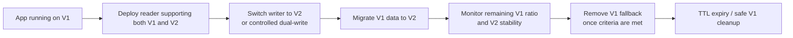
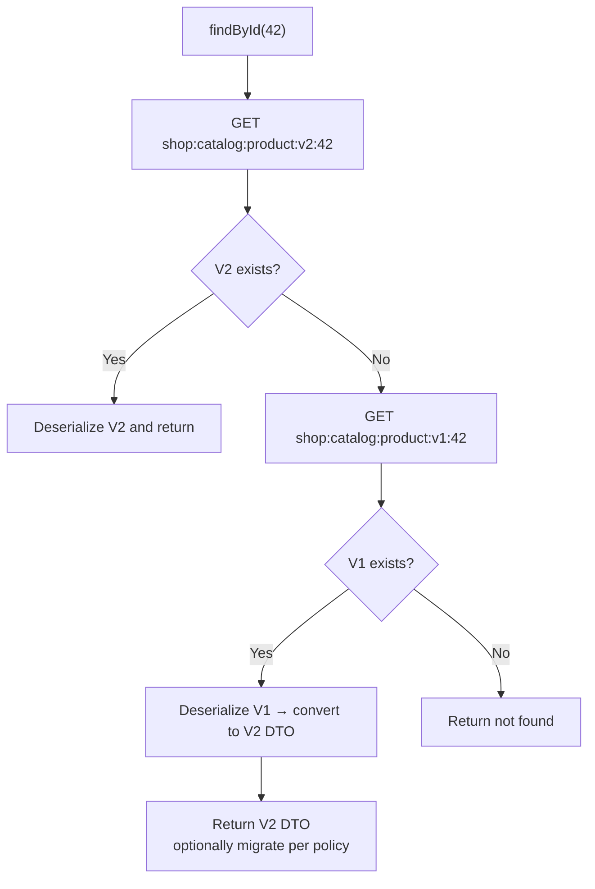
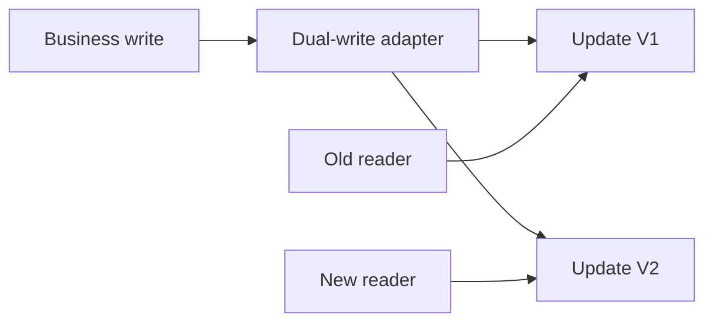
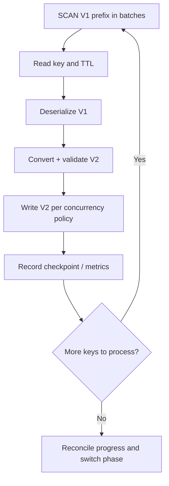

# Designing Versioned Keys to Support Data Structure Changes in Spring Data Redis

Redis stores data by key and value, yet **does not automatically manage Java object schemas** the way relational database management systems do. When a Spring Data Redis application changes an entity structure, property names, data types, serialization format, or key layout, legacy records may still remain in Redis. Newer application versions may misread them, while older versions may fail to understand data written by newer releases.

An important design solution is **embedding a schema version in the key name**. For instance, instead of overwriting new data onto `product:42`, transition from `catalog:product:v1:42` to `catalog:product:v2:42`. Both data generations coexist temporarily so the application can roll out incrementally, validate conversion results, and retire the old format in a controlled manner.

This lesson focuses on key versioning design in **Spring Data Redis**, covering `StringRedisTemplate`, `RedisTemplate`, Redis Repository, and Redis Cache. Examples use Java 21 and common Spring Boot 3.x/Spring Data Redis 3.x APIs; implementers should verify exact behavior against their project's dependency versions and Redis topology.

## 1. Why do Redis data structures need versioning?

Suppose a product catalog application stores JSON as follows:

**V1 data:**

```text
Key: catalog:product:v1:42
Type: Redis String
Value: {"id":"42","name":"Keyboard","priceCents":1599}
```

A new release wants to change the structure:

**V2 data:**

```text
Key: catalog:product:v2:42
Type: Redis String
Value: {
  "schemaVersion": 2,
  "id": "42",
  "displayName": "Keyboard",
  "priceMinor": 1599,
  "currency": "USD"
}
```

The changes include:

- `name` is renamed to `displayName`.
- `priceCents` is renamed to `priceMinor` for clearer unit definition.
- `currency` is added.
- `schemaVersion` is added inside the payload for validation and format observability.

If V2 JSON replaces the V1 key while older application instances remain active, older instances may fail to read `name` or misinterpret the price. Conversely, if the new application expects `currency` and encounters V1, required data may be missing.

Versioned key design helps:

1. Distinguish data by **schema contract**.
2. Allow V1 and V2 to coexist during rollout.
3. Support selective or background data conversion.
4. Reduce the risk of misreading binary/JSON/Hash data after changing serializers.
5. Easily monitor migration progress, configure TTLs, and clean up old key generations.

**Limitation:** adding `v2` to a key only creates a storage boundary; it does not automatically convert data, prevent concurrent overwrites, guarantee rollbacks, or delete old keys. Those require a dedicated migration protocol.

## 2. What does "key version" mean?

In Redis there are several notions of "version":

| Version type | Example | Purpose |
|---|---|---|
| **Schema/key format version** | `catalog:product:v2:42` | Distinguishes how data is structured, serialized, or interpreted |
| **Application release version** | `app-2.7.1` | Tracks software releases, not necessarily changing storage schemas |
| **Business revision / optimistic version** | `revision: 18` inside value | Detects stale updates or write conflicts |
| **Cache generation/version** | `cache:catalog:g5:...` | Invalidates an entire cache generation by changing namespaces |
| **API version** | `/api/v2/products` | HTTP contract, not necessarily equivalent to storage schema |

In this lesson, `v1` and `v2` in keys primarily represent the **storage format version**. You do not need to increment the schema version on every build/redeploy. Only introduce a new generation when a change could cause older code to misread data, alters the Redis type, serializer, or key rules, or requires an intentional migration.

For example, adding logging in a service or changing a cache TTL from 10 minutes to 5 minutes **does not necessarily require changing the key version**. In contrast, switching from a Redis String containing JSON to a Redis Hash with a new field layout warrants separating namespaces.

**Key-name versions do not replace optimistic locking.** If two requests concurrently write `catalog:product:v2:42`, the `v2` segment does not tell which request wrote last or which data is newer. Use revisions, transactions, Lua scripts, or appropriate protection mechanisms when update conflicts occur.

## 3. Building a key naming convention

A readable convention:

```text
<application>:<domain>:<entity>:v<schemaVersion>:<businessId>
```

Examples:

```text
shop:catalog:product:v1:42
shop:catalog:product:v2:42
shop:identity:session:v3:s-203
shop:inventory:stock:v2:sku-88
shop:search:result:v4:query-hash-7f1
```

Fields should carry stable meanings:

| Segment | Example | Meaning |
|---|---|---|
| Application/namespace | `shop` | Avoids collisions with other apps sharing Redis |
| Bounded context/domain | `catalog` | Distinguishes business subsystems |
| Data type | `product` | Identifies object or key group |
| Schema version | `v2` | Selects read/write contract |
| Business ID | `42` | Identifies the specific record |

Principles to apply:

- **Fix delimiter and segment ordering** so prefixes can be generated and scanned reliably.
- Use explicit names like `v2`, avoiding bare `2` which can be confused with an ID.
- Standardize IDs, encoding, and special characters. If IDs can contain `:`, spaces, or arbitrary characters, establish a stable escaping/encoding rule.
- Keep keys reasonably short; never cram entire JSON payloads into key names. Long keys increase memory usage and network cost.
- Avoid putting passwords, tokens, emails, or PII directly in keys without strict necessity and safeguards. Redis keys often appear in monitoring, logs, or admin tools.
- When multiple services share Redis, include enough prefix to prevent collisions and clearly document **which service owns the key**.

### 3.1. Placing version earlier or later?

Both conventions are viable:

```text
shop:catalog:product:v2:42
shop:catalog:v2:product:42
```

Choose based on common query patterns and operational tasks. If you frequently scan all V2 products, `shop:catalog:product:v2:*` is very convenient. What matters is **consistency** across the system and the ability to construct the exact key from the business ID.

If a migration involves multiple data types evolving at different paces, version each type independently; avoid forcing all of Redis onto a single "global version" unless you truly need to rotate the entire namespace.

### 3.2. Redis Cluster and hash tags

Redis Cluster partitions keys by hash slot. When you must operate on **multiple keys belonging to the same entity** inside a transaction or Lua script, you can design hash tags:

```text
shop:catalog:product:{42}:v1
shop:catalog:product:{42}:v2
shop:catalog:product:{42}:migration-lock
```

Redis Cluster computes the slot from the string inside `{42}`; these keys map to the same slot because they share the hash tag. This is useful for multi-key operations that must execute on one node.

However, placing the **same static hash tag on every product**, such as `{products}`, forces many keys into one slot and destroys load distribution. Use a well-distributed identity (such as each entity's real ID). Not every migration requires multi-key transactions; if unneeded, do not add hash tags unnecessarily.

## 4. Lifecycle roadmap from V1 to V2



The core axis of this design is **decoupling read capability, write ownership, data conversion, and old data deletion**. A release might combine several of these steps, though for large migrations, phased rollout reduces risk.

### Phase 1 — Dual-schema compatible reader

The new application knows how to read V2; when V2 is missing, it can read V1 and transform it into the V2 model in memory. This is **read fallback**.

### Phase 2 — Start writing V2

The new application writes into the V2 namespace. If V1 instances still need to read new data, design a **dual-write** window or ensure all consumers are upgraded before writing only to V2.

### Phase 3 — Convert remaining records

Records can be converted on read (lazy migration), via a background job (batch migration), or both.

### Phase 4 — Monitor and end compatibility

Only when no V1 consumers remain, V2 data is ready, and V1 is no longer needed for rollback should you remove V1 fallback and clean up old keys on schedule.

**Never use "new version deployed" as the sole proof for deleting V1.** Old workers, long-running consumers, batch jobs, auxiliary services, or external applications might still depend on the prior namespace.

## 5. Choosing a migration strategy

| Strategy | How it works | Best suited when | Key things to control |
|---|---|---|---|
| **Cold cutover** | Stop writers, convert all V1 to V2, switch readers/writers, reopen traffic | Small datasets or planned maintenance windows | Downtime, rollback, migration duration |
| **Read fallback** | Read V2 first; if missing, read and convert V1 in memory | App must stay online during upgrade | V1 may be stale; deletes and misses can blur |
| **Lazy migration** | When reading V1, write the corresponding V2 copy | Frequently accessed data, large volumes | Concurrency, TTL, rarely read keys linger |
| **Batch/background migration** | Scan by prefix, read V1, transform, write V2 | Need full conversion regardless of read traffic | SCAN, rate limiting, idempotency, progress, errors |
| **Dual-write** | One change writes both V1 and V2 during transition | Old and new instances must coexist | Partial failure, consistency, higher write cost |
| **Cache generation switch** | Readers switch to new prefix; new cache warms organically | Data rebuildable from source of truth | Spike in cache misses, database overload |

No single option wins every scenario. For **rebuildable caches**, bumping the generation and letting old keys expire via TTL is usually simplest. When **Redis is the primary data store**, treat migration as a data change requiring durability, consistency, and explicit rollback planning.

## 6. Read fallback: prefer V2 first, then V1

A common read rule during transition:



**Do not arbitrarily reverse the read order.** If both V1 and V2 exist, V2 is normally the preferred source for new readers when rollout designates V2 as authoritative. Reading V1 first risks returning stale data.

However, simply doing "if V2 is missing, read V1" **is unsafe for deletable data**:

1. Product `42` still has a V1 key.
2. The new application deletes V2 of product `42`.
3. The next read does not find V2.
4. The reader falls back to V1 and "resurrects" the deleted product.

This is a **stale resurrection** bug. If the domain allows updates/deletes during migration, enforce explicit rules: versioned tombstones, deleted-state records, data ownership cutoffs, or finishing conversion/cutting V1 before enabling new-style deletes.

A tombstone might use a key such as:

```text
shop:catalog:product:v2:42:deleted
```

When a valid tombstone is found, the reader returns "deleted" instead of falling back. Tombstones also carry TTLs, creation/deletion conditions, and concurrency concerns; **never choose a tombstone TTL shorter than the period V1 can still be fallen back to** without additional safeguards.

## 7. Spring Data Redis example: read two schemas, write V2

The snippet below illustrates encapsulating versioning inside a Spring Data Redis adapter. For this example, V1 stores prices in cents and **all V1 records are guaranteed to be USD under the legacy data contract**. Thus, migration can populate `currency = "USD"`; if real-world data spans multiple currencies without storing currency in V1, do not guess.

### 7.1. Storage models

```java
// ProductSnapshotV1.java
public record ProductSnapshotV1(
    String id,
    String name,
    long priceCents
) {}

// ProductSnapshotV2.java
public record ProductSnapshotV2(
    int schemaVersion,
    String id,
    String displayName,
    long priceMinor,
    String currency
) {}
```

### 7.2. Adapter with `StringRedisTemplate`

```java
import com.fasterxml.jackson.core.JsonProcessingException;
import com.fasterxml.jackson.databind.ObjectMapper;
import java.time.Duration;
import java.util.Optional;
import org.springframework.data.redis.core.StringRedisTemplate;
import org.springframework.stereotype.Repository;

@Repository
public class VersionedProductStore {
    private static final String V1_PREFIX = "shop:catalog:product:v1:";
    private static final String V2_PREFIX = "shop:catalog:product:v2:";
    private static final Duration V2_TTL = Duration.ofHours(6);

    private final StringRedisTemplate redis;
    private final ObjectMapper json;

    public VersionedProductStore(
            StringRedisTemplate redis,
            ObjectMapper json) {
        this.redis = redis;
        this.json = json;
    }

    public Optional<ProductSnapshotV2> find(String id) {
        validateId(id);

        String current = redis.opsForValue().get(V2_PREFIX + id);
        if (current != null) {
            ProductSnapshotV2 v2 = fromJson(
                current, ProductSnapshotV2.class
            );
            if (v2.schemaVersion() != 2) {
                throw new IllegalStateException("Unexpected V2 schema");
            }
            return Optional.of(v2);
        }

        // Transitional fallback; see delete/tombstone conditions below.
        String legacy = redis.opsForValue().get(V1_PREFIX + id);
        if (legacy == null) {
            return Optional.empty();
        }

        ProductSnapshotV1 v1 = fromJson(
            legacy, ProductSnapshotV1.class
        );
        return Optional.of(convert(v1));
    }

    public void save(ProductSnapshotV2 product) {
        if (product.schemaVersion() != 2) {
            throw new IllegalArgumentException("V2 schema required");
        }
        validateId(product.id());
        redis.opsForValue().set(
            V2_PREFIX + product.id(),
            toJson(product),
            V2_TTL
        );
    }

    private ProductSnapshotV2 convert(ProductSnapshotV1 v1) {
        return new ProductSnapshotV2(
            2,
            v1.id(),
            v1.name(),
            v1.priceCents(),
            "USD"
        );
    }

    private <T> T fromJson(String value, Class<T> type) {
        try {
            return json.readValue(value, type);
        } catch (JsonProcessingException e) {
            throw new IllegalStateException(
                "Invalid Redis JSON for " + type.getSimpleName(), e
            );
        }
    }

    private String toJson(Object value) {
        try {
            return json.writeValueAsString(value);
        } catch (JsonProcessingException e) {
            throw new IllegalStateException(
                "Cannot serialize Redis value", e
            );
        }
    }

    private void validateId(String id) {
        if (id == null || !id.matches("[A-Za-z0-9_-]{1,80}")) {
            throw new IllegalArgumentException("Invalid product ID");
        }
    }
}
```

Prerequisites for this example to work:

- The application includes `spring-boot-starter-data-redis` and Jackson JSON is declared/configured to provide `ObjectMapper`.
- Redis V1 stores JSON matching `ProductSnapshotV1`; this example does not apply directly to Redis Hash or JDK serialization.
- V1 genuinely uses USD under a known data contract.
- While fallback is enabled, the system must enforce a **delete/update policy preventing stale V1 reads**. This example shows a read path for non-deleted data or managed migration; it does not implement tombstones itself.
- Deserialization errors are **data-format errors** and must not be treated as "key does not exist" to silently fall back.

Usage example:

```java
ProductSnapshotV2 product = store.find("42")
    .orElseThrow();

store.save(new ProductSnapshotV2(
    2, "42", "Mechanical Keyboard", 1599, "USD"
));
```

The advantage of the adapter is that business services work exclusively with `ProductSnapshotV2`. Key construction, fallback reads, and model conversion are centralized in one place rather than duplicated across controllers or services.

Note: `@Repository` on `VersionedProductStore` is a Spring stereotype for bean creation/injection. It **is not equivalent** to a Redis Repository interface like `CrudRepository`; this example intentionally uses `StringRedisTemplate`.

## 8. Lazy migration: converting when users read V1

After reading and converting V1 to V2, the application can write V2 so subsequent reads skip fallback:

```text
read V2
  ├─ found   → return V2
  └─ missing → read V1
                ├─ missing → not found
                └─ found   → convert to V2
                              → write V2 if safe
                              → return V2
```

This is **read repair / lazy migration**. However, writing V2 in the fallback branch can introduce race conditions:

```text
T1: Migration reader reads V1 = price 100
T2: New writer updates V2 = price 120
T1: Migration reader writes V2 = price 100
Result: newer update is overwritten
```

An initial safeguard is using **SET NX** to write only when the V2 key does not yet exist:

```java
Boolean created = redis.opsForValue().setIfAbsent(
    "shop:catalog:product:v2:42",
    v2Json,
    Duration.ofHours(6)
);
```

`setIfAbsent(key, value, duration)` sets the key only if absent along with a TTL in Redis. This avoids overwriting an **existing** V2 key, yet **does not eliminate all races**:

- If a V2 writer updates concurrently, write ordering determines who creates the key first.
- If a new entity was deleted before lazy migration ran, V1 fallback can still recreate stale data.
- If update logic only runs when the key exists, a key freshly created by lazy migration can affect write correctness.
- If revision comparison is required, you need actual revision fields and atomic check-and-write operations.

Therefore, lazy migration fits best when V1 is relatively static or a protocol exists to **block stale writes and erroneous deletes**. `SET NX` is helpful, not a substitute for consistent design.

## 9. TTL: new versions must not unintentionally alter data lifetimes

TTL is the lifetime of **a single Redis key**, not an abstract entity. V1 and V2 are two distinct keys and therefore have separate TTLs.

Suppose:

```text
Key V1: login:session:v1:s-101
TTL: 120 seconds remaining

Migration writes:
Key V2: login:session:v2:s-101
TTL: 30 minutes
```

Here, a session nearly expired in V1 gets extended to 30 minutes in V2. That can be a security vulnerability or business bug.

### 9.1. Transferring remaining TTL

When migration requires **preserving the exact expiration time**, read V1's remaining TTL and apply the corresponding TTL to V2. Spring Data Redis provides `getExpire`:

```java
import java.time.Duration;

Duration remaining = redis.getExpire("login:session:v1:s-101");
```

Cases to distinguish depending on API/version:

- Positive TTL: key exists and has an expiration. Can write V2 with the remaining TTL, if policy allows.
- No TTL: Redis returns sentinel `-1` on `TTL` or `PTTL`.
- Key does not exist: Redis returns `-2` on `TTL` or `PTTL`.
- A Redis key can **expire right between reading its value and reading its TTL**.

Because separate `GET` and `TTL` calls do not form an atomic snapshot, migrations requiring strict consistency should use an appropriate script/transaction or versioned revisions rather than blindly "reading TTL then setting".

If sub-second precision is needed, check `PTTL` / `PEXPIRE` or `Duration` APIs with appropriate precision. Negative TTL sentinels must never be converted to positive durations via absolute value; handle each case per explicit policy.

### 9.2. When setting a fresh TTL makes sense

For **caches that are merely copies of a database**, V2 keys can be created with the V2 cache's default TTL. This is usually acceptable because the cache is not the source of truth; upon expiry it reloads from the source.

For **OTPs, sessions, leases, rate limits, locks, or temporary entitlements**, inadvertently extending TTLs changes business semantics. In such cases, the expiration timestamp is part of the contract that must be preserved or changed transparently.

## 10. Dual-write while old and new application versions coexist

In systems using rolling deployments, some instances may still read V1 while others already read V2.



Dual-write can let old instances see updates during transition. Yet it brings additional risks:

- V1 write succeeds, V2 write fails → data diverges.
- V2 write succeeds, V1 write fails → old readers see stale data.
- Retries after timeouts can overwrite values out of order.
- If V2 holds fields V1 cannot represent, reverse conversion V2 → V1 can **lose data**.
- Update and delete events arriving in different orders across the two key versions can leave inconsistent state.

Consequently, establish a single **source of truth** and conflict resolution rules. For example, with PostgreSQL as the primary source:

1. Database transaction commits updates.
2. Emit events carrying an ID/revision or use an outbox guaranteeing no lost events.
3. Consumers idempotently update/invalidate V1 and V2.
4. Monitor lag, errors, and sync progress.

During transition, you may prefer **invalidating caches in both namespaces** after source changes rather than trying to write identical values to both caches simultaneously. Which suits best depends on latency targets and cache-miss costs.

**Never treat two consecutive `SET` commands as a distributed transaction.** On standalone Redis, `MULTI/EXEC` or Lua can wrap valid operations on one Redis instance; on Redis Cluster, multi-key operations are constrained to the same hash slot. Even when Redis writes two keys atomically, it is still not atomic with a database or external system.

## 11. Batch migration with SCAN: handling large key counts

When V1 data does not expire automatically or many records are rarely accessed, lazy migration cannot ensure full conversion. Use a background job:



Example inspecting keys by prefix in an authorized environment:

```bash
redis-cli --scan --pattern 'shop:catalog:product:v1:*'
```

From CLI, `SCAN` is preferable to `KEYS shop:catalog:product:v1:*` on large keyspaces because `KEYS` can block the server significantly. However, **SCAN does not provide an immutable snapshot**:

- During scanning, keys may be added, deleted, have TTLs altered, or be updated.
- A key may appear more than once across scan iterations.
- Migrations must be designed to be **idempotent** so reruns are harmless.
- In Redis Cluster, scanning one endpoint does not automatically scan all primary nodes; you need a strategy covering every relevant shard/primary.

Migration jobs should enforce throughput limits, batch sizes, controlled retries, checkpoints, and pause capability. While V1 still has active writers, **completing one `SCAN` pass does not prove all data has been accurately migrated**; coordinate cutting over V1 writers, revisions, or reconciliation.

### 11.1. Measuring progress beyond V2 key counts

Example metrics:

| Metric | Meaning |
|---|---|
| `migration.v1_scanned` | Total scanned keys; may include duplicate scan hits |
| `migration.v2_created` | New V2 records actually created |
| `migration.v2_already_exists` | V2 records already present or written by another path |
| `migration.transform_failed` | V1 records that failed conversion |
| `migration.ttl_skipped` | Records already expired / incompatible with TTL policy |
| `reads.v1_fallback` | Rate at which readers still fall back to V1 |
| `writes.v1` / `writes.v2` | Shows whether legacy writers have stopped |

Do not put raw payloads or sensitive IDs into metric labels, as that causes high cardinality and data exposure. Log failures needing investigation in a restricted area with minimized IDs.

## 12. Versioned keys when using Redis Repository

Redis Repository in Spring Data Redis does not behave like `StringRedisTemplate` writing JSON. With `@RedisHash` entities, the framework maps data to Redis Hashes and may additionally manage secondary indexes, ID sets, TTL metadata, or phantom copies depending on features and configuration.

Example separating keyspaces by version:

```java
import org.springframework.data.annotation.Id;
import org.springframework.data.redis.core.RedisHash;

@RedisHash("product-v1")
public class ProductV1Entity {
    @Id
    private String id;
    private String name;
    // Required constructors/getters/setters omitted.
}

@RedisHash("product-v2")
public class ProductV2Entity {
    @Id
    private String id;
    private String displayName;
    private String currency;
    // Required constructors/getters/setters omitted.
}
```

Through `@RedisHash("product-v1")` and `@RedisHash("product-v2")`, the two aggregates occupy separate keyspaces. Note this is just an entity mapping illustration; using both concurrently requires configuring repository interfaces and scanning the relevant entities. Unlike JSON in the `StringRedisTemplate` example, primary keys and **metadata/index keys** managed by Spring Data Redis follow their own rules.

When migrating Repositories:

- Do not assume `RENAME product-v1:42 product-v2:42` is enough. Entity structure and secondary indexes may have changed; renaming raw Redis keys will not rebuild indexes or schema mappings properly.
- For `@Indexed` properties, migration must account for creating and cleaning up indexes in both keyspaces.
- Changing `@RedisHash` does not automatically migrate existing data into the new keyspace.
- If using TTL via `@RedisHash(timeToLive=...)` or `@TimeToLive`, define a policy to preserve expiration timestamps.
- If indexes/phantom copies/keyspace events are used, verify how your Spring Data Redis version stores metadata and performs cleanup before deleting keys with raw commands.

A safe path is usually **reading V1 via the V1 mapping, transforming the DTO, and saving V2 through the V2 repository** so the framework creates the proper data and indexes. If optimizing speed with lower-level commands, you must explicitly maintain all invariants normally managed by the repository.

## 13. Versioned keys when using Spring Cache

With caching, namespace versioning can be placed in the **cache name**:

```java
import org.springframework.cache.annotation.Cacheable;

@Cacheable(cacheNames = "catalog-product-v2", key = "#productId")
public ProductView findProduct(String productId) {
    return productGateway.load(productId);
}
```

If Spring Cache uses `RedisCacheManager` with the common default prefix, the logical key looks like:

```text
catalog-product-v2::42
```

Actual key formatting can vary based on `RedisCacheConfiguration` and the key serializer. Changing the cache name from `catalog-product-v1` to `catalog-product-v2` causes new readers to ignore old values and populate new entries on cache miss.

This is a simple way to implement **cache generation**:

1. Change the cache name when the serializer or output shape changes.
2. New readers read only the V2 cache.
3. Cache misses fetch from the data source and write V2 entries.
4. V1 cache entries expire via TTL or are cleaned up once legacy consumers are gone.

You do not need V1 cache fallback if the primary data source is healthy and reload cost is acceptable. However, if a rollout causes all cache keys to miss simultaneously, it can trigger a **cache stampede**: massive concurrent traffic hitting the database/API. Consider warm-up, phased rollouts, jittered TTLs, cache synchronization, or load shedding.

Example cache TTL alongside connection configuration:

```yaml
spring:
  data:
    redis:
      host: localhost
      port: 6379
  cache:
    type: redis
    redis:
      time-to-live: 15m
```

`spring.cache.redis.time-to-live` applies to configured cache entries; `spring.data.redis.timeout`, if present, is the command timeout, not a TTL. Renaming a cache does not automatically change its serializer; if JSON or cached value types change, configure the appropriate serializer for Redis Cache.

## 14. Serializer versioning and schema versioning

Changing key versions can be necessary even when business fields do not change—for example, migrating:

```text
V1: Redis String + JDK serialization
V2: Redis String + UTF-8 JSON
V3: Redis Hash + field-based mapping
```

If the same key holds multiple serialization formats, new code can hit deserialization errors, or Redis can return `WRONGTYPE` if a key shifts from String to Hash.

Separating namespaces by version makes it clear **which decoder to use**:

| Key prefix | Redis type | Decoder/mapping |
|---|---|---|
| `shop:profile:v1:*` | String | Legacy JDK serializer (if legacy data exists) |
| `shop:profile:v2:*` | String | JSON and V2 DTO |
| `shop:profile:v3:*` | Hash | V3 hash mapping/fields |

Avoid trying multiple decoders sequentially on one key without explicit metadata/versioning: error handling gets messy, and it is easy to misread valid bytes against the wrong schema. For audited or long-lived data, you can add `schemaVersion` inside the payload as a **secondary validation check**.

When using polymorphic JSON / Jackson default typing, weigh security and compatibility risks; avoid trusting untrusted payloads and avoid serializing Java class names as a long-term data contract unless strictly justified.

## 15. Concurrency, revisions, and new data overwritten by old data

Versioned keys separate schema generations; **they do not resolve update ordering by themselves**.

### 15.1. Problems during background migration

```text
t0: Job reads product V1: price = 100, revision = 7
t1: Service updates product V2: price = 120, revision = 8
t2: Job writes product V2: price = 100, revision = 7
```

V2 regressed to stale data. A safe procedure may require:

- Freezing legacy writers during the cutover window, or
- Sharing comparable revisions across both schemas, or
- Using locks/version checks and atomic writes compatible with your topology, or
- Sourcing data from an authoritative store (database/event log) rather than trusting potentially stale V1 snapshots.

If Redis is authoritative, revision checking and writing must be atomic. For Redis String JSON, one pattern is a script comparing the current revision and writing only if the new revision is higher; for Redis Hashes, `revision` can likewise be stored as a field and updated via Lua. Every key accessed by a script in Redis Cluster must reside on the same slot.

### 15.2. Tombstones and updates/deletes

A common model gives each entity a state:

```json
{
  "schemaVersion": 2,
  "id": "42",
  "revision": 19,
  "deleted": true
}
```

When a reader sees a V2 tombstone, it **does not fall back** to V1. You must still:

- Assign revisions/timestamps from a trusted source.
- Handle update events arriving late after a delete.
- Align tombstone retention with V1's lifetime.
- Ensure migration jobs never overwrite a tombstone with an older V1 record.

Do not delete tombstones immediately when the new app stops reading V1 if legacy writers or migration jobs could still recreate the data.

## 16. Phased rollout and rollback process

A controlled plan for a live system:

| Phase | Read path | Write path | Goal |
|---|---|---|---|
| 0 — Prepare | V1 | V1 | Finalize V1/V2 contracts, conversion, and observability metrics |
| 1 — Compatible reader | V2 then V1 fallback | V1 or transitional protocol | Ensure new readers do not break on legacy data |
| 2 — Switch writes | V2 then V1 fallback | V2, or dual-write while old readers remain | Direct new writes into V2 namespace |
| 3 — Migrate/reconcile | V2 preferred | V2 authoritative | Convert remaining data; ensure updates/deletes behave properly |
| 4 — Retire V1 dependency | V2 only | V2 only | No V1 consumers remain and fallback is unnecessary |
| 5 — Cleanup | V2 only | V2 only | Expire/delete V1 per verified plan |

Exact sequencing depends on data type. For rebuildable caches, you can skip fallback, dual-write, and batch migration. For authoritative Redis, pay close attention to continuously changing data and recoverability.

### 16.1. Is rollback truly safe?

If the new application has been writing solely to V2, rolling code back to a V1-only reader **will not automatically see V2 updates**. Therefore:

1. Define up to which phase rolling back to legacy readers is permitted.
2. During that window, ensure V1 data is maintained per contract or a reliable reverse-conversion mechanism exists.
3. If V2 introduces fields absent in V1 or irreversible changes, plan to roll forward instead of rolling data back.
4. Never purge V1 before the rollback window closes and all legacy consumers are shut down.

**Keeping V1 keys does not automatically make rollback safe**: those keys may already be stale. Consider rollback safe only when legacy-needed data is kept updated or a recovery plan from the source of truth exists.

### 16.2. Feature flags / key generation config

A service can manage reader/writer selection via configuration:

```yaml
app:
  redis:
    product:
      read-version: v2
      allow-v1-fallback: true
      write-version: v2
```

Here `app.redis.product.*` are **application-defined custom properties**, not built-in Spring Boot or Spring Data Redis properties. You must create the corresponding configuration properties class and usage logic.

Feature flags allow rapid phase switching, yet flags alone do not guarantee safe transitions. Mechanisms like revisions, tombstones, dual-writes, or migration jobs still must operate correctly.

## 17. Safely cleaning up old keys

V1 cleanup should proceed only when:

- No V1 readers/writers remain and old jobs have genuinely stopped.
- V2 holds all required data and conversion failures have been resolved.
- The rollback window has passed or an independent recovery plan exists.
- TTLs/tombstones/indexes have been reconciled against data requirements.
- A kill switch exists to halt cleanup if anomalies appear.

Example to merely **list** V1 keys:

```bash
redis-cli --scan --pattern 'shop:catalog:product:v1:*'
```

On large Redis instances, do not use `KEYS *` to scan production keys; never use `FLUSHDB` or `FLUSHALL` just to delete one schema version. Use batched `SCAN` with rate-limited deletion, using `UNLINK` where appropriate to reduce main-thread memory-reclamation blocking. `UNLINK` only selects how memory is reclaimed; it does not replace verifying key ownership or cleanup safety.

With Redis Repository, account for framework-maintained index/metadata keys. Deleting raw entity hashes while leaving indexes behind leaves invalid references; deleting raw indexes breaks queries for remaining entities.

## 18. Common mistakes

| Mistake | Consequence | Better design |
|---|---|---|
| Changing schema while keeping the same key and old serializer | Deserialization errors or misread fields | Separate version when format is incompatible |
| Using application release version as schema version | Creates excessive unnecessary key namespaces | Bump version only when storage contract changes |
| V2 reader always falls back to V1, even after deletes | Resurrects deleted data | Tombstone/revision/cutover protocol |
| Migration job uses `SET`, overwriting newer V2 | Loses recent updates | Version-aware writes, conditional writes |
| Replacing remaining TTL with a full TTL | Extends sessions, OTPs, or leases | Preserve expiration per domain policy |
| Dual-writing without handling partial failures | V1 and V2 drift apart | Source of truth, idempotent retries, reconciliation |
| Scanning only one Redis Cluster node | Misses keys on other shards | Iterate all relevant primaries |
| Assuming V2 prefix automatically updates Repository indexes | Index queries return wrong results | Migrate via repository mapping or handle metadata |
| Deleting V1 immediately after deployment | Old instances, rollbacks, or batch jobs fail | Clean up only after dependencies end |
| Scanning/deleting millions of keys without rate limiting | CPU/network pressure, Redis latency spikes | Batching, checkpoints, and throttling |

## 19. Three design exercises

### Scenario A — JSON cache schema change

An endpoint reads products from PostgreSQL, caches V1 JSON containing `name`, and a new version returns a V2 DTO with `displayName`. Redis is strictly a cache.

**Solution:** change the cache name/key namespace from V1 to V2, have new readers read/write only V2, and let V1 expire by TTL. Monitor cache misses to prevent sudden load spikes on PostgreSQL. No dual-write is needed if old instances can keep using their own V1 cache during deployment.

### Scenario B — Session with remaining TTL

Session V1 had a 5-minute TTL and has 45 seconds left. V2 adds a `lastSeenIp` field; migration wants to copy it to the V2 key.

**Solution:** preserve the original expiration policy; if business rules want sliding expiration, specify explicitly which events may refresh TTL. Never unconditionally set V2's TTL to 5 minutes, as that extends the session. Design migration to guard against races with key expiration and concurrent session updates.

### Scenario C — Redis as primary data, continuously updated

Product price V1 changes while a migration job runs. The job reads price 100 just as a V2 service writes price 120.

**Solution:** never overwrite V2 with a stale V1 snapshot. Freeze legacy writes, use atomically compared revisions, or source authoritative state from an event log/authoritative database. Treat migration as complete only after legacy writers stop and reconciliation ensures no updates were missed.

## 20. How to think about key versioning design

Whenever you plan to add `v2` to a Redis key, answer these questions:

1. **What is changing?** JSON schema, Redis data type, key layout, serializer, TTL semantics, or business meaning?
2. **Who owns the data?** Is Redis the source of truth or a rebuildable cache?
3. **Who is reading and writing V1?** Are there multi-instance rollouts, long-running workers, or external consumers?
4. **Can V1 → V2 be converted cleanly?** Are there missing fields, unsafe defaults, or irreversible conversions?
5. **When both keys exist, which is authoritative?** Are there revisions or update conflicts?
6. **How are deletes and TTLs handled?** Is there a risk of resurrecting records or extending lifetimes?
7. **When can V1 be dropped?** What proves progress, rollback window closure, and zero legacy readers/writers?

Versioned key design is a **contract for evolving data over time**. A clear namespace like `shop:catalog:product:v2:42` lets applications separate schemas, yet safe transitions require combining read/write rules, migration, TTL handling, concurrency control, rollback planning, and cleanup. In Spring Data Redis, always place these rules in the layer that owns the data: Template for self-managed keys, Repository for entities/indexes, and Redis Cache for values rebuildable from the primary data source.
