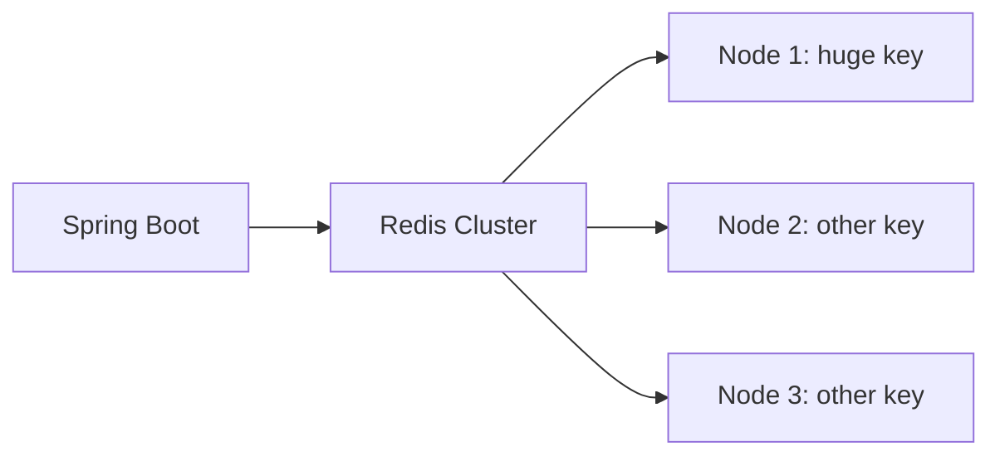
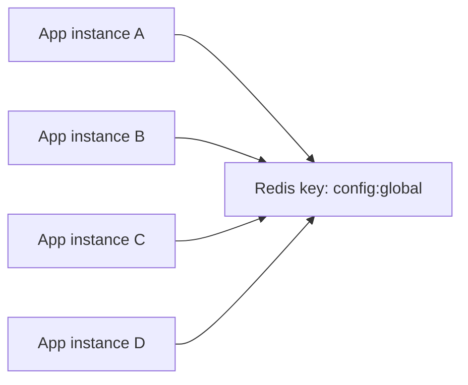
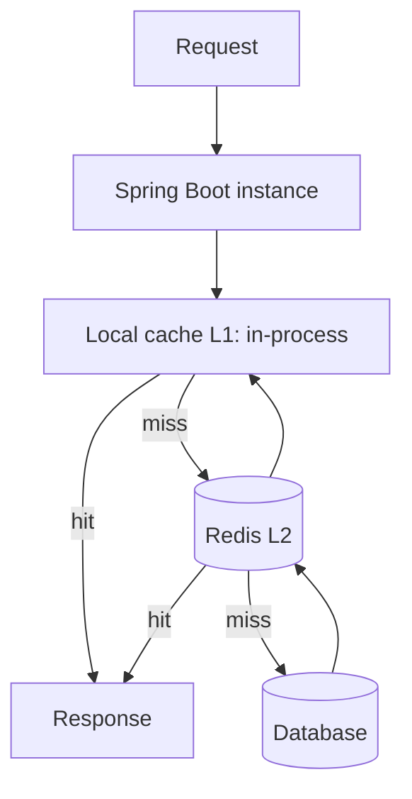

# Avoiding Big Keys and Hot Keys

In Redis, key design directly affects access speed, RAM consumption, network latency, and application scalability. A system may run smoothly during testing with a few thousand records yet slow down when a single key holds millions of elements or when most requests hammer a single key.

Two distinct phenomena must be distinguished:

- **Big Key:** a key that consumes substantial memory, holds a huge value, or contains an excessive number of elements. The core issue is **data size and operation cost**.
- **Hot Key:** a key receiving disproportionately high read/write traffic compared to other keys. The core issue is **traffic concentration**, regardless of whether the key is large or small.

In Spring Data Redis, choosing `StringRedisTemplate`, `RedisTemplate`, or `@Cacheable` does not automatically prevent these two issues. Keys, values, read/write patterns, TTLs, access metrics, and concurrency handling must be designed into the application from the start.

## 1. Lesson objectives

After this lesson, you will be able to:

1. Distinguish between a Big Key, a Hot Key, and a key that is both big and hot.
2. Explain why these keys bottleneck Redis, increase p99 latency, or prevent Redis Cluster from scaling effectively.
3. Recognize dangerous commands on large structures such as `HGETALL`, `SMEMBERS`, `LRANGE 0 -1`, or reading an oversized String.
4. Use Redis tools to inspect the keyspace, key sizes, access frequency, and latency while controlling impact on the server.
5. Choose strategies to bound sizes, shard by business rules, paginate reads, apply multi-tier caching, or distribute writes for Hot Keys when possible.
6. Apply Spring Data Redis code patterns while understanding trade-offs in atomicity, consistency, TTL, and operations.

## 2. How do Big Keys and Hot Keys differ?

### 2.1. Big Key: a key with an oversized value or element collection

Examples:

```text
product:42:description      → multi-MB JSON String
user:123:notifications     → List with hundreds of thousands of elements
tenant:88:members          → Set containing millions of user IDs
leaderboard:global         → Sorted Set holding all accounts
analytics:all-events       → Stream holding unbounded events
```

Redis has no universal "big" threshold applicable to all applications. A String of a few hundred KB can be too big for a latency-sensitive API; a structure with many elements can still be acceptable if operations touch only a small, bounded subset. Evaluate **actual bytes, element count, access pattern, response size, and system latency targets**.

A Big Key does not necessarily have a long key name. For instance, `x` can be a Big Key if its value takes hundreds of MB, whereas `shop:prod:product:detail:42` may hold only a few KB.

### 2.2. Hot Key: heavy traffic concentrated on a single key

Examples:

```text
cache:homepage:featured        → read by nearly every homepage request
counter:video:trending:42      → incremented on every view of a viral video
inventory:flashsale:sku:9     → checked/updated continuously during a flash sale
rate:global                   → every request increments the same counter
```

`cache:homepage:featured` may be only a few hundred bytes yet still be a Hot Key if it receives extreme request volume.

A Hot Key can be further classified by workload type:

| Type | Signal | Priority mitigation |
|---|---|---|
| **Read-hot** | Heavy `GET`, `HGET`, `ZRANGE` targeting the same key | Reduce Redis requests via controlled local cache, request coalescing, or read distribution |
| **Write-hot** | Heavy `INCR`, `HINCRBY`, `ZINCRBY`, `SET` targeting the same key | Reduce writes, shard writes when business logic permits, batch/aggregate |
| **Mixed-hot** | The same key is continuously read and written | Separate read/write models or adjust design, accepting bounded sync lag |

### 2.3. Four common scenarios

| Scenario | Example | Primary bottleneck |
|---|---|---|
| Small and rarely accessed | `feature:user:123` | Low risk |
| Large and rarely accessed | `tenant:archive:2025` | Memory, serialization, scan/delete commands, snapshots |
| Small and very hot | `views:viral:42` | Throughput, CPU/network, load concentrated on one node |
| Both large and hot | `homepage:all-products` | Both payload size and request volume; high risk |

**A large key is not automatically hot, and a hot key is not automatically large.** Tools that find large keys cannot replace monitoring per-key traffic.

## 3. Why can Big Keys slow down Redis?

Redis executes many data commands very quickly, yet actual request speed still depends on how much work a command must do.

### 3.1. Commands whose complexity depends on data size

Some commands touch only a small slice of a structure, while others process many elements:

| Structure | Operations to prefer | Operations that become expensive on big keys |
|---|---|---|
| String | `GET` when value is small and bounded | `GET` on very large values; overwriting huge values |
| Hash | `HGET key field`, `HMGET` for bounded fields | `HGETALL` on a hash with too many fields |
| List | `LRANGE key 0 49` | `LRANGE key 0 -1` on a very long list |
| Set | `SISMEMBER key member` | `SMEMBERS` on a large set |
| Sorted Set | Small bounded range / top-N queries | Returning millions of members |
| Stream | `XREAD`/`XRANGE` with reasonable range and `COUNT` | Returning huge entry batches; missing retention trimming |

Algorithmic complexity is only part of the story. Even when a command runs efficiently, sending a huge response over the network, decoding it entirely in Java, and allocating many JVM objects still increases **memory pressure, GC, and latency**.

Example:

```redis
HGETALL tenant:88:users
```

If the hash holds 500,000 fields, the application pulls every field and value even when the screen displays only 20 users. Using `HGET` or a pre-designed paginated query is usually far more sensible.

### 3.2. Deleting or expiring a Big Key can incur heavy cost

The `DEL` command deletes data and can cause significant processing pauses when an object contains many elements to free. Redis provides `UNLINK` to remove the key from the keyspace and **reclaim memory in the background** when appropriate.

```redis
UNLINK tenant:88:large-temp-set
```

`UNLINK` reduces main-thread latency compared to synchronously freeing a large object, yet it does not make memory reclamation free. Memory is freed asynchronously afterward and still consumes system resources. Never rely on delete commands as a substitute for preventing keys from growing unbounded in the first place.

Keys reaching TTL expiration must also be freed. On large datasets, how Redis handles expiration, eviction, and lazy-freeing settings can impact latency; measure under your exact version and configuration.

### 3.3. Memory, persistence, and replication

A Big Key raises total RAM usage. During snapshots or AOF rewrites, writes to large objects can amplify memory and I/O pressure; OS fork/copy-on-write mechanisms can also increase overhead in certain cases.

With Redis replication, data changes must also be streamed to and applied on replicas. Replication lag, backlogs, and recovery capacity must be monitored; never assume replication will absorb a huge key effortlessly.

### 3.4. Redis Cluster does not split a single key across multiple nodes

Redis Cluster distributes **keys** across hash slots. One key holding millions of elements still lives in a single slot, owned by **one primary shard**.



Adding nodes distributes **different keys**, not the contents of a single Hash/List/Set across nodes. When one structure grows too large, plan **data-model partitioning**.

## 4. Why do Hot Keys cause bottlenecks even when data is small?

Suppose every API request reads `config:global`:



Each `GET` may be fast, yet total command rate, read/write bytes, scheduling, and network bandwidth must all be served by the resources holding that key. In Redis Cluster, a Hot Key also makes one shard far busier than all other shards.

For a write-hot key like a shared counter:

```redis
INCR views:video:42
```

`INCR` is atomic per operation, yet every request targets the exact same key. Under extreme increment rates, load concentrates on one node. Splitting calls across multiple Java threads does not distribute load across Redis shards when targeting **the same key**.

Hot Keys can emerge transiently: flash sales, livestreams, viral posts, or batch jobs. Daily averages can hide severe multi-minute bottlenecks.

## 5. First principle: measure before changing the key schema

Determine:

- Which API groups are experiencing elevated p95/p99 latency?
- Is Redis slow because one command processes too much data, or because of too many commands?
- Which keys use the most RAM? Which keys see the most reads/writes?
- Is one shard noticeably hotter than others?
- Do load spikes coincide with cache misses, synchronized TTL expirations, batch jobs, or marketing events?
- Does the request truly need the entire payload returned from Redis?

Never conclude from a single metric. For instance, high `used_memory` might stem from millions of small keys, while high latency might come from network/client serialization with no Big Key present.

### 5.1. Observable metrics

| Metric | Investigation clue | What you cannot conclude from it alone |
|---|---|---|
| `used_memory`, `used_memory_dataset` | Dataset memory size | Which specific key is big |
| `evicted_keys`, `expired_keys` | Eviction or TTL activity | Which exact key caused slowness |
| `keyspace_hits`, `keyspace_misses` | Redis hit/miss trend | Where a specific Hot Key lives |
| `instantaneous_ops_per_sec` | Command rate at observation time | Whether there is one or many Hot Keys |
| `SLOWLOG` | Commands taking long server-side execution | Full round-trip, network, and deserialization time |
| `MEMORY USAGE key` | Estimated memory of one key | Requests/sec hitting the key |
| `HLEN`, `LLEN`, `SCARD`, `ZCARD`, `XLEN` | Element count of the structure | How many bytes each element consumes |
| APM, app metrics | Which key pattern ties to slow requests | Exact key size without further measurement |

The goal is correlating **size, frequency, command type, and latency** over the same time window.

## 6. Detecting Big Keys with Redis tools

Examples below use `redis-cli`. On a dev machine running Redis via Docker Compose, prepend `docker compose exec redis`:

```bash
docker compose exec redis redis-cli INFO memory
docker compose exec redis redis-cli INFO stats
docker compose exec redis redis-cli INFO commandstats
```

These commands report instance-wide metrics. In production/cluster setups, run with appropriate permissions and verify which node you are querying; `INFO` from one node does not describe the entire cluster.

### 6.1. Inspecting the size of a known key

```redis
TYPE tenant:88:members
MEMORY USAGE tenant:88:members
SCARD tenant:88:members
TTL tenant:88:members
```

Explanation:

- `TYPE` reports the key's data type.
- `MEMORY USAGE` returns Redis's estimated memory footprint for the key, including internal structural overhead.
- `SCARD` returns element count if it is a Set.
- `TTL` indicates remaining lifetime.

For other types, use the matching cardinality command:

```redis
STRLEN cache:homepage:featured
HLEN profile:fields:123
LLEN notifications:user:123
ZCARD leaderboard:monthly
XLEN stream:orders
```

`STRLEN` returns the byte length of a Redis String—not the number of visual Unicode characters in a UTF-8 string.

For nested/multi-element structures, `MEMORY USAGE` accepts `SAMPLES` to bound estimation sampling:

```redis
MEMORY USAGE tenant:88:members SAMPLES 10
```

Passing `SAMPLES 0` asks Redis to sample all elements as far as supported, which can be very expensive on large objects. Never default to the costliest measurement in production.

### 6.2. Finding large keys with `redis-cli --bigkeys`

In an environment with Redis access and known keyspace scope:

```bash
redis-cli -h 127.0.0.1 -p 6379 --bigkeys
```

This utility scans the keyspace and reports notable large keys by data type. Its output helps catch large byte Strings or high-cardinality structures.

Understand its limits:

- Scanning the full keyspace still adds load to Redis.
- Results do not replace exact RAM analysis via `MEMORY USAGE` on target keys.
- It is not an absolute snapshot while keys are added/deleted continuously.
- In Cluster, understand which node is queried and how shards are scanned; do not assume one endpoint measures the full cluster.
- Avoid running arbitrarily on overloaded production servers; pick an appropriate time, pacing, and scope.

Some `redis-cli` versions offer options to pace scanning; check `redis-cli --help` in your environment. Tool details can vary across versions.

### 6.3. Iterating key names with `SCAN`, avoiding `KEYS *`

Example:

```redis
SCAN 0 MATCH shop:prod:product:* COUNT 100
```

Redis returns the **next cursor** and a batch of keys. Keep calling `SCAN <cursor>` until the cursor returns `0`.

`COUNT 100` is a **work hint**, not a promise to return exactly or at most 100 keys. While the keyspace mutates, duplicates or shifting results can appear across iterations; if used for business processing, design idempotency.

Compared to:

```redis
KEYS *
```

`SCAN` is safer for iterating large keyspaces incrementally, because `KEYS *` can block Redis while listing huge key counts. Even so, **SCAN still consumes CPU/network** if run continuously without throttling.

Never turn frequent HTTP requests into a full-Redis `SCAN` to find keys. Business keys should be computed directly from identifiers or maintained via an explicit index.

### 6.4. Inspecting slow commands

```redis
SLOWLOG GET 10
```

The slow log measures server-side command execution time, **excluding network transit and client response parsing**. A `GET` returning megabytes can make Java slow due to network/deserialization even if it does not dominate the slow log.

You can also use:

```redis
LATENCY LATEST
```

And when latency monitoring is enabled/configured appropriately:

```redis
LATENCY DOCTOR
```

Read these metrics alongside p95/p99 latency in the Spring Boot application and client/connection pool metrics.

## 7. Detecting Hot Keys

Hot Keys require visibility into **per-key request concentration**, not just memory.

### 7.1. Prioritize application-side metrics

If an endpoint executes:

```java
redis.opsForValue().get("cache:homepage:featured");
```

on every request, emit metrics tagged by **key group and operation**:

```text
redis_access_total{
  operation="GET",
  key_group="homepage-featured"
}
```

Do not put individual user IDs or dynamic key names into metric **labels**, as that creates massive label cardinality in monitoring systems. Use bounded groups such as `product-detail`, `session`, `homepage`, `rate-limit`, and drill down further when anomalies appear.

Also track endpoint traces, cache hit/miss ratios, requests/sec, and returned byte sizes. With many keys, sampling or prefix aggregation is usually more practical than logging every key.

### 7.2. `redis-cli --hotkeys` depends on LFU

Redis CLI can locate frequently accessed keys via LFU tracking:

```bash
redis-cli -h 127.0.0.1 -p 6379 --hotkeys
```

This capability **requires Redis to run an LFU maxmemory eviction policy**, such as `allkeys-lfu` or `volatile-lfu`, so Redis tracks per-key access frequency. It is not universally usable under every configuration.

Check first:

```redis
CONFIG GET maxmemory-policy
```

**Never change production's eviction policy just to run a diagnostic command.** Eviction policies directly govern which keys Redis drops under memory pressure. Use a staging/replay environment or application-side metrics if production uses a non-LFU policy.

### 7.3. Why is `MONITOR` not a default tool?

`MONITOR` streams commands received by Redis, yet it adds significant overhead and can expose command arguments and sensitive data. Under heavy traffic, leaving `MONITOR` enabled poses severe performance and security risks.

Prefer APM, application metrics, controlled sampling, or approved observability tools. Use `MONITOR` only in appropriate environments, briefly, and for targeted investigation.

### 7.4. Distinguishing a Hot Key from a hot shard

A busy shard is not necessarily caused by **one** key. Thousands of active keys may happen to map to that shard. When assessing Redis Cluster, compare:

- Command counts, CPU, network, and latency **per node**.
- Key and slot distribution.
- Heavily accessed key patterns.
- Byte sizes of popular payloads.
- Resharding/failover/replication events.

Identify the true root cause before deciding between splitting a Hot Key, rebalancing key distribution, or scaling node capacity.

## 8. Avoiding Big Keys by bounding data at write time

The most direct principle is **never letting a key grow without bound**.

### 8.1. Design around actual access units

Suppose the UI shows 20 reviews per page. You do not need to cache all 300,000 reviews in a single JSON String:

```text
Wrong direction:
product:42:all-reviews
→ one JSON containing every review
```

Instead, cache per page:

```text
shop:prod:product:42:reviews:page:0
shop:prod:product:42:reviews:page:1
shop:prod:product:42:reviews:page:2
```

Each page bounds review count and payload size. Read only the page key needed rather than downloading the whole dataset to paginate in Java.

Another option is maintaining an ID index and storing details separately:

```text
shop:prod:product:42:review-ids:2026-11  → Sorted Set of IDs
shop:prod:review:991                     → review 991 data
shop:prod:review:992                     → review 992 data
```

This adds requests to fetch details and requires consistency management between the index and detail keys. No option is free; the goal is reducing per-operation data size and bounding growth.

### 8.2. Partition by time

Logs, notifications, or leaderboards often have a natural time axis:

```text
events:tenant:88:2026-11-10
events:tenant:88:2026-11-11
events:tenant:88:2026-11-12
```

Instead of:

```text
events:tenant:88:all-time
```

This limits elements per time window, enables partition-level expiration/retention, and reads only the needed range.

Trade-off: multi-month queries must merge multiple keys and handle time boundaries/time zones. Use UTC dates or a clearly defined timezone convention shared between key creation and queries.

### 8.3. Partition by tenant, entity, or bucket

A single key holding data across all tenants easily turns into both a Big Key and a Hot Key:

```text
global:member-ids
```

Replace with:

```text
tenant:88:members
tenant:89:members
tenant:90:members
```

If `tenant:88:members` still grows too large, split into buckets or business sub-structures:

```text
tenant:88:members:bucket:00
tenant:88:members:bucket:01
...
tenant:88:members:bucket:15
```

A deterministic bucketing rule is `bucket = hash(memberId) mod 16`. Use a **stable hash function and a fixed bucket count**; changing bucket count later requires migration/rebalancing. Never use an unstable hash across runtimes/versions if it shifts data placement.

If the application typically reads members by department, partition by department instead of hashing so queries match directly. Key design should stem from **access patterns**, not merely byte counts.

### 8.4. Cap List/Stream length on write

For a List needing only the latest N events, push and trim:

```redis
LPUSH user:123:recent-actions "open:42"
LTRIM user:123:recent-actions 0 99
```

This keeps at most roughly 100 elements as long as every writer follows the rule. With concurrent writers, if **push + trim** must be atomic for business correctness, wrap them in a Lua script or suitable transaction.

For Streams, define clear retention and trimming policies. Example:

```redis
XADD stream:activity MAXLEN ~ 10000 * type view productId 42
```

`~` specifies an **approximate** cap: Redis may retain slightly more entries for efficiency. If business rules require an exact bound or time-based retention, choose the matching policy and understand its cost.

Never let Streams or Lists grow unbounded in a system with finite retention needs.

### 8.5. Never fetch entire structures when only a subset is needed

Compare:

```redis
HGETALL user:123:profile
SMEMBERS group:88:members
LRANGE user:123:messages 0 -1
ZRANGE leaderboard:all 0 -1
```

with scoped commands:

```redis
HMGET user:123:profile name avatar
SISMEMBER group:88:members user:123
LRANGE user:123:messages 0 49
ZRANGE leaderboard:all 0 19 REV WITHSCORES
```

Targeted commands reduce network transfer and JVM memory allocation. However, if the key itself already contains millions of elements, changing read commands is only **symptom relief**; still evaluate retention and storage partitioning.

## 9. Iterating large collections incrementally with HSCAN, SSCAN, ZSCAN

When gradually processing elements of a collection, Redis offers scan commands:

```redis
HSCAN user:123:large-profile 0 COUNT 100
SSCAN tenant:88:members 0 COUNT 100
ZSCAN leaderboard:global 0 COUNT 100
```

These are **cursor-based workflows**. Continue passing the returned cursor until finished; never assume one call returns everything.

Key notes:

- `COUNT` is only a work hint; returned element counts vary.
- While the collection is written/deleted, duplicates can appear and traversal differs from a fixed snapshot.
- Compactly encoded structures may return many elements in a single scan call; do not treat `COUNT` as a strict client memory cap.
- Process in batches with concurrency limits and checkpoints/idempotency for long jobs.
- Scanning a huge structure still consumes resources; if normal business flows frequently scan everything, revisit the data model.

`HSCAN` helps with admin/migration jobs, yet should not replace stable business-ordered pagination. Cursor scans do not guarantee element ordering.

## 10. Avoiding Hot Keys for read workloads

Read-hot keys are generally easier to offload than write-hot keys because read data can be replicated to closer cache tiers **when bounded staleness is acceptable**.

### 10.1. Two-tier caching L1 + L2

A common architecture:



- **L1** can be an in-process cache such as Caffeine inside each instance.
- **L2** is Redis shared across instances.
- **Database** or upstream service remains the source of truth on cache misses.

If 10,000 requests/sec across instances read rarely changing configuration, L1 eliminates huge numbers of Redis round trips. However, each JVM holds its own copy, so instances may briefly see slightly different values.

Define clearly:

- L1 TTL and memory bounds.
- Invalidation strategy when data changes.
- Acceptable staleness window.
- Cold-start behavior when a new instance starts with an empty L1.

Redis Pub/Sub can **notify** invalidations in some designs, though standard Pub/Sub does not replay missed messages to offline consumers; TTLs or versioning remain necessary for important data.

### 10.2. Request coalescing / single-flight

On a cache miss, a thousand concurrent requests might simultaneously hit the database and overwrite Redis. A **per-key single-flight** mechanism lets only one loader fetch the data while concurrent callers wait for that shared result within bounded limits.

```text
100 concurrent requests
         │
         ▼
  Cache miss on same key
         │
         ▼
  1 source data fetch task
         │
         ▼
  Share result with waiting requests
```

Within one JVM, this can use a future/in-flight map or loading-cache support. Across multiple instances, local coalescing does not eliminate all duplicate loads across instances; measure savings before adding distributed locks.

Enforce timeouts, waiting-request limits, and failure handling. Unbounded single-flight on a hot key can pile up thousands of stalled tasks.

### 10.3. Avoid synchronized TTL expirations

If one million keys are created in a batch with an exact 300-second TTL, five minutes later a wave of misses hits together. A standard mitigation is adding **TTL jitter** within a safe range:

```text
Target TTL: around 4–5 minutes
Per key: 240–300 seconds
```

Jitter spreads expirations across keys. For a **single extremely hot key**, jitter does not eliminate stampedes; prewarming or single-flight may still be needed.

For data requiring exact business expiration timestamps, do not arbitrarily add jitter that violates rules. Design explicit refresh flows instead.

### 10.4. Read replication

Redis replicas can serve certain read workloads depending on client support, routing settings, and consistency needs. However:

- Replication is typically asynchronous, so replicas can return stale data.
- Not all Redis clients automatically route reads to replicas.
- Spring Data Redis read routing must be configured per driver and topology.
- Adding replicas does not alleviate write-hot keys on the primary.

Read replicas are an architectural option to benchmark, not an automatic substitute for sound key design.

## 11. Avoiding Hot Keys for write workloads

Write-hot keys are harder because mutations often demand ordering or atomicity.

### 11.1. Sharded counters: splitting one counter into N keys

Instead of every request running:

```redis
INCR views:video:42
```

split it into:

```text
views:video:42:shard:0
views:video:42:shard:1
views:video:42:shard:2
...
views:video:42:shard:15
```

Each view picks a shard to increment:

```text
shard = random(0..15)
INCR views:video:42:shard:<shard>
```

Total views equal the sum of all shards:

\[
\text{totalViews} = \sum_{i=0}^{N-1}\text{counter}_i
\]

Advantage: writes no longer hammer a single Redis key. In Cluster, if keys distribute across different slots, write load spreads across nodes.

Important trade-offs:

- Reading the total requires fetching and summing multiple keys.
- Summing across keys is not inherently an **atomic snapshot** under concurrent writes.
- If callers require an exact immediate total after every increment, sharding may be unsuitable.
- TTL management, daily resets, duplicate/retry handling, and changing shard counts require explicit plans.
- `INCR` on each shard is still non-idempotent if a request retries after a timeout.

Sharded counters fit statistics tolerant of slight lag or approximate snapshots; never apply them blindly to balances, tightly constrained inventory, or global transaction limits.

### 11.2. Batching / local aggregation before writing

When business rules permit, each instance can buffer events briefly and flush in batches:

```text
1,000 events in 1 second
    ↓ local aggregation
INCRBY views:video:42 1000
```

This drastically cuts command counts. However, unflushed events can be lost if an instance crashes abruptly. When durability matters, rely on a durable source log/queue, controlled flushes, and replay/idempotency.

Evaluate the full data pipeline before batching; "fewer Redis commands" does not automatically mean correctness across failures.

### 11.3. Never shard an invariant requiring global atomicity

Suppose `inventory:sku:9` tracks remaining stock to authorize purchases. Splitting it across 16 counters and letting instances sum them locally risks overselling without stricter coordination.

Invariants such as:

- Never overselling inventory.
- Never overdrawing a balance below zero.
- Never issuing more than N tickets system-wide.
- Processing an idempotency key strictly once.

must be guarded by protocols with matching semantics (atomic commands, scripts, authoritative database transactions/constraints, reservation models, etc.). Never trade away business invariants for raw throughput.

## 12. Key design for Redis Cluster

### 12.1. Distinct keys can route to different shards

Redis Cluster maps keys to hash slots, and slots belong to master nodes.

```text
views:video:42:shard:0
views:video:42:shard:1
views:video:42:shard:2
```

Named without hash tags forcing slot co-location, these keys can spread across different slots. Actual balance depends on hashing, slot distribution, and cluster slot assignments; monitor nodes to confirm load is truly balanced.

### 12.2. Hash tags can accidentally create a Hot Slot

In Redis Cluster, the substring inside a valid `{...}` pair acts as a **hash tag** forcing tagged keys into the same slot.

Example:

```text
order:{tenant88}:1
order:{tenant88}:2
order:{tenant88}:3
```

These keys share one slot, helpful when multi-key operations require co-location. Yet if all keys of a huge tenant carry `{tenant88}`, a single shard absorbs most of that tenant's traffic.

To spread a sharded counter, avoid giving all shards the same hash tag:

```text
Does not distribute across slots:
views:{video42}:shard:0
views:{video42}:shard:1

Can distribute across slots:
views:video42:shard:0
views:video42:shard:1
```

Never add or remove hash tags without reviewing multi-key commands, transactions, Lua scripts, and Cluster semantics. Multi-key operations needing co-location fail with `CROSSSLOT` or require multi-step handling if keys sit in separate slots.

### 12.3. A single key remains indivisible in Cluster

Hash tags control only **slot placement**, not splitting one key's contents. To break up a Hash with millions of fields, redesign the data model into multiple keys (e.g., by bucket or entity). Resharding only moves entire keys/slots between nodes; it never splits a giant Hash into pieces.

## 13. Spring Data Redis: paginated caching with jittered TTL

Suppose a service produces paginated product list JSON. Rather than caching one payload holding all products, key by page and bound payload size in the service.

```java
package example.redis;

import java.time.Duration;
import java.util.concurrent.ThreadLocalRandom;

import org.springframework.data.redis.core.StringRedisTemplate;
import org.springframework.stereotype.Service;

@Service
public class ProductPageCache {

    private final StringRedisTemplate redis;

    public ProductPageCache(StringRedisTemplate redis) {
        this.redis = redis;
    }

    public void put(long categoryId, int page, String jsonPage) {
        if (page < 0) {
            throw new IllegalArgumentException("page must be >= 0");
        }

        // Each page holds a bounded slice enforced at the query layer.
        String key = key(categoryId, page);

        long ttlSeconds = ThreadLocalRandom.current().nextLong(240, 301);
        redis.opsForValue().set(
                key,
                jsonPage,
                Duration.ofSeconds(ttlSeconds)
        );
    }

    public String get(long categoryId, int page) {
        if (page < 0) {
            throw new IllegalArgumentException("page must be >= 0");
        }

        return redis.opsForValue().get(key(categoryId, page));
    }

    public void invalidate(long categoryId, int page) {
        redis.delete(key(categoryId, page));
    }

    private String key(long categoryId, int page) {
        return "shop:product-page:category:" + categoryId + ":page:" + page;
    }
}
```

This pattern demonstrates three principles:

1. **Key by access unit**: per page, avoiding cramming the whole catalog into one String.
2. **Bounded TTL**: caches do not live forever, and keys created together do not expire in lockstep.
3. **Directly computable identifiers**: the service computes keys from `categoryId` and `page`, needing no `SCAN` to locate entries.

**Example limitation:** `put` accepts a pre-built `jsonPage` string, so it **does not enforce actual JSON byte size itself**. The query layer must cap page size, fields, and payload length; real systems should consider rejecting payloads above a measured byte threshold before caching.

Additionally, when a product changes price or is deleted, multiple pages may be affected. Design invalidation by data version, page group, or refresh policy; do not assume jittered TTL guarantees freshness.

### 13.1. Why not use `@Cacheable` everywhere?

`@Cacheable` works very well when cache boundaries match method invocations:

```java
@Cacheable(cacheNames = "productPage", key = "#categoryId + ':' + #page")
public PageDto getPage(long categoryId, int page) {
    return repository.getPage(categoryId, page);
}
```

However, the annotation does not bound `PageDto` size, enforce safe pagination, or apply per-entry randomized TTLs unless the cache manager is customized accordingly.

When you need explicit byte caps, sharding, per-entry TTLs, or specialized Redis operations, `StringRedisTemplate`/`RedisTemplate` is often clearer.

When caching objects, configure proper serializers and verify compatibility across class or JSON upgrades. Serializing/deserializing huge payloads can bottleneck the JVM even when Redis Server is fast.

## 14. Spring Data Redis: reading targeted fields instead of the whole Hash

Suppose user info lives in a Redis Hash:

```redis
HSET user:123:profile name "An" city "Da Nang" tier "silver"
```

Avoid fetching every field when the UI needs only a few:

```java
package example.redis;

import java.util.List;

import org.springframework.data.redis.core.StringRedisTemplate;
import org.springframework.stereotype.Service;

@Service
public class UserProfileReader {

    private final StringRedisTemplate redis;

    public UserProfileReader(StringRedisTemplate redis) {
        this.redis = redis;
    }

    public String getName(long userId) {
        String key = "user:" + userId + ":profile";
        Object value = redis.opsForHash().get(key, "name");
        return value == null ? null : value.toString();
    }

    public List<Object> getDisplayFields(long userId) {
        String key = "user:" + userId + ":profile";
        return redis.opsForHash()
                .multiGet(key, List.of("name", "city", "tier"));
    }
}
```

`HGET`/`HMGET` fetch only the requested fields. If a Hash is huge, you still need bounds on total field count and data size, yet targeted reads shrink response payloads.

For pagination or search across large profile sets, Hashes do not offer a SQL-like query engine. Design query-aligned indexes/collections or query a primary database/search engine while keeping only needed cache entries in Redis.

## 15. Spring Data Redis: sharded counter for write-hot keys

The code below demonstrates a 16-shard counter. Each request writes to a randomly chosen shard:

```java
package example.redis;

import java.util.concurrent.ThreadLocalRandom;

import org.springframework.data.redis.core.StringRedisTemplate;
import org.springframework.stereotype.Service;

@Service
public class ShardedViewCounter {

    private static final int SHARD_COUNT = 16;

    private final StringRedisTemplate redis;

    public ShardedViewCounter(StringRedisTemplate redis) {
        this.redis = redis;
    }

    public void recordView(long videoId) {
        int shard = ThreadLocalRandom.current().nextInt(SHARD_COUNT);
        redis.opsForValue().increment(key(videoId, shard));
    }

    public long readApproximateTotal(long videoId) {
        long sum = 0L;

        for (int shard = 0; shard < SHARD_COUNT; shard++) {
            String value = redis.opsForValue().get(key(videoId, shard));
            if (value != null) {
                sum += Long.parseLong(value);
            }
        }

        return sum;
    }

    private String key(long videoId, int shard) {
        return "views:video:" + videoId + ":shard:" + shard;
    }
}
```

Key behaviors to understand:

- `increment` executes an atomic increment **per shard**.
- `recordView()` does not return a global total, since one shard holds only its own slice.
- `readApproximateTotal()` reads 16 keys sequentially; writes can happen mid-loop, so the sum is **not an atomic snapshot**. 16 sequential reads also add network cost; optimize with batching/pipelining or periodic total materialization if needed.
- In Redis Cluster, shard keys may map to different slots; multi-key operations must respect Cluster limits.
- This sample omits TTLs, daily resets, idempotency, and overflow checks; define those per business requirements.
- If exact real-time totals are required, redesign reading or maintain a dedicated authoritative counter.

Sharding does not have to use `random`: you could pick shards by a stable producer ID, though if one producer generates most traffic, static mapping heats up one shard. Pick strategies based on real load distribution.

### 15.1. Combining batched writes and analytics

For view analytics, a scalable approach sends events to a durable stream, aggregates per time window, updates sharded counters, and periodically materializes totals into a database/analytics store.

The upside is sparing Redis from full aggregation costs on every read. The trade-off is explicitly accepting **update lag**, handling duplicates, and recovering cleanly when consumers fail.

## 16. TTL, eviction, and Big Keys / Hot Keys

TTL and eviction interact but are not identical:

- **TTL** expires a key after a duration or at a timestamp.
- **Eviction** occurs when Redis must free memory under configured `maxmemory` and `maxmemory-policy`.
- **Big Keys** can consume huge RAM even with very short TTLs.
- **Hot Keys** can draw continuous traffic even when tiny; TTL alone does not cut request rates.

Example:

```redis
SET cache:product:42 "..." EX 300
TTL cache:product:42
```

The key expires after its TTL unless deleted/overwritten; if Redis uses an eviction policy and runs low on memory, the key can also be evicted earlier.

### 16.1. Risks of keys without TTL

If an API continually generates keys:

```text
cache:search:q:term1
cache:search:q:term2
cache:search:q:term3
...
```

without TTLs or key-count limits, total memory can grow steadily even when each key is tiny. This is a **key cardinality problem**, distinct from a single Big Key yet capable of exhausting RAM identically.

Track both **size per key** and **key cardinality** per namespace. Adding TTL is only part of the fix; caches with unbounded input cardinality also need admission policies, input canonicalization, and capacity caps.

### 16.2. TTL does not prevent cache stampedes

Many requests arriving right as a Hot Key expires can simultaneously hit the primary data source.

```text
Hot Key expires
     │
     ├─ Request A: cache miss → DB
     ├─ Request B: cache miss → DB
     └─ Request C: cache miss → DB
```

Mitigations include single-flight, pre-expiry refresh, bounded stale-while-revalidate, or active prewarming. Choose based on consistency requirements and user experience.

Never serve stale data indefinitely for sensitive, fast-changing values merely for speed.

## 17. Key naming conventions that help control size proactively

A manageable template:

```text
<application>:<environment>:<domain>:<entity>:<id>:<segment>
```

Examples:

```text
shop:prod:product:42:detail:v2
shop:prod:product:42:reviews:page:0
shop:prod:tenant:88:members:bucket:03
shop:prod:metrics:2026-11-12:views:video:42:shard:07
```

Benefits:

- Easy to spot namespaces growing abnormally.
- Easy to define TTL/retention by data type.
- Easy to aggregate metrics by prefix instead of high-cardinality ID labels.
- Easy to migrate to new key schemas via versioning.
- Easy to distinguish data caches from sessions, rate limits, and other workloads.

However, prefixes do not provide security isolation. ACLs, network controls, and secret management must be configured separately.

### 17.1. Never turn key names into huge payloads

Keys also occupy memory and travel inside every command. Never embed JSON snippets, huge query strings, or full ID lists inside key names.

When keys derive from long inputs, canonicalize and hash the input into a fixed identifier:

```text
cache:search:<hash-of-normalized-query>
```

Choose a hash with sufficient length and low collision risk, and plan collision/canonicalization-version handling if key misattribution carries serious impact. Never use Java's 32-bit `hashCode()` as a unique identifier where collisions matter.

### 17.2. Avoid accidentally duplicating large data across many keys

If the same multi-MB JSON is cached under hundreds of keys to "spread load", total RAM consumption can explode. Before replicating reads, evaluate access ratios and copy counts.

Short-TTL replication in local L1 caches often helps; duplicating identical large payloads across Redis keys may backfire by hitting the same shard/node or inflating invalidation overhead.

## 18. Handling a Big Key already in production

Suppose you discover:

```text
tenant:88:members
```

is a massive Set and endpoints call `SMEMBERS` to fetch all of it.

Remediation can proceed in steps:

1. **Identify owner and purpose**: is this Set a rebuildable cache or authoritative source data?
2. **Stop unbounded growth**: halt unbounded write paths or enforce retention.
3. **Fix read paths**: stop returning the entire Set in APIs; switch to well-defined paginated/indexed queries.
4. **Pick a new key schema**: by tenant/bucket or sub-type matching access patterns.
5. **Plan migration**: backfill from the source of truth or run bounded batch jobs while managing concurrent writes.
6. **Switch application flows**: define strict rules for dual-read/dual-write or versioned cutover so no reads miss data.
7. **Reclaim the old key**: only after confirming zero remaining consumers; prefer `UNLINK` to avoid blocking while freeing a large object.
8. **Verify post-cutover**: monitor memory, latency, key counts, and divergence within expected bounds.

For completely rebuildable data, simply switching key prefixes and letting old entries expire via TTL is often cleaner. For critical data, never delete or migrate under the assumption it is merely a cache.

### 18.1. Never delete a Big Key solely because it is big

If a Big Key holds unique business state (such as active job data), `DEL`/`UNLINK` causes data loss. Before deleting, verify ownership, rebuildability, and consumer impact.

Conversely, if it is an unused temporary cache, `UNLINK` can be part of a controlled cleanup plan.

## 19. Handling a Hot Key already in production

Suppose `cache:homepage:featured` receives heavy GET traffic from many Spring Boot instances.

Act in order:

1. Confirm whether it is read-hot or write-hot using app/Redis metrics.
2. Measure payload size and latency to check if it is also a Big Key.
3. For read-hot, rarely changing data, add bounded-size/TTL L1 caches in each instance.
4. Ensure proper invalidation or refresh/versioning when source data updates.
5. If cache misses overload the database, add single-flight or controlled prewarming.
6. In Cluster, inspect actual shard load and distribution; never assume adding nodes splits a single key.
7. Track p95/p99 latency, error rates, ops/sec, network traffic, and staleness before and after changes.

For `counter:video:viral`, the playbook differs: evaluate sharded counters, batched `INCRBY`, or materialized stats, aligning accuracy and lag with product expectations.

## 20. Common misconceptions

### "A Big Key is just a key with a very long name"

False. Big Key normally refers to memory footprint, value size, or collection element count. Long key names waste bytes too, but that is a separate aspect.

### "Switching `HGETALL` to `HSCAN` eliminates the Big Key"

`HSCAN` avoids transferring everything in a single call, yet the oversized object still sits in RAM. Bound data, enforce retention, or split keys when structures exceed operational limits.

### "Redis Cluster automatically distributes a huge Hash"

No. One Redis key maps to one hash slot. Cluster moves slots/keys across nodes; it never splits one key across multiple shards.

### "A Hot Key must be a Big Key"

No. A tiny integer counter can become intensely hot if massive request volume continuously executes `INCR` against it.

### "Using `@Cacheable` prevents Hot Keys"

`@Cacheable` typically offloads database reads onto Redis. If every application instance hammers **the exact same Redis cache entry**, that entry is still a Redis Hot Key.

### "Adding more connections always boosts throughput"

Not necessarily. Multiple clients/connections can still contend on the same key on one shard while adding pool/network overhead. Profile the workload before resizing pools or connection sharing.

### "Splitting a counter into 16 keys keeps the sum exact at all times"

Each shard increments atomically, yet reading and summing 16 keys is not an atomic snapshot. Retries can also double-count. Exact totals require a matching design.

### "`SCAN COUNT 100` always returns at most 100 keys"

No. `COUNT` is a hint; returned counts can vary. Always follow the cursor and bound client-side batch processing.

### "`UNLINK` makes deletion completely free"

No. It offloads memory reclamation to a background thread when appropriate, yet still consumes CPU and RAM management, and removes the key from the keyspace immediately.

## 21. Illustrative hands-on exercises

Test in a **dedicated development Redis**, avoiding production keys.

### 21.1. Creating a Set and measuring cardinality

Use a script or CLI to populate an observable sample set:

```redis
SADD demo:members user:1 user:2 user:3 user:4 user:5
SCARD demo:members
MEMORY USAGE demo:members
SSCAN demo:members 0 COUNT 2
```

Notice that cardinality (`SCARD`) and memory usage measure two different dimensions. `SSCAN` returns a cursor for continued iteration; a single call is not strictly capped at `2` elements.

### 21.2. Comparing full reads vs. targeted reads

```redis
HSET demo:profile name "An" city "HCM" plan "basic" status "active"
HGETALL demo:profile
HMGET demo:profile name plan
```

With a handful of fields, both look effortless. Once a hash holds huge numbers of fields, `HGETALL` scales with the entire structure, whereas `HMGET` pulls only requested fields. That is why access patterns must guide design upfront.

### 21.3. Creating a counter with TTL

```redis
INCR demo:views:42
INCR demo:views:42
EXPIRE demo:views:42 120
GET demo:views:42
TTL demo:views:42
```

Each `INCR` is atomic, yet `INCR` followed by `EXPIRE` as two separate commands **is not a transaction**. When TTL is a strict invariant (such as rate limiting), enforce it atomically via Lua scripts or combined commands.

### 21.4. Inspecting keys and cleaning up practice data

```redis
TYPE demo:members
SCARD demo:members
MEMORY USAGE demo:members
UNLINK demo:members demo:profile demo:views:42
```

`UNLINK` removes the demo keys from the keyspace and handles memory reclamation per Redis behavior. Touch only the `demo:` prefix you created; never scan or delete other namespaces.

## 22. Technique selection guide by scenario

| Scenario | Mitigation | Trade-off |
|---|---|---|
| Caching an oversized JSON payload | Split by page/entity, cap payload size | More keys, trickier invalidation |
| Hash containing huge numbers of fields | Split by bucket/group, read only needed fields | Queries span multiple buckets |
| Unbounded List or Stream | Cap length/retention, partition by time | Full history no longer resides in Redis |
| Extremely read-heavy key | L1 cache + TTL/invalidation, coalescing | Staleness risk across instances |
| Extremely write-heavy counter | Sharded counter, batching/aggregation | Totals may not be instantaneously atomic |
| Overloaded Redis Cluster slot | Adjust key distribution/hash tags and workload | Multi-key operations and migration |
| Synchronized cache misses | TTL jitter, prewarming, single-flight | Refresh overhead and request waiting |
| Big Key needing removal | Migrate/cut over then `UNLINK` when safe | Background memory reclamation requires monitoring |
| Data requiring strict consistency and accuracy | Authoritative transactions/constraints, exact algorithms | Lower throughput than approximate approaches |

## Conclusion

Good Redis key design is not just readable naming—it means controlling **per-key size, element counts, per-key traffic, command patterns, and data lifecycles**. Big Keys inflate memory and slow down large-object operations; Hot Keys concentrate read/write traffic and can bottleneck a shard even with tiny values.

In **Spring Data Redis**, size caches to actual access scopes, avoid commands returning unbounded structures, enforce payload and retention limits, measure before optimizing, and pick tailored strategies for read-hot versus write-hot workloads. Whenever partitioning data or counters, evaluate impacts on consistency, atomicity, TTL, Redis Cluster, and future migrations. Well-bounded key models stay far easier to operate, monitor, and scale as data and traffic grow.
