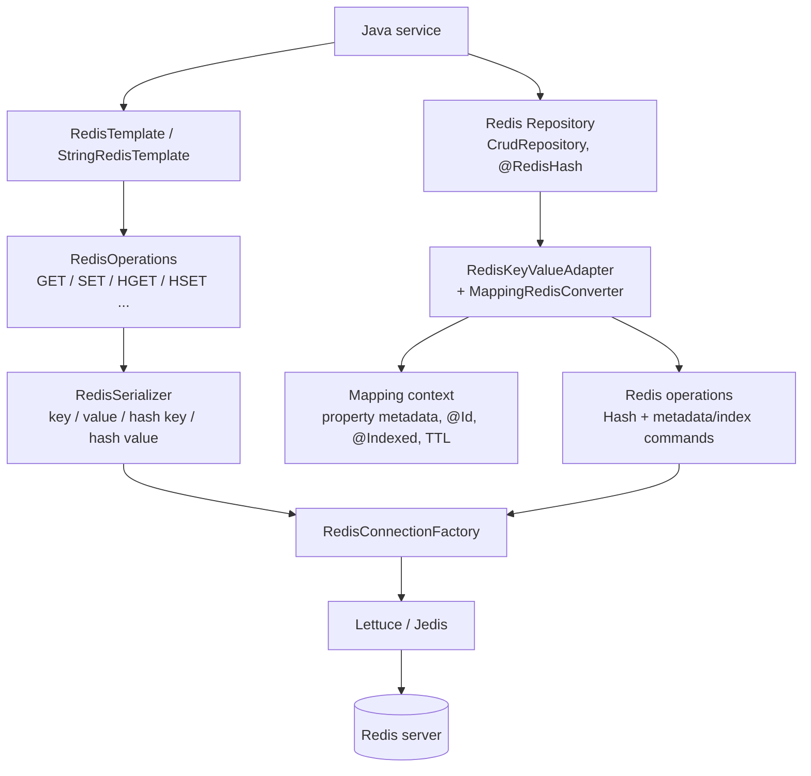
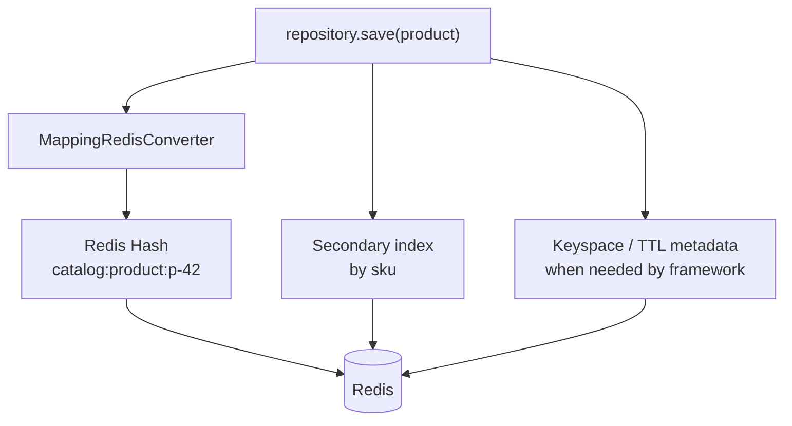
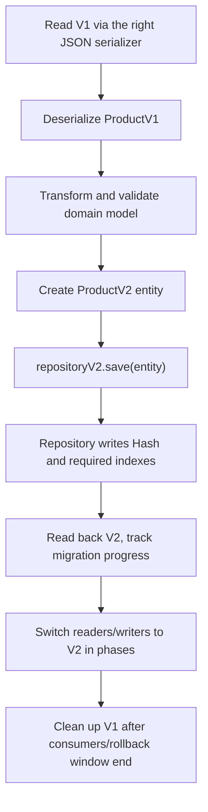

# Distinguishing RedisSerializer from Entity-to-Hash Mapping in Spring Data Redis

When a Java application writes an object to Redis, there are two questions that are very easy to confuse:

1. **How are Java values converted into bytes?** This is a **serialization** concern, typically handled through `RedisSerializer`.
2. **Which keys and fields is the object organized into inside Redis?** This is an **object mapping** concern, such as mapping an entity to a Redis **Hash** using `MappingRedisConverter` and Redis Repository.

Both mechanisms can be involved in the data writing process together, but they solve problems at two different levels. A `RedisSerializer` can turn **an entire object** into JSON and store it in a Redis String; a Redis Repository can turn **each property of an entity** into fields in a Redis Hash. In both cases, Redis ultimately still receives keys, fields, and values in byte form.

This lesson uses Spring Data Redis in the Spring Boot 3.x ecosystem; the Java examples illustrate the synchronous APIs of `StringRedisTemplate`, `RedisTemplate`, and Redis Repository. The exact way metadata and nested fields are stored may depend on the Spring Data Redis version and converter configuration.

## 1. From Redis's Perspective: Data Types and Bytes Are Two Different Concepts

Redis is a key-value database with multiple data structures: String, Hash, List, Set, Sorted Set, Stream, and more. A **Redis String** is the Redis data type for a key, yet the content of a String is still a sequence of bytes. Similarly, a **Redis Hash** contains multiple field/value pairs; the field names and value contents are also stored as bytes.

Suppose we have a product:

```json
{
  "id": "p-42",
  "name": "Mechanical Keyboard",
  "priceMinor": 159900,
  "currency": "VND"
}
```

We can store it in at least two ways.

**Approach A — Serialize the entire object into JSON inside a Redis String:**

```text
Redis key (String): product:json:p-42
Redis type:         string
Redis value:        {"id":"p-42","name":"Mechanical Keyboard",
                     "priceMinor":159900,"currency":"VND"}
```

**Approach B — Map each property into a Redis Hash:**

```text
Redis key (String): product:hash:p-42
Redis type:         hash
Redis fields:
    id          -> "p-42"           (the ID field may be derived from the key by mapping)
    name        -> "Mechanical Keyboard"
    priceMinor  -> "159900"
    currency    -> "VND"
    _class      -> "..."            (type metadata when needed by the converter)
```

The fields shown above illustrate the **concept**; how Spring Data Redis stores the `id` field, the `_class` marker, and actual data types depends on metadata/mapping. Do not treat illustrative diagrams as a byte-level contract across every library version.

In Approach A, Redis does not automatically understand that `priceMinor` is a property; it only sees the bytes of the JSON. In Approach B, Redis understands the **Hash fields** so it can apply commands such as `HGET`, `HSET`, `HDEL`, or `HGETALL`, even though it does not understand the full domain semantics of a Java `Product`.

Key takeaway: **Hash is a Redis data type; a serializer is a tool for converting representations; a mapper is a tool for organizing an object into a representation.**

## 2. Class Map in Spring Data Redis



The paths in this diagram are simplified for instructional purposes; Redis Repository uses Redis operations infrastructure and internal byte conversion mechanisms, which does not mean every repository call goes through a serializer configured on an arbitrary `RedisTemplate`.

| Component | Primary Role | What It Knows About |
|---|---|---|
| `RedisSerializer<T>` | Converts `T` to bytes and reads bytes back into `T` | A single value, key, hash field, or hash value |
| `RedisTemplate<K,V>` | Provides an API for executing Redis commands and uses the corresponding serializers | Redis keys, values, and data structures |
| `RedisHash` | Marks an entity managed as a Redis aggregate, specifying default keyspace/TTL | Entity type |
| `MappingRedisConverter` | Maps properties/entities to Redis Hash data and reads them back | Object graph, mapping metadata, type conversions |
| `RedisKeyValueAdapter` | Bridges Spring Data repository/key-value operations with Redis | Entity, ID, keyspace, indexes, TTL |
| `CrudRepository<T, ID>` | CRUD API for an aggregate | Entity and identifier, without directly manipulating Redis commands |
| `RedisConnectionFactory` | Provides connections to the Redis driver | Connections; does not decide the value schema |

You can use `RedisTemplate.opsForHash()` without using Redis Repository; you can also use Redis Repository without manually creating a `RedisTemplate<String, Product>` bean for that entity.

## 3. What Does RedisSerializer Actually Do?

`RedisSerializer<T>` is a data conversion contract:

```java
// Conceptual illustration, not the full interface definition.
byte[] serialize(T value);
T deserialize(byte[] bytes);
```

In the actual API, `null` handling, helper methods, and exceptions follow the contract of each serializer. Redis sends and receives bytes; Java needs to know whether those bytes represent a String, a number, a JSON object, a JDK serialization value, or an application-defined format.

For example:

```text
Java "hello"
    |
    | StringRedisSerializer (UTF-8)
    v
byte[] = 68 65 6c 6c 6f (hex)
    |
    v
Redis String value
```

With a JSON serializer:

```text
Java ProductSnapshot("p-42", "Keyboard")
    |
    | Jackson2JsonRedisSerializer<ProductSnapshot>
    v
byte[] of {"id":"p-42","name":"Keyboard"}
    |
    v
Redis String value
```

A serializer is an **encoding/decoding strategy**. It does not itself define key namespaces, entity relationships, secondary indexes, TTLs, property-based queries, or aggregate lifecycles.

### 3.1. Common Serializers

| Serializer | Representation | When to Consider | Limitations to Understand |
|---|---|---|---|
| `StringRedisSerializer` | UTF-8 string | Human-readable keys, text, and string values | Does not understand complex objects on its own |
| `JdkSerializationRedisSerializer` | Java native serialization format | Compatibility with existing Java serialization data | Hard-to-read bytes, class/version dependent; deserializing untrusted data carries security risks |
| `Jackson2JsonRedisSerializer<T>` | JSON for a specific Java type | Values are DTOs/records with a well-defined type | Requires managing schema changes and Jackson configuration |
| `GenericJackson2JsonRedisSerializer` | JSON with polymorphic type information handling | When reading/writing multiple object types through the same serializer | Requires evaluating type metadata configuration and polymorphic deserialization security |
| `GenericToStringSerializer<T>` | Converts values via `ConversionService` / String | Simple types with clear conversions | Not suitable for arbitrary object graphs |
| `ByteArrayRedisSerializer` | Raw bytes as-is | Already-encoded data, binary protocols | Caller must own the encode/decode logic |

Class names and constructors may vary across Spring Data Redis generations; when configuring in practice, check the API of the exact version your application uses. For new systems, an explicit, versioned data format that does not require trusting external class names is generally easier to operate than Java native serialization.

### 3.2. Four Serializer Slots in RedisTemplate

`RedisTemplate` has independent configuration slots:

```text
RedisTemplate<K, V>
├── keySerializer          # Redis key
├── valueSerializer        # Redis String value / value of certain operations
├── hashKeySerializer      # field name inside a Redis Hash
└── hashValueSerializer    # content of each field inside a Redis Hash
```

Example:

```java
import org.springframework.context.annotation.Bean;
import org.springframework.context.annotation.Configuration;
import org.springframework.data.redis.connection.RedisConnectionFactory;
import org.springframework.data.redis.core.RedisTemplate;
import org.springframework.data.redis.serializer.StringRedisSerializer;

@Configuration
class ManualRedisConfig {

    @Bean
    RedisTemplate<String, String> textRedisTemplate(
            RedisConnectionFactory connectionFactory) {

        RedisTemplate<String, String> template = new RedisTemplate<>();
        template.setConnectionFactory(connectionFactory);
        template.setKeySerializer(new StringRedisSerializer());
        template.setValueSerializer(new StringRedisSerializer());
        template.setHashKeySerializer(new StringRedisSerializer());
        template.setHashValueSerializer(new StringRedisSerializer());
        template.afterPropertiesSet();
        return template;
    }
}
```

In `RedisTemplate`, the key serializer and the hash key serializer are not the same thing: the key serializer converts the **Redis key name**; the hash key serializer converts the **field names inside a Hash**. If you forget to configure the hash key serializer, hash fields may not appear as expected strings in Redis CLI, depending on the template's defaults.

`StringRedisTemplate` is designed specifically for strings and uses a string serializer for key/value/hash key/hash value. When all data is text, it reduces configuration compared to creating a template manually.

## 4. Example 1: RedisTemplate Writing an Object as a Redis String

Consider a data model:

```java
public record ProductSnapshot(
    String id,
    String name,
    long priceMinor,
    String currency
) {}
```

Create a dedicated template for writing/reading JSON:

```java
import org.springframework.context.annotation.Bean;
import org.springframework.context.annotation.Configuration;
import org.springframework.data.redis.connection.RedisConnectionFactory;
import org.springframework.data.redis.core.RedisTemplate;
import org.springframework.data.redis.serializer.Jackson2JsonRedisSerializer;
import org.springframework.data.redis.serializer.StringRedisSerializer;

@Configuration
class ProductJsonConfig {
    @Bean
    RedisTemplate<String, ProductSnapshot> productJsonTemplate(
            RedisConnectionFactory connectionFactory) {

        RedisTemplate<String, ProductSnapshot> template =
            new RedisTemplate<>();
        template.setConnectionFactory(connectionFactory);
        template.setKeySerializer(new StringRedisSerializer());
        template.setValueSerializer(
            new Jackson2JsonRedisSerializer<>(ProductSnapshot.class)
        );
        template.afterPropertiesSet();
        return template;
    }
}
```

Writing and reading:

```java
import java.time.Duration;
import org.springframework.data.redis.core.RedisTemplate;
import org.springframework.stereotype.Service;

@Service
public class ProductJsonStore {
    private final RedisTemplate<String, ProductSnapshot> redis;

    public ProductJsonStore(
            RedisTemplate<String, ProductSnapshot> productJsonTemplate) {
        this.redis = productJsonTemplate;
    }

    public void save(ProductSnapshot product) {
        redis.opsForValue().set(
            "product:json:" + product.id(),
            product,
            Duration.ofMinutes(20)
        );
    }

    public ProductSnapshot find(String id) {
        return redis.opsForValue().get("product:json:" + id);
    }
}
```

Write flow:

```text
ProductSnapshot
      |
      v
Jackson2JsonRedisSerializer
      |
      v
byte[] JSON
      |
      v
Redis SET product:json:p-42 <JSON> EX ...
      |
      v
Redis stores a key with TYPE = string
```

Points to remember:

- Redis stores **one complete JSON value** per key.
- `RedisTemplate.opsForValue()` operates on a Redis String; it does not automatically create a Redis Hash just because the Java class has multiple fields.
- Redis cannot use `HGET product:json:p-42 name` to read the `name` property from a JSON String. Calling `HGET` on this key may return `WRONGTYPE`.
- Changing `ProductSnapshot` or the Jackson configuration can make old data unreadable; you need a migration plan, versioning, or TTL.
- The 20-minute TTL is passed by code into `set`, not determined by the serializer.

In real systems, if there are multiple beans with the same generic types or multiple templates, use explicit qualifiers so services inject the right serializer and key convention. These examples only illustrate choosing a representation, not recommending a single JSON serializer for all data.

## 5. Example 2: RedisTemplate Manually Writing Individual Fields into a Redis Hash

You can use a Redis Hash without a Repository. The `opsForHash()` API provides operations such as `put`, `get`, `entries`, and `delete`:

```java
import java.util.Map;
import org.springframework.data.redis.core.StringRedisTemplate;
import org.springframework.stereotype.Service;

@Service
public class ManualProductHashStore {
    private final StringRedisTemplate redis;

    public ManualProductHashStore(StringRedisTemplate redis) {
        this.redis = redis;
    }

    public void save(ProductSnapshot product) {
        String key = "product:manual-hash:" + product.id();
        redis.opsForHash().put(key, "name", product.name());
        redis.opsForHash().put(
            key, "priceMinor", Long.toString(product.priceMinor())
        );
        redis.opsForHash().put(key, "currency", product.currency());
    }

    public String findName(String productId) {
        Object value = redis.opsForHash().get(
            "product:manual-hash:" + productId,
            "name"
        );
        return value == null ? null : value.toString();
    }

    public Map<Object, Object> fields(String productId) {
        return redis.opsForHash().entries(
            "product:manual-hash:" + productId
        );
    }
}
```

In this example, `StringRedisTemplate` serializes **each field name** and **each value** as a UTF-8 string. Java code **explicitly decides** which fields are written, how numbers are represented as Strings, how keys are constructed, and when TTL is attached.

Checking with Redis CLI:

```bash
redis-cli TYPE product:manual-hash:p-42
# hash

redis-cli HGET product:manual-hash:p-42 name
# "Mechanical Keyboard"

redis-cli HGETALL product:manual-hash:p-42
# name, priceMinor, currency along with the written values
```

**This is still serialization**: `"priceMinor"` and `"159900"` are converted to bytes. However, there is no **automatic entity mapping** yet: no `@Id`, `@RedisHash`, `MappingRedisConverter`, secondary indexes, or Repository mechanism is invoked. A Redis Hash does not automatically become a Redis Repository entity just because it was created with `opsForHash()`.

## 6. How Does Redis Repository Map Entities to Hashes?

Spring Data Redis supports a mapping layer for entities. When using Redis Repository, you typically declare `@RedisHash` on the entity and `@Id` on the identifier property. The Spring Data KeyValue/Redis infrastructure can use `MappingRedisConverter` to convert the entity into hash fields and `RedisKeyValueAdapter` to save/read them via Redis.

Entity example:

```java
import org.springframework.data.annotation.Id;
import org.springframework.data.redis.core.RedisHash;
import org.springframework.data.redis.core.index.Indexed;

@RedisHash(value = "catalog:product", timeToLive = 1800)
public class ProductEntity {
    @Id
    private String id;

    @Indexed
    private String sku;

    private String name;
    private Long priceMinor;
    private String currency;

    public ProductEntity() {}

    public ProductEntity(
            String id, String sku, String name,
            Long priceMinor, String currency) {
        this.id = id;
        this.sku = sku;
        this.name = name;
        this.priceMinor = priceMinor;
        this.currency = currency;
    }

    public String getId() { return id; }
    public void setId(String id) { this.id = id; }
    public String getSku() { return sku; }
    public void setSku(String sku) { this.sku = sku; }
    public String getName() { return name; }
    public void setName(String name) { this.name = name; }
    public Long getPriceMinor() { return priceMinor; }
    public void setPriceMinor(Long priceMinor) { this.priceMinor = priceMinor; }
    public String getCurrency() { return currency; }
    public void setCurrency(String currency) { this.currency = currency; }
}
```

Repository declaration:

```java
import java.util.List;
import org.springframework.data.repository.CrudRepository;

public interface ProductRepository
        extends CrudRepository<ProductEntity, String> {

    List<ProductEntity> findBySku(String sku);
}
```

When Redis repositories are enabled and scan the right package (via appropriate Spring Boot auto-configuration or `@EnableRedisRepositories`), a service can work with the entity:

```java
ProductEntity entity = new ProductEntity(
    "p-42", "KEYBOARD-42", "Mechanical Keyboard",
    159900L, "VND"
);

productRepository.save(entity);
ProductEntity loaded =
    productRepository.findById("p-42").orElseThrow();
List<ProductEntity> bySku =
    productRepository.findBySku("KEYBOARD-42");
```

### 6.1. Meaning of Each Annotation

| Annotation | Effect |
|---|---|
| `@RedisHash("catalog:product")` | Specifies the keyspace of the Redis entity; for example, the primary key typically has the form `catalog:product:p-42` |
| `@Id` | Identifier used to build the key and look up the entity by ID |
| `@Indexed` | Instructs Spring Data Redis to manage a secondary index to support property-based queries such as `findBySku` |
| `timeToLive = 1800` | Sets a default TTL of 1,800 seconds for entity data when saved through the Repository mechanism |

`@RedisHash` **is not a JSON serializer**. It tells the framework that this is an entity organized within a Redis keyspace, typically stored in a Redis Hash. `@Indexed` also does not give Redis SQL indexes; Spring Data Redis maintains auxiliary key structures to look up entities by indexed values.

### 6.2. A Single Save Can Create Multiple Redis Keys

Conceptual diagram:



A simple entity can become a hash containing properties and type metadata. When `@Indexed` is added, the repository may create additional keys for querying by SKU. With TTL/expiration events, the framework may maintain metadata or shadow copies for expiration handling depending on configuration and version.

Therefore **`repository.save(entity)` cannot simply be understood as a single `SET` command with a value passed through a RedisSerializer**. It may correspond to multiple Redis commands and multiple keys. You should also not assume all of those operations form a single atomic transaction.

## 7. What Does a Repository's Redis Hash Contain?

An illustrative representation:

```text
Key: catalog:product:p-42
TYPE: hash
Fields typically correspond to:
    _class       = Java type name or type alias when needed
    sku          = KEYBOARD-42
    name         = Mechanical Keyboard
    priceMinor   = 159900
    currency     = VND
```

Depending on mapping and model:

- Simple properties can be placed into corresponding fields.
- Nested objects can be mapped via path/field names, such as `address.city`.
- Collections/maps can be represented via fields following specific conventions.
- Type metadata such as `_class` can be stored to assist in reconstructing the object type.
- Some properties may not be stored under a "Java-looking" field name if custom converters or mapping metadata are used.
- The ID is typically used to construct the key; do not assume there is always an `id` hash field identical to the key.

For simple data and readable serializers, you can inspect it with Redis CLI:

```bash
redis-cli TYPE catalog:product:p-42
# hash

redis-cli HGETALL catalog:product:p-42
# A list of field/value pairs; actual content depends on mapping
```

The returned values may not be JSON, and may contain bytes that do not display cleanly in a terminal. `HGETALL` shows fields at the Redis layer and **does not guarantee displaying the intact Java object when nesting, metadata, or special converters are involved**.

## 8. How Does MappingRedisConverter Differ from RedisSerializer?

The core difference:

```text
Path A: RedisTemplate + JSON serializer

Java object
   |
   v
serialize object -> byte[] JSON
   |
   v
SET key <byte[]>
   |
   v
Redis String

Path B: Redis Repository + object mapping

Java entity
   |
   v
inspect metadata: @RedisHash, @Id, @Indexed, properties
   |
   v
MappingRedisConverter -> RedisData / hash field representation
   |
   v
HSET / HMSET and commands managing keyspace, indexes, TTL
   |
   v
Redis Hash + metadata/index keys when needed
```

| Criterion | `RedisSerializer` | `MappingRedisConverter` / Redis Repository |
|---|---|---|
| Input | A Java value of the type to serialize | An entity along with property info and mapping metadata |
| Conceptual output | Byte representation | Redis Hash fields and metadata to store/read the aggregate |
| Field organization | Does not organize an entity into multiple hash fields on its own | Maps properties/object graphs into corresponding fields |
| Redis data type | Depends on template operation: String, Hash, List, etc. | Entity is primarily stored as a Redis Hash |
| ID and keyspace | Caller chooses the key manually | `@Id`, `@RedisHash`, and adapter help manage them |
| Secondary indexes | Not created automatically | Can be managed via `@Indexed` |
| TTL | Caller configures operations/`expire` | Can declare `@RedisHash(timeToLive=...)`, `@TimeToLive` |
| Schema changes | Change serializer/DTO/key version or migrate data | Change mapping converter/entity/keyspace and migrate data/indexes |
| Querying | Actively issue Redis commands | Repository API with supported query capabilities |

**Do not treat `MappingRedisConverter` as just another name for `Jackson2JsonRedisSerializer`.** A JSON serializer turns an object into a single JSON payload; a mapping converter understands properties and the Redis Hash representation to reconstruct the aggregate.

On the other hand, object mapping still needs to convert each piece of data into a storage representation. Thus, saying "Repository does not serialize data at all" is also inaccurate: the framework still converts properties and metadata into bytes, only **the conversion boundary and management mechanism differ from an application template's serializer**.

## 9. A Redis Hash Does Not Mean Redis Repository

There are three ways to store data that are often loosely referred to as "storing a Hash":

| Approach | Redis TYPE | Who Creates and Manages Fields? |
|---|---|---|
| `RedisTemplate.opsForValue().set(key, jsonObject)` with JSON serializer | `string` | Object is serialized to JSON; Redis is unaware of properties |
| `StringRedisTemplate.opsForHash().put(key, field, value)` | `hash` | Application code itself manages fields manually |
| `productRepository.save(entity)` with `@RedisHash` | `hash` | Spring Data Redis mapping and repository infrastructure |

The second and third approaches both use a Redis Hash, yet they are not arbitrarily interchangeable.

For example, suppose an application used Repository to save an entity with `@Indexed private String sku`. Later, some code runs:

```java
stringRedisTemplate.opsForHash().put(
    "catalog:product:p-42",
    "sku",
    "NEW-SKU"
);
```

The `HSET` command can change the `sku` field on the hash, yet **it does not automatically update the secondary indexes managed by the Repository**. As a result, `findById("p-42")` may see the new SKU while `findBySku("NEW-SKU")` fails to find the entity, or the index for the old SKU is not cleaned up.

Similarly, if code manually writes the same key with `opsForValue().set(...)`, the Redis key can be overwritten as a String type. A Repository expecting a Redis Hash will encounter a type error or fail to read the aggregate.

Design rule: **every keyspace needs a clear owner**. If a Repository owns the key and indexes, update through the Repository or a dedicated adapter that fully understands its mapping/indexes/TTL. If a Template owns the key, do not let a Repository claim that keyspace without a migration plan.

## 10. How the Four Serializers Behave in Practice During Manual Hash Operations

Suppose a template is configured as:

```java
RedisTemplate<String, Object> template = new RedisTemplate<>();
template.setConnectionFactory(connectionFactory);
template.setKeySerializer(new StringRedisSerializer());
template.setHashKeySerializer(new StringRedisSerializer());
template.setHashValueSerializer(new GenericJackson2JsonRedisSerializer());
template.afterPropertiesSet();
```

When calling:

```java
template.opsForHash().put(
    "profile:manual:42",
    "settings",
    new ProfileSettings("vi", true)
);
```

Redis receives:

```text
Key:       profile:manual:42                 (UTF-8 String)
Type:      hash
Hash field: settings                        (UTF-8 String)
Hash value: JSON bytes of ProfileSettings
```

Here, **each hash value** uses the JSON serializer, yet the framework does not automatically flatten it into fields like `settings.language` or `settings.notificationsEnabled`. The value of the `settings` field is simply a JSON payload placed inside the Hash.

An illustrative record:

```java
public record ProfileSettings(
    String language,
    boolean notificationsEnabled
) {}
```

This shows how the two layers can work together:

- **Redis Hash** determines the structure of the field collection.
- **Hash value serializer** determines the representation of each field value.

If you change `hashValueSerializer` from JSON to JDK serialization, Redis can still store a Hash, yet the byte data of each field changes. Existing fields do not automatically convert formats.

## 11. Nested Types and Custom Conversions in Redis Repository

When an entity has a nested object:

```java
public class ShippingAddress {
    private String city;
    private String postalCode;

    public ShippingAddress() {}
    public String getCity() { return city; }
    public void setCity(String city) { this.city = city; }
    public String getPostalCode() { return postalCode; }
    public void setPostalCode(String postalCode) {
        this.postalCode = postalCode;
    }
}

@RedisHash("orders")
public class OrderEntity {
    @Id
    private String id;
    private ShippingAddress address;
    // Corresponding constructors/getters/setters must be declared.
}
```

The mapping converter can traverse the object graph via metadata to map nested properties, such as fields representing `address.city` or `address.postalCode`. For collections or special Java types, mapping forms and type metadata have additional specific rules.

If you want to customize how a type is stored in a Redis Hash, Spring Data Redis supports **custom conversions** through the converter mechanism and `RedisCustomConversions` on supported mapping paths. A custom writing conversion can represent a domain type as a simple storage form or bytes; a reading conversion reconstructs the domain type.

Difference in responsibility:

```text
RedisSerializer
    "Encode/decode the bytes of a value."

Entity property/custom conversion
    "Represent this property as storage data
     that MappingRedisConverter can write into a Hash."
```

Custom conversions are useful when an object needs an explicit representation such as `Money`, `GeoPoint`, specialized identifiers, or types the mapper cannot handle by default. You must define **both reading and writing directions**, manage backwards compatibility, and avoid having a converter write bytes that earlier versions cannot understand.

Changing a custom converter can make old records unreadable even when key names and entity classes stay the same. This is also a schema change and must be versioned or migrated if incompatible.

## 12. RedisSerializer Does Not Dictate the Redis Command

A common misconception is "setting a JSON serializer makes Redis use the JSON data type." In reality:

```java
// With a RedisTemplate using a JSON value serializer:
template.opsForValue().set("x", someObject);
// Effective command is SET; key x is a Redis String.

// With a hash value JSON serializer:
template.opsForHash().put("y", "field1", someObject);
// Effective command is HSET; key y is a Redis Hash.
```

The operation type determines the Redis type; the serializer determines how keys/fields/values are represented as bytes. A JSON payload can live in a Redis String or **in a field value of a Redis Hash**. Redis does not automatically interpret JSON into fields just because the bytes start with `{`.

Redis also has modules/extensions that support JSON representation with their own APIs (for example, deployments running RedisJSON), but that is a different capability. `RedisTemplate` with a default JSON serializer does not automatically switch to RedisJSON commands.

## 13. Which Layer Do TTL and Indexes Belong To?

A serializer carries no key-lifecycle semantics. Suppose the same product is stored in three ways:

### String Template with JSON

```java
redisTemplate.opsForValue().set(
    "product:json:p-42", product,
    Duration.ofMinutes(10)
);
```

The TTL is set directly by the `set` operation.

### Manual Hash Template

```java
String key = "product:manual-hash:p-42";
stringRedisTemplate.opsForHash().put(key, "name", "Keyboard");
stringRedisTemplate.expire(key, Duration.ofMinutes(10));
```

Here, `expire` attaches a TTL to **the entire Redis Hash key**. Redis does not have standard field-level TTL across all configurations/versions, so do not assume each field expires independently of the key. Field expiration capabilities, if supported by a particular Redis system, are a separate matter requiring API/version verification.

### Entity Repository

```java
@RedisHash(value = "catalog:product", timeToLive = 600)
public class ProductEntity {
    @Id
    private String id;
    // ...
}
```

TTL is part of the mapping/entity configuration that the Repository applies on save. With `@TimeToLive`, TTL can be expressed per instance if required by the domain. When a key expires, index cleanup and expiration notifications depend on Redis keyspace events infrastructure and repository configuration; do not assume they are always processed immediately and with absolute precision.

**Serialization does not automatically grant TTL, create indexes, or turn multiple Repository commands into a single atomic transaction.** Those are separate data management decisions.

## 14. The Spring Cache Case: Yet Another Source of Serializers

An application can configure Redis as the backend for Spring Cache:

```java
@Cacheable(cacheNames = "product-details", key = "#productId")
public ProductView findProduct(String productId) {
    return productGateway.load(productId);
}
```

Spring Cache with `RedisCacheManager` typically writes **cache entries** to Redis using the serializer from `RedisCacheConfiguration`, rather than automatically using a `RedisTemplate<String, ProductSnapshot>` bean you created. Cache keys are usually prefixed by the cache name; cache values have their own serializer and TTL.

For example:

```text
product-details::p-42   -> serialized ProductView cache value
catalog:product:p-42    -> Redis Repository Hash
product:json:p-42       -> ProductSnapshot JSON in a Redis String
```

The three keys above can coexist in the same Redis server, yet each key is managed by a different abstraction. Changing `RedisCacheConfiguration` does not mean Repository will change its Hash mapping. Changing `RedisTemplate.setValueSerializer` also does not mean cache data and entities are migrated.

Identifying a key's owner is the first step in debugging: cache value, raw template value, or repository aggregate?

## 15. What Happens When Changing the Serializer or Entity Schema?

### 15.1. Changing the Serializer While Keeping Old Keys

Before upgrading:

```text
product:json:p-42 -> Java JDK serialization bytes
```

After upgrading:

```text
ProductJsonStore wants to read product:json:p-42 using a JSON serializer
```

The JSON decoder can fail because the old bytes are not JSON. **Simply changing the serializer in configuration does not automatically convert data already in Redis.**

Options:

- Choose a new namespace, such as `product:json:v2:p-42`, and transition in a controlled manner.
- If it is only regenerable cache, delete/let the old cache expire and write the new cache.
- If the data is authoritative, read it with the old codec, transform it to the new model, and write it using the new codec; account for concurrent updates and rollback.

### 15.2. Changing Entity Mapping While Keeping the Keyspace

Before:

```java
@RedisHash("customers")
class CustomerV1 {
    @Id String id;
    String fullName;
}
```

After:

```java
@RedisHash("customers")
class CustomerV2 {
    @Id String id;
    String givenName;
    String familyName;
}
```

The old hash may contain `fullName`; V2 code expects `givenName` and `familyName`. The mapper cannot automatically deduce how to split names accurately in all cases. Renaming Java fields does not mean the Redis data structure is changed.

You can:

1. Use a converter that reads V1 and converts to the V2 model if the transformation algorithm is well-defined.
2. Change the keyspace to `customers-v2` to prevent the new decoder from misreading old data.
3. Perform migration with controls for concurrency, TTL, indexes, and error observability.

Migrating from a JSON String to a Repository Hash requires even more explicit planning because **the key's Redis type changes from `string` to `hash`**. You cannot use `HGETALL` to read a String key; nor can you use `GET` directly to read a Hash.

## 16. Migrating from a JSON String to a Repository Hash

Suppose the application previously used:

```text
product:json:v1:p-42
    TYPE = string
    value = {"id":"p-42","name":"Keyboard"}
```

The new version switches to Redis Repository with:

```text
catalog:product:v2:p-42
    TYPE = hash
    fields per MappingRedisConverter
```

A controlled migration flow:



Do not take the shortcut `RENAME product:json:v1:p-42 catalog:product:v2:p-42`, because after `RENAME`, the key is still a **Redis String** and does not automatically become a Redis Hash. Nor should you only write a few fields with `HSET` while skipping the secondary indexes the repository needs to maintain.

For data that is actively changing, conversion must handle **stale writes** (migration must not overwrite newer updates), **deletes/tombstones** (avoiding resurrecting deleted data), and **TTL** (avoiding unexpectedly extending sessions/OTPs). For Redis Cluster, multi-key operations in Lua/transactions must obey same-hash-slot constraints.

## 17. Debugging: Immediately Identify the Redis Type and Decoding Strategy

When seeing a deserialization error or `WRONGTYPE`, trace in order:

**Step 1 — Check the Redis type of the key**

```bash
redis-cli TYPE product:json:p-42
redis-cli TYPE product:manual-hash:p-42
redis-cli TYPE catalog:product:p-42
```

**Step 2 — Read with the command matching the type**

```bash
# Only use GET for Redis String
redis-cli GET product:json:p-42

# Only use HGETALL for Redis Hash
redis-cli HGETALL product:manual-hash:p-42
redis-cli HGETALL catalog:product:p-42
```

**Step 3 — Identify the serializer or mapping**

- Redis String value from `RedisTemplate.opsForValue()`: check `valueSerializer`.
- Redis Hash created with `opsForHash()`: check `hashKeySerializer` and `hashValueSerializer`.
- Redis Hash created by Repository: check `@RedisHash`, `@Id`, `@Indexed`, entity field mapping, and `MappingRedisConverter`/custom conversions.
- Redis Cache: check `RedisCacheConfiguration`, cache name, key prefix, and serializer.

**Step 4 — Check TTL and source of truth**

```bash
redis-cli TTL product:json:p-42
redis-cli TTL catalog:product:p-42
```

`TTL` returns remaining seconds when the key has an expiry, `-1` when the key exists with no expiry, and `-2` when the key does not exist. When a key has expired, a deserialization error will not occur for that key; if an object cannot be found, distinguish that from connection errors or serializer errors.

Redis CLI prints values as text, yet bytes from JDK serialization or binary serializers may not display meaningfully. Do not change the serializer just to make CLI output look "pretty" if the system has existing data it must remain compatible with.

In environments with many keys, use `SCAN` by prefix to inspect:

```bash
redis-cli --scan --pattern 'catalog:product:*'
```

Avoid `KEYS *` on large production Redis instances as it can block the server; when deleting keys, be aware of metadata/index keys belonging to the Repository infrastructure.

## 18. Performance: No Single Representation Is Best for Every Problem

| Need | JSON String with Serializer | Manual Hash with Template | Repository Hash Mapping |
|---|---|---|---|
| Write/read entire object by key | Simple, each value is a single payload | Must split/assemble fields manually | Provides `save/findById` API |
| Read only a single field | Usually must read/parse full payload, unless a custom mechanism exists | `HGET` is very well suited | Repository tends to reconstruct the aggregate; not optimized for field-only reads by default |
| Update a single field | Usually rewrites entire object/payload | Direct `HSET` | May require saving aggregate and updating indexes |
| Derived queries by property | Not automatic | Manage indexes manually | Supported within the limits of Redis Repository and `@Indexed` |
| Nested objects | JSON is usually natural | Must define representation per field | Mapper has flattening/nested metadata rules |
| Inspecting via Redis CLI | Easy if UTF-8 JSON | Easy if hash fields/values are String | May contain metadata and hard-to-read bytes |
| Metadata update overhead | Minimal, self-managed | Self-managed | Can incur additional keys/indexes/TTL metadata |
| Compatibility on schema changes | Manage JSON DTOs and serializers | Manage field names and custom converters | Manage entity mapping, keyspace, indexes, converters |

You should not claim "Hash always uses less memory than JSON" or "Repository is always slower than Template." Actual cost depends on payload size, field count, Redis encoding, network round trips, index count, query patterns, update frequency, and driver settings.

Benchmarks should use realistic workloads: field counts, object size distributions, read/write ratios, key counts, TTLs, concurrent requests, and Redis topology. When an atomic command like `INCR` or `HINCRBY` is needed, the Template API is usually clearer and better suited than reading, modifying, and writing back an entire entity.

## 19. Misconceptions to Avoid

| Misconception | What Is More Accurate |
|---|---|
| "If a Java object has multiple properties, RedisTemplate will store it as a Hash." | `opsForValue()` still writes a Redis String; a serializer does not automatically change Redis commands. |
| "Using Jackson2JsonRedisSerializer means using RedisJSON." | A JSON serializer only produces JSON bytes; the Redis data type depends on the operation. |
| "`@RedisHash` is shorthand for a JSON serializer." | `@RedisHash` participates in entity/keyspace mapping, not defining a JSON codec for the whole object. |
| "A Redis Hash created with `opsForHash()` can immediately be used with a Repository." | Repository also requires mapping metadata/indexes/IDs and its own contract. |
| "Changing the serializer on a RedisTemplate bean changes how Repository stores entities." | Serializer settings on an application template do not automatically replace the Repository's entity mapper. |
| "`HSET` updating a field on a Repository entity updates `@Indexed`." | Low-level writes do not automatically maintain secondary indexes managed by Repository. |
| "`@Indexed` is a SQL index automatically created by Redis." | Spring Data Redis maintains secondary index structures using Redis keys according to its own mechanism. |
| "Changing a Java class automatically migrates Redis data." | Data migration, keyspace versioning, or backward-compatible converters must be designed explicitly. |
| "The serializer determines TTL." | TTL belongs to the command/Repository/Cache configuration, independent of the codec. |
| "Every null read result is caused by a missing key." | Deserialization, type, and connection errors have different semantics from Redis nil. |

## 20. Representation Identification Exercises

### Scenario A — Caching a Profile as JSON

Requirement: store a profile snapshot with a few dozen properties, read it all in one go, and be able to regenerate it from the database.

A `RedisTemplate<String, ProfileSnapshot>` with a JSON value serializer or Redis Cache with an explicitly configured serializer is a reasonable choice. The key is a Redis String; TTL is managed per cache/use case. You do not need a Repository just because a profile is a Java object.

### Scenario B — Session Entity by ID, Lookup by User ID

Requirement: store a session with an ID, 20-minute TTL, and queries by `userId`. A Redis Repository with `@RedisHash`, `@Id`, and `@Indexed` may fit if the query needs fall within Repository capabilities. You need to monitor indexes and TTL; saving through Repo differs from putting a JSON string with Template.

### Scenario C — Updating Counters Inside a Redis Hash

Requirement: each article has `views` and `likes`, and each request increments only one field.

`StringRedisTemplate.opsForHash().increment(...)` maps to Redis `HINCRBY`; you explicitly use Redis's atomic command for a single field. There is no need to map an entire Java aggregate for each counter increment.

### Scenario D — Existing JSON Strings, Wanting to Switch to Repository

Requirement: the product schema changes, and queries by `sku` using `@Indexed` are needed.

You must read the JSON records using the old serializer, transform them into the new entity, save through the repository to build the corresponding Hash/indexes, and switch readers/writers in phases. Do not merely `RENAME` keys or swap `setValueSerializer`.

### Scenario E — A Redis Key Returns `WRONGTYPE`

Requirement: a service calls `opsForHash().get("product:42", "name")` while key `product:42` was previously written with `opsForValue().set(...)`.

The Redis key has type **String**, so `HGET` cannot be used. The fix is to unify ownership/key namespaces, pick the right Redis type, and migrate data if necessary. Changing the hash value serializer does not turn a String key into a Hash.

## 21. How to Choose the Right Abstraction

Use the following questions when designing:

1. **Do you want control over Redis commands and the byte format of a value?** Start with `RedisTemplate` and `RedisSerializer`.
2. **Do you want to store entities by ID, with property mapping and supported property indexes?** Consider Redis Repository with `@RedisHash` and `MappingRedisConverter`.
3. **Do you want to manipulate individual fields directly on a Redis Hash?** `opsForHash()` fits well; manage schema, indexes, and TTL yourself.
4. **Do you want to cache method return values?** Use Spring Cache with `RedisCacheManager` and its own serializer/cache TTL.
5. **Do you want to change an existing storage format?** Identify key owner, Redis TYPE, old serializer/mapping, new format, TTL, indexes, and migration strategy before rolling out.

**RedisSerializer answers how to represent a value as bytes; entity-to-Hash mapping answers how to organize an object into Redis fields and keys.** Spring Data Redis provides both because they serve different needs. When reading errors or changing schemas, do not only ask "which serializer is being used"; also ask "is this key a Redis String or Hash, who owns it, and at which layer is the representation managed?".
