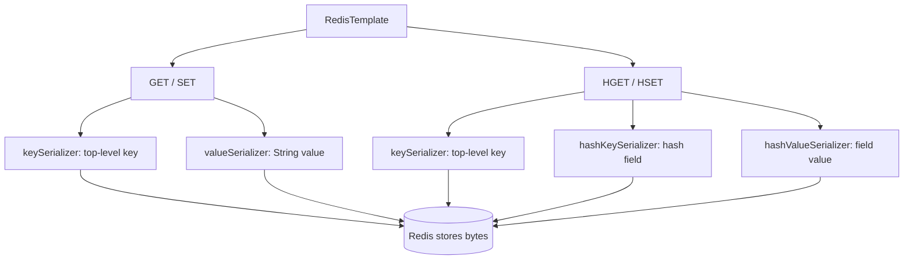

# Separate Serializers for Key, Value, Hash Key, and Hash Value

## 1. Why Does RedisTemplate Need Four Serializers?

Redis does not directly store Java objects, `String`, or generic data types. At the protocol layer, key names and value contents are transmitted as **bytes**. Spring Data Redis must convert Java data to bytes before sending a command, and then convert returned bytes back into Java values. The component performing this two-way conversion is **`RedisSerializer<T>`**.

A `RedisTemplate<K, V>` has four independent serializer configuration slots:

- **Key serializer:** encodes top-level Redis key names.
- **Value serializer:** encodes values for Redis String operations, such as `GET`/`SET`.
- **Hash key serializer:** encodes field names inside a Redis Hash.
- **Hash value serializer:** encodes the value data of each field in a Redis Hash.

Distinguishing these four slots is critical because an application might want key names and field names to be human-readable UTF-8 strings, while values are structured JSON. If a serializer is configured incorrectly, Redis will still store the bytes, yet another application or a newer version might fail to find keys, fail to decode values, or read the wrong structure.

For example, an e-commerce application needs to store:

```text
Redis String key: product:42
JSON value:       {"id":"42","name":"Keyboard","priceCents":890000}

Redis Hash key:   cart:user-7
Field:            sku-123
Field value JSON: {"sku":"sku-123","quantity":2}
```

In that example, you might choose `StringRedisSerializer` for **key** and **hash key**, `Jackson2JsonRedisSerializer<ProductSnapshot>` for **value**, and `Jackson2JsonRedisSerializer<CartLine>` for **hash value**.

Core point: **Redis only sees bytes; the meaning, type, and readability of those bytes are a contract among applications sharing the keyspace.**

## 2. Which Part of a Redis Command Does Each of the Four Serializers Map To?

Consider two operations:

```redis
SET product:42 "{\"id\":\"42\",\"name\":\"Keyboard\",\"priceCents\":890000}"
HSET cart:user-7 sku-123 "{\"sku\":\"sku-123\",\"quantity\":2}"
```

The `SET` command only has a top-level key and a String value. The `HSET` command has a top-level key, a hash field, and a hash field value. Therefore, `RedisTemplate` selects serializers by parameter position, not by whether a Java variable name contains the word "key" or "value".

| Configuration Property | Input Java Data | Where It Is Used | Example Output Bytes |
|---|---|---|---|
| `keySerializer` | `String` like `"product:42"` | Top-level key of `GET`, `SET`, `HSET`, `SADD`, `DEL`, etc. | UTF-8 bytes of `product:42` |
| `valueSerializer` | `ProductSnapshot` | Redis String values such as `SET`/`GET`; some other APIs use the value serializer per contract | JSON bytes of the product object |
| `hashKeySerializer` | `String` like `"sku-123"` | Field name in `HSET`, `HGET`, `HDEL` | UTF-8 bytes of `sku-123` |
| `hashValueSerializer` | `CartLine` | Field value in `HSET`/`HGET`/`HGETALL` | JSON bytes of a cart line |

Data flow diagram:



### 2.1. "Key" and "Hash Key" Are Two Different Concepts

Consider the command:

```redis
HSET cart:user-7 sku-123 2
```

- `cart:user-7` is the **Redis key**, governed by `keySerializer`.
- `sku-123` is the **hash key**, also called a **field**, governed by `hashKeySerializer`.
- `2` is the **hash value**, governed by `hashValueSerializer`.

A Hash can contain thousands of fields and still occupy only **one top-level key** in the keyspace. Typical TTLs attach to the Hash's top-level key, so how you configure the hash key serializer does not change how Redis determines the key's lifetime.

### 2.2. Not Every Redis Structure Has a "Hash Key"

`SetOperations`, `ListOperations`, and `ZSetOperations` also operate through `RedisTemplate`, but the term "hash key" applies only to fields of a Redis Hash. For lists/sets/zsets, value/member components and scores follow the serialization contract of their respective APIs; do not infer that hash serializers govern elements of every Redis structure.

For example:

```java
template.opsForValue().set("product:42", product);
template.opsForHash().put("cart:user-7", "sku-123", cartLine);
```

In the first line, the template uses key serializer and value serializer. In the second line, the template uses key serializer, hash key serializer, and hash value serializer.

## 3. Defaults of RedisTemplate and StringRedisTemplate

Both classes can access Redis yet do not necessarily write identical bytes.

### 3.1. StringRedisTemplate

`StringRedisTemplate` is a specialized variant of `RedisTemplate<String, String>`. It comes preconfigured with `StringRedisSerializer` for the key, value, hash key, and hash value slots.

```java
import org.springframework.data.redis.core.StringRedisTemplate;
import org.springframework.stereotype.Service;

@Service
public class SimpleFlagStore {
    private final StringRedisTemplate redis;

    public SimpleFlagStore(StringRedisTemplate redis) {
        this.redis = redis;
    }

    public void saveFlag(String id, boolean enabled) {
        redis.opsForValue().set("feature:" + id, Boolean.toString(enabled));
    }

    public boolean loadFlag(String id) {
        return Boolean.parseBoolean(
                redis.opsForValue().get("feature:" + id));
    }
}
```

Data in Redis is usually easy to inspect with `redis-cli`:

```redis
GET feature:checkout
```

If the application wrote `"true"`, the CLI can return the string `true`. This is an appropriate choice when data is inherently text, integers represented as text, or when compatibility with non-Java systems is desired.

**Note:** `StringRedisSerializer` only encodes and decodes strings. It does not automatically turn a Java object into JSON and does not enforce JSON schema compatibility.

### 3.2. General RedisTemplate

`RedisTemplate<K, V>` allows configuring each serializer individually. A general template created with default configuration may use **Java native serialization** (`JdkSerializationRedisSerializer`) if you do not specify other serializers and the default serializer remains enabled.

This causes keys in Redis to potentially be binary bytes, rather than the intuitive string `product:42` that you type in the CLI.

Example of a configuration that has not explicitly set a format:

```java
RedisTemplate<String, ProductSnapshot> template = new RedisTemplate<>();
template.setConnectionFactory(connectionFactory);
// Custom serializers not declared yet.
```

The generic `<String, ProductSnapshot>` only gives Java compile-time type checking. It **does not force Redis to write UTF-8 keys** and **does not automatically choose a JSON serializer**. Do not rely on the template's default serializer for a data contract shared across multiple services.

### 3.3. All Serializers Must Agree on the Format

The following two templates both pass the Java key `"product:42"`, yet can access **two different byte keys** if their key serializers differ:

```text
Template A:
  Java key: "product:42"
  key serializer: StringRedisSerializer
  key bytes: UTF-8("product:42")

Template B:
  Java key: "product:42"
  key serializer: JdkSerializationRedisSerializer
  key bytes: Java serialized String
```

Redis compares keys by bytes, so keys in the two cases do not match. This is a common cause when an application writes successfully yet `redis-cli GET product:42` or another service fails to find the key.

## 4. Common RedisSerializers

| Serializer | Format | Strengths | Considerations |
|---|---|---|---|
| `StringRedisSerializer` | UTF-8 string | Simple, easy to debug, cross-language compatible | Must establish conventions for type parsing and schema yourself |
| `Jackson2JsonRedisSerializer<T>` | JSON bound to a specific target type | Friendly for DTOs with clear schemas, inspectable via CLI | Field/class changes require a compatibility strategy |
| `GenericJackson2JsonRedisSerializer` | JSON using dynamic type handling | Useful when values have multiple types | Type metadata, versioning, trusted type restrictions, and security |
| `JdkSerializationRedisSerializer` | Java native serialization data | Usable for some legacy Java systems | Coupled to Java classes, hard to inspect, deserialization risks |
| `ByteArrayRedisSerializer` | Direct byte array | Binary data preserved verbatim | Application must enforce byte contract and validate data |
| Custom `RedisSerializer<T>` | Application-defined | Full control over format, versioning, and size | Must handle null, errors, migration, and compatibility yourself |

No serializer is optimal for every purpose. Keys and hash fields should usually use a stable string form because they need to be easy to name, discover, and maintain. Values can use JSON, text, or binary depending on data type, throughput, and cross-application compatibility requirements.

### 4.1. Why Is JSON Often Suitable for Values?

JSON is cross-language. A Java service writing JSON can be read by Go, Node.js, or Python as long as everyone agrees on the schema. JSON is also easy to view in the CLI and controlled logs.

Downsides include serialize/deserialize overhead, payload size, and schema changes such as adding/removing fields or changing types. An object containing `LocalDateTime` or other temporal types may require appropriate mappers/modules. Do not assume all application-wide Jackson configuration automatically applies to a serializer you instantiate directly.

### 4.2. Why Is JDK Serialization Hard to Use as a Shared Standard?

Java native serialization depends on Java class structure, version management, and deserialization policies. Values are hard to read with operational tools and hard to consume from services in other languages. Deserializing data from untrusted sources also carries security risks.

If you are maintaining legacy data using JDK serialization, you need a data migration plan and coordination across application versions. Simply switching the configuration bean to JSON while Redis still holds old JDK bytes can cause new read commands to fail.

## 5. Configuring All Four Serializers in RedisTemplate

Suppose we have two business data types:

```java
// ProductSnapshot.java
public record ProductSnapshot(
        String id,
        String name,
        long priceCents
) {}

// CartLine.java
public record CartLine(
        String sku,
        int quantity
) {}
```

The system wants:

- `GET product:snapshot:42` returns a JSON value shaped like `ProductSnapshot`.
- `HGET cart:user-7 sku-123` returns a hash value shaped like JSON `CartLine`.
- All top-level keys and field names are readable UTF-8 strings.

You can create **one template with different serializers for the value and hash value slots**. Example for Spring Data Redis 3.x:

```java
import org.springframework.context.annotation.Bean;
import org.springframework.context.annotation.Configuration;
import org.springframework.data.redis.connection.RedisConnectionFactory;
import org.springframework.data.redis.core.RedisTemplate;
import org.springframework.data.redis.serializer.Jackson2JsonRedisSerializer;
import org.springframework.data.redis.serializer.StringRedisSerializer;

@Configuration
public class BusinessRedisSerializationConfiguration {

    @Bean("businessRedisTemplate")
    public RedisTemplate<String, ProductSnapshot> businessRedisTemplate(
            RedisConnectionFactory connectionFactory) {

        RedisTemplate<String, ProductSnapshot> template =
                new RedisTemplate<>();

        template.setConnectionFactory(connectionFactory);

        // Redis top-level key: "product:snapshot:42", "cart:user-7".
        template.setKeySerializer(new StringRedisSerializer());

        // Redis String value: JSON of ProductSnapshot.
        template.setValueSerializer(
                new Jackson2JsonRedisSerializer<>(ProductSnapshot.class));

        // Redis Hash field name: "sku-123".
        template.setHashKeySerializer(new StringRedisSerializer());

        // Redis Hash field value: JSON of CartLine.
        template.setHashValueSerializer(
                new Jackson2JsonRedisSerializer<>(CartLine.class));

        return template;
    }
}
```

### 5.1. Meaning of Each Configuration Line

`template.setConnectionFactory(connectionFactory)` specifies the component responsible for connecting to Redis. A Spring-managed template is typically a singleton injected into multiple services.

`template.setKeySerializer(...)` determines how all **top-level keys** are encoded, including keys of Strings, Hashes, Sets, or Lists. If text keys are already used in production, changing this property without migration will prevent the application from finding old keys.

`template.setValueSerializer(...)` determines how objects are represented in APIs that use the value serializer, typically `opsForValue()` on Redis Strings. For example, a `ProductSnapshot` is converted into JSON.

`template.setHashKeySerializer(...)` determines how Redis Hash field names are encoded. Using `StringRedisSerializer` lets `HGET cart:user-7 sku-123` from the CLI query the exact field.

`template.setHashValueSerializer(...)` determines how field values inside a Hash are encoded. Here JSON is deserialized into `CartLine`. Fields in hashes managed by this template must adhere to the same format.

**Note on types:** `RedisTemplate<String, ProductSnapshot>` declares the top-level value type `ProductSnapshot`. Meanwhile, `HashOperations` has generics for hash key and hash value, so `CartLine` can still be used for hash contents with the chosen serializer. Do not conclude from the template's generics that all four serializers share `ProductSnapshot`.

### 5.2. Service Reading/Writing Both Redis String and Redis Hash

```java
import java.time.Duration;
import java.util.Optional;
import org.springframework.beans.factory.annotation.Qualifier;
import org.springframework.data.redis.core.HashOperations;
import org.springframework.data.redis.core.RedisTemplate;
import org.springframework.stereotype.Service;

@Service
public class BusinessRedisStore {

    private final RedisTemplate<String, ProductSnapshot> redis;

    public BusinessRedisStore(
            @Qualifier("businessRedisTemplate")
            RedisTemplate<String, ProductSnapshot> redis) {
        this.redis = redis;
    }

    public void saveProduct(ProductSnapshot product) {
        redis.opsForValue().set(
                "product:snapshot:" + product.id(),
                product,
                Duration.ofMinutes(15));
    }

    public Optional<ProductSnapshot> getProduct(String id) {
        return Optional.ofNullable(
                redis.opsForValue().get("product:snapshot:" + id));
    }

    public void saveCartLine(String userId, CartLine line) {
        String key = "cart:" + userId;

        HashOperations<String, String, CartLine> hash =
                redis.opsForHash();
        hash.put(key, line.sku(), line);

        redis.expire(key, Duration.ofDays(7));
    }

    public Optional<CartLine> getCartLine(
            String userId, String sku) {
        HashOperations<String, String, CartLine> hash =
                redis.opsForHash();

        return Optional.ofNullable(
                hash.get("cart:" + userId, sku));
    }
}
```

Illustrative data created by these commands:

```text
String key
    product:snapshot:42
String value
    {"id":"42","name":"Keyboard","priceCents":890000}

Hash key
    cart:user-7
Hash field
    sku-123
Hash field value
    {"sku":"sku-123","quantity":2}
```

The actual JSON bytes produced by Jackson may vary in field order or formatting configuration, yet the contract remains JSON of the exact target type. With this configuration, `CartLine` should only be used via hash; do not write `CartLine` with `opsForValue()` on this template because the top-level value serializer expects `ProductSnapshot`.

### 5.3. Two Consecutive Commands Are Not Automatically Atomic

In `saveCartLine`, `hash.put(...)` and `redis.expire(...)` are **two commands**. If the application fails between commands, the hash may be written without its TTL being refreshed. This is an atomicity issue, not a serialization issue.

If an invariant requires "every field write must attach a TTL in the same operation," use a Redis script or an appropriate atomic mechanism. A serializer only determines bytes; it does not determine transactions or consistency across commands.

### 5.4. Why Sometimes You Should Split Into Two Templates

The example above highlights the ability to configure **the four serializers independently**. In real-world systems, splitting templates by schema can be easier to maintain:

```text
productSnapshotRedisTemplate
  keySerializer:       String
  valueSerializer:     ProductSnapshot JSON

cartLineRedisTemplate
  keySerializer:       String
  hashKeySerializer:   String
  hashValueSerializer: CartLine JSON
```

When each template manages a specific data type, readers can easily tell which operations are permitted and avoid accidentally writing the wrong value type into another namespace. Templates can share a `RedisConnectionFactory`; there is no need to create separate Redis clients just to have two serializer policies.

## 6. Inspecting Actual Data with redis-cli

With `keySerializer` set to `StringRedisSerializer`, key names are sent as UTF-8. Similarly, hash fields using `StringRedisSerializer` are easy to access.

After calling `saveProduct(new ProductSnapshot("42", "Keyboard", 890000))` and `saveCartLine("user-7", new CartLine("sku-123", 2))`:

```redis
TYPE product:snapshot:42
GET product:snapshot:42
TTL product:snapshot:42

TYPE cart:user-7
HGET cart:user-7 sku-123
HGETALL cart:user-7
TTL cart:user-7
```

Conceptual results:

```text
TYPE product:snapshot:42 -> string
GET  product:snapshot:42 -> {"id":"42","name":"Keyboard","priceCents":890000}
TTL  product:snapshot:42 -> remaining seconds

TYPE cart:user-7     -> hash
HGET cart:user-7 sku-123 -> {"sku":"sku-123","quantity":2}
HGETALL cart:user-7      -> JSON field/value pairs per field
```

Do not use `GET cart:user-7`, because that Redis key has type Hash and may return a `WRONGTYPE` error. Similarly, `HGET product:snapshot:42 sku-123` uses the wrong Redis type. **`WRONGTYPE` errors relate to Redis data structure types; deserialization errors relate to byte formats.** These two classes of errors must be diagnosed separately.

If the application uses a binary serializer for hash fields, `HGET cart:user-7 sku-123` in the CLI may find nothing because the field bytes do not match. In that case, do not jump to concluding the hash is empty; verify the serializer and inspect actual fields using a tool capable of displaying bytes.

## 7. Configuring Individual Serializers Does Not Mean Every Operation Uses the Same One

A template can operate on Redis Strings, Hashes, Lists, Sets, Sorted Sets, Streams, and other primitives. The four most commonly discussed serializers are key, value, hash key, and hash value, yet each API group has its own rules for transmitted data.

| Operation | Data Typically Needing Serialization | Notes |
|---|---|---|
| `opsForValue().set(key, value)` | Key + value | Value serializer |
| `opsForValue().get(key)` | Key; response deserialized with value serializer | Returned Java type must match |
| `opsForHash().put(key, field, value)` | Key + hash key + hash value | Three corresponding serializers |
| `opsForHash().get(key, field)` | Key + hash key; response uses hash value serializer | Reading a field must use the same hash key serializer |
| `opsForHash().entries(key)` | Key; all fields and values | Decodes each field with hash key serializer and each value with hash value serializer |
| `opsForList().rightPush(key, value)` | Key + list element | Elements usually follow value serializer |
| `opsForSet().add(key, member)` | Key + member | Members usually follow value serializer |
| `opsForZSet().add(key, member, score)` | Key + member; score is a numeric command argument | Members usually follow value serializer |
| `expire(key, ttl)` / `delete(key)` | Key | Key serializer still applies |

**Example:** a value written via `opsForList()` using a JSON serializer will not naturally be compatible with a `StringRedisTemplate` on the same key, because the string template interprets members as `String` rather than DTOs. You must agree on wire format and Redis type across callers.

Advanced APIs such as script execution, pipelining, message listeners, Redis Streams, or raw `RedisConnection` may use serializers or codecs according to their own API contracts. Do not assume based solely on the four setters that every byte across all commands is handled by the same serializer. When integrating a new operation type, check how Spring Data Redis serializes specific keys, arguments, results, and entries.

## 8. Writing a Custom RedisSerializer for Special Formats

Built-in serializers are usually sufficient. If a system has a proprietary wire format, wants to fix a data type in minimal text form, or needs compatibility with a legacy system, you can implement `RedisSerializer<T>`.

Example of a `Long` value as a UTF-8 decimal string:

```java
import java.nio.charset.StandardCharsets;
import org.springframework.data.redis.serializer.RedisSerializer;
import org.springframework.data.redis.serializer.SerializationException;

public final class DecimalLongSerializer
        implements RedisSerializer<Long> {

    @Override
    public byte[] serialize(Long value)
            throws SerializationException {
        if (value == null) {
            return null;
        }

        return Long.toString(value)
                .getBytes(StandardCharsets.UTF_8);
    }

    @Override
    public Long deserialize(byte[] bytes)
            throws SerializationException {
        if (bytes == null) {
            return null;
        }

        try {
            String text = new String(
                    bytes, StandardCharsets.UTF_8);
            return Long.parseLong(text);
        } catch (NumberFormatException ex) {
            throw new SerializationException(
                    "Invalid decimal long in Redis", ex);
        }
    }
}
```

When a value is encoded cleanly as a numeric string, it can be compatible with `INCR`/`INCRBY` in Redis (provided the value stays within Redis's supported integer range). If replaced with a proprietary binary format, you cannot assume Redis will still recognize those bytes as a number for direct incrementing.

### 8.1. Decisions Needed When Building a Custom Serializer

- **Null:** return `null` or a special representation? Redis APIs may not accept null in certain positions; do not confuse "missing key" with "null value".
- **Encoding:** UTF-8, ASCII, or which binary endianness? The convention must be fixed.
- **Versioning:** when the format changes, how will older versions read the data back?
- **Validation:** missing fields, wrong sizes, unexpected bytes, or invalid checksums must have clear behavior.
- **Error semantics:** throw `SerializationException` with a helpful cause; do not silently return a default value when data is corrupted.
- **Compatibility:** do other services writing to the same key follow the exact schema?
- **Performance:** avoid heavy serialization on hot request paths; measure both byte size and CPU.
- **Security:** do not deserialize arbitrary types from untrusted data.

Do not write a custom serializer just to convert a string to UTF-8 when `StringRedisSerializer` already covers it. A custom serializer increases your burden of maintaining the data contract.

## 9. Distinguishing Serializers from Converters, Codecs, and Mapping

In Spring Data Redis there are multiple data conversion layers:

```text
Java service
   |
   +-- RedisTemplate
   |     |
   |     +-- RedisSerializer: Java value <-> byte[]
   |     +-- RedisConnectionFactory -> driver -> Redis
   |
   +-- Redis repository / mapping abstraction
         |
         +-- Redis mapping/conversion for entities and Hashes
         +-- Interacts with Redis via repository mechanisms
```

A **Serializer** converts objects to bytes and back according to the `RedisTemplate` contract. A **Redis driver codec** (such as direct Lettuce APIs) also determines how keys/values are represented when working outside Spring Data Redis abstractions. **Redis repository mapping** can use its own converter system and Hash organization distinct from `RedisTemplate.opsForValue()` writing JSON directly.

Therefore:

- Configuring `setHashValueSerializer(...)` on a `RedisTemplate` does not mean every `@RedisHash` repository automatically uses that serializer.
- An entity saved via a Spring Data Redis repository can be represented across multiple Hash fields via mapping, unlike a single field containing a whole JSON blob written by a template.
- A Lettuce client used directly with its own codec can write bytes incompatible with a Spring template, even with the same Java key name.
- Spring Cache with `RedisCacheManager` has its own serialization configuration for cache keys and values; by default it does not take serializers from a `RedisTemplate` you defined manually.

Treat each abstraction as a writer/reader with its own format contract. When multiple abstractions access the same key, proactively unify formats or separate namespaces.

## 10. How Does Spring Cache Serialization Differ from RedisTemplate Serialization?

If using Spring Cache:

```java
@Cacheable(cacheNames = "products", key = "#id")
public ProductSnapshot findProduct(String id) {
    return repository.findById(id)
            .orElseThrow();
}
```

`RedisCacheManager` determines prefixes, cache key format, value format, and TTL based on `RedisCacheConfiguration`. An example of configuring JSON values for cache:

```java
import java.time.Duration;
import org.springframework.context.annotation.Bean;
import org.springframework.context.annotation.Configuration;
import org.springframework.data.redis.cache.RedisCacheConfiguration;
import org.springframework.data.redis.serializer.Jackson2JsonRedisSerializer;
import org.springframework.data.redis.serializer.RedisSerializationContext;
import org.springframework.data.redis.serializer.StringRedisSerializer;

@Configuration
class ProductCacheSerializationConfiguration {

    @Bean
    RedisCacheConfiguration redisCacheConfiguration() {
        Jackson2JsonRedisSerializer<ProductSnapshot> json =
                new Jackson2JsonRedisSerializer<>(ProductSnapshot.class);

        return RedisCacheConfiguration.defaultCacheConfig()
                .serializeKeysWith(
                        RedisSerializationContext.SerializationPair
                                .fromSerializer(new StringRedisSerializer()))
                .serializeValuesWith(
                        RedisSerializationContext.SerializationPair
                                .fromSerializer(json))
                .entryTtl(Duration.ofMinutes(10));
    }
}
```

The snippet above illustrates the principle; applications with multiple caches storing different value types will need per-cache-name configurations or an appropriate shared format. **Cache keys** usually contain prefixes generated by Spring Cache, such as `products::42`, distinct from keys like `product:snapshot:42` used manually in a template.

Do not assume `StringRedisTemplate.opsForValue().get("products::42")` can directly return a cached object. It only returns text via the String serializer; if the cache value is JSON, the caller must understand the exact format, prefix, and policy. The proper access path once Spring Cache is used is typically through `CacheManager`/annotations, not arbitrary manipulation of internal cache keys.

## 11. Serializers in ReactiveRedisTemplate

`ReactiveRedisTemplate<K, V>` shares the same byte-formatting needs, yet uses a `RedisSerializationContext<K, V>` configuration approach rather than relying solely on synchronous template setters.

Conceptual example with reactive Redis in Spring Data Redis 3.x:

```java
import org.springframework.context.annotation.Bean;
import org.springframework.context.annotation.Configuration;
import org.springframework.data.redis.connection.ReactiveRedisConnectionFactory;
import org.springframework.data.redis.core.ReactiveRedisTemplate;
import org.springframework.data.redis.serializer.Jackson2JsonRedisSerializer;
import org.springframework.data.redis.serializer.RedisSerializationContext;
import org.springframework.data.redis.serializer.StringRedisSerializer;

@Configuration
public class ReactiveProductRedisConfiguration {

    @Bean
    ReactiveRedisTemplate<String, ProductSnapshot> reactiveProductRedisTemplate(
            ReactiveRedisConnectionFactory factory) {

        var keySerializer = new StringRedisSerializer();
        var valueSerializer =
                new Jackson2JsonRedisSerializer<>(ProductSnapshot.class);

        RedisSerializationContext<String, ProductSnapshot> context =
                RedisSerializationContext
                        .<String, ProductSnapshot>newSerializationContext(
                                keySerializer)
                        .value(valueSerializer)
                        .hashKey(keySerializer)
                        .hashValue(valueSerializer)
                        .build();

        return new ReactiveRedisTemplate<>(factory, context);
    }
}
```

In this example, hash value also uses `ProductSnapshot` because the context is declared with the same type for value and hash value. If `CartLine` is needed for Hashes, create another context/template with the appropriate type or use an API/serializer with its own contract. Do not interpret generics on a reactive template as an automatic type-conversion mechanism for every field.

**Important:** A reactive template solves non-blocking reactive interaction with callers, whereas serialization still requires a byte contract compatible with synchronous services. If one service uses `RedisTemplate` and another uses `ReactiveRedisTemplate` to read the same key, they are compatible **only when** they share the same key/value serializers and schema; using Spring Data Redis on both sides does not guarantee automatic compatibility.

## 12. Common Mistakes When Configuring the Four Serializers

### 12.1. Changing the Value Serializer While Forgetting the Hash Value Serializer

Configuration:

```java
template.setKeySerializer(new StringRedisSerializer());
template.setValueSerializer(
        new Jackson2JsonRedisSerializer<>(ProductSnapshot.class));

// hashKeySerializer and hashValueSerializer not configured.
```

The consequence can be that `opsForValue()` writes JSON as intended while `opsForHash()` still uses a different default serializer for fields and values. In that case, hash fields can become binary bytes that are hard to interact with from the CLI or other services. Configure **all four slots** when a template will be used for both Strings and Hashes.

### 12.2. Same Java Key Name with Different Key Serializers

Service A writes:

```java
stringRedisTemplate.opsForValue()
        .set("product:42", "ready");
```

Service B uses a template whose key serializer is JDK serialization and tries to read `"product:42"`. Redis cannot find it because the serialized key bytes differ. This cannot be fixed by only changing the value serializer: **first you must read the exact key bytes**.

### 12.3. Reading a JSON Value with a String Serializer

If the writer uses `Jackson2JsonRedisSerializer<ProductSnapshot>`, a reader using `StringRedisTemplate` with the same UTF-8 key can receive the JSON string. This can be useful for debugging, yet the reader will not automatically get a `ProductSnapshot`. If the writer uses JDK binary, a String serializer may produce gibberish or fail depending on the decoder.

Clearly separate "reading bytes", "reading a string", and "deserializing into a DTO matching the schema".

### 12.4. Reading the Same Hash Field with Different Hash Key Serializers

The writer uses a String `hashKeySerializer` to write field `"sku-123"`. The reader uses JDK serialization for hash keys. Even though the top-level key is identical, `HGET` looks up different field bytes and may return `null`. This is a **hash key serializer** mistake, not a hash value serializer mistake.

### 12.5. Decoding JSON into the Wrong Java Type

A `CartLine` JSON value might contain fields `sku` and `quantity`. If code tries to deserialize it using `Jackson2JsonRedisSerializer<ProductSnapshot>`, depending on Jackson settings, it may throw an error or construct an object missing data. Do not handle this by catching all exceptions and assuming the key "does not exist".

Use the proper type/value schema or introduce type-identifying metadata with controlled migration. A Redis Hash should have a consistent convention for field values, or separate fields of different types into different namespaces/records.

### 12.6. Changing Serializers While Production Still Holds Old Data

Previously, values were written with JDK serialization; now the application switches to JSON. After deployment, old keys still hold JDK bytes; the JSON deserializer cannot understand the old format automatically. If data has a short TTL and a source to rebuild from, you can accept cache misses after accounting for load impact. If the data is critical, you need a dual-reader, migration, versioned namespace, or a verified cutover plan.

### 12.7. Seeing WRONGTYPE and Blaming the JSON Serializer

`WRONGTYPE` reports that the Redis key holds a different data structure than the command expects: for example, `GET` on a Hash. It does not mean a JSON value failed to decode. First run `TYPE key` or verify key ownership; only then investigate serializers/schemas.

### 12.8. Assuming setDefaultSerializer(null) Automatically Uses String

Setting the default serializer to `null` or disabling the default serializer can cause some operations to pass objects as raw bytes or without any serializer applied, depending on the API. That is not a shortcut to UTF-8 keys. **Explicitly declare the desired serializer** for each slot rather than relying on fallback behavior.

## 13. Designing Schema Compatibility for Multi-Version Services

In real systems, the serializer is part of the storage protocol. Two instances running different versions may read/write Redis concurrently during a rolling deployment.

For example, initially:

```json
{"id":"42","name":"Keyboard","priceCents":890000}
```

Later, currency is added:

```json
{"id":"42","name":"Keyboard","priceCents":890000,"currency":"VND"}
```

Schema changes can break if old readers reject new fields, or if new readers require mandatory fields absent in old data. Several strategies exist:

1. **Compatible changes:** add fields with sensible defaults, preserve the meaning and types of existing fields; define how unknown fields are handled when reading.
2. **Payload versioning:** add a `schemaVersion` field and use the corresponding decoder per version when data must persist long-term.
3. **Namespace versioning:** write `product:v2:42` instead of `product:v1:42`, while preparing the transition of reads/writes.
4. **Controlled dual-read / single-write:** prefer the new format, fall back to the old format to gradually transition data; ensure updates do not overwrite and lose newer data.
5. **TTL as a migration tool:** for regenerable data, short TTLs help transition to the new format, though they can increase origin load during mass cache misses.
6. **Measure remaining legacy data:** monitor keys and old decode rates before removing compatibility branches.

Do not write code that tries deserializing a value across a chain of formats without knowing which namespace the key belongs to: corrupted-data errors can be masked and incur high CPU costs. Establish a clear format-identification mechanism and bound the migration window.

### Key Formats Also Need Versioning When Changed

Changing a hash field name from `"sku-123"` to a binary form or changing Unicode normalization alters the field bytes. Changing the key serializer from String to a new serializer changes the key bytes, causing old keys to "disappear" from the new reader's view even though they still exist in Redis.

If you want to change the key format, design a transition step and measure key counts/memory during coexistence. You cannot simply read an old value with a new serializer if the application can no longer address the exact key bytes.

## 14. Performance, Size, and Security

### 14.1. Storage Cost

Every JSON object repeats field names, braces, and quotes, making total data larger than binary encodings. In return, JSON reduces difficulty in debugging and multi-language coordination. For very large numbers of keys, prefix length also contributes to memory footprint and network transfer cost.

Before optimizing serializers with binary formats, measure:

- Byte counts before and after serialization on realistic sample data.
- Serialize/deserialize latency at p95/p99 for requests handling many objects.
- Cache hit/miss rates, throughput, and Redis latency.
- Network overhead, memory usage, evictions, and JVM GC pressure.

A smaller binary format that costs more CPU to decode or complicates migrations does not necessarily improve the overall system.

### 14.2. Serializers Are Not a Data Protection Layer

JSON, JDK serialization, or byte arrays are just ways of encoding data into bytes. They **do not encrypt data for security**. For sensitive data, define access controls, TLS, ACLs, secret management, retention policies, and limits on what enters Redis. Never write raw passwords or sensitive tokens into logs just to debug a serializer.

When deserializing dynamic types or Java native serialized data, restrict what data can be written to Redis by untrusted actors. A JSON format carrying type metadata can pose a risk if it allows instantiating arbitrary classes on the classpath. Prefer fixed target DTOs or strictly limit allowed types.

### 14.3. Avoid Changing Serializers at Runtime

`RedisTemplate` is typically managed as a singleton. Serializer configuration happens when the bean initializes, before threads begin using it. Never call `setValueSerializer(...)` or `setHashValueSerializer(...)` inside a service to swap formats per request: concurrent requests could use different settings and produce inconsistent data.

When multiple schemas or formats exist, create separate templates or place explicit serialization logic in the repository/adapter layer; each key namespace needs a stable contract.

## 15. Guide to Choosing Serializers by Data Group

| Requirement | Key Serializer | Value Serializer | Hash Key Serializer | Hash Value Serializer |
|---|---|---|---|---|
| Flags, counters, text tokens | String | String | Unused if not operating on Hashes | Unused if not operating on Hashes |
| Snapshot DTO stored as Redis String | String | Typed JSON of DTO | As needed | As needed |
| Cart as Hash, field is SKU, value is text quantity | String | As needed | String | String |
| Cart as Hash, field is SKU, value is line-item DTO | String | As needed | String | Typed JSON of `CartLine` |
| Values of varying types | String | Explicit type-identifying schema or restricted dynamic serializer | String | Matching each Hash's schema |
| Cross-service agreed binary format | String or contracted binary | Appropriate binary serializer | String or contracted binary | Appropriate binary serializer |

For most Spring Boot applications, a good starting point is **String serializer for key/field names** and **explicitly typed JSON for structured values**. This keeps operations observable while reducing coupling to Java native serialization. However, for counters needing `INCR`, values must be data that Redis understands as integers; JSON objects are not suitable for direct arithmetic increments.

## 16. Practical Scenario: Two Writers Accessing One Hash

Suppose service A uses Spring Data Redis to write:

```java
HashOperations<String, String, CartLine> hash =
        businessRedisTemplate.opsForHash();

hash.put(
        "cart:user-7",
        "sku-123",
        new CartLine("sku-123", 2));
```

Service B uses `StringRedisTemplate`:

```java
Object rawValue = stringRedisTemplate.opsForHash()
        .get("cart:user-7", "sku-123");
```

If both agree on String serializers for the top-level key and hash field, service B **reads the right field** and receives a JSON string (because the value bytes are JSON text). However, service B does not automatically receive a `CartLine`; to use it in business logic, B must parse the JSON per the schema or use a template with a matching hash value serializer.

Conversely, if B uses a different hash key serializer, it may fail to find the field. If B writes a plain string `"2"` back into the same field while A expects `CartLine` JSON, A's next read may throw a deserialization error.

Thus, **agreeing on key names is not enough**. You must also agree on:

- Redis data type (`String` or `Hash`).
- Byte format of the top-level key.
- Byte format of the hash field.
- Byte format and schema of the hash field value.
- TTL, update, delete, and version compatibility rules.

When teams or services cannot maintain the same contract, separate namespaces or designate one primary adapter as owner of the data format.

## 17. Self-Check Questions for Design Reviews

**Question 1: Can `StringRedisTemplate` read keys written by `RedisTemplate`?**

Yes, when key bytes match; the value `StringRedisTemplate` receives is text via its String serializer. If the value is JSON text, it can be read as a JSON string, though it will not automatically become a DTO. If the key was written with a different serializer, the String template may fail to find the key.

**Question 2: Does the hash key serializer affect `HGETALL`?**

Yes. `HGETALL` returns fields and values; the template must decode fields using the hash key serializer and values using the hash value serializer. A wrong serializer can cause fields not to be represented as expected.

**Question 3: Why did setting `setValueSerializer(json)` and calling `opsForHash().put(...)` still write a different format?**

Because Hash field values use the **hash value serializer**. `valueSerializer` and `hashValueSerializer` are two separate settings, even on the same template.

**Question 4: Does a Redis Hash still need a serializer for its top-level key?**

Yes. When calling `HSET cart:user-7 sku-123 ...`, the string `cart:user-7` is still a top-level key and passes through the key serializer. The hash key serializer applies only to `sku-123`.

**Question 5: Do RedisTemplate generics guarantee the format in Redis?**

No. `RedisTemplate<String, ProductSnapshot>` is a Java type declaration; wire format is still determined by serializers. Other services or configuration changes can write different bytes to the same key.

**Question 6: Does switching from JSON to JDK serialization delete old data?**

Redis does not delete data when an application changes a bean, yet the new reader may fail to decode old data or even fail to locate keys if the key serializer also changed. Explicit migration or namespace separation is needed.

**Question 7: Do different serializers make Redis execute commands more atomically?**

No. Serializers only turn objects into bytes. Atomicity depends on Redis commands, scripts, transactions, and application concurrency design.

## 18. Summary

`RedisTemplate` provides **four independent serializer configuration points** because Redis has multiple distinct data positions:

1. `keySerializer` for top-level key names.
2. `valueSerializer` for values in operations such as `GET`/`SET`.
3. `hashKeySerializer` for field names inside a Hash.
4. `hashValueSerializer` for the data of each field in a Hash.

In new designs, it is usually best to keep keys and hash fields as UTF-8 strings, structured values as JSON with an explicit schema/type, and only use binary when there is a measured reason or specific integration contract. Configure every slot the application actually uses, keep formats stable per namespace, and plan migrations when changing versions.

Spring Data Redis handles object ↔ byte conversion, while the ability of two applications to understand the same data depends on **serializer contracts, Redis types, schemas, and key lifecycles**. Understanding the four serializers properly prevents errors such as "written but not found", "same Hash yet unable to read fields", and "bytes read yet deserialization fails" in multi-service systems.
