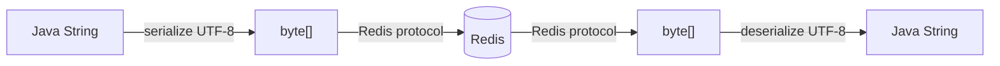

# Using StringRedisSerializer for Readable Strings and Keys

## 1. Why Care About How Redis Stores Strings?

Suppose a Spring Boot application needs to store temporary order statuses under a key:

```text
orders:status:v1:1042 → PROCESSING
```

When opening Redis CLI to investigate an incident, a developer wants to read the key `orders:status:v1:1042` and the value `PROCESSING`. However, Redis stores **byte sequences**: Redis does not inherently know what a Java `String`, `Long`, or `ProductDto` is. Before data is sent over the network, Spring Data Redis must convert Java objects into byte sequences; after receiving data, the application must convert them back.

**`StringRedisSerializer`** is a serializer dedicated to Java `String`. It represents strings as bytes using a character encoding (defaulting to **UTF-8**) and converts those bytes back into a string when reading.

For example:

```text
Java String: "shop:product:v1:42"
         |
         | StringRedisSerializer (UTF-8)
         v
Redis key bytes: 73 68 6F 70 3A 70 72 6F 64 75 63 74 3A 76 31 3A 34 32 (hex)
         |
         | Redis CLI decodes/displays the text part
         v
Redis CLI: shop:product:v1:42
```

For Unicode values such as `"Đang xử lý"`, UTF-8 still preserves all Unicode characters. Whether the characters *render properly* depends on the terminal and how the tool displays bytes, yet the data is encoded according to a clear rule rather than turned into Java serialization binary format.

In Redis, **both keys and values are binary-safe**. "Readable keys" is a **convention between the application, the serializer, and operational tools**, not a different Redis key type.

## 2. How Does StringRedisSerializer Work?

`StringRedisSerializer` implements Spring Data Redis's `RedisSerializer<String>`. Its two main directions are:

- **Serialize:** takes a Java `String` and encodes it into `byte[]` (UTF-8 by default).
- **Deserialize:** takes `byte[]`, decodes it using the same charset, and returns a `String`.



Example using the serializer directly to understand its semantics:

```java
import java.nio.charset.StandardCharsets;
import org.springframework.data.redis.serializer.StringRedisSerializer;

StringRedisSerializer serializer =
        new StringRedisSerializer(StandardCharsets.UTF_8);

byte[] encoded = serializer.serialize("Hello Redis");
String decoded = serializer.deserialize(encoded);

System.out.println(decoded); // Hello Redis
```

That example merely illustrates the data transformation; in real applications, `RedisTemplate` typically invokes the serializer automatically.

### Key Characteristics to Remember

| Characteristic | Practical Meaning |
|---|---|
| Default charset | UTF-8, supporting international characters and Unicode |
| Source data | `String`; does not automatically serialize arbitrary Java objects |
| Stored output | Text bytes, without adding a Java object serialization header |
| Shared reading convention | Readers must use a compatible encoding, otherwise garbled characters may appear |
| Usable for keys | Easy to inspect keys via Redis CLI and operational tools |
| Usable for values | Suitable for strings, numbers represented as strings, status codes, JSON text |
| Does not create schemas | Does not validate JSON content, manage DTO versioning, or coerce value types |

Note that an encoded string can occupy **more bytes than its character count**. Common ASCII characters take one byte in UTF-8, while many Unicode characters take multiple bytes. When estimating memory, bandwidth, or key/value size limits, consider byte size and Redis overhead, not just `String.length()` in Java.

## 3. Distinguishing Key Serializers from Value Serializers

A `RedisTemplate<K,V>` has multiple serializer application points, not just one:

```text
RedisTemplate<K, V>
  |
  +-- keySerializer       -> Redis key
  +-- valueSerializer     -> Redis String value / corresponding collection elements
  +-- hashKeySerializer   -> field name in a Redis Hash
  +-- hashValueSerializer -> field value in a Redis Hash
```

Example stored in Redis:

```text
Key: user:settings:v1:42
Type: hash
  language    -> vi
  theme       -> dark
  timezone    -> Asia/Ho_Chi_Minh
```

Here:

- `user:settings:v1:42` is governed by the **key serializer**.
- `language`, `theme`, and `timezone` are governed by the **hash key serializer**.
- `vi`, `dark`, and `Asia/Ho_Chi_Minh` are governed by the **hash value serializer**.

If you only configure `keySerializer` and omit `hashKeySerializer`, fields inside the Hash may be serialized with a different mechanism and no longer be readable in Redis CLI. To keep an entire Hash in text form, explicitly configure all three relevant slots: key, hash key, and hash value.

### Redis String Structure and Java String Are Two Different Concepts

Redis has a **String data type**, yet a value of type String can still hold **JSON, compressed bytes, or Java serialization**. Consider the same Redis `GET` command:

| Java Data to Store | Serialization Approach | What May Be Visible in Redis |
|---|---|---|
| `"ACTIVE"` | `StringRedisSerializer` | `ACTIVE` |
| `"42"` | `StringRedisSerializer` | `42` |
| `new ProductDto(42, "Book")` | JSON serializer | `{"id":42,"name":"Book"}` (format-dependent) |
| `ProductDto` | JDK serialization | Binary bytes with header, hard to read |
| Compressed image data | Direct byte array | Binary bytes, not text |

The goal of "readable keys" typically only requires **the key serializer to be String**, while the **value serializer** is chosen based on data type and compatibility needs. Do not force DTOs into Java `String` just to use the same serializer for everything.

## 4. Simplest Approach: Using StringRedisTemplate

**`StringRedisTemplate`** is a variant of `RedisTemplate<String,String>` configured to use `StringRedisSerializer` for keys, values, hash keys, and hash values. It fits well whenever both key names and contents should be represented as text.

In a Spring Boot application with `spring-boot-starter-data-redis` and an appropriate `RedisConnectionFactory`, Boot normally auto-configures `StringRedisTemplate` for injection into services:

```groovy
dependencies {
    implementation 'org.springframework.boot:spring-boot-starter-data-redis'
}
```

```yaml
# application.yml: local Redis connection example
spring:
  data:
    redis:
      host: localhost
      port: 6379
      connect-timeout: 2s
      timeout: 2s
```

Service example:

```java
import java.time.Duration;
import org.springframework.data.redis.core.StringRedisTemplate;
import org.springframework.stereotype.Service;

@Service
public class OrderStatusStore {
    private final StringRedisTemplate redis;

    public OrderStatusStore(StringRedisTemplate redis) {
        this.redis = redis;
    }

    public void markProcessing(long orderId) {
        String key = "orders:status:v1:" + orderId;
        redis.opsForValue().set(
                key, "PROCESSING", Duration.ofMinutes(15));
    }

    public String readStatus(long orderId) {
        return redis.opsForValue()
                .get("orders:status:v1:" + orderId);
    }

    public void remove(long orderId) {
        redis.delete("orders:status:v1:" + orderId);
    }
}
```

The `set(key, value, Duration)` call creates/updates the value and specifies the TTL in the write operation. Once the TTL expires, `get` typically returns `null` because the key no longer exists. At the business layer, distinguish between "no status yet", "expired", and "Redis error" if they carry different meanings.

`StringRedisTemplate` does not require developers to call `serializer.serialize(...)` manually every time. The template handles data conversion, connections, and Redis calls via the driver.

### How Does It Look in Redis CLI?

After the service runs `markProcessing(1042)`, you can inspect it (assuming Redis CLI connects to the same instance/database and the key has not expired):

```bash
redis-cli TYPE orders:status:v1:1042
redis-cli --raw GET orders:status:v1:1042
redis-cli TTL orders:status:v1:1042
```

Typical output:

```text
string
PROCESSING
894
```

The TTL number is just a point-in-time example; it counts down over time. By Redis convention, `TTL = -1` means the key exists with no expiration, and `TTL = -2` means it does not exist. Depending on the terminal, `redis-cli` by default may add quotes or escape characters; the `--raw` option is convenient for reading text content.

## 5. Configuring RedisTemplate with StringRedisSerializer

When an application already has a custom `RedisTemplate` or needs a dedicated template, you can configure explicit serializers instead of relying on defaults:

```java
import java.nio.charset.StandardCharsets;
import org.springframework.context.annotation.Bean;
import org.springframework.context.annotation.Configuration;
import org.springframework.data.redis.connection.RedisConnectionFactory;
import org.springframework.data.redis.core.RedisTemplate;
import org.springframework.data.redis.serializer.StringRedisSerializer;

@Configuration
public class TextRedisConfiguration {

    @Bean("readableRedisTemplate")
    public RedisTemplate<String, String> readableRedisTemplate(
            RedisConnectionFactory connectionFactory) {
        RedisTemplate<String, String> template = new RedisTemplate<>();
        template.setConnectionFactory(connectionFactory);

        StringRedisSerializer utf8 =
                new StringRedisSerializer(StandardCharsets.UTF_8);

        template.setKeySerializer(utf8);
        template.setValueSerializer(utf8);
        template.setHashKeySerializer(utf8);
        template.setHashValueSerializer(utf8);
        return template;
    }
}
```

When the bean is initialized by Spring, the `RedisTemplate` bean lifecycle handles the necessary initialization step. Declaring a named bean `readableRedisTemplate` is useful if the application has multiple templates with different serializers.

Service using the bean name:

```java
import org.springframework.beans.factory.annotation.Qualifier;
import org.springframework.data.redis.core.RedisTemplate;
import org.springframework.stereotype.Service;

@Service
public class SystemFlagStore {
    private final RedisTemplate<String, String> redis;

    public SystemFlagStore(
            @Qualifier("readableRedisTemplate")
            RedisTemplate<String, String> redis) {
        this.redis = redis;
    }

    public void setMaintenanceMode(boolean enabled) {
        redis.opsForValue().set(
                "system:maintenance:v1",
                Boolean.toString(enabled));
    }
}
```

For purely string scenarios, `StringRedisTemplate` is usually more concise than configuring a template from scratch. Explicit configuration is especially useful when you want clear control over serializers or need multiple templates serving different data groups.

### Do Not Confuse Java Generics with Runtime Configuration

Declaring `RedisTemplate<String, String>` **does not automatically guarantee** keys/values are stored as UTF-8 if the template has not been configured with the corresponding serializers. Java generics provide compile-time type checking; **serializers determine the actual bytes in Redis**. A template with matching generic types that still uses the JDK serializer can still produce binary keys/values.

Conversely, `StringRedisSerializer` is strictly for `String` data. Do not try passing `ProductDto` or `Long` directly into a template typed as `RedisTemplate<String,String>`. Convert them to strings intentionally or use a serializer suited to the value type.

## 6. Reading and Writing Observable Redis Hashes

When all attributes are strings, `StringRedisTemplate` lets you store Hashes with clear fields and values:

```java
import java.time.Duration;
import java.util.Map;
import org.springframework.data.redis.core.HashOperations;

String key = "profile:prefs:v1:42";
HashOperations<String, String, String> hash = redis.opsForHash();

hash.put(key, "language", "vi");
hash.put(key, "theme", "dark");
hash.put(key, "timezone", "Asia/Ho_Chi_Minh");
redis.expire(key, Duration.ofHours(12));

String theme = hash.get(key, "theme");        // "dark"
Map<String, String> all = hash.entries(key); // three attributes
```

Inspecting with Redis CLI:

```bash
redis-cli TYPE profile:prefs:v1:42
redis-cli HGET profile:prefs:v1:42 theme
redis-cli HGETALL profile:prefs:v1:42
```

A Hash has **one Redis key** and multiple fields. The `EXPIRE` command in the example applies to **the entire Hash key**, not specifically to the `theme` field. The two calls `put` and `expire` are separate commands; for strict TTL requirements at key creation time, use an atomic update mechanism or appropriate cleanup policy.

For very large Hashes, `HGETALL` or `hash.entries(key)` can consume significant memory and bandwidth; use them only when size is bounded. To read a single field, use `HGET`/`hash.get`.

## 7. StringRedisSerializer and Numeric Counters

A common scenario is storing counters with `StringRedisTemplate`:

```java
String key = "article:views:today:v1:42";

Long count = redis.opsForValue().increment(key);
String stored = redis.opsForValue().get(key);
```

Redis stores the counter as a byte sequence representing a decimal integer, such as `"27"`. The `INCR` command interprets numeric strings per Redis rules and performs an atomic increment. Hence, **the Java value when read with `StringRedisTemplate` is still a `String`**, while the return value of `increment` is a `Long` per the API.

This is a practical benefit: using a String serializer for counter values enables Redis arithmetic commands to work directly, provided the string content matches the numeric format the command supports.

Caveats:

- If the key holds `"ACTIVE"` or `"{\"count\":27}"`, `INCR` will fail because the value is not a valid integer.
- Redis `INCR` increments atomically, whereas a Java sequence `GET -> parse -> +1 -> SET` is not atomic under concurrent requests.
- `INCR` **does not automatically set a TTL**. If you need a time-windowed counter, incrementing and setting TTL may require an atomic script operation or an explicitly designed mechanism.
- Values read from Redis should not be cast to `Integer` just because they are currently small; consider numeric limits and Java API types.

Example of storing an integer as a string:

```java
redis.opsForValue().set("users:online:estimated:v1", Long.toString(120L));
String text = redis.opsForValue().get("users:online:estimated:v1");
long parsed = Long.parseLong(text);
```

Parsing must handle `null`, invalid content, and out-of-range values if data can be modified by multiple actors.

## 8. JSON Values: When to Use StringRedisSerializer?

**JSON is text**, so you can serialize a DTO with Jackson into a JSON string and then send that string through `StringRedisTemplate`:

```java
import com.fasterxml.jackson.core.JsonProcessingException;
import com.fasterxml.jackson.databind.ObjectMapper;
import java.io.IOException;
import java.time.Duration;
import org.springframework.data.redis.core.StringRedisTemplate;

public record ProductSummary(long id, String name, long price) {}

public class ProductJsonStore {
    private final StringRedisTemplate redis;
    private final ObjectMapper mapper;

    public ProductJsonStore(StringRedisTemplate redis, ObjectMapper mapper) {
        this.redis = redis;
        this.mapper = mapper;
    }

    public void save(ProductSummary product)
            throws JsonProcessingException {
        String key = "product:summary:v1:" + product.id();
        String json = mapper.writeValueAsString(product);
        redis.opsForValue().set(key, json, Duration.ofMinutes(10));
    }

    public ProductSummary find(long id) throws IOException {
        String json = redis.opsForValue()
                .get("product:summary:v1:" + id);
        return json == null ? null
                : mapper.readValue(json, ProductSummary.class);
    }
}
```

The data path has two stages:

```text
ProductSummary
  -> ObjectMapper: JSON String
  -> StringRedisSerializer: UTF-8 byte[]
  -> Redis
  -> StringRedisSerializer: JSON String
  -> ObjectMapper: ProductSummary
```

Crucially, **`StringRedisSerializer` does not automatically convert DTOs to JSON**. The example code explicitly invokes Jackson before and after.

For larger systems, you can choose a dedicated JSON serializer for values, such as Spring Data Redis's Jackson-based serializer (depending on version and security settings). Even then, you should **keep the key serializer as `StringRedisSerializer`** so Redis keys remain readable:

```java
RedisTemplate<String, ProductSummary> template = new RedisTemplate<>();
template.setConnectionFactory(connectionFactory);
template.setKeySerializer(new StringRedisSerializer());

// Choose a RedisSerializer<ProductSummary> compatible
// with the application's JSON format and schema policy:
template.setValueSerializer(productSummaryJsonSerializer);
```

`productSummaryJsonSerializer` above is an **application-provided dependency**, illustrating how serializers compose; it is not a built-in default bean. You must decide on JSON/schema versioning, multi-version deployment compatibility, deserialization protection against untrusted data, and legacy data handling.

### Comparing Value Storage Approaches

| Value Requirement | Serializer or Approach | Notes |
|---|---|---|
| Status codes, free-form strings | `StringRedisSerializer` | Easy to inspect, simple |
| Counters using `INCR` | Numeric strings with `StringRedisSerializer` | Must be a numeric format Redis understands |
| Pre-built JSON text | `StringRedisSerializer` | DTO ↔ JSON handled by application code |
| Java DTOs with dedicated schema | Properly typed JSON serializer | Requires schema/version conventions; not necessarily readable directly via `StringRedisTemplate` |
| Binary/compressed data | Appropriate byte array serializer | Never force non-text bytes into UTF-8 |
| Legacy data using Java object serialization | Legacy mechanism for reading/migration | Avoid treating raw binary as text; migrate systematically |

## 9. Comparison with JdkSerializationRedisSerializer

A common mistake when using `RedisTemplate` without full configuration is that keys get serialized in traditional Java serialization format, causing Redis CLI to show hard-to-read byte sequences.

For example, the key `"customer:42"` serialized by JDK can start with binary bytes representing a Java serialization stream. Redis does not understand that as a customer name string; Redis only compares bytes.

| Criterion | `StringRedisSerializer` | `JdkSerializationRedisSerializer` |
|---|---|---|
| Source type | Java `String` | Java objects serializable via JDK mechanism |
| Format | Text in a charset, typically UTF-8 | Java serialization binary format |
| Readable keys in CLI | Yes, if keys are built from text | Typically no |
| Cross-language usage | Easy, based on UTF-8 | Difficult, tied to Java format |
| Java class changes | Irrelevant if data is strings | Can hit class/version compatibility errors |
| Deserialization risk | Validate data as text | Java deserialization of untrusted data carries significant security risks |
| Usable with `INCR` | Yes, with valid numeric strings | Unsuitable for values encoded as Java binary |

Some `RedisTemplate` configurations use the JDK serializer by default if developers do not customize it, yet you should **check the actual bean and Spring Boot/Spring Data Redis version running**; do not assume every template shares the same default. `StringRedisTemplate` is tailored specifically for string operations, avoiding this ambiguity.

**You cannot just swap the key serializer and expect to immediately read old keys**: old key bytes and new key bytes are two distinct Redis keys. Migration must be handled separately.

## 10. Naming Keys So They Are Truly Readable and Operable

The serializer only handles text encoding. **Key naming design** determines whether operators can understand the contents.

A common convention:

```text
<application>:<domain>:<purpose>:v<schema-version>:<opaque-id>
```

Examples:

```text
shop:product:summary:v1:42
shop:cart:items:v2:cart-0f8a
shop:rate:login:v1:subject-a7d2
shop:job:status:v1:job-1042
shop:leaderboard:weekly:v1:2026-W46
```

Each component has a purpose:

- **Application namespace** prevents collisions when multiple services share one Redis instance.
- **Domain and purpose** identify which business workflow the key serves.
- **Schema version** supports controlled changes to value structure/serializers.
- **Stable, safe ID** enables direct key lookup rather than scanning the keyspace.
- **Consistent delimiter rules**, usually colons, help CLI inspection and metric grouping.

Good key example:

```text
inventory:reservation:v1:res-4a7c
```

Problematic key examples:

```text
token:eyJhbGciOi...          # Exposing sensitive tokens in the key
customer:alice@example.com  # Exposing email addresses in the key
search:<entire-user-query>   # Unbounded keys, easily creating too many distinct values
```

**Readable keys do not mean private data is allowed in them.** Keys can appear in logs, APM, operational tools, or when administrators browse Redis. Prefer internal IDs or random/opaque identifiers; when keys must be derived from input data, normalize and bound length, and consider hashing/HMAC with a secret key as appropriate.

Additionally, overly long keys add overhead, increasing memory/bandwidth consumption and making diagnostics harder. Overly short keys like `k42` are cryptic. Pick names descriptive enough while keeping size bounded.

### Unicode in Keys: Valid, Yet Needs Conventions

`StringRedisSerializer` with UTF-8 can encode non-ASCII keys:

```text
đơn-hàng:trạng-thái:42
```

Redis supports the corresponding bytes, yet operating across shells, tools, operating systems, and programs in different languages is smoother when **the key schema consistently uses ASCII**:

```text
orders:status:v1:42
```

User-facing values can still be Unicode. If keys are built from free-form text, two visually identical strings may have different Unicode normalization forms and therefore produce different key bytes. Normalize or map to stable identifiers before constructing keys.

### Redis Cluster and Hash Tags

If using Redis Cluster, Redis determines the hash slot from the key bytes. Curly braces have special meaning when using hash tags, for example:

```text
orders:{1042}:status:v1
orders:{1042}:items:v1
```

Two keys sharing `{1042}` route to the same slot, useful for certain multi-key commands requiring a single slot. However, do not funnel all data into one shared hash tag, as that causes uneven load. `StringRedisSerializer` simply encodes `{` and `}` as text; hash slot rules are applied by Redis Cluster to the key bytes.

## 11. Inspecting Keys with Redis CLI and Operational Tools

One practical advantage of `StringRedisSerializer` is that diagnosing data rarely requires writing a custom Java program just to deserialize keys.

Illustrative commands:

```bash
# Read a known key
redis-cli TYPE shop:job:status:v1:job-1042
redis-cli --raw GET shop:job:status:v1:job-1042
redis-cli TTL shop:job:status:v1:job-1042

# Inspect fields in a Hash
redis-cli HGETALL shop:cart:items:v2:cart-0f8a

# Incrementally browse by namespace
redis-cli --scan --pattern 'shop:product:summary:v1:*'
```

`--scan` uses cursor-based iteration, which is more appropriate than calling `KEYS *` across large keyspaces in production. Still, `SCAN` consumes resources and is not a consistent snapshot; while keys change, iteration can encounter duplicates and does not guarantee catching every concurrent change. Bound scope and frequency.

**Never infer the value type from the fact that the key is readable.** Always check `TYPE` before running `GET` or `HGETALL`. A Redis Hash key cannot be read with `GET` even if the key name was serialized with `StringRedisSerializer`.

For Redis with ACL/TLS/authentication, use the connection method authorized by your organization. Avoid leaving passwords directly in shell history or logs. Redis CLI aids observability, but does not replace access control and data protection policies.

## 12. Two Applications Reading the Same Key Must Agree on Bytes

Suppose Service A runs:

```java
StringRedisSerializer serializer = new StringRedisSerializer();
redis.opsForValue().set("app:feature:v1", "enabled");
```

Service B must also use a compatible byte convention if it wants to read the same key. For example, a Python application sending the UTF-8 key `app:feature:v1` can access the same Redis key; a Java program using the JDK serializer for keys will **not** access it, even though the pre-serialization Java key name is identical.

The value format must also match. If A writes the string `"enabled"`, B using a JSON serializer expecting an object with an `enabled` field will not automatically receive properly typed data.

### Shared Data Contract Elements to Document Clearly

| Component | Contract Example |
|---|---|
| Key pattern | `app:feature:v1:<feature-id>` |
| Key encoding | UTF-8 text |
| Redis type | String |
| Value encoding | UTF-8 text |
| Valid values | `enabled` or `disabled` |
| TTL | No TTL, or a defined TTL |
| Write owner | One specific service |
| Schema change rule | Increment key version, support transition period |

A clear contract allows switching drivers (Lettuce/Jedis), replacing clients, or implementing services in other languages while keeping existing data usable. **The driver chooses how commands are sent; serializers and key schemas determine the bytes stored.**

## 13. Changing Serializers on a Running System: Is Migration Needed?

**Potentially yes.** This is the primary scenario requiring care when migrating from a `RedisTemplate` with a binary serializer to `StringRedisTemplate`.

Suppose the old version created key `product:42` as JDK serialization bytes. The new version creates a UTF-8 key from the string `product:42`. Redis considers these **two different keys**. The new version reading with `StringRedisTemplate` will see cache misses, even though the old data still sits in Redis.

### Case 1: Regenerable Cache Only

If data in Redis is a copy from a database:

1. Use a new namespace/version, such as `product:summary:v2:42`.
2. On cache miss, load from the source database and write back in the new format.
3. Let old keys expire via TTL or clean them up on a bounded schedule.
4. Monitor temporary memory growth, hit rates, and database load during the transition.

This is usually the safest and least complex approach for caches. Do not scan and wipe all of Redis just to change a serializer.

### Case 2: Data That Must Be Preserved and Cannot Be Regenerated

If old data represents meaningful business state:

1. Identify the source of truth and ability to read data using the old serializer.
2. Build a migration tool that reads old key/value bytes with the exact old serializer, validates them, and writes to the new namespace as UTF-8/text or the target format.
3. Design the cutover while both old and new versions are running: dual-write, read old format on miss, or lock update paths as required.
4. Verify counts/key mappings, remaining TTLs, key collisions, and deployment rollback behavior.
5. Delete old data only after verified conversion success and the compatibility window ends.

Do not use "try deserializing across every serializer until no error occurs" as a long-term strategy. For important data, formats must be explicitly identified and versioned.

### Note on Changing Values While Keeping Keys

If you keep the old UTF-8 key yet switch values from plain strings to JSON, old and new application versions can read **the same key with different value formats**. This can be more dangerous than a cache miss because data is found yet misinterpreted. The straightforward fix is to version the namespace or establish a clear backward-compatible contract.

## 14. Spring Cache Has Its Own Serializer

Having `StringRedisTemplate` in the application **does not automatically determine how `@Cacheable` serializes keys and values**. Spring Cache integrates with Redis through `RedisCacheManager` and `RedisCacheConfiguration`, which have their own serializer/TTL settings.

Example specifically for cache methods returning `String`:

```java
import java.time.Duration;
import org.springframework.context.annotation.Bean;
import org.springframework.context.annotation.Configuration;
import org.springframework.data.redis.cache.RedisCacheConfiguration;
import org.springframework.data.redis.cache.RedisCacheManager;
import org.springframework.data.redis.connection.RedisConnectionFactory;
import org.springframework.data.redis.serializer.RedisSerializationContext;
import org.springframework.data.redis.serializer.StringRedisSerializer;

@Configuration
public class TextOnlyCacheConfiguration {
    @Bean
    public RedisCacheManager cacheManager(
            RedisConnectionFactory connectionFactory) {

        StringRedisSerializer strings = new StringRedisSerializer();

        RedisCacheConfiguration config =
                RedisCacheConfiguration.defaultCacheConfig()
                        .entryTtl(Duration.ofMinutes(10))
                        .serializeKeysWith(
                                RedisSerializationContext.SerializationPair
                                        .fromSerializer(strings))
                        .serializeValuesWith(
                                RedisSerializationContext.SerializationPair
                                        .fromSerializer(strings));

        return RedisCacheManager.builder(connectionFactory)
                .cacheDefaults(config)
                .build();
    }
}
```

This pattern keeps cache keys and values in text, yet **is only suitable if the cache stores `String`**. When `@Cacheable` methods return DTOs, Lists, or other types, design an appropriate value serializer rather than blindly applying `StringRedisSerializer`.

Moreover, Spring Cache usually generates keys with cache names, prefixes, and key generators—for instance `productTitles::42`—instead of using exact key strings assembled manually by a service. Key readability depends on both **key generation** and **key serialization**. When altering global cache settings, consider every cache sharing that manager.

## 15. Reactive and String Serialization

In Spring WebFlux applications, `ReactiveStringRedisTemplate` provides a reactive API for string data and uses string-appropriate serialization conventions.

```java
import java.time.Duration;
import org.springframework.data.redis.core.ReactiveStringRedisTemplate;
import reactor.core.publisher.Mono;

public class ReactiveFlagStore {
    private final ReactiveStringRedisTemplate redis;

    public ReactiveFlagStore(ReactiveStringRedisTemplate redis) {
        this.redis = redis;
    }

    public Mono<Boolean> write(String flag) {
        return redis.opsForValue()
                .set("app:flag:v1", flag, Duration.ofMinutes(5));
    }

    public Mono<String> read() {
        return redis.opsForValue().get("app:flag:v1");
    }
}
```

Byte principles remain identical to the synchronous version: serializer choices must be compatible with other services sharing the keys. Reactive only changes the **result-handling and I/O model**, without creating new Redis data types.

## 16. Common Errors and How to Identify Them

| Symptom | Likely Cause | Remediation |
|---|---|---|
| Redis CLI displays keys with strange characters | Keys were serialized as binary/JDK | Check `keySerializer` of the writing template; do not assume Java key names are UTF-8 bytes |
| `StringRedisTemplate.get()` returns `null` even though another app reports data exists | Different key bytes, different database, namespace, or expired TTL | Check Redis endpoint/DB, key schema, serializer, and `TTL` |
| `HGET` does not find a field even though the Hash exists | Different hash key serializers or misnamed field | Verify `hashKeySerializer` and actual field bytes |
| `INCR` returns an error | Value is not a valid integer string | Separate JSON caches from counters; use appropriate numeric key/value formats |
| Reading Unicode strings shows corrupted characters | Writer and reader use different charsets or terminal lacks UTF-8 display | Standardize encoding and inspect raw bytes rather than guessing repairs |
| Mass cache misses after changing serializer | Old data was written under a different key format | Version keys and migrate by data category; anticipate DB load |
| `ClassCastException` when saving DTOs | Using `StringRedisSerializer`/`StringRedisTemplate` for non-`String` objects | Explicitly convert DTOs to JSON text or use a DTO serializer |
| `@Cacheable` still writes binary values | Redis Cache Manager has separate serialization config | Inspect `RedisCacheConfiguration`, split configurations per cache |
| Key collisions between service A and B | Lack of clear namespace/ownership/versioning | Standardize key naming conventions and read/write contracts |
| Overly long keys or leaked personal data | Concatenating raw input, emails/tokens into keys | Use opaque IDs, bound lengths, and keep sensitive info out of keys |

### An Easy Configuration Mistake to Make

```java
RedisTemplate<String, String> template = new RedisTemplate<>();
template.setConnectionFactory(connectionFactory);
template.setKeySerializer(new StringRedisSerializer());
// valueSerializer/hashKeySerializer/hashValueSerializer not set
```

This snippet **only guarantees serialization for keys on the specified template**. The remaining components depend on default settings and initialization lifecycle; do not conclude all data will be text. If the goal is readable keys and values, configure all relevant serializers or use `StringRedisTemplate`.

## 17. Designing for Three Real-World Scenarios

### Scenario A — Short-Lived Status for a Job

Requirement: a status string `QUEUED`, `RUNNING`, `DONE`, automatically expiring after 30 minutes and directly inspectable in Redis CLI.

Solution: `StringRedisTemplate`, key like `jobs:status:v1:<job-id>`, string values, and `set(key, value, Duration)`. Authoritative job history, if needed, must be stored in a separate durable system.

### Scenario B — Caching Product DTOs from a Database

Requirement: product ID keys must be readable; values are multi-field DTOs; JSON serialization is desired with future schema evolution.

Solution: use `StringRedisSerializer` **for keys**, a JSON serializer with a schema contract **for values**, or `StringRedisTemplate` with manually converted JSON text. Include key versions and TTLs; the database remains the source of truth. Avoid accidentally using JDK serialization just because creating a default template is convenient.

### Scenario C — Counting Views with a Counter

Requirement: increment by 1 per view, readable as a count in Redis CLI, stored per day.

Solution: `StringRedisTemplate.opsForValue().increment(key)` with key `article:views:daily:v1:<date>:<id>`. Values are stored as text integers; define a TTL strategy and sync to a durable store if formal reporting is required. Incrementing via `INCR` avoids lost updates from `GET`-then-`SET` races.

## 18. Process for Choosing a Serializer for a New Feature

1. **Identify the data shape:** Redis String, Hash, Set, List, or another structure; what do keys represent, and are values Strings or DTOs?
2. **Choose key conventions:** stable namespace, version, ID, and delimiter; avoid secrets and bound key length.
3. **Choose encoding:** UTF-8 for keys/text, ensuring consistent writers and readers; do not mix binary and text under the same key schema.
4. **Choose the Spring API:** `StringRedisTemplate` when everything is strings; `RedisTemplate<String,V>` with a string key serializer and a value serializer tailored to `V` when needed.
5. **Treat Hashes separately:** if using Hashes, configure both `hashKeySerializer` and `hashValueSerializer` appropriately.
6. **Specify TTL and source of truth:** whether data is regenerable cache or state that must be preserved; services sharing data need explicit contracts.
7. **Prepare versioning/migration:** when changing serializers or schemas, know how old data will be read, regenerated, or cleaned up.
8. **Inspect with Redis CLI:** check `TYPE`, `GET`/`HGET`, `TTL`, and key names by namespace; use controlled `SCAN` instead of `KEYS *` on large keyspaces.

**Key takeaway:** `StringRedisSerializer` solves the problem of representing **Java Strings as consistent text bytes**, typically UTF-8. It makes Redis keys and string values easy to inspect and integrate across systems. In Spring Data Redis, `StringRedisTemplate` is the natural choice for pure string data; for DTOs or complex structures, still use a string key serializer while choosing value serializers per the data contract. Structured key names, TTLs, and clear migration strategies are what turn "readability" into reliable operations.
