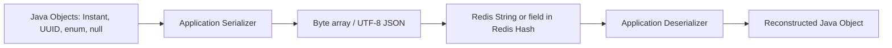

# Handling Dates/Times, Enums, UUIDs, and Null Values in Serialized Data

When storing a Java object in Redis with Spring Data Redis, Redis does not automatically know which field is an `Instant`, `LocalDate`, `enum`, or `UUID`. The application must convert objects into bytes before writing and reconstruct objects from bytes when reading. If conversion conventions lack clarity, two reads and writes on the same key can return timestamps in the wrong timezone, nonexistent enum states, malformed UUIDs, or `null` indistinguishable from a key that was never stored.

This lesson explains how to define a **serialization contract** for four common data groups in Spring Data Redis applications: dates/times, enums, UUIDs, and null values. Examples use JSON because it is easy to inspect and interoperate across services; the same data principles also apply to Redis Hashes, binary serializers, and caching mechanisms.

## 1. What Does Redis Actually Store?

Redis provides data structures such as String, Hash, List, Set, and Sorted Set. However, at the protocol interface, keys and data contents are largely represented as **byte sequences**. Redis does not understand the Java object types an application uses.



In Spring Data Redis, separate two layers:

| Layer | Example | Who Is Responsible? |
|---|---|---|
| **Java data model** | `Instant`, `BookingStatus`, `UUID`, nullable `String` | The application defines business meaning. |
| **Value serialization** | JSON, UTF-8 string, binary, Java serialization | `RedisSerializer`, Jackson, or the chosen converter. |
| **Redis protocol** | RESP sending `SET`, `GET`, `HSET`, `HGET` commands | Lettuce/Jedis driver and Redis Server. |
| **Redis storage** | Keys and values as bytes | Redis stores client-provided content, unaware of original Java types. |

Example object:

```java
public record BookingSnapshot(
        int schemaVersion,
        UUID bookingId,
        Instant createdAt,
        LocalDate serviceDate,
        BookingStatus status,
        String note
) {}

public enum BookingStatus {
    CREATED, CONFIRMED, CANCELLED
}
```

A JSON representation could be:

```json
{
  "schemaVersion": 1,
  "bookingId": "f81d4fae-7dec-11d0-a765-00a0c91e6bf6",
  "createdAt": "2026-11-12T08:15:30Z",
  "serviceDate": "2026-11-20",
  "status": "CONFIRMED",
  "note": null
}
```

The strings in the JSON above do not automatically become `UUID`, `Instant`, or an enum if the reader does not know the target type and parsing rules. **The data contract** must specify both writing and reading.

### 1.1. Key Serializer Differs from Value Serializer

A `RedisTemplate<K, V>` can separately configure:

- `keySerializer`: converts main Redis keys into bytes.
- `valueSerializer`: converts Redis String/List/Set values into bytes.
- `hashKeySerializer`: converts field names in a Redis Hash into bytes.
- `hashValueSerializer`: converts field values in a Redis Hash into bytes.

For example, for the same object, key `booking:v1:<uuid>` is a UTF-8 string while the value is JSON. If one service uses `StringRedisSerializer` for keys while another uses the default `JdkSerializationRedisSerializer`, they may be accessing **two different byte keys** even though the Java key names look identical.

`StringRedisTemplate` is designed to handle string keys and values. A standard `RedisTemplate` must be configured with serializers per the application's contract. Do not assume declaring the generic type `RedisTemplate<String, BookingSnapshot>` automatically turns values into JSON.

## 2. Define Data Conventions Before Writing Serializers

Multiple valid representations exist for the same value. What matters is that both sides consistently use one convention.

| Java Type | Recommended Representation in JSON | Common Confusion |
|---|---|---|
| `Instant` | ISO-8601 UTC, e.g., `"2026-11-12T08:15:30Z"` | Epoch seconds vs. milliseconds, fractional precision. |
| `OffsetDateTime` | ISO-8601 with offset, e.g., `"2026-11-12T15:15:30+07:00"` | Offset may be shifted if deserializer adjusts to context timezone. |
| `ZonedDateTime` | Both instant and zone ID when required by domain | An offset like `+07:00` does not fully describe timezone rules. |
| `LocalDateTime` | `"2026-11-12T15:15:30"` | No timezone; cannot infer an absolute point in time alone. |
| `LocalDate` | `"2026-11-20"` | A calendar date, not a timestamp. |
| `Duration` | ISO-8601 duration like `"PT15M"`, or a number with explicit unit | Is 900 seconds or milliseconds? |
| `enum` | Stable string code | Renaming constants or using `ordinal()` corrupts meaning. |
| `UUID` | Canonical 36-character hyphenated string | 16-byte binary form requires matching byte order rules. |
| `null` | Convention: absent key, absent field, JSON `null`, or sentinel | Redis has no native "null value" equivalent to Java null. |

Not every system must choose JSON. A high-performance system may use Protocol Buffers, CBOR, or another binary schema. In that case, you still need schema versioning, mappings, and a similar format-evolution strategy.

## 3. Handling Dates and Times: Pick the Right Java Type First

### 3.1. `Instant` for an Absolute Point in Time

`Instant` represents a point on the timeline. It fits `createdAt`, `updatedAt`, `processedAt`, event arrival times, or task start times.

```java
Instant createdAt = Instant.parse("2026-11-12T08:15:30Z");
String text = createdAt.toString();
// "2026-11-12T08:15:30Z"
```

The `Z` denotes UTC. If a service in Vietnam and a service in Europe read this same string, both reconstruct **the exact same instant**, even though their local display times differ.

In JSON, you can store:

```json
{
  "createdAt": "2026-11-12T08:15:30Z"
}
```

Never strip `Z` and interpret the remaining string with the server's default timezone. Doing so shifts timestamps whenever a service is deployed in another region.

### 3.2. `LocalDate` for Calendar Dates

A holiday, expected delivery date, or booking date often means strictly **a calendar date**, without a time of day.

```java
LocalDate serviceDate = LocalDate.parse("2026-11-20");
```

Store as:

```json
{
  "serviceDate": "2026-11-20"
}
```

Do not automatically convert `LocalDate` into an `Instant` at 00:00 UTC. When displayed in another timezone, midnight UTC can land on the previous or next local calendar day; that is not the semantics of a standalone calendar date.

### 3.3. `LocalDateTime` Carries No Timezone

`LocalDateTime` holds a date and time "on the wall clock" yet **does not know where that clock is**.

```java
LocalDateTime opening = LocalDateTime.parse("2026-11-12T09:00:00");
```

JSON:

```json
{
  "opensAtLocal": "2026-11-12T09:00:00"
}
```

This could be 9:00 in Hanoi, Tokyo, or Berlin. Do not convert it directly to an epoch timestamp without knowing the timezone and rules for Daylight Saving Time (DST) transitions.

When business logic requires "9:00 in the branch's local time," store both:

```json
{
  "localTime": "2026-11-12T09:00:00",
  "zoneId": "Asia/Ho_Chi_Minh"
}
```

Then convert when needed:

```java
LocalDateTime local = LocalDateTime.parse("2026-11-12T09:00:00");
ZoneId zone = ZoneId.of("Asia/Ho_Chi_Minh");
Instant absoluteTime = local.atZone(zone).toInstant();
```

In regions with DST, a `LocalDateTime` can **not exist** (`gap`) or **occur twice** (`overlap`) during clock changes. Strict scheduling applications must explicitly decide how to handle `gap` and `overlap`, rather than assuming calling `atZone` always reflects business intent.

### 3.4. `OffsetDateTime` and `ZonedDateTime` Are Different

`OffsetDateTime` knows an offset from UTC, such as `+07:00`. It suffices to pinpoint an instant at the moment it was recorded.

`ZonedDateTime` also knows a region with time rules such as `Europe/Berlin`, which can include DST transitions and historical timezone rules. When business logic needs to reconstruct **future appointments in local time**, explicitly store the **zone ID** alongside local time or an appropriate instant.

| Need to Represent | Appropriate Type | Example |
|---|---|---|
| An event that occurred | `Instant` | When an API finished processing an order. |
| Local time with a specific offset | `OffsetDateTime` | Timestamp received from an international API. |
| Schedule in a DST-observing region | `LocalDateTime` + `ZoneId`, or `ZonedDateTime` per contract | 09:00 daily in Europe/Berlin. |
| Date of birth / booking date | `LocalDate` | 2026-11-20. |
| Time span | `Duration` | 15 minutes. |

Jackson configuration can adjust `OffsetDateTime` to the context timezone during reads. If preserving the original offset is required, verify/disable that adjustment on the serializer and add appropriate round-trip tests.

## 4. Time Precision, Epochs, and Timezones

### 4.1. Seconds or Milliseconds?

For numeric timestamps:

```text
Unix epoch seconds:      1_700_000_000
Unix epoch milliseconds: 1_700_000_000_000
```

A three-digit difference is a factor of **1,000**. Redis has no metadata indicating whether a stored number is seconds or milliseconds.

Java example:

```java
Instant time = Instant.parse("2023-11-14T22:13:20Z");

long epochSeconds = time.getEpochSecond();   // 1700000000
long epochMillis = time.toEpochMilli();       // 1700000000000

Instant fromSeconds = Instant.ofEpochSecond(epochSeconds);
Instant fromMillis = Instant.ofEpochMilli(epochMillis);
```

If a system chooses numeric timestamps, include the unit in the field name or schema:

```json
{
  "createdAtEpochMillis": 1700000000000
}
```

Avoid generic field names like `createdAt: 1700000000` without specifying units. For external data, never guess units solely from digit count while ignoring the API contract.

### 4.2. Nanoseconds and Round-Trips

`Instant` supports nanosecond precision, yet JSON formats, parsers, upstream databases, and millisecond conversions can truncate sub-millisecond fractions.

Example:

```java
Instant precise = Instant.parse("2026-11-12T08:15:30.123456789Z");
long millis = precise.toEpochMilli();

Instant restored = Instant.ofEpochMilli(millis);
// Micro/nanosecond fraction beyond milliseconds is lost.
```

Do not use `toEpochMilli()` if business logic needs full nanosecond comparison. If only millisecond precision is needed, **explicitly normalize at the write boundary** to prevent mismatches when comparing data.

### 4.3. TTL Is Not a Date/Time Field

Redis has its own per-key TTL mechanism. For example:

```redis
SET booking:v1:123 "{\"status\":\"CONFIRMED\"}" EX 300
TTL booking:v1:123
```

Here, `EX 300` is the 300-second lifetime of the **key on the server**, not an `expiresAt` field inside the JSON. If the application merely needs the cache entry to expire after five minutes, use TTL:

```java
redisTemplate.opsForValue().set(
        key,
        snapshot,
        Duration.ofMinutes(5)
);
```

If business logic also needs to display the exact expiration timestamp, you can store a domain-meaningful `expiresAt` field as well. Decide the relationship between it and TTL: TTL is a data-eviction mechanism, while the timestamp field is application data. They can diverge due to latency, refreshes, or cache policies.

### 4.4. Do Not Use the Default Timezone as a Data Contract

`ZoneId.systemDefault()` depends on machine configuration. A service in a container may run UTC; a developer laptop may use another timezone. Parse/format outputs must not depend on environment when data is shared across services.

Prefer:

- UTC `Instant` for absolute timestamps.
- ISO `LocalDate` for calendar dates.
- `OffsetDateTime`/`ZoneId` when offsets/zones carry meaning.
- ISO-8601 and UTF-8 charset stated explicitly in the contract.
- Injectable `Clock` so `now` values are deterministic and testable across application code and tests.

## 5. Serializing Dates and Times with Jackson in Spring Data Redis

### 5.1. Why Do `java.time` Errors Occur?

Core Jackson 2 does not guarantee proper handling of all `java.time` types without the corresponding module. When using Jackson 2 with Spring Data Redis, configuration typically requires **`jackson-datatype-jsr310`** and `JavaTimeModule`.

Common error when the module is missing:

```text
Java 8 date/time type java.time.Instant not supported by default
```

The Jackson library and mapper creation must match the **Spring Boot/Spring Data Redis line in use**. The concrete examples below use **Spring Data Redis 3.x + Jackson 2.x**. Spring Data Redis **4.x switches to Jackson 3 as its primary JSON library**, changing serializer APIs and packages as explained in Section 9.

### 5.2. Configuring Jackson 2 to Store ISO Timestamps

For Spring Boot 3.x and Jackson 2:

```java
import com.fasterxml.jackson.databind.DeserializationFeature;
import com.fasterxml.jackson.databind.ObjectMapper;
import com.fasterxml.jackson.databind.SerializationFeature;
import com.fasterxml.jackson.datatype.jsr310.JavaTimeModule;

ObjectMapper mapper = new ObjectMapper()
        .registerModule(new JavaTimeModule())
        .disable(SerializationFeature.WRITE_DATES_AS_TIMESTAMPS)
        .disable(DeserializationFeature.ADJUST_DATES_TO_CONTEXT_TIME_ZONE);
```

Meaning:

- `JavaTimeModule` adds support for reading/writing `Instant`, `LocalDate`, `LocalDateTime`, `OffsetDateTime`, and other modern Java time types.
- Disabling `WRITE_DATES_AS_TIMESTAMPS` prefers ISO-8601 strings over Jackson's numeric/array timestamp forms.
- Disabling `ADJUST_DATES_TO_CONTEXT_TIME_ZONE` preserves offsets/zones per contract instead of letting Jackson shift them during reads.

**Note:** this snippet configures a mapper *for the Redis serializer example*. If the application already has a Spring Boot-managed `ObjectMapper`, avoid creating multiple differently configured mappers without good reason. You can configure a dedicated serializer or use Boot's customizer mechanism as needed.

### 5.3. What Does the JSON Look Like?

Given the object:

```java
BookingSnapshot snapshot = new BookingSnapshot(
        1,
        UUID.fromString("f81d4fae-7dec-11d0-a765-00a0c91e6bf6"),
        Instant.parse("2026-11-12T08:15:30Z"),
        LocalDate.of(2026, 11, 20),
        BookingStatus.CONFIRMED,
        null
);
```

Configured Jackson 2 produces equivalent JSON:

```json
{
  "schemaVersion": 1,
  "bookingId": "f81d4fae-7dec-11d0-a765-00a0c91e6bf6",
  "createdAt": "2026-11-12T08:15:30Z",
  "serviceDate": "2026-11-20",
  "status": "CONFIRMED",
  "note": null
}
```

This data is stored in a Redis String as UTF-8 and readable via `redis-cli GET`. JSON does not carry Java field types; the deserializer relies on `BookingSnapshot.class` and the date/time module to reconstruct the object.

### 5.4. Creating a `RedisTemplate` with Explicit Serializers (Spring Data Redis 3.x)

Complete illustration for Spring Data Redis 3.x and Jackson 2:

```java
import com.fasterxml.jackson.databind.DeserializationFeature;
import com.fasterxml.jackson.databind.ObjectMapper;
import com.fasterxml.jackson.databind.SerializationFeature;
import com.fasterxml.jackson.datatype.jsr310.JavaTimeModule;

import org.springframework.context.annotation.Bean;
import org.springframework.context.annotation.Configuration;
import org.springframework.data.redis.connection.RedisConnectionFactory;
import org.springframework.data.redis.core.RedisTemplate;
import org.springframework.data.redis.serializer.Jackson2JsonRedisSerializer;
import org.springframework.data.redis.serializer.StringRedisSerializer;

@Configuration
public class BookingRedisSerializationConfig {

    @Bean("bookingRedisTemplate")
    RedisTemplate<String, BookingSnapshot> bookingRedisTemplate(
            RedisConnectionFactory connectionFactory) {

        ObjectMapper mapper = new ObjectMapper()
                .registerModule(new JavaTimeModule())
                .disable(SerializationFeature.WRITE_DATES_AS_TIMESTAMPS)
                .disable(DeserializationFeature.ADJUST_DATES_TO_CONTEXT_TIME_ZONE);

        Jackson2JsonRedisSerializer<BookingSnapshot> json =
                new Jackson2JsonRedisSerializer<>(mapper, BookingSnapshot.class);

        RedisTemplate<String, BookingSnapshot> template = new RedisTemplate<>();
        template.setConnectionFactory(connectionFactory);
        template.setKeySerializer(new StringRedisSerializer());
        template.setValueSerializer(json);
        template.setHashKeySerializer(new StringRedisSerializer());
        template.setHashValueSerializer(json);
        template.afterPropertiesSet();
        return template;
    }
}
```

`Jackson2JsonRedisSerializer<BookingSnapshot>` is a **typed serializer**: when reading values, it directs Jackson to reconstruct a `BookingSnapshot`. If the same Redis key namespace holds multiple incompatible object types, a typed serializer cannot automatically infer each value's type.

Service usage:

```java
import java.time.Duration;
import java.util.Optional;
import java.util.UUID;

import org.springframework.beans.factory.annotation.Qualifier;
import org.springframework.data.redis.core.RedisTemplate;
import org.springframework.stereotype.Service;

@Service
public class BookingCacheRepository {

    private final RedisTemplate<String, BookingSnapshot> redis;

    public BookingCacheRepository(
            @Qualifier("bookingRedisTemplate")
            RedisTemplate<String, BookingSnapshot> redis) {
        this.redis = redis;
    }

    public void save(BookingSnapshot booking) {
        String key = keyFor(booking.bookingId());
        redis.opsForValue().set(key, booking, Duration.ofMinutes(20));
    }

    public Optional<BookingSnapshot> find(UUID bookingId) {
        return Optional.ofNullable(
                redis.opsForValue().get(keyFor(bookingId))
        );
    }

    private String keyFor(UUID id) {
        return "booking:v1:" + id;
    }
}
```

`Optional.empty()` in this example means **no object was received from Redis**. It fits a strategy that does not store null objects in cache; a later section explains why it should not be taken as absolute proof that a key does not exist if stored data might be JSON `null` or if pipelines/transactions are used.

### 5.5. If Using `StringRedisTemplate`

`StringRedisTemplate` accepts and returns strings. It does not automatically serialize whole Java records to JSON. You can convert explicitly at the application boundary:

```java
String json = mapper.writeValueAsString(snapshot);
stringRedisTemplate.opsForValue()
        .set("booking:v1:" + snapshot.bookingId(), json, Duration.ofMinutes(20));

// When reading:
String saved = stringRedisTemplate.opsForValue().get(key);
BookingSnapshot restored = saved == null
        ? null
        : mapper.readValue(saved, BookingSnapshot.class);
```

`writeValueAsString` and `readValue` throw the respective Jackson exceptions and must be handled by the calling method. The manual approach is useful when managing multiple schema versions or inspecting raw JSON, provided you avoid copy/pasting inconsistent conversion logic across services.

## 6. Enums: Store Names or Store Stable Codes?

### 6.1. Why Should You Avoid `ordinal()`?

Consider a Java enum:

```java
enum PaymentStatus {
    NEW, PAID, REFUNDED
}
```

`PaymentStatus.PAID.ordinal()` returns `1` in this list. After inserting a new constant at the front:

```java
enum PaymentStatus {
    CREATED, NEW, PAID, REFUNDED
}
```

Code `1` no longer means `PAID`. If Redis stores ordinals as numbers, old data is silently interpreted as a different status **without throwing an error**. This is a dangerous bug because it alters business meaning.

The usual default with Jackson is writing enums by name:

```json
{
  "status": "PAID"
}
```

This is readable and avoids dependence on enum declaration order. Still, **renaming a constant** from `PAID` to `SETTLED` can prevent the new application from reading old data.

### 6.2. Using Stable Codes Decoupled from Enum Names

For data that must survive multiple releases, define a stable external code:

```java
import com.fasterxml.jackson.annotation.JsonCreator;
import com.fasterxml.jackson.annotation.JsonValue;

public enum PaymentStatus {
    NEW("new"),
    PAID("paid"),
    REFUNDED("refunded");

    private final String code;

    PaymentStatus(String code) {
        this.code = code;
    }

    @JsonValue
    public String code() {
        return code;
    }

    @JsonCreator
    public static PaymentStatus fromCode(String code) {
        for (PaymentStatus status : values()) {
            if (status.code.equals(code)) {
                return status;
            }
        }
        throw new IllegalArgumentException("Unknown payment status code: " + code);
    }
}
```

Corresponding JSON:

```json
{
  "status": "paid"
}
```

When Java code wants to rename `PAID` to `SETTLED`, it can keep wire code `"paid"` during a transition period per the contract. The enum constant name is an implementation detail; **the wire code** is the storage contract.

The annotations above use Jackson 2's `com.fasterxml.jackson.annotation` package. When upgrading Spring Data Redis and Jackson, verify the exact annotations and serializer version in use.

### 6.3. Handling Unrecognized Enum Values

Suppose a new service wrote `"chargeback"`, while an older service only knows `"new"`, `"paid"`, and `"refunded"`. Three strategies apply:

| Strategy | Behavior | Appropriate When |
|---|---|---|
| **Fail fast** | Deserialization throws an error on unknown codes | Sensitive business decisions; statuses must never be misunderstood. |
| **Unknown state** | Map unknown codes to an `UNKNOWN` constant | Consumer only displays/forwards and handles missing info safely. |
| **Intentional backward compatibility** | Reader code recognizes aliases for old/new codes | Performing a controlled migration. |

Jackson 2 supports `@JsonEnumDefaultValue` combined with `READ_UNKNOWN_ENUM_VALUES_USING_DEFAULT_VALUE`. However, mapping every unknown value to `UNKNOWN` by default can hide critical errors. **For payments, authorization, and workflows**, it is usually better to throw an error or handle unknown states explicitly rather than silently allowing processing to continue.

A `null` enum also does not mean an unrecognized status. If business logic needs to distinguish "no information yet" from a valid `UNKNOWN` status, represent the two cases independently.

### 6.4. Enums Used in Redis Keys or Hash Fields

With `StringRedisTemplate`, `status.code()` or `status.name()` is commonly used as part of a key:

```java
String key = "orders:status:" + status.code();
```

Do not rely on `Enum.toString()` if that method might be overridden for UI formatting. When enums appear in Redis Hashes, keep `hashKeySerializer` and field-naming conventions identical across all services.

## 7. UUIDs: String Form or 16 Bytes?

### 7.1. Interoperable Canonical Representation

A `UUID` consists of 128 bits. Java provides the canonical 36-character hyphenated string:

```java
UUID id = UUID.fromString("f81d4fae-7dec-11d0-a765-00a0c91e6bf6");

String text = id.toString();
// f81d4fae-7dec-11d0-a765-00a0c91e6bf6

UUID restored = UUID.fromString(text);
```

The string form works well when you need:

- Inspection via `redis-cli`.
- Interoperability across Java, Node.js, Go, or other languages.
- Key names such as `booking:v1:<uuid>`.
- Clear, stable ID fields in JSON.

Example:

```redis
SET booking-owner:f81d4fae-7dec-11d0-a765-00a0c91e6bf6 "user-19"
```

When storing UUIDs in JSON with Jackson, the default is normally the canonical string. When reading into a field typed as `UUID`, Jackson parses it back into a `UUID`.

### 7.2. Storing UUIDs as 16-Byte Binary

When optimizing byte footprint across huge numbers of UUIDs, 16 bytes can be used. Byte order and conversion logic must be agreed upon by **every client**.

Java example:

```java
import java.nio.ByteBuffer;
import java.util.UUID;

public final class UuidBinary {
    private UuidBinary() {}

    public static byte[] encode(UUID id) {
        ByteBuffer buffer = ByteBuffer.allocate(16);
        buffer.putLong(id.getMostSignificantBits());
        buffer.putLong(id.getLeastSignificantBits());
        return buffer.array();
    }

    public static UUID decode(byte[] raw) {
        if (raw == null || raw.length != 16) {
            throw new IllegalArgumentException("UUID binary must be exactly 16 bytes");
        }

        ByteBuffer buffer = ByteBuffer.wrap(raw);
        return new UUID(buffer.getLong(), buffer.getLong());
    }
}
```

`ByteBuffer` uses **big-endian** byte order by default. If another service uses a different byte order, the same 16 bytes will be interpreted as a different UUID. Never assume binary UUIDs follow a self-evident wire standard across multiple languages/frameworks.

| Option | Representation Size | Strengths | Limitations |
|---|---|---|---|
| Canonical UUID string | Typically 36 UTF-8 bytes (excluding framing/metadata) | Easy to debug, cross-language, natural in JSON | Uses more bytes than 16-byte binary |
| Binary UUID | 16 bytes | Compact | Requires codec and byte-order agreement; hard to read in CLI |

### 7.3. UUIDs in Keys and Namespaces

A manageable key convention:

```text
booking:v1:<uuid>
payment:v2:<uuid>
customer:<tenant-id>:<uuid>
```

The `booking`, `payment`, `v1`, and tenant segments form the key-naming contract. Do not use a bare UUID alone and let multiple object types share the same namespace.

Random UUIDs can cause key counts to grow rapidly. Apply TTLs or deletion strategies suited to the business domain; using "unique" UUID keys does not guarantee data gets garbage-collected automatically.

If a UUID arrives from untrusted input, parse/validate it before constructing keys. Do not mix hyphenated, unhyphenated, and uppercase/lowercase formats across services if they must access the exact same byte key.

## 8. `null`: The Hardest Problem Because Redis Has No Native Null Value

### 8.1. Distinguishing Java Null, JSON Null, and Missing Keys

A Java reference can be `null`. JSON has the `null` token. A Redis String can store **the four UTF-8 bytes `n`, `u`, `l`, `l`**, yet Redis **has no native "null" String value**.

Consider three Redis operations:

```redis
DEL demo:null:missing
SET demo:null:empty ""
SET demo:null:literal "null"
```

Results on the Redis side:

| Key | `EXISTS` | `GET` at Redis Level | Meaning |
|---|---|---|---|
| `demo:null:missing` | `0` | Nil/null reply | **Key does not exist**. |
| `demo:null:empty` | `1` | 0-byte bulk string | **Empty string**; key exists. |
| `demo:null:literal` | `1` | 4-byte string `null` | **4-character string**; if interpreted as JSON, JSON null. |

Spring Data Redis's high-level API may return `null` when `GET` finds no key. However, how a serializer behaves when receiving JSON `null`, empty bytes, or invalid values depends on the serializer.

`RedisSerializer` documentation notes that Redis does not accept null keys/values yet returns a null reply for missing keys. Serializers must define their own contract for serializing `null`. For example, `Jackson2JsonRedisSerializer` in 3.x represents a null object as an **empty byte array** in serialize/deserialize operations, rather than meaning a native null value exists in Redis.

**Never call `redisTemplate.opsForValue().set(key, null)` as a universal way to store a "null value" across all serializers/drivers.** It does not provide consistent cross-client state and may throw exceptions or cause ambiguity depending on the API.

### 8.2. When Should You Delete the Key?

If the business rule is "no data means no record," the simple option is deleting the key:

```java
public void saveOrDelete(String key, String value) {
    if (value == null) {
        stringRedisTemplate.delete(key);
    } else {
        stringRedisTemplate.opsForValue().set(key, value);
    }
}
```

This treats **no value** as **no key**. It fits positive-lookup caches well, yet does not work when you must distinguish "not looked up yet" from "looked up and confirmed absent."

### 8.3. Negative Caching: Representing Not Found with a Sentinel

When looking up a potentially nonexistent record on the backend is expensive, applications sometimes cache negative results briefly:

```json
{
  "schemaVersion": 1,
  "state": "NOT_FOUND"
}
```

For example, key `customer:lookup:v1:<id>` stores the sentinel for **30 seconds**. Subsequent reads see `NOT_FOUND` and skip hitting the backend immediately.

At minimum, distinguish:

1. **Key absent:** not cached yet or TTL expired → query origin.
2. **`NOT_FOUND` sentinel:** cached negative result within TTL → return not found per policy.
3. **Payload present:** cache hit with real data.

Negative caching reduces load yet risks serving "not found" right after a record is newly created. Negative TTL should match update frequency and consistency requirements, usually shorter than positive cache TTLs.

### 8.4. Absent JSON Fields Differ from `null` Fields

These two payloads are different:

```json
{
  "schemaVersion": 1,
  "note": null
}
```

```json
{
  "schemaVersion": 1
}
```

In some Java deserialization setups, both yield `note == null`. Yet for patch APIs, auditing, or schema evolution:

- An **absent field** can mean "not provided" or "keep unchanged."
- A **JSON null field** can mean "clear the value."
- An **empty string field** can mean "user entered an empty string."

Jackson provides `@JsonInclude(Include.NON_NULL)` to omit null fields when writing, yet if this distinction matters, omitting null fields automatically can **lose business information**.

For requirements like PATCH or form updates, consider a three-state DTO (absent / explicit null / value) or an explicitly defined convention instead of relying solely on nullable fields.

### 8.5. Redis Hashes and Missing Fields

A Hash can contain a field holding an empty string, yet fields do not have an intrinsic `null` value like a Java reference.

```redis
HSET user:1 displayName ""
HEXISTS user:1 displayName
HGET user:1 displayName
HGET user:1 middleName
```

In this example, `displayName` exists with an empty value, while `middleName` does not exist. To remove a field, call `HDEL` per contract. Do not assume `hashOps.put(key, field, null)` creates a null state readable identically across every serializer.

When using hash serializers, manage **hash key serializer** and **hash value serializer** independently of Redis String key/value serializers.

## 9. `Optional`, Null Caching, and Pipelines in Spring Data Redis

### 9.1. `Optional` Belongs at the Java API Boundary

`Optional<T>` is useful to express "result present or absent" in a method signature:

```java
public Optional<BookingSnapshot> find(UUID bookingId) {
    BookingSnapshot value = redis.opsForValue().get(keyFor(bookingId));
    return Optional.ofNullable(value);
}
```

However, `Optional` is not necessarily a good structure to serialize directly into Redis. It is better to pick one of two designs:

- Store **the real object**, using an absent key when no data exists.
- Store **a stateful payload** such as `FOUND`/`NOT_FOUND` when negative caching is required.

This keeps contracts stable between Java and clients in other languages. When deserializing JSON null into Java null, `Optional.ofNullable` hides which bytes were actually stored.

### 9.2. Spring Cache May Cache Nulls Differently

The Spring Cache abstraction (`@Cacheable`, `RedisCacheManager`) has its own logic. In Spring Data Redis 3.x, `RedisCacheConfiguration.defaultCacheConfig()` **allows caching null values** by default and uses a cache-layer representation—typically a sentinel such as `org.springframework.cache.support.NullValue`—which the serializer then converts to bytes.

This differs from calling `RedisTemplate.opsForValue().set(key, null)` directly.

If the application should not store null results from `@Cacheable`, use:

```java
@Cacheable(cacheNames = "bookings", key = "#bookingId",
           unless = "#result == null")
public BookingSnapshot loadBooking(UUID bookingId) {
    return repository.load(bookingId);
}
```

Or configure:

```java
RedisCacheConfiguration config =
        RedisCacheConfiguration.defaultCacheConfig()
                .disableCachingNullValues();
```

This snippet is a configuration expression that must be wired into `RedisCacheManager` or the appropriate Boot configuration. When replacing the `RedisCache` serializer, account for how the **`NullValue` sentinel** is represented, not just JavaTime/UUID/enums. Pay special attention when upgrading from Jackson 2 to Jackson 3, as reading legacy cached payloads may differ.

### 9.3. `null` Inside Pipelines or Transactions

A `null` return value from Spring Data Redis **does not always mean the key is missing**. Inside a pipeline or transaction, commands do not have immediate results at method invocation time:

```java
redisTemplate.executePipelined(connection -> {
    // Commands inside are queued into the pipeline.
    // Never use the return value here to decide if a key exists.
    return null;
});
```

Spring Data Redis documentation notes that methods called within a pipeline/transaction context may return `null` until results are collected at the end of the pipeline or transaction. To know whether `GET` returned nil, inspect **the collected results after pipeline/`EXEC` completion**, along with the corresponding command and serializer.

## 10. Migration Between Jackson 2 and Jackson 3

### 10.1. Why Do Library Versions Affect Redis Data?

Spring Data Redis 4.0 makes **Jackson 3** the primary JSON library. Some Jackson 2 APIs remain available yet are marked deprecated for future removal.

| Purpose | Spring Data Redis 3.x / Jackson 2 | Spring Data Redis 4.x / Jackson 3 |
|---|---|---|
| Typed JSON serializer | `Jackson2JsonRedisSerializer` | `JacksonJsonRedisSerializer` |
| Generic JSON serializer | `GenericJackson2JsonRedisSerializer` | `GenericJacksonJsonRedisSerializer` |
| Redis Hash mapper | `Jackson2HashMapper` | `JacksonHashMapper` |
| `RedisSerializer.json()` call | Relied on Jackson 2 serializer previously | Uses Jackson 3 |

Jackson 3 uses the root package `tools.jackson` for many components, unlike Jackson 2's `com.fasterxml.jackson`. **Do not copy imports, mapper creation code, or APIs verbatim from Spring Data Redis 3.x examples into a 4.x project and assume they will compile.**

More importantly, the exact same Java object can yield different JSON when changing serializers or how type metadata, date/time settings, and null handling are configured.

### 10.2. Default Typing and Generic Data

`GenericJackson2JsonRedisSerializer` in Spring Data Redis 3.x commonly enables type metadata by default for generic cases. `GenericJacksonJsonRedisSerializer` in 4.x **does not enable default typing automatically in the same way**; if needed, it must be configured via its builder along with an appropriate security policy.

Example legacy payload with metadata:

```json
{
  "@class": "com.example.booking.BookingSnapshot",
  "schemaVersion": 1,
  "bookingId": "f81d4fae-7dec-11d0-a765-00a0c91e6bf6"
}
```

If the new serializer does not emit or read metadata by the old convention, existing data in Redis may fail to read directly. Using typed serializers and class-name-independent schemas reduces coupling to Java package names.

**Never enable broad polymorphic default typing for untrusted data** without configuring restrictions on allowed deserialized types. Java native serialization also carries deserialization risks; Spring Data Redis documentation recommends caution and preferring safer data formats like JSON with an explicit contract.

### 10.3. Migration Strategy When Legacy Data Exists

A controlled rollout approach:

1. Identify the old serializer and sample existing payloads in Redis.
2. Define the new schema: date/time types, enum codes, UUID format, null handling.
3. Build a reader supporting **both old and new data** during the transition window if needed.
4. Write new data in the new schema, recording version in the key or payload.
5. Wait for old keys' TTLs, migrate data, or execute controlled invalidation.
6. Once legacy data is gone, remove backward-compatible readers/serializers.

Example:

```text
booking:v1:<uuid>   → legacy schema/serializer
booking:v2:<uuid>   → new schema/serializer
```

You do not need to version keys for every minor change; `schemaVersion` inside the value can suffice. Still, pick one strategy and know when the reader must decode by version before constructing Java objects.

## 11. Recommended Data Contract for a Booking Cache

Suppose an application needs to cache booking snapshots read by multiple services.

### 11.1. Payload Schema

```json
{
  "schemaVersion": 2,
  "bookingId": "f81d4fae-7dec-11d0-a765-00a0c91e6bf6",
  "createdAt": "2026-11-12T08:15:30Z",
  "serviceDate": "2026-11-20",
  "serviceTime": "09:00:00",
  "serviceZoneId": "Asia/Ho_Chi_Minh",
  "status": "confirmed",
  "note": null
}
```

Definition:

| Field | JSON Type | Rule |
|---|---|---|
| `schemaVersion` | number | Integer identifying the payload version. |
| `bookingId` | string | Canonical hyphenated UUID. |
| `createdAt` | string | ISO-8601 UTC `Instant`. |
| `serviceDate` | string | ISO-8601 `LocalDate`, calendar date. |
| `serviceTime` | string | ISO-8601 `LocalTime`, local time. |
| `serviceZoneId` | string | IANA time zone ID, e.g., `Asia/Ho_Chi_Minh`. |
| `status` | string | Stable enum code, never ordinal. |
| `note` | string or null | Explicit convention: null means no note; do not silently coerce to empty string. |

Date/time fields are separated by meaning: `createdAt` is an absolute instant, while `serviceDate`/`serviceTime`/`serviceZoneId` represent the scheduled appointment in local time.

### 11.2. Redis Key and TTL Convention

```text
Key:      booking:cache:v2:<uuid>
Value:    UTF-8 JSON per schemaVersion 2
TTL:      20 minutes
Missing:  Absent key = cache miss
Negative: Separate key/sentinel with short TTL if needed
```

Do not serialize `Optional.empty()` or a `null` object to represent a cache miss; data absence has its own rule. If distinguishing "not yet queried" from "queried and not found" is required, add an explicit status sentinel.

### 11.3. When Should You Split into a Redis Hash?

A Redis String containing JSON is convenient for a cohesive payload. A Redis Hash is useful when reading/writing individual fields, yet each field needs its own serializer and conventions. For example:

```redis
HSET booking:hash:v2:123 \
     createdAt "2026-11-12T08:15:30Z" \
     serviceDate "2026-11-20" \
     status "confirmed"
```

These values are strings. When reading, parse `createdAt` into `Instant`, `serviceDate` into `LocalDate`, and `status` into the enum. If a field is missing, `HGET` returns nil; that differs from a field present with an empty string.

With Hashes, also consider consistency when updating multiple fields and how schema versions are handled: updating only a few fields can produce mixed old/new combinations without proper coordination.

## 12. Practice with Redis CLI and Spring

### 12.1. Storing Inspectable JSON

Try locally with Redis:

```bash
redis-cli SET booking:cache:v2:demo '{"schemaVersion":2,"bookingId":"f81d4fae-7dec-11d0-a765-00a0c91e6bf6","createdAt":"2026-11-12T08:15:30Z","serviceDate":"2026-11-20","status":"confirmed","note":null}' EX 300

redis-cli GET booking:cache:v2:demo
redis-cli TTL booking:cache:v2:demo
```

Observations:

- `GET` returns a JSON string, not a Java record.
- `createdAt` and `bookingId` are formatted JSON strings matching the agreed convention.
- `note: null` is a JSON token inside the payload.
- `TTL` is managed separately by Redis and does not appear automatically in the JSON.

### 12.2. Seeing the Difference Between Missing Keys and Empty Strings

```bash
redis-cli DEL lab:missing
redis-cli SET lab:empty ""
redis-cli SET lab:literal-null "null"

redis-cli EXISTS lab:missing
redis-cli EXISTS lab:empty
redis-cli EXISTS lab:literal-null

redis-cli GET lab:missing
redis-cli GET lab:empty
redis-cli GET lab:literal-null
```

An application can call `hasKey` to distinguish "key exists with data deserializing to null" from "key does not exist," yet beware of **race conditions**: if `EXISTS` and `GET` run as two separate commands, the key can expire or be deleted by another client in between. When this consistency matters, design a stateful value or use an appropriate atomic operation.

### 12.3. Representation Choice Exercises

1. A system has two services in two timezones and needs to record when a payment succeeded. Choose `Instant` or `LocalDateTime`?
2. An appointment says "09:00 in Berlin" several months from now. Is storing only today's `OffsetDateTime` enough?
3. Redis already stores enum `"PAID"`; code renames the Java constant to `SETTLED`. What must be done so old and new readers remain compatible?
4. A Redis key holds bytes representing `null`. Does that mean the key is absent?
5. Why can inserting a new enum constant before `PAID` corrupt the meaning of old ordinal data?
6. A project upgrades Spring Data Redis from 3.x to 4.x. Should you swap the JSON serializer without inspecting stored payloads?

**Reasoning guide:** (1) `Instant`; (2) store the zone ID and local scheduling rules; (3) keep the wire code or perform an intentional migration; (4) no; (5) ordinals depend on declaration order; (6) you must evaluate Jackson 2/3 migration, type metadata, and existing stored values.

## 13. Common Errors and How to Find Root Causes

| Symptom | Common Cause | How to Resolve |
|---|---|---|
| Jackson error saying `java.time.Instant` is not supported | Missing Java Time module or wrong mapper | Register the module matching your Jackson version and serializer. |
| Time shifts by hours on read | Using `LocalDateTime` without zone, or mapper adjusting offsets | Pick `Instant`/`ZoneId` properly, keep ISO conventions, and check timezone adjustment settings. |
| Timestamp off by decades | Confusing epoch seconds with milliseconds | Document units explicitly and use `ofEpochSecond` / `ofEpochMilli` accurately. |
| Enum deserialization fails after deploy | Constant renamed or new code added | Use stable enum codes, aliases/migration, or controlled fail-fast. |
| Reordering enum constants corrupts states | Ordinals were stored | Stop using ordinals as wire format; migrate to string codes. |
| UUID parse fails | Wrong string format or mismatched binary byte order | Verify canonical UUID format, byte length, and encode/decode rules. |
| `GET` returns Java null yet `EXISTS` is 1 | Value may be JSON null, empty bytes, or serializer returning null | Inspect raw bytes, serializer behavior, and null contract. |
| `@Cacheable` does not cache nulls as expected | `unless`, `disableCachingNullValues`, or a different serializer | Inspect Spring Cache config rather than inferring from `RedisTemplate`. |
| Redis CLI displays unreadable bytes | Serializer uses native JDK/binary format | Verify configured serializer and matching decoding tool. |
| Cannot read old JSON caches after 3.x → 4.x upgrade | Jackson 2 replaced by Jackson 3, metadata/type mapping differs | Consult migration guide, test old payloads, and establish a transition strategy. |

### 13.1. Reading Legacy Data in a Controlled Way

Never look at a Java exception and wipe all of Redis. First identify:

- Which key failed and which feature owns that namespace?
- Was the old serializer `StringRedisSerializer`, Jackson JSON, Java serialization, or another format?
- Does the data have a TTL, and is it still read by older service versions?
- Does it contain PII or sensitive info? Never dump raw payloads into public logs.
- If migration is needed, can the reader identify schemas and decode accurately?

For short-TTL caches, letting old keys expire naturally may be the cleanest path. For Redis data serving as durable storage or queues/workflows, mass deletion loses business state and must be replaced by a concrete migration plan.

### 13.2. Do Not Rely on `toString()` Formats

Java classes may override `toString()` for user display; enums may return translated names or labels; dates/times may format by locale. Using `toString()` as a storage format without a contract causes UI changes to alter Redis data formats.

Use explicit formatters/codecs: `DateTimeFormatter.ISO_INSTANT`, canonical `UUID.toString()`, stable enum codes, or a controlled JSON serializer configuration.

## 14. Summary of Design Choices

| Concern | Maintainable Default Choice | When Another Design Is Needed |
|---|---|---|
| Event timestamps | ISO-8601 UTC `Instant` | Epoch with explicit unit or agreed binary contract. |
| Calendar dates | ISO-8601 `LocalDate` | Non-ISO calendars or mandatory domain format. |
| Local schedules | `LocalDate` + `LocalTime` + `ZoneId` | Domain requires storing additional offset/instant. |
| Enums in long-lived data | Stable string codes | Compact format with explicit schema and migration. |
| UUIDs | Canonical string | 16-byte binary with agreed byte order. |
| Cache absence | Missing key | `NOT_FOUND` sentinel when negative caching is required. |
| Nullable fields | JSON null or absent field **by contract** | Three-state model for PATCH/updates. |
| JSON with Spring Data Redis | Typed serializer for payloads with clear schemas | Generic serializer when polymorphism is required, with safe type metadata policy. |
| Upgrading serializer versions | Verify reading old data before rollout | Change namespace/schema and let old data expire via TTL or migrate. |

The foundation of a reliable Spring Data Redis system is **writing down explicit byte contracts** between services. Dates and times must have timezone semantics, enums must have stable codes, UUIDs must use a consistent format, and `null` must have a meaning distinct from absent keys. Whenever upgrading Spring Boot, Jackson, or Spring Data Redis, treat stored Redis data structures as a versioned interface rather than an implementation detail you can change at will.

### Official Documentation for Further Study

- [Spring Data Redis — Working with Objects through RedisTemplate](https://docs.spring.io/spring-data/redis/reference/redis/template.html): key/value/hash serializers, `StringRedisTemplate`, and notes on native Java serialization.
- [Spring Data Redis — Migration Guides](https://docs.spring.io/spring-data/redis/reference/upgrading.html): Jackson 2/3 serializer changes, default typing, and null handling in Spring Data Redis 4.x.
- [Spring Data Redis — RedisSerializer API](https://docs.spring.io/spring-data/redis/reference/api/java/org/springframework/data/redis/serializer/RedisSerializer.html): byte and null serialize/deserialize contracts.
- [Spring Data Redis — Redis Cache](https://docs.spring.io/spring-data/redis/reference/redis/redis-cache.html): cache configuration, TTL, value serialization, and null caching.
- [Jackson — JavaTimeModule](https://fasterxml.github.io/jackson-datatype-jsr310/javadoc/2.18/com/fasterxml/jackson/datatype/jsr310/JavaTimeModule.html): `java.time` support and timestamp options.
- [Java SE — Date-Time API](https://docs.oracle.com/en/java/javase/21/docs/api/java.base/java/time/package-summary.html): semantics of `Instant`, `LocalDate`, `LocalDateTime`, and `ZoneId`.
- [Redis — GET](https://redis.io/docs/latest/commands/get/), [HGET](https://redis.io/docs/latest/commands/hget/), [EXISTS](https://redis.io/docs/latest/commands/exists/), and [TTL](https://redis.io/docs/latest/commands/ttl/): distinguishing nonexistent keys/fields from stored values.
