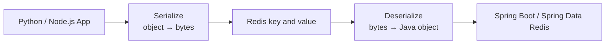
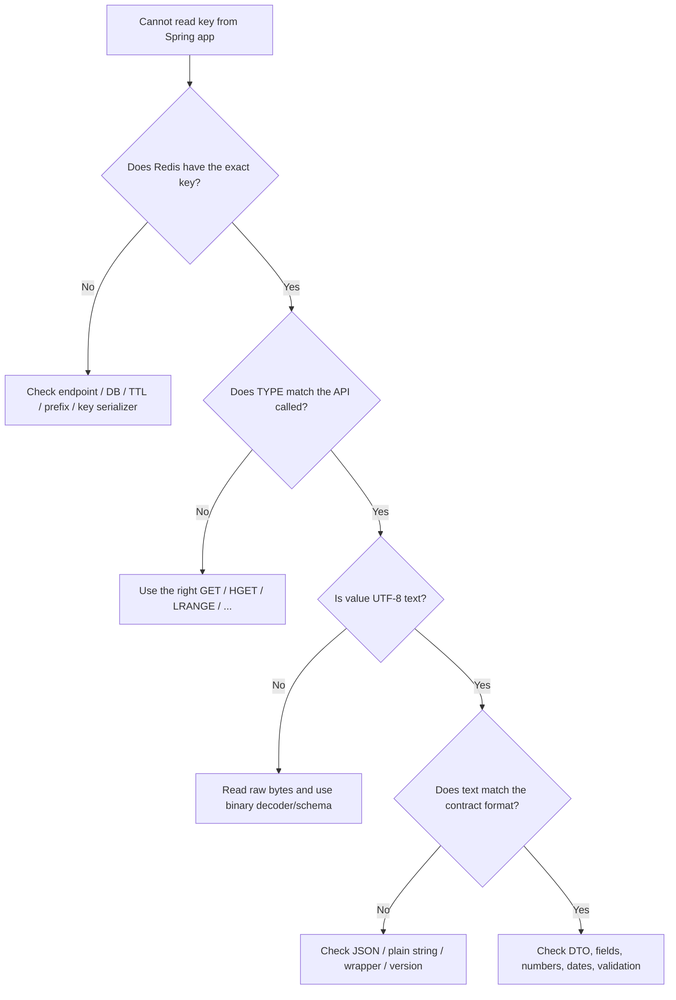

# Reading Redis Data Written by Other Applications or Languages

Redis is often shared across multiple services: a Python application writes session data, a Node.js service updates user profiles, while a Java/Spring Boot application needs to read and process that data. Living in the same Redis instance **does not mean** applications automatically understand each other. The challenge rarely lies in connectivity, but rather in **how data is serialized** before writing and how the reading application **deserializes** it.

In Spring Data Redis, two programs can both call `GET` yet get completely different outcomes: program A writes UTF-8 JSON, while program B uses the default Java serializer to decode it, causing an error; or program A writes a Redis Hash, while B tries `GET` and receives `WRONGTYPE`. To read data produced by another system, you must know the *key*, *Redis data type*, *byte format*, *schema*, and *versioning rules* of that data.

This lesson shows how to identify the stored format, choose compatible serializers in Spring Data Redis, read JSON/Hashes/bytes written by Python or Node.js, handle legacy data, and design stable cross-application data exchange contracts.

## 1. Redis Stores Data as Bytes, Not Java Object Types

When Java writes a `Customer` object, Redis does not know it is a Java class. Redis only knows the key, the data structure type (string, hash, list, set, sorted set, stream, etc.), and the byte contents or elements of that structure. **The meaning of bytes is an agreement between writer and reader.**



Consider three producers all storing a user's name under key `user:42`:

| Producer | Effective Redis Command | Bytes/Value Stored in Redis | Spring Must Read With |
| --- | --- | --- | --- |
| Python writing a string | `SET user:42 "Mai"` | UTF-8 of `Mai` | `StringRedisSerializer` |
| Node.js writing JSON | `SET user:42 '{"id":42,"name":"Mai"}'` | UTF-8 of JSON text | `StringRedisSerializer` then parse JSON, or a matching JSON serializer |
| Java using JDK serializer | `SET user:42 <binary>` | Java serialization binary stream | Compatible JDK serializer, in a trusted and controlled environment |

All three cases can be a **Redis String**, yet their decoding differs completely. The `string` type name in Redis does not guarantee the content is a UTF-8 string. It is a byte value that can hold plain text, JSON, Protobuf, an image, or arbitrary binary data.

### Where Are Serializers Used in Spring Data Redis?

`RedisTemplate` manages serializers for **four common positions**:

| Position | Property | Example |
| --- | --- | --- |
| Redis key | `keySerializer` | `profile:v1:42` |
| Redis String value | `valueSerializer` | JSON object in `GET profile:v1:42` |
| Redis Hash field | `hashKeySerializer` | `displayName` in `HGET profile:42 displayName` |
| Hash field value | `hashValueSerializer` | `Mai` in field `displayName` |

An application might configure keys as UTF-8 yet values as JSON; or keys and fields as UTF-8 while hash values are stored as binary bytes. If you only fix `valueSerializer` and forget `hashValueSerializer`, `GET` may work while `HGET` still decodes incorrectly.

`StringRedisTemplate` is a strong choice for cross-language text data: it uses `StringRedisSerializer` for keys, values, hash keys, and hash values. In Spring Boot with the Spring Data Redis starter, `StringRedisTemplate` is normally auto-configured when configuration conditions are met. Distinguish it from `RedisTemplate<Object, Object>` with default serializers: a traditional `RedisTemplate` default setup often relies on JDK serialization for unconfigured slots, which is unsuitable as a cross-language data-sharing protocol.

## 2. Inspect Existing Data Before Choosing How to Read It

Before writing Java code, align with the writer or inspect a few sample keys in an authorized environment. First questions to ask:

1. Are the key name and database/namespace exact? Is there a prefix from a cache library, environment, or tenant?
2. Which Redis type holds the data: String, Hash, List, Set, Sorted Set, or Stream?
3. Are keys/fields/values encoded as UTF-8, JSON, Protobuf, MessagePack, JDK serialization, or another format?
4. Is compression, encryption, a version header, or an outer envelope applied around the payload?
5. What is the expected schema: field names, data types, timezones, optional fields, units, and `null` rules?
6. Does the key have a TTL? Which party owns creating, refreshing, and deleting keys?

### Useful Redis CLI Commands

```redis
TYPE profile:v1:u-42
TTL profile:v1:u-42
GET profile:v1:u-42

TYPE account:42
HGETALL account:42
HGET account:42 balance

TYPE recent:orders:42
LRANGE recent:orders:42 0 9
```

- `TYPE` reports the Redis structure type, helping avoid mistakenly calling `GET` on a Hash.
- `TTL` returns remaining lifetime in seconds; `-1` means the key exists without expiry, `-2` means the key does not exist. `PTTL` is similar but in milliseconds.
- `GET` works on Redis Strings; `HGET` / `HGETALL` on Hashes; `LRANGE` on Lists. For large collections, bound how much data you read.
- `redis-cli --raw` is handy for viewing UTF-8 strings without some default escaping. However, **never** use the terminal as an arbitrary binary decoder: non-UTF-8 bytes may render garbled or emit control characters.

```bash
redis-cli --raw GET profile:v1:u-42
redis-cli TYPE profile:v1:u-42
```

**Note on `DUMP`:** this command produces Redis's internal serialization format for `RESTORE`/data migration; it is **not** a way to retrieve application-stored JSON or logical objects. Read the value through the matching command and decode with the application protocol's decoder.

Never run `KEYS *` in production just to probe data; doing so can scan the entire keyspace and hurt Redis latency. When pattern-based key lookup is unavoidable, use bounded `SCAN` while watching server load and access permissions.

## 3. Building a Cross-Language Serialization Contract

The most reliable way for applications in different languages to share Redis reads/writes is documenting the **wire format**: the exact bytes present in Redis and their semantics. A minimal contract can record:

| Contract Element | Agreed Example | Without Agreement |
| --- | --- | --- |
| Key naming | `profile:v1:{userId}`, with validated `userId` | Reading wrong keys or version/tenant collisions |
| Redis data type | `string` | `WRONGTYPE` when one side uses Hash and the other calls GET |
| Character encoding | UTF-8 | Decoding failures, corrupted Unicode characters |
| Value format | JSON object | One side expects JSON while the other writes binary/Java objects |
| Schema | `userId`, `displayName`, `balanceMinor`, `updatedAt` | Missing fields, type mismatches, mapping failures |
| Date/time | ISO-8601 UTC, e.g., `2026-11-12T08:30:00Z` | Wrong timezone, unparseable timestamps |
| Large integers | Decimal strings for IDs/amounts needing exact precision | JavaScript may lose precision on integers exceeding Number bounds |
| Monetary amounts | Integer minor units or contracted decimal strings | Wrong scale, lost fractional precision |
| Optional/null | Whether fields may be omitted or always present as `null` | Divergent business deserialization behavior |
| TTL | E.g., 900 seconds from write | One app reads stale data or keys vanish early |
| Versioning | `v1` in key or `schemaVersion` field | Schema changes break older consumers |
| Compression/encryption | None, or explicitly specified algorithm/header | Bytes returned by GET fail direct parsing |

### Choosing UTF-8 JSON When Payloads Are Moderate

For small or medium business payloads, UTF-8 JSON is usually an easy starting point because Python, JavaScript, Java, Go, and most other languages have JSON libraries. JSON suits payloads with clear schemas, though keep in mind:

- JSON numbers do not guarantee uniform large-number precision across languages. JavaScript `Number` preserves integers safely only up to `2^53 - 1`; for larger values, use **numeric strings** or an agreed exact-integer encoding.
- Money should not rely on standard floating-point if exact arithmetic is required; use contracted integer minor units or decimal strings.
- JSON has no built-in date/time type. Choose strings with offset/UTC, or epochs with explicitly documented units.
- Object key ordering must never carry business meaning. JSON fields may be emitted in any order while representing the same object.
- Unicode handling must agree on encoding, and when matching names/identifiers, agree on Unicode normalization as well.
- A writer API may emit new fields. Readers need a policy for ignoring or rejecting unknown fields depending on compatibility and security needs.

For large payloads, binary data, or strict schema constraints, you can use Protobuf/MessagePack/Avro; in that case, **schemas and decoders must be shared**, and bytes must never be treated like JSON.

## 4. Complete Example: Python Writes JSON, Spring Boot Reads It

Suppose a Python service stores a temporary profile in Redis under this contract:

```text
Key:          profile:v1:u-42
Redis type:   string
Encoding:     UTF-8
Payload:      JSON object
TTL:          900 seconds
Schema v1:    userId, displayName, balanceMinor, updatedAt
```

Expected JSON value:

```json
{
  "userId": "u-42",
  "displayName": "Nguyễn Mai",
  "balanceMinor": "12345678901234567890",
  "updatedAt": "2026-11-12T08:30:00Z"
}
```

`balanceMinor` is a decimal string to preserve exact large integers across languages. This example is illustrative; production business apps must clearly define currency units and valid value bounds.

### 4.1. Python Producer Using `redis-py`

```python
import json
import redis

client = redis.Redis(
    host="localhost",
    port=6379,
    db=0,
    decode_responses=False,
)

profile = {
    "userId": "u-42",
    "displayName": "Nguyễn Mai",
    "balanceMinor": "12345678901234567890",
    "updatedAt": "2026-11-12T08:30:00Z",
}

payload = json.dumps(
    profile,
    ensure_ascii=False,
    separators=(",", ":"),
).encode("utf-8")

client.set("profile:v1:u-42", payload, ex=900)
client.close()
```

Key points:

- `json.dumps(...)` produces **JSON text**, not Python pickle objects.
- `encode("utf-8")` converts text to bytes; Redis stores those exact bytes.
- `ensure_ascii=False` keeps Unicode characters as readable UTF-8 during inspection, though `ensure_ascii=True` also produces valid JSON if readers decode JSON properly.
- `ex=900` sets the TTL within the same `SET` operation, avoiding a window where the key is written without an expiry.
- `decode_responses=False` works well when controlling raw bytes; for text JSON data you can enable UTF-8 decode mode, yet never use that mode to read arbitrary binary payloads.

In Redis CLI, you can inspect:

```redis
TYPE profile:v1:u-42
# string

GET profile:v1:u-42
# {"userId":"u-42","displayName":"Nguyễn Mai",...}
```

### 4.2. Java Reading with `StringRedisTemplate` + Jackson

In a Spring Boot app with `spring-boot-starter-data-redis`, use `StringRedisTemplate` to fetch JSON text, then map it to a DTO using Jackson `ObjectMapper`.

DTO for schema v1:

```java
public record ProfileV1(
        String userId,
        String displayName,
        String balanceMinor,
        String updatedAt
) {}
```

Reader service:

```java
import com.fasterxml.jackson.core.JsonProcessingException;
import com.fasterxml.jackson.databind.ObjectMapper;
import java.math.BigInteger;
import java.time.Instant;
import java.time.format.DateTimeParseException;
import java.util.Optional;
import org.springframework.data.redis.core.StringRedisTemplate;
import org.springframework.stereotype.Service;

@Service
public class ExternalProfileReader {

    private final StringRedisTemplate redis;
    private final ObjectMapper objectMapper;

    public ExternalProfileReader(
            StringRedisTemplate redis,
            ObjectMapper objectMapper
    ) {
        this.redis = redis;
        this.objectMapper = objectMapper;
    }

    public Optional<ProfileV1> find(String userId) {
        String json = redis.opsForValue().get("profile:v1:" + userId);
        if (json == null) {
            return Optional.empty();
        }

        try {
            ProfileV1 profile = objectMapper.readValue(json, ProfileV1.class);

            if (profile.userId() == null || !userId.equals(profile.userId())) {
                throw new IllegalArgumentException("Profile userId mismatch");
            }
            if (profile.balanceMinor() == null || profile.updatedAt() == null) {
                throw new IllegalArgumentException("Required fields missing");
            }

            // Validate format before passing data into business logic.
            new BigInteger(profile.balanceMinor());
            Instant.parse(profile.updatedAt());

            return Optional.of(profile);
        } catch (JsonProcessingException
                 | DateTimeParseException
                 | NumberFormatException e) {
            throw new IllegalStateException(
                    "Invalid external Redis profile for user " + userId, e
            );
        }
    }
}
```

The application needs Jackson Databind and a matching `ObjectMapper` bean. In Spring Boot apps with Web or JSON starters, Jackson is usually present and configured; if a project only includes the Redis starter, ensure Jackson and `ObjectMapper` are declared/configured. For example:

```groovy
dependencies {
    implementation 'org.springframework.boot:spring-boot-starter-data-redis'
    implementation 'org.springframework.boot:spring-boot-starter-json'
}
```

If a project uses a Spring Boot version with a different JSON/mapper setup, check the corresponding dependencies and auto-configuration. The aim of this example is **reading UTF-8 JSON as a String and deserializing intentionally**, without depending on Java-specific type metadata inside Redis.

### Why Avoid Default `RedisTemplate<Object, Object>`?

A template with the default JDK serializer tries decoding JSON bytes via `ObjectInputStream`; the first byte is `{` instead of a valid Java serialization header, causing an exception. Even the key gets JDK-serialized, so `get("profile:v1:u-42")` actually sends a binary key **different** from the UTF-8 key Python wrote and returns `null`.

`StringRedisTemplate` eliminates both common causes in text JSON scenarios: both key and value are treated as UTF-8 strings, and Jackson handles the JSON schema explicitly.

### 4.3. Node.js Producer Following the Same Contract

Node.js can write the exact same Redis String structure:

```javascript
import { createClient } from "redis";

const client = createClient({ url: "redis://localhost:6379" });
await client.connect();

const profile = {
  userId: "u-43",
  displayName: "Lê An",
  balanceMinor: "9007199254740993",
  updatedAt: "2026-11-12T09:00:00Z",
};

await client.set(
  "profile:v1:u-43",
  JSON.stringify(profile),
  { EX: 900 }
);

await client.quit();
```

The Java service above can read `profile:v1:u-43` without knowing whether it came from Node.js or Python. The condition is that both producers honor **the same contract** for key naming, Redis type, UTF-8 JSON, schema, and TTL rules.

Never represent `9007199254740993` as a JavaScript `Number` before calling `JSON.stringify` if precision matters; that value exceeds JavaScript's safe integer limit. Use decimal strings (as shown) or a library/format with explicit precision guarantees.

## 5. Spring Boot Writes JSON for Python to Read Back

Two-way interoperability proves a protocol is truly language-independent. When Java writes via `StringRedisTemplate`, Python can `GET` and `json.loads` as follows.

Java:

```java
import com.fasterxml.jackson.core.JsonProcessingException;
import com.fasterxml.jackson.databind.ObjectMapper;
import java.time.Duration;
import org.springframework.data.redis.core.StringRedisTemplate;
import org.springframework.stereotype.Service;

@Service
public class ExternalProfileWriter {

    private final StringRedisTemplate redis;
    private final ObjectMapper objectMapper;

    public ExternalProfileWriter(StringRedisTemplate redis, ObjectMapper objectMapper) {
        this.redis = redis;
        this.objectMapper = objectMapper;
    }

    public void save(ProfileV1 profile) throws JsonProcessingException {
        String json = objectMapper.writeValueAsString(profile);
        redis.opsForValue().set(
                "profile:v1:" + profile.userId(),
                json,
                Duration.ofMinutes(15)
        );
    }
}
```

Python:

```python
import json
import redis

client = redis.Redis(host="localhost", port=6379, db=0)
raw = client.get("profile:v1:u-42")

if raw is None:
    print("Profile not found or expired")
else:
    profile = json.loads(raw.decode("utf-8"))
    print(profile["displayName"])
    print(int(profile["balanceMinor"]))

client.close()
```

Here, `raw is None` means the key did not exist at read time (never written, deleted, or TTL expired). `null` inside JSON is a schema value instead; never confuse the two. If a payload exists yet is invalid, the reader should surface a data error rather than silently treating it as a missing key.

## 6. Reading Redis Hashes Written by Other Applications

Not every application stores a JSON document inside one Redis String. Another design uses a **Redis Hash**, giving each field its own value:

```redis
HSET account:42 displayName "Nguyễn Mai" enabled "true" loginCount "17"
EXPIRE account:42 900
HGET account:42 displayName
HGETALL account:42
```

The contract here is:

- Redis key `account:42` has type `hash`.
- Hash fields `displayName`, `enabled`, and `loginCount` are UTF-8 strings.
- `enabled` is represented strictly as `"true"` or `"false"`.
- `loginCount` is a decimal integer string, not a JSON number or Java bytes.

### 6.1. Python Writing a Hash

```python
import redis

client = redis.Redis(host="localhost", port=6379, db=0)

with client.pipeline(transaction=True) as pipe:
    pipe.hset(
        "account:42",
        mapping={
            "displayName": "Nguyễn Mai",
            "enabled": "true",
            "loginCount": "17",
        },
    )
    pipe.expire("account:42", 900)
    pipe.execute()

client.close()
```

`hset` and `expire` inside a pipeline with `transaction=True` are grouped via `MULTI`/`EXEC`, executing the two updates together as a Redis transaction block. Do not confuse this with relational database transactions that roll back arbitrary application logic on failure.

### 6.2. Java Reading via HashOperations

```java
import java.util.Map;
import org.springframework.data.redis.core.StringRedisTemplate;
import org.springframework.stereotype.Service;

@Service
public class ExternalAccountReader {
    private final StringRedisTemplate redis;

    public ExternalAccountReader(StringRedisTemplate redis) {
        this.redis = redis;
    }

    public AccountSnapshot read(long accountId) {
        String key = "account:" + accountId;
        Map<Object, Object> fields = redis.opsForHash().entries(key);

        if (fields.isEmpty()) {
            throw new IllegalArgumentException("Account hash missing or empty");
        }

        String name = (String) fields.get("displayName");
        String enabledText = (String) fields.get("enabled");
        String loginCountText = (String) fields.get("loginCount");

        if (name == null
                || (!"true".equals(enabledText) && !"false".equals(enabledText))
                || loginCountText == null) {
            throw new IllegalStateException("Invalid account hash schema");
        }

        return new AccountSnapshot(
                accountId,
                name,
                Boolean.parseBoolean(enabledText),
                Long.parseLong(loginCountText)
        );
    }

    public record AccountSnapshot(
            long accountId,
            String displayName,
            boolean enabled,
            long loginCount
    ) {}
}
```

`StringRedisTemplate` decodes field names and field values as Strings. However, a Redis Hash **stores no per-field type metadata**: `"17"` does not become a Java `long` automatically; you must parse and validate bounds. Notably, `Boolean.parseBoolean("1")` returns `false`, so if a producer writes `1/0`, the consumer must use a parser matching that contract instead of a `true/false` parser.

If you only need one or a few fields from a large Hash, use:

```java
Object value = redis.opsForHash().get("account:42", "displayName");
```

instead of `entries(...)`, which reads the entire Hash. `HGETALL` scales in cost with the number of fields and builds huge responses if a Hash grows large.

### 6.3. Hashes Holding JSON Inside a Field

A system may write:

```redis
HSET document:42 metadata '{"version":1,"owner":"u-42"}'
```

Then `HGET document:42 metadata` returns **a string containing JSON**; parse the JSON after reading the field. Conversely, if the producer writes the entire document as a Redis String, use `GET`. Both contain "JSON data," yet the Redis type and read commands differ.

## 7. Reading Lists, Sets, Sorted Sets, and Streams from Other Systems

Beyond Redis Strings and Hashes, many systems exchange data via collections. Each structure has distinct read semantics and ordering:

| Redis Type | Writer Example | Typical Spring Data Redis Method | Details to Align On |
| --- | --- | --- | --- |
| List | `LPUSH events "..."` | `opsForList().range(key, 0, 49)` | Whether each element is text/JSON/binary; push/pop ordering |
| Set | `SADD tags "java" "redis"` | `opsForSet().isMember(...)` or `members(...)` | No stable ordering; member format |
| Sorted Set | `ZADD scores 98.5 "u-42"` | `opsForZSet().reverseRangeWithScores(...)` | Floating-point score, member encoding, tie-breaking order |
| Stream | `XADD audit * eventType login userId u-42` | `opsForStream()` | Field/value encoding, consumer groups, IDs, and acks |

Example of a List containing JSON strings written by Node.js:

```javascript
await client.rPush(
  "events:v1",
  JSON.stringify({ type: "LOGIN", userId: "u-42" }),
  JSON.stringify({ type: "LOGOUT", userId: "u-41" })
);
```

Spring Data Redis reading it:

```java
List<String> rawEvents =
        stringRedisTemplate.opsForList().range("events:v1", 0, 49);
// Each element is JSON text; parse each element per the agreed schema.
```

Never call a single command that returns an entire collection if it can grow unbounded. A `Set` is not a list suitable for stable order-based pagination; `Sorted Set` orders by score with tie-breaking rules worth understanding; Streams require consumer-group, acknowledgment, and duplicate-message contracts beyond mere serialization.

If Stream fields/values use a different serializer than Hash fields/values, configure a dedicated `RedisTemplate` or serializer accordingly; do not assume one serializer configuration fits every Redis structure.

## 8. When Payloads Are Binary: Protobuf, MessagePack, or Compressed Data

Some producers optimize size, parsing speed, or schema enforcement using binary formats such as Protobuf or MessagePack. Those payloads **are not JSON text**, so calling `StringRedisTemplate.opsForValue().get(...)` can trigger UTF-8 errors or corrupt bytes before decoding.

With Spring Data Redis, create a `RedisTemplate<String, byte[]>` dedicated to reading raw bytes untouched:

```java
import org.springframework.context.annotation.Bean;
import org.springframework.context.annotation.Configuration;
import org.springframework.data.redis.connection.RedisConnectionFactory;
import org.springframework.data.redis.core.RedisTemplate;
import org.springframework.data.redis.serializer.RedisSerializer;
import org.springframework.data.redis.serializer.StringRedisSerializer;

@Configuration
public class BinaryRedisConfig {

    @Bean("binaryRedisTemplate")
    RedisTemplate<String, byte[]> binaryRedisTemplate(
            RedisConnectionFactory factory
    ) {
        RedisTemplate<String, byte[]> template = new RedisTemplate<>();
        template.setConnectionFactory(factory);

        template.setKeySerializer(new StringRedisSerializer());
        template.setHashKeySerializer(new StringRedisSerializer());
        template.setValueSerializer(RedisSerializer.byteArray());
        template.setHashValueSerializer(RedisSerializer.byteArray());

        template.afterPropertiesSet();
        return template;
    }
}
```

Read bytes and hand them to the corresponding decoder:

```java
import org.springframework.beans.factory.annotation.Qualifier;
import org.springframework.data.redis.core.RedisTemplate;
import org.springframework.stereotype.Service;

@Service
public class BinaryDocumentReader {
    private final RedisTemplate<String, byte[]> redis;

    public BinaryDocumentReader(
            @Qualifier("binaryRedisTemplate") RedisTemplate<String, byte[]> redis
    ) {
        this.redis = redis;
    }

    public byte[] readRaw(String id) {
        return redis.opsForValue().get("document:pb:v1:" + id);
    }
}
```

Next, the application must use the exact library and schema published by the producer, such as a Protobuf class generated from the shared `.proto` file:

```java
byte[] raw = binaryDocumentReader.readRaw("42");
if (raw != null) {
    // DocumentV1 is a class generated by protoc from the shared schema.
    DocumentV1 parsed = DocumentV1.parseFrom(raw);
}
```

`DocumentV1` in this example is a hypothetical generated class name; this snippet alone will not compile unless the project adds the Protobuf dependency and generates the class. For compressed or encrypted payloads, decompress/decrypt using the **agreed algorithms and operation order** before parsing Protobuf/MessagePack. Never guess formats solely from the first few bytes.

**Why does key config still use the String serializer?** Because the producer wrote UTF-8 keys (`document:pb:v1:42`). If Java serialized keys using Java native serialization while keeping values as raw bytes, `GET` would look up a different binary key and return `null`.

## 9. JDK Serialization Data or Java-Specific Serializers

A common situation in legacy systems is Java writing via `RedisTemplate<Object, Object>` with `JdkSerializationRedisSerializer`. Payloads may start with the characteristic Java Object Serialization stream header: `AC ED 00 05` (hexadecimal). Python, Node.js, and other consumers **cannot automatically turn this payload into JSON** simply by reading the Redis String.

When encountering such data, options are:

1. Identify the producer and exact serializer, including serializers for keys/hash fields.
2. If temporary reads from Java are still required, decode data only in trusted environments, with compatible class versions and safe deserialization policies.
3. Design a neutral exchange format (such as UTF-8 JSON or a shared Protobuf schema) and gradually migrate data to new keys/schemas.

**Never deserialize Java objects or Python pickles from untrusted data.** Both serialization mechanisms tie into complex object construction flows and pose severe security risks when accepting payloads controlled by untrusted parties. Keep native deserialization mechanisms out of open cross-language exchange channels.

### Is a Jackson Serializer Guaranteed Compatible Between Java and Python?

Simply using "Jackson" does not ensure every language can read the payload at the business level. Distinguish between:

- **Plain JSON:** `{"userId":"u-42","displayName":"Mai"}`. Other languages can parse JSON and map it per schema.
- **JSON with Java type info:** some generic serializers (such as Generic Jackson configurations with type metadata) may write extra fields like `@class` or type hints. Python/Node can parse the JSON syntactically, yet do not understand Java class names or Java polymorphic consumer expectations.
- **JDK binary serialization:** not JSON at all.

For Redis shared across multiple languages, dedicate a clean serializer/schema for interoperable keys. Keep Java class names out of wire contracts unless explicitly accepted by all consumers.

If configuring Jackson polymorphic deserialization yourself, never allow arbitrary types from payloads outside trusted boundaries. Prefer concrete DTOs and allowlists of permitted types.

## 10. Schema Evolution: Producers and Consumers Do Not Upgrade Simultaneously

Issues emerge over time in operations: Python starts writing a new field, Node.js changes a numeric type, while some Spring Boot instances still run an older release. Redis does not enforce schemas, so a record valid for a new producer can break an old consumer.

### 10.1. Versioning by Key and Schema

A straightforward approach is putting the version in the key name:

```text
profile:v1:u-42  -> JSON schema v1
profile:v2:u-42  -> JSON schema v2
```

Or keep the key identifier and place `schemaVersion` inside the payload if all consumers already route decoding by version. For breaking changes, **versioned keys** prevent a new producer from overwriting formats an older consumer still expects. Still, design key cleanup and synchronization rules across versions.

Example of a compatible change:

```json
{
  "userId": "u-42",
  "displayName": "Mai",
  "balanceMinor": "1000",
  "updatedAt": "2026-11-12T08:30:00Z",
  "locale": "vi-VN"
}
```

Adding `locale` can be compatible if old consumers **ignore unknown fields**. With Jackson, default behavior on unknown properties depends on `ObjectMapper` settings: decide explicitly whether to add `@JsonIgnoreProperties(ignoreUnknown = true)` on DTOs or equivalent configuration. If strict contract validation is desired, rejecting unknown fields may also be reasonable; no single policy fits every system.

Example of an **incompatible** change: switching `balanceMinor` from a decimal string to a floating-point number, or changing `updatedAt` from ISO-8601 to epoch milliseconds without bumping the version. Those changes can parse incorrectly or corrupt business logic even when JSON remains syntactically valid.

### 10.2. Legacy Data Migration Roadmap

Suppose a legacy system stores `profile:v1:{id}` using JDK serialization and needs to move to UTF-8 JSON:

1. **Lock the v2 contract:** specify new key prefix, Redis type, encoding, schema, and TTL.
2. **Deploy v2-capable consumers:** prefer reading v2; fall back to v1 via the old decoder *only within trusted data boundaries*.
3. **Update producers:** write v2; if transitional compatibility is needed, dual-write v1/v2 with failure-handling plans per side.
4. **Batched backfill:** migrate remaining needed v1 keys using controlled `SCAN` without loading the entire keyspace into memory.
5. **Preserve lifecycles:** avoid accidentally turning soon-to-expire keys into permanent ones. When copying, account for remaining TTL and expiration policies.
6. **Observe and retire the old path:** monitor v1/v2 read ratios, decode errors, and app rollout progress; remove the old decoder and v1 keys only after dependencies reach zero.

Dual-writing does not guarantee atomicity across two keys when using separate commands. If strict consistency is required, design commit/read policies or suitable write patterns and handle partial failures between the two writes.

## 11. Security and Reliability When Reading Data from Other Producers

Data inside Redis must be treated as **application input**, even when producers live on an internal network. Practical safeguards:

- **Authenticate write sources:** Redis ACLs, network access controls, and scoped key prefixes reduce the chance of one service overwriting another's data. Redis ACLs support key patterns; align them with your actual deployment.
- **Bound payload sizes:** never deserialize unbounded huge JSON/binary blobs, especially on HTTP request paths. Check byte limits before parsing if payloads could be abused.
- **Validate schemas and values:** verify required fields, enums, numeric ranges, identifiers, timestamps, and tenant/owner fields. Syntactically valid JSON is not automatically business-valid.
- **Do not log secrets:** avoid dumping full payloads containing tokens/sessions/PII into logs or exceptions. Log normalized keys, error categories, versions, and correlation IDs where sufficient.
- **Control encodings and decoders:** never randomly fall back from JSON to Java native deserialization on error, as that masks corrupted data and creates security risks.
- **Define idempotency:** if data is read and processed by multiple consumers, enforce business-level deduplication; serializers do not provide processing idempotency.
- **Distinguish caches from sources of truth:** TTLs can make keys vanish at any moment. If business data must persist permanently, keep a durable store and appropriate fallback rules.

When inspecting a specific value with Redis CLI or admin tools, use authorized environments and permissions. Commands like `MONITOR` can expose commands/payloads and create heavy load; it is not a default tool for inspecting production data.

## 12. Diagnosing Common Interoperability Failures

| Symptom When Spring Data Redis Reads | Possible Cause | How to Investigate |
| --- | --- | --- |
| `GET` returns `null` yet producer insists it wrote | Wrong key prefix, database, Redis endpoint, key serializer; or TTL expired | Compare key names as raw bytes/UTF-8, database, endpoint, and `TTL` |
| `WRONGTYPE Operation against a key holding the wrong kind of value` | Producer wrote Hash/List/Set while consumer called GET, or vice versa | Run `TYPE key` and switch to the matching API |
| Corrupted diacritics or UTF-8 decoding failure | Producer wrote non-UTF-8 encoding or value is binary | Identify actual format; read raw bytes instead of forcing string conversion |
| `SerializationException` / stream header error | Java tried decoding JSON with JDK serializer, or binary data mismatched serializer | Inspect `keySerializer` and `valueSerializer`, view leading payload bytes in a safe binary tool |
| JSON parse fails at the first character | Payload is not JSON, has compression header, BOM, envelope, or double-encoding | Inspect raw value and writer's protocol |
| Java maps JSON yet fields become `null` | Wrong field name, casing mismatch, missing field, or mismatched DTO | Compare schema against payload and Jackson settings |
| Wrong/rounded parsed numbers | Producer used floating-point or JavaScript Number for large integers | Use decimal strings or exact-integer schemas |
| Timestamps off by hours | Writer and reader assume different timezones or epoch seconds vs. milliseconds | Standardize on ISO-8601 with offset or epoch with explicit units |
| Reading Hash field yields unreadable binary | `hashValueSerializer` differs from producer's format | Check all four serializers of `RedisTemplate` |
| Reads worked yesterday, fail today | Schema changed without versioning, or multiple producers write different formats to same key | Check ownership, versioning, and rollout timeline |
| Reads succeed intermittently | TTL expiry, delete/write race conditions, hitting wrong node/DB, or incomplete multi-step writes | Check TTL, write timestamps, and atomicity of write workflows |

### Ordered Diagnostic Flow



These questions separate **Redis access errors**, **serializer selection errors**, and **business schema errors**. Increasing timeouts or retries will never fix data written in an incompatible format.

## 13. Choosing the Data Reading Model in Spring Data Redis

| Format Written by Producer | Recommended Spring Reading Approach | Conditions |
| --- | --- | --- |
| Redis String holding UTF-8 text | `StringRedisTemplate.opsForValue().get(key)` | Key names use UTF-8, values are genuinely text |
| Redis String holding UTF-8 JSON | `StringRedisTemplate` + `ObjectMapper.readValue` into DTO | JSON schema is agreed upon |
| Redis Hash with UTF-8 fields/values | `StringRedisTemplate.opsForHash()` | All fields/values are text-represented |
| Redis List with JSON elements | `StringRedisTemplate.opsForList().range` + parse each element | Bounded read count; known push/pop ordering |
| Binary Redis String/Hash values | `RedisTemplate<String, byte[]>` with UTF-8 key serializer and raw byte value serializer | Matching binary decoder/schema available |
| Redis String written by Java JDK serialization | Controlled Java decoder during transition window | Only on trusted data with matching class/version; prioritize moving to a neutral format |
| JSON with Java-specific type metadata | Read under explicit metadata agreement or migrate to neutral JSON DTOs | Never accept arbitrary classes from untrusted producers |

Do not build a "one-size-fits-all" `RedisTemplate` that tries multiple decoders for every key. A much clearer approach is **separating namespaces by contract** and naming templates/services by format: for example, `ProfileJsonRepository` owns only `profile:v1:*`, while `BinaryDocumentRepository` owns `document:pb:v1:*`.

## 14. Practice Exercises

### Exercise 1 — Identifying Why a Key Cannot Be Read

Python writes:

```python
client.set("product:7", '{"id":7,"name":"Book"}')
```

Java uses `RedisTemplate<Object, Object>` with default serializers and calls `opsForValue().get("product:7")`, failing to read properly. Name **two serializer positions** to inspect before altering any data in Redis.

*Hint:* the key serializer determines the bytes of the key name, while the value serializer determines how the content is decoded.

### Exercise 2 — Hash vs. JSON

Node.js writes:

```redis
HSET session:abc userId "u-42" expiresAt "2026-11-12T09:00:00Z"
```

Why is `StringRedisTemplate.opsForValue().get("session:abc")` the wrong way to read it? Choose the Hash operation to fetch only `userId`.

*Hint:* `TYPE` is `hash`; you can use `opsForHash().get("session:abc", "userId")`.

### Exercise 3 — Large Integers

A Node.js producer writes JSON:

```javascript
JSON.stringify({ invoiceId: 9007199254740993 })
```

Why can the received ID lose accuracy before even reaching Java? Propose an alternative representation that preserves the exact value.

*Hint:* JavaScript `Number` and its safe integer threshold.

### Exercise 4 — Schema Change

Producer v2 changes `updatedAt` from `"2026-11-12T08:30:00Z"` to `1762936200000` without bumping the key version. Some Spring Boot consumers still parse timestamps with `Instant.parse`. Predict the failure and propose a rollout order to prevent old consumers from misreading.

*Hint:* versioned namespaces, v2-capable readers, time-bounded dual-read, and switching the producer only once consumers are ready.

### Exercise 5 — Binary Payload

Redis `TYPE report:42` returns `string`, yet `GET` prints many unreadable characters. Why can't you conclude the payload is "corrupted text"? How do you preserve raw bytes from Redis before trying a Protobuf parser?

*Hint:* Redis Strings are byte sequences; use a template with a raw bytes value serializer and the matching binary decoder.

## 15. Takeaways

For Spring Data Redis to read data written by other applications or languages, agree on **key encoding, Redis data type, value encoding, schema, versioning, and TTL**. The simplest option for ordinary business data is **UTF-8 JSON**: external applications write JSON into Redis Strings, and Spring reads with `StringRedisTemplate` and maps to DTOs via Jackson. For Redis Hashes, fields/values can be strings parsed per schema; for Protobuf/MessagePack or compressed payloads, read **raw bytes** and pass them to the corresponding decoder.

Avoid using JDK native serialization or Java-specific type metadata as the default exchange protocol across services. When dealing with legacy data, identify the exact serializer first, establish a clear versioning contract, and migrate in a controlled way. Seeing a key in Redis CLI is never enough to prove two applications understand the same object: **compatibility lives in the bytes the producer writes and how the consumer interprets them**.
